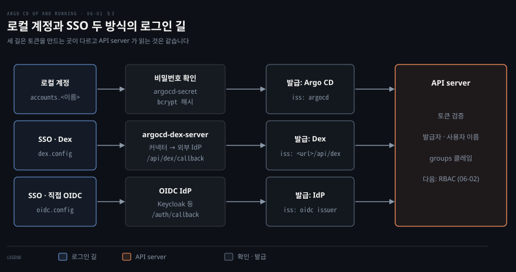

# Argo CD 사용자와 인증 — admin·로컬 사용자·토큰과 SSO
---

## 핵심 요약

> Argo CD 는 요청에 실린 토큰의 발급자와 사용자 이름과 그룹을 보고 누구인지 정하고, 그 토큰은 `argocd-cm` 에 정의한 로컬 계정이 로그인할 때나 외부 IdP 가 사용자를 보증할 때 만들어집니다.

admin 과 로컬 사용자는 `argocd-cm` 의 `admin.enabled` 와 `accounts.<이름>` 키로 정의하고, 비밀번호 해시와 발급한 토큰의 목록(id·발급·만료 시각)은 `argocd-secret` 에 저장합니다. `apiKey` 능력이 있는 계정은 만료 시간과 id 를 붙인 토큰을 발급해 자동화 도구에 건넬 수 있습니다. 사용자가 늘어나면 `dex.config` 나 `oidc.config` 로 SSO 를 켜는데, 어느 쪽이든 `url` 과 콜백 주소와 그룹 클레임을 먼저 준비해야 합니다.[^ver]


## 학습 목표

이 내용을 읽고 나면:

1. admin 의 초기 비밀번호가 저장된 곳과 바꿔야 하는 이유, 바꾼 뒤에 할 일을 설명할 수 있습니다.
2. 로컬 사용자를 `argocd-cm` 에 정의하고 비밀번호를 CLI 와 `argocd-secret` 두 방법으로 정한 뒤 비활성화할 수 있습니다.
3. 인증 토큰을 만료 시간과 함께 발급하고 목록 확인과 폐기까지 할 수 있습니다.
4. Dex 와 직접 OIDC 를 켜는 ConfigMap 키와 선택 기준을 말할 수 있습니다.
5. SSO 를 켜기 전에 준비할 `url`, 콜백 주소, 그룹 클레임, 클라이언트 비밀 참조 형식을 설명할 수 있습니다.


## 1. admin 초기 계정과 로컬 사용자

> admin 은 초기 설정에만 쓰고, 이후에는 `argocd-cm` 에 정의한 로컬 사용자로 옮깁니다.

Argo CD 는 계정의 이름과 능력을 `argocd-cm` 에, 비밀번호 해시를 `argocd-secret` 에 나누어 저장합니다. 그래서 계정을 만드는 일과 비밀번호를 정하는 일은 서로 다른 오브젝트를 고치는 두 단계입니다.

### admin 초기 비밀번호 교체

설치 직후에 쓸 수 있는 계정은 `admin` 하나이고 이 계정은 모든 기능에 제한 없이 접근합니다. 공식 문서는 admin 을 초기 설정에만 쓰고 이후에는 로컬 사용자나 SSO 로 옮기라고 권합니다.[^admin] 초기 비밀번호는 같은 네임스페이스의 `argocd-initial-admin-secret` Secret 에 들어 있습니다.

```bash
kubectl -n argocd get secret argocd-initial-admin-secret \
  -o jsonpath="{.data.password}" | base64 -d
```

이 Secret 의 값은 base64 로 인코딩되었을 뿐 암호화되지 않았기 때문에, `argocd` 네임스페이스의 Secret 을 읽을 수 있는 사람은 누구나 admin 으로 로그인할 수 있습니다. 그래서 첫 로그인 직후 `argocd account update-password` 로 비밀번호를 바꾸고 초기 Secret 을 지웁니다. Secret 의 성질은 [컨테이너에 시크릿 전달하기](../container-security/12-01.컨테이너에%20시크릿%20전달하기%20—%20다섯%20경로와%20root라는%20천장.md)의 「Kubernetes 기본 시크릿」 절에서 다룹니다.

```bash
argocd login <argocd-host> --insecure --grpc-web \
  --username admin --password '<initial-password>'
argocd account update-password --account admin \
  --current-password '<initial-password>' --new-password '<new-password>'
kubectl delete secret argocd-initial-admin-secret -n argocd
argocd account get-user-info
```

`argocd account get-user-info` 는 `Logged In: true` 와 `Username: admin` 과 `Issuer: argocd` 를 보여 줍니다. 출력의 `Issuer` 가 `argocd` 인 것은 토큰을 Argo CD 자신이 발급했다는 뜻이고, 뒤에서 보는 SSO 사용자는 이 자리에 다른 발급자가 나옵니다.

### 로컬 사용자 정의와 비밀번호

로컬 사용자는 두 가지 쓸모가 있습니다. 하나는 CI/CD 같은 도구가 쓸 인증 토큰을 만드는 것이고, 다른 하나는 SSO 를 붙이기에는 작은 팀에게 계정을 따로 주는 것입니다. 로컬 사용자에게는 그룹이나 로그인 이력 같은 기능이 없어서 그런 기능이 필요하면 SSO 를 쓰라고 문서가 안내합니다.[^local]

로컬 사용자는 `argocd-cm` 에 `accounts.<이름>` 키를 넣어 정의하고 값으로 능력을 적습니다. 능력은 두 가지뿐입니다. `login` 은 UI 와 CLI 로 로그인하는 능력이고 `apiKey` 는 API 용 인증 토큰을 만드는 능력입니다.

```bash
kubectl patch -n argocd cm argocd-cm --type='merge' \
  -p='{"data": {"accounts.alice": "apiKey, login"}}'
argocd account list
```

```bash
NAME     ENABLED  CAPABILITIES
admin    true     login
alice    true     apiKey, login
```

사람이 쓰는 계정에는 보통 `login` 만 있으면 충분합니다. 계정을 정의하는 것만으로는 로그인할 수 없는데, 비밀번호가 아직 없기 때문입니다. 비밀번호를 정하는 길은 둘입니다. CLI 로 정할 때는 `argocd account update-password` 를 씁니다. admin 이 다른 계정의 비밀번호를 바꿀 때 `--current-password` 에 넣는 값은 그 계정이 아니라 지금 로그인한 admin 의 비밀번호입니다.[^pw]

```bash
argocd account update-password --account alice \
  --current-password '<admin-password>' --new-password '<alice-password>'
```

선언적으로 정할 때는 `argocd account bcrypt` 로 해시를 만들어 `argocd-secret` 의 `accounts.<이름>.password` 키에 넣습니다. 값은 평문이 아니라 bcrypt 해시여야 합니다. 마지막으로 바꾼 시각은 `accounts.<이름>.passwordMtime` 키에 함께 적습니다.

```bash
argocd account bcrypt --password '<alice-password>'
kubectl -n argocd patch secret argocd-secret -p \
  '{"stringData": {"accounts.alice.password": "<bcrypt-hash>",
    "accounts.alice.passwordMtime": "'$(date -u +"%Y-%m-%dT%H:%M:%SZ")'"}}'
```

### 계정 비활성화와 삭제

계정을 잠시 막으려면 `accounts.alice.enabled` 를 `"false"` 로 둡니다. 기본값은 활성이므로 키를 지우면 계정이 다시 열립니다. admin 도 `admin.enabled: "false"` 로 끌 수 있습니다.[^cm]

```bash
kubectl patch -n argocd cm argocd-cm --type='merge' \
  -p='{"data": {"accounts.alice.enabled": "false"}}'
kubectl patch -n argocd cm argocd-cm --type=json \
  -p='[{"op": "remove", "path": "/data/accounts.alice.enabled"}]'
kubectl patch -n argocd cm argocd-cm --type='merge' \
  -p='{"data": {"admin.enabled": "false"}}'
```

admin 을 끄는 시점은 다른 계정이 필요한 권한을 얻은 뒤여야 합니다. 로그인에 성공하는 것과 무엇을 할 수 있는지는 별개이기 때문입니다. `policy.default` 가 비어 있는 새 설치에서 `alice` 로 로그인하면 `app list` 와 `cluster list` 와 `repo list` 는 오류 없이 빈 표를 보여 줍니다. 반면 `app get` 이나 `cert list` 는 `PermissionDenied` 로 끝납니다. 권한을 주는 방법은 [06-02](./06-02.SSO%20연결과%20RBAC%20—%20Dex·직접%20OIDC·역할과%20정책.md)의 RBAC 절에서 다룹니다.

계정을 완전히 없애려면 `argocd-cm` 의 `accounts.<이름>` 키를 지웁니다. `argocd-secret` 에 남은 `accounts.<이름>.password` 도 함께 지우는 것이 권장됩니다.


## 2. CI 용 인증 토큰 발급과 폐기

> 토큰은 `apiKey` 능력이 있는 계정만 만들 수 있고, 만료 시간을 붙여 발급해 필요 없어지면 폐기합니다.

`apiKey` 능력이 있는 계정만 인증 토큰을 만들 수 있고, 토큰은 그 계정에 묶인 JWT(JSON Web Token)이므로 토큰으로 할 수 있는 일은 계정의 권한이 정합니다.

자동화용 계정은 사람이 로그인할 일이 없으니 `login` 없이 `apiKey` 만 줍니다. 계정을 만든 뒤 `argocd account generate-token` 으로 토큰을 발급하고, `--account` 를 생략하면 지금 로그인한 계정의 토큰이 나옵니다.

```bash
kubectl patch -n argocd cm argocd-cm --type='merge' \
  -p='{"data": {"accounts.automation": "apiKey"}}'
argocd account generate-token --account automation --expires-in 90d --id ci-bot
```

`--expires-in` 을 주지 않으면 토큰은 만료되지 않습니다. 공식 문서는 이 경우를 경고로 적고, 짧게 사는 토큰을 CI 시스템에서 주기적으로 갈아 끼우라고 권합니다.[^tok] `--id` 는 토큰에 붙이는 이름이고 생략하면 UUID 가 붙습니다. 발급된 토큰은 사용할 도구에 두 가지 방법으로 전달합니다. 명령마다 `--auth-token` 옵션을 쓰거나, `ARGOCD_AUTH_TOKEN` 환경 변수에 한 번 정해 둡니다. 두 방법 모두 이전에 로그인한 사용자보다 우선합니다.

```bash
export ARGOCD_AUTH_TOKEN='<token>'
argocd account get-user-info
```

```bash
Logged In: true
Username: automation
Issuer: argocd
Groups:
```

토큰을 JWT 로 풀어 보면 `iss` 는 `argocd`, `sub` 는 `automation:apiKey`, `jti` 는 `--id` 로 준 값입니다. 다만 권한을 따질 때 주체로 쓰이는 이름은 `:apiKey` 가 빠진 `automation` 입니다. 권한이 없을 때의 오류 메시지에 `sub: automation` 이 들어 있는 것으로 확인할 수 있습니다.

토큰의 목록은 `argocd account get` 이 보여 줍니다. 만료 시각이 `never` 인 토큰이 있으면 한눈에 드러납니다.

```bash
argocd account get --account automation
```

```bash
Name:               automation
Enabled:            true
Capabilities:       apiKey

Tokens:
ID       ISSUED AT                  EXPIRING AT
ci-bot   2026-11-06T15:12:35+09:00  2027-02-04T15:12:35+09:00
```

토큰은 새어 나갔거나 쓰던 사람이 팀을 떠났을 때 만료를 기다리지 않고 폐기합니다. `argocd account delete-token --account <계정> <ID>` 가 그 명령이고, 폐기한 토큰으로 `get-user-info` 를 부르면 `Logged In: false` 가 나옵니다. 토큰 목록은 `argocd-secret` 의 `accounts.<계정>.tokens` 키에 저장되며 손으로 고칠 수도 있지만 CLI 가 훨씬 안전합니다.

```bash
argocd account delete-token --account automation ci-bot
```


## 3. SSO — Dex 와 직접 OIDC 준비물

> SSO 는 Dex 와 직접 OIDC 두 방식이 있고, 켜기 전에 `url`·콜백 주소·그룹 클레임·비밀 참조를 준비합니다.

SSO 는 인증을 외부 시스템에 맡기는 방식입니다. Argo CD 는 그 시스템이 보증한 토큰의 사용자 이름과 그룹만 받아 쓰므로, 계정 목록은 로컬 사용자와 달리 Argo CD 밖에 있습니다.

### Dex 와 직접 OIDC 선택

SSO 에는 두 방식이 있고 둘 다 OIDC(OpenID Connect) 프로토콜을 씁니다.[^sso] 첫째는 Argo CD 에 번들된 Dex 입니다.

Dex 는 별도의 파드(`argocd-dex-server`)로 돌며 외부 시스템을 커넥터로 연결합니다. 커넥터는 GitHub, GitLab, Google, Microsoft, LDAP 같은 시스템의 사용자 정보를 Argo CD 가 이해하는 표준 형식으로 바꾸고, 여러 개를 함께 둘 수 있습니다.

둘째는 직접 OIDC 입니다. 사용자 관리 도구가 이미 OIDC 를 제공하면 Argo CD 가 인증 전체를 그 도구에 맡기고 Dex 를 거치지 않습니다. Keycloak, Okta, Google 이 그런 도구의 예입니다. 두 방식은 `argocd-cm` 의 서로 다른 키로 켭니다.

| 방식 | 켜는 키 | 쓰는 경우 |
|------|---------|----------|
| Dex | `dex.config` | IdP 가 OIDC 를 직접 지원하지 않거나(SAML, LDAP) Dex 커넥터의 기능이 필요할 때 |
| 직접 OIDC | `oidc.config` | 이미 OIDC IdP 를 쓰고 있어 Dex 를 거칠 이유가 없을 때 |

발급자는 `oidc.config` 가 있으면 그 `issuer` 이고, `oidc.config` 가 없고 `dex.config` 가 있을 때만 `<url>/api/dex` 입니다. 그래서 두 키가 함께 있으면 `oidc.config` 가 앞섭니다.[^issuer] SSO 로 로그인한 사용자의 `get-user-info` 는 `Issuer` 에 로컬 계정의 `argocd` 대신 이 주소를 보여 줍니다.

### SSO 켜기 전 준비물 넷

방식과 상관없이 SSO 를 켜기 전에 준비할 것이 네 가지 있습니다.

첫째는 `argocd-cm` 의 `url` 입니다. Argo CD 의 외부 접속 주소이며, 소스는 `url` 이 비어 있으면 Dex 를 설정되지 않은 것으로 취급합니다.[^url]

둘째는 IdP 에 등록할 콜백 주소입니다. 인증이 끝나면 IdP 가 사용자를 되돌려 보내는 주소이고 방식마다 경로가 다릅니다. Dex 는 `/api/dex/callback`, 직접 OIDC 는 `/auth/callback` 입니다. 두 방식을 모두 시험할 계획이면 클라이언트에 두 주소를 다 등록합니다.

직접 OIDC 로 CLI SSO 를 쓸 계획이면 `http://localhost:8085/auth/callback` 도 등록합니다. 8085 는 `argocd login --sso` 의 `--sso-port` 기본값입니다. Dex 를 거칠 때는 Dex 의 내장 CLI 클라이언트(`argo-cd-cli`)가 이 콜백을 받으므로 IdP 에는 `/api/dex/callback` 만 있으면 됩니다.[^kc]

셋째는 그룹 클레임입니다. RBAC 이 사용자를 그룹으로 묶으려면 토큰에 `groups` 클레임이 들어 있어야 합니다. Keycloak 에서는 `groups` 라는 클라이언트 범위를 만들고 Group Membership 매퍼를 붙여 토큰 클레임 이름을 `groups` 로 정하며 Full group path 는 끕니다. 그 범위를 클라이언트에 Default 로 붙이면 요청하지 않아도 항상 토큰에 실립니다. Optional 로 붙였다면 Argo CD 가 그 범위를 요청해야 합니다.

직접 OIDC 는 `requestedScopes` 를 생략하면 `groups` 를 기본으로 요청합니다. 목록을 직접 적었다면 거기에 `groups` 를 넣어야 합니다. Dex 는 커넥터의 `scopes` 에 `groups` 를 넣습니다.[^grp]

넷째는 클라이언트 비밀의 참조입니다. `clientSecret` 같은 민감한 값을 ConfigMap 에 평문으로 적지 않고 Secret 에 두고 `$` 로 시작하는 값으로 가리킵니다. 값이 `$<secret>:<key>` 형태이면 이름이 `<secret>` 인 Secret 의 `<key>` 를 읽고, 콜론이 없는 `$<key>` 이면 `argocd-secret` 의 키를 읽습니다. 별도 Secret 을 쓸 때는 `app.kubernetes.io/part-of: argocd` 레이블이 반드시 있어야 합니다.[^ref]

```bash
kubectl create secret generic -n argocd keycloak-secret \
  --from-literal=clientSecret='<client-secret>'
kubectl label secret -n argocd keycloak-secret app.kubernetes.io/part-of=argocd
kubectl patch -n argocd cm argocd-cm --type='merge' \
  -p '{"data":{"url":"https://<argocd-host>"}}'
```

이 설정이면 `clientSecret: $keycloak-secret:clientSecret` 으로 비밀을 가리킬 수 있습니다. Keycloak 클라이언트에서는 Client authentication 을 켜서 비밀이 발급되게 하고, Argo CD 주소를 Root URL 과 Web origins 에 넣습니다. kind 에서 Keycloak 을 호스트 이름으로 띄우는 실습이라면 Argo CD 파드도 그 이름을 풀 수 있어야 합니다. 그래서 CoreDNS 에 해당 도메인을 Ingress 컨트롤러 Service 로 돌리는 rewrite 규칙을 넣습니다.




## 연습 문제

> 아래 여섯 문제는 admin 과 로컬 사용자와 토큰과 SSO 준비물을 하나씩 묻습니다. 답을 적은 뒤에 정답 절을 펼칩니다.

1. 새로 설치한 Argo CD 의 admin 비밀번호는 어디에 저장되고 왜 바꿔야 합니까? 바꾼 뒤 그 Secret 은 어떻게 합니까?
2. `argocd-cm` 에 `accounts.alice: apiKey, login` 을 넣었는데 `alice` 가 로그인하지 못합니다. 비밀번호를 정하는 두 방법은 무엇이며 각각 어떤 오브젝트를 바꿉니까?
3. 로컬 사용자 `alice` 를 일시적으로 막고 나중에 되살리려면 무엇을 합니까? admin 을 끄려는 팀은 그 전에 무엇을 확인해야 합니까?
4. `automation` 계정의 토큰을 `--expires-in` 없이 발급했는데 그 토큰이 새어 나갔습니다. 어떻게 알아내고 어떻게 대응합니까? 토큰은 어느 권한 주체로 취급됩니까?
5. Dex 와 직접 OIDC 는 각각 어떤 키로 켜고 어떤 경우에 고릅니까? 두 키가 모두 있으면 발급자는 어디가 됩니까?
6. SSO 를 켜기 전에 준비할 네 가지는 무엇입니까? 클라이언트 비밀을 `keycloak-secret` Secret 의 `clientSecret` 키에 두었다면 설정에서 어떻게 가리킵니까?


## 정답 (자답 후 펼치기)

### 정답 1

`argocd` 네임스페이스의 `argocd-initial-admin-secret` Secret 에 저장됩니다. base64 인코딩일 뿐이어서 그 네임스페이스의 Secret 을 읽을 수 있는 사람은 누구나 admin 비밀번호를 얻으므로, 초기 비밀번호는 첫 로그인에만 쓰고 `argocd account update-password` 로 바꿉니다. 바꾼 뒤에는 초기 Secret 을 지워도 됩니다.

### 정답 2

계정을 정의하는 것만으로는 비밀번호가 없어 로그인할 수 없습니다. 첫 번째 방법은 CLI 의 `argocd account update-password --account alice` 입니다. admin 이 바꿀 때 `--current-password` 에는 `alice` 가 아니라 지금 로그인한 admin 의 비밀번호를 넣습니다.

두 번째 방법은 `argocd account bcrypt` 로 해시를 만들어 `argocd-secret` 의 `accounts.alice.password` 와 `accounts.alice.passwordMtime` 키에 넣는 것입니다. 첫 번째는 CLI 가 `argocd-secret` 을 대신 고쳐 주고, 두 번째는 그 오브젝트를 직접 고칩니다.

### 정답 3

`argocd-cm` 의 `accounts.alice.enabled` 를 `"false"` 로 두면 막히고, 그 키를 지우거나 `"true"` 로 바꾸면 되살아납니다. admin 은 `admin.enabled: "false"` 로 끕니다. 끄기 전에 다른 계정이나 SSO 그룹이 필요한 권한을 이미 받았는지 확인해야 합니다. 로그인에 성공해도 정책이 없으면 목록은 비어 있고 개별 조회는 `PermissionDenied` 이므로, 권한이 부여되지 않은 채 admin 을 끄면 아무도 관리할 수 없습니다.

### 정답 4

`argocd account get --account automation` 이 토큰 id 와 발급·만료 시각을 보여 주고, 만료가 `never` 인 줄이 그 토큰입니다. `argocd account delete-token --account automation <ID>` 로 폐기하면 만료 전이라도 그 토큰은 `Logged In: false` 가 됩니다. 이후에는 `--expires-in` 을 주어 짧게 사는 토큰으로 갈아 끼웁니다. 토큰의 `sub` 클레임은 `automation:apiKey` 이지만 권한을 따질 때의 주체는 계정 이름인 `automation` 입니다.

### 정답 5

Dex 는 `dex.config`, 직접 OIDC 는 `oidc.config` 로 켭니다. IdP 가 OIDC 를 직접 지원하지 않거나 Dex 커넥터의 기능이 필요하면 Dex 를 고릅니다. 이미 OIDC IdP 를 쓰고 있으면 직접 OIDC 를 고릅니다.

두 키가 모두 있으면 `oidc.config` 의 `issuer` 가 발급자가 됩니다. `oidc.config` 가 없을 때만 `<url>/api/dex` 가 발급자입니다.

### 정답 6

`argocd-cm` 의 `url`, IdP 에 등록할 콜백 주소, 토큰의 `groups` 클레임, 클라이언트 비밀의 Secret 참조입니다. 콜백 주소는 Dex 가 `/api/dex/callback`, 직접 OIDC 가 `/auth/callback` 이고, 직접 OIDC 로 CLI SSO 를 쓸 때는 `http://localhost:8085/auth/callback` 도 등록합니다.

비밀은 `$keycloak-secret:clientSecret` 으로 가리키고, 그 Secret 에 `app.kubernetes.io/part-of: argocd` 레이블이 있어야 합니다. `argocd-secret` 에 둔 키라면 `$<key>` 처럼 콜론 없이 가리킵니다.


## 참고 자료

- 《Argo CD: Up and Running》(Andrew Block · Christian Hernandez, O'Reilly, 2025, ISBN 978-1-098-14200-1) 6장
- [사용자 관리 개요](https://github.com/argoproj/argo-cd/blob/v3.6.1/docs/operator-manual/user-management/index.md)
- [Keycloak 연동](https://github.com/argoproj/argo-cd/blob/v3.6.1/docs/operator-manual/user-management/keycloak.md)
- [argocd-cm.yaml](https://github.com/argoproj/argo-cd/blob/v3.6.1/docs/operator-manual/argocd-cm.yaml)
- [argocd account generate-token](https://github.com/argoproj/argo-cd/blob/v3.6.1/docs/user-guide/commands/argocd_account_generate-token.md)
- [argocd account update-password](https://github.com/argoproj/argo-cd/blob/v3.6.1/docs/user-guide/commands/argocd_account_update-password.md)
- [argocd account delete-token](https://github.com/argoproj/argo-cd/blob/v3.6.1/docs/user-guide/commands/argocd_account_delete-token.md)
- [settings.go](https://github.com/argoproj/argo-cd/blob/v3.6.1/util/settings/settings.go)
- 관련 노트: [이 책의 인덱스](./README.md), [02-01 Argo CD 설치하기](./02-01.Argo%20CD%20설치하기%20—%20구성%20요소·설치%20유형·매니페스트와%20Helm.md), [03-01 Argo CD 와 상호작용하기](./03-01.Argo%20CD%20와%20상호작용하기%20—%20UI·CLI·REST%20API%20와%20선언적%20구성.md), [06-02 SSO 연결과 RBAC](./06-02.SSO%20연결과%20RBAC%20—%20Dex·직접%20OIDC·역할과%20정책.md), [Kubernetes RBAC](../kubernetes-up-and-running/14-01.RBAC%20—%20인가를%20설계하고%20운영하는%20법.md), [컨테이너에 시크릿 전달하기](../container-security/12-01.컨테이너에%20시크릿%20전달하기%20—%20다섯%20경로와%20root라는%20천장.md)

[^ver]: 최신 릴리스는 Argo CD v3.6.1(2026-11-04)이고 Helm 차트는 10.14.0(appVersion v3.6.1)입니다. 문서와 소스는 v3.6.1 태그에 고정했고 설치 매니페스트는 `https://raw.githubusercontent.com/argoproj/argo-cd/v3.6.1/manifests/install.yaml` 입니다. 이 노트의 실습은 kind v0.31.0 이 만든 Kubernetes v1.35.0 클러스터에 그 매니페스트로 설치한 v3.6.1 에서 실행했고, admin 비밀번호 변경과 로컬 사용자 정의, 두 가지 비밀번호 설정, 비활성화와 복구, 토큰 발급·만료·폐기, Dex 커넥터 설정의 반영을 확인했습니다. <https://github.com/argoproj/argo-cd/releases/tag/v3.6.1> (2026-11-06 조회)
[^admin]: 사용자 관리 문서의 첫머리는 "Once installed Argo CD has one built-in `admin` user that has full access to the system. It is recommended to use `admin` user only for initial configuration and then switch to local users or configure SSO integration."입니다. <https://github.com/argoproj/argo-cd/blob/v3.6.1/docs/operator-manual/user-management/index.md> (2026-11-06 조회)
[^local]: 같은 문서는 로컬 사용자의 용도를 "Auth tokens for Argo CD management automation"과 "Additional users for a very small team where use of SSO integration might be considered an overkill"로 나누고, "The local users don't provide advanced features such as groups, login history etc. So if you need such features it is strongly recommended to use SSO."라고 덧붙입니다. <https://github.com/argoproj/argo-cd/blob/v3.6.1/docs/operator-manual/user-management/index.md> (2026-11-06 조회)
[^pw]: 사용자 관리 문서의 예는 `argocd account update-password --account <name> --current-password <current-user-password> --new-password <new-user-password>` 이고 주석은 "if you are managing users as the admin user, <current-user-password> should be the current admin password."입니다. <https://github.com/argoproj/argo-cd/blob/v3.6.1/docs/operator-manual/user-management/index.md> (2026-11-06 조회)
[^cm]: `argocd-cm.yaml` 은 "disables admin user. Admin is enabled by default"(`admin.enabled`)와 "add an additional local user with apiKey and login capabilities"(`accounts.alice: apiKey, login`)와 "disables user. User is enabled by default"(`accounts.alice.enabled`)를 설명합니다. `login` 능력이 없는 계정은 비밀번호를 정해도 `argocd login` 이 `Account <이름> does not have login capability` 로 거부합니다. 사용자 관리 문서는 사용자 삭제를 `accounts.alice` 키 제거로 안내하고 "It is recommended to also remove the password entry in the `argocd-secret` Secret"이라고 덧붙입니다. <https://github.com/argoproj/argo-cd/blob/v3.6.1/docs/operator-manual/argocd-cm.yaml> · <https://github.com/argoproj/argo-cd/blob/v3.6.1/docs/operator-manual/user-management/index.md> (2026-11-06 조회)
[^tok]: 사용자 관리 문서의 경고는 "Without `--expires-in`, the generated token never expires. Prefer short-lived tokens and rotate them from your CI system rather than relying on manual revocation."이고, `argocd account generate-token` 의 `--expires-in` 설명은 "Duration before the token will expire. (Default: No expiration)", `--id` 설명은 "Optional token id. Fall back to uuid if not value specified."입니다. <https://github.com/argoproj/argo-cd/blob/v3.6.1/docs/operator-manual/user-management/index.md> · <https://github.com/argoproj/argo-cd/blob/v3.6.1/docs/user-guide/commands/argocd_account_generate-token.md> (2026-11-06 조회)
[^sso]: 사용자 관리 문서는 "There are two ways that SSO can be configured"라며 "Bundled Dex OIDC provider - use this option if your current provider does not support OIDC (e.g. SAML, LDAP) or if you wish to leverage any of Dex's connector features"와 "Existing OIDC provider - use this if you already have an OIDC provider which you are using"를 구분합니다. <https://github.com/argoproj/argo-cd/blob/v3.6.1/docs/operator-manual/user-management/index.md> (2026-11-06 조회)
[^issuer]: `settings.go` 의 `IssuerURL()` 은 `OIDCConfig()` 가 있으면 그 `Issuer` 를 돌려주고, 아니면 `DexConfig` 가 비어 있지 않을 때 `a.URL + common.DexAPIEndpoint` 를 돌려줍니다. 실행해 보면 Dex 를 켠 서버의 SSO 사용자는 `Issuer: <url>/api/dex` 로 나타납니다. <https://github.com/argoproj/argo-cd/blob/v3.6.1/util/settings/settings.go> (2026-11-06 조회)
[^url]: `argocd-cm.yaml` 은 `url` 을 "Argo CD's externally facing base URL (optional). Required when configuring SSO"라고 설명하고, `settings.go` 의 `IsDexConfigured()` 는 `a.URL == ""` 이면 곧바로 `false` 를 돌려줍니다. <https://github.com/argoproj/argo-cd/blob/v3.6.1/docs/operator-manual/argocd-cm.yaml> · <https://github.com/argoproj/argo-cd/blob/v3.6.1/util/settings/settings.go> (2026-11-06 조회)
[^kc]: 사용자 관리 문서는 Dex 의 콜백을 "The callback address should be the `/api/dex/callback` endpoint of your Argo CD URL"로, 직접 OIDC 의 콜백을 "The callback address should be the /auth/callback endpoint of your Argo CD URL"로 안내합니다. Keycloak 문서는 Valid Redirect URIs 에 "http://localhost:8085/auth/callback (needed for argo-cd cli, depends on value from --sso-port)"와 "https://{hostname}/auth/callback"을 적습니다. Dex 경로의 CLI 는 `util/dex/config.go` 가 Dex 에 넣어 두는 public 클라이언트 `argo-cd-cli` 로 인가를 받고, 그 클라이언트의 `redirectURIs` 가 `http://localhost` 와 `http://localhost:8085/auth/callback` 이며 외부 IdP 커넥터의 `redirectURI` 는 `/api/dex/callback` 입니다. <https://github.com/argoproj/argo-cd/blob/v3.6.1/docs/operator-manual/user-management/index.md> · <https://github.com/argoproj/argo-cd/blob/v3.6.1/docs/operator-manual/user-management/keycloak.md> · <https://github.com/argoproj/argo-cd/blob/v3.6.1/util/dex/config.go> (2026-11-06 조회)
[^ref]: 사용자 관리 문서는 "If value has the form: `$<secret>:a.key.in.k8s.secret`, look for a k8s secret with the name `<secret>` (minus the `$`), and read its value."와 "Otherwise, look for a key in the k8s secret named `argocd-secret`."를 적고, 별도 Secret 에 대해서는 "Secret must have label `app.kubernetes.io/part-of: argocd`"라고 안내합니다. <https://github.com/argoproj/argo-cd/blob/v3.6.1/docs/operator-manual/user-management/index.md> (2026-11-06 조회)
[^grp]: `argocd-cm.yaml` 은 `oidc.config` 의 `requestedScopes` 를 "Optional set of OIDC scopes to request. If omitted, defaults to: ["openid", "profile", "email", "groups"]"라고 설명합니다. Keycloak 문서는 "requestedScopes contains the groups claim if you didn't add it to the Default scopes"와 "If you put it in the Optional category you will need to make sure that Argo CD requests the scope in its OIDC configuration."을 적고, 사용자 관리 문서는 Dex 에 대해 "By default Dex only retrieves the profile and email scopes. In order to retrieve more claims you can add them under the `scopes` entry in the Dex configuration."이라고 안내합니다. <https://github.com/argoproj/argo-cd/blob/v3.6.1/docs/operator-manual/argocd-cm.yaml> · <https://github.com/argoproj/argo-cd/blob/v3.6.1/docs/operator-manual/user-management/keycloak.md> · <https://github.com/argoproj/argo-cd/blob/v3.6.1/docs/operator-manual/user-management/index.md> (2026-11-06 조회)
