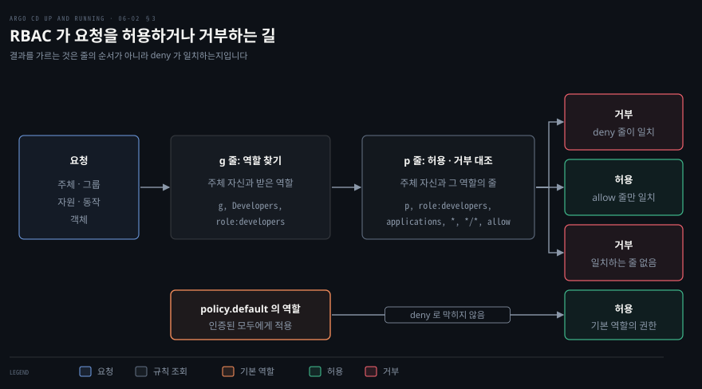

# SSO 연결과 RBAC — Dex·직접 OIDC·역할과 정책
---

## 핵심 요약

> Argo CD 에서 로그인한 사람이 누구인지는 SSO 가 정하고 그 사람이 무엇을 할 수 있는지는 `argocd-rbac-cm` 의 정책이 정하며, 두 일은 사용자 이름과 그룹 이름이라는 문자열로만 이어집니다.

Dex 는 `dex.config` 의 커넥터로, 직접 OIDC 는 `oidc.config` 로 같은 Keycloak 을 연결합니다. 직접 OIDC 의 CLI 로그인은 `localhost:8085` 콜백과 비밀 없이 동작하는 클라이언트를 따로 준비해야 합니다. RBAC 정책은 `p` 줄과 `g` 줄로 쓰고 `deny` 가 일치하면 줄 순서와 상관없이 거부하며, 어느 줄에도 걸리지 않는 사용자의 권한은 `policy.default` 가 정합니다. 정책은 적용 전에 `rbac validate` 로 문법을, `rbac can` 으로 결과를 확인합니다.[^ver]


## 학습 목표

이 내용을 읽고 나면:

1. `dex.config` 로 Keycloak 을 커넥터로 연결하고 그룹이 나오게 하는 옵션을 설명할 수 있습니다.
2. 직접 OIDC 의 `oidc.config` 와 Dex 설정의 차이를 말하고 로그인 결과를 `get-user-info` 로 확인할 수 있습니다.
3. CLI SSO 로그인에 필요한 콜백 주소와 클라이언트 조건을 설명할 수 있습니다.
4. `p` 줄과 `g` 줄을 읽고 개발자 역할을 정의해 그룹에 묶을 수 있습니다.
5. `rbac validate` 와 `rbac can` 으로 정책을 적용 전에 검증하고 `policy.default` 와 익명 접근의 효과를 설명할 수 있습니다.


## 1. Dex 설정으로 SSO 켜기

> Dex 로 SSO 를 켜려면 `argocd-cm` 의 `dex.config` 에 Dex 설정을 넣고, 그룹은 따로 요청해야 합니다.

Dex 로 SSO 를 켜는 일은 `argocd-cm` 의 `dex.config` 에 Dex 설정 파일을 그대로 넣는 일입니다. Argo CD 가 설정의 나머지 틀을 채워 주므로 사용자는 어느 IdP 에 어떤 방식으로 인증할지 정하는 커넥터만 적습니다.[^dex] Keycloak 전용 커넥터는 없어서 범용 `oidc` 커넥터를 씁니다.

```yaml
data:
  url: https://argocd.example.com
  dex.config: |
    connectors:
      - type: oidc
        id: keycloak
        name: Keycloak Dex
        config:
          issuer: https://keycloak.example.com/realms/argocd
          clientID: argocd
          clientSecret: $keycloak-secret:clientSecret
          insecureEnableGroups: true
```

`issuer` 는 Keycloak realm 의 OIDC 발견 문서 주소에서 `/.well-known/openid-configuration` 을 뺀 기본 주소입니다. `clientSecret` 의 `$keycloak-secret:clientSecret` 은 06-01 에서 만든 Secret 을 가리키는 참조입니다. 자체 서명 인증서를 쓰는 실습이라면 커넥터 설정에 `insecureSkipVerify: true` 를 더하지만 운영에서는 쓰지 않습니다.

그룹은 따로 켜야 나옵니다. Dex 는 기본으로 `profile` 과 `email` 범위만 요청합니다. IdP 가 `groups` 를 기본으로 싣지 않으면 커넥터의 `scopes` 에 `groups` 를 더해야 합니다. 어느 경우든 Dex 가 그룹을 넘기려면 `insecureEnableGroups: true` 를 켜야 합니다.[^dexgrp] 그룹 정보는 인증하는 순간에만 갱신되어서, 소속이 바뀐 사용자가 새 그룹을 받으려면 다시 로그인해야 합니다.

설정이 적용되면 로그인 화면에 `Log In Via Keycloak` 단추가 생깁니다. 단추가 보이지 않으면 `argocd-server` 를 재시작합니다. 로그인한 뒤 `get-user-info` 는 발급자와 그룹을 보여 줍니다.

```bash
argocd account get-user-info
Logged In: true
Username: <IdP 가 준 사용자 이름>
Issuer: https://argocd.example.com/api/dex
Groups: Developers
```

`Issuer` 가 Keycloak 주소가 아니라 `<url>/api/dex` 인 이유는 토큰을 Dex 가 다시 발급하기 때문입니다. Keycloak 주소가 나오는 쪽은 다음 절의 직접 OIDC 입니다.


## 2. 직접 OIDC 설정과 CLI 로그인

> 직접 OIDC 는 Dex 없이 IdP 와 바로 통신하고, CLI 로그인은 콜백 주소를 따로 열어 PKCE 로 설정합니다.

### 직접 OIDC 설정

직접 OIDC 는 Dex 를 빼고 Argo CD 가 IdP 와 OIDC 를 바로 주고받는 방식이어서 Dex 설정과 내용이 거의 같고 키 이름과 콜백 주소만 다릅니다. Dex 에서 옮길 때는 `dex.config` 를 지우고 `oidc.config` 를 넣습니다. 두 키가 함께 있으면 발급자는 `oidc.config` 의 `issuer` 가 되므로 한쪽만 남겨 설정을 하나로 맞춥니다.

```yaml
data:
  url: https://argocd.example.com
  oidc.config: |
    name: Keycloak
    issuer: https://keycloak.example.com/realms/argocd
    clientID: argocd
    clientSecret: $keycloak-secret:clientSecret
```

IdP 에는 이 방식의 콜백인 `https://argocd.example.com/auth/callback` 을 등록합니다. `requestedScopes` 를 적지 않으면 `openid`, `profile`, `email`, `groups` 가 기본으로 요청되므로 Keycloak 에 `groups` 범위가 있으면 그룹이 따라옵니다.[^oidc] 이 밖에 IdP 세션까지 끊는 `logoutURL`, 토큰을 미리 갱신하는 `refreshTokenThreshold`, PKCE 를 켜는 `enablePKCEAuthentication` 키가 있습니다.

인증서를 검증하지 못하는 IdP 라면 건너뛰는 설정을 `oidc.config` 안이 아니라 `argocd-cm` 최상위에 둡니다. 키는 `oidc.tls.insecure.skip.verify: "true"` 이고 실습 밖에서는 권하지 않는 설정입니다. 사용자 눈에는 Dex 와 직접 OIDC 의 로그인이 같아 보이고 User Info 의 `Issuer` 만 Keycloak realm 주소로 바뀝니다.

### CLI SSO 로그인과 PKCE

직접 OIDC 에서 CLI 로그인은 UI 와 달리 콜백을 받을 주소를 따로 열어야 합니다. `argocd login <주소> --sso` 를 실행하면 CLI 가 로컬 포트에 작은 웹 서버를 띄우고 IdP 가 그 주소로 사용자를 돌려보냅니다.[^cli] 포트의 기본값은 8085 이고 `--sso-port` 로 바꿉니다. 그래서 IdP 에 `http://localhost:8085/auth/callback` 도 유효한 Redirect URI 로 등록해야 합니다.

CLI 는 클라이언트 비밀을 안전하게 들고 있을 수 없으므로 Client authentication 을 끈 public 클라이언트가 필요합니다. 공식 Keycloak 문서는 CLI 로그인이 필요하면 PKCE 방식을 고르라고 하고, 그 방식도 클라이언트를 기본값(Client authentication 꺼짐)으로 만듭니다.

PKCE 설정은 그 위에 얹습니다. Keycloak 클라이언트의 PKCE Method 를 `S256` 으로 두고 `oidc.config` 에 `enablePKCEAuthentication: true` 를 넣습니다. UI 로그인을 위해 `https://<Argo CD 주소>/pkce/verify` 도 Redirect URI 로 등록합니다.[^pkce] PKCE 는 인가 코드를 가로채는 공격을 막는 OIDC 확장입니다.

Dex 를 쓰면 CLI 는 Dex 에 등록된 CLI 전용 클라이언트로 인가 요청을 보냅니다. 요청의 `client_id` 는 `argo-cd-cli` 이고 `code_challenge_method=S256` 이 붙습니다. 책의 kind 실습에서는 CLI 가 보내는 헤더가 NGINX Ingress 의 기본 버퍼보다 커서 `proxy-buffer-size` 를 100k 로 올렸습니다. 로그인이 끝나면 UI 에서 본 것과 같은 정보를 CLI 에서도 `get-user-info` 로 봅니다.


## 3. RBAC 정책의 p·g 줄 읽기

> RBAC 정책에서 `p` 줄은 권한을, `g` 줄은 주체와 역할의 묶음을 정하고, `deny` 가 `allow` 보다 앞섭니다.

인증을 통과해도 권한은 따로 받아야 하며, Argo CD 는 이 일을 `argocd-rbac-cm` ConfigMap 의 Casbin 정책으로 처리합니다. 책에서 SSO 로 로그인한 Argo CD 관리자 사용자는 `argocd cert list` 가 `PermissionDenied` 로 끝납니다. 관리자라는 이름과 달리 어떤 권한도 받지 않았기 때문입니다.

기본으로 들어 있는 역할은 둘입니다. `role:admin` 은 모든 자원에 제한 없이 접근하고 `role:readonly` 는 모든 자원을 보기만 합니다. 정책은 쉼표로 나눈 줄이고 종류가 둘입니다.[^rbac]

```yaml
data:
  policy.csv: |
    p, <주체>, <자원>, <동작>, <객체>, <효과>
    g, <주체>, <상속받는 역할>
```

`p` 줄은 권한 하나를 정하고 `g` 줄은 주체를 역할에 묶습니다. 주체는 역할이나 사용자나 그룹입니다. SSO 사용자의 이름은 Dex 를 거친 토큰이면 `federated_claims.user_id` 이고, 그 클레임이 없는 직접 OIDC 토큰이면 `sub` 입니다. 그룹은 `scopes` 키가 가리키는 클레임에서 오며 기본값은 `groups` 입니다.

자원은 `clusters`, `projects`, `applications`, `applicationsets`, `repositories`, `write-repositories`, `certificates` 입니다. 이 밖에 `accounts`, `gpgkeys`, `logs`, `exec`, `extensions` 가 있습니다.

동작은 `get`, `create`, `update`, `delete`, `sync`, `override`, `action/<그룹>/<종류>/<이름>` 입니다. `extensions` 자원의 동작은 `invoke` 하나입니다. `rollback` 은 `argocd-cm` 의 `server.rbac.rollback.enforce.enable` 을 켰을 때만 `sync` 와 따로 검사합니다.

애플리케이션처럼 프로젝트에 속하는 자원은 객체를 `<프로젝트>/<객체>` 로 적고, 모든 프로젝트의 모든 앱은 `*/*` 입니다.

`g, ArgoCDAdmins, role:admin` 한 줄이면 `ArgoCDAdmins` 그룹 전원이 관리자가 됩니다. 이미 있는 역할에 그룹을 묶을 뿐이어서 새 `p` 줄이 필요 없습니다.

효과는 `allow` 와 `deny` 입니다. `deny` 가 일치하면 더 구체적인 `allow` 가 있어도 `deny` 가 이깁니다.[^deny] 줄이 적힌 순서는 결과에 영향을 주지 않습니다. 그래서 정책을 읽을 때 위에서 아래로 첫 일치를 찾지 않습니다. 요청에 일치하는 줄을 전부 모은 뒤 `deny` 가 있는지부터 봅니다.




## 4. 개발자 역할 만들기와 기본 권한

> 내장 역할로 부족하면 `p` 줄로 개발자 역할을 만들고, 적용 전에 검증하며, 기본 권한은 `policy.default` 가 정합니다.

### 개발자 역할 정의

내장 역할로 부족하면 `p` 줄로 역할을 직접 만들어 그룹에 묶습니다. 책의 개발자는 애플리케이션을 배포하고 관리하되 클러스터와 저장소와 인증서는 보기만 하면 됩니다. 이 요구는 다섯 줄과 묶음 한 줄이 됩니다.

```yaml
data:
  policy.developers.csv: |
    p, role:developers, applications, *, */*, allow
    p, role:developers, applicationsets, *, */*, allow
    p, role:developers, clusters, get, *, allow
    p, role:developers, repositories, get, *, allow
    p, role:developers, certificates, get, *, allow
    g, Developers, role:developers
```

키 이름 `policy.<아무 문자열>.csv` 는 정책을 여러 파일로 나눠 쌓는 방법입니다. Argo CD 는 이런 키를 모두 찾아 `policy.csv` 아래에 이어 붙입니다. Kustomize 나 Helm 으로 정책을 합칠 때 쓰기 좋은 구조입니다. 이 ConfigMap 은 CSV 파일에서 만들어 병합 패치로 적용합니다.

```bash
kubectl create configmap argocd-rbac-cm -n argocd \
  --from-file=policy.developers.csv=policy.developers.csv \
  --dry-run=client -o yaml \
  | kubectl patch configmap argocd-rbac-cm -n argocd \
  --type merge --patch-file /dev/stdin
```

- `--from-file`: 파일 내용을 `policy.developers.csv` 키의 값으로 넣습니다.
- `--dry-run=client -o yaml`: 클러스터에 만들지 않고 YAML 만 출력합니다.
- `--type merge --patch-file /dev/stdin`: 앞 명령이 만든 YAML 을 기존 ConfigMap 에 병합합니다.

### rbac validate 와 rbac can 검증

정책에서 쉼표 하나만 빠져도 문법 오류가 됩니다. 잘못된 정책을 그대로 적용하면 서버 안정성에 영향을 줄 수 있으므로 적용 전에 `argocd admin settings rbac validate` 로 파일을 검증합니다.[^validate] 정상이면 `Policy is valid.` 가 나옵니다. `*/*` 와 `allow` 사이의 쉼표를 지우면 `Policy is invalid: <nil>` 이 나오고 종료 코드는 1 입니다.

결과까지 보려면 `rbac can` 을 씁니다. `--policy-file` 에 CSV 를 줄 때는 파일 하나만 읽으므로 `policy.csv` 와 `policy.developers.csv` 를 이어 붙여 줍니다. ConfigMap YAML 을 주거나 `--policy-file` 을 빼고 클러스터의 `argocd-rbac-cm` 을 읽게 하면 `policy.<아무 문자열>.csv` 키까지 합쳐 평가합니다. 출력은 `Yes` 나 `No` 이고 `No` 이면 종료 코드가 1 입니다.

```bash
cat policy.csv policy.developers.csv > combined.csv
argocd admin settings rbac can Developers sync applications default/guestbook --policy-file combined.csv
Yes
argocd admin settings rbac can Developers delete clusters '*' --policy-file combined.csv
No
```

`rbac can` 은 주어진 주체 문자열을 그대로 평가하고 그룹 소속을 따라가지 않습니다. 개인 이메일을 주면 `No` 가 나오므로 그룹의 권한을 보려면 위처럼 그룹 이름을 주체로 줍니다. 실제 로그인 세션의 권한은 서버에 묻는 `argocd account can-i sync applications default/guestbook` 으로 확인합니다.

### policy.default 와 익명 접근

어느 `p` 줄과 `g` 줄에도 걸리지 않는 사용자의 권한은 `policy.default` 가 정합니다. 새 설치에서 이 값은 비어 있어서 로그인은 되지만 목록이 비어 있고, `role:readonly` 로 두면 인증된 모든 사용자가 모든 자원을 보게 됩니다.[^default] 이 기본 권한은 `deny` 로도 막을 수 없습니다. `deny` 줄을 두어도 `--default-role role:readonly` 를 준 `rbac can` 은 `get` 에 `Yes` 를 돌려줍니다. 그래서 공식 문서는 최소 권한만 가진 `role:authenticated` 같은 새 역할을 만들어 기본으로 두라고 권합니다.

익명 접근은 같은 기본값을 로그인 없이 얻게 하는 설정입니다. `argocd-cm` 의 `users.anonymous.enabled` 를 `"true"` 로 두면 인증하지 않은 요청이 `policy.default` 의 권한을 받습니다.[^anon] 읽기 전용 상태 화면을 열어 둘 때 쓰고, 이때는 `role:readonly` 를 그대로 기본으로 두기보다 `role:unauthenticated` 같은 별도 역할을 두라는 경고가 문서에 있습니다.


## 연습 문제

> 아래 여섯 문제는 Dex 와 직접 OIDC 와 CLI 로그인과 RBAC 정책을 하나씩 묻습니다. 답을 적은 뒤에 정답 절을 펼칩니다.

1. Dex 로 로그인했는데 `get-user-info` 의 `Groups` 가 비어 있습니다. 어느 두 곳을 확인합니까? 소속을 바꾼 사용자는 언제 새 그룹을 받습니까?
2. Dex 로 쓰던 Keycloak 연결을 직접 OIDC 로 옮깁니다. 바꿀 것 셋과 IdP 에 등록할 콜백 주소는 무엇입니까? 인증서를 검증하지 못할 때는 어디에 무엇을 적습니까?
3. 직접 OIDC 로 Keycloak 을 연결한 서버에서 SSO 로그인은 UI 에서 되는데 `argocd login --sso` 는 브라우저에서 되돌아오지 못합니다. IdP 쪽에서 무엇을 준비합니까? 클라이언트는 어떻게 설정합니까?
4. `g, ArgoCDAdmins, role:admin` 은 무슨 일을 합니까? `p, role:developers, applications, *, */*, allow` 의 `*/*` 는 무슨 뜻입니까?
5. 새 정책 파일을 적용하기 전에 문법과 결과를 어떻게 확인합니까? 그룹 `Developers` 의 권한을 `rbac can` 으로 물을 때 주체에 무엇을 줍니까?
6. `applications, *, */*` 를 허용하고 `applications, delete, */*` 를 거부하는 두 줄이 있습니다. 두 줄의 순서를 바꾸면 결과가 달라집니까? `policy.default` 가 `role:readonly` 일 때 익명 접근을 켜면 무슨 일이 생깁니까?


## 정답 (자답 후 펼치기)

### 정답 1

첫째는 Dex 커넥터의 `insecureEnableGroups: true` 이고 둘째는 Keycloak 이 토큰에 `groups` 클레임을 내려 주는지입니다. 앞은 Dex 쪽 스위치이고 뒤는 IdP 쪽 준비로, 06-01 에서 본 `groups` 클라이언트 범위와 Group Membership 매퍼가 그 준비입니다. IdP 가 그룹을 기본으로 싣지 않는다면 커넥터 `scopes` 에 `groups` 가 있는지도 봅니다. 그룹 정보는 인증하는 순간에만 갱신되므로 소속이 바뀐 사용자는 다시 로그인해야 새 그룹을 받습니다.

### 정답 2

바꿀 것은 세 가지입니다. `dex.config` 를 지우고 `oidc.config` 를 넣으며 IdP 의 콜백을 `/auth/callback` 으로 맞춥니다. 직접 OIDC 의 콜백은 `https://<Argo CD 주소>/auth/callback` 이고 Dex 의 `/api/dex/callback` 과 다릅니다. 인증서를 검증하지 못하면 `argocd-cm` 최상위에 `oidc.tls.insecure.skip.verify: "true"` 를 적으며, `oidc.config` 안에 넣는 키가 아닙니다.

### 정답 3

IdP 클라이언트에 `http://localhost:8085/auth/callback` 을 Redirect URI 로 등록합니다. CLI 는 이 포트에서 콜백을 받기 때문입니다. `--sso-port` 로 포트를 바꿨다면 같은 값으로 맞춥니다.

클라이언트는 Client authentication 을 끈 public 클라이언트로 만듭니다. 공식 문서대로 PKCE(`S256` 과 `enablePKCEAuthentication: true` 와 `/pkce/verify` 등록)를 더합니다. Dex 를 거치면 내장 `argo-cd-cli` 클라이언트가 이 역할을 맡으므로 IdP 쪽 준비는 필요 없습니다.

### 정답 4

`ArgoCDAdmins` 그룹의 모든 구성원에게 내장 역할 `role:admin` 을 묶습니다. 이미 있는 역할을 가리킬 뿐이어서 새 `p` 줄이 필요 없습니다. `*/*` 는 `<프로젝트>/<앱>` 형식에서 모든 프로젝트의 모든 앱을 뜻하고, 앞의 `*` 가 프로젝트이며 뒤의 `*` 가 앱 이름입니다.

### 정답 5

`argocd admin settings rbac validate --policy-file=<파일>` 로 문법을 보면 `Policy is valid.` 나 `Policy is invalid: <nil>` 이 나옵니다.

결과는 `rbac can` 으로 확인하는데, CSV 를 줄 때는 파일 하나만 읽으므로 `policy.csv` 와 `policy.developers.csv` 를 이어 붙여 줍니다. ConfigMap YAML 을 주거나 `--policy-file` 을 빼면 `policy.<아무 문자열>.csv` 키까지 합쳐 평가합니다. 그룹의 권한을 물을 때는 그룹 이름 `Developers` 를 주체로 줍니다. 이 명령은 사용자가 어느 그룹에 속하는지 따라가지 않기 때문입니다.

### 정답 6

순서를 바꿔도 결과는 같습니다. `deny` 가 일치하는 `delete` 는 거부되고 `get` 과 `sync` 는 허용됩니다.

`policy.default` 가 `role:readonly` 일 때 `users.anonymous.enabled` 를 켜면 로그인하지 않은 요청이 모든 자원을 읽습니다. 애플리케이션 목록이 토큰 없이 돌아오는 것으로 확인할 수 있습니다. 이 기본 권한은 `deny` 로 막을 수 없으므로 익명용 역할을 따로 두는 편이 안전합니다.


## 참고 자료

- 《Argo CD: Up and Running》(Andrew Block · Christian Hernandez, O'Reilly, 2025, ISBN 978-1-098-14200-1) 6장
- [사용자 관리 개요](https://github.com/argoproj/argo-cd/blob/v3.6.1/docs/operator-manual/user-management/index.md)
- [Keycloak 연동](https://github.com/argoproj/argo-cd/blob/v3.6.1/docs/operator-manual/user-management/keycloak.md)
- [RBAC 설정](https://github.com/argoproj/argo-cd/blob/v3.6.1/docs/operator-manual/rbac.md)
- [argocd-rbac-cm.yaml](https://github.com/argoproj/argo-cd/blob/v3.6.1/docs/operator-manual/argocd-rbac-cm.yaml)
- [argocd-cm.yaml](https://github.com/argoproj/argo-cd/blob/v3.6.1/docs/operator-manual/argocd-cm.yaml)
- [argocd login](https://github.com/argoproj/argo-cd/blob/v3.6.1/docs/user-guide/commands/argocd_login.md)
- [argocd admin settings rbac can](https://github.com/argoproj/argo-cd/blob/v3.6.1/docs/user-guide/commands/argocd_admin_settings_rbac_can.md)
- 관련 노트: [이 책의 인덱스](./README.md), [06-01 Argo CD 사용자와 인증](./06-01.Argo%20CD%20사용자와%20인증%20—%20admin·로컬%20사용자·토큰과%20SSO.md), [03-01 Argo CD 와 상호작용하기](./03-01.Argo%20CD%20와%20상호작용하기%20—%20UI·CLI·REST%20API%20와%20선언적%20구성.md), [Kubernetes RBAC](../kubernetes-up-and-running/14-01.RBAC%20—%20인가를%20설계하고%20운영하는%20법.md), [Access Control — RBAC](../kubernetes-patterns/26-01.Access%20Control%20—%20RBAC으로%20누가%20무엇을%20할%20수%20있는지.md)

[^ver]: 최신 릴리스는 Argo CD v3.6.1(2026-11-04)이고 Helm 차트는 10.14.0(appVersion v3.6.1)입니다. 문서와 소스는 v3.6.1 태그에 고정했고 설치 매니페스트는 `https://raw.githubusercontent.com/argoproj/argo-cd/v3.6.1/manifests/install.yaml` 입니다. 이 노트의 실습은 kind v0.31.0 이 만든 Kubernetes v1.35.0 클러스터에 그 매니페스트로 설치한 v3.6.1 에서 실행했고, Dex `mockCallback` 커넥터로 `argocd login --sso` 와 `get-user-info`, `oidc.config` 키의 설정 API 반영, `rbac validate`·`rbac can`·`account can-i`, `deny` 의 순서 무관, `policy.default` 가 `deny` 로 막히지 않는 것, 익명 접근의 효과를 확인했습니다. <https://github.com/argoproj/argo-cd/releases/tag/v3.6.1> (2026-11-06 조회)
[^dex]: 사용자 관리 문서는 Dex 를 쓰는 설정을 "In the `argocd-cm` ConfigMap add the `OIDC` connector to the `connectors` sub field inside `dex.config`."라고 안내하고, 커넥터의 다른 옵션은 Dex 의 OIDC 커넥터 문서를 보라고 덧붙입니다. Dex 의 콜백은 "The callback address should be the `/api/dex/callback` endpoint of your Argo CD URL"입니다. <https://github.com/argoproj/argo-cd/blob/v3.6.1/docs/operator-manual/user-management/index.md> (2026-11-06 조회)
[^dexgrp]: 사용자 관리 문서는 "By default Dex only retrieves the profile and email scopes. In order to retrieve more claims you can add them under the `scopes` entry in the Dex configuration."라며 "To enable group claims through Dex, `insecureEnableGroups` also needs to be enabled. Group information is currently only refreshed at authentication time"이라고 적습니다. <https://github.com/argoproj/argo-cd/blob/v3.6.1/docs/operator-manual/user-management/index.md> (2026-11-06 조회)
[^oidc]: `argocd-cm.yaml` 의 `oidc.config` 주석은 `requestedScopes` 를 "Optional set of OIDC scopes to request. If omitted, defaults to: ["openid", "profile", "email", "groups"]"로 설명하고, 사용자 관리 문서는 "Not all OIDC providers support a special `groups` scope. E.g. Okta, OneLogin and Microsoft do support a special `groups` scope and will return group membership with the default `requestedScopes`."라고 설명합니다. 인증서 검증을 끄는 `oidc.tls.insecure.skip.verify` 는 "you understand and accept the risks of skipping OIDC provider cert verification"인 경우에만 쓰라는 조건이 붙습니다. <https://github.com/argoproj/argo-cd/blob/v3.6.1/docs/operator-manual/argocd-cm.yaml> · <https://github.com/argoproj/argo-cd/blob/v3.6.1/docs/operator-manual/user-management/index.md> (2026-11-06 조회)
[^cli]: `argocd login` 문서의 옵션은 `--sso`("Perform SSO login"), `--sso-launch-browser`("Automatically launch the system default browser when performing SSO login (default true)"), `--sso-port`("Port to run local OAuth2 login application (default 8085)")입니다. Dex 를 켠 서버에서 `--sso-launch-browser=false` 로 받은 인가 URL 은 `/api/dex/auth` 를 가리키고 `client_id=argo-cd-cli`, `redirect_uri=http://localhost:8085/auth/callback`, `code_challenge_method=S256` 을 담았습니다. <https://github.com/argoproj/argo-cd/blob/v3.6.1/docs/user-guide/commands/argocd_login.md> (2026-11-06 조회)
[^pkce]: Keycloak 문서는 첫머리에서 "If you need to authenticate with __argo-cd command line__, you must choose PKCE way."라고 하고, PKCE 방식의 설정에서 "__enablePKCEAuthentication__ must be set to true to enable correct Argo CD behaviour with PKCE"와 Keycloak 클라이언트의 "PKCE Method"를 `S256` 으로 두라고 안내합니다. `oidc.config` 주석은 PKCE 를 "an OIDC extension to prevent authorization code interception attacks"로 설명합니다. PKCE 방식의 클라이언트 생성 절은 "Leave default values." 이고 Valid Redirect URIs 는 "http://localhost:8085/auth/callback (needed for argo-cd cli, depends on value from --sso-port)"와 "https://{hostname}/auth/callback"과 "https://{hostname}/pkce/verify (needed for argo-cd UI)"입니다. <https://github.com/argoproj/argo-cd/blob/v3.6.1/docs/operator-manual/user-management/keycloak.md> · <https://github.com/argoproj/argo-cd/blob/v3.6.1/docs/operator-manual/user-management/index.md> (2026-11-06 조회)
[^rbac]: RBAC 문서는 기본 역할을 "`role:readonly`: read-only access to all resources"와 "`role:admin`: unrestricted access to all resources"로 소개하고, 문법을 "Group: Allows to assign authenticated users/groups to internal roles. Syntax: `g, <user/group>, <role>`"로 적습니다. SSO 에서는 "the `user` is derived from the token's `federated_claims.user_id` field, and groups are populated from the values returned by the OIDC provider under the configured scopes"입니다. `argocd-rbac-cm.yaml` 은 `p, subject, resource, action, object, effect` 형식과 `scopes` 의 기본값 `'[groups]'` 를 보여 줍니다. 같은 문서의 자원·동작 표는 동작 열에 get, create, update, delete, sync, rollback, action, override, invoke 를 두고 자원 행에 `write-repositories` 를 넣으며 `extensions` 는 `invoke` 만 허용합니다. `rollback` 은 "The `rollback` action is opt-in and disabled by default for backwards compatibility."입니다. 소스 `util/jwt/jwt.go` 의 `GetUserIdentifier` 는 "Fallback to sub if federated_claims.user_id is not set."라는 주석과 함께 `federated_claims` 가 없으면 `sub` 를 돌려줍니다. <https://github.com/argoproj/argo-cd/blob/v3.6.1/docs/operator-manual/rbac.md> · <https://github.com/argoproj/argo-cd/blob/v3.6.1/docs/operator-manual/argocd-rbac-cm.yaml> · <https://github.com/argoproj/argo-cd/blob/v3.6.1/util/jwt/jwt.go> (2026-11-06 조회)
[^deny]: RBAC 문서의 `deny` 절은 "Even if more specific policies with the `allow` effect match as well, the `deny` will have priority. The order in which the policies appears in the policy file configuration has no impact, and the result is deterministic."입니다. 같은 구성에서 `deny` 줄을 `allow` 줄의 앞에 두어도 뒤에 두어도 `delete` 는 `No`, `get` 과 `sync` 는 `Yes` 였습니다. <https://github.com/argoproj/argo-cd/blob/v3.6.1/docs/operator-manual/rbac.md> (2026-11-06 조회)
[^validate]: `argocd-rbac-cm.yaml` 은 추가 정책을 "In this case the key must follow the pattern 'policy.<any string>.csv'. Argo CD will concatenate all additional policies it finds with this pattern below the main one ('policy.csv')."로 설명합니다. `rbac can` 문서의 사용법은 `argocd admin settings rbac can ROLE/SUBJECT ACTION RESOURCE [SUB-RESOURCE] [flags]` 이고 `--policy-file` 이 없으면 클러스터의 `argocd-rbac-cm` 을 읽고, "Policy file can also be K8s config map with data keys like argocd-rbac-cm, i.e. 'policy.csv' and (optionally) 'policy.default'"라고 적어 ConfigMap YAML 도 받습니다. <https://github.com/argoproj/argo-cd/blob/v3.6.1/docs/operator-manual/argocd-rbac-cm.yaml> · <https://github.com/argoproj/argo-cd/blob/v3.6.1/docs/user-guide/commands/argocd_admin_settings_rbac_can.md> (2026-11-06 조회)
[^default]: `argocd-rbac-cm.yaml` 은 `policy.default` 를 "If omitted or empty, users may be still be able to login, but will see no apps, projects, etc..."로 설명합니다. RBAC 문서의 경고는 "All authenticated users get _at least_ the permissions granted by the default policies. This access cannot be blocked by a `deny` rule. It is recommended to create a new `role:authenticated` with the minimum set of permissions possible, then grant permissions to individual roles as needed."입니다. <https://github.com/argoproj/argo-cd/blob/v3.6.1/docs/operator-manual/argocd-rbac-cm.yaml> · <https://github.com/argoproj/argo-cd/blob/v3.6.1/docs/operator-manual/rbac.md> (2026-11-06 조회)
[^anon]: `argocd-cm.yaml` 은 `users.anonymous.enabled` 를 "Enables anonymous user access. The anonymous users get default role permissions specified argocd-rbac-cm.yaml."로 설명하고, RBAC 문서의 경고는 "When enabling anonymous access, consider creating a new default role and assigning it to the default policies with `policy.default: role:unauthenticated`."입니다. 같은 설정에서 토큰 없이 `/api/v1/applications` 를 호출하면 애플리케이션 목록이 돌아왔습니다. <https://github.com/argoproj/argo-cd/blob/v3.6.1/docs/operator-manual/argocd-cm.yaml> · <https://github.com/argoproj/argo-cd/blob/v3.6.1/docs/operator-manual/rbac.md> (2026-11-06 조회)
