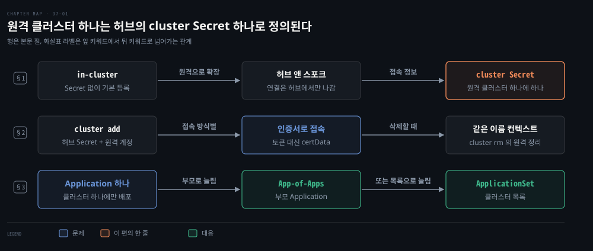
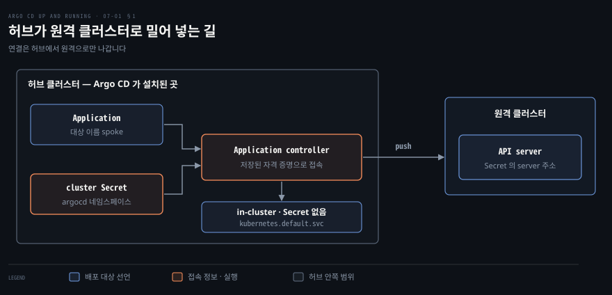
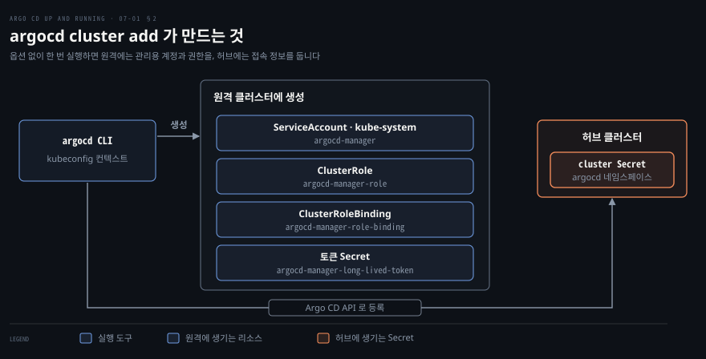

# 여러 클러스터 관리하기 — 허브 앤 스포크·클러스터 Secret·멀티 클러스터 배포
---

## 핵심 요약

> Argo CD 는 설치된 클러스터와 원격 클러스터를 같은 방식으로 배포 대상으로 다룹니다. 원격 클러스터 하나는 `argocd` 네임스페이스의 cluster Secret 하나로 정의되고, 설치된 클러스터는 Secret 없이 기본으로 등록됩니다.

연결은 Argo CD 가 설치된 허브에서 원격 클러스터로만 나갑니다. 원격 클러스터는 `argocd cluster add` 나 Secret 직접 작성으로 등록합니다. CLI(Command Line Interface)는 옵션 없이 실행하면 원격에 관리용 계정과 권한을 만들고, 그 계정의 토큰을 허브의 Secret 에 담습니다. 다만 kubeconfig 가 클라이언트 인증서로 접속하면 토큰 대신 그 인증서를 담습니다.

Application 하나는 클러스터 하나만 가리키므로 여러 클러스터에 배포하려면 Application 을 늘려야 합니다. 그 일을 App-of-Apps 는 부모 Application 으로, ApplicationSet 은 클러스터 목록으로 줄여 줍니다.[^ver]


## 학습 목표

이 내용을 읽고 나면:

1. 로컬 클러스터와 원격 클러스터를 `destination` 으로 어떻게 가리키는지, 허브 앤 스포크의 연결 방향이 네트워크에 거는 조건을 설명할 수 있습니다.
2. cluster Secret 의 라벨과 필드를 읽고, 원격 클러스터를 선언적으로 등록하는 Secret 을 쓸 수 있습니다.
3. `argocd cluster add` 를 옵션 없이 실행할 때 원격과 허브에 만드는 리소스와, `argocd cluster rm` 이 지우는 범위를 말할 수 있습니다.
4. Application 이 클러스터 하나만 가리키는 제약을 App-of-Apps 와 ApplicationSet 으로 푸는 방법을 들고, 상황에 맞게 고를 수 있습니다.
5. cluster generator 의 라벨 selector 로 대상 클러스터를 좁히고, 로컬 클러스터가 빠지는 이유를 설명할 수 있습니다.

아래 개념도는 이 편의 세 절을 한 줄씩 보입니다. 각 줄이 한 절이고 노드가 그 절의 핵심 키워드입니다. 화살표 위 글자는 앞 키워드에서 뒤 키워드로 넘어가는 관계입니다. 파란 노드가 그 절이 푸는 문제이고 초록 노드가 대응입니다. 1행의 앞 두 노드와 2행의 첫 노드는 문제도 대응도 아닌 구성이라 색이 없습니다. 2행 끝의 색이 없는 노드는 삭제할 때 걸리는 조건입니다. 3행은 대응이 둘이라 초록 노드가 둘입니다. 1행 끝의 코랄색 cluster Secret 이 이 편의 한 줄입니다. 원격 클러스터 하나가 허브의 cluster Secret 하나로 정의된다는 뜻입니다.

1절은 설치한 클러스터의 기본 등록과 허브 앤 스포크 구성, cluster Secret 의 역할을 다룹니다. 2절은 argocd cluster add 로 원격 클러스터를 등록하고 cluster rm 으로 지우는 방법을 다룹니다. 3절은 App-of-Apps 와 ApplicationSet 으로 여러 클러스터에 배포하고 둘 중 하나를 고르는 기준을 다룹니다.




## 1. 클러스터 정의와 허브 앤 스포크

> 설치한 클러스터는 기본 배포 대상이고, 원격 클러스터는 허브가 cluster Secret 의 자격 증명으로 접속합니다.

Argo CD 는 클러스터를 `destination` 이 가리키는 Kubernetes API(Application Programming Interface) server 주소로만 다룹니다. 그 주소에 접속할 자격 증명은 `argocd` 네임스페이스의 cluster Secret 에서 읽습니다.

Argo CD 를 설치한 클러스터는 설치 직후부터 배포 대상입니다. `server` 로는 `https://kubernetes.default.svc` 이고 `name` 으로는 `in-cluster` 입니다. 원격 클러스터도 같은 두 필드로 가리키므로 원격에 배포하려면 `destination` 만 바꾸면 됩니다.[^dest] `destination` 의 구조와 `server`·`name` 을 함께 적을 때의 오류는 [04-01 §1](./04-01.Application%20관리하기%20—%20소스·대상·Helm·Kustomize%20와%20삭제·finalizer.md)이 다룹니다.

설치한 클러스터는 cluster Secret 없이 기본으로 등록되어 있습니다. 설치 직후 라벨 `argocd.argoproj.io/secret-type=cluster` 로 Secret 을 찾으면 하나도 나오지 않습니다. 그런데도 `argocd cluster list` 에는 `in-cluster` 가 보입니다. 이 기본 등록은 `argocd-cm` 의 `cluster.inClusterEnabled` 가 정하고 기본값은 `"true"` 입니다.[^inc]

### 허브 앤 스포크 구성

원격 클러스터를 다루는 구조를 **허브 앤 스포크**(hub-and-spoke)라고 부릅니다. Argo CD 가 설치된 허브 클러스터가 중심이고 관리 대상인 원격 클러스터가 스포크입니다. 허브의 Application controller 가 원격 API server 로 접속해 매니페스트를 밀어 넣어서 이를 push 모델이라고 합니다. 매니페스트는 허브가 받아 캐시하고, 원격에 적용하는 일도 허브의 controller 가 직접 합니다. 그래서 원격에는 Argo CD 를 따로 설치하지 않아도 됩니다.



연결이 허브에서 원격으로만 나가므로 조건도 한 방향입니다. 허브의 파드가 원격 API server 주소에 닿아야 합니다. 경로에 방화벽이 있으면 허브에서 원격의 API server 포트로 나가는 규칙이 필요합니다. 원격에서 허브로 들어오는 연결은 없으므로 허브에는 원격을 위한 수신 포트를 열지 않아도 됩니다.

### cluster Secret 의 역할

그 주소와 자격 증명을 알려 주는 것이 cluster Secret 입니다. `argocd` 네임스페이스에서 라벨 `argocd.argoproj.io/secret-type: cluster` 가 붙은 Secret 을 Argo CD 가 클러스터로 읽습니다.[^sec] 필드는 다음과 같습니다.

- `name` 은 클러스터 이름이고 Application 의 `destination.name` 과 짝입니다.
- `server` 는 API server 주소이고 `destination.server` 와 짝입니다.
- `config` 는 접속 설정을 담은 JSON(JavaScript Object Notation)입니다. 토큰이나 인증서가 여기에 들어갑니다.
- `namespaces` 는 쉼표로 구분한 네임스페이스 목록입니다. 적으면 그 네임스페이스만 관리하고 클러스터 범위 리소스는 무시합니다.
- `clusterResources` 는 `"true"` 또는 `"false"` 문자열입니다. `namespaces` 로 범위를 좁혔을 때만 쓰이고, `"true"` 이면 클러스터 범위 리소스도 다시 대상이 됩니다.
- `project` 는 클러스터를 AppProject 하나에 묶는 필드이고 8장에서 다룹니다.

완성한 Secret 예시는 §2 에 있습니다.


## 2. 원격 클러스터 등록과 삭제

> 원격 클러스터 등록은 허브에 cluster Secret 을 만드는 일이며, `argocd cluster add` 나 Secret 선언으로 합니다.

### argocd cluster add 로 등록

원격 클러스터를 등록한다는 것은 허브에 cluster Secret 을 만드는 일입니다. `argocd cluster add` 는 그 Secret 과 원격의 관리용 계정을 한 번에 만듭니다.

명령의 첫 인자는 kubeconfig 의 컨텍스트 이름입니다. kubeconfig 와 컨텍스트가 무엇인지는 [Kubernetes in Action 03-01](../kubernetes-in-action/03-01.쿠버네티스%20클러스터%20실행하기.md)의 「kubeconfig 설정」 절에 있습니다. 실습은 kind 클러스터 두 개를 씁니다. Argo CD 는 허브에만 설치했습니다. 원격 클러스터의 컨텍스트로 다음을 실행합니다.

```bash
argocd cluster add <컨텍스트 이름> --name spoke --yes --cluster-endpoint kube-public
```

`--name` 은 Secret 의 `name` 이 됩니다. `--cluster-endpoint` 는 Secret 의 `server` 에 넣을 주소를 `kubeconfig`·`kube-public`·`internal` 중에서 고릅니다.[^add]

kind 의 kubeconfig 는 API server 를 `https://127.0.0.1:<포트>` 로 적습니다. 허브의 파드에서 이 주소는 허브 자신을 가리켜 원격에 닿지 않습니다. `kube-public` 은 원격의 `kube-public` 네임스페이스에 있는 `cluster-info` ConfigMap 에서 주소와 CA 를 읽습니다. 읽지 못하면 경고를 남기고 kubeconfig 의 주소를 그대로 씁니다.[^add] 실습에서는 같은 Docker 네트워크의 컨트롤 플레인 컨테이너 이름인 `https://spoke-control-plane:6443` 형태의 주소가 들어갔습니다.

명령이 끝나면 다음 로그가 나옵니다. 처음 네 줄은 JSON 로그의 `msg` 값만 옮긴 것이고 마지막 줄만 평문입니다.

```bash
ServiceAccount "argocd-manager" created in namespace "kube-system"
ClusterRole "argocd-manager-role" created
ClusterRoleBinding "argocd-manager-role-binding" created
Created bearer token secret "argocd-manager-long-lived-token" for ServiceAccount "argocd-manager"
Cluster 'https://spoke-control-plane:6443' added
```

옵션 없이 실행하면 처음 네 줄이 원격 클러스터에 만든 리소스입니다. `argocd-manager` ServiceAccount 가 원격에서 Argo CD 의 신원입니다. `argocd-manager-role` ClusterRole 은 모든 API 그룹과 리소스와 동사를 `*` 로 허용합니다. ClusterRoleBinding 이 계정과 그 ClusterRole 을 묶습니다. 토큰 Secret 은 그 계정의 토큰을 담습니다.[^rbac]

`--namespace` 로 관리할 네임스페이스를 주면 ClusterRole·ClusterRoleBinding 대신 그 네임스페이스마다 같은 이름의 Role·RoleBinding 을 만듭니다. `--service-account` 로 기존 계정을 주면 계정과 권한은 만들지 않고 그 계정의 토큰을 씁니다.

ServiceAccount 와 ClusterRole 이 무엇인지는 [Kubernetes Patterns 26-01](../kubernetes-patterns/26-01.Access%20Control%20—%20RBAC으로%20누가%20무엇을%20할%20수%20있는지.md)의 두 절이 다룹니다. 「ServiceAccount — 워크로드의 신원」과 「ClusterRole과 ClusterRoleBinding」입니다. 권한을 좁히려면 `--namespace` 로 네임스페이스 단위 Role 을 쓰거나 ClusterRole 을 직접 고칩니다. 후자는 8장 설치 모드 절이, 동기화 때 다른 계정을 쓰는 Sync Impersonation 은 9장이 다룹니다.



### 접속 방식별 Secret 내용

허브의 Secret 에 무엇이 담기는지는 kubeconfig 컨텍스트가 어떻게 접속하는지에 달렸습니다. 컨텍스트가 클라이언트 인증서로 접속하면 Secret 의 `config` 에 `certData`·`keyData`·`caData` 가 들어가고 `bearerToken` 은 들어가지 않습니다. 소스 주석은 토큰이 인증서보다 우선하므로 인증서 데이터가 없을 때만 토큰을 넣는다고 설명합니다.[^cert]

kind 의 기본 kubeconfig 가 이 경우였습니다. `argocd-manager` 를 만들었는데도 Secret 에는 인증서 쌍이 들어갔습니다. 그 인증서는 kubeconfig 사용자의 것입니다. 그래서 Argo CD 는 `argocd-manager` 가 아니라 그 사용자의 권한(kind 에서는 클러스터 관리자)으로 원격에 접속합니다. 이때 `argocd-manager` 와 그 토큰은 인증에 쓰이지 않습니다. 그래서 `argocd` 네임스페이스의 Secret 을 읽을 수 있는 사람이 곧 원격의 접근권을 쥡니다.

### argocd cluster rm 과 정리

`argocd cluster rm` 은 허브의 Secret 을 먼저 지우고 이어서 원격의 `argocd-manager` 리소스를 지웁니다. 원격 정리는 kubeconfig 에서 Argo CD 의 클러스터 이름과 같은 이름의 컨텍스트를 찾아 접속합니다. 컨텍스트 이름이 다르면 `context spoke does not exist in kubeconfig` 로 실패합니다.[^rm]

그때는 Secret 이 이미 지워진 뒤라서 원격에 ServiceAccount 와 ClusterRole 과 ClusterRoleBinding 과 토큰 Secret 이 그대로 남습니다. 컨텍스트 이름을 고쳐 `cluster rm` 을 다시 실행해도 소용이 없습니다. 첫 단계에서 Argo CD 가 `spoke` 를 찾지 못해 끝나므로 원격 정리까지 가지 못합니다. 남은 리소스는 원격 클러스터에서 `kubectl delete` 로 직접 지웁니다.

자동 정리는 처음 실행할 때 컨텍스트 이름이 `spoke` 와 같아야 합니다. 그러면 ClusterRoleBinding, ClusterRole, ServiceAccount 가 차례로 `deleted` 로그와 함께 지워집니다. 토큰 Secret 은 ServiceAccount 가 지워질 때 Kubernetes 의 토큰 컨트롤러가 지웁니다.[^tok]

이미 배포한 워크로드는 어느 쪽이든 원격에 남습니다.

### cluster Secret 선언으로 등록

같은 일을 GitOps 로 관리하려면 Secret 을 직접 만듭니다. 먼저 원격 클러스터에 계정과 권한과 토큰 Secret 을 둡니다.

```yaml
# 원격 클러스터에 적용
apiVersion: v1
kind: ServiceAccount
metadata:
  name: argocd-manager
  namespace: kube-system
---
apiVersion: rbac.authorization.k8s.io/v1
kind: ClusterRoleBinding
metadata:
  name: argocd-manager-role-binding
roleRef:
  apiGroup: rbac.authorization.k8s.io
  kind: ClusterRole
  name: cluster-admin
subjects:
  - kind: ServiceAccount
    name: argocd-manager
    namespace: kube-system
---
apiVersion: v1
kind: Secret
metadata:
  name: argocd-manager-token
  namespace: kube-system
  annotations:
    kubernetes.io/service-account.name: argocd-manager
type: kubernetes.io/service-account-token
```

`kubernetes.io/service-account-token` 타입의 Secret 에 계정 이름을 주석으로 적으면 컨트롤 플레인이 만료 없는 토큰을 채워 줍니다.[^tok] 이 토큰과 CA(Certificate Authority) 인증서를 꺼내 허브의 cluster Secret 에 넣습니다.

```bash
kubectl --context <원격 컨텍스트> -n kube-system get secret argocd-manager-token -o jsonpath='{.data.token}' | base64 -d
kubectl --context <원격 컨텍스트> -n kube-system get secret argocd-manager-token -o jsonpath='{.data.ca\.crt}'
```

```yaml
# 허브 클러스터에 적용
apiVersion: v1
kind: Secret
metadata:
  name: spoke
  namespace: argocd
  labels:
    argocd.argoproj.io/secret-type: cluster
    env: dev
type: Opaque
stringData:
  name: spoke
  server: https://spoke-control-plane:6443
  config: |
    {
      "bearerToken": "<ServiceAccount token>",
      "tlsClientConfig": {
        "insecure": false,
        "caData": "<base64 로 인코딩한 CA 인증서>"
      }
    }
```

`bearerToken` 에는 `base64 -d` 로 푼 평문 토큰을, `caData` 에는 디코딩하지 않은 base64 문자열을 넣습니다. 이 Secret 을 적용하면 `argocd cluster list` 에 `spoke` 가 나옵니다. 이 클러스터로 배포한 Application 이 없는 동안은 상태가 `Unknown` 입니다. 이유는 MESSAGE 칸의 `Cluster has no applications and is not being monitored.` 가 알려 줍니다. §3 에서 앱을 배포하면 `Successful` 로 바뀝니다.

```bash
SERVER                            NAME        VERSION  STATUS   MESSAGE                                                  PROJECT
https://spoke-control-plane:6443  spoke                Unknown  Cluster has no applications and is not being monitored.
https://kubernetes.default.svc    in-cluster  1.35.0   Unknown  Cluster has no applications and is not being monitored.
```

`env: dev` 라벨은 §3 의 selector 가 씁니다. 이 Secret 은 자격 증명을 담으므로 Git 에 평문으로 올리지 않습니다. [External Secrets Operator](https://external-secrets.io/latest/) 같은 시크릿 관리 도구로 만들어 넣습니다.

등록한 클러스터의 이름이나 라벨, 허용 네임스페이스는 `argocd cluster set` 으로 바꿉니다.[^set] 같은 이름으로 다시 등록할 때는 `argocd cluster add` 에 `--upsert` 를 붙입니다.[^add]


## 3. 멀티 클러스터 배포와 선택 기준

> Application 하나는 클러스터 하나에만 배포하므로, App-of-Apps 나 ApplicationSet 으로 Application 을 늘립니다.

Application 하나는 클러스터 하나에만 배포합니다. 그래서 여러 클러스터에는 Application 을 늘려야 하고, 그 일을 App-of-Apps 와 ApplicationSet 이 줄여 줍니다.

### destination 으로 대상 지정

Application 의 `destination` 은 `server` 나 `name` 하나만 받습니다. 원격 클러스터에 배포하려면 §2 에서 등록한 이름을 적습니다.

```yaml
spec:
  project: default
  source:
    repoURL: https://github.com/argoproj/argocd-example-apps.git
    targetRevision: HEAD
    path: guestbook
  destination:
    name: spoke
    namespace: guestbook
  syncPolicy:
    automated: {}
    syncOptions:
      - CreateNamespace=true
```

동기화하면 `guestbook` 네임스페이스의 리소스가 원격에만 생기고 허브에는 생기지 않습니다. 클러스터가 셋이면 이런 Application 이 셋 필요합니다.

### App-of-Apps 로 Application 늘리기

**App-of-Apps** 는 자식 Application 매니페스트가 든 경로를 소스로 삼는 부모 Application 입니다. Application 도 CRD(Custom Resource Definition, 사용자 정의 리소스 정의)로 만든 리소스라서 Argo CD 가 다른 리소스처럼 동기화합니다.

자식마다 YAML 을 따로 쓰는 부담은 Helm 으로 줄입니다. 예제 저장소의 `apps` 경로는 `applications` 목록의 항목마다 `example.<이름>` Application 을 만드는 차트입니다. `config.spec.destination.server` 한 값이 모든 자식의 대상 클러스터를 정합니다. 부모 Application 이 그 값을 `helm.valuesObject` 로 덮어씁니다.

```yaml
spec:
  project: default
  source:
    repoURL: https://github.com/argoproj/argocd-example-apps.git
    targetRevision: 8088f4c0d970abb09e250248cc97e35623447cb5
    path: apps
    helm:
      valuesObject:
        config:
          spec:
            destination:
              server: https://spoke-control-plane:6443
            source:
              targetRevision: 8088f4c0d970abb09e250248cc97e35623447cb5
        applications:
          - name: guestbook
            destination:
              namespace: guestbook-aoa
  destination:
    server: https://kubernetes.default.svc
    namespace: argocd
  syncPolicy:
    automated: {}
```

부모를 동기화하자 자식 `example.guestbook` 이 생겼습니다. 대상은 원격 클러스터였고 `Synced` 와 `Healthy` 가 되었습니다. 자식은 `resources-finalizer.argocd.argoproj.io` finalizer 를 달고 만들어집니다. 그래서 자식을 지우면 배포한 리소스까지 함께 지워집니다. 이 연쇄 삭제는 [04-01 §3](./04-01.Application%20관리하기%20—%20소스·대상·Helm·Kustomize%20와%20삭제·finalizer.md)에 있습니다.

자식 Application 사이에 Sync Wave 로 순서를 두려면 부모가 자식의 Health 를 알아야 합니다. 공식 문서는 `argocd-cm` 에 Health 판정 스크립트를 추가하라고 안내합니다. 키는 `resource.customizations.health.argoproj.io_Application` 입니다.[^hlth] Sync Wave 가 무엇인지는 [05-01 §3](./05-01.Application%20동기화%20—%20자동%20동기화·Sync%20Option·Hook·Sync%20Wave%20와%20차이%20무시.md)에 있습니다.

### ApplicationSet 과 generator 종류

**ApplicationSet** 은 generator 가 내놓는 파라미터 목록마다 Application 을 하나씩 찍어 내는 CRD 입니다. 대표적인 generator 셋은 다음과 같습니다.

- List generator 는 고정한 key/value 목록을 입력으로 삼습니다.
- Cluster generator 는 Argo CD 에 등록된 클러스터를 입력으로 삼습니다.
- Git generator 는 Git 저장소의 디렉터리나 파일을 입력으로 삼습니다.

이 셋 말고도 generator 는 여섯 종이 더 있습니다. 역할로 나누면 셋입니다. Matrix 와 Merge 는 다른 generator 가 만든 파라미터를 묶습니다. SCM Provider 와 Pull Request 는 외부 시스템에서 대상을 찾아 옵니다. Cluster Decision Resource 와 Plugin 은 직접 규칙을 꽂는 확장 지점입니다.[^gens]

| generator | 파라미터를 얻는 곳 | 쓰는 때 |
|-----------|-------------------|---------|
| Matrix | 자식 generator 둘이 만든 파라미터 | 두 집합의 모든 조합(곱)이 필요할 때입니다. 예를 들면 클러스터 × 앱 디렉터리입니다. |
| Merge | 기준이 되는 첫 generator 와 뒤따르는 generator | 대부분은 기본값을 쓰고 일부 대상만 값을 덮어쓸 때입니다. 예를 들면 특정 클러스터의 설정만 바꿀 때입니다. |
| SCM Provider | GitHub 같은 SCM 서비스 API 가 알려 주는 조직의 저장소 | 마이크로서비스가 저장소 여럿에 흩어져 있을 때입니다. |
| Pull Request | SCM 서비스 API 가 알려 주는 저장소의 열린 풀 리퀘스트 | 풀 리퀘스트마다 미리보기 환경을 만들 때입니다. |
| Cluster Decision Resource | 별도 커스텀 리소스의 status 에 적힌 클러스터 목록 | 어느 클러스터에 배포할지의 결정을 다른 시스템에 맡길 때입니다. |
| Plugin | 직접 만든 HTTP 서비스의 응답 | 내장 generator 로 맞지 않을 때입니다. |

Matrix 와 Merge 는 둘 다 파라미터를 합치지만 방향이 다릅니다. Matrix 는 두 결과를 곱해 Application 수를 늘립니다. Merge 는 첫 generator 의 결과 위에 값을 덮어쓸 뿐 항목 수를 늘리지 않습니다. Merge 는 셋 이상의 generator 도 받아 뒤의 것이 앞의 값을 덮어쓰지만, Matrix 는 자식 generator 를 둘까지만 받습니다.[^mtx]

SCM Provider 와 Pull Request 는 외부 API 가 알려 주는 대상마다 Application 을 만듭니다. 풀 리퀘스트가 조건에서 벗어나면 그 Application 도 지워집니다.[^disc]

Cluster Decision Resource 와 Plugin 은 결정 로직을 Argo CD 밖으로 빼냅니다.[^xtn]

v3.6.1 문서에는 OCI generator 도 올라 있습니다. Git generator 처럼 파일이나 디렉터리 구조를 읽지만 대상은 OCI 아티팩트입니다.

### Cluster generator 와 selector

Cluster generator 는 클러스터마다 `name` 과 `nameNormalized` 와 `server` 와 `project` 를 템플릿에 줍니다. 라벨과 주석은 `metadata.labels.<키>` 와 `metadata.annotations.<키>` 로 줍니다.[^gen] 아래 예제처럼 `goTemplate: true` 를 쓰면 변수 앞에 점이 붙어 `{{.name}}` 으로 읽습니다. 이때 `metadata` 는 객체라서 라벨은 `{{ index .metadata.labels "키" }}` 로 읽습니다.

```yaml
apiVersion: argoproj.io/v1alpha1
kind: ApplicationSet
metadata:
  name: guestbook
  namespace: argocd
spec:
  goTemplate: true
  goTemplateOptions: ["missingkey=error"]
  generators:
    - clusters:
        selector:
          matchLabels:
            env: dev
  template:
    metadata:
      name: '{{.name}}-guestbook'
    spec:
      project: default
      source:
        repoURL: https://github.com/argoproj/argocd-example-apps.git
        targetRevision: HEAD
        path: guestbook
      destination:
        server: '{{.server}}'
        namespace: guestbook
      syncPolicy:
        automated: {}
        syncOptions:
          - CreateNamespace=true
```

`selector` 는 라벨이 맞는 클러스터 Secret 만 고릅니다. §2 에서 `env: dev` 를 단 `spoke` 를 등록해 두었습니다. 그래서 `spoke-guestbook` Application 이 생겼고 `Synced` 와 `Healthy` 가 되었습니다. 클러스터를 등록하거나 지우면 Application 도 따라서 생기고 사라집니다. 클러스터를 늘릴 때 Application 을 손으로 쓸 일이 없습니다.

`selector` 를 쓰면 기본 로컬 클러스터는 빠집니다. 로컬 클러스터에는 Secret 이 없어서 어떤 라벨도 붙어 있지 않고 `env: dev` 도 마찬가지이기 때문입니다. 라벨 selector 는 그 라벨이 붙은 Secret 이 있는 클러스터만 고릅니다.[^loc]

공식 문서는 같은 원리로 `argocd.argoproj.io/secret-type` 라벨 selector 를 로컬을 뺀 원격 클러스터 전부를 고르는 예로 듭니다. 로컬도 넣으려면 `argocd cluster add "<컨텍스트 이름>" --in-cluster` 로 Secret 을 만들거나 Secret 을 직접 선언합니다. 실습에서는 `in-cluster` 이름의 Secret 에 `env: dev` 를 달자 `in-cluster-guestbook` 이 함께 생겼습니다.

### App-of-Apps 와 ApplicationSet 선택

둘 중 무엇을 쓸지는 무엇을 늘리려는지에 달렸습니다. 같은 앱을 라벨로 고른 여러 클러스터에 배포한다면 ApplicationSet 이 맞습니다. 공식 부트스트랩 문서도 일반적인 경우를 클러스터 generator 로 풀라고 권합니다.[^boot]

자식 Application 사이에 Sync Wave 로 순서를 두어야 하거나, 새 Argo CD 를 부트스트랩·복구하려고 앱 묶음을 한 번에 올린다면 App-of-Apps 가 맞습니다. 두 패턴을 함께 쓰는 경우도 많습니다. ApplicationSet 이 만든 Application 의 순서를 제어하는 기능은 Progressive Syncs 입니다. v3.3.0 부터 Beta 이고 명시적으로 켜야 하며 10장에서 다룹니다.[^prog]


## 연습 문제

> 아래 여섯 문제는 `destination` 과 허브 앤 스포크와 cluster Secret 과 등록과 삭제와 멀티 클러스터 배포를 하나씩 묻습니다. 답을 적은 뒤에 정답 절을 펼칩니다.

1. `destination` 으로 설치한 클러스터와 원격 클러스터를 각각 어떻게 가리킵니까? 설치 직후 cluster Secret 이 하나도 없는데도 `in-cluster` 가 클러스터 목록에 나오는 이유는 무엇입니까?
2. 허브 앤 스포크의 push 모델에서 연결은 어느 쪽에서 어느 쪽으로 나갑니까? 이 방향 때문에 허브와 원격 클러스터 사이에 무엇이 필요합니까?
3. cluster Secret 이 클러스터로 인식되려면 무엇이 있어야 합니까? `name` 과 `server` 는 Application 의 어느 필드와 짝이고, `namespaces` 를 적으면 무엇이 달라집니까?
4. `argocd cluster add` 를 옵션 없이 실행하면 원격 클러스터에 만드는 리소스는 무엇입니까? kubeconfig 컨텍스트가 클라이언트 인증서로 접속하면 허브의 Secret `config` 에는 무엇이 담깁니까?
5. 컨텍스트 이름이 Argo CD 의 클러스터 이름과 다른 상태에서 `argocd cluster rm` 을 실행하면 어떻게 됩니까? 이미 배포한 워크로드는 어떻게 됩니까?
6. Application 하나로 세 클러스터에 같은 앱을 배포할 수 있습니까? App-of-Apps 와 ApplicationSet 은 각각 언제 고릅니까? `env: dev` 라벨 selector 를 쓰면 로컬 클러스터는 왜 빠집니까?


## 정답 (자답 후 펼치기)

### 정답 1

가리키는 방법은 둘이 같고 `destination` 의 `server` 나 `name` 에 클러스터를 적습니다. 설치한 클러스터는 `server: https://kubernetes.default.svc` 나 `name: in-cluster` 입니다. 원격 클러스터는 등록한 API server 주소나 이름입니다. 원격에 배포하려면 `destination` 만 바꿉니다.

설치한 클러스터는 Secret 이 아니라 `argocd-cm` 의 `cluster.inClusterEnabled` 로 기본 등록됩니다. 이 값의 기본값이 `"true"` 이기 때문입니다.

### 정답 2

연결은 허브 클러스터의 Application controller 에서 원격 클러스터의 API server 로만 나갑니다. 이 방식이 push 모델입니다.

그래서 허브의 파드가 원격 API server 주소에 닿아야 합니다. 경로에 방화벽이 있으면 허브에서 원격의 API server 포트로 나가는 규칙이 필요합니다. 원격에서 허브로 들어오는 연결은 없으므로 허브에는 원격을 위한 수신 포트를 열지 않아도 됩니다.

### 정답 3

`argocd` 네임스페이스에 있는 Secret 에 라벨 `argocd.argoproj.io/secret-type: cluster` 가 붙어 있어야 합니다.

`name` 은 `destination.name` 과, `server` 는 `destination.server` 와 짝입니다. `namespaces` 를 적으면 그 네임스페이스만 관리하고 클러스터 범위 리소스는 무시합니다. `clusterResources: "true"` 를 함께 적어야 클러스터 범위 리소스가 다시 대상이 됩니다.

### 정답 4

옵션 없이 실행하면 원격 클러스터에 네 리소스를 만들고 허브에 cluster Secret 하나를 만듭니다.

- ServiceAccount `argocd-manager` 는 `kube-system` 네임스페이스에 생깁니다.
- ClusterRole `argocd-manager-role` 과 ClusterRoleBinding `argocd-manager-role-binding` 이 권한을 줍니다.
- 토큰 Secret `argocd-manager-long-lived-token` 이 계정의 토큰을 담습니다.

`--namespace` 를 주면 ClusterRole·ClusterRoleBinding 대신 네임스페이스마다 Role·RoleBinding 을 만듭니다. `--service-account` 를 주면 기존 계정의 토큰을 쓰므로 계정과 권한을 만들지 않습니다.

컨텍스트가 클라이언트 인증서로 접속하면 `config` 에 `certData`·`keyData`·`caData` 가 담기고 `bearerToken` 은 담기지 않습니다. 토큰은 인증서 데이터가 없을 때만 넣기 때문입니다.

### 정답 5

허브의 Secret 이 먼저 지워지고, 원격의 `argocd-manager` 정리는 Argo CD 클러스터 이름과 같은 이름의 컨텍스트를 kubeconfig 에서 찾지 못해 `context ... does not exist in kubeconfig` 로 실패합니다. 원격에는 ServiceAccount, ClusterRole, ClusterRoleBinding, 토큰 Secret 이 그대로 남습니다. 이 상태에서는 컨텍스트 이름을 고쳐 `cluster rm` 을 다시 실행해도 Argo CD 가 클러스터를 찾지 못해 끝납니다. 남은 리소스는 원격에서 `kubectl delete` 로 지웁니다.

컨텍스트 이름을 클러스터 이름과 같게 맞춰 처음부터 실행했을 때만 이것들까지 자동으로 지워집니다.

이미 배포한 워크로드는 어느 쪽이든 원격에 남습니다.

### 정답 6

Application 하나는 `destination` 하나만 가질 수 있어서 불가능합니다. 클러스터마다 Application 이 필요합니다.

같은 앱을 라벨로 고른 여러 클러스터에 배포한다면 ApplicationSet 의 cluster generator 를 고릅니다. 자식 Application 사이에 Sync Wave 로 순서를 두어야 하거나 새 Argo CD 를 부트스트랩·복구하려고 앱 묶음을 한 번에 올린다면 App-of-Apps 를 고릅니다. 두 패턴을 함께 쓰기도 합니다.

로컬 클러스터에는 Secret 이 없어서 `env: dev` 를 포함해 어떤 라벨도 없습니다. 라벨 selector 는 그 라벨이 붙은 Secret 이 있는 클러스터만 고르므로 로컬은 빠집니다. 로컬을 넣으려면 `argocd cluster add "<컨텍스트 이름>" --in-cluster` 로 Secret 을 만듭니다.


## 참고 자료

- 《Argo CD: Up and Running》(Andrew Block · Christian Hernandez, O'Reilly, 2025, ISBN 978-1-098-14200-1) 7장
- [클러스터 선언적 설정](https://github.com/argoproj/argo-cd/blob/v3.6.1/docs/operator-manual/declarative-setup.md)
- [시작하기 — 다른 클러스터 등록](https://github.com/argoproj/argo-cd/blob/v3.6.1/docs/getting_started.md)
- [argocd cluster add](https://github.com/argoproj/argo-cd/blob/v3.6.1/docs/user-guide/commands/argocd_cluster_add.md)
- [argocd cluster set](https://github.com/argoproj/argo-cd/blob/v3.6.1/docs/user-guide/commands/argocd_cluster_set.md)
- [Application 예제 application.yaml](https://github.com/argoproj/argo-cd/blob/v3.6.1/docs/operator-manual/application.yaml)
- [argocd-cm 예제](https://github.com/argoproj/argo-cd/blob/v3.6.1/docs/operator-manual/argocd-cm.yaml)
- [argocd-manager 의 이름과 권한 규칙 소스](https://github.com/argoproj/argo-cd/blob/v3.6.1/util/clusterauth/clusterauth.go)
- [인증서와 토큰의 저장 규칙 소스](https://github.com/argoproj/argo-cd/blob/v3.6.1/cmd/util/cluster.go)
- [cluster rm 의 처리 순서 소스](https://github.com/argoproj/argo-cd/blob/v3.6.1/cmd/argocd/commands/cluster.go)
- [Cluster generator](https://github.com/argoproj/argo-cd/blob/v3.6.1/docs/operator-manual/applicationset/Generators-Cluster.md)
- [Generators 개관](https://github.com/argoproj/argo-cd/blob/v3.6.1/docs/operator-manual/applicationset/Generators.md)
- [OCI generator](https://github.com/argoproj/argo-cd/blob/v3.6.1/docs/operator-manual/applicationset/Generators-OCI.md)
- [Matrix generator](https://github.com/argoproj/argo-cd/blob/v3.6.1/docs/operator-manual/applicationset/Generators-Matrix.md)
- [Merge generator](https://github.com/argoproj/argo-cd/blob/v3.6.1/docs/operator-manual/applicationset/Generators-Merge.md)
- [SCM Provider generator](https://github.com/argoproj/argo-cd/blob/v3.6.1/docs/operator-manual/applicationset/Generators-SCM-Provider.md)
- [Pull Request generator](https://github.com/argoproj/argo-cd/blob/v3.6.1/docs/operator-manual/applicationset/Generators-Pull-Request.md)
- [Cluster Decision Resource generator](https://github.com/argoproj/argo-cd/blob/v3.6.1/docs/operator-manual/applicationset/Generators-Cluster-Decision-Resource.md)
- [Plugin generator](https://github.com/argoproj/argo-cd/blob/v3.6.1/docs/operator-manual/applicationset/Generators-Plugin.md)
- [ApplicationSet Go Template](https://github.com/argoproj/argo-cd/blob/v3.6.1/docs/operator-manual/applicationset/GoTemplate.md)
- [클러스터 부트스트래핑](https://github.com/argoproj/argo-cd/blob/v3.6.1/docs/operator-manual/cluster-bootstrapping.md)
- [Health 판정](https://github.com/argoproj/argo-cd/blob/v3.6.1/docs/operator-manual/health.md)
- [Progressive Syncs](https://github.com/argoproj/argo-cd/blob/v3.6.1/docs/operator-manual/applicationset/Progressive-Syncs.md)
- [Kubernetes ServiceAccount 관리](https://kubernetes.io/docs/reference/access-authn-authz/service-accounts-admin/)
- [argocd-example-apps](https://github.com/argoproj/argocd-example-apps/tree/8088f4c0d970abb09e250248cc97e35623447cb5)
- [External Secrets Operator](https://external-secrets.io/latest/)
- 관련 노트: [이 책의 인덱스](./README.md)
- 관련 노트: [02-01 Argo CD 설치하기](./02-01.Argo%20CD%20설치하기%20—%20구성%20요소·설치%20유형·매니페스트와%20Helm.md)
- 관련 노트: [03-01 Argo CD 와 상호작용하기](./03-01.Argo%20CD%20와%20상호작용하기%20—%20UI·CLI·REST%20API%20와%20선언적%20구성.md)
- 관련 노트: [04-01 Application 관리하기](./04-01.Application%20관리하기%20—%20소스·대상·Helm·Kustomize%20와%20삭제·finalizer.md)
- 관련 노트: [05-01 Application 동기화](./05-01.Application%20동기화%20—%20자동%20동기화·Sync%20Option·Hook·Sync%20Wave%20와%20차이%20무시.md)
- 관련 노트: [Kubernetes Patterns 26-01 Access Control](../kubernetes-patterns/26-01.Access%20Control%20—%20RBAC으로%20누가%20무엇을%20할%20수%20있는지.md)
- 관련 노트: [Kubernetes in Action 03-01 클러스터 실행하기](../kubernetes-in-action/03-01.쿠버네티스%20클러스터%20실행하기.md)

[^ver]: 최신 릴리스는 [Argo CD v3.6.1](https://github.com/argoproj/argo-cd/releases/tag/v3.6.1)(2026-11-04)이고 설치 매니페스트는 [v3.6.1 의 install.yaml](https://raw.githubusercontent.com/argoproj/argo-cd/v3.6.1/manifests/install.yaml)이며 Helm 차트는 [argo-cd 10.14.0](https://argoproj.github.io/argo-helm/index.yaml)(appVersion v3.6.1)입니다. 문서와 소스는 v3.6.1 태그에 고정했습니다. 실습은 kind v0.31.0 이 만든 Kubernetes v1.35.0 클러스터 두 개(허브와 원격)를 쓰고, 허브에 install.yaml 을 `--server-side --force-conflicts` 로 적용하고, v3.6.1 CLI 를 `argocd login --grpc-web` 으로 로그인한 상태를 전제로 합니다. 예제 저장소는 `argocd-example-apps` 의 커밋 `8088f4c0d970abb09e250248cc97e35623447cb5` 입니다.
[^dest]: `application.yaml` 은 `destination` 아래에 "cluster API URL" 과 "or cluster name" 주석을 달고 `server: https://kubernetes.default.svc` 와 `name: in-cluster` 를 예로 듭니다. 시작하기 문서는 같은 클러스터에 배포할 때 "https://kubernetes.default.svc should be used as the application's K8s API server address"라고 적습니다. <https://github.com/argoproj/argo-cd/blob/v3.6.1/docs/operator-manual/application.yaml> · <https://github.com/argoproj/argo-cd/blob/v3.6.1/docs/getting_started.md> (2026-11-06 조회)
[^inc]: `argocd-cm` 예제는 "cluster.inClusterEnabled indicates whether to allow in-cluster server address. This is enabled by default."라고 적습니다. 설치 직후 `kubectl get secret -n argocd -l argocd.argoproj.io/secret-type=cluster` 는 `No resources found` 를 돌려주고, Cluster generator 문서도 "the default local cluster does not have a Secret"이라고 적습니다. <https://github.com/argoproj/argo-cd/blob/v3.6.1/docs/operator-manual/argocd-cm.yaml> (2026-11-06 조회)
[^sec]: 선언적 설정 문서는 "Cluster credentials are stored in secrets same as repositories or repository credentials. Each secret must have label `argocd.argoproj.io/secret-type: cluster`."라고 적고, `namespaces` 를 "Setting namespace values will cause cluster-level resources to be ignored unless `clusterResources` is set to `true`."로, `project` 를 "optional string to designate this as a project-scoped cluster"로 설명합니다. <https://github.com/argoproj/argo-cd/blob/v3.6.1/docs/operator-manual/declarative-setup.md> (2026-11-06 조회)
[^add]: `argocd cluster add` 문서는 `--cluster-endpoint` 를 "Cluster endpoint to use. Can be one of the following: 'kubeconfig', 'kube-public', or 'internal'."로, `--upsert` 를 "Override an existing cluster with the same name even if the spec differs"로 설명합니다. `cmd/argocd/commands/cluster.go` 는 `GetKubePublicEndpoint` 로 `kube-public` 의 `cluster-info` ConfigMap 에 든 kubeconfig 에서 주소와 CA 를 읽습니다. 읽지 못하면 "Failed to find the cluster endpoint from kube-public data" 경고를 남기고 "Falling back to the endpoint ... as listed in the kubeconfig context"라고 알린 뒤 kubeconfig 의 주소를 씁니다. <https://github.com/argoproj/argo-cd/blob/v3.6.1/docs/user-guide/commands/argocd_cluster_add.md> · <https://github.com/argoproj/argo-cd/blob/v3.6.1/cmd/argocd/commands/cluster.go> · <https://github.com/argoproj/argo-cd/blob/v3.6.1/cmd/util/cluster.go> (2026-11-06 조회)
[^rbac]: 시작하기 문서는 "The above command installs a ServiceAccount (`argocd-manager`), into the kube-system namespace of that kubectl context, and binds the service account to an admin-level ClusterRole. Argo CD uses this service account token to perform its management tasks (i.e. deploy/monitoring)."라고 적습니다. 소스의 `ArgoCDManagerClusterPolicyRules` 는 `APIGroups`, `Resources`, `Verbs` 와 `NonResourceURLs` 를 모두 `"*"` 로 둡니다. 같은 파일은 네임스페이스 목록이 비어 있을 때만 ClusterRole 과 ClusterRoleBinding 을 만들고, 목록이 있으면 네임스페이스마다 Role 과 RoleBinding 을 만듭니다. `cluster add` 의 옵션 문서는 `--service-account` 를 "System namespace service account to use for kubernetes resource management. If not set then default "argocd-manager" SA will be created"로 설명합니다. <https://github.com/argoproj/argo-cd/blob/v3.6.1/docs/getting_started.md> · <https://github.com/argoproj/argo-cd/blob/v3.6.1/util/clusterauth/clusterauth.go> (2026-11-06 조회)
[^cert]: `cmd/util/cluster.go` 의 주석은 "Bearer token will preferentially be used for auth if present, Even in presence of key/cert credentials. So set bearer token only if the key/cert data is absent"이고, 바로 아래 조건문이 `CertData` 나 `KeyData` 가 비어 있을 때만 `BearerToken` 을 설정합니다. kind 기본 kubeconfig 로 등록하면 `config` 에 `bearerToken` 없이 `certData`·`keyData`·`caData` 가 들어갑니다. <https://github.com/argoproj/argo-cd/blob/v3.6.1/cmd/util/cluster.go> (2026-11-06 조회)
[^rm]: `cluster rm` 소스는 클러스터 정보를 읽은 뒤 `clusterIf.Delete` 로 Secret 을 지우고, 이어서 "remove RBAC from cluster" 단계에서 `getRestConfig(pathOpts, clst.Name)` 으로 클러스터 이름과 같은 컨텍스트의 접속 설정을 얻어 `UninstallClusterManagerRBAC` 를 부릅니다. 확인 프롬프트는 "Any Apps deploying to this cluster will go to health status Unknown."이라고 경고합니다. `UninstallClusterManagerRBAC` 가 부르는 `UninstallRBAC` 는 ClusterRoleBinding, ClusterRole, ServiceAccount 순서로 지우고 지울 때마다 `"... deleted"` 로그를 남기며, 토큰 Secret 을 지우는 코드는 없습니다. 순서가 Get, Delete, getRestConfig, UninstallClusterManagerRBAC 이고 각 단계의 오류는 `errors.CheckError` 로 곧바로 끝나므로, Secret 이 없는 상태에서 다시 실행하면 첫 단계 Get 에서 멈춥니다. <https://github.com/argoproj/argo-cd/blob/v3.6.1/cmd/argocd/commands/cluster.go> · <https://github.com/argoproj/argo-cd/blob/v3.6.1/util/clusterauth/clusterauth.go> (2026-11-06 조회)
[^tok]: Kubernetes 문서는 "To create a non-expiring, persisted API token for a ServiceAccount, create a Secret of type `kubernetes.io/service-account-token` with an annotation referencing the ServiceAccount. The control plane then generates a long-lived token and updates that Secret with that generated token data."라고 적고, 만료되는 토큰이 정보 보안 위험이 낮아 "Only create long-lived API tokens if the token request mechanism is not suitable."이라고 덧붙입니다. 같은 문서의 Token controller 절은 이 컨트롤러가 "watches for ServiceAccount deletion and deletes all corresponding ServiceAccount token Secrets"라고 적습니다. <https://kubernetes.io/docs/reference/access-authn-authz/service-accounts-admin/> (2026-11-06 조회)
[^set]: `argocd cluster set NAME` 은 `--name`, `--label`, `--annotation`, `--namespace` 옵션을 받고, `--namespace` 는 "List of namespaces which are allowed to manage. Specify '*' to manage all namespaces"입니다. <https://github.com/argoproj/argo-cd/blob/v3.6.1/docs/user-guide/commands/argocd_cluster_set.md> (2026-11-06 조회)
[^hlth]: 공식 문서는 "The health assessment of `argoproj.io/Application` CRD has been removed in argocd 1.8 ... You might need to restore it if you are using app-of-apps pattern and orchestrating synchronization using sync waves. Add the following resource customization in `argocd-cm` ConfigMap"이라고 적고 `resource.customizations.health.argoproj.io_Application` 키의 스크립트를 보여 줍니다. <https://github.com/argoproj/argo-cd/blob/v3.6.1/docs/operator-manual/health.md> (2026-11-06 조회)
[^gens]: generator 개관 문서는 "Generators are primarily based on the data source that they use to generate the template parameters."라고 적고, "As of this writing there are nine generators"라는 문장 아래 List, Cluster, Git, Matrix, Merge, SCM Provider, Pull Request, Cluster Decision Resource, Plugin 에 OCI generator 를 더해 열 개를 나열합니다. OCI 문서는 "The OCI generator works similarly to the Git generator but uses OCI artifacts as the source instead of Git repositories."라고 적습니다. <https://github.com/argoproj/argo-cd/blob/v3.6.1/docs/operator-manual/applicationset/Generators.md> · <https://github.com/argoproj/argo-cd/blob/v3.6.1/docs/operator-manual/applicationset/Generators-OCI.md> (2026-11-08 조회)
[^mtx]: Matrix 문서는 "The Matrix generator combines the parameters generated by two child generators, iterating through every combination of each generator's generated parameters."라고 적고, 제한 절에서 "The Matrix generator currently only supports combining the outputs of only two child generators (eg does not support generating combinations for 3 or more)."라고 밝힙니다. 같은 절은 "Combination-type generators (matrix or merge) can only be nested once."라고 덧붙입니다. Merge 문서는 "The Merge generator combines parameters produced by the base (first) generator with matching parameter sets produced by subsequent generators."라고 적고, 일치는 설정한 merge key 의 값이 같다는 뜻이며 "Non-matching parameter sets are discarded."라고 설명합니다. 덮어쓰는 우선순위는 "Override precedence is bottom-to-top: the values from a matching parameter set produced by generator 3 will take precedence over the values from the corresponding parameter set produced by generator 2."라고 적습니다. <https://github.com/argoproj/argo-cd/blob/v3.6.1/docs/operator-manual/applicationset/Generators-Matrix.md> · <https://github.com/argoproj/argo-cd/blob/v3.6.1/docs/operator-manual/applicationset/Generators-Merge.md> (2026-11-08 조회)
[^disc]: SCM Provider 문서는 "The SCM Provider generator uses the API of an SCMaaS provider (eg GitHub) to automatically discover repositories within an organization."이라고 적습니다. Pull Request 문서는 "automatically discover open pull requests within a repository. This fits well with the style of building a test environment when you create a pull request."라고 적고, Lifecycle 절에서 "Application will be removed when a Pull Request no longer meets the specified criteria."라고 밝힙니다. 조건은 GitHub 기준 `labels` 와 `pullRequestState` 입니다. <https://github.com/argoproj/argo-cd/blob/v3.6.1/docs/operator-manual/applicationset/Generators-SCM-Provider.md> · <https://github.com/argoproj/argo-cd/blob/v3.6.1/docs/operator-manual/applicationset/Generators-Pull-Request.md> (2026-11-08 조회)
[^xtn]: Cluster Decision Resource 문서는 이 generator 가 "duck-typing"으로 Argo CD 클러스터 목록을 만든다고 적고, 목록은 참조한 리소스의 `status` 아래 `decisions` 같은 키에서 읽으며 ConfigMap 이 그 리소스의 종류와 키 이름을 알려 준다고 설명합니다. 또 "The ApplicationSet controller does not create clusters within Argo CD."라고 밝혀, 목록의 클러스터는 Argo CD 에 미리 등록돼 있어야 합니다. Plugin 문서는 "a plugin just responds to RPC HTTP requests"라고 적고, 컨트롤러가 `requeueAfterSeconds` 마다 `baseUrl` 로 HTTP POST 를 보내 파라미터 목록을 받는 흐름을 설명합니다. <https://github.com/argoproj/argo-cd/blob/v3.6.1/docs/operator-manual/applicationset/Generators-Cluster-Decision-Resource.md> · <https://github.com/argoproj/argo-cd/blob/v3.6.1/docs/operator-manual/applicationset/Generators-Plugin.md> (2026-11-08 조회)
[^gen]: Cluster generator 문서는 Argo CD 에 정의된 클러스터를 자동으로 찾아 `name`, `nameNormalized`, `server`, `project`, `metadata.labels.<key>`, `metadata.annotations.<key>` 를 파라미터로 주고, "The cluster generator will automatically target both local and non-local clusters, for every cluster that matches the cluster selector."라고 적습니다. 실습에서는 `env: dev` 라벨 selector 로 `spoke-guestbook` Application 이 생겼습니다. Go Template 문서는 "By activating Go Templating, `{{ .metadata }}` becomes an object."라고 적고, `{{ metadata.labels.my-label }}` 이 `{{ index .metadata.labels "my-label" }}` 이 된다고 보여 줍니다. <https://github.com/argoproj/argo-cd/blob/v3.6.1/docs/operator-manual/applicationset/Generators-Cluster.md> · <https://github.com/argoproj/argo-cd/blob/v3.6.1/docs/operator-manual/applicationset/GoTemplate.md> (2026-11-06 조회)
[^loc]: 같은 문서는 "This selector will not match the default local cluster, since the default local cluster does not have a Secret (and thus does not have the `argocd.argoproj.io/secret-type` label on that secret). Any cluster selector that selects on that label will automatically exclude the default local cluster."라고 적고, 로컬용 Secret 을 "with the CLI using `argocd cluster add "(context name)" --in-cluster`"로 만들 수 있다고 안내합니다. 실습에서는 `in-cluster` 이름의 Secret 에 `env: dev` 를 달자 `in-cluster-guestbook` 이 생겼습니다. <https://github.com/argoproj/argo-cd/blob/v3.6.1/docs/operator-manual/applicationset/Generators-Cluster.md> (2026-11-06 조회)
[^boot]: 클러스터 부트스트래핑 문서는 "Our recommendation is to look at ApplicationSets and more specifically the cluster generator which can handle most typical scenarios."라고 적고, 클러스터에 라벨을 달아 두면 "as soon as you add the cluster to Argo CD, any application set that uses these labels will deploy the respective applications"라고 설명합니다. 같은 문서는 App of Apps 를 "(Alternative)" 절에 두고, 클러스터를 단계별로 부트스트랩하려면 "bootstrap your cluster in waves" 를 위한 Application Health 설정을 보라고 안내합니다. <https://github.com/argoproj/argo-cd/blob/v3.6.1/docs/operator-manual/cluster-bootstrapping.md> (2026-11-06 조회)
[^prog]: Progressive Syncs 문서는 "Beta Feature (Since v3.3.0)"라고 표시하고 "progressive syncs must be explicitly enabled"라고 적습니다. 켜는 방법은 ApplicationSet controller 의 `--enable-progressive-syncs` 인자, 환경 변수 `ARGOCD_APPLICATIONSET_CONTROLLER_ENABLE_PROGRESSIVE_SYNCS=true`, `argocd-cmd-params-cm` 의 `applicationsetcontroller.enable.progressive.syncs: "true"` 셋 중 하나입니다. <https://github.com/argoproj/argo-cd/blob/v3.6.1/docs/operator-manual/applicationset/Progressive-Syncs.md> (2026-11-06 조회)
