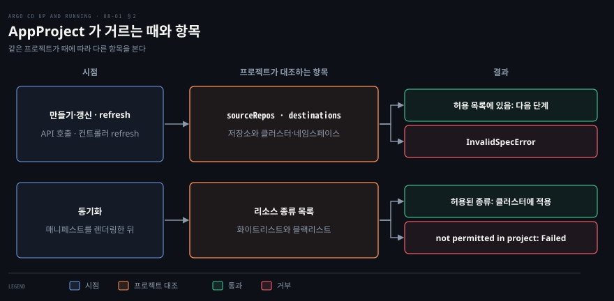
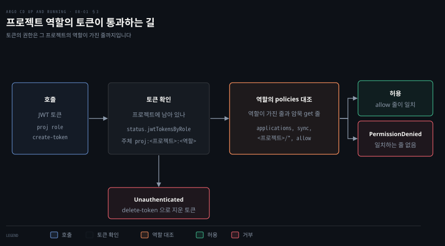

# 멀티 테넌시 — 설치 모드와 AppProject·프로젝트 역할
---

## 핵심 요약

> Argo CD 한 대를 여러 팀이 나눠 쓰게 하는 장치는 AppProject 이고, 설치 모드는 그 Argo CD 가 클러스터에서 가지는 권한의 크기를 정합니다.

클러스터 범위 설치는 ClusterRole 과 CRD 를 함께 깔아 어느 클러스터에든 배포하는 허브를 만듭니다. 네임스페이스 범위 설치는 Role 만 깔아서 팀마다 따로 줄 수 있는 인스턴스를 만듭니다. AppProject 는 Application 을 만들거나 갱신할 때와 컨트롤러가 refresh 할 때마다 소스 저장소와 배포 대상을 검사합니다. 리소스 종류는 동기화할 때 막습니다. 프로젝트 역할은 한 프로젝트 안으로만 권한을 주고 JWT 토큰은 그 역할의 권한까지만 통과합니다.[^ver]


## 학습 목표

이 내용을 읽고 나면:

1. 클러스터 범위 설치와 네임스페이스 범위 설치의 매니페스트 차이와, 네임스페이스 범위 설치에서 같은 클러스터에 배포하려면 무엇을 더해야 하는지 설명할 수 있습니다.
2. AppProject 의 `sourceRepos`, `destinations`, 리소스 종류 목록이 각각 무엇을 막고 어느 시점에 검사되는지 말할 수 있습니다.
3. 허용 규칙과 `!` 거부 규칙이 함께 있을 때 통과 여부를 순서와 상관없이 판정할 수 있습니다.
4. `default` 프로젝트가 무엇을 허용하는지, 지울 수 없는 이유와 잠그는 방법을 설명할 수 있습니다.
5. 프로젝트 역할의 정책 문법과 JWT 토큰 발급·삭제를 다루고, 개발자에게 조회와 동기화만 열어 주는 프로젝트를 만들 수 있습니다.


## 1. 설치 모드 — 클러스터·네임스페이스 범위

> 설치 모드는 컨트롤러 권한의 크기를 정하며, 클러스터 범위는 허브 구조에, 네임스페이스 범위는 팀별 인스턴스에 맞습니다.

설치 모드는 Argo CD 컨트롤러가 클러스터에서 가지는 권한의 크기를 정합니다. 모드는 클러스터 범위(`install.yaml`)와 네임스페이스 범위(`namespace-install.yaml`) 두 가지입니다. 하나를 여러 팀이 공유하면 클러스터 범위가 맞습니다. 팀마다 인스턴스를 나눠 주려면 네임스페이스 범위가 맞습니다. 설치 매니페스트를 고르는 기준 전체는 [02-01 §3](./02-01.Argo%20CD%20설치하기%20—%20구성%20요소·설치%20유형·매니페스트와%20Helm.md)에서 다뤘으므로 여기서는 멀티 테넌시에 닿는 차이만 봅니다.

### 클러스터 범위 설치

클러스터 범위 설치는 한 Argo CD 가 같은 클러스터와 등록한 외부 클러스터 모두에 배포하는 허브 구조에 맞습니다. 설치 문서는 `install.yaml` 을 "Standard Argo CD installation with cluster-admin access."라고 소개합니다.[^inst]

컨트롤러의 권한은 `install.yaml` 의 ClusterRole 이 정합니다. v3.6.1 의 `install.yaml` 에는 ClusterRole 3개, ClusterRoleBinding 3개, CRD 3개, Role 6개가 들어 있습니다. `argocd-application-controller` 의 ClusterRole 은 모든 리소스에 모든 동작(`*`)을 허용합니다.[^count] 권한의 크기를 따지는 보안 검토는 이 ClusterRole 에서 출발합니다.

### 네임스페이스 범위 설치

네임스페이스 범위 설치는 클러스터 수준 권한 없이 네임스페이스 안에서만 동작하는 인스턴스를 만듭니다. `namespace-install.yaml` 에는 ClusterRole 과 ClusterRoleBinding 과 CRD 가 하나도 없고 Role 6개만 있습니다.[^count] CRD 가 없으므로 클러스터 관리자가 별도로 설치해야 합니다.[^crd]

```bash
kubectl apply --server-side --force-conflicts -k "https://github.com/argoproj/argo-cd/manifests/crds?ref=v3.6.1"
```

이 모드에서 같은 클러스터에 배포하려면 그 클러스터를 따로 등록해야 합니다. 설치 문서는 기본 역할로는 Argo CD 리소스(Application, ApplicationSet, AppProject)만 같은 클러스터에 배포할 수 있다고 적습니다. 등록 명령은 `argocd cluster add <CONTEXT> --in-cluster --namespace <YOUR NAMESPACE>` 입니다.[^inst]

등록한 뒤에도 컨트롤러의 ServiceAccount 에 권한을 따로 묶어야 Application 이 배포되었습니다. `--in-cluster` 로 등록한 클러스터에는 토큰이 저장되지 않아 컨트롤러가 자기 ServiceAccount(`argocd-application-controller`)로 접속하기 때문입니다.[^incluster]

### 네임스페이스 범위 인스턴스 실습

실습에서는 네임스페이스 범위 인스턴스를 `argocd-b` 네임스페이스에 설치하고 배포 대상 네임스페이스를 `team-b` 로 두었습니다. `argocd-b` 는 Argo CD 가 설치된 곳이고 `team-b` 는 Application 이 배포되는 곳입니다.

등록 명령을 `--namespace team-b` 로 실행하면 `team-b` 에 `argocd-manager-role` 이 만들어집니다. 그런데 컨트롤러는 이 역할을 쓰지 않습니다. 그래서 `team-b` 에 `argocd-b` 의 컨트롤러 ServiceAccount 를 묶는 RoleBinding 을 따로 더해야 합니다. `cluster-admin` ClusterRole 을 묶는 RoleBinding 을 `team-b` 에 더하자 Application 이 `Synced` 가 되었습니다. RoleBinding 은 그 네임스페이스 안에서만 효력이 있어서 권한이 네임스페이스를 넘지 않습니다.

```yaml
apiVersion: rbac.authorization.k8s.io/v1
kind: RoleBinding
metadata:
  name: argocd-b-deployer
  namespace: team-b
subjects:
  - kind: ServiceAccount
    name: argocd-application-controller
    namespace: argocd-b
roleRef:
  apiGroup: rbac.authorization.k8s.io
  kind: ClusterRole
  name: cluster-admin
```

네임스페이스 범위 인스턴스의 컨트롤러는 클러스터 범위 리소스를 조회하지 못합니다. 그래서 Namespace 같은 클러스터 범위 리소스를 배포하려면 클러스터 관리자가 권한을 따로 열어 주어야 합니다. 등록할 때 `--cluster-resources` 도 주어야 합니다. `--namespace` 로 등록한 클러스터는 이 옵션이 없으면 클러스터 범위 리소스를 관리 대상에서 뺍니다. 인스턴스가 늘수록 이 조율과 운영 부담도 늘어납니다. 이 장의 나머지는 클러스터 범위 인스턴스 하나를 여러 팀이 나눠 쓰는 경우를 중심으로 합니다. 클러스터 등록과 허브 앤 스포크는 [07-01](./07-01.여러%20클러스터%20관리하기%20—%20허브%20앤%20스포크·클러스터%20Secret·멀티%20클러스터%20배포.md)에서 다룹니다.


## 2. AppProject 의 배포 범위 제한

> AppProject 는 Application 이 배포할 수 있는 저장소·대상·리소스 종류를 제한하고, 항목마다 검사 시점이 다릅니다.

AppProject 는 Application 이 어느 저장소에서 어디로 어떤 종류의 리소스를 배포할 수 있는지를 제한하는 CRD 입니다. 모든 Application 은 정확히 하나의 프로젝트에 속합니다. 프로젝트 문서는 "Projects provide a logical grouping of applications, which is useful when Argo CD is used by multiple teams."라고 설명합니다.[^proj]

`project` 를 적지 않은 Application 은 `default` 프로젝트에 속합니다([04-01](./04-01.Application%20관리하기%20—%20소스·대상·Helm·Kustomize%20와%20삭제·finalizer.md)). 프로젝트가 제한하는 항목은 네 가지이고 항목마다 검사하는 시점이 다릅니다.

| 필드 | 제한하는 것 | 검사 시점 |
|------|------------|----------|
| `sourceRepos` | 소스 저장소 URL | Application 생성·갱신(API), 컨트롤러 refresh 마다 |
| `destinations` | 클러스터(`server`)와 네임스페이스의 짝 | Application 생성·갱신(API), 컨트롤러 refresh 마다 |
| `clusterResourceWhitelist` · `clusterResourceBlacklist` | 클러스터 범위 리소스 종류 | 동기화 |
| `namespaceResourceWhitelist` · `namespaceResourceBlacklist` | 네임스페이스 범위 리소스 종류 | 동기화 |



### 저장소·대상 검사 시점

저장소와 배포 대상은 Application 을 만들거나 갱신하는 순간에 API 서버가 검사하고, 어긋나면 `InvalidSpecError` 로 거부됩니다. 허용 목록에 없는 저장소를 소스로 하는 Application 을 만들면 API 호출이 다음 오류로 끝납니다.

```bash
InvalidSpecError: application repo https://github.com/argoproj/argo-helm.git is not permitted in project 'golist'
```

배포 대상이 어긋나면 같은 종류의 오류가 납니다.

```bash
InvalidSpecError: application destination server 'https://kubernetes.default.svc' and namespace 'team-b' do not match any of the allowed destinations in project 'golist'
```

같은 Application 을 YAML 로 선언해 `kubectl apply` 하면 Application 은 만들어집니다. 그 `status.conditions` 에 같은 `InvalidSpecError` 가 남고 상태는 `Unknown` 입니다. 애플리케이션 컨트롤러도 refresh 할 때마다 같은 검사를 다시 합니다. 그래서 프로젝트를 나중에 좁히면 이미 있던 Application 에도 `InvalidSpecError` 가 붙고 동기화가 거부됩니다.[^refresh]

### 허용 규칙과 거부 규칙

허용 규칙과 거부 규칙은 적힌 순서와 상관없이 같은 조건으로 판정됩니다. 거부 규칙(`!`)의 뒤 패턴이 대상과 맞으면 다른 규칙과 상관없이 거부됩니다. 반대로 거부 규칙은 자기 패턴과 맞지 않는 대상을 일치로 셉니다. 그래서 목록에 거부 규칙이 하나라도 있으면 그 패턴에 걸리지 않는 대상은 다른 허용 규칙에 맞지 않아도 허용됩니다. 거부 규칙이 없는 목록에서는 허용 규칙 하나가 대상에 맞아야 허용됩니다.[^allow] 목적지도 같은 구조이고, 서버나 이름이 맞는 경우에만 일치로 센다는 점이 다릅니다. `!*` 는 모든 것을 거부하는 규칙이라 무효입니다.

`sourceRepos` 가 다음 두 줄이면 `argo-helm` 저장소는 첫 줄에 걸려 거부됩니다. `my-org` 아래 저장소는 두 번째 줄에 맞아 허용됩니다. 어느 줄에도 이름이 없는 `https://github.com/other-org/app.git` 도 첫 줄의 거부 규칙에 걸리지 않으므로 허용됩니다.

```yaml
spec:
  sourceRepos:
    - '!https://github.com/argoproj/argo-helm.git'
    - 'https://github.com/my-org/*'
```

허용 범위를 허용 규칙만으로 좁히려면 거부 규칙을 섞지 않아야 합니다. 다음 YAML 은 거부 규칙과 모든 것을 허용하는 `'*'` 규칙을 함께 적은 예입니다.

```yaml
spec:
  sourceRepos:
    - '!https://github.com/argoproj/argo-helm.git'
    - '*'
  destinations:
    - namespace: '!kube-system'
      server: '*'
    - namespace: '*'
      server: '*'
```

거부 규칙을 허용 규칙 앞에 두든 뒤에 두든 `argo-helm` 저장소와 `kube-system` 네임스페이스는 거부되고 나머지는 허용되었습니다. 두 순서의 프로젝트를 각각 만들어 같은 Application 으로 확인한 결과입니다.

네임스페이스 이름에는 글롭도 쓰입니다. `team-a-*` 를 허용하면 `team-a-extra` 는 통과하고 `team-b` 는 거부됩니다. 팀 이름을 네임스페이스 접두사로 고정해 두면 이름 규칙이 곧 권한 경계가 됩니다.

클러스터 Secret 의 `project` 필드로 클러스터를 한 프로젝트에 묶을 수 있습니다([07-01](./07-01.여러%20클러스터%20관리하기%20—%20허브%20앤%20스포크·클러스터%20Secret·멀티%20클러스터%20배포.md)). 묶인 클러스터는 평가할 때 그 프로젝트의 `destinations` 에 암묵 항목으로 더해집니다. 클러스터 정의에 `namespaces` 를 적지 않았다면 모든 네임스페이스가 대상이 됩니다. 프로젝트에 `permitOnlyProjectScopedClusters: true` 를 주면 그 프로젝트의 Application 은 묶인 클러스터로만 배포됩니다.[^scoped]

### 리소스 종류 허용과 거부

리소스 종류는 동기화할 때 검사됩니다. 허용되지 않은 종류의 리소스는 동기화 전 비교 단계에서도 상태가 `Unknown` 으로 표시됩니다. 네임스페이스 범위 리소스는 거부 목록으로, 클러스터 범위 리소스는 허용 목록으로 제한합니다. 프로젝트 문서는 "namespaced-scoped resources are restricted via a deny list, whereas cluster-scoped resources are restricted via allow list"라고 설명합니다.[^kind]

네임스페이스 범위 리소스는 기본으로 모두 허용됩니다. `namespaceResourceBlacklist` 로 `ResourceQuota` 같은 종류를 뺍니다. 클러스터 범위 리소스는 `clusterResourceWhitelist` 에 적은 종류만 허용되고 비워 두면 하나도 허용되지 않습니다.

```yaml
spec:
  clusterResourceWhitelist:
    - group: ''
      kind: Namespace
  namespaceResourceBlacklist:
    - group: ''
      kind: ResourceQuota
```

클러스터 범위 리소스를 막은 프로젝트에서는 `CreateNamespace=true` 를 준 Application 의 동기화가 실패합니다. 이 옵션이 만드는 Namespace 가 클러스터 범위 리소스이기 때문입니다. `clusterResourceWhitelist` 가 비어 있는 `golist` 프로젝트에서 이 옵션을 준 Application 을 동기화하면 Namespace 줄이 `SyncFailed` 가 되었습니다.

```bash
resource :Namespace is not permitted in project golist
```

네임스페이스를 먼저 만들어 두고 옵션을 빼자 같은 Application 이 `Synced` 가 되었습니다. `CreateNamespace` 가 만드는 Namespace 처럼 매니페스트에 없는 리소스는 동기화 시점에야 드러납니다. 그래서 프로젝트를 설계할 때 Application 이 만드는 리소스 종류까지 함께 따져야 합니다.

### default 프로젝트 잠그기

`default` 프로젝트는 설치할 때 자동으로 만들어지며 어느 저장소에서 어느 클러스터로든 모든 종류를 배포하게 허용합니다. 프로젝트 문서는 이를 "created automatically and by default, permits deployments from any source repo, to any cluster, and all resource Kinds"라고 적습니다.[^default]

이 프로젝트는 지울 수 없습니다. `argocd proj delete default` 는 `name 'default' is reserved and cannot be deleted` 로 거부됩니다.

대신 허용 범위를 잠글 수 있습니다. `sourceNamespaces` 는 Argo CD 가 설치된 네임스페이스 밖에 만든 Application 이 이 프로젝트를 쓸 수 있는 네임스페이스의 목록입니다.[^srcns] 비워 두면 그런 Application 은 이 프로젝트를 쓸 수 없습니다. 잠글 때는 `sourceRepos`·`sourceNamespaces`·`destinations` 를 빈 목록으로 둡니다. `namespaceResourceBlacklist` 에 `*`/`*` 를 적으면 아무 Application 도 배포되지 않습니다.

```yaml
apiVersion: argoproj.io/v1alpha1
kind: AppProject
metadata:
  name: default
  namespace: argocd
spec:
  sourceRepos: []
  sourceNamespaces: []
  destinations: []
  namespaceResourceBlacklist:
    - group: '*'
      kind: '*'
```

### AppProject 와 RBAC 의 역할 차이

AppProject 와 RBAC 는 서로 다른 문을 지키므로 RBAC 권한이 충분해도 프로젝트가 막으면 배포되지 않습니다. RBAC 는 누가 API 를 호출할 수 있는지를 정합니다. AppProject 는 Application 이 어디에 무엇을 배포할 수 있는지를 정합니다.

`admin` 으로 `argocd app set golist-web --dest-namespace team-b` 를 실행해 `golist` 프로젝트의 Application 을 옮기려 해도 위와 같은 `InvalidSpecError` 로 거부되었습니다. 그래서 팀 단위 경계를 세우려면 RBAC 만으로는 부족하고 프로젝트로 배포 범위를 따로 좁혀야 합니다.


## 3. 프로젝트 역할과 JWT 토큰

> 프로젝트 역할은 권한을 한 프로젝트 안으로만 주고, JWT 토큰으로 사람 없이 인증할 수 있습니다.

프로젝트 역할은 권한을 한 프로젝트 안으로만 주는 역할입니다. 대상 리소스는 보통 `applications` 이고 `applicationsets`·`repositories`·`clusters`·`logs`·`exec` 도 쓸 수 있습니다. 정책과 그룹은 `spec.roles` 에 적습니다. 프로젝트 문서는 CI 파이프라인에 한 앱의 동기화만 허용하는 용도를 예로 듭니다. 정책은 그 프로젝트 안으로만 적을 수 있습니다.[^role]

### 역할 정책 형식과 검증

정책 형식은 `argocd-rbac-cm` 의 정책과 같습니다([06-02](./06-02.SSO%20연결과%20RBAC%20—%20Dex·직접%20OIDC·역할과%20정책.md)). 다만 주체와 객체의 모양이 정해져 있습니다. 주체는 `proj:<프로젝트>:<역할>` 이고 객체는 `<프로젝트>/` 로 시작합니다. `<프로젝트>/*`, `<프로젝트>/<이름>`, `<프로젝트>/<네임스페이스>/<이름>` 모양을 받습니다.

```yaml
spec:
  roles:
    - name: golist-developer
      description: golist 앱 조회와 동기화
      policies:
        - p, proj:golist:golist-developer, applications, get, golist/*, allow
        - p, proj:golist:golist-developer, applications, sync, golist/*, allow
      groups:
        - Developers
```

Argo CD 는 이 역할을 Casbin 규칙으로 바꿀 때 `projects, get` 줄을 자동으로 더합니다. 그룹을 역할에 묶는 `g` 줄도 만듭니다. `argocd proj role get golist golist-developer` 가 보여 준 결과입니다.

```bash
p, proj:golist:golist-developer, projects, get, golist, allow
p, proj:golist:golist-developer, applications, get, golist/*, allow
p, proj:golist:golist-developer, applications, sync, golist/*, allow
g, Developers, proj:golist:golist-developer
```

이 줄은 Argo CD 가 넣으므로 정책에 직접 적지 않습니다. 직접 적으면 `projects` 가 역할 정책의 리소스로 허용되지 않아 `project resource must be: …` 로 거부됩니다. 정책에 적히지 않은 동작은 허용되지 않으므로 `delete` 나 `update` 는 막힙니다. `groups` 의 `Developers` 가 SSO 가 주는 그룹 이름과 같아야 사람이 이 역할을 받습니다([06-02](./06-02.SSO%20연결과%20RBAC%20—%20Dex·직접%20OIDC·역할과%20정책.md)).

정책의 주체·객체·효과 모양이 틀리면 프로젝트를 만들 때 바로 거부됩니다. 아래 세 줄은 각각 다른 이유로 `argocd proj create --upsert --file` 에서 `InvalidArgument` 가 되었습니다.

```bash
p, proj:team-a:role:dev, applications, get, team-a/*, allow
  policy subject must be: 'proj:team-a:dev', not 'proj:team-a:role:dev'
p, proj:team-a:dev, applications, get, team-b/*, allow
  object must be of form 'team-a/*', 'team-a[/<NAMESPACE>]/<APPNAME>' or 'team-a/<APPNAME>', not 'team-b/*'
p, proj:team-a:dev, applications, get, team-a/*, all
  effect must be: 'allow' or 'deny'
```

세 줄은 주체에 `role:` 이 끼어든 모양, 다른 프로젝트의 객체, 효과 값 `all` 입니다. 역할 정책이 다른 프로젝트의 객체를 가리키지 못한다는 점이 두 번째 오류의 뜻입니다. 여러 프로젝트에 걸치는 권한은 `argocd-rbac-cm` 에 적어야 합니다.

### JWT 토큰 발급과 삭제

JWT 토큰은 프로젝트 역할로 사람 없이 인증하는 방법입니다. 토큰은 지우거나 만료될 때까지 쓸 수 있고, CLI 는 기본으로 만료 없이 만듭니다(`-e 10m` 처럼 만료를 줍니다). 프로젝트 문서는 "Argo CD supports JWT tokens as the means to authenticate to a role."라고 설명합니다. 토큰 값은 만들 때만 볼 수 있고 `--auth-token` 플래그나 `ARGOCD_AUTH_TOKEN` 환경 변수로 씁니다.[^tok]

토큰을 만들면 `argocd proj role get` 의 `JWT Tokens` 표에 한 줄이 생깁니다. `ID` 열은 발급 시각의 유닉스 초 정수이고 `ISSUED-AT` 열은 같은 시각을 읽기 쉽게 적은 문자열입니다.[^tok] 토큰 값은 이후에 다시 조회되지 않습니다.

```bash
argocd proj role create-token golist golist-developer
argocd app list --auth-token "$TOKEN"
```



토큰으로 할 수 있는 일은 그 역할의 정책 줄까지입니다. `golist-developer` 토큰으로 `argocd app list` 를 하면 `golist` 프로젝트의 Application 만 보입니다. 다른 프로젝트(`default`)의 Application 을 조회하면 `PermissionDenied` 입니다. `argocd app sync golist-web` 은 허용되어 동기화가 끝납니다. `delete` 는 정책에 없어서 거부되고 오류에 주체와 동작이 그대로 나옵니다.

```bash
rpc error: code = PermissionDenied desc = permission denied: applications, delete, golist/golist-web, sub: proj:golist:golist-developer, iat: 2026-11-06T07:31:43Z
```

토큰은 `delete-token` 으로 지웁니다. 세 번째 인자의 이름은 `ISSUED-AT` 이지만 값은 토큰의 uuid 도 시각 문자열도 아닌 정수입니다. `argocd proj role delete-token golist golist-developer 1793950303` 처럼 `JWT Tokens` 표의 `ID` 열 값을 줍니다.

`ISSUED-AT` 열의 시각 문자열을 넣으면 정수로 읽을 수 없어 명령이 실패합니다. 지운 직후의 다음 호출부터 같은 토큰은 `Unauthenticated` 로 거부됩니다. 오류 문구는 `JWT token for role 'golist-developer' issued at '1793950303' does not exist in project 'golist'` 입니다.

### 프로젝트 역할 사용 방식

GitOps 대시보드는 그룹에 조회와 동기화만 열고 수정과 삭제는 막는 사용 방식입니다. 위의 `golist-developer` 역할이 그 형태입니다. `Developers` 그룹의 사용자는 프로젝트의 Application 목록을 보고 필요할 때 동기화를 누릅니다. 삭제는 거부됩니다. 그래서 개발자가 상태를 확인하고 즉시 동기화하는 개발자 포털 같은 용도에 맞습니다.

프로젝트 자체도 YAML 로 Git 에 두면 변경 이력이 남습니다. `argocd proj create --upsert --file` 이나 `kubectl apply` 로 적용합니다. `--upsert` 가 있어야 같은 이름의 프로젝트를 덮어씁니다.

토큰을 CI 에서 쓰는 법(`--token-only`, `-e` 만료, Secret 주입)은 12장 정독 노트(12-01)에서 다룹니다.


## 연습 문제

> 아래 여섯 문제는 설치 모드와 프로젝트의 검사 시점과 허용·거부 규칙과 프로젝트 역할과 토큰을 하나씩 묻습니다. 답을 적은 뒤에 정답 절을 펼칩니다.

1. 클러스터 범위 설치와 네임스페이스 범위 설치의 매니페스트는 ClusterRole·ClusterRoleBinding·CRD 개수가 각각 어떻게 다릅니까? 네임스페이스 범위 인스턴스에서 같은 클러스터에 배포하려면 등록 명령 말고 무엇이 더 필요했습니까?
2. 프로젝트의 `sourceRepos` 에 `argocd-example-apps` 저장소 하나만 있습니다. 허용되지 않은 저장소를 소스로 하는 Application 을 `argocd app create` 로 만들면 어떻게 됩니까? 같은 Application 을 YAML 로 `kubectl apply` 하면 어디에서 오류를 볼 수 있습니까?
3. `sourceRepos` 가 `'*'` 와 `'!https://github.com/argoproj/argo-helm.git'` 두 줄입니다. 두 줄의 순서를 바꾸면 `argo-helm` 저장소는 허용됩니까? `destinations` 의 `namespace: 'team-a-*'` 는 `team-a-extra` 와 `team-b` 를 각각 어떻게 판정합니까?
4. `clusterResourceWhitelist` 가 비어 있는 프로젝트의 Application 에 `CreateNamespace=true` 를 줬습니다. 동기화 결과는 무엇이고 어떻게 고칩니까?
5. 역할 정책 `p, proj:team-a:role:dev, applications, get, team-a/*, allow` 가 `InvalidArgument` 가 됩니다. 이유와 고친 모양은 무엇입니까? 객체를 다른 프로젝트 `team-b/*` 로 바꾸면 무엇이 달라집니까?
6. `golist-developer` 토큰으로 `golist-web` 을 동기화하고 삭제를 시도했습니다. 결과는 각각 무엇입니까? 그 토큰을 `delete-token` 으로 지우면 다음 호출은 어떻게 됩니까? `admin` 으로 이 프로젝트의 Application 을 허용되지 않은 네임스페이스로 옮기려 하면 어떻게 됩니까?


## 정답 (자답 후 펼치기)

### 정답 1

클러스터 범위 `install.yaml` 은 ClusterRole 3개, ClusterRoleBinding 3개, CRD 3개이고, 네임스페이스 범위 `namespace-install.yaml` 은 세 가지가 모두 0개이며 Role 6개는 같습니다. CRD 는 클러스터 관리자가 `manifests/crds` 로 따로 설치합니다.

네임스페이스 범위 인스턴스는 `argocd cluster add <CONTEXT> --in-cluster --namespace <NS>` 로 같은 클러스터를 등록해야 합니다. 실습에서는 이것만으로 부족했습니다. 이 방식으로 등록한 클러스터에는 토큰이 없어 컨트롤러가 자기 ServiceAccount 로 접속하기 때문입니다. 대상 네임스페이스에 컨트롤러의 ServiceAccount 를 `cluster-admin` ClusterRole 에 묶는 RoleBinding 을 더하자 Application 이 `Synced` 가 되었습니다.

### 정답 2

`argocd app create` 는 `InvalidSpecError: application repo <URL> is not permitted in project '<이름>'` 으로 API 단계에서 거부되어 Application 이 만들어지지 않습니다.

YAML 로 `kubectl apply` 하면 Application 자체는 만들어지지만 `status.conditions` 에 같은 `InvalidSpecError` 가 남고 상태가 `Unknown` 입니다. `kubectl get application <이름> -n argocd -o jsonpath='{.status.conditions}'` 로 볼 수 있습니다.

### 정답 3

순서를 바꿔도 결과는 같고 `argo-helm` 저장소는 거부됩니다. 거부 규칙 하나가 대상과 맞으면 순서와 상관없이 거부되기 때문입니다.

`team-a-*` 는 `team-a-extra` 를 허용하고 `team-b` 를 거부합니다. `team-b` 의 거부는 `InvalidSpecError ... do not match any of the allowed destinations` 로 나옵니다.

### 정답 4

동기화가 실패하고 Namespace 줄이 `SyncFailed` 이며 메시지는 `resource :Namespace is not permitted in project <이름>` 입니다. `CreateNamespace=true` 가 클러스터 범위 리소스인 Namespace 를 만드는데, 클러스터 범위 리소스는 `clusterResourceWhitelist` 에 적어야 허용되기 때문입니다.

고치는 길은 둘입니다. `clusterResourceWhitelist` 에 `group: ''`, `kind: Namespace` 를 허용하거나, 네임스페이스를 미리 만들어 두고 `CreateNamespace=true` 를 뺍니다. 실습에서는 뒤쪽이 `Synced` 로 끝났습니다.

### 정답 5

주체가 `proj:<프로젝트>:<역할>` 이어야 하는데 `role:` 이 끼어 있기 때문입니다. 오류는 `policy subject must be: 'proj:team-a:dev', not 'proj:team-a:role:dev'` 이고, 고친 줄은 `p, proj:team-a:dev, applications, get, team-a/*, allow` 입니다.

객체를 `team-b/*` 로 바꾸면 이번에는 객체 오류가 납니다. 역할 정책은 자기 프로젝트의 객체(`team-a/*`, `team-a/<앱>`)만 가리킬 수 있고, 다른 프로젝트에 걸치는 권한은 `argocd-rbac-cm` 에 적어야 합니다. 효과에 `allow` 나 `deny` 가 아닌 값(`all`)을 써도 같은 방식으로 거부됩니다.

### 정답 6

동기화는 허용되어 끝납니다. 삭제는 `PermissionDenied: permission denied: applications, delete, golist/golist-web, ...` 으로 거부됩니다. 정책에 `get` 과 `sync` 만 있기 때문입니다.

`delete-token golist golist-developer <ID 열 값>` 로 지운 뒤의 다음 호출은 `Unauthenticated` 입니다. 문구는 `JWT token for role 'golist-developer' issued at '...' does not exist in project 'golist'` 입니다. 인자는 uuid 도 시각 문자열도 아니고, `ID` 열에 찍힌 발급 시각의 유닉스 초 정수입니다.

`admin` 도 허용 목록 밖의 네임스페이스로 옮기려 하면 `InvalidSpecError` 로 거부됩니다. RBAC 가 허용해도 AppProject 가 배포 범위를 막기 때문입니다.


## 참고 자료

- 《Argo CD: Up and Running》(Andrew Block · Christian Hernandez, O'Reilly, 2025, ISBN 978-1-098-14200-1) 8장
- [설치](https://github.com/argoproj/argo-cd/blob/v3.6.1/docs/operator-manual/installation.md)
- [프로젝트](https://github.com/argoproj/argo-cd/blob/v3.6.1/docs/user-guide/projects.md)
- [project.yaml](https://github.com/argoproj/argo-cd/blob/v3.6.1/docs/operator-manual/project.yaml)
- [RBAC 설정](https://github.com/argoproj/argo-cd/blob/v3.6.1/docs/operator-manual/rbac.md)
- [argocd proj role create-token](https://github.com/argoproj/argo-cd/blob/v3.6.1/docs/user-guide/commands/argocd_proj_role_create-token.md)
- 관련 노트: [이 책의 인덱스](./README.md)
- 관련 노트: [02-01 Argo CD 설치하기](./02-01.Argo%20CD%20설치하기%20—%20구성%20요소·설치%20유형·매니페스트와%20Helm.md), [04-01 Application 관리하기](./04-01.Application%20관리하기%20—%20소스·대상·Helm·Kustomize%20와%20삭제·finalizer.md)
- 관련 노트: [06-02 SSO 연결과 RBAC](./06-02.SSO%20연결과%20RBAC%20—%20Dex·직접%20OIDC·역할과%20정책.md), [07-01 여러 클러스터 관리하기](./07-01.여러%20클러스터%20관리하기%20—%20허브%20앤%20스포크·클러스터%20Secret·멀티%20클러스터%20배포.md)
- 관련 노트: [Kubernetes namespace](../kubernetes-in-action/07-01.namespace로%20클러스터를%20가상%20분할하기.md), [Kubernetes RBAC](../kubernetes-up-and-running/14-01.RBAC%20—%20인가를%20설계하고%20운영하는%20법.md), [Access Control — RBAC](../kubernetes-patterns/26-01.Access%20Control%20—%20RBAC으로%20누가%20무엇을%20할%20수%20있는지.md)

[^ver]: 최신 릴리스는 Argo CD v3.6.1(2026-11-04)이고 Helm 차트는 10.14.0(appVersion v3.6.1)입니다. 문서와 소스는 v3.6.1 태그에 고정했고 설치 매니페스트는 `https://raw.githubusercontent.com/argoproj/argo-cd/v3.6.1/manifests/install.yaml` 입니다. 이 노트의 실습은 kind v0.31.0 이 만든 Kubernetes v1.35.0 클러스터에 그 매니페스트로 설치한 v3.6.1 에서 실행했고, 클러스터 범위 인스턴스 하나와 `namespace-install.yaml` 로 설치한 인스턴스 하나를 같은 클러스터에 두어 비교했습니다. `argocd` CLI 는 admin 토큰과 프로젝트 역할 토큰으로 각각 실행했습니다.
[^inst]: 설치 문서는 `install.yaml` 을 "Standard Argo CD installation with cluster-admin access."로 소개하고, `namespace-install.yaml` 을 "Installation of Argo CD which requires only namespace level privileges (does not need cluster roles)."로 소개합니다. 같은 클러스터에는 "It will still be possible to deploy to the same cluster (kubernetes.svc.default) with provided credentials (i.e. `argocd cluster add <CONTEXT> --in-cluster --namespace <YOUR NAMESPACE>`). With the default roles included, you will only be able to deploy Argo CD resources (Applications, ApplicationSets and AppProjects) in the same cluster"라고 하고, 권한을 넓히려면 "defining new roles and binding them to the `argocd-application-controller` service account"라고 안내합니다. <https://github.com/argoproj/argo-cd/blob/v3.6.1/docs/operator-manual/installation.md> (2026-11-06 조회)
[^count]: v3.6.1 의 `manifests/install.yaml` 은 ClusterRole 3개(`argocd-application-controller`, `argocd-applicationset-controller`, `argocd-server`), ClusterRoleBinding 3개, CustomResourceDefinition 3개, Role 6개이고, `argocd-application-controller` 의 ClusterRole 은 `apiGroups: *`, `resources: *`, `verbs: *` 와 `nonResourceURLs: *` 를 가집니다. `manifests/namespace-install.yaml` 은 ClusterRole·ClusterRoleBinding·CustomResourceDefinition 이 각각 0개이고 Role 6개입니다. 두 파일을 내려받아 `kind` 별로 센 결과입니다. <https://github.com/argoproj/argo-cd/blob/v3.6.1/manifests/install.yaml>, <https://github.com/argoproj/argo-cd/blob/v3.6.1/manifests/namespace-install.yaml> (2026-11-06 조회)
[^crd]: 설치 문서는 "Argo CD CRDs are not included into namespace-install.yaml. and have to be installed separately. The CRD manifests are located in the manifests/crds directory."라고 하고 `kubectl apply --server-side --force-conflicts -k https://github.com/argoproj/argo-cd/manifests/crds\?ref\=stable` 을 안내합니다. 이 노트는 태그를 `v3.6.1` 로 고정해 적었습니다. <https://github.com/argoproj/argo-cd/blob/v3.6.1/docs/operator-manual/installation.md> (2026-11-06 조회)
[^proj]: 프로젝트 문서는 "Projects provide a logical grouping of applications, which is useful when Argo CD is used by multiple teams."라고 하고 기능으로 "restrict what may be deployed (trusted Git source repositories)", "restrict where apps may be deployed to (destination clusters and namespaces)", "restrict what kinds of objects may or may not be deployed", "defining project roles to provide application RBAC (bound to OIDC groups and/or JWT tokens)"를 듭니다. <https://github.com/argoproj/argo-cd/blob/v3.6.1/docs/user-guide/projects.md> (2026-11-06 조회)
[^allow]: 프로젝트 문서는 소스 저장소가 유효한 조건을 "_Any_ allow source rule (i.e. a rule which isn't prefixed with `!`) permits the source AND *no* deny source (i.e. a rule which is prefixed with `!`) rejects the source"로 적고 "Keep in mind that `!*` is an invalid rule, since it doesn't make any sense to disallow everything."라고 덧붙입니다. 문서 문장만 읽으면 허용 규칙이 하나는 있어야 통과할 것 같지만 코드는 다르게 움직입니다. v3.6.1 `app_project_types.go` 의 `globMatch`(446~455행)는 `!` 패턴이 대상과 맞지 않으면 `true` 를 돌려줍니다. `IsSourcePermitted`(458~480행)는 이 `true` 를 일치로 세어 `anySourceMatched` 를 켜고, `!` 패턴이 대상과 맞으면 그 자리에서 `false` 를 돌려줍니다. 그래서 거부 규칙에 걸리지 않은 대상은 허용 규칙에 맞지 않아도 통과합니다. 목적지는 `isDestinationMatched`(507~527행)가 같은 구조로 판정하며 서버나 이름이 맞아야 일치로 세는 점만 다릅니다. 거부 규칙을 허용 규칙의 앞에 둔 프로젝트와 뒤에 둔 프로젝트를 각각 만들어 같은 Application 으로 확인했고 결과는 같았습니다. <https://github.com/argoproj/argo-cd/blob/v3.6.1/docs/user-guide/projects.md> (2026-11-06 조회), <https://github.com/argoproj/argo-cd/blob/v3.6.1/pkg/apis/application/v1alpha1/app_project_types.go> (2026-11-08 조회)
[^kind]: 프로젝트 문서는 "Note that namespaced-scoped resources are restricted via a deny list, whereas cluster-scoped resources are restricted via allow list."라고 적습니다. 필드는 `namespaceResourceBlacklist`·`namespaceResourceWhitelist` 와 `clusterResourceWhitelist`·`clusterResourceBlacklist` 입니다. <https://github.com/argoproj/argo-cd/blob/v3.6.1/docs/user-guide/projects.md> (2026-11-06 조회)
[^default]: 프로젝트 문서는 "Every application belongs to a single project. If unspecified, an application belongs to the `default` project, which is created automatically and by default, permits deployments from any source repo, to any cluster, and all resource Kinds."라고 적고, 처음 만들어질 때의 `sourceRepos`·`destinations`·`clusterResourceWhitelist` 는 모두 `'*'` 입니다. `argocd proj delete default` 의 거부 문구는 실습에서 얻었고, 잠그는 YAML 도 같은 인스턴스에 적용해 Application 이 배포되지 않는 것을 확인했습니다. <https://github.com/argoproj/argo-cd/blob/v3.6.1/docs/user-guide/projects.md> (2026-11-06 조회)
[^role]: 프로젝트 문서는 "Projects include a feature called roles that can be used to determine who and what can be done to the applications associated with the project. As an example, it can be used to give a CI pipeline a restricted set of permissions allowing sync operations on a single app (but not change its source or destination)."라고 하고, "Note that each project role policy rule must be scoped to that project only. Use the `argocd-rbac-cm` ConfigMap described in RBAC documentation if you want to configure cross project RBAC rules."라고 적습니다. 정책의 리소스에 대해서는 "The example above used `applications` as the resource for the policy definition. However other types of resources can also be used: `applicationsets`, `repositories`, `clusters`, `logs` and `exec`."라고 적습니다. 소스의 `validatePolicy` 는 `applications`·`applicationsets`·`repositories`·`exec`·`logs`·`clusters` 가 아닌 리소스(`projects` 포함)를 "project resource must be: …" 로 거부하고, 객체는 `^<프로젝트>(/[*\w-.]+)?/[*\w-.]+$` 모양이어야 합니다. 역할이 만드는 Casbin 규칙은 "p, proj:sample-test-project:custom-project-role, applications, *, *, allow"와 "g, some-user, proj:sample-test-project:custom-project-role"입니다. <https://github.com/argoproj/argo-cd/blob/v3.6.1/docs/user-guide/projects.md> (2026-11-06 조회), <https://github.com/argoproj/argo-cd/blob/v3.6.1/pkg/apis/application/v1alpha1/types.go> (2026-11-08 조회)
[^refresh]: v3.6.1 `controller/appcontroller.go` 의 `refreshAppConditions` 는 refresh 마다 `argo.ValidatePermissions` 로 Application 의 저장소와 목적지를 프로젝트에 대조해 어긋나면 condition 을 붙입니다. kind 실습에서는 `team-a-*` 로 허용된 네임스페이스의 Application 이 있는 프로젝트에서 그 글롭을 빼자, 앱을 건드리지 않았는데도 refresh 만으로 `InvalidSpecError` 가 붙고 동기화 상태가 `Unknown` 이 되었습니다. <https://github.com/argoproj/argo-cd/blob/v3.6.1/controller/appcontroller.go> (2026-11-08 조회)
[^incluster]: v3.6.1 `types.go` 의 `RawRestConfig` 는 서버가 `https://kubernetes.default.svc` 이고 사용자 이름·비밀번호·bearer token 이 모두 비어 있으면 `rest.InClusterConfig()` 로 접속합니다. `--in-cluster` 로 등록한 클러스터 Secret 의 `config` 에는 `tlsClientConfig` 만 있고 bearer token 은 없었습니다. <https://github.com/argoproj/argo-cd/blob/v3.6.1/pkg/apis/application/v1alpha1/types.go> (2026-11-08 조회)
[^scoped]: 프로젝트 문서의 「Project scoped Repositories and Clusters」는 "When a project-scoped cluster is defined, an implicit entry is dynamically added to the AppProject's `destinations` list during evaluation."이라고 하고, 클러스터 정의에 `namespaces` 가 있으면 그 네임스페이스만 암묵 항목이 된다고 설명합니다. 이어서 "To prevent this behavior, we can set the attribute `permitOnlyProjectScopedClusters` on a project."라고 적습니다. 클러스터 Secret 에는 `project: my-project1` 필드를 둡니다. <https://github.com/argoproj/argo-cd/blob/v3.6.1/docs/user-guide/projects.md> (2026-11-08 조회)
[^tok]: 프로젝트 문서는 "Argo CD supports JWT tokens as the means to authenticate to a role. Since the JWT token is associated with a role's policies, any changes to the role's policies will immediately take effect for that JWT token."라고 하고, "Since the JWT tokens aren't stored in Argo CD, they can only be retrieved when they are created. A user can leverage them in the cli by either passing them in using the `--auth-token` flag or setting the ARGOCD_AUTH_TOKEN environment variable. The JWT tokens can be used until they expire or are revoked.  The JWT tokens can be created with or without an expiration.  By default, the cli creates them without an expirations date."라고 적습니다. 명령은 `argocd proj role create-token PROJECT ROLE-NAME` 과 `argocd proj role delete-token PROJECT ROLE-NAME ISSUED-AT` 입니다. v3.6.1 `cmd/argocd/commands/project_role.go` 의 `get` 은 표 머리를 `ID`·`ISSUED-AT`·`EXPIRES-AT` 로 찍고 `ID` 열에 `token.IssuedAt` 정수를, `ISSUED-AT` 열에 같은 값을 `humanizeTimestamp` 로 바꾼 문자열을 찍습니다(622~628행). `delete-token` 은 세 번째 인자를 `strconv.ParseInt` 로 정수로 읽어 `Iat` 로 보냅니다(490~491행). 같은 파일의 `list-tokens` 는 머리를 `ISSUED AT`(공백)으로 찍어 `get` 과 다릅니다(426행). <https://github.com/argoproj/argo-cd/blob/v3.6.1/docs/user-guide/projects.md> (2026-11-06 조회), <https://github.com/argoproj/argo-cd/blob/v3.6.1/cmd/argocd/commands/project_role.go> (2026-11-08 조회)

[^srcns]: 운영 문서는 "The `AppProject` referenced by the `.spec.project` field of the `Application` must have the namespace listed in its `.spec.sourceNamespaces` field."라고 적습니다. v3.6.1 `app_project_types.go` 의 `IsAppNamespacePermitted`(625~631행)는 Application 의 네임스페이스가 비어 있거나 컨트롤러의 네임스페이스이면 통과시키고, 그 밖의 네임스페이스는 `sourceNamespaces` 목록과 맞을 때만 통과시킵니다. <https://github.com/argoproj/argo-cd/blob/v3.6.1/docs/operator-manual/app-any-namespace.md> (2026-11-08 조회), <https://github.com/argoproj/argo-cd/blob/v3.6.1/pkg/apis/application/v1alpha1/app_project_types.go> (2026-11-08 조회)
