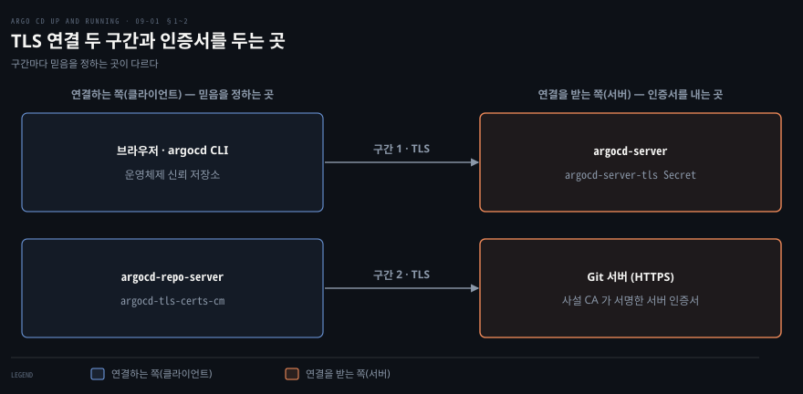
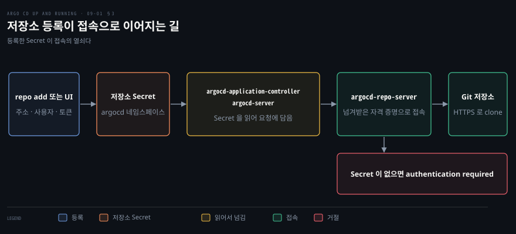

# 서버와 저장소 접근 보안 — TLS 인증서·저장소 인증서·HTTPS 자격 증명
---

## 핵심 요약

> 이 편이 다루는 TLS 연결은 둘이고, 연결마다 인증서를 내는 쪽과 믿는 쪽이 다르므로 설정하는 곳도 다릅니다.

브라우저와 명령줄 도구가 `argocd-server` 로 가는 구간에서는 `argocd-server-tls` Secret 이 인증서를 냅니다. 서버 쪽 `--insecure` 는 그 TLS 를 끕니다. `argocd-repo-server` 가 Git 서버로 가는 구간에서는 `argocd-tls-certs-cm` 이 믿을 인증서를 정합니다. 인증이 필요한 저장소는 저장소 Secret 에 담은 사용자 이름과 토큰으로 접속합니다.[^ver]


## 학습 목표

이 내용을 읽고 나면:

1. `argocd-server` 가 어떤 순서로 TLS 인증서를 고르는지 말하고 `argocd-server-tls` Secret 으로 인증서를 바꿀 수 있습니다.
2. 서버의 `--insecure` 와 CLI 의 `--insecure` 가 각각 무엇을 끄는지 구분하고 Ingress 가 TLS 를 끝내는 구조에서 어떤 오류가 나는지 설명할 수 있습니다.
3. 사설 CA 가 서명한 Git 서버를 `argocd cert add-tls` 와 `argocd-tls-certs-cm` 으로 믿게 하고 `insecure` 옵션과 구분할 수 있습니다.
4. 인증이 필요한 저장소를 `argocd repo add` 로 등록할 때 만들어지는 Secret 의 모양과 `project` 필드의 뜻을 설명할 수 있습니다.


## 본문 정리

### 1. 서버 인증서와 --insecure

운영에서는 `argocd-server` 가 TLS(Transport Layer Security)를 직접 켜 두고, 인증서는 `argocd-server-tls` Secret 으로 넣습니다. `admin` 계정의 초기 Secret 과 비밀번호를 바꾸는 일은 [06-01](./06-01.Argo%20CD%20사용자와%20인증%20—%20admin·로컬%20사용자·토큰과%20SSO.md)에서 다뤘으므로 여기서는 연결 구간만 봅니다.

이 편이 다루는 TLS 연결은 두 구간입니다. 첫째 구간은 브라우저와 `argocd` CLI(Command Line Interface)가 `argocd-server` 에 연결하는 구간입니다. 둘째 구간은 `argocd-repo-server` 가 Git 서버에 연결하는 구간입니다.

구간마다 연결을 받는 쪽(서버)이 인증서를 내고, 연결하는 쪽(클라이언트)이 그 인증서를 믿을지 정합니다. 그래서 믿음을 정하는 설정은 구간 1 이 클라이언트의 운영체제 신뢰 저장소이고 구간 2 가 `argocd-tls-certs-cm` 입니다. 이 절은 구간 1 을 다루고 다음 절이 구간 2 를 다룹니다.

구성 요소 사이의 TLS 와 `argocd-repo-server`·`argocd-dex-server` 의 인증서는 TLS 문서가 따로 다룹니다.[^tls]



`argocd-server` 는 인증서를 정해진 순서로 고릅니다. 공식 문서는 우선순위를 "`argocd-server-tls` secret (recommended)", "`argocd-secret` secret (deprecated)", "Auto-generated self-signed certificate" 순서로 적습니다.[^tls]

앞의 두 Secret 에 `tls.crt` 와 `tls.key` 가 없으면 Argo CD 가 자체 서명 인증서를 만들어 `argocd-secret` 에 저장해 둡니다. 자체 서명 인증서는 브라우저가 믿지 않으므로 경고가 뜹니다. 외부 시스템이 안정적으로 믿으려면 인증서를 직접 넣어야 합니다.

```bash
kubectl create -n argocd secret tls argocd-server-tls \
  --cert=<cert.pem> \
  --key=<key.pem>
```

문서는 "Argo CD will pick up changes to the `argocd-server-tls` secret automatically"라고 적습니다.[^tls] v3.6.1 에서는 이 Secret 에 `app.kubernetes.io/part-of=argocd` 라벨이 있어야 자동으로 반영됩니다. 소스가 이 라벨을 가진 Secret 의 변경만 설정 변경으로 받기 때문입니다.[^label]

라벨이 없는 Secret 은 만든 것만으로는 반영되지 않았습니다. 라벨을 달자 다시 시작하지 않아도 바뀌었습니다. 라벨이 없어도 반영되는 때가 있습니다. 라벨이 붙은 다른 설정(예: `argocd-cm`)이 바뀌어 설정을 다시 읽을 때와 `argocd-server` 를 다시 시작할 때입니다.

```bash
kubectl label -n argocd secret argocd-server-tls app.kubernetes.io/part-of=argocd
```

서버의 `--insecure` 는 이 TLS 를 통째로 끕니다. TLS 를 끄면 UI 와 API 로 오가는 로그인 정보와 토큰이 평문으로 흐르므로 도중에 엿볼 수 있습니다. 문서는 이 옵션을 "Disables TLS completely"라고 설명합니다.[^tls]

설정 쪽에서는 `argocd-cmd-params-cm` 의 `server.insecure` 가 같은 일을 하고 기본값은 `"false"` 입니다.[^params] Helm 차트로 설치했다면 `configs.params."server.insecure"` 값으로 바꿉니다. 이 옵션은 앞단의 Ingress 가 TLS 를 끝내고 `argocd-server` 에는 평문으로 보내는 구조에서만 씁니다. 평문 구간이 클러스터 안으로 좁혀지기 때문입니다.

반대로 앞단이 TLS 를 끝내는데 서버에서 `--insecure` 인자를 빼 TLS 를 켜 두면 리디렉션이 끝없이 이어집니다. `argocd-server` 가 평문 요청을 HTTPS(HTTP over TLS)로 되돌려 보내고 Ingress 는 다시 평문으로 연결하기 때문입니다. 실습에서도 평문 요청에 `307` 응답이 오는 것을 확인했습니다.

공식 문서는 이 경우 Ingress 가 백엔드에 HTTPS 로 연결하게 하는 `backend-protocol: "HTTPS"` 어노테이션을 안내합니다. 다른 방법은 `ssl-passthrough` 어노테이션입니다. 패스스루는 암호화된 연결을 그대로 `argocd-server` 에 넘기므로 TLS 를 서버에서 끝냅니다. 이 어노테이션은 NGINX Ingress 컨트롤러가 `--enable-ssl-passthrough` 인자로 시작해야 동작합니다. 이 기능은 기본으로 꺼져 있습니다.[^ingress]

CLI 의 `--insecure` 는 이름만 같고 하는 일이 다릅니다. CLI 의 `--insecure` 는 "Skip server certificate and domain verification"이고 `--plaintext` 는 "Disable TLS"입니다.[^login] 즉 서버가 TLS 를 켜 둔 채 인증서를 검증하지 않고 연결하는 것이 CLI 의 `--insecure` 이고, 서버를 평문으로 바꾸는 것은 서버 쪽 `--insecure` 입니다.

사설 CA 가 서명한 서버 인증서를 CLI 가 믿게 하려면 운영체제 신뢰 저장소에 그 CA 를 넣습니다. Linux 에서는 `SSL_CERT_FILE` 환경 변수로 CA 파일을 가리켜도 로그인이 통과했습니다. v3.6.1 에서 `argocd login` 에 `--server-crt` 를 줬을 때는 효과가 없었습니다.[^logincode]


### 2. 저장소 서버 인증서

Git 서버가 사설 CA 가 서명한 인증서를 쓰면 CA 의 PEM(Privacy-Enhanced Mail) 인증서를 `argocd-tls-certs-cm` 에 호스트 이름으로 등록합니다. `insecure` 옵션은 운영에서 쓰지 않습니다.

사설 CA 를 Argo CD 가 모르면 저장소는 등록되지 않고 `x509: certificate signed by unknown authority` 오류가 납니다.[^repotls] 실습에서도 Application 이 같은 계열의 x509 오류로 실패했습니다. CA 인증서를 등록한 뒤에는 접속이 되었습니다. 공개 서비스처럼 널리 알려진 CA 의 인증서를 쓰는 서버는 등록이 필요 없습니다. 인증서를 등록하지 않은 서버는 시스템 기본 신뢰 저장소로 검증하기 때문입니다.[^decl]

인증서는 CLI 나 UI 로 등록합니다. 어느 쪽이든 서버 이름에는 URL 이 아니라 호스트 이름만 씁니다.

```bash
argocd cert add-tls git.example.com --from <ca.pem>
argocd cert list --cert-type https
argocd cert rm --cert-type https git.example.com
```

`argocd cert add-tls` 는 `--from` 으로 PEM 파일을 읽고 이미 있는 인증서를 바꾸려면 `--upsert` 를 더합니다.[^addtls] CLI 와 UI 가 쓰는 곳도 이 `argocd-tls-certs-cm` ConfigMap 이므로 선언적으로 직접 둘 수도 있습니다. 문서는 키가 저장소 서버의 호스트 이름이고 값이 PEM 형식의 인증서라고 설명합니다. URL `https://server.example.com/repos/my-repo` 이면 키는 `server.example.com` 입니다.[^decl]

```yaml
apiVersion: v1
kind: ConfigMap
metadata:
  name: argocd-tls-certs-cm
  namespace: argocd
  labels:
    app.kubernetes.io/part-of: argocd
data:
  git.example.com: |
    -----BEGIN CERTIFICATE-----
    <ca-certificate>
    -----END CERTIFICATE-----
```

이 라벨이 없으면 `argocd-repo-server` 는 인증서를 쓰지만 `argocd cert list` 와 UI 에는 보이지 않습니다.[^decl]

Helm 차트에서는 `configs.tls.certificates` 에 같은 모양으로 넣으면 이 ConfigMap 이 됩니다.[^chart] 인증서는 저장소 하나가 아니라 서버 하나에 붙습니다. 같은 서버의 저장소가 여럿이어도 한 번만 등록하면 됩니다.[^repotls] 이 ConfigMap 은 `argocd-server` 와 `argocd-repo-server` 의 `/app/config/tls` 에 마운트되고, 변경이 파드에 반영되기까지 시간이 걸릴 수 있습니다.[^decl]

`insecure` 는 서버 인증서를 검증하지 않고 접속하는 옵션입니다. `argocd repo add` 에 `--insecure-skip-server-verification` 을 주면 저장소 Secret 에 `insecure: "true"` 가 적혔습니다. 공식 문서는 중간자 공격이 가능하므로 운영이 아닌 환경에서만 쓰라고 경고합니다.[^repotls] 서버 이름이 맞지 않거나 만료된 인증서는 CA 인증서를 등록해도 해결되지 않습니다. 이 경우 문서가 안내하는 길은 이 옵션뿐이지만 서버 관리자가 올바른 인증서로 바꾸게 하는 편이 낫다고 합니다.[^repotls]

저장소가 클라이언트 인증서로 상호 인증을 요구하면 `argocd repo add` 에 `--tls-client-cert-path` 와 `--tls-client-cert-key-path` 를 함께 줍니다. 둘은 항상 같이 지정해야 합니다.[^private]


### 3. 보호된 저장소의 HTTPS 자격 증명

인증이 필요한 저장소는 `argocd repo add` 로 사용자 이름과 토큰을 등록하고, 토큰은 저장소 하나 읽기 범위로 좁혀 발급합니다.

등록하지 않은 채 보호된 저장소를 가리키는 Application 은 `authentication required` 로 실패합니다. 실습에서도 `Failed to load target state` 와 함께 이 오류가 났습니다. 해결은 저장소를 등록하는 것입니다.

```bash
argocd repo add https://git.example.com/org/private-repo.git \
  --username <username> \
  --password <token>
```

저장소를 등록하면 `argocd` 네임스페이스에 Secret 이 하나 만들어집니다. CLI 가 만든 Secret 은 이름이 `repo-` 뒤에 해시가 붙은 모양이었습니다. 라벨 `argocd.argoproj.io/secret-type: repository` 가 이 Secret 을 저장소 설정으로 표시합니다. 같은 Secret 을 선언적으로 직접 만들 수도 있습니다.

```yaml
apiVersion: v1
kind: Secret
metadata:
  name: private-repo
  namespace: argocd
  labels:
    argocd.argoproj.io/secret-type: repository
stringData:
  type: git
  url: https://git.example.com/org/private-repo.git
  username: <username>
  password: <token>
  project: <project-name>
```

공식 문서는 이 Secret 의 `project` 필드가 선택이라고 설명합니다. 이 필드로 자격 증명을 프로젝트 범위로 좁힐 수 있고, 적지 않으면 "the default for all projects without a scoped credential"로 쓰입니다.[^decl] 프로젝트가 무엇인지는 [08-01](./08-01.멀티%20테넌시%20—%20설치%20모드와%20AppProject·프로젝트%20역할.md)에서 다뤘습니다.

이 Secret 을 읽는 쪽은 `argocd-repo-server` 가 아닙니다. `argocd-application-controller` 와 `argocd-server` 가 저장소 설정을 읽어 요청에 담아 `argocd-repo-server` 에 넘깁니다. `argocd-repo-server` 는 넘겨받은 자격 증명으로 Git 저장소에 접속합니다.[^reposrv]



비밀번호 자리에는 계정 비밀번호 대신 토큰을 씁니다. 공식 문서는 접근 토큰을 쓸 때 "any non-empty string as username and the access token value as a password"를 쓰라고 안내합니다. 서비스에 따라서는 사용자 이름을 지정해야 합니다.[^private] 토큰은 계정 비밀번호와 수명이 따로이고 읽기 전용처럼 범위를 좁힐 수 있어서 Argo CD 에 맡기기에 알맞습니다. 이미 등록한 저장소의 자격 증명을 바꿀 때는 `--upsert` 를 더해 같은 저장소 항목을 덮어씁니다.[^repoadd]

저장소 여러 개의 자격 증명을 하나로 묶는 방법은 다음 편에서 다룹니다.


## 연습 문제

> 아래 여섯 문제는 `--insecure` 의 위험과 두 `--insecure` 의 차이와 인증서 선택과 사설 CA 와 `insecure` 옵션과 저장소 자격 증명을 하나씩 묻습니다. 답을 적은 뒤에 정답 절을 펼칩니다.

1. `argocd-server` 에 `--insecure` 를 운영 기본값으로 두면 왜 위험합니까? 이 옵션을 써도 되는 구조는 무엇입니까?
2. 서버의 `--insecure` 와 CLI 의 `--insecure` 는 각각 무엇을 끕니까? 사설 CA 가 서명한 서버 인증서를 CLI 가 믿게 하려면 어떻게 합니까?
3. `argocd-server` 가 인증서를 고르는 순서는 무엇입니까? `argocd-server-tls` Secret 을 만들었는데 새 인증서가 나오지 않으면 무엇을 확인합니까?
4. 사설 CA 가 서명한 인증서를 쓰는 Git 서버의 저장소를 등록하자 `x509: certificate signed by unknown authority` 가 납니다. 어디에 무엇을 등록합니까? `argocd-tls-certs-cm` 의 키에는 URL 과 호스트 이름 중 무엇을 씁니까?
5. `--insecure-skip-server-verification` 으로 저장소를 등록하면 저장소 Secret 에 무엇이 적힙니까? 서버 인증서가 만료됐을 때 CA 인증서를 등록하면 해결됩니까?
6. 보호된 저장소를 가리키는 Application 이 `authentication required` 로 실패합니다. 어떻게 고치고 어떤 Secret 이 만들어집니까? 그 Secret 의 `project` 필드는 무슨 일을 합니까?


## 정답 (자답 후 펼치기)

### 정답 1

TLS 를 끄면 UI 와 API 로 오가는 관리자 토큰과 비밀번호가 암호화되지 않은 채 흐릅니다. 클러스터를 바꾸는 권한이 이 연결에 실리므로 도청되면 피해가 큽니다.

이 옵션은 Ingress 같은 앞단이 TLS 를 끝내고 `argocd-server` 에는 클러스터 안의 평문 연결만 남는 구조에서 씁니다. 인터넷에 열린 구간은 앞단의 TLS 가 보호합니다.

### 정답 2

서버의 `--insecure`(`server.insecure`)는 `argocd-server` 의 TLS 자체를 끕니다. CLI 의 `--insecure` 는 서버가 TLS 를 켠 채로 두고 서버 인증서와 도메인 검증만 건너뜁니다. 서버를 평문으로 쓰는 CLI 쪽 옵션은 `--plaintext` 입니다.

사설 CA 를 믿게 하려면 클라이언트의 운영체제 신뢰 저장소에 CA 를 넣습니다. Linux 에서는 `SSL_CERT_FILE` 로 CA 파일을 가리켜도 되었고, `argocd login` 의 `--server-crt` 는 v3.6.1 에서 효과가 없었습니다.

### 정답 3

순서는 `argocd-server-tls` Secret, 다음이 `argocd-secret`(deprecated), 마지막이 자동 생성한 자체 서명 인증서입니다. 앞의 두 Secret 에 유효한 `tls.crt` 와 `tls.key` 가 없을 때만 자체 서명 인증서를 씁니다.

새 인증서가 나오지 않으면 Secret 에 `app.kubernetes.io/part-of=argocd` 라벨이 있는지 봅니다. v3.6.1 은 이 라벨이 있는 Secret 의 변경만 다시 읽기의 계기로 삼으므로, 라벨을 달면 곧바로 반영되고 라벨 없이 두면 다른 설정이 바뀌거나 `argocd-server` 를 다시 시작할 때까지 이전 인증서가 남습니다.

### 정답 4

Git 서버의 CA 인증서(PEM)를 `argocd-tls-certs-cm` 에 등록합니다. `argocd cert add-tls <호스트 이름> --from <파일>` 이나 ConfigMap 의 `data` 로 넣습니다. 키는 URL 전체가 아니라 호스트 이름만 씁니다. ConfigMap 을 직접 만들 때는 `app.kubernetes.io/part-of: argocd` 라벨을 둡니다. 같은 서버의 저장소는 한 번만 등록하면 됩니다. 반영에는 시간이 걸릴 수 있습니다.

### 정답 5

저장소 Secret 에 `insecure: "true"` 가 적힙니다. 이 옵션은 서버 인증서를 검증하지 않으므로 중간자 공격에 열려 있고 운영이 아닌 환경에서만 씁니다.

서버 이름이 맞지 않거나 만료된 인증서는 CA 인증서를 등록해도 해결되지 않습니다. 서버의 인증서를 올바른 것으로 바꾸는 것이 해결입니다.

### 정답 6

`argocd repo add <URL> --username <username> --password <token>` 으로 저장소를 등록합니다. `argocd` 네임스페이스에 라벨 `argocd.argoproj.io/secret-type: repository` 를 단 Secret 이 만들어지고 `type`, `url`, `username`, `password` 가 담깁니다.

`project` 필드는 자격 증명을 프로젝트 범위로 좁힙니다. 적지 않으면 범위가 지정되지 않은 모든 프로젝트의 기본 자격 증명이 됩니다.


## 참고 자료

- 《Argo CD: Up and Running》(Andrew Block · Christian Hernandez, O'Reilly, 2025, ISBN 978-1-098-14200-1) 9장
- [TLS 구성](https://github.com/argoproj/argo-cd/blob/v3.6.1/docs/operator-manual/tls.md)
- [Ingress 구성](https://github.com/argoproj/argo-cd/blob/v3.6.1/docs/operator-manual/ingress.md)
- [선언적 설정](https://github.com/argoproj/argo-cd/blob/v3.6.1/docs/operator-manual/declarative-setup.md)
- [비공개 저장소](https://github.com/argoproj/argo-cd/blob/v3.6.1/docs/user-guide/private-repositories.md)
- 관련 노트: [이 책의 인덱스](./README.md)
- 관련 노트: [02-01 Argo CD 설치하기](./02-01.Argo%20CD%20설치하기%20—%20구성%20요소·설치%20유형·매니페스트와%20Helm.md), [06-01 Argo CD 사용자와 인증](./06-01.Argo%20CD%20사용자와%20인증%20—%20admin·로컬%20사용자·토큰과%20SSO.md)
- 관련 노트: [08-01 멀티 테넌시](./08-01.멀티%20테넌시%20—%20설치%20모드와%20AppProject·프로젝트%20역할.md)

[^ver]: 최신 릴리스는 Argo CD v3.6.1(2026-11-04)이고 Helm 차트는 10.14.0(appVersion v3.6.1)입니다. 문서와 소스는 v3.6.1 태그에 고정했고 설치 매니페스트는 `https://raw.githubusercontent.com/argoproj/argo-cd/v3.6.1/manifests/install.yaml` 입니다. 이 노트의 실습은 kind v0.31.0 이 만든 Kubernetes v1.35.0 클러스터에 그 매니페스트로 설치한 v3.6.1 에서 실행했습니다. 저장소 접속 실습의 Git 서버는 사설 CA 가 서명한 인증서와 기본 인증을 쓰는 임시 서버였고 인증서와 자격 증명은 실습용 가짜 값이었습니다.
[^tls]: TLS 문서는 인증서 우선순위를 "1. `argocd-server-tls` secret (recommended) 2. `argocd-secret` secret (deprecated) 3. Auto-generated self-signed certificate"로 적고, 자체 서명 인증서는 "persist it in the `argocd-secret` secret"이라고 합니다. `--insecure` 는 "Disables TLS completely"이고 "Argo CD will pick up changes to the `argocd-server-tls` secret automatically and will not require restarting to use a renewed certificate."라고 합니다. 설정할 수 있는 받는 쪽 TLS 끝점은 "three inbound TLS endpoints"로 `argocd-server`·`argocd-repo-server`·`argocd-dex-server` 의 것이고, 구성 요소 사이의 TLS 는 "Inter-Component TLS" 표에 따로 있습니다. <https://github.com/argoproj/argo-cd/blob/v3.6.1/docs/operator-manual/tls.md> (2026-11-08 조회)
[^label]: v3.6.1 소스의 `isSettingsObject` 는 `app.kubernetes.io/part-of=argocd` 라벨이 있는 객체만 설정 시스템의 변경 알림 대상으로 받고, 라벨이 없으면 거짓을 돌려줍니다. 설정을 다시 읽을 때마다 `updateSettingsFromSecret` 이 `argocd-server-tls` Secret 을 이름으로 읽습니다. <https://github.com/argoproj/argo-cd/blob/v3.6.1/util/settings/settings.go> (2026-11-08 조회)
[^params]: 명령 인자 ConfigMap 예시에 "Run server without TLS"라는 주석과 함께 `server.insecure: "false"` 가 있고, 차트 values 는 같은 값을 `configs.params."server.insecure"` 로 참조합니다. <https://github.com/argoproj/argo-cd/blob/v3.6.1/docs/operator-manual/argocd-cmd-params-cm.yaml>, <https://github.com/argoproj/argo-helm/blob/argo-cd-10.14.0/charts/argo-cd/values.yaml> (2026-11-08 조회)
[^ingress]: Ingress 문서는 `ssl-passthrough` 어노테이션이 "to passthrough TLS connections and terminate TLS at the Argo CD API server"에 쓰인다고 하고, 예시 주석에서 "If you encounter a redirect loop or are getting a 307 response code then you need to force the nginx ingress to connect to the backend using HTTPS."라고 안내하며 `backend-protocol: "HTTPS"` 를 둡니다. 같은 문서는 ingress-nginx 가 2026년 3월 24일 보관 처리되었다고 적습니다. <https://github.com/argoproj/argo-cd/blob/v3.6.1/docs/operator-manual/ingress.md> (2026-11-08 조회). 같은 문서는 "the `nginx.ingress.kubernetes.io/ssl-passthrough` annotation requires that the `--enable-ssl-passthrough` flag be added to the command line arguments to `nginx-ingress-controller`"라고도 적습니다.
[^login]: `argocd login` 문서의 전역 옵션은 `--insecure` 를 "Skip server certificate and domain verification"으로, `--plaintext` 를 "Disable TLS"로 설명합니다. <https://github.com/argoproj/argo-cd/blob/v3.6.1/docs/user-guide/commands/argocd_login.md> (2026-11-08 조회)
[^logincode]: `--server-crt` 는 전역 옵션("Server certificate file")으로 선언되어 있지만 v3.6.1 에서 `login` 에 줬을 때 로그인 결과가 바뀌지 않았습니다. 소스의 `login` 명령이 로그인에 쓰려고 만드는 `loginOpts` 는 `Insecure` 와 `PlainText` 같은 값만 옮기고 서버 인증서 파일(`CertFile`)은 옮기지 않습니다. <https://github.com/argoproj/argo-cd/blob/v3.6.1/cmd/argocd/commands/login.go> (2026-11-08 조회)
[^repotls]: 비공개 저장소 문서는 사설 CA 인증서에 대해 "the repository will not be added due to security reasons"이고 오류가 `x509: certificate signed by unknown authority` 같은 모양이라고 합니다. 두 해결 중 `--insecure-skip-server-verification` 은 "only for non-production setups"에만 쓰라고 하고, `cert add-tls` 는 "the recommended method and suitable for production use"라고 합니다. "TLS certificates are configured on a per-server, not on a per-repository basis."이고, 서버 이름이 맞지 않거나 만료된 인증서는 "adding a CA certificate will not help"라고 합니다. <https://github.com/argoproj/argo-cd/blob/v3.6.1/docs/user-guide/private-repositories.md> (2026-11-08 조회)
[^decl]: 선언적 설정 문서는 `argocd-tls-certs-cm` 의 키가 "the repository server's hostname part (not the complete URL)"이고 값이 PEM 형식 인증서라고 합니다. 따로 등록하지 않은 서버는 "the system's default trust store is used"입니다. 이 ConfigMap 은 `argocd-server` 와 `argocd-repo-server` 의 `/app/config/tls` 에 마운트되고 "It might take a while for changes in the ConfigMap to be reflected in your pods"라고 합니다. 저장소 Secret 의 `project` 는 "Credentials can be scoped to a project using the optional `project` field. When omitted, the credential will be used as the default for all projects without a scoped credential."라고 설명합니다. `argocd-tls-certs-cm` 예시 ConfigMap 은 `labels` 에 `app.kubernetes.io/part-of: argocd` 를 둡니다. v3.6.1 소스에서 설정 ConfigMap 을 감시하는 `initialize` 의 informer 는 이 라벨 선택자로 거른 것만 받습니다(<https://github.com/argoproj/argo-cd/blob/v3.6.1/util/settings/settings.go>). <https://github.com/argoproj/argo-cd/blob/v3.6.1/docs/operator-manual/declarative-setup.md> (2026-11-08 조회)
[^addtls]: `argocd cert add-tls` 옵션은 `--from`("Read TLS certificate data from file")과 `--upsert`("Replace existing TLS certificate if certificate is different in input")입니다. <https://github.com/argoproj/argo-cd/blob/v3.6.1/docs/user-guide/commands/argocd_cert_add-tls.md> (2026-11-08 조회)
[^chart]: 차트 10.14.0 의 `configs.tls.certificates` 주석은 "TLS certificates for Git repositories"이고, 주석 예시는 호스트 이름 키 아래에 PEM 을 둡니다. <https://github.com/argoproj/argo-helm/blob/argo-cd-10.14.0/charts/argo-cd/values.yaml> (2026-11-08 조회)
[^private]: 비공개 저장소 문서는 접근 토큰을 쓸 때 "connect the repository using any non-empty string as username and the access token value as a password"라고 하고 일부 서비스는 계정 이름을 요구한다고 덧붙입니다. 클라이언트 인증서는 `--tls-client-cert-path` 와 `--tls-client-cert-key-path` 두 옵션을 함께 지정해야 합니다. <https://github.com/argoproj/argo-cd/blob/v3.6.1/docs/user-guide/private-repositories.md> (2026-11-08 조회)
[^repoadd]: `argocd repo add` 의 `--upsert` 는 "Override an existing repository with the same name even if the spec differs"이고 `--project` 는 "project of the repository"입니다. <https://github.com/argoproj/argo-cd/blob/v3.6.1/docs/user-guide/commands/argocd_repo_add.md> (2026-11-08 조회)
[^reposrv]: 보안 문서는 "The repo-server does not carry any Kubernetes privileges and does not store credentials to any services (including git)."이라고 합니다. TLS 문서는 `argocd-repo-server` 의 끝점이 `argocd-server` 와 `argocd-application-controller` 에게 "to request repository operations"로 쓰인다고 합니다. 소스에서는 `controller/state.go` 와 `server/application/application.go` 가 `db.GetRepository` 로 저장소 설정을 읽습니다. <https://github.com/argoproj/argo-cd/blob/v3.6.1/docs/operator-manual/security.md>, <https://github.com/argoproj/argo-cd/blob/v3.6.1/controller/state.go> (2026-11-08 조회)
