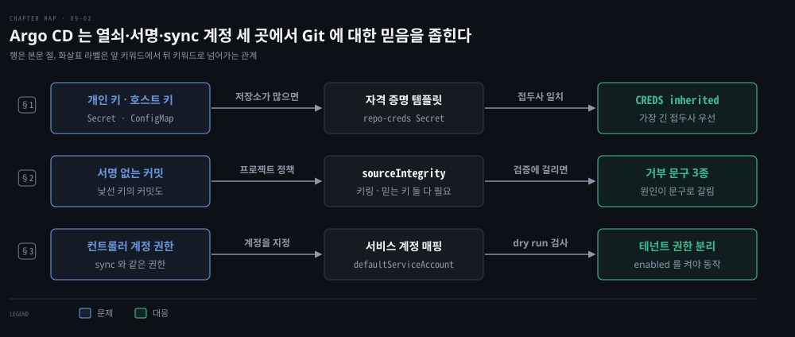
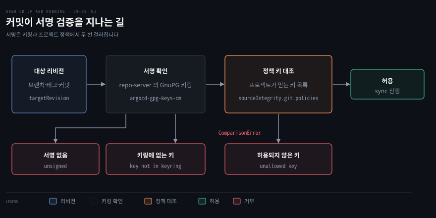
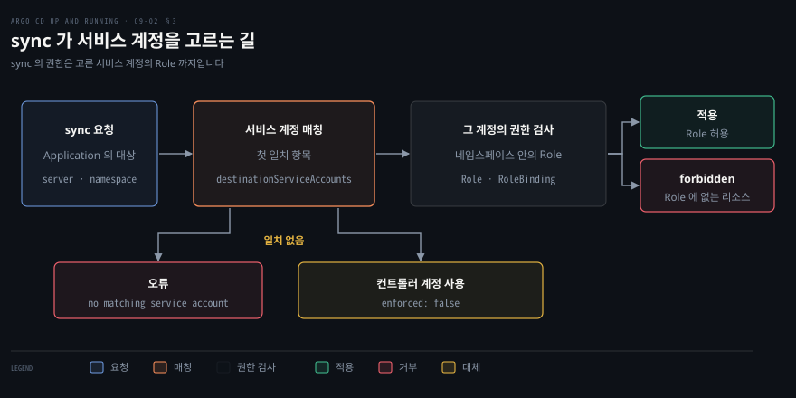

# SSH 인증과 배포 신뢰 — 자격 증명 템플릿·GPG 서명 검증·Sync Impersonation
---

## 핵심 요약

> Argo CD 는 Git 저장소를 믿고 클러스터를 바꾸므로 그 믿음을 세 곳에서 좁힙니다. 저장소에 들어가는 열쇠, 커밋의 서명, sync 가 빌려 쓰는 계정입니다.

SSH(Secure Shell) 로 붙는 저장소는 개인 키와 서버의 호스트 키를 둘 다 Argo CD 에 알려 줘야 합니다. 저장소들이 같은 접두사 아래 있으면 자격 증명 템플릿 하나로 묶을 수 있습니다. 서명 검증은 AppProject 에 믿을 키 목록을 두고 대상 리비전의 서명이 그 목록에 있을 때만 sync 를 허용합니다. Sync Impersonation 은 sync 를 컨트롤러 계정이 아니라 프로젝트가 지정한 서비스 계정의 권한으로 돌립니다. 그러면 컨트롤러가 가진 권한의 크기와 테넌트가 쓸 수 있는 권한이 분리됩니다.[^ver]


## 학습 목표

이 내용을 읽고 나면:

1. SSH 로 저장소를 연결하는 데 필요한 개인 키 Secret 과 known hosts 항목을 구분하고, 호스트 키를 등록한 직후 연결이 실패하는 이유를 설명할 수 있습니다.
2. 자격 증명 템플릿이 적용되는 조건과 접두사 겹침 규칙을 말하고, `CREDS` 열의 `inherited` 로 적용 여부를 확인할 수 있습니다.
3. GPG(GNU Privacy Guard) 공개 키 등록과 프로젝트 정책의 `mode`(`none`, `head`, `strict`)를 설정하고, 서명 없음·키링에 없는 키·허용되지 않은 키 오류를 구분할 수 있습니다.
4. 옛 `signatureKeys` 와 새 `sourceIntegrity` 의 관계, 그리고 Git 소스에만 적용되는 한계를 설명할 수 있습니다.
5. Sync Impersonation 을 켜고 `destinationServiceAccounts` 를 매핑해, 매핑이 없을 때와 서비스 계정의 Role 이 모자랄 때의 실패를 구분할 수 있습니다.

아래 개념도는 이 편의 세 절을 한 줄씩 보입니다. 각 줄이 한 절이고 노드가 그 절의 핵심 키워드입니다. 화살표 위 글자는 앞 키워드에서 뒤 키워드로 넘어가는 관계입니다. 파란 노드가 그 절이 푸는 문제이고 초록 노드가 대응입니다.

1절은 SSH 저장소에 필요한 개인 키와 호스트 키, 그리고 접두사로 묶는 자격 증명 템플릿을 다룹니다. 2절은 GPG 공개 키 등록과 `sourceIntegrity` 정책의 `mode`, 거부 문구를 다룹니다. 3절은 Sync Impersonation 의 스위치와 프로젝트의 서비스 계정 매핑을 다룹니다.




## 1. SSH 인증과 자격 증명 템플릿

> SSH 로 붙으려면 개인 키와 서버의 호스트 키를 등록해야 하고, 저장소가 많으면 접두사 템플릿 하나로 묶습니다.

### 개인 키와 호스트 키 등록

SSH 로 저장소에 붙으려면 Argo CD 가 두 가지를 알아야 합니다. 하나는 Argo CD 가 누구인지 보여 줄 개인 키이고, 다른 하나는 접속하는 서버가 진짜인지 확인할 서버의 공개 호스트 키입니다. 개인 키는 저장소 Secret 에 들어가고 호스트 키는 known hosts ConfigMap 에 들어갑니다.

저장소를 CLI(command-line interface) 로 추가하면 Argo CD 가 `argocd.argoproj.io/secret-type: repository` 라벨이 붙은 Secret 을 만듭니다. 이 Secret 의 데이터 키는 `sshPrivateKey`, `type`, `url` 세 개였습니다.[^lab] SSH 저장소의 URL 은 `git@` 나 `ssh://` 로 시작하고, 서버가 표준이 아닌 포트를 쓰면 `ssh://` 형태로 적어야 합니다.[^ssh]

서버의 호스트 키는 `argocd-ssh-known-hosts-cm` ConfigMap 의 `ssh_known_hosts` 항목에 한 줄에 하나씩 모입니다. 이 ConfigMap 은 `argocd-server` 와 `argocd-repo-server` 파드의 `/app/config/ssh` 에 마운트됩니다.[^hosts]

호스트 키를 모으는 방법으로 문서가 권하는 것은 `ssh-keyscan` 의 출력을 `argocd cert add-ssh` 로 넘기는 방식입니다. 호스트 키 검증을 아예 끄는 `--insecure-skip-server-verification` 은 운영에 쓰지 말라고 안내됩니다.[^hosts]

실습은 kind 클러스터 안에 SSH 로 서비스하는 Git 서버 파드를 두고 Argo CD 가 거기에 붙게 했습니다. SSH 연결은 네 단계를 순서대로 밟아야 끝납니다. 키 쌍을 만들고 서버에 공개 키를 등록한 뒤 서버의 호스트 키를 Argo CD 에 알리고 저장소를 추가했습니다. 개인 키에는 암호를 걸지 않습니다. 암호가 걸린 키는 `ssh: this private key is passphrase protected` 로 연결 시험에서 실패합니다.[^lab]

```bash
ssh-keygen -t ed25519 -f argocd_ssh -N "" -q
kubectl -n argocd exec -c argocd-repo-server deploy/argocd-repo-server -- ssh-keyscan git-ssh.gitsrv | argocd cert add-ssh --batch
argocd repo add 'git@git-ssh.gitsrv:/srv/git/app.git' --ssh-private-key-path argocd_ssh
```

둘째 줄의 `ssh-keyscan` 은 repo-server 파드 안에서 실행해야 합니다. SSH 서버가 클러스터 밖으로 열려 있지 않을 수 있고, known hosts 항목은 저장소 URL 에 쓰는 호스트 이름(`git-ssh.gitsrv`)으로 등록되어야 하기 때문입니다. `--batch` 는 확인 질문 없이 표준 입력의 항목을 그대로 등록합니다.

호스트 키를 등록한 직후의 `repo add` 는 실패할 수 있습니다. 실습에서도 `cert add-ssh` 를 끝내고 곧바로 `repo add` 를 하면 실패했습니다. ConfigMap 이 repo-server 파드의 마운트에 반영되기까지 시간이 걸리기 때문입니다. 15초 간격으로 다시 시도하자 네 번째에 성공했으니 약 1분이 걸린 셈입니다. 저장소가 비어 있으면 연결 시험이 `remote repository is empty` 로 실패했으므로 커밋이 하나는 있어야 합니다.

### 자격 증명 템플릿으로 키 재사용

저장소가 많아지면 저장소마다 키를 등록하는 일이 부담이 됩니다. 이때 쓰는 것이 **자격 증명 템플릿**입니다. 문서는 URL 접두사를 정해 두면 그 접두사로 시작하고 자기 자격 증명이 없는 모든 저장소에 같은 자격 증명이 쓰인다고 설명합니다.[^tmpl] 템플릿은 `argocd.argoproj.io/secret-type: repo-creds` 라벨의 Secret 이고 `argocd repocreds add`·`list`·`rm` 으로 관리합니다.

```bash
argocd repo rm 'git@git-ssh.gitsrv:/srv/git/app.git'
argocd repocreds add 'git@git-ssh.gitsrv:/srv/git' --ssh-private-key-path argocd_ssh
argocd repo add 'git@git-ssh.gitsrv:/srv/git/app.git'
argocd repo list
```

템플릿이 적용된 저장소는 `repo list` 의 `CREDS` 열에 `inherited` 로 찍힙니다. 앞에서 키를 달아 추가한 `app.git` 을 지우고 템플릿을 등록한 뒤 자격 증명 없이 다시 추가하자 이 열이 `inherited` 였습니다. 상태는 `Successful` 이었습니다. 템플릿 접두사 아래의 다른 저장소(`other.git`)도 같은 방식으로 추가되었습니다. 템플릿이 쓰이려면 저장소에 자기 자격 증명이 없어야 하고, 템플릿의 URL 이 저장소 URL 의 접두사여야 합니다.[^tmpl]

저장소 자신의 자격 증명은 템플릿보다 우선합니다. 저장소에 일부러 잘못된 키를 직접 달아 추가하면 템플릿에 올바른 키가 있는데도 `ssh: handshake failed` 로 실패했습니다.

접두사가 겹치면 가장 긴 접두사의 템플릿이 쓰입니다. 접두사가 더 긴 템플릿에 잘못된 키를 달아 등록하자 그 접두사 아래 저장소(`other.git`)는 실패했습니다. 짧은 접두사 아래의 `app.git` 은 계속 `inherited` 였습니다. 문서가 말하는 가장 긴 접두사 우선이 그대로 나타납니다.[^tmpl]

`repocreds list` 의 `SSH_CREDS` 열로 템플릿의 종류를 판단하면 안 됩니다. SSH 키를 넣은 템플릿에서도 이 열은 `false` 로 찍혔습니다.

템플릿은 편리한 만큼 범위가 넓어집니다. 접두사를 조직 전체로 잡으면 키 하나가 닿는 저장소도 조직 전체가 되므로, 접두사는 한 팀이나 한 용도의 저장소 묶음까지만 잡는 편이 좋습니다. HTTPS(HyperText Transfer Protocol Secure) 와 SSH 중 어느 쪽이 안전한가는 방식보다 이 열쇠의 범위와 회전 절차에서 갈립니다. HTTPS 쪽 자격 증명과 TLS(Transport Layer Security) 는 [09-01](./09-01.서버와%20저장소%20접근%20보안%20—%20TLS%20인증서·저장소%20인증서·HTTPS%20자격%20증명.md)에서 다룹니다.


## 2. GPG 서명 검증과 소스 무결성 정책

> 서명 검증은 키링에 믿을 공개 키를 두고, 프로젝트 정책으로 서명 없는 커밋과 낯선 키의 커밋을 거릅니다.

### 검증 흐름과 키링 준비

서명 검증은 프로젝트 단위로 걸립니다. 대상 리비전의 서명이 repo-server 의 키링에 있는 키로 확인되고 프로젝트 정책이 믿는 키 목록에도 있어야 sync 가 진행됩니다. 로그인 권한은 누가 Git 에 쓸 수 있는지를 정하지만 서명은 이 커밋을 누가 만들었는지를 정합니다. 그래서 쓰기 권한이 새어도 믿는 키가 없으면 변경이 배포되지 않습니다.

GPG 서명 검증은 v1.7 에서 프로젝트의 `signatureKeys` 로 처음 들어왔습니다. v3.6.1 문서는 이 방식이 폐기 예정이고 소스 무결성 검증이 새 대안이라고 안내합니다.[^dep] 옛 `signatureKeys` 는 계속 지원되지만 `sourceIntegrity` 와 함께 효과를 내지는 않습니다. 둘 다 적으면 `sourceIntegrity.git` 만 쓰이고 `signatureKeys` 는 로그에 오류만 남긴 채 무시됩니다.[^dep] 이 노트는 새 방식인 `sourceIntegrity` 를 기준으로 설명하고 AppProject 의 다른 필드는 [08-01](./08-01.멀티%20테넌시%20—%20설치%20모드와%20AppProject·프로젝트%20역할.md)에서 다뤘습니다.

검증에는 두 가지 준비가 필요합니다. 먼저 믿을 공개 키를 Argo CD 의 키링에 넣습니다. `argocd gpg add --from` 으로 가져오고 `argocd gpg list` 로 확인합니다.

```bash
KEYID             TYPE     IDENTITY
06D4BF5200925E84  RSA3072  Demo Signer A <signerA@example.invalid>
14A1691A17B7D0E9  RSA3072  Demo Signer B <signerB@example.invalid>
```

키는 `argocd-gpg-keys-cm` ConfigMap 에 저장됩니다. 이름이 키 ID 이고 값이 아스키 아머 형식의 공개 키입니다. repo-server 파드는 이 ConfigMap 으로 키링을 다시 만듭니다.[^ring] 키를 다루는 RBAC(Role-Based Access Control) 리소스의 이름은 `gpgkeys` 이며 `get`, `create`, `delete` 동작이 있습니다.[^ring] RBAC 정책의 문법은 [06-02](./06-02.SSO%20연결과%20RBAC%20—%20Dex·직접%20OIDC·역할과%20정책.md)에서 다뤘습니다.

### sourceIntegrity 정책과 mode

그다음 프로젝트의 `spec.sourceIntegrity.git.policies` 에 정책을 둡니다. 정책의 `repos` 는 항목마다 `url` 에 소스 URL 과 맞춰 볼 글롭 패턴을 적는 목록이고, `!` 로 시작하는 패턴은 제외입니다. `gpg.keys` 는 이 정책이 믿는 키 ID 목록이며 `gpg.mode` 가 검증 범위를 정합니다.[^pol]

```yaml
spec:
  sourceIntegrity:
    git:
      policies:
        - repos:
            - url: "*"
          gpg:
            mode: head
            keys:
              - "06D4BF5200925E84"
```

`mode` 는 세 가지입니다. `none` 은 검증하지 않고 서명 없는 커밋도 받아들입니다. `head` 는 대상 리비전이 가리키는 커밋 하나만 검증하며, 주석 태그라면 커밋이 아니라 태그의 서명을 봅니다. `strict` 는 대상 리비전과 모든 조상을 검증합니다.[^mode]

한 소스 저장소에는 정책이 하나만 맞아야 합니다. 둘 이상 맞으면 그 저장소의 sync 가 모두 `multiple (N) git source integrity policies found` 로 막힙니다. 어느 정책에도 맞지 않는 소스는 검증하지 않습니다.[^pol]



### 거부 문구로 원인 가리기

거부 문구는 어느 단계에서 걸렸는지를 알려 주므로 고칠 곳이 문구로 정해집니다. 실습에서는 프로젝트 정책을 `head` 모드에 키 A 만 믿도록 두고 대상 리비전만 바꿔 그림의 길을 밟았습니다.[^lab]

서명 없음과 키링에 없는 키는 서로 다른 문구로 거부됩니다. 서명 없는 커밋은 `GIT/GPG: Failed verifying revision … unsigned (key_id=)` 로 거부되었습니다. `gpg add` 로 키를 넣은 직후에 키 A 로 서명한 커밋을 확인하면 `signed with key not in keyring (key_id=…)` 였습니다. 서명한 키가 키링에 없을 때 나오는 문구입니다.

키링에 있어도 정책의 `keys` 에 없는 키로 서명한 커밋은 거부됩니다. 키 B 를 `gpg add` 로 키링에 넣은 뒤 키 B 로 서명한 커밋을 보면 `signed with unallowed key (key_id=…)` 가 나왔습니다. 키 A 로 서명한 커밋만 sync 가 `Succeeded` 였습니다.

`signed with key not in keyring` 은 진짜 거부와 반영 지연이 같은 문구로 나온다는 점이 함정입니다. 문서도 키를 가져온 뒤 클러스터에 전파되기까지 시간이 걸릴 수 있다고 적고 있고,[^ring] 실습에서도 `gpg add` 직후에는 이 오류가 났다가 약 1분 뒤 같은 커밋이 통과했습니다. 반영이 끝났는지 의심되면 repo-server 파드 안에서 키링을 직접 조회합니다.

### strict·seal 커밋과 적용 범위

`strict` 는 이력 전체를 요구하므로 서명 없는 옛 커밋이 있는 저장소에는 그대로 쓸 수 없습니다. 실습에서도 맨 위 커밋을 키 A 로 서명했는데 조상에 서명 없는 커밋이 있는 브랜치는 `unsigned` 오류가 조상 커밋마다 찍혔습니다. 이때 쓰는 것이 seal 커밋입니다. 정책이 믿는 키로 서명한 커밋에 `Argocd-gpg-seal` 트레일러를 달면 그 이전 조상은 검토를 마친 것으로 보고 검증이 거기서 멈춥니다.[^seal] 만드는 명령은 문서의 형식을 따르되 `--signoff` 는 빼고 빈 커밋으로 만들었습니다.

```bash
git commit -S --allow-empty -m "seal" --trailer "Argocd-gpg-seal: review done"
```

seal 커밋이 있으면 서명 없는 옛 이력이 있어도 `strict` 를 쓸 수 있습니다. 이 seal 커밋을 맨 위에 올린 브랜치는 `strict` 모드에서 비교 오류가 나오지 않았습니다. 서명 없는 옛 이력을 다시 쓰지 않고도 "여기부터는 서명한다" 고 선언할 수 있는 길입니다.

서명 검증은 Git 소스에만 적용됩니다. Helm 이나 OCI(Open Container Initiative) 소스에는 적용되지 않습니다.[^dep] 서명은 누가 만들었는지를 보증할 뿐 내용이 안전하다는 뜻은 아니므로, 서명 검증은 브랜치 보호나 리뷰를 대신하지 못합니다. 또 소스 무결성이 걸린 프로젝트에서는 `argocd app sync --local` 로 로컬 소스를 올리는 sync 가 막힙니다.[^pol] 키를 한 번 가져오면 Argo CD 는 그 키를 그대로 믿으며, 공개 키에 다시 서명하는 더 복잡한 신뢰 모델은 지원하지 않습니다.[^dep]


## 3. Sync Impersonation 과 권한 분리

> Sync Impersonation 은 sync 를 컨트롤러 계정이 아니라 프로젝트가 지정한 서비스 계정의 권한으로 돌립니다.

### 스위치 두 개와 enforced

impersonation 을 켜면 sync 는 컨트롤러 자신의 계정이 아니라 프로젝트가 지정한 서비스 계정의 권한으로 클러스터를 호출합니다. 이 기능이 없으면 sync 는 컨트롤러와 같은 권한을 가지므로, Application 열 개 중 하나만 높은 권한이 필요해도 컨트롤러 전체가 그 권한을 가져야 합니다.[^imp] AppProject 가 배포 범위를 좁혀 주지만 컨트롤러가 가진 권한 자체를 줄이지는 못하므로, 이 기능은 그 빈자리를 메웁니다. 상태는 베타(v3.5.0 부터)이며 잘못 설정하면 보안 문제가 될 수 있다고 문서가 경고합니다.[^imp]

스위치는 `argocd-cm` 에 두 개 있고 둘 다 시스템 전체에 적용됩니다.

impersonation 은 기본적으로 꺼져 있고, 켜면 일치하는 계정이 없는 sync 를 막는 쪽이 기본입니다. `application.sync.impersonation.enabled` 의 기본값은 `"false"` 이고 `application.sync.impersonation.enforced` 의 기본값은 `"true"` 입니다.[^enf]

`enforced` 가 `"false"` 이면 일치하는 서비스 계정이 없을 때 컨트롤러의 계정으로 넘어갑니다.[^enf] 문서는 이 값을 impersonation 으로 단계적으로 옮겨 갈 때 쓰라고 하며, 끄면 앱 사이의 격리가 약해진다고 경고합니다.[^enf]

### 프로젝트의 서비스 계정 매핑

서비스 계정은 AppProject 의 `spec.destinationServiceAccounts` 에 대상 `server` 와 `namespace` 별로 `defaultServiceAccount` 를 적어 정합니다. 컨트롤러는 목록을 위에서부터 훑어 처음 맞는 항목을 고릅니다. 맞는 항목이 없으면 sync 에서 오류를 냅니다. 서비스 계정은 `tenant1-ns:guestbook-deployer` 처럼 네임스페이스를 붙여 적을 수 있습니다.[^map]

```yaml
spec:
  destinationServiceAccounts:
    - server: https://kubernetes.default.svc
      namespace: impersonation
      defaultServiceAccount: web-deployer
```

모든 네임스페이스를 받는 `namespace: '*'` 항목을 맨 뒤에 두면 맞는 항목이 없는 경우를 막을 수 있습니다. 위에서부터 훑는 규칙이라 이 항목이 앞에 오면 뒤의 구체적인 항목이 가려집니다. 문서도 일치하는 항목이 없는 오류를 피하려면 catch-all 을 두라고 권하지만,[^map] 일부러 두지 않는 것이 sync 의 범위를 더 좁힌다는 선택도 가능합니다.



### dry run 에서 드러나는 실패

서비스 계정의 권한 검사는 sync 의 dry run 단계에서 일어납니다. 실습에서는 매핑이 없는 경우부터 Role 이 일부만 있는 경우까지 계단식으로 확인했습니다.[^lab] 켜는 데는 컨트롤러 재시작이 필요 없었고 `argocd-cm` 을 고치자 바로 적용되었습니다.

매핑이 없으면 sync 가 오류로 끝납니다. 매핑이 없는 프로젝트의 Application 은 `no matching service account found for destination server https://kubernetes.default.svc and namespace …` 로 sync 가 끝났습니다.

매핑이 있어도 서비스 계정에 Role 이 없으면 sync 는 forbidden 으로 실패합니다. 실습에서는 dry run 단계에서 `User "system:serviceaccount:<네임스페이스>:<서비스 계정>" cannot get resource …` 로 `Failed` 였습니다. 네임스페이스와 서비스 계정이 아직 없어도 같은 forbidden 이었습니다. 쿠버네티스의 impersonation 이 대상 계정의 존재를 확인하지 않고 그 계정의 권한만 따지기 때문입니다.

Role 이 일부만 허용하는 경우에는 sync 전체가 한 덩어리로 실패했습니다. Deployment 권한만 준 Role 에서는 ConfigMap 이 forbidden 이 되어 Deployment 도 만들어지지 않았고, ConfigMap 권한을 더하자 `Succeeded` 였습니다. dry run 이 모든 리소스에 대해 먼저 돌기 때문에 하나라도 막히면 아무것도 적용되지 않습니다. 마지막으로 `enforced` 를 `"false"` 로 두고 매핑을 지운 프로젝트는 컨트롤러 계정으로 sync 가 `Succeeded` 였습니다. 이 경우 프로젝트의 격리가 풀린 것이므로 이행 기간에만 쓸 설정입니다.

### 시스템 전체 영향과 적용 범위

시스템 전체 스위치라서 한 프로젝트를 위한 설정이 다른 프로젝트의 sync 를 막을 수 있습니다. 실습에서도 impersonation 을 켜 두자 매핑이 없는 다른 프로젝트(서명 검증용 프로젝트)의 sync 가 `no matching service account found` 로 막혔습니다. 스위치를 `"false"` 로 되돌린 뒤에야 풀렸습니다.

적용 범위는 sync 로 만들고 갱신하고 prune 하는 일, Application finalizer 의 삭제, 사용자가 UI(user interface) 에서 일으키는 동작입니다.[^imp] 도입은 프로젝트와 서비스 계정 설계를 먼저 정하는 데서 시작합니다. 그다음 `enforced` 를 끈 채로 켜고 프로젝트마다 매핑을 늘린 뒤 마지막에 `enforced` 를 켭니다. 문서가 단계적 이행으로 적은 순서입니다.[^enf] sync 의 일반 동작은 [05-01](./05-01.Application%20동기화%20—%20자동%20동기화·Sync%20Option·Hook·Sync%20Wave%20와%20차이%20무시.md)에서 다뤘습니다.


## 연습 문제

> 아래 여섯 문제는 SSH 연결, 자격 증명 템플릿, 서명 검증의 거부 사유와 mode, impersonation 의 실패 층을 하나씩 묻습니다. 답을 적은 뒤에 정답 절을 펼칩니다.

1. SSH 저장소를 추가하기 전에 Argo CD 에 등록해야 하는 호스트 정보는 무엇이고 어디에 저장됩니까? 등록한 직후에 `repo add` 가 실패했다면 의심할 것은 무엇입니까?
2. 접두사가 `git@git-ssh.gitsrv:/srv/git` 인 템플릿이 있고, `app.git` 은 자격 증명 없이 추가되었습니다. `CREDS` 열에는 무엇이 찍힙니까? 저장소 하나에 잘못된 키를 직접 달아 추가하면 어떻게 됩니까?
3. 서명 검증 프로젝트에서 sync 가 거부되며 `unsigned`, `signed with key not in keyring`, `signed with unallowed key` 가 각각 나왔습니다. 각 오류의 원인과 고치는 곳은 어디입니까?
4. `head` 와 `strict` 의 차이는 무엇입니까? 조상에 서명 없는 커밋이 있는 브랜치를 `strict` 로 통과시키려면 어떻게 합니까?
5. 옛 `signatureKeys` 와 새 `sourceIntegrity` 를 한 프로젝트에 함께 적으면 어떻게 됩니까? Helm 차트를 소스로 하는 Application 에는 서명 검증이 걸립니까?
6. impersonation 을 켠 뒤 sync 가 실패했습니다. `no matching service account found` 와 `cannot get resource … system:serviceaccount` 는 각각 어느 층의 실패이고 무엇을 고칩니까? `enforced` 를 `"false"` 로 두면 어떻게 달라집니까?


## 정답 (자답 후 펼치기)

### 정답 1

서버의 공개 호스트 키를 등록해야 합니다. `argocd-ssh-known-hosts-cm` ConfigMap 의 `ssh_known_hosts` 에 저장되고, `ssh-keyscan` 의 출력을 `argocd cert add-ssh --batch` 로 넘기면 됩니다. 호스트 키 검증을 끄는 `--insecure-skip-server-verification` 은 운영에 쓰지 않습니다.

등록 직후의 실패는 ConfigMap 이 repo-server 파드에 반영되기 전일 가능성이 큽니다. 실습에서는 약 1분이 걸렸으니 조금 기다렸다가 다시 시도합니다. 개인 키 쪽은 `sshPrivateKey` 로 저장소 Secret 에 들어가는 별개의 정보입니다.

### 정답 2

`app.git` 의 `CREDS` 열에는 `inherited` 가 찍히고 상태는 `Successful` 입니다. 저장소 하나에 잘못된 키를 직접 달면 템플릿에 올바른 키가 있어도 `ssh: handshake failed` 로 실패합니다. 저장소가 자기 자격 증명을 가지면 템플릿을 쓰지 않기 때문입니다.

접두사가 더 긴 템플릿이 있으면 그 접두사 아래 저장소에는 긴 쪽 템플릿이 이깁니다. 정의한 순서는 상관없고 가장 긴 접두사가 우선입니다.

### 정답 3

`unsigned` 는 대상 리비전의 커밋에 서명이 없는 경우입니다. 서명해서 다시 올립니다.

`signed with key not in keyring` 은 서명한 키의 공개 키가 Argo CD 키링에 없는 경우이고, `argocd gpg add --from` 으로 등록합니다. 등록한 직후라면 반영까지 1분쯤 기다려야 합니다.

`signed with unallowed key` 는 키링에는 있지만 프로젝트 정책의 `gpg.keys` 에 없는 키라는 뜻이며, 프로젝트의 키 목록에 그 키 ID 를 더하는 것이 고치는 길입니다.

### 정답 4

`head` 는 대상 리비전이 가리키는 커밋 하나만, 주석 태그면 태그의 서명을 검증합니다. `strict` 는 대상 리비전과 모든 조상을 검증합니다.

조상에 서명 없는 커밋이 있으면 `strict` 에서는 그 조상마다 `unsigned` 가 찍힙니다. 서명한 seal 커밋(`Argocd-gpg-seal` 트레일러)을 맨 위에 올리면 검증이 그 지점에서 멈추므로, 이력을 다시 쓰지 않고 통과합니다. 실습에서도 seal 커밋을 올린 브랜치만 비교 오류가 나오지 않았습니다.

### 정답 5

둘 다 적을 수는 있지만 함께 효과를 내지 않습니다. `sourceIntegrity.git` 이 있으면 `signatureKeys` 는 무시되고 컨트롤러 로그에 오류만 남습니다. 옛 방식은 모두 `head` 모드로 동작합니다. 새 방식으로 옮기려면 `signatureKeys` 의 키를 `sourceIntegrity.git.policies[].gpg.keys` 로 옮깁니다.

Helm 이나 OCI 소스에는 걸리지 않습니다. 서명 검증은 Git 저장소의 커밋과 태그에만 적용되기 때문입니다.

### 정답 6

`no matching service account found` 는 매칭 층의 실패입니다. 프로젝트의 `destinationServiceAccounts` 에 그 `server` 와 `namespace` 항목이 없다는 뜻이므로 항목을 더하거나 catch-all 을 맨 뒤에 둡니다.

`cannot get resource … system:serviceaccount` 는 권한 층의 실패입니다. 서비스 계정은 골랐지만 그 계정의 Role 이 해당 리소스를 허용하지 않으므로 Role 과 RoleBinding 을 고칩니다. 서비스 계정이나 네임스페이스가 없어도 같은 문구가 나올 수 있습니다.

`enforced` 가 `"false"` 이면 매칭 실패 때 오류 대신 컨트롤러 계정으로 sync 합니다. 권한 층의 forbidden 은 그대로입니다. 매핑이 있어서 서비스 계정을 골랐다면 그 계정의 Role 을 따르기 때문입니다.


## 참고 자료

- 《Argo CD: Up and Running》(Andrew Block · Christian Hernandez, O'Reilly, 2025, ISBN 978-1-098-14200-1) 9장
- [비공개 저장소](https://github.com/argoproj/argo-cd/blob/v3.6.1/docs/user-guide/private-repositories.md)
- [선언적 설정](https://github.com/argoproj/argo-cd/blob/v3.6.1/docs/operator-manual/declarative-setup.md)
- [소스 무결성 검증](https://github.com/argoproj/argo-cd/blob/v3.6.1/docs/user-guide/source-integrity.md)
- [Git GnuPG 서명 검증](https://github.com/argoproj/argo-cd/blob/v3.6.1/docs/user-guide/source-integrity-git-gpg.md)
- [Application Sync using impersonation](https://github.com/argoproj/argo-cd/blob/v3.6.1/docs/operator-manual/app-sync-using-impersonation.md)
- 관련 노트: [이 책의 인덱스](./README.md)
- 관련 노트: [05-01 Application 동기화](./05-01.Application%20동기화%20—%20자동%20동기화·Sync%20Option·Hook·Sync%20Wave%20와%20차이%20무시.md), [06-02 SSO 연결과 RBAC](./06-02.SSO%20연결과%20RBAC%20—%20Dex·직접%20OIDC·역할과%20정책.md)
- 관련 노트: [08-01 멀티 테넌시](./08-01.멀티%20테넌시%20—%20설치%20모드와%20AppProject·프로젝트%20역할.md), [09-01 서버와 저장소 접근 보안](./09-01.서버와%20저장소%20접근%20보안%20—%20TLS%20인증서·저장소%20인증서·HTTPS%20자격%20증명.md)

[^ver]: 최신 릴리스는 Argo CD v3.6.1(2026-11-04)이고 Helm 차트는 10.14.0(appVersion v3.6.1)입니다. 문서와 소스는 v3.6.1 태그에 고정했고 설치 매니페스트는 `https://raw.githubusercontent.com/argoproj/argo-cd/v3.6.1/manifests/install.yaml` 입니다. <https://github.com/argoproj/argo-cd/releases/tag/v3.6.1> (2026-11-08 조회)
[^lab]: 이 노트의 실습은 kind v0.31.0 클러스터에 위 매니페스트로 설치한 v3.6.1 에서 실행했고, `argocd` CLI 는 v3.6.1 입니다. Git 서버는 클러스터 안의 SSH 서버 파드(저장소 `app.git`, `other.git`)였고 푸시는 포트 포워딩으로 했습니다. SSH 저장소 Secret 의 데이터 키 이름은 값을 보지 않고 `kubectl get secret -o json` 의 키만 읽어 확인했습니다. 서명 실습의 키 두 개는 이 실험용으로 만든 일회용 키이고 공개 키만 Argo CD 에 넣었습니다. 암호를 건 ed25519 키로 `argocd repo add` 를 하면 `failed to list refs: ssh: this private key is passphrase protected` 로 실패했습니다.
[^ssh]: 문서는 SSH 키가 필요한 저장소의 URL 이 "typically start with `git@` or `ssh://` rather than `https://`"라고 하고, "When your SSH repository is served from a non-standard port, you have to use `ssh://`-style URLs to specify your repository."라고 적습니다. 추가 명령의 예는 `argocd repo add git@github.com:argoproj/argocd-example-apps.git --ssh-private-key-path ~/.ssh/id_rsa` 입니다. <https://github.com/argoproj/argo-cd/blob/v3.6.1/docs/user-guide/private-repositories.md> (2026-11-08 조회)
[^hosts]: 문서는 호스트 키를 모르는 서버에 대해 두 가지 길을 적습니다. 하나는 `--insecure-skip-server-verification` 으로 호스트 키를 검증하지 않는 것인데 "this should be done only for non-production setups"라고 하고, 다른 하나는 `cert add-ssh` 로 서버의 공개 키를 알리는 것으로 "This is the recommended method and suitable for production use."라고 합니다. 키는 "You can get the server's public SSH host key e.g. by using the `ssh-keyscan` utility."라고 안내합니다. 선언적 설정 문서는 "This ConfigMap contains a single entry, `ssh_known_hosts`, with the public keys of the SSH servers as its value."라고 하고, 마운트 경로는 `/app/config/ssh` 이며 "It might take a while for changes in the ConfigMap to be reflected in your pods"라고 적습니다. <https://github.com/argoproj/argo-cd/blob/v3.6.1/docs/user-guide/private-repositories.md>, <https://github.com/argoproj/argo-cd/blob/v3.6.1/docs/operator-manual/declarative-setup.md> (2026-11-08 조회)
[^tmpl]: 문서는 자격 증명 템플릿을 "if you setup credential templates for the URL prefix `https://github.com/argoproj`, these credentials will be used for all repositories with this URL as prefix (e.g. `https://github.com/argoproj/argocd-example-apps`) that do not have their own credentials configured."라고 설명합니다. 쓰이는 조건은 "The repository must either not be configured at all, or if configured, must not contain any credential information"와 "The URL configured for a credential template (e.g. `https://github.com/argoproj`) must match as prefix for the repository URL"이고, 우선순위는 "Matching credential template URL prefixes is done on a _best match_ effort, so the longest (best) match will take precedence. The order of definition is not important"입니다. 관리 명령은 `argocd repocreds add`·`list`·`rm` 이고, 선언적으로는 `argocd.argoproj.io/secret-type: repo-creds` 라벨의 Secret 입니다. <https://github.com/argoproj/argo-cd/blob/v3.6.1/docs/user-guide/private-repositories.md>, <https://github.com/argoproj/argo-cd/blob/v3.6.1/docs/operator-manual/declarative-setup.md> (2026-11-08 조회)
[^dep]: 폐기 안내는 "GPG Signature verification is deprecated and will be removed in the next major Argo CD version."이고 새 대안은 Source Integrity Verification 입니다. 호환 안내는 "Keys configured in `signatureKeys` will continue to be supported, but they cannot be used together with `sourceIntegrity`."이고, 지원 범위는 "Verification of GnuPG signatures is only supported with Git repositories. It is not possible when using Helm or OCI application sources."입니다. 신뢰 모델은 "Once the key is imported, ArgoCD will trust it. ArgoCD does not support more complex trust models"라고 적습니다. 옛 방식은 새 방식에서 `all "head" mode for all project repositories`라고 적습니다. `EffectiveSourceIntegrity` 는 `sourceIntegrity.git` 이 있으면 "Both SourceIntegrity and SignatureKeys specified in %s AppProject. Ignoring SignatureKeys. Migrate them to SourceIntegrity."라는 오류를 로그에 남기고 `sourceIntegrity` 를 그대로 돌려줍니다. `sourceIntegrity` 는 있고 `git` 이 없을 때만 둘을 합칩니다. <https://github.com/argoproj/argo-cd/blob/v3.6.1/docs/user-guide/gpg-verification.md>, <https://github.com/argoproj/argo-cd/blob/v3.6.1/docs/user-guide/source-integrity-git-gpg.md>, <https://github.com/argoproj/argo-cd/blob/v3.6.1/pkg/apis/application/v1alpha1/types.go> (2026-11-08 조회)
[^ring]: 키링 문서는 키링 관리를 위한 RBAC 리소스가 "`gpgkeys`"이고 정책은 `p, role:myrole, gpgkeys, get, *, allow` 처럼 `get`·`create`·`delete` 로 적는다고 설명합니다. 키를 가져온 뒤에는 "it may take a while until the key is propagated within the cluster"라고 합니다. 키링은 "The GnuPG key ring used for signature verification is maintained within the pods of `argocd-repo-server`. The keys in the keyring are synchronized to the configuration stored in the `argocd-gpg-keys-cm` ConfigMap resource"라고 설명하고, 파드 안의 키링에 손으로 키를 넣고 빼지 말라고 경고합니다. 환경 변수 `ARGOCD_GPG_ENABLED` 를 `false` 로 하면 이 기능을 끌 수 있습니다. <https://github.com/argoproj/argo-cd/blob/v3.6.1/docs/user-guide/source-integrity-git-gpg.md> (2026-11-08 조회)
[^pol]: 정책 문서는 `repos` 를 "a list of glob-style patterns matched against the URL of the source to verify"라고 설명하고, 예시는 `- url: "https://github.com/my-group/*"` 처럼 항목마다 `url` 을 둡니다. `!` 로 시작하는 패턴은 제외입니다. "Only one policy is applied per source repository, and sources not matched by any policy will not have its integrity verified."라고 하고, `keys` 는 "the set of key IDs to trust for signed commits"입니다. 소스 무결성이 걸리면 "you will not be able to sync from local sources (i.e. `argocd app sync --local`) anymore"라고 경고합니다. 소스 무결성은 "only configured through `AppProject` manifests or CLI. UI is not supported yet."입니다. 정책이 둘 이상 맞을 때의 동작은 문서가 아니라 소스에 있습니다. `lookupGit` 은 맞은 정책이 둘 이상이면 "Multiple matching policies is an error. BUT, it has to return a check that fails for every repo."라고 주석을 달고 `multiple (%d) git source integrity policies found for repo URL: %s` 오류를 돌려주는 검사를 반환합니다. 맞은 정책 중 하나가 `mode: none` 이어도 같습니다. <https://github.com/argoproj/argo-cd/blob/v3.6.1/docs/user-guide/source-integrity-git-gpg.md>, <https://github.com/argoproj/argo-cd/blob/v3.6.1/docs/user-guide/source-integrity.md>, <https://github.com/argoproj/argo-cd/blob/v3.6.1/util/sourceintegrity/source_integrity.go> (2026-11-08 조회)
[^mode]: 모드 문서는 `none` 을 "Verification is not performed for this strategy"로, `head` 를 "Verify only the commit/tag pointed to by the target revision of the source."로, `strict` 를 "Verify target revision and all its ancestors."로 설명합니다. 주석 태그는 "it is the tag's signature that is verified, not the commit's signature (i.e. the tag itself must be signed using `git tag -s`)"입니다. <https://github.com/argoproj/argo-cd/blob/v3.6.1/docs/user-guide/source-integrity-git-gpg.md> (2026-11-08 조회)
[^seal]: seal 커밋은 문서에서 "A sealing commit is a GnuPG signed commit that works as a "seal of approval" attesting that all its ancestor commits were either signed by a trusted key, or reviewed and trusted by the author of the sealing commit."로 정의되고, 만드는 명령은 `git commit --signoff --gpg-sign --trailer="Argocd-gpg-seal: <justification>"` 입니다. 문서는 "Using seal commits is preferable to rewriting git history"라고 합니다. 실습에서는 `-S`, `--allow-empty`, `-m`, `--trailer` 로 만들었고 `--signoff` 는 쓰지 않았습니다. <https://github.com/argoproj/argo-cd/blob/v3.6.1/docs/user-guide/source-integrity-git-gpg.md> (2026-11-08 조회)
[^imp]: 문서는 상태를 "Beta Feature (Since v3.5.0)"로 표시하고, 필요를 "in a multi-tenant setup, the Argo CD control plane privileges needs to match the tenant that needs the highest privileges."로 설명합니다. 적용 범위는 "Impersonation is supported for the lifecycle of objects managed by an Application directly, which includes sync operations (creation, update and pruning of resources) and deletion as part of Application finalizer logic. It is also supported for UI operations triggered by the user."입니다. <https://github.com/argoproj/argo-cd/blob/v3.6.1/docs/operator-manual/app-sync-using-impersonation.md> (2026-11-08 조회)
[^enf]: `argocd-cm` 문서의 기본값은 `application.sync.impersonation.enabled: "false"` 와 `application.sync.impersonation.enforced: "true"` 입니다. 설명은 "When set to false, if no matching service account is found, the controller's service account will be used. Defaults to true for security. Only disable if you trust all applications."이고, impersonation 문서는 "This feature can be enabled/disabled only at the system level and once enabled/disabled it is applicable to all Applications managed by ArgoCD."라고 적습니다. <https://github.com/argoproj/argo-cd/blob/v3.6.1/docs/operator-manual/argocd-cm.yaml>, <https://github.com/argoproj/argo-cd/blob/v3.6.1/docs/operator-manual/app-sync-using-impersonation.md> (2026-11-08 조회)
[^map]: 문서는 "the controller loops through the available `destinationServiceAccounts` in the mapped `AppProject` and tries to find a matching candidate. If there are multiple matches for a destination server and namespace combination, then the first valid match will be considered. If there are no matches, then an error is reported during the sync operation."이라고 적고, 서비스 계정을 `tenant1-ns:guestbook-deployer` 처럼 네임스페이스와 함께 적을 수 있다고 합니다. 오류를 피하려고 마지막 항목에 catch-all 을 두는 구성이 예시에 있습니다. <https://github.com/argoproj/argo-cd/blob/v3.6.1/docs/operator-manual/app-sync-using-impersonation.md> (2026-11-08 조회)
