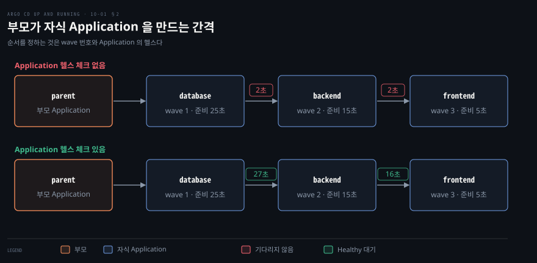
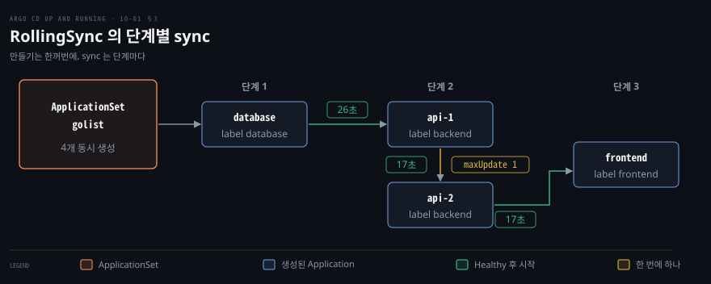

# Application 여럿을 순서대로 — 헬스 체크·App-of-Apps sync wave·Progressive Sync
---

## 핵심 요약

> Application 은 서로를 기다리지 않으므로 순서는 Application 위에 한 층을 더 얹어서 만들고, 그 층이 기다릴 수 있는 이유는 Application 의 헬스입니다.

App-of-Apps 는 부모 Application 이 자식 Application 을 sync wave 순서로 만듭니다. 앞 자식이 Healthy 가 되어야 다음으로 가는 대기는 Application 자체의 헬스 체크를 `argocd-cm` 에 더해야 작동합니다. ApplicationSet 의 Progressive Sync 는 Application 을 한꺼번에 만든 뒤 라벨로 가른 단계마다 Healthy 를 기다리며 sync 하는 Beta 기능이고 켜야 작동합니다.[^ver] 두 길은 경쟁하지 않아서 부모 Application 이 ApplicationSet 을 배포하는 구성도 가능합니다.


## 학습 목표

이 내용은 10장 Applications at Scale 전체를 읽은 노트입니다. 읽고 나면:

1. sync wave 가 한 Application 안의 리소스만 줄 세우는 이유와, Application 끼리 기다리지 않는 이유를 설명할 수 있습니다.
2. Probe 와 Argo CD 헬스 체크가 Application 의 Healthy 를 어떻게 만들고, Application 자체의 헬스 체크를 왜 따로 더해야 하는지 말할 수 있습니다.
3. wave 를 단 자식 Application 셋을 가진 App-of-Apps 를 작성하고, 자식이 만들어지는 시각으로 대기가 작동하는지 판정할 수 있습니다.
4. RollingSync 의 `steps`·`matchExpressions`·`maxUpdate` 로 ApplicationSet 의 Application 을 단계별로 sync 하는 매니페스트를 쓸 수 있습니다.
5. Progressive Sync 를 켜는 방법과 기능 상태, 켰을 때 달라지는 것(autosync 비활성화·미선택 Application)을 설명할 수 있습니다.


## 본문 정리

### 1. Application 의 순서와 헬스

Application 은 서로 기다리지 않으므로 Application 사이에는 의존 관계가 없습니다. sync wave 는 한 Application 안의 리소스만 정렬합니다. 데이터베이스를 백엔드보다 먼저 띄우고 싶어도 각각 Application 이면 둘은 따로 sync 됩니다.

순서를 주려면 Application 을 리소스로 다루는 층이 하나 더 필요합니다. 그 층이 기다리는 기준은 아래쪽 Application 의 헬스입니다([05-01](./05-01.Application%20동기화%20—%20자동%20동기화·Sync%20Option·Hook·Sync%20Wave%20와%20차이%20무시.md)의 wave 는 한 Application 안의 순서였습니다).

Application 의 헬스는 지금 있는 직계 자식 리소스 중 가장 나쁜 헬스입니다. 좋은 쪽부터 Healthy, Suspended, Progressing, Degraded, Unknown 순서입니다. 아직 만들어지지 않은 리소스는 이 계산에서 빠지고, 리소스가 하나도 없을 때만 Application 이 Missing 이 됩니다. 자식이 Application 이면 그 자식의 Missing·Unknown 도 부모 헬스에 넣지 않습니다.[^health]

리소스가 실제로 준비되기 전에 Healthy 로 보이면 뒤 단계가 일찍 시작됩니다. readinessProbe 가 없는 Deployment 는 컨테이너가 뜨자마자 준비된 것으로 보이므로 Probe 를 반드시 달아야 합니다. liveness 는 죽은 컨테이너를 되살리고 readiness 는 요청을 받을 수 있는지를 알립니다.

```yaml
spec:
  template:
    spec:
      containers:
        - name: web
          livenessProbe:
            tcpSocket:
              port: 80
            initialDelaySeconds: 5
          readinessProbe:
            httpGet:
              path: /
              port: 80
            initialDelaySeconds: 25   # 이 시간 뒤에야 Ready 가 될 수 있다
            periodSeconds: 2
```

내장 헬스 체크가 없는 종류는 Lua 로 직접 씁니다. `argocd-cm` 의 `resource.customizations.health.<group>_<kind>` 키에 스크립트를 두면 됩니다. 스크립트는 `obj` 를 읽고 `hs.status` 와, 선택 항목인 `hs.message` 를 가진 객체를 돌려줍니다. 코어 그룹의 종류는 그룹 접두사 없이 종류 이름만 씁니다.[^lua] 오퍼레이터가 만드는 사용자 정의 리소스가 대표적인 대상입니다.

Application 리소스 자체에는 내장 헬스 체크가 없습니다. 그래서 자식 Application 이 Progressing 이어도 부모 쪽에서는 이미 끝난 리소스로 보입니다. 다음 키를 `argocd-cm` 에 더하면 자식 Application 의 `status.health` 가 그대로 헬스가 됩니다.[^appHealth]

```yaml
data:
  resource.customizations.health.argoproj.io_Application: |
    hs = {}
    hs.status = "Progressing"
    hs.message = ""
    if obj.status ~= nil then
      if obj.status.health ~= nil then
        hs.status = obj.status.health.status
        if obj.status.health.message ~= nil then
          hs.message = obj.status.health.message
        end
      end
    end
    return hs
```

이 키는 `argocd-cm` 을 고치면 컨트롤러를 다시 띄우지 않아도 바로 적용되었습니다. 키를 넣고 빼는 쪽 모두 같았습니다.

순서를 따로 만들지 않고 재시도에 맡기는 길도 있습니다. Application 에 `retry` 를 두면 실패한 sync 를 다시 시도합니다.[^retry] 아직 없는 CRD 의 리소스에는 `SkipDryRunOnMissingResource=true` 를 답니다.[^skipdry] 두 설정의 뜻과 기본값은 [05-01](./05-01.Application%20동기화%20—%20자동%20동기화·Sync%20Option·Hook·Sync%20Wave%20와%20차이%20무시.md)에서 다뤘습니다. 이 방식은 순서를 선언하지 않아도 되지만, 수렴하는 시점이 재시도 한도에 달려 있습니다.

### 2. App-of-Apps 와 sync wave

**App-of-Apps** 는 자식 Application 의 매니페스트를 리소스로 가진 부모 Application 입니다. Application 도 Kubernetes 리소스이므로 sync wave 를 자식 Application 에 달 수 있습니다. 그러면 부모가 wave 가 낮은 자식부터 만듭니다. Application 헬스 체크가 켜져 있으면 앞 자식이 Healthy 가 되어야 다음 자식을 만듭니다. 원래는 클러스터를 부트스트랩하는 데 쓰던 패턴입니다.[^boot]



데이터베이스, 백엔드, 프런트엔드를 이 순서로 띄우는 예입니다. 자식 Application 의 `sync-wave` 어노테이션은 숫자가 작을수록 먼저이고 음수도 됩니다.[^wave] 자식 Application 마다 삭제 finalizer 를 둡니다.

```yaml
apiVersion: argoproj.io/v1alpha1
kind: Application
metadata:
  name: database
  namespace: argocd
  annotations:
    argocd.argoproj.io/sync-wave: "1"     # backend 는 "2", frontend 는 "3"
  finalizers:
    - resources-finalizer.argocd.argoproj.io
spec:
  project: default
  source:
    repoURL: <chart-repo-url>
    chart: tier
    targetRevision: 0.1.0
    helm:
      releaseName: database
      parameters:
        - name: readyDelay
          value: "25"                     # readinessProbe 의 initialDelaySeconds
  destination:
    server: https://kubernetes.default.svc
    namespace: golist
  syncPolicy:
    automated: {}
    syncOptions:
      - CreateNamespace=true
```

부모 Application 은 이 자식들을 렌더링해 내는 소스를 가리킵니다. 자식 매니페스트를 Git 디렉터리에 두어도 되고, 다음처럼 Helm 차트의 `range` 로 목록에서 찍어 내도 됩니다. 후자는 환경마다 `values` 를 바꿔 자식 목록과 값을 달리할 수 있어서 환경 수가 늘 때 유리합니다. 차트 저장소를 띄우는 방법은 아래 「재현하려면」에 있습니다.

```yaml
# parent/templates/children.yaml
{{- range .Values.tiers }}
---
apiVersion: argoproj.io/v1alpha1
kind: Application
metadata:
  name: {{ .name }}
  namespace: argocd
  annotations:
    argocd.argoproj.io/sync-wave: {{ .wave | quote }}
  finalizers:
    - resources-finalizer.argocd.argoproj.io
spec:
  project: default
  source:
    repoURL: {{ $.Values.repoURL }}
    chart: tier
    targetRevision: 0.1.0
    helm:
      releaseName: {{ .name }}
      parameters:
        - name: readyDelay
          value: {{ .delay | quote }}
  destination:
    server: https://kubernetes.default.svc
    namespace: golist
  syncPolicy:
    automated: {}
    syncOptions:
      - CreateNamespace=true
{{- end }}
```

```yaml
# parent/values.yaml
repoURL: http://chartrepo.charts.svc.cluster.local
tiers:
  - {name: database, wave: "1", delay: 25}
  - {name: backend, wave: "2", delay: 15}
  - {name: frontend, wave: "3", delay: 5}
```

부모 자신은 일반 Application 입니다. 자동 동기화에 재시도를 두고, 삭제할 때 자식을 함께 지우도록 finalizer 를 둡니다.

```yaml
apiVersion: argoproj.io/v1alpha1
kind: Application
metadata:
  name: parent
  namespace: argocd
  finalizers:
    - resources-finalizer.argocd.argoproj.io
spec:
  project: default
  source:
    repoURL: <chart-repo-url>
    chart: parent
    targetRevision: 0.1.0
  destination:
    server: https://kubernetes.default.svc
    namespace: argocd
  syncPolicy:
    automated:
      prune: true
      selfHeal: true
    retry:
      limit: 5
      backoff:
        duration: 5s
        maxDuration: 3m0s
        factor: 2
```

Application 헬스 체크가 없으면 부모는 wave 사이의 기본 지연 2초만 두고 다음 자식을 만듭니다. 헬스 체크가 없는 리소스는 적용하자마자 성공으로 처리되기 때문입니다.[^wave] `parent` 를 이 상태로 적용하자 자식 셋이 2초 간격으로 만들어졌고, 부모는 곧바로 Healthy 로 보였습니다.

헬스 체크를 더하면 앞 자식이 Healthy 가 될 때까지 다음 자식을 만들지 않습니다. 같은 순서로 다시 하자 database 가 만들어진 뒤 backend 까지 약 27초, backend 에서 frontend 까지 약 16초가 걸렸습니다. 각 자식의 readinessProbe 지연(25초와 15초)에 맞는 간격입니다. 두 설정을 번갈아 두 번씩 돌려도 같은 결과였습니다.

이 부모는 모든 자식의 통제점입니다. 부모와 자식에 삭제 finalizer 가 모두 있을 때 부모를 지우자 자식 Application 셋과 그 Deployment 도 함께 사라졌습니다. 부모 하나를 지우면 그 아래 Application 과 워크로드가 모두 지워집니다.

부모의 소스 저장소에 푸시할 수 있는 사람은 임의 프로젝트에 Application 을 만들 수 있으므로 사실상 관리자 권한을 가집니다. 그래서 App-of-Apps 는 관리자 전용 도구입니다. 푸시 권한은 관리자에게만 주고 풀 리퀘스트에서는 각 Application 의 `project` 필드를 살펴야 합니다.[^boot] 프로젝트 경계를 정하는 방법은 [08-01](./08-01.멀티%20테넌시%20—%20설치%20모드와%20AppProject·프로젝트%20역할.md)에서 다뤘습니다.

### 3. ApplicationSet 과 Progressive Sync

**ApplicationSet** 은 Application 을 찍어 내는 공장입니다. generator 가 만든 파라미터를 `template` 에 채워 Application 여럿을 한 매니페스트에서 만듭니다. 여러 클러스터에 같은 Application 을 배포하는 데도 씁니다([07-01](./07-01.여러%20클러스터%20관리하기%20—%20허브%20앤%20스포크·클러스터%20Secret·멀티%20클러스터%20배포.md)).

generator 종류는 [07-01](./07-01.여러%20클러스터%20관리하기%20—%20허브%20앤%20스포크·클러스터%20Secret·멀티%20클러스터%20배포.md)에서 다뤘습니다. ApplicationSet 은 Application 만 만들 뿐 순서는 정하지 않습니다. 만들어진 Application 을 단계별로 sync 하려는 경우를 위한 기능이 **Progressive Sync** 입니다.



Progressive Sync 는 `strategy.type: RollingSync` 로 정합니다. 단계(`steps`)마다 `matchExpressions` 로 Application 의 라벨을 골라 그룹을 만듭니다. 한 그룹의 Application 이 모두 Healthy 가 되어야 다음 그룹으로 갑니다. 그러므로 `template.metadata.labels` 에 그룹을 가를 라벨을 먼저 붙입니다.

같은 단계 안에서는 `maxUpdate` 가 동시에 sync 할 개수를 제한합니다. 기본값은 100% 이고 정수와 퍼센트 문자열을 받습니다. 0 이면 그 단계의 Application 을 사람이 sync 해 Healthy 가 될 때까지 그 단계와 뒤 단계가 모두 기다립니다.[^rolling]

```yaml
apiVersion: argoproj.io/v1alpha1
kind: ApplicationSet
metadata:
  name: golist
  namespace: argocd
spec:
  goTemplate: true
  goTemplateOptions: ["missingkey=error"]
  generators:
    - list:
        elements:
          - {name: database, component: database, delay: "25"}
          - {name: api-1, component: backend, delay: "15"}
          - {name: api-2, component: backend, delay: "15"}
          - {name: frontend, component: frontend, delay: "5"}
  strategy:
    type: RollingSync
    rollingSync:
      steps:
        - matchExpressions:
            - key: golist-component
              operator: In
              values:
                - database
        - matchExpressions:
            - key: golist-component
              operator: In
              values:
                - backend
          maxUpdate: 1                    # backend 는 한 번에 하나씩
        - matchExpressions:
            - key: golist-component
              operator: In
              values:
                - frontend
  template:
    metadata:
      name: '{{.name}}'
      labels:
        golist-component: '{{.component}}'
    spec:
      project: default
      source:
        repoURL: <chart-repo-url>
        chart: tier
        targetRevision: 0.1.0
        helm:
          releaseName: '{{.name}}'
          parameters:
            - name: readyDelay
              value: '{{.delay}}'
      destination:
        server: https://kubernetes.default.svc
        namespace: golist
      syncPolicy:
        syncOptions:
          - CreateNamespace=true
```

이 기능은 켜야 작동합니다. v3.6.1 에서는 Beta 로 분류되고 다음 셋 중 하나로 켭니다.[^enable]

- ApplicationSet 컨트롤러 인자에 `--enable-progressive-syncs` 를 줍니다.
- 컨트롤러의 환경 변수 `ARGOCD_APPLICATIONSET_CONTROLLER_ENABLE_PROGRESSIVE_SYNCS=true` 를 줍니다.
- `argocd-cmd-params-cm` 에 `applicationsetcontroller.enable.progressive.syncs: "true"` 를 둡니다.

ConfigMap 으로 켠 뒤에는 컨트롤러를 다시 띄워야 환경 변수가 바뀝니다.

```bash
kubectl -n argocd patch cm/argocd-cmd-params-cm --type=merge \
  -p '{"data":{"applicationsetcontroller.enable.progressive.syncs":"true"}}'
kubectl -n argocd rollout restart deploy/argocd-applicationset-controller
```

기능을 켜지 않으면 `strategy` 는 무시됩니다. 템플릿에 자동 동기화가 없으면 Application 은 만들어지기만 하고 `OutOfSync` 와 `Missing` 으로 남습니다. 자동 동기화가 있으면 단계 없이 한꺼번에 sync 됩니다.[^enable]

켜지 않은 채 같은 ApplicationSet 을 적용하자 Application 4개가 만들어졌고 모두 이 상태로 남았습니다. 이 예제의 템플릿에 자동 동기화가 없기 때문입니다.

기능을 켜면 Application 은 한꺼번에 만들어지고 sync 는 단계 순서로 시작됩니다. 켠 뒤에는 Application 4개가 동시에 생기고 `database` 만 곧바로 sync 되었습니다. `api-1` 은 약 26초 뒤, `api-2` 는 그 약 17초 뒤, `frontend` 는 다시 약 17초 뒤에 sync 를 시작했습니다. `maxUpdate: 1` 때문에 `api-1` 이 Healthy 가 된 뒤에야 `api-2` 가 시작되었습니다. 진행 상태는 ApplicationSet 의 `status.applicationStatus` 에 단계 번호와 함께 남습니다.

Progressive Sync 는 `argocd-cm` 의 Application 헬스 체크 없이도 단계를 기다립니다. ApplicationSet 컨트롤러가 Application 의 헬스 상태를 직접 읽기 때문입니다.[^ctrl] 그 키를 뺀 상태로 돌려도 순서와 간격이 같았습니다.

켜면 달라지는 점이 둘 있습니다. 첫째, 템플릿에 `automated` 를 적어도 만들어진 Application 에는 `automated.enabled: false` 가 붙어 자동 동기화가 꺼집니다. sync 는 컨트롤러가 UI 나 CLI 와 같은 방식으로 직접 시작하므로 sync window 도 지켜집니다.[^rolling] 둘째, 어떤 단계의 `matchExpressions` 에도 걸리지 않은 Application 은 RollingSync 에서 빠지고 사람이 수동으로 sync 해야 합니다.[^rolling] 그래서 단계의 라벨 값이 템플릿 라벨과 어긋나지 않는지 먼저 봅니다.

Progressive Sync 가 보는 것은 Application 의 헬스뿐입니다. 공식 문서는 이 기능이 다른 롤아웃 컨트롤러(ReplicaSet 컨트롤러나 Argo Rollouts)와 직접 통합하려고 만든 것이 아니라고 밝힙니다.[^rolling] 그러므로 Probe 와 헬스 체크가 틀리면 순차 배포도 틀린 기준 위에서 돕니다.

`maxUpdate` 는 퍼센트로도 줄 수 있어 Application 수가 늘어도 한 번에 sync 하는 비율을 고정할 수 있습니다. 삭제는 `deletionOrder: Reverse` 로 단계의 역순으로 지울 수 있습니다.[^rolling]

App-of-Apps 와 ApplicationSet 은 한쪽을 고르는 문제가 아닙니다. 부모 Application 이 ApplicationSet 매니페스트를 배포하는 구성을 쓰면 역할이 나뉩니다. 부트스트랩은 App-of-Apps 가, Application 양산은 ApplicationSet 이 맡습니다.

모양은 서로 다릅니다. App-of-Apps 는 자식 Application 이 Git 에 하나씩 적혀 있어 구조가 눈에 보이고, finalizer 가 있으면 부모 삭제로 함께 정리됩니다. ApplicationSet 은 한 매니페스트가 규칙으로 여럿을 만들어 환경이 늘어도 목록 한 줄이 늘 뿐입니다. ApplicationSet 도 임의 프로젝트에 Application 을 만들 수 있어 관리자만 만들고 고치게 해야 합니다.[^appsetSec]

### 재현하려면

Application 이 가리킬 차트를 클러스터 안의 정적 Helm 차트 저장소로 서빙하면 외부 저장소 없이 같은 실습이 돕니다. 여기서는 kind 에 Argo CD v3.6.1 을 설치하고 `tier` 와 `parent` 차트를 그렇게 서빙했습니다. 매니페스트의 `<chart-repo-url>` 자리에는 아래 `helm repo index` 에 준 주소(`http://chartrepo.charts.svc.cluster.local`)를 넣습니다.

`tier` 차트는 `Chart.yaml` 에 `name: tier`, `version: 0.1.0` 을 두고 `values.yaml` 에 `readyDelay: 5` 를 둡니다. 템플릿은 `readyDelay` 를 readinessProbe 의 `initialDelaySeconds` 에 넣는 Deployment 하나입니다.

```yaml
# tier/templates/deployment.yaml
apiVersion: apps/v1
kind: Deployment
metadata:
  name: {{ .Release.Name }}
spec:
  replicas: 1
  selector:
    matchLabels:
      app: {{ .Release.Name }}
  template:
    metadata:
      labels:
        app: {{ .Release.Name }}
    spec:
      containers:
        - name: web
          image: nginx:1.27-alpine
          livenessProbe:
            tcpSocket:
              port: 80
          readinessProbe:
            httpGet:
              path: /
              port: 80
            initialDelaySeconds: {{ .Values.readyDelay }}
            periodSeconds: 2
```

`parent` 차트의 `Chart.yaml` 은 `name: parent`, `version: 0.1.0` 이고 템플릿과 `values.yaml` 은 위 §2 에 있습니다. 차트 저장소는 네임스페이스부터 만들어 올립니다.

```bash
kubectl create namespace charts
helm package tier parent -d repo
helm repo index repo --url http://chartrepo.charts.svc.cluster.local
kubectl -n charts create configmap repo --from-file=repo/
# repo 를 nginx 의 /usr/share/nginx/html 에 마운트한 Deployment 와 Service(chartrepo) 를 둔다
```


## 연습 문제

> 아래 여섯 문제는 sync wave 의 범위와 헬스 체크와 App-of-Apps 의 위험과 Progressive Sync 의 전제와 두 길의 관계를 하나씩 묻습니다. 답을 적은 뒤에 정답 절을 펼칩니다.

1. wave 를 단 자식 Application 셋을 가진 App-of-Apps 에서, `argocd-cm` 에 아무것도 더하지 않으면 자식이 만들어지는 간격은 어떻게 되고 이유는 무엇입니까? 무엇을 더하면 어떻게 바뀝니까?
2. App-of-Apps 가 admin-level 패턴인 이유는 무엇입니까?
3. 팀별로 ApplicationSet 생성 권한을 열어도 됩니까?
4. Progressive Sync 만 켜면 순차 배포가 안전해집니까?
5. RollingSync 를 켰습니다. 템플릿에 `automated` 를 적었고 단계 두 개가 `golist-component` 의 `database` 와 `frontend` 를 고릅니다. 라벨이 `backend` 인 Application 은 어떻게 됩니까? `automated` 는 어떻게 되고 `maxUpdate: 0` 인 단계는 무엇을 뜻합니까?
6. App-of-Apps 와 Progressive Sync 는 서로 대체 관계입니까? 만들어지는 순서는 두 방식에서 어떻게 다릅니까?


## 정답 (자답 후 펼치기)

### 정답 1

간격은 wave 사이의 기본 지연인 2초로 모두 같고, 자식이 아직 Progressing 이어도 다음 wave 가 시작됩니다. Application 리소스에는 내장 헬스 체크가 없어 부모가 자식의 헬스를 알 수 없기 때문입니다.

`resource.customizations.health.argoproj.io_Application` 키에 자식의 `status.health` 를 돌려주는 Lua 를 더하면 앞 wave 의 자식이 Healthy 가 되어야 다음 자식이 만들어집니다. 실습에서는 readinessProbe 지연에 맞춰 약 27초와 약 16초가 걸렸습니다. 이 설정은 컨트롤러를 다시 띄우지 않아도 적용되었습니다.

### 정답 2

부모 Application 이 자식 Application 을 통해 임의 프로젝트에 Application 을 만들 수 있기 때문입니다. 부모의 소스 저장소에 푸시할 수 있으면 권한이 넓은 프로젝트에 Application 을 만들 수 있습니다. 공식 문서는 Argo CD 가 설치된 네임스페이스에 접근하는 프로젝트가 사실상 관리자 권한을 가진다고 경고합니다. 그래서 푸시 권한은 관리자에게만 주고, 풀 리퀘스트에서는 각 Application 의 `project` 필드를 봅니다.

### 정답 3

기본은 열지 않는 것입니다. ApplicationSet 은 임의 프로젝트에 Application 을 만들 수 있고 Application 을 순식간에 늘리고 지울 수 있습니다. git generator 는 Argo CD 네임스페이스의 Secret 을 읽어 임의 URL 로 보낼 수도 있습니다. 공식 문서는 이 이유로 관리자만 ApplicationSet 을 만들고 고치고 지우게 하라고 합니다. `project` 필드를 템플릿으로 채우는 경우에는 generator 의 원본도 관리자가 통제해야 합니다.

### 정답 4

아닙니다. Progressive Sync 는 Application 의 헬스만 보고 다음 단계로 가므로, readinessProbe 가 없거나 헬스 체크가 틀리면 아직 준비되지 않은 Application 을 Healthy 로 보고 넘어갑니다. 앞 단계의 대기 시간이 의미를 가지려면 Probe 와 리소스 헬스 체크가 먼저 정확해야 합니다.

### 정답 5

`backend` 라벨의 Application 은 어느 단계에도 걸리지 않아 RollingSync 에서 빠지고, UI 나 CLI 로 직접 sync 해야 합니다. `automated` 는 적어도 만들어진 Application 에서 `enabled: false` 로 꺼집니다. `maxUpdate: 0` 인 단계는 선택된 Application 을 하나도 업데이트하지 않으므로, 사람이 수동으로 sync 하는 관문으로 쓰입니다. 그 단계의 Application 이 sync 되어 Healthy 가 될 때까지 뒤 단계도 시작하지 않습니다.

### 정답 6

대체 관계가 아닙니다. App-of-Apps 는 부모가 자식 Application 을 wave 순서로 만들어 가므로 자식이 하나씩 생겨납니다. ApplicationSet 은 대상 Application 을 모두 한꺼번에 만들어(이 노트의 실습에서는 4개) `OutOfSync` 로 두고 단계마다 sync 합니다. 둘을 함께 써서 부모 Application 이 ApplicationSet 을 부트스트랩하는 구성도 가능합니다. 두 방식 모두 아래쪽 Application 의 헬스가 정확해야 합니다.


## 참고 자료

- 《Argo CD: Up and Running》(Andrew Block · Christian Hernandez, O'Reilly, 2025, ISBN 978-1-098-14200-1) 10장
- [헬스 체크](https://github.com/argoproj/argo-cd/blob/v3.6.1/docs/operator-manual/health.md)
- [3.3 에서 3.4 로 업그레이드](https://github.com/argoproj/argo-cd/blob/v3.6.1/docs/operator-manual/upgrading/3.3-3.4.md)
- [Sync Waves](https://github.com/argoproj/argo-cd/blob/v3.6.1/docs/user-guide/sync-waves.md)
- [자동 동기화와 재시도](https://github.com/argoproj/argo-cd/blob/v3.6.1/docs/user-guide/auto_sync.md)
- [Sync Options](https://github.com/argoproj/argo-cd/blob/v3.6.1/docs/user-guide/sync-options.md)
- [클러스터 부트스트랩](https://github.com/argoproj/argo-cd/blob/v3.6.1/docs/operator-manual/cluster-bootstrapping.md)
- [Application 삭제](https://github.com/argoproj/argo-cd/blob/v3.6.1/docs/user-guide/app_deletion.md)
- [Progressive Syncs](https://github.com/argoproj/argo-cd/blob/v3.6.1/docs/operator-manual/applicationset/Progressive-Syncs.md)
- [Generators](https://github.com/argoproj/argo-cd/blob/v3.6.1/docs/operator-manual/applicationset/Generators.md)
- [ApplicationSet Security](https://github.com/argoproj/argo-cd/blob/v3.6.1/docs/operator-manual/applicationset/Security.md)
- 관련 노트: [이 책의 인덱스](./README.md)
- 관련 노트: [04-01 Application 관리하기](./04-01.Application%20관리하기%20—%20소스·대상·Helm·Kustomize%20와%20삭제·finalizer.md), [05-01 Application 동기화](./05-01.Application%20동기화%20—%20자동%20동기화·Sync%20Option·Hook·Sync%20Wave%20와%20차이%20무시.md)
- 관련 노트: [07-01 여러 클러스터 관리하기](./07-01.여러%20클러스터%20관리하기%20—%20허브%20앤%20스포크·클러스터%20Secret·멀티%20클러스터%20배포.md), [08-01 멀티 테넌시](./08-01.멀티%20테넌시%20—%20설치%20모드와%20AppProject·프로젝트%20역할.md)

[^ver]: 최신 릴리스는 Argo CD v3.6.1(2026-11-04)입니다. 문서와 소스는 v3.6.1 태그에 고정했고 설치 매니페스트는 `https://raw.githubusercontent.com/argoproj/argo-cd/v3.6.1/manifests/install.yaml` 입니다. 이 노트의 실습은 kind v0.31.0 이 만든 Kubernetes v1.35.0 클러스터에 그 매니페스트(`--server-side`)로 설치한 v3.6.1 에서 실행했습니다. 자식 Application 이 배포하는 `tier` 차트는 nginx:1.27-alpine 하나를 띄우고 readinessProbe 의 `initialDelaySeconds` 로 준비 시간을 흉내 냅니다. 차트와 Application 매니페스트는 같은 클러스터 안의 정적 Helm 차트 저장소(nginx 가 ConfigMap 을 서빙)로 제공했습니다. <https://github.com/argoproj/argo-cd/releases/tag/v3.6.1> (2026-11-08 조회, GitHub API `releases/latest` 의 `tag_name` 이 v3.6.1, `published_at` 2026-11-04)
[^health]: 헬스 문서는 "Argo CD provides built-in health assessment for several standard Kubernetes types, which is then surfaced to the overall Application health status as a whole."라고 하고, "The App health will be the worst health of its immediate child resources, based on the following priority (from most to least healthy): Healthy, Suspended, Progressing, Missing, Degraded, Unknown."라고 적습니다. 이 목록의 Missing 은 v3.4 부터 달라졌습니다. 업그레이드 문서는 "Applications now show `Missing` health only when ALL resources are missing (e.g., before the first sync)"와 "Individual missing resources no longer affect the Application's overall health status"라고 적고, 존재하는 리소스의 헬스 체크가 Missing 을 직접 돌려주면 그 값은 그대로 반영된다고 덧붙입니다. v3.6.1 의 `controller/health.go` 는 "Missing resources should not affect parent app health"와 "Missing or Unknown health status of child Argo CD app should not affect parent"라는 주석 아래에서 해당 리소스를 집계에서 건너뜁니다. <https://github.com/argoproj/argo-cd/blob/v3.6.1/docs/operator-manual/health.md>, <https://github.com/argoproj/argo-cd/blob/v3.6.1/docs/operator-manual/upgrading/3.3-3.4.md>, <https://github.com/argoproj/argo-cd/blob/v3.6.1/controller/health.go> (2026-11-08 조회)
[^lua]: 헬스 문서는 사용자 정의 헬스 체크를 `argocd-cm` 의 `resource.customizations.health.<group>_<kind>` 필드에 두라고 하고, 코어 리소스는 "omit the `<group>_` prefix and use the resource kind directly"라고 안내합니다. 스크립트는 "an object with status and optional message field"를 돌려줘야 하고, 헬스 문서가 드는 상태는 Healthy, Progressing, Degraded, Suspended 입니다. 와일드카드(`*`)는 `resource.customizations` 키에서만 쓰입니다. <https://github.com/argoproj/argo-cd/blob/v3.6.1/docs/operator-manual/health.md> (2026-11-08 조회)
[^appHealth]: 헬스 문서는 "The health assessment of `argoproj.io/Application` CRD has been removed in argocd 1.8"라고 하고, "You might need to restore it if you are using app-of-apps pattern and orchestrating synchronization using sync waves."라며 `resource.customizations.health.argoproj.io_Application` 키의 Lua 를 보여 줍니다. v3.6.1 저장소의 `resource_customizations/argoproj.io/Application/health.lua` 는 없습니다(404). 이 키를 `argocd-cm` 에 넣고 빼면서 같은 순서로 두 번씩 실행했고, 컨트롤러는 다시 띄우지 않았습니다. <https://github.com/argoproj/argo-cd/blob/v3.6.1/docs/operator-manual/health.md> (2026-11-08 조회)
[^retry]: 자동 동기화 문서는 "Argo CD can automatically retry a failed sync operation using exponential backoff."라고 하고 `limit`(-1 이면 무제한), `backoff.duration`, `backoff.factor`, `backoff.maxDuration` 을 설명합니다. <https://github.com/argoproj/argo-cd/blob/v3.6.1/docs/user-guide/auto_sync.md> (2026-11-08 조회)
[^skipdry]: 동기화 옵션 문서는 "To skip the dry run for missing resource types, use the following annotation"으로 `argocd.argoproj.io/sync-options: SkipDryRunOnMissingResource=true` 를 보여 주고 "The dry run will still be executed if the CRD is already present in the cluster."라고 적습니다. <https://github.com/argoproj/argo-cd/blob/v3.6.1/docs/user-guide/sync-options.md> (2026-11-08 조회)
[^boot]: 부트스트랩 문서는 "App of Apps is an admin-only tool"이라는 경고에서 "The ability to create Applications in arbitrary Projects is an admin-level capability. Only admins should have push access to the parent Application's source repository. Admins should review pull requests to that repository, paying particular attention to the `project` field in each Application."이라고 적습니다. 삭제 문서는 "When deleting an Application with this finalizer, the Argo CD application controller will perform a cascading delete of the Application's resources."라고 하고 이 finalizer 가 App of Apps 패턴의 cascade 삭제를 가능하게 한다고 설명합니다. <https://github.com/argoproj/argo-cd/blob/v3.6.1/docs/operator-manual/cluster-bootstrapping.md>, <https://github.com/argoproj/argo-cd/blob/v3.6.1/docs/user-guide/app_deletion.md> (2026-11-08 조회)
[^wave]: sync wave 문서는 "The value is an integer that defines the ordering (ArgoCD will start deploying from the lowest number and finish with the highest number)."라고 하고 "Hooks and resources are assigned to wave 0 by default. The wave can be negative"라고 적습니다. 또 "The current delay between each sync wave is 2 seconds and can be configured via the environment variable ARGOCD_SYNC_WAVE_DELAY."라고 합니다. 헬스 체크가 없는 리소스를 곧바로 성공으로 처리하는 곳은 sync 엔진입니다. v3.6.1 의 `gitops-engine/pkg/sync/sync_context.go` 는 헬스 상태가 없을 때 "some objects (e.g. secret) do not have health, and they automatically success"라는 주석 아래에서 그 리소스를 성공으로 기록합니다(gitops-engine 은 argo-cd 저장소 안에 있습니다). 실습에서는 Application 헬스 체크가 없을 때 자식의 `creationTimestamp` 가 2초 간격이었고(두 번 모두), 헬스 체크를 더하면 database 기준으로 backend 가 약 26~27초 뒤, frontend 가 그로부터 약 16~17초 뒤였습니다. <https://github.com/argoproj/argo-cd/blob/v3.6.1/docs/user-guide/sync-waves.md>, <https://github.com/argoproj/argo-cd/blob/v3.6.1/gitops-engine/pkg/sync/sync_context.go> (2026-11-08 조회)
[^rolling]: Progressive Syncs 문서는 RollingSync 를 "This update strategy allows you to group Applications by labels present on the generated Application resources."라고 하고, "All Applications in each group must become Healthy before the ApplicationSet controller will proceed to update the next group of Applications.", "The number of simultaneous Application updates in a group will not exceed its `maxUpdate` parameter (default is 100%, unbounded).", "RollingSync will force all generated Applications to have autosync disabled.", "If an Application is not selected in any step, it will be excluded from the rolling sync and needs to be manually synced through the CLI or UI."라고 적습니다. `maxUpdate` 는 "supports both integer and percentage string values (rounds down, but floored at 1 Application for >0%)"이고 0 이면 "no matched applications will be updated"입니다. 같은 문서의 예제는 `maxUpdate: 0` 인 `env-qa` 단계를 두고 "The rollout will wait for all `env-qa` Applications to be manually synced via the `argocd` CLI or by clicking the Sync button in the UI."라고 풀어 씁니다. 동작 절은 "Sync operations are triggered the same way as if they were triggered by the UI or CLI (by directly setting the `operation` status field on the Application resource). This means that a RollingSync will respect sync windows just as if a user had clicked the "Sync" button in the Argo UI."라고 적고, 사용 사례 절은 "It is not intended to support direct integrations with other Rollout controllers (such as the native ReplicaSet controller or Argo Rollouts)."라고 적고, `deletionOrder: Reverse` 는 단계의 역순으로 Application 을 지웁니다. 실습에서는 켠 뒤 템플릿에 `automated: {prune: true, selfHeal: true}` 를 적자 만들어진 Application 의 `spec.syncPolicy.automated` 가 `{"enabled":false,"prune":true,"selfHeal":true}` 였습니다. <https://github.com/argoproj/argo-cd/blob/v3.6.1/docs/operator-manual/applicationset/Progressive-Syncs.md> (2026-11-08 조회)
[^enable]: Progressive Syncs 문서는 "Beta Feature (Since v3.3.0)" 경고 아래에서 "As an experimental feature, progressive syncs must be explicitly enabled"라며 `--enable-progressive-syncs` 인자, `ARGOCD_APPLICATIONSET_CONTROLLER_ENABLE_PROGRESSIVE_SYNCS=true` 환경 변수, `argocd-cmd-params-cm` 의 `applicationsetcontroller.enable.progressive.syncs: "true"` 세 길을 듭니다. 실습에서는 ConfigMap 키를 패치하고 `argocd-applicationset-controller` 를 `rollout restart` 하자 컨트롤러에 그 환경 변수가 `true` 로 들어갔고, 켜기 전에는 같은 ApplicationSet 이 Application 4개를 `OutOfSync`/`Missing` 으로 만들고 끝났습니다. v3.6.1 의 `applicationset/controllers/applicationset_controller.go` 에서 RollingSync 를 처리하는 `SyncDesiredApplications` 는 `if r.EnableProgressiveSyncs {` 안에서만 불립니다. `automated` 를 끄는 `disableAutomatedSync` 가 만들 Application 을 실제로 바꾸는 곳은 `progressive_sync.go` 의 `SyncDesiredApplications` 뿐이고, 다른 호출은 상태 비교용 복사본에 쓰입니다. 그래서 기능이 꺼져 있으면 `strategy` 는 쓰이지 않고 템플릿의 `automated` 도 꺼지지 않습니다. 켠 뒤 단계별 sync 시작 시각은 database 기준으로 api-1 이 26초, api-2 가 43초, frontend 가 60초 뒤였고, 같은 결과가 Application 헬스 체크 없이도 나왔습니다. <https://github.com/argoproj/argo-cd/blob/v3.6.1/docs/operator-manual/applicationset/Progressive-Syncs.md>, <https://github.com/argoproj/argo-cd/blob/v3.6.1/applicationset/controllers/applicationset_controller.go>, <https://github.com/argoproj/argo-cd/blob/v3.6.1/applicationset/progressivesync/progressive_sync.go> (2026-11-08 조회)
[^ctrl]: v3.6.1 소스의 `applicationset/progressivesync/progressive_sync.go` 에서 `UpdateApplicationSetApplicationStatus` 가 Application 의 `app.Status.Health.Status == health.HealthStatusHealthy` 와 `SyncStatusCodeSynced` 를 직접 비교해 단계 상태를 Healthy 로 올립니다. Application 리소스 종류의 `argocd-cm` 헬스 체크는 이 비교에 쓰이지 않습니다. 이 노트의 실습에서 그 키를 뺀 뒤에도 같은 순서가 나온 것과 맞습니다. <https://github.com/argoproj/argo-cd/blob/v3.6.1/applicationset/progressivesync/progressive_sync.go> (2026-11-08 조회)
[^appsetSec]: ApplicationSet 보안 문서는 "ApplicationSets can create Applications under arbitrary Projects."라고 하고 "ApplicationSets can also quickly create an arbitrary number of Applications and just as quickly delete them."라며 "only admins may be given permission (via Kubernetes RBAC or any other mechanism) to create, update, or delete ApplicationSets"라고 적습니다. git generator 는 Argo CD 네임스페이스의 Secret 을 읽어 임의 URL 로 보낼 수 있다는 점도 이유로 듭니다. <https://github.com/argoproj/argo-cd/blob/v3.6.1/docs/operator-manual/applicationset/Security.md> (2026-11-08 조회)
