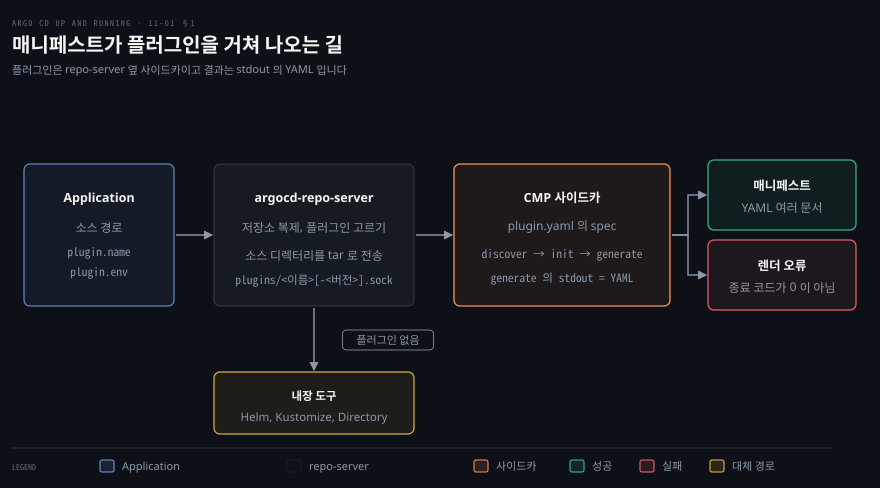
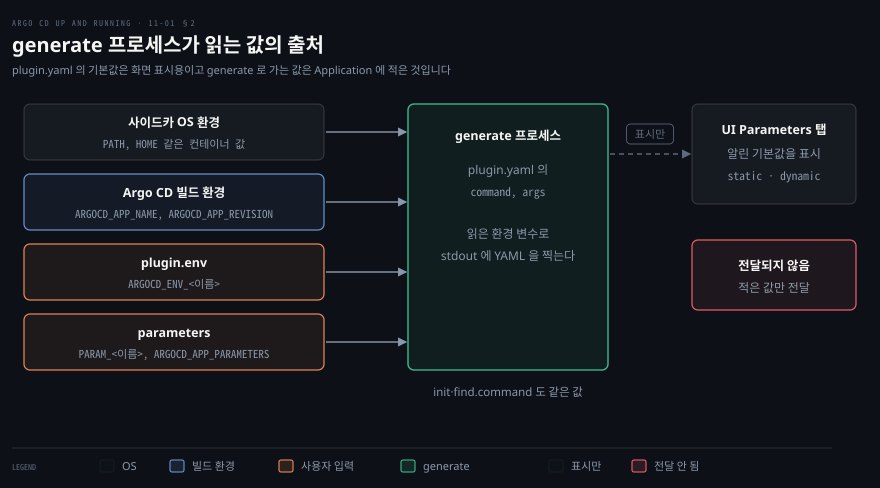

# Argo CD 확장하기 — Config Management Plugin·UI 맞춤
---

## 핵심 요약

> Argo CD 를 늘리는 길은 둘입니다. 매니페스트를 만드는 방법은 repo-server 옆 사이드카의 플러그인이 맡고, 화면은 argocd-cm 설정과 argocd-server 가 내려주는 파일이 맡습니다.

플러그인(Config Management Plugin, CMP)은 소스 디렉터리에서 `init` 과 `generate` 를 실행하고, `generate` 가 stdout 에 찍은 YAML 을 매니페스트로 씁니다. 설정은 CRD 가 아니라 사이드카의 `plugin.yaml` 파일에 있습니다. Application 에 이름을 적거나 `discover` 규칙이 맞으면 플러그인이 선택됩니다.

플러그인에 값을 넘기는 통로는 두 가지입니다. `plugin.env` 는 `ARGOCD_ENV_` 접두사가 붙어 도착하고, parameters 는 `PARAM_` 접두사가 붙어 도착합니다.

UI 쪽에서는 배너(`ui.banner*`)와 CSS(`ui.cssurl`)를 argocd-cm 키로 켭니다. 새 화면은 `extension*.js` 파일을 argocd-server 의 `/tmp/extensions` 아래에 두어 붙입니다.[^ver]


## 학습 목표

이 내용을 읽고 나면:

1. 내장 도구로 렌더할 수 없을 때 CMP 가 어떤 구조(사이드카·유닉스 소켓·`plugin.yaml`)로 매니페스트를 만드는지 설명할 수 있습니다.
2. Application 의 `plugin.name`, `discover`, `version` 이 어우러져 플러그인이 선택되거나 오류가 나는 경우를 판정할 수 있습니다.
3. 플러그인이 읽는 환경 변수의 출처 네 가지와 `plugin.env`·parameters 가 변수 이름으로 바뀌는 규칙을 말할 수 있습니다.
4. 플러그인 운영에서 타임아웃, 빈 출력과 prune, 설정 변경 반영, 오류 캐시를 어떻게 다루는지 설명할 수 있습니다.
5. 배너·커스텀 CSS·UI 확장을 켜는 설정과 파일 위치를 말하고, UI 확장이 어떤 경로로 브라우저에 전달되는지 설명할 수 있습니다.


## 1. 플러그인이 필요한 때와 CMP 의 구조

> 내장 도구로 렌더할 수 없는 소스는 repo-server 옆 사이드카의 플러그인이 generate 출력으로 매니페스트를 만듭니다.

### 사이드카로 떼어 낸 CMP 구조

내장 도구(Helm·Kustomize·Directory)로 렌더할 수 없는 소스가 있으면 Argo CD 는 매니페스트를 만들지 못합니다. 이때 매니페스트를 만드는 명령을 직접 정해 repo-server 에 꽂는 장치가 Config Management Plugin(CMP)입니다.

예를 들어 Kustomize 가 Helm 차트를 풀어 렌더하는 Helm inflator 는 `kustomize build --enable-helm` 이 있어야 돕니다. 이 옵션은 argocd-cm 의 `kustomize.buildOptions` 에 넣으면 모든 Kustomize Application 에 한꺼번에 켜집니다. 전역으로 켜고 싶지 않거나 argocd-cm 을 고칠 권한이 없으면, 이 명령을 `generate` 에 적은 플러그인을 만들어 필요한 Application 에만 씁니다.[^helm]

렌더 도구를 repo-server 이미지 안에 넣으면 도구 버전이 repo-server 와 얽히고, 그 이미지의 수명주기까지 맡아야 합니다. 그래서 CMP 는 도구를 별도 컨테이너에 담아 repo-server Pod 안에 나란히 띄웁니다. 이 방식을 사이드카(sidecar, 한 Pod 안에서 주 컨테이너 옆에 붙는 보조 컨테이너)라고 부릅니다.

사이드카의 entrypoint 는 `/var/run/argocd/argocd-cmp-server` 이고, 이 프로그램은 repo-server 의 요청을 받는 가벼운 gRPC 서버입니다. repo-server 와는 공유 볼륨 위의 유닉스 소켓(같은 노드 안에서 파일처럼 열어 쓰는 통신 통로)으로 이야기합니다.[^sidecar]

### plugin.yaml 과 사이드카 조건

플러그인의 설정은 CRD 가 아니라 사이드카 안의 설정 파일입니다. 파일에는 `apiVersion: argoproj.io/v1alpha1` 과 `kind: ConfigManagementPlugin` 줄이 있습니다. 그래도 이것을 `kubectl apply` 하면 문서가 적은 `no matches for kind "ConfigManagementPlugin"` 오류가 납니다. argocd-cm 에 플러그인을 적던 옛 방식은 2.8 에서 없어졌습니다.[^crd]

파일은 사이드카의 `/home/argocd/cmp-server/config/plugin.yaml` 에 있어야 합니다. 보통 ConfigMap 을 `subPath` 로 마운트해 넣습니다. 사이드카가 갖춰야 할 조건은 다섯 가지입니다.

| 조건 | 값 |
|------|----|
| 실행 사용자 | UID 999 |
| entrypoint | `/var/run/argocd/argocd-cmp-server` |
| 공유 볼륨 | `var-files` 를 `/var/run/argocd` 에, `plugins` 를 `/home/argocd/cmp-server/plugins` 에 마운트 |
| 설정 파일 | `plugin.yaml` 을 `/home/argocd/cmp-server/config/plugin.yaml` 에 마운트 |
| 임시 디렉터리 | `/tmp` 에 emptyDir |

실습에서는 busybox 이미지로 `echo-demo` 라는 사이드카를 repo-server Deployment 에 붙였습니다. 아래 patch 가 위 조건을 그대로 옮긴 것입니다.

```yaml
spec:
  template:
    spec:
      containers:
        - name: echo-demo
          image: busybox:1.37.0
          command: [/var/run/argocd/argocd-cmp-server]
          securityContext:
            runAsNonRoot: true
            runAsUser: 999
          volumeMounts:
            - mountPath: /var/run/argocd
              name: var-files
            - mountPath: /home/argocd/cmp-server/plugins
              name: plugins
            - mountPath: /home/argocd/cmp-server/config/plugin.yaml
              subPath: plugin.yaml
              name: cmp-echo
            - mountPath: /tmp
              name: cmp-tmp
      volumes:
        - name: cmp-echo
          configMap:
            name: cmp-echo
        - name: cmp-tmp
          emptyDir: {}
```

### discover·init·generate 세 블록

`plugin.yaml` 의 `spec` 에서 먼저 볼 블록은 세 개입니다. `discover` 는 이 플러그인이 어떤 소스에 맞는지 가리는 규칙입니다. `init` 은 렌더 전에 한 번 도는 준비 명령이고, `generate` 는 매니페스트를 만드는 본 명령입니다.

`discover` 는 세 방식 중 하나를 씁니다. `fileName` 은 glob 으로 파일 이름을 맞추고, `find.glob` 은 `**` 를 쓸 수 있는 glob 입니다. `find.command` 는 종료 코드가 0 이면서 stdout 이 비어 있지 않으면 일치입니다. 여럿을 적으면 이 순서에서 첫 번째만 평가됩니다.[^disc]

`init` 의 출력은 매니페스트로 쓰이지 않습니다. 차트 의존성을 받아 두는 일이 대표적인 쓰임입니다. `generate` 의 stdout 에는 올바른 Kubernetes 객체(YAML 또는 JSON)만 있어야 하고, 로그는 stderr 로 보냅니다. 두 명령 모두 종료 코드가 0 이 아니면 렌더가 실패합니다.[^cmp]

```yaml
apiVersion: argoproj.io/v1alpha1
kind: ConfigManagementPlugin
metadata:
  name: echo-demo
spec:
  version: v1.0
  discover:
    fileName: "guestbook-ui-deployment.yaml"
  init:
    command: [sh, -c]
    args: ['echo "init ran in $(pwd)" >&2']
  generate:
    command: [sh, -c]
    args:
      - |
        cat <<EOF
        apiVersion: v1
        kind: ConfigMap
        metadata:
          name: ${ARGOCD_APP_NAME}-cmp
          namespace: ${ARGOCD_APP_NAMESPACE}
        data:
          source_path: "${ARGOCD_APP_SOURCE_PATH}"
        EOF
```

위 파일이 들어간 사이드카 로그에서 `init` 의 stderr 출력과 `generate` 의 실행이 repo-server 의 요청 한 번 안에서 차례로 일어나는 것을 확인했습니다. 그래서 `init` 에서 만든 파일은 `generate` 가 같은 디렉터리에서 그대로 씁니다.



### Application 이 플러그인을 고르는 규칙

repo-server 는 Application 의 `source.plugin` 설정과 사이드카들의 `discover` 규칙을 보고 플러그인을 고릅니다. 판정은 아래 표와 같고, `plugin` 필드가 없고 맞는 플러그인도 없는 Application 은 내장 도구로 렌더됩니다. `plugin` 필드에 `env`·`parameters` 만 적고 이름을 비우면 타입이 플러그인으로 정해집니다. 이때 맞는 플러그인이 없으면 내장 도구로 넘어가지 않고 `could not find plugin supporting the given repository` 오류가 납니다.[^disc]

| Application 의 `plugin.name` | 플러그인의 `discover` | 결과 |
|------|------|------|
| 있음 | 없음 | 이름이 같은 플러그인이 일치 |
| 있음 | 맞음 | 이름이 같은 플러그인이 일치 |
| 있음 | 안 맞음 | `could not find cmp-server plugin with name "…" supporting the given repository` |
| 없음 | 없음 | 후보에서 제외(이름 없이는 선택되지 않음) |
| 없음 | 맞음 | 소켓을 훑다 처음 일치한 플러그인 |

`spec.version` 을 쓰면 Application 에는 `<이름>-<버전>` 으로 적어야 합니다. 실습에서 `version: v1.0` 인 `echo-demo` 에 `plugin.name: echo-demo` 만 적어 보았습니다.

결과는 표 셋째 줄과 같은 `could not find cmp-server plugin with name "echo-demo" …` 로 시작했습니다. 다만 뒤에 `error dialing to cmp-server for plugin echo-demo.sock` 과 `no such file or directory` 가 붙었습니다. 소켓 파일 이름이 `echo-demo-v1.0.sock` 이기 때문입니다.

`echo-demo-v1.0` 으로 적자 렌더가 되었습니다. discover 가 맞지 않는 소스(`helm-guestbook` 디렉터리)에 이름을 지정한 Application 은 위 표의 세 번째 줄 오류로 끝났습니다.

Application 하나에는 플러그인 하나만 쓸 수 있습니다. 같은 소스에 Helm 과 Kustomize 를 겹쳐 쓰고 싶으면 두 도구를 한 `generate` 명령 안에서 이어 호출하는 플러그인을 만들어야 합니다.


## 2. 플러그인에 값을 넘기고 운영하기

> 플러그인에는 plugin.env 와 parameters 로 값을 넘기고, 운영에서는 시간 제한과 빈 출력 같은 일을 겪습니다.

### 환경 변수로 값 넘기기

같은 플러그인을 Application 마다 다른 입력으로 돌리고 싶은 때가 많습니다. 값은 `init`·`generate`·`discover.find.command` 의 환경 변수로 들어가고, 출처는 네 가지입니다. 사이드카 컨테이너의 OS 환경 변수, Argo CD 가 채우는 빌드 환경 변수, Application 의 `plugin.env`, 그리고 `plugin.parameters` 입니다.[^env]



빌드 환경 변수는 Argo CD 가 Application 정보에서 채웁니다. `ARGOCD_APP_NAME`, `ARGOCD_APP_NAMESPACE`, `ARGOCD_APP_PROJECT_NAME` 은 Application 의 이름과 배포 대상(destination) 네임스페이스와 프로젝트입니다. `ARGOCD_APP_REVISION`, `ARGOCD_APP_SOURCE_PATH`, `ARGOCD_APP_SOURCE_REPO_URL` 은 소스의 리비전과 경로와 저장소 URL 입니다. 클러스터 정보는 `KUBE_VERSION` 과 `KUBE_API_VERSIONS` 입니다.

`plugin.env` 로 넣은 값은 이름 앞에 `ARGOCD_ENV_` 가 붙어서 도착합니다. 값 안에서는 `$ARGOCD_APP_REVISION_SHORT` 같은 빌드 변수를 쓸 수 있습니다.

```yaml
spec:
  source:
    plugin:
      name: echo-demo-v1.0
      env:
        - name: FOO
          value: bar
        - name: REV
          value: test-$ARGOCD_APP_REVISION_SHORT
```

이렇게 넣고 `generate` 가 값을 ConfigMap 으로 찍게 해서 확인했습니다. `ARGOCD_ENV_FOO` 는 `bar` 였고 접두사 없는 `FOO` 는 비어 있었습니다. `ARGOCD_ENV_REV` 는 `test-8088f4c` 로 풀렸습니다. 접두사가 붙으므로 사용자가 넣은 `FOO` 가 사이드카의 기존 환경 변수와 섞이지 않습니다. `KUBE_VERSION` 은 `1.35.0` 으로 `v` 없이 들어왔습니다.

### parameters 로 값 넘기기

parameters 는 환경 변수보다 형이 다양합니다. 값의 형은 문자열(`string`)·배열(`array`)·맵(`map`)입니다. 변수 이름은 `PARAM_` 뒤에 parameter 이름을 대문자로 바꾸고 영문 대문자·숫자·`_` 가 아닌 글자(`-` 와 `.` 등)를 모두 `_` 로 바꾼 것입니다. 배열은 뒤에 인덱스가, 맵은 뒤에 같은 규칙으로 바꾼 키가 붙습니다(`image.tag` → `_IMAGE_TAG`). 모든 parameters 는 JSON 배열로 묶여 `ARGOCD_APP_PARAMETERS` 변수에도 들어갑니다.[^par]

```yaml
spec:
  source:
    plugin:
      name: echo-demo-v1.0
      parameters:
        - name: greeting
          string: hi there
        - name: list
          array: [x, "y z"]
        - name: labels
          map: {team: web, tier: fe}
```

parameters 는 배열 원소와 맵 키마다 변수 하나가 생깁니다. 이 Application 에서 `generate` 가 본 `PARAM_` 변수는 다섯 개였습니다. `PARAM_GREETING=hi there`, `PARAM_LIST_0=x`, `PARAM_LIST_1=y z`, `PARAM_LABELS_TEAM=web`, `PARAM_LABELS_TIER=fe` 입니다.

`ARGOCD_APP_PARAMETERS` 에는 Application 에 적은 parameters 항목만 JSON 배열로 담깁니다. 다른 `source.plugin` 필드(`name`, `env`)는 들어가지 않습니다. 실습에서도 세 항목만 있었습니다.

### parameters 를 UI 에 알리기

parameters 에는 UI 에 알리는(announce) 기능이 있습니다. `plugin.yaml` 의 `parameters.static` 에 이름·제목·기본값을 적으면 UI 의 Parameters 탭에 입력 칸이 생깁니다. `parameters.dynamic.command` 가 소스 디렉터리에서 같은 모양의 JSON 을 찍어도 같은 칸이 생깁니다.

사이드카가 알린 static 과 dynamic parameters 는 REST API 의 앱 상세 조회(`appdetails`) 한 응답에 함께 담깁니다. 실습에서 이 조회가 돌려주는 `plugin.parametersAnnouncement` 에는 static 세 항목과 dynamic 의 `dyn-param` 이 함께 담겼습니다.[^ann]

알린 기본값은 표시용이라서 플러그인으로 전달되지 않습니다. `plugin.yaml` 에 기본값 `hello`·`[a, b]`·`{team: base}` 가 있어도, Application 에 `parameters` 를 적지 않은 첫 실행에서는 `PARAM_GREETING` 등이 모두 `unset` 이었습니다. 기본값이 필요하면 플러그인 스크립트가 `${PARAM_GREETING:-hello}` 처럼 직접 채워야 합니다.

### 운영에서 부딪히는 다섯 가지

운영에서 부딪히는 일은 다섯 가지입니다.

첫째는 시간 제한입니다. 렌더 요청의 기본 제한은 60초이고, `argocd-cmd-params-cm` 의 `server.repo.server.timeout.seconds` 와 `controller.repo.server.timeout.seconds` 로 늘립니다. 실습에서 `generate` 에 70초 대기를 넣자 사이드카 로그에 `Generating manifests with deadline 59.07s from now` 가 찍혔습니다. Application 은 `ComparisonError: … DeadlineExceeded desc = context deadline exceeded` 가 되었습니다.

공식 문서는 사이드카의 `ARGOCD_EXEC_TIMEOUT`(기본 90초)도 명령마다 따로 적용된다고 적습니다. 그러나 v3.6.1 의 CMP 서버는 이 값을 읽지 않습니다. 사이드카의 명령은 요청 기한보다 0.1초 앞선 시점에 TERM 을 받고 5초 뒤 KILL 되므로, 상한은 위의 요청 제한 하나입니다. 실습에서도 `ARGOCD_EXEC_TIMEOUT=2s` 인 사이드카에서 5초짜리 `sleep` 이 끝까지 돌았습니다.[^ops]

둘째는 빈 출력입니다. `generate` 가 아무것도 찍지 않고 정상 종료하면 Argo CD 는 매니페스트가 비었다고 봅니다. `prune` 이 켜져 있으면 기존 리소스를 지우려 합니다.

`kustomize build . | cat` 처럼 파이프를 쓰면 앞 명령이 실패해도 종료 코드가 0 이 되어 이 상황이 생깁니다. 실습에서 `false | cat` 은 빈 매니페스트와 `requiresPruning=true` 가 되었습니다. 앞에 `set -o pipefail` 을 두자 `ComparisonError` 로 오류가 드러났습니다.[^ops]

셋째는 설정 반영입니다. ConfigMap 으로 마운트한 `plugin.yaml` 을 고쳤으면 repo-server Pod 를 다시 띄워야 사이드카가 새 설정을 읽습니다. 이미지에 구운 `plugin.yaml` 이면 이미지를 다시 받게 해야 합니다.

넷째는 오류 캐시입니다. 플러그인 오류는 repo-server 가 Redis 에 캐시하므로 repo-server 를 재시작해도 지워지지 않습니다. 개발 중에는 Application 에 Hard Refresh 를 눌러(`argocd.argoproj.io/refresh=hard` 어노테이션) 최신 출력을 봅니다.

다섯째는 파일 전달 옵션입니다. 소스를 사이드카로 보낼 때 제외할 파일은 `reposerver.plugin.tar.exclusions` 로 정합니다. 원래 파일 모드를 보존하려면 `plugin.yaml` 에 `preserveFileMode: true` 를 두고, repo-server 의 git 자격 증명을 받으려면 `provideGitCreds: true` 를 둡니다. 두 옵션은 플러그인을 신뢰할 때만 켭니다.[^ops]


## 3. UI 맞춤 — 배너·스타일·확장

> UI 는 코드를 고치지 않고 배너, CSS, 확장 세 층에서 맞춥니다.

### 세 층과 배너 설정

UI 맞춤은 코드를 고치지 않고 세 층에서 합니다. 같은 안내를 모든 사용자에게 알리는 배너, 모양을 바꾸는 CSS, 새 화면을 붙이는 확장입니다.

배너는 argocd-cm 에 키를 적으면 켜집니다. `ui.bannercontent` 가 문구이고, `ui.bannerurl` 을 주면 문구 전체가 링크가 됩니다. 문구 없이 URL 만 줄 수는 없습니다.

`ui.bannerpermanent: "true"` 면 닫기 버튼이 없어집니다. 영구 배너는 한 줄만 보이므로 문구를 짧게 둡니다. 영구 배너와 닫을 수 있는 배너를 함께 둘 수는 없습니다. `ui.bannerposition` 은 `top`(기본값)·`bottom`·`both` 입니다. 문구를 고치면 사용자의 브라우저에 저장된 "배너 숨김" 상태가 지워져 배너가 다시 보입니다.[^banner]

실습에서 이 키들을 argocd-cm 에 넣고 REST API 의 `/api/v1/settings` 를 조회했습니다. 로그인한 토큰으로 부르면 배너 내용·링크·위치 필드가 오고, 토큰 없이 부르면 `uiCssURL` 은 보이지만 배너 필드는 오지 않았습니다. 로그인 전 응답에는 배너 정보가 없습니다.

### CSS 로 모양 바꾸기

커스텀 CSS 는 `ui.cssurl` 이 가리키는 파일을 UI 가 불러와 적용합니다. 값은 외부 URL 이거나 `/shared/app` 기준의 상대 경로(`./custom/my-styles.css`)입니다. 서버 컨테이너의 파일을 쓸 때는 `/shared/app` 의 하위 디렉터리(예: `/shared/app/custom`)에 마운트해야 합니다. 그렇지 않으면 브라우저가 MIME 형식 오류로 파일을 불러오지 못할 가능성이 큽니다.[^css]

`install.yaml` 로 설치한 argocd-server 에는 이 경로로 마운트되는 볼륨이 없었습니다. 실습에서는 `argocd-styles-cm` ConfigMap 의 `my-styles.css` 키에 CSS 를 두고, Deployment 에 이 ConfigMap 을 `/shared/app/custom` 으로 마운트하는 볼륨을 더했습니다. 그 뒤 argocd-server 가 CSS 내용을 그대로 내려주는 것까지 확인했습니다.

### 확장 파일 마운트와 등록

UI 확장은 argocd-server 가 `/extensions.js` 한 파일로 묶어 내려주는 JavaScript 입니다. 서버는 `/tmp/extensions` 아래에서 이름이 `^extension(.*)\.js$` 에 맞는 파일을 모두 찾아 한 파일로 이어 붙입니다. 각 파일은 `try … catch` 로 감싸서 한 확장이 깨져도 나머지가 돌게 합니다.

파일 탐색은 심볼릭 링크를 건너뜁니다. 그런데 ConfigMap 을 디렉터리로 마운트하면 실제 파일이 kubelet 이 만든 `..2026_…` 디렉터리 안에 있어서 탐색에 잡힙니다.

실습에서 `ext-hello` ConfigMap 을 `/tmp/extensions/hello` 에 마운트했습니다. `/extensions.js` 응답에 파일 내용이 `// source: /tmp/extensions/hello/..2026_…/extension-hello.js/extension-hello.js` 주석(파일 이름이 두 번 붙습니다)과 함께 들어 있었습니다.[^ext]

확장은 `window.extensionsAPI` 에 등록 함수를 불러서 붙입니다. 다섯 가지 자리가 있고 함수마다 인자가 다릅니다.

| 함수 | 붙는 자리 | 인자 |
|------|-----------|------|
| `registerResourceExtension` | 리소스 상세 패널의 탭 | 컴포넌트, group, kind, 탭 제목, (아이콘) |
| `registerSystemLevelExtension` | 사이드바의 새 페이지 | 컴포넌트, 제목, 경로, 아이콘 |
| `registerAppViewExtension` | Application 상세의 보기 방식 | 컴포넌트, 제목, 아이콘, (표시 조건 함수) |
| `registerStatusPanelExtension` | Application 상태 패널 | 컴포넌트, 제목, id, (flyout) |
| `registerTopBarActionMenuExt` | Application 상단 동작 메뉴 | 컴포넌트, 제목, id, flyout, … |

실습에서 올린 확장은 사이드바에 `Hello Ext` 를 붙이는 한 줄짜리였습니다.

```javascript
((window) => {
  const component = () => window.React.createElement("div", { style: { padding: "10px" } }, "Hello from extension");
  window.extensionsAPI.registerSystemLevelExtension(component, "Hello Ext", "/hello", "fa-flask");
})(window);
```

### 번들 규칙과 프록시 확장

확장을 번들러로 만든다면 Argo CD 3.5 부터 `react` 와 `react-dom` 뿐 아니라 `react/jsx-runtime` 도 번들에서 빼야 합니다. 빼 두면 확장이 `window.ReactJSXRuntime` 을 씁니다. 빼지 않으면 로드할 때 `Extension <이름>.js failed to load: TypeError: Cannot read properties of undefined` 가 납니다.[^react]

확장 파일을 서버에 전달하는 방법은 둘입니다. 위처럼 ConfigMap 이나 볼륨으로 마운트하는 방법이 있고, init 컨테이너가 확장을 내려받아 넣는 Argo CD Extension Installer 를 쓰는 방법이 있습니다.[^ext]

화면 확장과 별개로 argocd-server 가 외부 백엔드로 요청을 대신 보내 주는 프록시 확장이 있습니다. 이 기능은 기본으로 꺼져 있고 `argocd-cmd-params-cm` 의 `server.enable.proxy.extension` 으로 켭니다. 켠 뒤에는 argocd-cm 의 `extension.config` 에 백엔드를 적습니다.[^proxy]


## 연습 문제

> 아래 여섯 문제는 CMP 의 구조와 선택 규칙과 값 전달과 운영 함정과 배너·CSS·확장을 하나씩 묻습니다. 답을 적은 뒤에 정답 절을 펼칩니다.

1. 사이드카와 repo-server 의 통신 방식, `plugin.yaml` 의 위치를 말하십시오. `plugin.yaml` 을 `kubectl apply` 로 올리면 어떻게 됩니까? `init` 과 `generate` 중 어느 쪽의 stdout 이 매니페스트가 됩니까?
2. 플러그인이 `spec.version: v1.0` 으로 선언되어 있고 `discover.fileName` 이 있습니다. Application 에 `plugin.name: echo-demo` 만 적으면 어떻게 됩니까? 이름은 맞지만 소스에 `discover` 가 맞는 파일이 없으면 어떻게 됩니까?
3. Application 의 `plugin.env` 에 `FOO=bar` 를 적었습니다. `generate` 안에서 `$FOO` 와 `$ARGOCD_ENV_FOO` 는 각각 무엇입니까? `REV=test-$ARGOCD_APP_REVISION_SHORT` 는 `generate` 안에서 어떤 값으로 보입니까?
4. `plugin.yaml` 의 `parameters.static` 에 `greeting` 의 기본값 `hello` 가 있고 Application 에는 `parameters` 가 없습니다. `generate` 가 보는 `PARAM_GREETING` 은 무엇입니까? Application 에 `labels` 맵(`team: web`)을 적으면 변수 이름은 무엇이고 `ARGOCD_APP_PARAMETERS` 에는 무엇이 담깁니까?
5. `generate` 가 `kustomize build . | cat` 으로 끝나는 플러그인을 쓰는 Application 에 `prune` 이 켜져 있습니다. 어떤 일이 생길 수 있고 어떻게 막습니까? `plugin.yaml` ConfigMap 을 고친 뒤에 할 일과, 고친 뒤에도 옛 오류가 보일 때 할 일은 무엇입니까?
6. 커스텀 CSS 를 `ui.cssurl: "./custom/my-styles.css"` 로 켜려고 합니다. 파일은 서버 컨테이너의 어디에 마운트해야 합니까? 배너에 `ui.bannerpermanent: "true"` 를 주면 무엇이 달라집니까? UI 확장 파일은 어디에 어떤 이름으로 두며, 번들러에서 3.5 이상이라면 무엇을 외부로 빼야 합니까?


## 정답 (자답 후 펼치기)

### 정답 1

사이드카는 `argocd-cmp-server`(gRPC 서버)를 띄우고, repo-server 와는 공유 볼륨의 `/home/argocd/cmp-server/plugins/<이름>[-<버전>].sock` 유닉스 소켓으로 통신합니다. 설정 파일 `plugin.yaml` 은 사이드카의 `/home/argocd/cmp-server/config/plugin.yaml` 에 있어야 하며 보통 ConfigMap 을 `subPath` 로 마운트합니다.

`kind: ConfigManagementPlugin` 줄이 있어도 이 파일은 CRD 가 아니라 설정 파일 형식입니다. 클러스터에 `kubectl apply` 하면 문서가 적은 `no matches for kind "ConfigManagementPlugin"` 오류가 납니다. 매니페스트가 되는 것은 `generate` 의 stdout 입니다. `init` 은 같은 요청 안에서 `generate` 직전에 실행되지만 출력은 매니페스트로 쓰이지 않습니다.

### 정답 2

버전이 있으면 소켓 파일 이름이 `<이름>-<버전>.sock` 이라서 Application 에는 `echo-demo-v1.0` 으로 적어야 합니다. `echo-demo` 만 적으면 표 셋째 줄과 같은 `could not find cmp-server plugin with name "echo-demo" …` 로 시작합니다. 다만 뒤에 `error dialing to cmp-server for plugin echo-demo.sock` 과 `no such file or directory` 가 붙습니다. 머리말만 보고 discover 가 안 맞았다고 읽지 말고 꼬리의 원인을 봅니다.

이름이 맞아도 `discover` 가 설정된 플러그인이 소스와 맞지 않으면 `could not find cmp-server plugin with name "…" supporting the given repository` 오류가 납니다. `discover` 가 없는 플러그인이라면 이름만으로 일치합니다.

### 정답 3

`$ARGOCD_ENV_FOO` 는 `bar` 이고 `$FOO` 는 비어 있습니다. 사용자가 넣은 `plugin.env` 에는 항상 `ARGOCD_ENV_` 접두사가 붙기 때문입니다. `generate` 가 보는 `ARGOCD_ENV_REV` 는 `$ARGOCD_APP_REVISION_SHORT` 가 이미 풀린 `test-8088f4c` 입니다. 실습의 커밋 `8088f4c0…` 의 짧은 해시가 들어간 값입니다.

### 정답 4

`PARAM_GREETING` 은 비어 있어서 스크립트가 `${PARAM_GREETING:-unset}` 으로 읽으면 `unset` 입니다. `parameters.static` 의 기본값은 UI 의 Parameters 탭에 보이기만 하고 플러그인으로는 전달되지 않기 때문입니다. 기본값이 필요하면 스크립트가 `${PARAM_GREETING:-hello}` 처럼 스스로 채웁니다.

`labels` 맵의 `team: web` 은 `PARAM_LABELS_TEAM=web` 이 됩니다. `ARGOCD_APP_PARAMETERS` 에는 Application 의 `plugin.parameters` 에 적은 항목의 JSON 배열(`[{"map":{"team":"web"},"name":"labels"}]`)만 들어갑니다. `name` 이나 `env` 는 없습니다.

### 정답 5

파이프의 앞 명령(`kustomize build`)이 실패해도 `cat` 이 0 으로 끝나서 `generate` 는 빈 출력과 종료 코드 0 이 됩니다. Argo CD 는 이를 "매니페스트가 비었다"고 보고 `prune` 이 켜져 있으면 기존 리소스를 지우려 합니다. 실습에서 `false | cat` 이 이렇게 빈 매니페스트와 `requiresPruning=true` 가 되었습니다. 스크립트 앞에 `set -o pipefail` 을 두면 앞 명령의 실패가 종료 코드로 전해져 `ComparisonError` 로 드러납니다.

ConfigMap 으로 마운트한 `plugin.yaml` 을 고쳤으면 repo-server Pod 를 다시 띄워야 합니다. 그래도 옛 오류가 보이면 오류가 Redis 에 캐시된 것이므로 repo-server 재시작으로는 지워지지 않고, Application 에 Hard Refresh 를 해야 합니다.

### 정답 6

`ui.cssurl` 의 상대 경로는 `/shared/app` 기준이라서 `./custom/my-styles.css` 는 서버 컨테이너의 `/shared/app/custom/my-styles.css` 를 뜻합니다. 파일은 `/shared/app` 아래 하위 디렉터리에 마운트해야 하고, 그러지 않으면 브라우저가 MIME 형식 오류로 불러오지 못할 가능성이 큽니다. `install.yaml` 로 설치한 서버에는 이 경로의 볼륨이 없어서 ConfigMap 을 마운트하는 볼륨을 더했습니다.

`ui.bannerpermanent: "true"` 는 배너의 닫기 버튼을 없앱니다. 그 대신 한 줄만 보이므로 문구를 짧게 둡니다. 영구 배너와 닫을 수 있는 배너를 동시에 둘 수 없습니다.

UI 확장은 `/tmp/extensions` 아래에 `extension*.js`(정규식 `^extension(.*)\.js$`)로 둡니다. ConfigMap 을 디렉터리(예: `/tmp/extensions/hello`)로 마운트하면 됩니다. 3.5 이상에서는 `react` 와 `react-dom` 외에 `react/jsx-runtime` 을 외부로 빼서 `window.ReactJSXRuntime` 을 쓰게 해야 하고, 빼지 않으면 로드할 때 `TypeError` 가 납니다.


## 참고 자료

- 《Argo CD: Up and Running》(Andrew Block · Christian Hernandez, O'Reilly, 2025, ISBN 978-1-098-14200-1) 11장
- [Config Management Plugins](https://github.com/argoproj/argo-cd/blob/v3.6.1/docs/operator-manual/config-management-plugins.md)
- [빌드 환경](https://github.com/argoproj/argo-cd/blob/v3.6.1/docs/user-guide/build-environment.md)
- [UI 커스텀 스타일과 배너](https://github.com/argoproj/argo-cd/blob/v3.6.1/docs/operator-manual/custom-styles.md)
- [UI 확장](https://github.com/argoproj/argo-cd/blob/v3.6.1/docs/developer-guide/extensions/ui-extensions.md)
- [프록시 확장](https://github.com/argoproj/argo-cd/blob/v3.6.1/docs/developer-guide/extensions/proxy-extensions.md)
- 관련 노트: [이 책의 인덱스](./README.md)
- 관련 노트: [02-01 Argo CD 설치하기](./02-01.Argo%20CD%20설치하기%20—%20구성%20요소·설치%20유형·매니페스트와%20Helm.md), [03-01 Argo CD 와 상호작용하기](./03-01.Argo%20CD%20와%20상호작용하기%20—%20UI·CLI·REST%20API%20와%20선언적%20구성.md)
- 관련 노트: [04-01 Application 관리하기](./04-01.Application%20관리하기%20—%20소스·대상·Helm·Kustomize%20와%20삭제·finalizer.md), [05-01 Application 동기화](./05-01.Application%20동기화%20—%20자동%20동기화·Sync%20Option·Hook·Sync%20Wave%20와%20차이%20무시.md)
- 관련 노트: [ArgoCD 확장과 플러그인(옛 정리)](../../argocd/04-01.ArgoCD%20확장과%20플러그인.md)

[^ver]: 최신 릴리스는 Argo CD v3.6.1(2026-11-04)입니다. 문서와 소스는 v3.6.1 태그에 고정했습니다. 이 노트의 실습은 kind v0.31.0 이 만든 Kubernetes v1.35.0 클러스터에 `install.yaml` 로 설치한 v3.6.1 에서 했고, 예제 저장소 `argoproj/argocd-example-apps` 를 커밋 `8088f4c0d970abb09e250248cc97e35623447cb5` 로 고정해 썼습니다. 실습한 플러그인은 값을 ConfigMap 으로 찍는 `echo-demo` 입니다.
[^helm]: Kustomize 로 Helm 차트를 렌더하는 방법을 문서는 "If you would like to render Helm charts through Kustomize in an Argo CD application, you have two options: You can either create a custom plugin, or modify the `argocd-cm` ConfigMap to include the `--enable-helm` flag globally for all Kustomize applications"로 설명하고, 설정 예로 `kustomize.buildOptions: --enable-helm` 을 보입니다. <https://github.com/argoproj/argo-cd/blob/v3.6.1/docs/user-guide/kustomize.md> (2026-11-08 조회)
[^sidecar]: 문서는 사이드카 설치를 "To install a plugin, patch argocd-repo-server to run the plugin container as a sidecar, with argocd-cmp-server as its entrypoint"로 설명하고, "Make sure to use `/var/run/argocd/argocd-cmp-server` as an entrypoint. The `argocd-cmp-server` is a lightweight GRPC service that allows Argo CD to interact with the plugin."이라고 적습니다. 유닉스 소켓은 `util/app/discovery/discovery.go` 가 `plugins` 디렉터리에서 `os.ModeSocket` 파일을 찾는 코드(L118)와 실습의 `.sock` 파일에서 확인했습니다. <https://github.com/argoproj/argo-cd/blob/v3.6.1/docs/operator-manual/config-management-plugins.md> (2026-11-08 조회)
[^crd]: 문서의 오류 표는 `no matches for kind "ConfigManagementPlugin" in version "argoproj.io/v1alpha1"` 의 원인을 "The `ConfigManagementPlugin` CRD was deprecated in Argo CD 2.4 and removed in 2.8."로 설명하고, 같은 문서의 「Migrating from argocd-cm plugins」 절은 "Installing plugins by modifying the argocd-cm ConfigMap is deprecated as of v2.4 and has been completely removed starting in v2.8."이라고 적습니다. <https://github.com/argoproj/argo-cd/blob/v3.6.1/docs/operator-manual/config-management-plugins.md> (2026-11-08 조회)
[^disc]: `discover` 의 평가 순서(fileName, find.glob, find.command 중 처음 것만)는 `cmpserver/plugin/plugin.go` 의 일치 판정 `matchRepository`(L337-386)에 있습니다. 플러그인 선택은 `util/app/discovery/discovery.go` 의 `DetectConfigManagementPlugin`(L91-133)과 `cmpSupports`(L159-221)가 정합니다. 이름을 지정하면 소켓 파일 `<이름>[-<버전>].sock` 만 열고, `discover` 가 설정되지 않은 플러그인은 이름이 지정될 때만 일치로 칩니다. 이름이 없으면 `plugins` 디렉터리의 소켓을 차례로 열어 처음 일치하는 플러그인을 씁니다. <https://github.com/argoproj/argo-cd/blob/v3.6.1/util/app/discovery/discovery.go>, <https://github.com/argoproj/argo-cd/blob/v3.6.1/cmpserver/plugin/plugin.go> (2026-11-08 조회)
[^cmp]: 문서의 `plugin.yaml` 설명은 `generate` 에 대해 "Standard output must be ONLY valid Kubernetes Objects in either YAML or JSON. A non-zero exit code will fail manifest generation."이라고 적고, `init` 에 대해 "Init always happens immediately before generate, but its output is not treated as manifests."라고 적습니다. <https://github.com/argoproj/argo-cd/blob/v3.6.1/docs/operator-manual/config-management-plugins.md> (2026-11-08 조회)
[^env]: 문서는 플러그인이 보는 환경 변수를 "The system environment variables of the sidecar", "Standard build environment variables", "Variables in the Application spec", "Parameters in the Application spec" 네 가지로 나누고, 셋째 것에 대해 "Argo CD prefixes all user-supplied environment variables (#3 above) with `ARGOCD_ENV_`"라고 적습니다. 빌드 환경 변수 목록은 `build-environment.md` 에 있습니다. <https://github.com/argoproj/argo-cd/blob/v3.6.1/docs/operator-manual/config-management-plugins.md>, <https://github.com/argoproj/argo-cd/blob/v3.6.1/docs/user-guide/build-environment.md> (2026-11-08 조회)
[^par]: 문서는 parameters 가 "available as JSON in the `ARGOCD_APP_PARAMETERS` environment variable"이라고 하고, 변수 예로 `PARAM_SOME_STRING_PARAM`, `PARAM_SOME_ARRAY_PARAM_0`, `PARAM_SOME_MAP_PARAM_IMAGE_TAG` 를 보입니다. 같은 절에서 "Parameter announcements, even if they specify defaults, are _not_ sent to the plugin in `ARGOCD_APP_PARAMETERS`."라고 적습니다. <https://github.com/argoproj/argo-cd/blob/v3.6.1/docs/operator-manual/config-management-plugins.md> (2026-11-08 조회)
[^ann]: 앱 상세 API 는 `server/repository/repository.go` 의 `GetAppDetails`(L333 부터)가 받고, 사이드카의 알림 수집은 `reposerver/repository/repository.go` 의 L2802-2818 에서 합니다. 응답에서는 플러그인 소스에 사이드카의 parameters 알림이 `plugin.parametersAnnouncement` 로 담겨 돌아왔습니다. 호출하려면 Application 의 `spec.source` 와 같은 소스를 보내야 했고, 저장소가 Argo CD 에 등록되어 있어야 했습니다. <https://github.com/argoproj/argo-cd/blob/v3.6.1/server/repository/repository.go>, <https://github.com/argoproj/argo-cd/blob/v3.6.1/reposerver/repository/repository.go> (2026-11-08 조회)
[^ops]: 문서의 안내는 "The CMP server respects the timeouts set by the `server.repo.server.timeout.seconds` and `controller.repo.server.timeout.seconds` items in `argocd-cmd-params-cm`. Increase their values from the default of 60s."이고, "Each CMP command will also independently timeout on the `ARGOCD_EXEC_TIMEOUT` set for the CMP sidecar. The default is 90s."입니다. 빈 출력에 대해서는 "If a CMP renders blank manifests, and `prune` is set to `true`, Argo CD will automatically remove resources."라 하고 `set -o pipefail` 을 권합니다. 파일 전달 옵션은 같은 문서의 `reposerver.plugin.tar.exclusions`, `preserveFileMode`, `provideGitCreds` 절에 있습니다. 그러나 v3.6.1 의 `cmpserver/plugin/plugin.go` `runCommand`(L80-156)는 `exec.CommandContext` 에 요청 컨텍스트만 넘기고, 기한이 지나면 프로세스 그룹에 TERM 을, 5초 뒤 KILL 을 보냅니다. `ARGOCD_EXEC_TIMEOUT` 을 읽는 곳은 `util/exec/exec.go` 의 `initTimeout`(L44-48)이고, `runCommand` 는 이 패키지에서 로그용 `GetCommandArgsToLog` 만 씁니다. <https://github.com/argoproj/argo-cd/blob/v3.6.1/docs/operator-manual/config-management-plugins.md>, <https://github.com/argoproj/argo-cd/blob/v3.6.1/cmpserver/plugin/plugin.go>, <https://github.com/argoproj/argo-cd/blob/v3.6.1/util/exec/exec.go> (2026-11-08 조회)
[^banner]: argocd-cm 주석은 `ui.bannercontent` 를 "An optional user-defined banner message that's displayed at the top of every UI page. Every time this is updated, it will clear a user's localStorage telling the UI to hide the banner forever."로, `ui.bannerurl` 을 "You can have bannercontent without a bannerurl, but not the other way around."로 설명합니다. 영구 배너는 "only one line of text is available to not take up too much real estate in the UI"라서 문구를 짧게 두라고 권합니다. 또 "you can have either a permanent banner or a regular closeable banner, and NOT both"라고 합니다. 위치는 `"top"`, `"bottom"`, `"both"` 이고 기본이 `top` 입니다. <https://github.com/argoproj/argo-cd/blob/v3.6.1/docs/operator-manual/argocd-cm.yaml>, <https://github.com/argoproj/argo-cd/blob/v3.6.1/docs/operator-manual/custom-styles.md> (2026-11-08 조회)
[^css]: argocd-cm 주석은 `ui.cssurl` 에 대해 "If the supplied path is to a file mounted on the argocd-server container, that file should be mounted within a subdirectory of the existing "/shared/app" directory (e.g. "/shared/app/custom"). Otherwise, the file will likely fail to be imported by the browser with an "incorrect MIME type" error."와 "The path should be specified relative to the "/shared/app" directory; not as an absolute path."를 적습니다. <https://github.com/argoproj/argo-cd/blob/v3.6.1/docs/operator-manual/argocd-cm.yaml> (2026-11-08 조회)
[^ext]: `server/server.go` 의 `serveExtensions`(L1358-1398)는 `/tmp/extensions` 아래를 `filepath.Walk` 로 훑어 `^extension(.*)\.js$` 에 맞는 파일을 한 응답으로 이어 붙입니다. 각 파일 앞에 `// source: <경로>` 주석을 붙이고 본문을 `try { … } catch(e) { console.error('Extension <파일>.js failed to load:', e); }` 로 감쌉니다. `filepath.Walk` 는 심볼릭 링크를 따라가지 않으므로 ConfigMap 을 디렉터리로 마운트했을 때 실제 파일이 있는 `..2026_…` 디렉터리 안의 파일이 응답에 나타났습니다. Extension Installer 는 argocd-server 에 init 컨테이너로 붙어 `EXTENSION_URL` 에서 받은 tar 를 `/tmp/extensions` 공유 볼륨에 풀어 두는 이미지입니다. <https://github.com/argoproj/argo-cd/blob/v3.6.1/server/server.go>, <https://github.com/argoproj/argo-cd/blob/v3.6.1/docs/developer-guide/extensions/ui-extensions.md>, <https://github.com/argoproj-labs/argocd-extension-installer/blob/6b5a7943c5e03f3bcff2c8f6af97c1694ca13280/README.md> (2026-11-08 조회)
[^react]: 업그레이드 문서는 "Starting with Argo CD 3.5, extensions must externalize `react/jsx-runtime` in addition to `react` and `react-dom`. The host application exposes the JSX runtime as `window.ReactJSXRuntime`."이라 하고, 실패 모양을 "Extension <name>.js failed to load: TypeError: Cannot read properties of undefined"로 적습니다. 등록 함수의 인자는 `ui/src/app/shared/services/extensions-service.ts` 의 `registerResourceExtension`, `registerSystemLevelExtension`, `registerAppViewExtension`, `registerStatusPanelExtension`, `registerTopBarActionMenuExt` 정의(L41-77)를 따랐습니다. <https://github.com/argoproj/argo-cd/blob/v3.6.1/docs/operator-manual/upgrading/ui-extensions-react-19-upgrading.md>, <https://github.com/argoproj/argo-cd/blob/v3.6.1/ui/src/app/shared/services/extensions-service.ts> (2026-11-08 조회)
[^proxy]: 프록시 확장 문서는 이 기능이 기본으로 꺼져 있다고 하고, "The easiest way to properly enable this feature flag is by adding the `server.enable.proxy.extension` key in the existing `argocd-cmd-params-cm`."라고 적습니다. 켠 뒤의 설정은 "Once the proxy extension is enabled, it can be configured in the main Argo CD configmap (argocd-cm)."라고 안내하며, 백엔드는 `extension.config` 에 적습니다. <https://github.com/argoproj/argo-cd/blob/v3.6.1/docs/developer-guide/extensions/proxy-extensions.md> (2026-11-08 조회)
