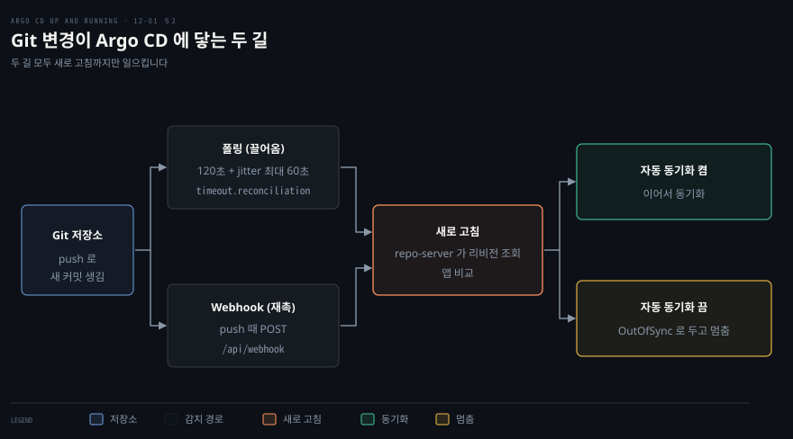
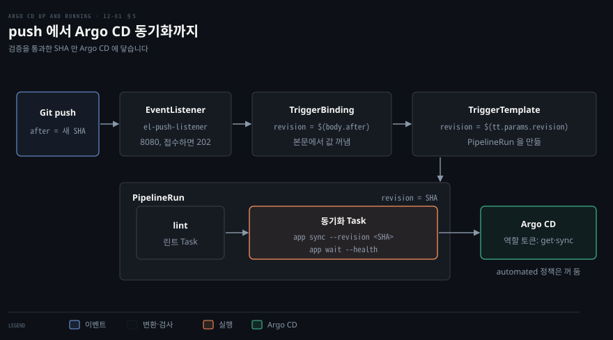

# CI 와 Argo CD 잇기 — 조정 주기·Webhook·Tekton

---


## 핵심 요약

> Argo CD 는 Git 의 변경을 주기적으로 끌어와 알아채고, 그 알림을 앞당기고 싶으면 Webhook 으로 새로 고침을 재촉하며, 검증을 통과한 리비전만 배포하고 싶으면 CI 파이프라인이 프로젝트 역할 토큰으로 Argo CD 를 직접 불러 특정 리비전을 동기화합니다.

Argo CD 는 Git 에서 변경을 끌어오는 풀 방식이라서 CI 가 끝났다는 사실을 스스로 알지 못합니다. 그래서 길이 둘로 갈립니다. 하나는 기다리는 시간을 줄이는 길(조정 주기 줄이기, Webhook)이고, 다른 하나는 배포 시점을 CI 가 쥐는 길(파이프라인이 `argocd app sync` 를 부르기)입니다. 앞의 길은 새로 고침만 일으키고 동기화 여부는 자동 동기화가 정합니다. 뒤의 길은 린트와 테스트를 통과한 리비전만 동기화해야 하므로 자동 동기화를 꺼 둡니다.

이 노트의 값은 Argo CD v3.6.1 과 Tekton Pipelines v1.18.0, Tekton Triggers v0.37.2 를 kind 클러스터에서 직접 돌려 확인한 것입니다.[^ver]


## 학습 목표

이 내용을 읽고 나면:

1. Argo CD 가 Git 변경을 알아채는 주기(`timeout.reconciliation`)와 jitter 의 뜻, 값을 바꿀 때 다시 시작해야 하는 구성 요소를 설명할 수 있습니다.
2. Webhook 이 일으키는 일이 새로 고침뿐이라는 점을 설명하고, HTTP 200 이 새로 고침을 보장하지 않는 경우 세 가지를 들 수 있습니다.
3. 파이프라인에서 프로젝트 역할 토큰으로 `argocd app sync --revision` 과 `argocd app wait --health` 를 부르는 구성을 쓰고, 자동 동기화를 꺼야 하는 이유를 설명할 수 있습니다.
4. Tekton 의 Task·Pipeline·PipelineRun 이 서로 어떻게 값을 넘기는지 읽을 수 있습니다.
5. Tekton Triggers 의 EventListener·TriggerBinding·TriggerTemplate 이 Git push 이벤트를 PipelineRun 으로 바꾸는 흐름과, 인터셉터 없이 열어 둔 EventListener 의 위험을 설명할 수 있습니다.


## 본문 정리

### 1. 변경을 알아채는 주기와 지연

Argo CD 는 Git 이 알려 주기를 기다리지 않습니다. application-controller 가 앱마다 일정한 간격으로 새로 고침(refresh)을 일으키면, repo-server 가 Git 의 최신 리비전을 읽어 옵니다. 읽어 온 리비전이 직전 비교 때와 달라졌으면 매니페스트를 다시 만들어 클러스터와 비교하고 자동 동기화가 켜져 있으면 이어서 동기화합니다.

이 간격이 조정 주기이고 `argocd-cm` 의 `timeout.reconciliation` 으로 정합니다. 문서는 기본 간격을 "3분"이라고 부르고 계산식은 120초에 최대 60초의 jitter(동시에 몰리지 않게 섞는 임의의 지연)로 적습니다.[^poll]

값을 바꾸는 방법은 `argocd-cm` 의 키를 고치는 것입니다. 예를 들어 주기를 30초, jitter 를 0 으로 줄이려면 다음과 같이 적습니다.

```yaml
apiVersion: v1
kind: ConfigMap
metadata:
  name: argocd-cm
  namespace: argocd
data:
  timeout.reconciliation: 30s
  timeout.reconciliation.jitter: 0s
```

이 값은 환경 변수로 컨테이너에 들어갑니다(`ARGOCD_RECONCILIATION_TIMEOUT`, `ARGOCD_RECONCILIATION_JITTER`). 그래서 ConfigMap 을 고쳐도 떠 있는 프로세스는 옛 값을 쥐고 있습니다. repo-server 와 application-controller 를 직접 다시 시작해야 바뀐 값이 적용됩니다. 03-01 에서 본 것처럼 `argocd-cm` 의 값은 대개 재시작 없이 반영되지만, 이 키는 재시작이 필요한 예외입니다.[^restart]

값을 `0` 으로 두면 폴링이 꺼집니다. 이때는 Webhook 이나 수동 새로 고침으로만 변경을 알아채므로, 캐시 만료를 정하는 `ARGOCD_DEFAULT_CACHE_EXPIRATION` 도 함께 맞춰야 할 수 있습니다.[^zero]

폴링과 별개로 하드 리프레시(대상 매니페스트 캐시까지 함께 새로 고치는 새로 고침)를 주기로 일으키는 키도 있습니다. `argocd-cm` 의 `timeout.hard.reconciliation` 이고 기본값은 0 이어서 꺼져 있습니다.[^hard]

주기를 줄이는 쪽의 비용은 repo-server 부하와 Git 호스팅 서비스의 요청 제한입니다. 그래서 책은 기본값을 유지하고 Webhook 을 보태라고 권합니다.

주기를 얼마나 믿어도 되는지 재 보았습니다. 앱 하나를 클러스터 안의 Git 서버(git-http-backend)에 두고 push 한 시각부터 `status.sync.revision` 이 새 SHA 가 되기까지 걸린 시간을 쟀습니다. 실행 환경은 kind 단일 노드이고 호스트 부하가 높은 상태(load average 18~28)였으며 조건마다 두세 번씩 쟀습니다.

| 설정 | push 부터 감지까지 |
|------|-------------------|
| 기본 (120초 + jitter 60초) | 171초, 236초, 288초 |
| 30초 + jitter 0 | 53초, 67초 |

기본 설정에서 가장 오래 걸린 값(288초)은 "3분"보다 깁니다. 30초로 줄인 설정에서도 53초와 67초가 나와 설정값을 넘었습니다. 재시작 직후 첫 측정 161초는 워밍업이어서 뺐습니다.

소스로 보면 지연이 길어지는 길이 둘 있습니다. 하나는 새로 고침을 한 주기 건너뛰는 경우입니다.

application-controller 의 informer 는 같은 리소스 버전으로 다시 훑을 때 새로 고침을 요청합니다. 요청 앞에는 0 부터 jitter 사이의 임의의 지연이 붙습니다(`controller/appcontroller.go`). 요청을 받으면 직전 비교 시각이 `timeout.reconciliation` 보다 오래됐을 때만 새로 고칩니다(`needRefreshAppStatus`). 직전 비교에 붙은 지연이 이번 지연보다 길면 이번에는 아직 만료 전으로 보여 한 주기를 건너뜁니다.

다른 하나는 캐시입니다. 주기 새로 고침은 repo-server 가 캐시해 둔 브랜치 이름의 SHA 를 씁니다. 그 캐시는 `timeout.reconciliation` 값 동안(환경 변수가 없으면 3분) 유지됩니다. Webhook 과 수동 새로 고침은 이 캐시를 건너뜁니다.[^cache]

표본이 적어 어느 쪽이 컸는지는 가르지 못했습니다. 다만 폴링만 믿는 배포는 두 주기에 jitter 를 더한 시간까지 늦어질 수 있다고 잡아 두는 편이 안전합니다. 기본값이면 약 5분입니다.

### 2. Webhook 으로 새로 고침 재촉하기

Git 서버가 push 때 Argo CD 의 `/api/webhook` 주소로 POST 하면, Argo CD 는 그 저장소를 보는 앱을 곧바로 새로 고칩니다. 주기를 줄이는 것과 달리 변경이 있을 때만 새로 고침을 일으키므로 조회 횟수를 늘리지 않아도 됩니다. 구성은 양쪽에서 해야 합니다.

Argo CD 쪽은 제공자별 키로 `argocd-secret` 에 공유 비밀을 넣습니다. GitHub 는 `webhook.github.secret`, GitLab 은 `webhook.gitlab.secret`, Gogs 는 `webhook.gogs.secret` 처럼 키 이름이 제공자마다 다릅니다.[^hook] 책의 실습은 Gitea 에 Gogs 키를 쓰고, 값은 아래처럼 자리표시로 둡니다.

```yaml
apiVersion: v1
kind: Secret
metadata:
  name: argocd-secret
  namespace: argocd
type: Opaque
stringData:
  webhook.gogs.secret: <webhook-secret>
```

Git 서버 쪽은 대상 주소를 `https://<argocd 주소>/api/webhook` 으로 두고 방식은 POST, 본문 형식은 `application/json` 으로 맞춥니다. 비밀은 위 값과 같게 넣고 이벤트는 push 로 고릅니다. 책의 Gitea 양식에서는 브랜치 필터를 `*` 로 두었습니다.

Webhook 이 맞는 앱을 찾는 방식에는 두 가지 조건이 있습니다. 첫째는 payload 의 저장소 주소가 앱의 `repoURL` 과 일치해야 한다는 것입니다. 둘째는 push 된 브랜치가 앱의 `targetRevision` 과 같아야 한다는 것입니다. `targetRevision` 이 `HEAD` 이거나 비어 있으면 저장소의 기본 브랜치에 push 했을 때만 새로 고칩니다. 문서는 브랜치와 태그가 같은 이름이면 구분하지 않는다는 점도 덧붙입니다.[^match]

앱에 `argocd.argoproj.io/manifest-generate-paths` 주석이 있으면 위 두 조건을 만족해도 바뀐 파일이 그 경로와 겹칠 때만 새로 고칩니다.

공유 비밀은 필수가 아닙니다. 비밀을 두지 않아도 Argo CD 는 인증 없는 이벤트로 앱을 새로 고칩니다. payload 의 내용을 믿지 않고 새로 고침만 일으키니 안전하다는 논리입니다. 그러나 `/api/webhook` 에는 요청 제한이 없고, 공개된 Argo CD 라면 비밀을 설정하라고 문서가 권합니다. 본문 크기 상한은 `webhook.maxPayloadSizeMB`(기본 50MB)로 줄일 수 있습니다.[^secret]

동작을 직접 확인하려고 클러스터 안에서 `curl` 로 `/api/webhook` 에 GitHub push 형식의 요청을 보냈습니다. 결과가 중요한 이유는 응답 코드만으로는 새로 고침이 일어났는지 알 수 없기 때문입니다.

| 보낸 요청 | HTTP | 새로 고침 |
|-----------|------|-----------|
| 비밀 없음, 맞는 저장소, ref=main, targetRevision=main | 200 | 일어남 |
| 저장소 주소(`repository.html_url`)가 다름 | 200 | 안 일어남 |
| ref=dev, targetRevision=main | 200 | 안 일어남 |
| targetRevision=HEAD, ref=dev | 200 | 안 일어남 |
| targetRevision=HEAD, ref=main (기본 브랜치 main) | 200 | 일어남 |
| 비밀을 설정했는데 서명 헤더가 없음 | 400 | 안 일어남 |
| 비밀을 설정했는데 서명이 틀림 | 400 | 안 일어남 |
| 비밀을 설정하고 서명이 맞음 | 200 | 일어남 |

GitHub 형식 요청에서 서명이 틀리거나 헤더가 없으면 서버가 400 으로 끊고 로그에 `missing X-Hub-Signature-256 Header` 또는 `HMAC verification failed` 를 남깁니다. 반대로 주소나 브랜치가 어긋난 요청은 200 을 받고도 아무 일도 일으키지 않습니다.

새로 고침이 일어났는지는 argocd-server 로그의 `refreshing app from webhook` 줄로 확인합니다. Git 서버 화면의 초록 점은 요청이 전달됐다는 뜻일 뿐입니다.

Webhook 이 하는 일은 새로 고침뿐입니다. 자동 동기화를 끈 앱에 같은 요청을 보내면 앱이 `OutOfSync` 로 바뀔 뿐 클러스터 값은 그대로였습니다. 동기화할지는 05-01 의 자동 동기화 설정이 정합니다.



### 3. 파이프라인이 Argo CD 를 부르는 길

Webhook 은 push 직후에 새로 고침을 일으키므로, 자동 동기화가 켜져 있으면 CI 가 린트나 테스트를 마치기 전에도 변경이 배포됩니다. Webhook 은 CI 의 정적 분석과 검증 단계를 거치지 않는 길입니다. 검증을 통과한 리비전만 배포하려면 순서를 거꾸로 세워야 합니다. 파이프라인이 검증을 끝낸 뒤에 Argo CD 에 "이 리비전을 동기화하라"고 말하고, 완료될 때까지 기다립니다. CLI 로는 두 줄입니다.

```bash
argocd app sync <앱 이름> --revision <커밋 SHA>
argocd app wait <앱 이름> --health
```

`--revision` 은 지정한 리비전으로 동기화하는 옵션이고, `app wait --health` 는 앱이 Healthy 가 될 때까지 기다립니다.[^cli] 두 명령을 파이프라인의 마지막 단계에 넣으면 동기화 성공 여부가 파이프라인의 성공 여부가 되어, CI 화면 하나로 배포 결과까지 읽을 수 있습니다.

파이프라인은 사람이 아니므로 `admin` 대신 프로젝트 역할의 토큰으로 인증하는 편이 맞습니다. 역할과 토큰을 만드는 법은 08-01 에서 다뤘고, 여기서는 쓰는 쪽만 봅니다. 먼저 `get` 과 `sync` 만 허용한 역할을 만듭니다. 정책 한 줄의 action 칸에는 값을 하나만 적을 수 있어서 줄을 둘로 나눕니다.[^policy]

```pseudocode
p, proj:default:tekton, applications, get, default/*, allow
p, proj:default:tekton, applications, sync, default/*, allow
```

`sync` 만으로는 모자라고 `get` 이 함께 있어야 합니다. 서버의 `Sync` 요청은 동기화 권한을 보기 전에 `get` 권한부터 검사하고, `app wait` 가 앱 상태를 읽는 요청(`Get`)과 변화를 받는 요청(`Watch`)도 `get` 권한으로 검사하기 때문입니다.[^get]

토큰은 유효 기간을 두어 만들고, 값만 출력하는 옵션으로 스크립트에 넘깁니다.

```bash
argocd proj role create-token default tekton -e 12h --token-only
```

`-e` 로 만료를 정하지 않으면 토큰은 만료되지 않습니다.[^tok] 토큰은 Kubernetes Secret 에 `ARGOCD_AUTH_TOKEN` 으로, 서버 주소는 ConfigMap 에 `ARGOCD_SERVER` 로 담아 파이프라인이 환경 변수로 읽게 합니다. CLI 는 두 변수를 보고 로그인 없이 호출합니다.

둘은 파이프라인이 돌 `webhooks` 네임스페이스에 만듭니다. 이름은 4절의 Task 가 참조하는 이름과 같고, 값은 자리표시입니다.

```bash
kubectl create namespace webhooks
kubectl create configmap argocd-env-configmap -n webhooks \
  --from-literal="ARGOCD_SERVER=<argocd-server>"
kubectl create secret generic argocd-env-secret -n webhooks \
  --from-literal="ARGOCD_AUTH_TOKEN=<project-role-token>"
```

실습처럼 Argo CD 서버가 자체 서명 인증서를 쓰면 `--insecure` 를 붙입니다. 인증서 설정은 09-01 을 참고합니다. 서버 앞에 HTTP/2 를 못 넘기는 프록시가 있으면 `--grpc-web` 을 붙입니다. 토큰은 그 프로젝트의 역할이 가진 권한 안에서만 통하므로 이 역할로는 다른 프로젝트의 앱을 동기화하지 못합니다.

여기에는 걸림돌이 하나 있습니다. 자동 동기화가 켜진 앱에 `--revision` 을 주면 서버가 거절합니다. 실제로 이전 SHA 와 현재 HEAD 의 SHA 를 모두 시험했는데 같은 오류가 났습니다.

```pseudocode
rpc error: code = FailedPrecondition desc = Cannot sync to <sha>: auto-sync currently set to main
```

서버는 요청한 리비전 문자열이 앱의 `targetRevision`(비어 있으면 `HEAD`)과 다르면 자동 동기화가 켜진 앱에서 거절합니다. 리비전을 SHA 로 풀기 전에 문자열만 비교합니다. 그래서 `targetRevision` 이 `main` 이면 지금 HEAD 의 SHA 도 거절됩니다.[^rev] 그래서 책은 파이프라인이 배포 시점을 쥐도록 `automated` 정책과 `targetRevision` 을 함께 뗍니다.

```bash
kubectl patch application <앱 이름> -n argocd --type=json \
  -p="[{'op': 'remove', 'path': '/spec/source/targetRevision'},
       {'op': 'remove', 'path': '/spec/syncPolicy/automated'}]"
```

실습에서는 `targetRevision` 을 `main` 으로 둔 채 `automated` 만 꺼도 `--revision` 동기화가 통과했습니다. 상태는 `Synced to main (0f70272)` 로 찍혔습니다. 서버가 거절 여부를 가르는 조건에서 `targetRevision` 은 요청한 리비전과 비교하는 값일 뿐이고, 거절을 풀어 주는 쪽은 자동 동기화가 켜져 있는지(`IsAutomatedSyncEnabled`)입니다. 그래서 `automated` 만 떼면 `targetRevision` 은 그대로 두어도 됩니다. 자동 동기화의 정책 자체는 05-01 을 참고합니다.

앞에서 만든 `get` 과 `sync` 두 줄로 `--revision` 동기화가 되는 것은 기본 설정일 때뿐입니다. `argocd-cm` 의 `application.sync.requireOverridePrivilegeForRevisionSync` 를 `true` 로 두면 `override` 줄도 필요해집니다. 앱의 `targetRevision` 과 다른 리비전으로 동기화할 때 검사하는 권한입니다. 문서는 이 값을 `true` 로 두라고 권하고 다음 메이저 릴리스에서 기본값을 `true` 로 바꾼다고 적습니다.[^override]

### 4. Tekton Pipelines 로 린트 뒤 동기화

Tekton 은 CI/CD 단계를 Kubernetes 의 CRD 로 표현하는 프로젝트입니다. 책이 소개하는 하위 프로젝트는 넷이고 필요한 것만 설치합니다. Pipelines 는 파이프라인을 구성합니다. Triggers 는 이벤트로 파이프라인을 시작합니다. Chains 는 산출물의 출처 증명을 다루고 Operator 는 설치를 관리합니다. 이 장은 앞의 둘을 씁니다.

Pipelines 가 제공하는 개체는 넷입니다. Task 는 단계(step)들을 순서대로 실행하는 단위이고 입력 인자를 받아 결과를 낼 수 있습니다. TaskRun 은 Task 를 한 번 실행한 기록입니다. Pipeline 은 Task 들을 순서에 맞춰 엮은 것이고 PipelineRun 은 Pipeline 을 한 번 실행한 기록입니다.[^tekton]

정의인 Task 와 Pipeline 이 실행 기록인 TaskRun 과 PipelineRun 에서 분리되어 있어서, 같은 Task 를 여러 파이프라인에서 인자만 바꿔 재사용합니다.

설치는 릴리스 매니페스트 하나를 적용하는 것이고, 버전을 고정하려면 `previous/<버전>` 경로를 씁니다.

```bash
kubectl apply --filename \
  https://infra.tekton.dev/tekton-releases/pipeline/previous/v1.18.0/release.yaml
```

v1.18.0 에서 서빙되는 API 버전은 `tekton.dev/v1` 입니다(`v1beta1` 도 함께 서빙합니다). 아래 예는 Argo CD 를 부르는 Task 입니다. `stepTemplate` 은 모든 단계의 시작점이 되는 컨테이너 설정입니다. 여기서 ConfigMap 과 Secret 을 환경 변수로 한 번만 연결하면 모든 단계가 `ARGOCD_SERVER` 와 `ARGOCD_AUTH_TOKEN` 을 받습니다.

```yaml
apiVersion: tekton.dev/v1
kind: Task
metadata:
  name: argocd-task-sync-and-wait
  namespace: webhooks
spec:
  params:
    - name: application-name
    - name: revision
      default: HEAD
    - name: flags
      default: --
    - name: argocd-version
      default: v3.6.1
  stepTemplate:
    envFrom:
      - configMapRef:
          name: argocd-env-configmap
      - secretRef:
          name: argocd-env-secret
  steps:
    - name: sync-app
      image: quay.io/argoproj/argocd:$(params.argocd-version)
      script: |
        if [ -z "$ARGOCD_AUTH_TOKEN" ]; then
          yes | argocd login "$ARGOCD_SERVER" --username="$ARGOCD_USERNAME" --password="$ARGOCD_PASSWORD"
        fi
        argocd app sync "$(params.application-name)" --revision "$(params.revision)" $(params.flags)
        argocd app wait "$(params.application-name)" --health $(params.flags)
```

토큰이 비어 있으면 사용자 이름과 비밀번호로 로그인하는 분기가 있지만 앞 절에서 정한 대로 토큰 쪽을 쓰는 편이 낫습니다.

이 Task 를 부르는 Pipeline 은 린트 Task 다음에 동기화 Task 가 오도록 `runAfter` 로 순서를 정합니다. 외부에서 받은 리비전과 플래그는 인자로 흘려 보냅니다.

```yaml
apiVersion: tekton.dev/v1
kind: Pipeline
metadata:
  name: lint-sync-argocd
  namespace: webhooks
spec:
  params:
    - name: revision
    - name: flags
      default: --insecure
  tasks:
    - name: lint
      taskSpec:
        steps:
          - name: echo
            image: alpine
            script: echo "lint placeholder"
    - name: sync
      runAfter: ["lint"]
      taskRef:
        name: argocd-task-sync-and-wait
      params:
        - name: application-name
          value: <앱 이름>
        - name: revision
          value: $(params.revision)
        - name: flags
          value: $(params.flags)
```

책의 파이프라인은 세 Task 입니다. 저장소를 복제하는 Task, 복제한 매니페스트를 Kustomize 로 렌더링하고 yamllint 설정으로 검사하는 Task, 위의 동기화 Task 입니다.

실습 파이프라인은 린트 자리에 `echo` 만 하는 단계를 두어 순서와 인자 전달만 확인했습니다. 그 PipelineRun 은 `lint` 와 `sync` 가 모두 `Succeeded` 였습니다. 자동 동기화를 끈 앱은 `Synced to main (0f70272)` 로 표시됐습니다.

린트 Task 가 실패하면 뒤의 Task 는 실행되지 않습니다. Tekton 은 한 Task 의 실패를 기본값(`onError: stopAndFail`)에서 PipelineRun 전체의 실패로 다루기 때문입니다.[^onerr]

### 5. Triggers 로 PipelineRun 시작하기

Pipelines 는 파이프라인을 정의할 뿐 스스로 시작하지 못합니다. Git push 를 받아 PipelineRun 을 만드는 일은 Triggers 의 몫입니다. Triggers 는 별도 프로젝트여서 따로 설치합니다. 핵심 개체와 인터셉터를 두 매니페스트로 나눠 적용합니다.

```bash
kubectl apply --filename \
  https://infra.tekton.dev/tekton-releases/triggers/previous/v0.37.2/release.yaml
kubectl apply --filename \
  https://infra.tekton.dev/tekton-releases/triggers/previous/v0.37.2/interceptors.yaml
```

세 개체가 역할을 나눠 맡습니다. TriggerBinding 은 이벤트 본문에서 필요한 필드를 꺼내 이름을 붙입니다. TriggerTemplate 은 그 값을 받아 PipelineRun 같은 리소스를 만드는 틀입니다. EventListener 는 외부에서 오는 요청을 받는 주소를 열고 어떤 바인딩과 템플릿을 엮을지 정합니다.[^el]

값이 흐르는 길을 따라가 보겠습니다. push 이벤트 본문의 `after`(push 직후 커밋 SHA)를 바인딩이 `revision` 으로 꺼냅니다. 템플릿은 그 값을 PipelineRun 의 `revision` 인자로 넣습니다. 앞 절의 동기화 Task 는 그 SHA 를 `--revision` 에 받습니다.

```yaml
apiVersion: triggers.tekton.dev/v1beta1
kind: TriggerBinding
metadata:
  name: push-binding
  namespace: webhooks
spec:
  params:
    - name: revision
      value: $(body.after)
---
apiVersion: triggers.tekton.dev/v1beta1
kind: TriggerTemplate
metadata:
  name: lint-sync-template
  namespace: webhooks
spec:
  params:
    - name: revision
  resourcetemplates:
    - apiVersion: tekton.dev/v1
      kind: PipelineRun
      metadata:
        generateName: lint-sync-argocd-run-
      spec:
        pipelineRef:
          name: lint-sync-argocd
        params:
          - name: revision
            value: $(tt.params.revision)
---
apiVersion: triggers.tekton.dev/v1beta1
kind: EventListener
metadata:
  name: push-listener
  namespace: webhooks
spec:
  serviceAccountName: tekton-triggers-sa
  triggers:
    - name: push-trigger
      bindings:
        - ref: push-binding
      template:
        ref: lint-sync-template
```

EventListener 는 PipelineRun 을 만들려고 Kubernetes API 를 부르는 Pod 를 띄우므로 권한이 필요합니다. `serviceAccountName` 에 ServiceAccount 를 지정하고 그 계정에 Triggers 가 설치 때 만들어 두는 ClusterRole 두 개를 연결합니다.

하나는 ClusterRole `tekton-triggers-eventlistener-roles` 를 네임스페이스 안에서만 쓰도록 묶는 RoleBinding 입니다. 다른 하나는 ClusterRole `tekton-triggers-eventlistener-clusterroles` 를 가리키는 ClusterRoleBinding 입니다.

명령으로 쓰면 다음과 같습니다. ServiceAccount 이름은 위 EventListener 의 `serviceAccountName` 과 같아야 합니다.

```bash
kubectl create serviceaccount tekton-triggers-sa -n webhooks
kubectl create rolebinding tekton-triggers-sa-roles -n webhooks \
  --clusterrole=tekton-triggers-eventlistener-roles \
  --serviceaccount=webhooks:tekton-triggers-sa
kubectl create clusterrolebinding tekton-triggers-sa-clusterroles \
  --clusterrole=tekton-triggers-eventlistener-clusterroles \
  --serviceaccount=webhooks:tekton-triggers-sa
```

EventListener 를 만들면 `el-push-listener` 라는 Service 가 8080 포트로 생깁니다. 클러스터 안에서는 `el-push-listener.webhooks.svc.cluster.local:8080` 으로 부를 수 있습니다. 클러스터 밖의 Git 서버가 부르게 하려면 Ingress 를 따로 둡니다. 책은 이를 보이려고 Ingress 를 포함하지만 같은 클러스터의 Gitea 에서 오는 요청에는 필요하지 않다고 밝힙니다.

마지막으로 Git 서버의 Webhook 대상 주소를 Argo CD 가 아닌 이 EventListener 로 바꿉니다. 그러면 push 가 일어날 때마다 새 PipelineRun 이 만들어지고, 린트를 통과하면 그 SHA 가 Argo CD 에 동기화됩니다.



실험에서 확인한 두 가지가 이 흐름의 약점을 보여 줍니다. 첫째, 인터셉터 없이 만든 EventListener 는 인증 없는 POST 도 받아 PipelineRun 을 만듭니다. `after` 를 담은 요청을 보내자 HTTP 202 를 받았고 PipelineRun 이 만들어져 성공했습니다.

클러스터에서 닿을 수 있는 누구나 임의의 SHA 로 동기화를 일으킬 수 있다는 뜻입니다. 실서비스에서는 GitHub 인터셉터를 `secretRef` 와 함께 두어 서명을 검증하게 합니다. 문서는 GitHub 인터셉터가 웹훅의 출처를 검증하고 이벤트를 걸러 내는 로직을 담는다고 설명합니다. `secretRef` 를 빼면 서명을 검증하지 않고 곧바로 통과시킨다는 점도 문서에 적혀 있습니다.[^int]

둘째, 202 는 요청을 접수했다는 뜻이고 PipelineRun 이 만들어졌다는 뜻이 아닙니다. 본문이 `{}` 인 요청을 보내도 202 가 돌아왔지만 PipelineRun 은 생기지 않았습니다. EventListener 로그에는 `$(body.after)` 를 찾지 못했다는 바인딩 오류가 남았습니다. Webhook 의 200 처럼 응답 코드와 실제 결과를 분리해서 읽어야 합니다.


## 연습 문제

> 풀이를 보기 전에 소리 내어 답해 봅니다. 모르면 막히는 곳을 적어 두고 정답을 확인합니다.

1. `timeout.reconciliation` 을 `60s` 로 고친 뒤 `argocd-cm` 만 적용했습니다. 어떤 일이 생기고, 무엇을 더 해야 합니까?
2. `timeout.reconciliation` 이 `120s`, jitter 가 `60s` 인 클러스터에서 push 한 뒤 288초에야 감지된 사례가 나왔습니다. 설정이 잘못된 것입니까? 이 숫자를 어떻게 읽어야 합니까?
3. Webhook 에 HTTP 200 이 돌아왔는데 앱이 새로 고쳐지지 않았습니다. 가능한 원인 세 가지와, 새로 고침을 확인하는 방법을 말해 보십시오.
4. 자동 동기화를 끈 앱에 Webhook 이 도착하면 어떤 일이 일어나고 어떤 일은 일어나지 않습니까?
5. 파이프라인 단계에서 `argocd app sync 앱 --revision <SHA>` 가 `FailedPrecondition` 으로 거절됐습니다. 원인과 해결책을 말해 보십시오.
6. 파이프라인이 쓰는 토큰을 `admin` 계정 토큰이 아니라 프로젝트 역할 토큰으로 만들어야 하는 이유는 무엇입니까? 역할 정책에는 어떤 줄이 있어야 합니까?
7. EventListener 에 `{}` 를 POST 했더니 202 가 돌아왔지만 PipelineRun 이 없습니다. 원인은 무엇이고 어디에서 확인합니까?
8. 인터셉터 없는 EventListener 를 클러스터 밖에 Ingress 로 열어 두면 어떤 위험이 있습니까?


## 정답 (자답 후 펼치기)

### 정답 1

적용 직후에는 아무 일도 바뀌지 않습니다. 값이 환경 변수로 컨테이너에 주입되는 구조여서 떠 있는 프로세스는 옛 값을 쥐고 있기 때문입니다. repo-server 와 application-controller 를 직접 다시 시작해야 새 주기가 적용됩니다.

### 정답 2

설정이 잘못된 것이 아닙니다. 설정값 120초 + 60초는 폴링 간격이지 감지 시간의 상한이 아닙니다. 직전 비교에 붙은 jitter 가 이번 것보다 길면 새로 고침을 한 주기 건너뜁니다. 또 주기 새로 고침은 repo-server 가 캐시한 브랜치 결과를 쓰므로 캐시가 만료되기 전에는 새 커밋이 보이지 않을 수 있습니다.

호스트 부하가 높았던 실측에서는 기본 설정이 171초, 236초, 288초였습니다. 표본이 적어 어느 쪽 영향이 컸는지는 가르지 못했습니다. 폴링만 믿는 배포는 두 주기에 jitter 를 더한 시간(기본값이면 약 5분)까지 늦어질 수 있다고 잡아 두고, 지연을 줄이려면 Webhook 을 씁니다.

### 정답 3

실습에서 확인한 원인은 셋입니다. 요청의 저장소 주소(`repository.html_url`)가 앱의 `repoURL` 과 다른 경우가 첫째입니다. push 한 브랜치가 앱의 `targetRevision` 과 다른 경우가 둘째입니다. `targetRevision` 이 `HEAD` 인데 기본 브랜치가 아닌 곳에 push 한 경우가 셋째입니다. 세 경우 모두 200 을 받고도 새로 고침이 일어나지 않았습니다.

이 셋으로 닫히지는 않습니다. 앱에 `argocd.argoproj.io/manifest-generate-paths` 주석이 있으면 바뀐 파일이 그 경로와 겹치지 않는 push 도 새로 고침을 일으키지 않습니다. 서버가 payload 를 큐에 넣는 즉시 200 을 돌려주기 때문에 200 은 새로 고침이 끝났다는 뜻도 아닙니다. 확인은 argocd-server 로그에서 `refreshing app from webhook` 줄이 있는지 찾는 것입니다. GitHub 형식 요청에서 서명이 틀리면 200 이 아니라 400 이 옵니다.

### 정답 4

앱이 새로 고쳐져 `OutOfSync` 로 바뀝니다. 동기화는 일어나지 않아서 클러스터의 실제 값은 그대로입니다. Webhook 이 하는 일은 새로 고침뿐이고, 동기화할지는 자동 동기화 정책이 정하기 때문입니다.

### 정답 5

서버는 요청한 리비전 문자열이 앱의 `targetRevision`(비어 있으면 `HEAD`)과 다르면 자동 동기화가 켜진 앱에서 `Cannot sync to <sha>: auto-sync currently set to main` 이라고 거절합니다. SHA 로 풀기 전에 문자열만 비교하므로 이전 SHA 뿐 아니라 현재 HEAD 의 SHA 도 마찬가지입니다. 해결책은 앱의 `automated` 동기화 정책을 끄는 것입니다. 책은 `targetRevision` 도 함께 뗍니다.

### 정답 6

토큰이 새어도 피해 범위를 그 역할의 권한까지로 막기 위해서입니다. `admin` 토큰은 모든 앱과 설정에 닿지만, 프로젝트 역할 토큰은 그 프로젝트의 앱에 허용된 동작만 합니다. 정책은 action 마다 한 줄이라 아래 두 줄이 있으면 충분합니다.

```pseudocode
p, proj:<프로젝트>:<역할>, applications, get, <프로젝트>/*, allow
p, proj:<프로젝트>:<역할>, applications, sync, <프로젝트>/*, allow
```

이 조합으로 `app sync` 와 `app wait` 가 통과했습니다. 다만 `application.sync.requireOverridePrivilegeForRevisionSync` 를 `true` 로 두면 `--revision` 동기화에 `override` 줄도 필요합니다. 문서가 이 값을 권하고 다음 메이저 릴리스부터 기본값으로 삼겠다고 적습니다.

### 정답 7

EventListener 는 요청을 받으면 일단 202 로 접수하고 뒤에서 바인딩을 처리합니다. 본문에 `after` 가 없어서 `$(body.after)` 를 채우지 못했고, 그 오류가 EventListener Pod 의 로그에만 남았습니다. 확인은 `el-push-listener` Pod 의 로그입니다.

### 정답 8

인증 없는 요청도 받아 PipelineRun 을 만듭니다. 주소를 아는 누구나 임의의 SHA 로 동기화 파이프라인을 일으킬 수 있습니다. GitHub 인터셉터 같은 검증 장치를 `secretRef` 와 함께 두고, 가능하면 Ingress 의 접근 범위도 좁힙니다.


## 참고 자료

- 《Argo CD: Up and Running》(Andrew Block · Christian Hernandez, O'Reilly, 2025, ISBN 978-1-098-14200-1) 12장
- [FAQ](https://github.com/argoproj/argo-cd/blob/v3.6.1/docs/faq.md)
- [argocd-cm.yaml](https://github.com/argoproj/argo-cd/blob/v3.6.1/docs/operator-manual/argocd-cm.yaml)
- [Webhook 설정](https://github.com/argoproj/argo-cd/blob/v3.6.1/docs/operator-manual/webhook.md)
- [자동 동기화](https://github.com/argoproj/argo-cd/blob/v3.6.1/docs/user-guide/auto_sync.md)
- [argocd app sync](https://github.com/argoproj/argo-cd/blob/v3.6.1/docs/user-guide/commands/argocd_app_sync.md)
- [argocd app wait](https://github.com/argoproj/argo-cd/blob/v3.6.1/docs/user-guide/commands/argocd_app_wait.md)
- [argocd proj role create-token](https://github.com/argoproj/argo-cd/blob/v3.6.1/docs/user-guide/commands/argocd_proj_role_create-token.md)
- [Tekton Pipelines Tasks](https://github.com/tektoncd/pipeline/blob/v1.18.0/docs/tasks.md)
- [Tekton Pipelines Pipelines](https://github.com/tektoncd/pipeline/blob/v1.18.0/docs/pipelines.md)
- [Tekton Triggers EventListeners](https://github.com/tektoncd/triggers/blob/v0.37.2/docs/eventlisteners.md)
- [Tekton Triggers Interceptors](https://github.com/tektoncd/triggers/blob/v0.37.2/docs/interceptors.md)
- 관련 노트: [이 책의 인덱스](./README.md)
- 관련 노트: [01-01 Argo CD 가 푸는 문제](./01-01.Argo%20CD%20가%20푸는%20문제%20—%20GitOps%20원칙과%20Argo%20생태계.md), [03-01 Argo CD 와 상호작용하기](./03-01.Argo%20CD%20와%20상호작용하기%20—%20UI·CLI·REST%20API%20와%20선언적%20구성.md), [05-01 Application 동기화](./05-01.Application%20동기화%20—%20자동%20동기화·Sync%20Option·Hook·Sync%20Wave%20와%20차이%20무시.md)
- 관련 노트: [06-01 Argo CD 사용자와 인증](./06-01.Argo%20CD%20사용자와%20인증%20—%20admin·로컬%20사용자·토큰과%20SSO.md), [08-01 멀티 테넌시](./08-01.멀티%20테넌시%20—%20설치%20모드와%20AppProject·프로젝트%20역할.md)
- 관련 노트: [09-01 서버와 저장소 접근 보안](./09-01.서버와%20저장소%20접근%20보안%20—%20TLS%20인증서·저장소%20인증서·HTTPS%20자격%20증명.md), [09-02 SSH 인증과 배포 신뢰](./09-02.SSH%20인증과%20배포%20신뢰%20—%20자격%20증명%20템플릿·GPG%20서명%20검증·Sync%20Impersonation.md)

[^ver]: 최신 릴리스는 Argo CD v3.6.1(2026-11-04)입니다. Tekton Pipelines 는 v1.18.0(LTS, 2026-10-29), Tekton Triggers 는 v0.37.2(2026-10-22)입니다. 문서는 각 태그에 고정했습니다. 실습은 kind v0.31.0 이 만든 Kubernetes v1.35.0 단일 노드 클러스터에서 했고, Git 서버는 클러스터 안에 둔 git-http-backend 입니다. 측정은 호스트 부하가 높은 상태(load average 18~28)에서 조건별 2~3회였으므로 절댓값이 아니라 경향으로 읽어야 합니다. 자격 증명 값은 모두 자리표시로 적었습니다.
[^poll]: FAQ 는 "By default, Argo CD checks (polls) Git repositories every 3 minutes to detect changes."라고 하고, 이어서 "This default interval is calculated as 120 seconds + up to 60 seconds of jitter (a small random delay to avoid simultaneous polling)."라고 적습니다. <https://github.com/argoproj/argo-cd/blob/v3.6.1/docs/faq.md> (2026-11-08 조회)
[^restart]: `argocd-cm.yaml` 의 `timeout.reconciliation` 주석은 "The argocd-repo-server deployment and the argocd-application-controller statefulset (or deployment, if configured) must be manually restarted after changing the setting."라고 적고, 키가 repo-server 에서는 캐시된 git 리비전의 만료 값이라고 설명합니다. <https://github.com/argoproj/argo-cd/blob/v3.6.1/docs/operator-manual/argocd-cm.yaml> (2026-11-08 조회) 같은 키가 환경 변수 `ARGOCD_RECONCILIATION_TIMEOUT` 으로 주입된다는 사실은 설치 매니페스트에서 확인했습니다. 환경 변수의 `valueFrom.configMapKeyRef` 가 `argocd-cm` 의 `timeout.reconciliation` 을 가리킵니다. <https://github.com/argoproj/argo-cd/blob/v3.6.1/manifests/install.yaml> (2026-11-08 조회)
[^zero]: FAQ 는 "Setting `timeout.reconciliation` to 0 completely disables automatic polling."이라고 하고, 이 경우 "Argo CD will only detect changes when triggered through webhooks or a manual refresh."라고 적습니다. 값을 0 으로 둘 때는 `ARGOCD_DEFAULT_CACHE_EXPIRATION` 설정이 필요할 수 있다고 덧붙이고, 네트워크 문제나 잘못된 설정으로 Webhook 이 실패할 수 있어 권장하지 않는다고 합니다. 실행 중인 repo-server 의 `--help` 에서 `--revision-cache-expiration` 기본값은 3분, `--repo-cache-expiration` 과 `--default-cache-expiration` 은 24시간이었습니다. <https://github.com/argoproj/argo-cd/blob/v3.6.1/docs/faq.md> (2026-11-08 조회)
[^hard]: `install.yaml` 은 application-controller 의 환경 변수 `ARGOCD_HARD_RECONCILIATION_TIMEOUT` 을 `argocd-cm` 의 `timeout.hard.reconciliation` 키(`configMapKeyRef`)에서 읽게 하고, 컨트롤러 코드는 기본값 `defaultAppHardResyncPeriod = 0` 을 둡니다. 만료 판정 `comparisonExpiry` 는 `statusHardRefreshTimeout > 0` 일 때만 하드 만료를 보므로 0 이면 시간 기반 하드 리프레시가 일어나지 않습니다. 하드 리프레시는 CLI 옵션 설명이 "Refresh application data as well as target manifests cache"라고 적습니다. <https://github.com/argoproj/argo-cd/blob/v3.6.1/manifests/install.yaml> · <https://github.com/argoproj/argo-cd/blob/v3.6.1/cmd/argocd-application-controller/commands/argocd_application_controller.go> · <https://github.com/argoproj/argo-cd/blob/v3.6.1/controller/appcontroller.go> · <https://github.com/argoproj/argo-cd/blob/v3.6.1/docs/user-guide/commands/argocd_app_get.md> (2026-11-08 조회)
[^hook]: Webhook 문서의 제공자별 표는 GitHub `webhook.github.secret`, GitLab `webhook.gitlab.secret`, BitBucket `webhook.bitbucket.uuid`, BitBucketServer `webhook.bitbucketserver.secret`, Gogs `webhook.gogs.secret`, Azure DevOps `webhook.azuredevops.username` 과 `webhook.azuredevops.password`, Harbor `webhook.harbor.secret` 를 보입니다. <https://github.com/argoproj/argo-cd/blob/v3.6.1/docs/operator-manual/webhook.md> (2026-11-08 조회) 설정 키 `webhook.refresh.jitter` 는 webhook.md 가 아니라 `argocd-cm.yaml` 에 있습니다. 여러 앱이 한꺼번에 새로 고쳐질 때 부하를 퍼뜨리려는 값으로 기본은 `0s`(꺼짐)이고, 영향받는 앱이 `webhook.refresh.jitter.threshold`(기본 10)를 넘을 때만 적용됩니다. <https://github.com/argoproj/argo-cd/blob/v3.6.1/docs/operator-manual/argocd-cm.yaml> (2026-11-08 조회)
[^match]: 문서는 "The webhook handler does not differentiate between branch events and tag events where the branch and tag names are the same. A hook event for a push to branch `x` will trigger a refresh for an app pointing at the same repo with `targetRevision: refs/tags/x`."라고 적습니다. `targetRevision` 이 `HEAD` 이거나 비어 있을 때 기본 브랜치에 push 해야 새로 고치는 판정은 `util/webhook/webhook.go` 의 `sourceRevisionHasChanged` 와 `touchedHead = DefaultBranch == revision` 에서 확인했습니다. 앱에 `argocd.argoproj.io/manifest-generate-paths` 주석이 있으면 `path.GetSourceRefreshPaths` 가 돌려준 경로와 바뀐 파일이 겹칠 때만 새로 고칩니다. 서명 오류가 400 인 것은 Git 제공자 payload 경로이고, 같은 핸들러의 401 분기는 OCI 레지스트리 webhook 의 서명 오류(`util/webhook/registry.go` 의 `ErrHMACVerificationFailed`)에 걸립니다. <https://github.com/argoproj/argo-cd/blob/v3.6.1/util/webhook/webhook.go> (2026-11-08 조회)
[^secret]: 문서는 "Configuring a webhook shared secret is optional, since Argo CD will still refresh applications related to the Git repository, even with unauthenticated webhook events."라고 하고, 같은 문서에서 "the `/api/webhook` endpoint currently lacks rate limiting protection"이므로 `webhook.maxPayloadSizeMB`(기본 50MB)로 본문 크기를 제한하라고 권합니다. <https://github.com/argoproj/argo-cd/blob/v3.6.1/docs/operator-manual/webhook.md> (2026-11-08 조회)
[^cli]: `argocd app sync` 의 옵션 설명은 "--revision string   Sync to a specific revision. Preserves parameter overrides"이고, `argocd app wait` 의 옵션 설명은 "--health   Wait for health"입니다. 인증 토큰은 "--auth-token string   Authentication token; set this or the ARGOCD_AUTH_TOKEN environment variable"로 받습니다. <https://github.com/argoproj/argo-cd/blob/v3.6.1/docs/user-guide/commands/argocd_app_sync.md> (2026-11-08 조회)
[^tok]: `create-token` 의 옵션은 "-e, --expires-in string   Duration before the token will expire, e.g. "12h", "7d". (Default: No expiration)"와 "-t, --token-only   Output token only - for use in scripts."입니다. 12시간 토큰을 만들어 확인하니 토큰 길이는 268자였고 만료와 발급 시각의 차가 43200초(12시간)였습니다. <https://github.com/argoproj/argo-cd/blob/v3.6.1/docs/user-guide/commands/argocd_proj_role_create-token.md> (2026-11-08 조회)
[^tekton]: Tekton Pipelines 문서는 "A `Task` is a collection of `Steps` that you define and arrange in a specific order of execution as part of your continuous integration flow."라고 하고, "A `Pipeline` is a collection of `Tasks` that you define and arrange in a specific order of execution as part of your continuous integration flow."라고 적습니다. `stepTemplate` 은 "specifies a `Container` configuration that will be used as the starting point for all of the `Steps` in your `Task`."입니다. <https://github.com/tektoncd/pipeline/blob/v1.18.0/docs/tasks.md> (2026-11-08 조회)
[^onerr]: Pipelines 문서는 "`OnError` can be set to `stopAndFail` (default) and `continue`. The failure of a `PipelineTask` with `stopAndFail` would stop and fail the whole `PipelineRun`."이라고 적습니다. <https://github.com/tektoncd/pipeline/blob/v1.18.0/docs/pipelines.md> (2026-11-08 조회)
[^el]: Triggers 문서는 "An `EventListener` is a Kubernetes object that listens for events at a specified port on your Kubernetes cluster."라고 하고, `Trigger` 가 "one or more `TriggerBindings` that allow you to extract fields and their values from event payloads, and one or more `TriggerTemplates` that receive field values from the corresponding `TriggerBindings`"를 지정한다고 적습니다. 권한에 대해서는 "You must specify a Kubernetes service account in the `serviceAccountName` field that the `EventListener` will use to instantiate Tekton objects."와 "Tekton Trigger creates 2 clusterroles while installing with necessary permissions required for an eventlistener."라고 합니다. 실제로 설치 뒤 `tekton-triggers-eventlistener-roles` 와 `tekton-triggers-eventlistener-clusterroles` 가 생겼고, 응답은 202 였으며 `el-push-listener` Service 가 8080 포트로 열렸습니다. <https://github.com/tektoncd/triggers/blob/v0.37.2/docs/eventlisteners.md> (2026-11-08 조회)
[^int]: 인터셉터 문서는 "A GitHub `Interceptor` contains logic that validates and filters GitHub webhooks. It can validate the webhook's origin as described in Securing your webhooks as well as filter incoming events by the criteria you specify."라고 적고, "If `secretRef` is omitted, the `Interceptor` returns `continue: true` immediately without validating the webhook signature or performing any further processing"라고 덧붙입니다. <https://github.com/tektoncd/triggers/blob/v0.37.2/docs/interceptors.md> (2026-11-08 조회)

[^cache]: repo-server 의 `--revision-cache-expiration` 은 "Cache expiration for cached revision"이고 기본값은 환경 변수 `ARGOCD_RECONCILIATION_TIMEOUT` 이며, 환경 변수가 없으면 3분입니다. <https://github.com/argoproj/argo-cd/blob/v3.6.1/reposerver/cache/cache.go> (2026-11-08 조회) 컨트롤러는 사용자가 요청한 새로 고침이나 `spec.source` 변경에서는 `CompareWithLatestForceResolve` 로 비교해 `noRevisionCache` 를 켜고, 주기 만료에서는 `CompareWithLatest` 를 씁니다. Webhook 은 `argo.RefreshApp` 으로 새로 고침을 요청하므로 앞쪽에 속합니다. <https://github.com/argoproj/argo-cd/blob/v3.6.1/controller/appcontroller.go> (2026-11-08 조회)
[^policy]: 프로젝트 역할 정책의 action 은 `get`, `create`, `update`, `delete`, `sync`, `override`, `rollback`, `*` 와 `action/…`·`update/…`·`delete/…` 패턴만 받고, 그 밖의 값은 `invalid action` 오류로 거절합니다. `get` 과 `sync` 를 세로선으로 묶어 한 칸에 적는 문법은 없습니다. <https://github.com/argoproj/argo-cd/blob/v3.6.1/pkg/apis/application/v1alpha1/types.go> (2026-11-08 조회) 정책 줄의 형식은 RBAC 문서의 `p, <주체>, <리소스>, <action>, <객체>, <allow|deny>` 예시를 따릅니다. <https://github.com/argoproj/argo-cd/blob/v3.6.1/docs/operator-manual/rbac.md> (2026-11-08 조회)
[^get]: `server/application/application.go` 에서 `Sync` 는 첫 줄에서 `rbac.ActionGet` 으로 앱 접근을 검사하고 그 뒤에 `rbac.ActionSync` 를 따로 검사합니다. `Get` 도 `rbac.ActionGet` 이고, `Watch` 가 각 앱을 보내기 전에 거치는 `isApplicationPermitted` 도 `rbac.ActionGet` 으로 걸러 냅니다. CLI 의 `app wait` 는 `Get` 으로 앱을 읽고 `WatchApplicationWithRetry` 를 통해 `Watch` 로 변화를 받습니다. <https://github.com/argoproj/argo-cd/blob/v3.6.1/server/application/application.go> · <https://github.com/argoproj/argo-cd/blob/v3.6.1/cmd/argocd/commands/app.go> · <https://github.com/argoproj/argo-cd/blob/v3.6.1/pkg/apiclient/apiclient.go> (2026-11-08 조회)
[^rev]: 서버는 요청한 리비전이 비어 있지 않고 `text.FirstNonEmpty(source.TargetRevision, "HEAD")` 와 다를 때, 자동 동기화가 켜져 있고(`SyncPolicy.IsAutomatedSyncEnabled()`) dry-run 이 아니면 `Cannot sync to %s: auto-sync currently set to %s` 로 거절합니다. 리비전을 푸는 `resolveRevision` 은 이 검사 뒤에 호출됩니다. 다중 소스 앱은 `Cannot sync source %s to %s` 로 같은 검사를 합니다. <https://github.com/argoproj/argo-cd/blob/v3.6.1/server/application/application.go> (2026-11-08 조회)
[^override]: `argocd-cm.yaml` 은 "If true, passing passing a different revision from the one given in the application when syncing requires the `override` privilege. The current default setting up to now (`false`) requires only `sync` privilege for syncing to a different revision. We highly recommend that this be set to `true`. The next major release will set the default to be `true`."라고 적습니다. <https://github.com/argoproj/argo-cd/blob/v3.6.1/docs/operator-manual/argocd-cm.yaml> (2026-11-08 조회) RBAC 문서도 같은 설정을 설명하며 `override` 를 필요한 사용자에게만 프로젝트 단위로 주라고 권합니다. <https://github.com/argoproj/argo-cd/blob/v3.6.1/docs/operator-manual/rbac.md> (2026-11-08 조회)
