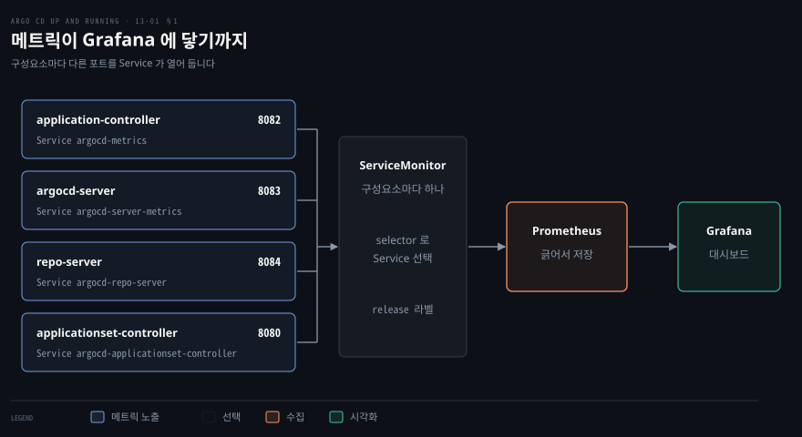
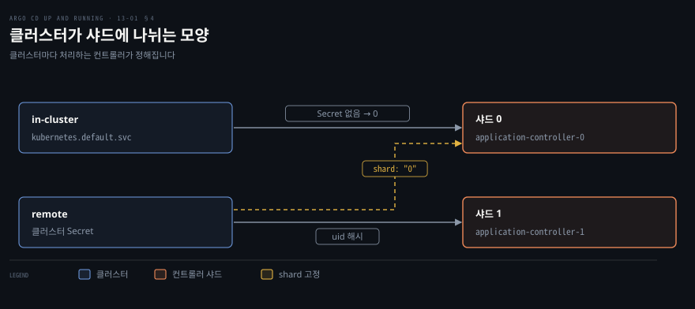

# Argo CD 운영하기 — 메트릭·알림·고가용성·샤딩
---

## 핵심 요약

> Argo CD 운영은 상태를 보는 일, 변화를 알리는 일, 부하를 견디는 일로 나뉩니다. 앞의 둘은 설정으로 켜고 마지막 하나는 자원과 복제 수와 샤드 수로 늘립니다.

구성요소는 저마다 다른 포트에서 메트릭을 내보내고 ServiceMonitor 가 그 Service 를 골라 Prometheus 가 긁게 합니다. 알림은 `argocd-notifications-cm` 에 service·template·trigger 를 적고 Application 의 annotation 으로 구독합니다.

고가용성 매니페스트는 argocd-server 와 repo-server 와 Redis 를 복제로 늘립니다. 컨트롤러는 복제 수만 올려서는 일이 나뉘지 않고 샤딩 설정이 함께 있어야 클러스터가 샤드에 나뉩니다.[^ver]


## 학습 목표

이 내용을 읽고 나면:

1. 구성요소별 메트릭 포트와 Service 이름을 말하고 ServiceMonitor 가 수집에 쓰이는 방식을 설명할 수 있습니다.
2. 알림의 service·template·trigger·구독이 각각 어디에 적히고 어떻게 이어지는지 설명할 수 있습니다.
3. 고가용성 매니페스트가 구성요소별로 정한 복제 수와 노드 조건을 말할 수 있습니다.
4. 컨트롤러 샤딩을 켜는 방법과 알고리즘 세 가지와 클러스터를 샤드에 고정하는 방법을 설명할 수 있습니다.
5. 자원 늘리기와 처리량 조절 값과 샤딩이 각각 어떤 부하를 줄이는지 구분해 설명할 수 있습니다.


## 1. 메트릭과 대시보드

> 구성요소가 각자 포트로 내보내는 메트릭을 ServiceMonitor 로 Prometheus 가 모아 Grafana 로 봅니다.

### 구성요소별 메트릭

Argo CD 구성요소는 각자 정해진 포트의 `/metrics` 경로로 Prometheus 형식의 메트릭을 내보냅니다. 수집기가 한 주소만 긁어서는 전체가 보이지 않으므로 구성요소마다 Service 와 포트를 알아야 합니다. 아래 표는 v3.6.1 의 `install.yaml` 에 정의된 값입니다.[^ports]

| 구성요소 | Service | 포트 | 대표 메트릭 |
|---|---|---|---|
| application-controller | `argocd-metrics` | 8082 | `argocd_app_info`, `argocd_app_sync_total`, `argocd_app_reconcile`, `argocd_cluster_info` |
| argocd-server | `argocd-server-metrics` | 8083 | `argocd_login_request_total` |
| repo-server | `argocd-repo-server` | 8084 | `argocd_git_request_total` |
| applicationset-controller | `argocd-applicationset-controller` | 8080 | `argocd_appset_info` |
| notifications-controller | `argocd-notifications-controller-metrics` | 9001 | — |

`argocd_app_info` 는 Application 마다 한 줄씩 나오는 게이지입니다. `sync_status`, `health_status`, `hydrator_status` 같은 라벨에 상태가 담기므로 "OutOfSync 인 앱이 몇 개인가" 같은 질문이 라벨 집계 하나로 풀립니다. `argocd_app_sync_total` 은 동기화 횟수를 세는 카운터이고 `argocd_app_reconcile` 은 조정 시간을 재는 히스토그램입니다.

카운터는 사건이 처음 일어나야 출력에 나타납니다. kind 클러스터에 v3.6.1 을 설치해 본 결과 앱을 만들고 첫 동기화가 끝나기 전에는 `argocd_app_sync_total` 줄이 없었습니다. 그래서 이 값으로 경보를 만들 때는 값이 0 인 경우만이 아니라 줄이 아예 없는 경우도 고려해야 합니다.

`argocd_cluster_connection_status` 는 관리 대상 클러스터와의 연결 상태를, `argocd_git_request_total` 은 repo-server 가 보낸 Git 요청 수를 셉니다. `argocd_login_request_total` 은 로그인 요청 수입니다. ApplicationSet 컨트롤러의 `argocd_appset_*` 줄은 ApplicationSet 을 하나도 만들지 않은 클러스터에서는 나오지 않았습니다.

### ServiceMonitor 수집과 Grafana

Prometheus Operator 로 수집할 때는 구성요소마다 `ServiceMonitor` 를 하나씩 만들어 그 Service 를 고릅니다. 고르는 기준은 Service 의 `app.kubernetes.io/name` 라벨입니다. `metadata.labels.release` 는 사용 중인 Prometheus 가 선택하는 라벨 값으로 바꿔야 한다고 문서가 안내합니다.[^sm]

```yaml
apiVersion: monitoring.coreos.com/v1
kind: ServiceMonitor
metadata:
  name: argocd-metrics
  labels:
    release: prometheus-operator
spec:
  selector:
    matchLabels:
      app.kubernetes.io/name: argocd-metrics
  endpoints:
    - port: metrics
```

컨트롤러를 여러 복제로 띄워도 ServiceMonitor 는 엔드포인트마다 긁으므로 복제 전부가 수집됩니다. 반대로 ClusterIP 주소 하나를 긁는 수집기는 요청마다 복제 하나의 값만 받습니다. 이 차이는 3절의 HA 구성처럼 복제가 둘 이상인 구성요소가 생기면 중요해지고, 4절의 샤딩에서 특히 커집니다.



Grafana 는 Prometheus 를 데이터 소스로 두고 대시보드로 값을 그립니다. Argo CD 저장소의 `examples/dashboard.json` 이 예제 대시보드입니다. 이 JSON 을 Grafana 의 가져오기 화면에 올려 씁니다.


## 2. 알림 컨트롤러 설정과 구독

> 알림은 service·template·trigger 를 ConfigMap 에 적고 Application annotation 으로 구독합니다.

### service·template·trigger 세 조각

알림 컨트롤러는 설치만으로는 아무것도 보내지 않으며 ConfigMap 에 service·template·trigger 를 적어야 동작합니다. `argocd-notifications-cm` 은 설치 직후 비어 있습니다. 공식 카탈로그에 든 트리거와 템플릿은 별도 매니페스트로 한 번에 넣습니다.[^notif]

```bash
kubectl apply -n argocd --server-side --force-conflicts \
  -f https://raw.githubusercontent.com/argoproj/argo-cd/v3.6.1/notifications_catalog/install.yaml
```

카탈로그에는 트리거 여덟 개가 들어 있습니다. 앱 생성과 삭제는 `on-created` 와 `on-deleted` 이고 배포 상태는 `on-deployed` 와 `on-health-degraded` 입니다. 동기화는 `on-sync-failed`, `on-sync-running`, `on-sync-status-unknown`, `on-sync-succeeded` 가 맡습니다. 카탈로그에 없는 조건이 필요할 때만 직접 씁니다.

세 조각은 이어져 있습니다. service 는 어디로 보낼지, template 은 무엇을 보낼지, trigger 는 언제 보낼지를 정합니다. 아래는 kind 에서 쓴 최소 예입니다. 클러스터 안의 작은 HTTP 서버에 POST 하는 webhook service 와 그 본문 템플릿과 동기화 성공 조건을 한 ConfigMap 에 담았습니다.

```yaml
apiVersion: v1
kind: ConfigMap
metadata:
  name: argocd-notifications-cm
data:
  service.webhook.receiver: |
    url: http://receiver.default.svc:8080
  template.hook-sync-succeeded: |
    webhook:
      receiver:
        method: POST
        path: /argocd
        body: |
          {"app": "{{.app.metadata.name}}", "sync": "{{.app.status.sync.status}}", "phase": "{{.app.status.operationState.phase}}"}
  trigger.on-sync-succeeded-hook: |
    - description: Application syncing has succeeded
      send:
        - hook-sync-succeeded
      when: app.status.operationState != nil and app.status.operationState.phase in ['Succeeded']
```

### 조건식과 비밀 값 관리

`when` 의 조건식은 antonmedv/expr 문법으로 평가됩니다. 동기화가 한 번도 없는 앱에는 `status.operationState` 가 없어서 `app.status.operationState.phase` 를 평가하다 실패합니다. 문서 예제는 `app.status?.operationState.phase` 로 쓰는데, `?.` 는 붙인 자리 바로 앞의 값이 비었을 때만 건너뜁니다. `status` 는 있고 `operationState` 만 없는 앱에서는 이 식도 `cannot fetch phase from <nil>` 로 실패합니다.

그래서 위 예제는 카탈로그 트리거처럼 `operationState != nil` 로 먼저 거릅니다. `app.status.operationState?.phase` 처럼 비어 있을 수 있는 필드 바로 뒤에 `?.` 를 두어도 `operationState` 만 없는 앱에서는 결과가 같습니다. 평가에 실패한 트리거는 알림을 보내지 않고 오류 로그만 남깁니다. 같은 조건이 깜빡이며 알림이 되풀이되는 경우에는 트리거에 `oncePer` 를 두어 지정한 필드가 바뀔 때만 보내게 합니다.[^trig]

토큰이나 비밀번호는 ConfigMap 이 아니라 `argocd-notifications-secret` 에 두고 service 설정에서 `$<키 이름>` 형식으로 참조합니다. webhook service 는 네트워크 오류나 5xx 응답이면 기본값으로 세 번까지 다시 시도하므로 첫 시도를 합쳐 모두 네 번 보내고, 간격은 1초에서 5초 사이입니다. `retryMax` 와 `retryWaitMin` 과 `retryWaitMax` 로 조절합니다.

### 구독 annotation 달기

구독은 Application 에 다는 annotation 입니다. 형식은 `notifications.argoproj.io/subscribe.<트리거>.<서비스>: <수신처>` 이고 수신처를 여럿 두려면 세미콜론으로 이어 씁니다. webhook 처럼 수신처가 필요 없는 서비스는 값을 빈 문자열로 둡니다.

같은 annotation 을 AppProject 에 달면 그 프로젝트의 모든 앱이 구독합니다. ConfigMap 의 `subscriptions` 로는 모든 앱에 붙는 기본 구독을 둘 수 있습니다. `defaultTriggers` 는 구독이 아니라 구독에 트리거를 적지 않았을 때 쓸 트리거 목록입니다. annotation 에서 트리거 이름을 뺀 `notifications.argoproj.io/subscribe.<서비스>: <수신처>` 가 이 목록을 따릅니다.[^sub]

```bash
kubectl annotate app guestbook -n argocd \
  'notifications.argoproj.io/subscribe.on-sync-succeeded-hook.receiver=' 
```

### 알림 동작 확인과 재시도

이미 동기화가 끝난 `guestbook` 에 위 annotation 을 달자 트리거가 곧바로 조건을 평가해 알림이 나갔습니다. 받는 쪽 파드의 로그에는 `RECEIVED /argocd {"app": "guestbook", "sync": "Synced", "phase": "Succeeded"}` 가 찍혔습니다.

전송이 실패한 알림은 보냈다는 기록이 남지 않으므로 컨트롤러가 앱을 다음에 처리할 때 다시 보냅니다. 받는 쪽 Service 의 엔드포인트가 아직 비어 있으면 첫 시도와 재시도 세 번이 모두 연결 거부로 끝나고, 닿는 것은 그 뒤에 다시 보낸 알림입니다.

알림이 나가면 앱에 `notified.notifications.argoproj.io` annotation 이 생깁니다. 이 annotation 은 트리거 조건과 수신처마다 언제 보냈는지를 기록하고, 같은 조건이 참으로 남아 있는 동안 다시 보내지 않게 합니다. 조건이 거짓이 되면 기록이 지워지므로 다음에 조건이 다시 참이 될 때 알림이 또 나갑니다. 동기화가 Error 로 끝나 `phase` 가 `Succeeded` 가 아니게 되면 값이 비는 것도 이 때문입니다.

이 노트에서 말하는 webhook 은 Argo CD 가 밖으로 보내는 알림 전송이고 [12-01](./12-01.CI%20%EC%99%80%20Argo%20CD%20%EC%9E%87%EA%B8%B0%20%E2%80%94%20%EC%A1%B0%EC%A0%95%20%EC%A3%BC%EA%B8%B0%C2%B7Webhook%C2%B7Tekton.md) 의 Webhook 은 Git 에서 Argo CD 로 들어오는 이벤트입니다. 둘은 방향이 반대입니다.


## 3. 고가용성 — 복제 수와 Redis

> 고가용성 매니페스트는 구성요소마다 복제 수를 정해 두며, Redis 는 버려도 되는 캐시입니다.

### ha/install.yaml 의 복제 수

고가용성 매니페스트는 구성요소마다 복제 수를 미리 정해 두며 `ha/install.yaml` 을 적용하면 그 값이 그대로 들어갑니다. 일반 설치 방법은 [02-01](./02-01.Argo%20CD%20%EC%84%A4%EC%B9%98%ED%95%98%EA%B8%B0%20%E2%80%94%20%EA%B5%AC%EC%84%B1%20%EC%9A%94%EC%86%8C%C2%B7%EC%84%A4%EC%B9%98%20%EC%9C%A0%ED%98%95%C2%B7%EB%A7%A4%EB%8B%88%ED%8E%98%EC%8A%A4%ED%8A%B8%EC%99%80%20Helm.md) 에서 다뤘고 여기서는 `ha/` 경로만 바뀝니다.

```bash
kubectl apply -n argocd --server-side --force-conflicts \
  -f https://raw.githubusercontent.com/argoproj/argo-cd/v3.6.1/manifests/ha/install.yaml
```

v3.6.1 의 `ha/install.yaml` 을 읽어 보면 복제 수는 아래와 같습니다. ApplicationSet 컨트롤러와 알림 컨트롤러는 `replicas` 를 적지 않아 한 개로 뜹니다.[^ha]

| 구성요소 | 복제 수 |
|---|---|
| argocd-server | 2 |
| argocd-repo-server | 2 |
| argocd-redis-ha-server | 3 |
| argocd-redis-ha-haproxy | 3 |
| argocd-application-controller | 1 |

노드는 서로 다른 것이 세 개 이상 있어야 합니다. 문서가 매니페스트의 파드 안티 어피니티 규칙을 이유로 들어 세 노드를 요구하기 때문입니다. IPv6 만 쓰는 클러스터는 이 구성에서 지원되지 않습니다.

### Redis 캐시와 server 복제

Redis 는 상태 저장소가 아니라 버려도 되는 캐시입니다. Application 과 설정 같은 상태는 Kubernetes 오브젝트에 있으므로 Redis 가 사라져도 다시 채워집니다. 따라서 Redis 를 잃었을 때 다시 만들어야 하는 것은 데이터가 아니라 캐시입니다.

argocd-server 는 상태가 없어 복제를 늘리기 쉽습니다. 복제를 늘리면 환경 변수 `ARGOCD_API_SERVER_REPLICAS` 에도 같은 수를 적습니다. 이 값은 동시 로그인 요청 한도를 복제 수로 나누는 데 쓰입니다. 반대로 dex 서버는 메모리 DB 를 쓰므로 둘 이상 띄우면 인스턴스끼리 데이터가 어긋날 수 있습니다.[^ha2]

### Helm 값·자동 확장·리더 선출

Helm 차트로 설치했다면 값으로 같은 구성을 만듭니다. `redis-ha.enabled: true` 로 Redis HA 를 켭니다. `server.replicas`, `repoServer.replicas`, `applicationSet.replicas` 에는 복제 수를 적습니다.

고정 복제 수 대신 자동 확장을 고를 수도 있습니다. `server.autoscaling` 과 `repoServer.autoscaling` 에서 `enabled: true` 와 `minReplicas: 2` 를 씁니다. HA 만 켜는 동안에는 `controller.replicas` 를 1 로 둡니다. 1 보다 큰 값은 곧 샤딩을 켜는 일이기 때문이고, 샤딩은 4절에서 다룹니다.[^helm]

ApplicationSet 컨트롤러는 `applicationsetcontroller.enable.leader.election` 키로 리더 선출을 켜면 활성 컨트롤러 매니저가 하나만 남습니다. 기본값은 `"false"` 입니다. 컨트롤러는 복제를 늘린다고 일이 둘로 쪼개지지 않고 따로 샤딩 설정이 필요합니다. 이어지는 절이 그 설정을 다룹니다.


## 4. 성능 확장과 컨트롤러 샤딩

> 느려지는 원인에 따라 자원 늘리기, 처리기 수 올리기, 컨트롤러 샤딩 중 하나를 고릅니다.

### 리소스 요청·한도와 처리기 수

느려지는 원인에 따라 해법이 셋으로 갈립니다. 가장 빠른 길은 구성요소마다 `resources` 요청과 한도를 올리는 것입니다. 처리 대기열이 밀리면 processor 수를 올리고 클러스터가 많아 메모리가 모자라면 샤딩으로 나눕니다. 문서도 앱이 너무 많을 때는 processor 를, 클러스터가 너무 많아 메모리를 많이 쓸 때는 샤딩을 안내합니다.[^knob]

구성요소마다 기본 요청과 한도가 잡혀 있고 대부분의 워크로드에는 그 값으로 충분합니다. 조직이 커지고 Argo CD 가 바빠지면 조정하는데, 무엇을 늘릴지는 느려지는 증상이 가립니다.

Application 이 많아 상태를 모두 가져오는 데 오래 걸리면 application-controller 를 늘립니다. 여러 팀이 쓰는 환경에서 UI 와 CLI 가 느려지면 argocd-server 를 늘립니다. 저장소가 많거나 매니페스트 대부분이 한 모노레포에 있으면 repo-server 를 늘립니다. ApplicationSet 이 많거나 하나가 앱을 많이 만들어 내면 applicationset-controller 를 늘립니다. Kubernetes 로 가는 요청이 많거나 저장소가 많고 크면 Redis 를 늘립니다.[^scale]

Helm 차트에서는 `controller`, `server`, `repoServer`, `applicationSet`, `redis` 아래의 `resources` 값으로 정합니다. 아래 수치는 출발점으로 삼는 예이고 환경마다 달라집니다. 소비량을 Prometheus 와 Grafana 로 지켜보다가 이력이 쌓인 뒤에 조정합니다.

```yaml
controller:
  resources:
    requests:
      cpu: 250m
      memory: 256Mi
    limits:
      cpu: 500m
      memory: 512Mi
```

| 키(`argocd-cmd-params-cm`) | 기본값 | 하는 일 |
|---|---|---|
| `controller.status.processors` | 20 | 앱 상태를 갱신하는 처리기 수 |
| `controller.operation.processors` | 10 | 동기화 같은 작업을 처리하는 처리기 수 |
| `controller.hydration.processors` | 5 | Source Hydrator 를 켰을 때 매니페스트를 만드는 처리기 수 |
| `controller.kubectl.parallelism.limit` | 20 | 동기화 중 동시에 도는 클러스터 작업 수 |
| `reposerver.parallelism.limit` | 0 (제한 없음) | repo-server 의 동시 매니페스트 생성 수 |

두 parallelism 키는 1 보다 작으면 제한이 없다는 뜻입니다. 문서는 앱이 1000개일 때 status 처리기 50, operation 처리기 25 를 쓴다고 적습니다. 이 수치는 하나의 참고 사례이므로 자기 환경에서는 큐 지연을 보며 올립니다.

### 샤딩 켜기와 배정 알고리즘

샤딩을 켜려면 컨트롤러 StatefulSet 의 `replicas` 를 올리고 같은 수를 `ARGOCD_CONTROLLER_REPLICAS` 환경 변수에 적습니다. Helm 차트는 `controller.replicas` 값을 이 환경 변수에도 넣으므로 차트 사용자는 `replicas` 하나만 바꿉니다.[^helm] 아래는 매니페스트를 직접 고칠 때 복제를 두 개로 늘리는 패치 예입니다.

```yaml
apiVersion: apps/v1
kind: StatefulSet
metadata:
  name: argocd-application-controller
spec:
  replicas: 2
  template:
    spec:
      containers:
        - name: argocd-application-controller
          env:
            - name: ARGOCD_CONTROLLER_REPLICAS
              value: "2"
```

클러스터가 어느 샤드로 가는지는 `controller.sharding.algorithm` 이 정합니다. 기본값 `legacy` 는 클러스터 uid 를 해시하는 방식이라 고르지 않게 갈릴 수 있습니다. `round-robin` 은 샤드마다 같은 수로 나누고 `consistent-hashing` 은 샤드나 클러스터가 늘고 줄 때 재배치를 줄이려는 방식입니다. 문서는 두 방식 모두 실험적 기능이라고 표시합니다.[^shard]

특정 클러스터를 특정 샤드에 묶으려면 그 클러스터 Secret 의 `shard` 필드에 샤드 번호를 적습니다. 지정하지 않으면 컨트롤러가 실시간으로 계산합니다. 어느 클러스터가 몇 번 샤드인지는 컨트롤러 파드 안에서 `argocd admin cluster stats -n argocd` 로 볼 수 있습니다.

### stats 명령의 샤드 확인과 한계

다만 `stats` 의 SHARD 열은 추정값입니다. 떠 있는 컨트롤러 파드 수와 알고리즘과 클러스터 Secret 으로 샤드를 다시 계산해 보여 줄 뿐입니다. 컨트롤러가 실제로 맡은 샤드나 `ARGOCD_CONTROLLER_REPLICAS` 는 읽지 않습니다. 그래서 환경 변수를 그대로 두고 StatefulSet 만 늘려도 표는 파드 수 2 로 다시 계산한 값을 보여 줍니다. 그래도 컨트롤러는 복제 수가 1 이하라고 보고 모든 클러스터를 처리합니다. 실제로 나뉘었는지는 컨트롤러 로그에 `Processing all cluster shards` 가 없는지로 확인합니다.[^shard]

kind 에서 컨트롤러 StatefulSet 을 두 개로 늘리고 환경 변수를 `2` 로 맞추면 `https://kubernetes.default.svc` 는 샤드 0 으로 나옵니다. 같은 kind 클러스터를 노드 주소 URL 로 한 번 더 등록한 두 번째 클러스터는 샤드 1 로 나옵니다. `kubernetes.default.svc` 는 클러스터 Secret 이 없어 ID 가 비어 있으므로 늘 샤드 0 입니다. 두 번째 클러스터가 샤드 1 로 간 것은 그 Secret uid 를 해시한 결과입니다. Secret 을 다시 만들면 다른 샤드가 될 수 있습니다.

두 번째 클러스터 Secret 에 `shard: "0"` 을 쓰면 `stats` 가 그 클러스터를 샤드 0 으로 보여 줍니다.

### 샤드 비율·동적 분배·수집

샤드와 클러스터의 비율은 바쁜 시스템에서 1:1 로 두라는 권고가 있습니다. 개발 단계 환경은 샤드 두세 개가 함께 맡고 운영 환경은 클러스터마다 전용 샤드를 두는 배치도 있습니다. 어느 쪽으로 갈지는 Argo CD 를 모니터링한 데이터로 정합니다.[^ratio]



heartbeat 로 죽은 샤드를 가려내고 샤드 수를 Deployment 의 `replicas` 에서 읽는 방식은 기본 StatefulSet 샤딩과 다른 동적 클러스터 분배입니다. 이 기능은 v2.9 에 들어온 알파이고 기본으로 꺼져 있습니다. 켜려면 `manifests/ha/base/controller-deployment/` 를 Kustomize 오버레이로 적용해 StatefulSet 을 0개로 만들고 Deployment 가 컨트롤러를 띄우게 합니다.[^dyn]

샤딩을 켠 뒤에는 1절의 수집 방식도 봐야 합니다. ServiceMonitor 는 복제마다 긁지만 ClusterIP 를 긁는 수집기는 요청마다 복제 하나의 값만 받으므로 합산 값이 실제와 다를 수 있습니다.


## 연습 문제

> 아래 여섯 문제는 메트릭 수집과 알림 구성과 HA 복제 수와 샤딩 설정을 하나씩 묻습니다. 답을 적은 뒤에 정답 절을 펼칩니다.

1. application-controller 와 argocd-server 와 repo-server 의 메트릭 포트와 Service 이름을 말하십시오. 컨트롤러를 두 복제로 띄웠을 때 ClusterIP 주소 하나를 긁는 수집기는 무엇이 문제입니까?
2. 알림을 보내려면 `argocd-notifications-cm` 에 어떤 세 조각이 필요하고 각각 무엇을 정합니까? 앱에 구독을 거는 annotation 은 어떤 모양이며 수신처를 여럿 둘 때 구분자는 무엇입니까?
3. `when` 조건에 `app.status.operationState.phase` 를 쓰면 동기화가 한 번도 없는 앱에서 어떤 문제가 생깁니까? 깜빡이는 조건이 알림을 되풀이할 때는 무엇을 씁니까?
4. HA 매니페스트에서 argocd-server 와 Redis 와 컨트롤러의 복제 수는 각각 몇 개입니까? 노드는 몇 개 이상이 필요하며 그 이유는 무엇입니까? Redis 를 잃으면 상태도 잃습니까?
5. 컨트롤러를 두 샤드로 나누려면 무엇 두 가지를 바꿔야 합니까? 클러스터 하나를 샤드 0 에 묶으려면 어디에 무엇을 씁니까? 샤드 배정은 어느 명령으로 봅니까?
6. 앱이 많아 상태 갱신이 밀리는 경우와 관리 클러스터가 많아 컨트롤러 메모리가 모자라는 경우에 각각 무엇을 건드립니까?


## 정답 (자답 후 펼치기)

### 정답 1

application-controller 는 `argocd-metrics` 의 8082, argocd-server 는 `argocd-server-metrics` 의 8083, repo-server 는 `argocd-repo-server` 의 8084 입니다. ApplicationSet 컨트롤러는 8080 이고 알림 컨트롤러는 `argocd-notifications-controller-metrics` 의 9001 입니다.

ClusterIP 하나를 긁으면 요청마다 복제 하나로 가므로 매번 일부 값만 받습니다. ServiceMonitor 는 엔드포인트마다 긁어 복제 전부를 수집합니다.

### 정답 2

service 는 보낼 곳을, template 은 보낼 내용을, trigger 는 보낼 조건을 정합니다. 키 이름은 `service.<종류>.<이름>`, `template.<이름>`, `trigger.<이름>` 입니다.

구독 annotation 은 `notifications.argoproj.io/subscribe.<트리거>.<서비스>: <수신처>` 이고 수신처는 세미콜론으로 구분합니다. webhook 처럼 수신처가 필요 없으면 빈 문자열입니다.

### 정답 3

`status.operationState` 가 없어서 `app.status.operationState.phase` 가 평가 오류가 됩니다. `?.` 는 바로 앞의 값이 비었을 때만 건너뛰므로 `app.status.operationState?.phase` 처럼 비어 있을 수 있는 필드 뒤에 둡니다. `app.status?.operationState.phase` 는 `status` 는 있고 `operationState` 만 없는 앱에서 여전히 실패합니다. `app.status.operationState != nil and …` 로 먼저 걸러도 됩니다.

조건이 깜빡이며 알림이 되풀이되는 경우에는 트리거에 `oncePer` 를 두어 지정한 필드가 바뀔 때만 보내게 합니다.

### 정답 4

argocd-server 는 2개, Redis HA 서버는 3개이고 HAProxy 도 3개입니다. application-controller 는 1개입니다. 노드는 서로 다른 것이 세 개 이상 필요합니다. 매니페스트의 파드 안티 어피니티 규칙을 이유로 문서가 요구합니다.

Redis 는 버려도 되는 캐시이고 상태는 Kubernetes 오브젝트에 있으므로 Redis 를 잃어도 다시 채워집니다.

### 정답 5

StatefulSet 의 `replicas` 를 2로 올리고 환경 변수 `ARGOCD_CONTROLLER_REPLICAS` 도 2 로 맞춥니다. 클러스터를 샤드 0 에 묶으려면 그 클러스터 Secret 에 `shard: "0"` 을 씁니다. 배정은 컨트롤러 파드 안에서 `argocd admin cluster stats -n argocd` 로 보지만, 이 표는 파드 수로 계산한 추정값입니다. 실제로 나뉘었는지는 컨트롤러 로그에 `Processing all cluster shards` 가 없는지로 확인합니다.

### 정답 6

앱이 많아 밀리는 경우에는 `controller.status.processors` 와 `controller.operation.processors` 를 올립니다. 클러스터가 많아 메모리가 모자라면 컨트롤러 복제를 늘려 샤딩합니다. 앞의 것은 한 컨트롤러의 처리 속도를 올리고 뒤의 것은 일을 여러 컨트롤러로 나눕니다.


## 참고 자료

- 《Argo CD: Up and Running》(Andrew Block · Christian Hernandez, O'Reilly, 2025, ISBN 978-1-098-14200-1) 13장
- [메트릭](https://github.com/argoproj/argo-cd/blob/v3.6.1/docs/operator-manual/metrics.md)
- [알림 시작하기](https://github.com/argoproj/argo-cd/blob/v3.6.1/docs/operator-manual/notifications/index.md)
- [고가용성](https://github.com/argoproj/argo-cd/blob/v3.6.1/docs/operator-manual/high_availability.md)
- [동적 클러스터 분배](https://github.com/argoproj/argo-cd/blob/v3.6.1/docs/operator-manual/dynamic-cluster-distribution.md)
- 관련 노트: [이 책의 인덱스](./README.md)
- 관련 노트: [02-01 Argo CD 설치하기](./02-01.Argo%20CD%20%EC%84%A4%EC%B9%98%ED%95%98%EA%B8%B0%20%E2%80%94%20%EA%B5%AC%EC%84%B1%20%EC%9A%94%EC%86%8C%C2%B7%EC%84%A4%EC%B9%98%20%EC%9C%A0%ED%98%95%C2%B7%EB%A7%A4%EB%8B%88%ED%8E%98%EC%8A%A4%ED%8A%B8%EC%99%80%20Helm.md), [07-01 여러 클러스터 관리하기](./07-01.%EC%97%AC%EB%9F%AC%20%ED%81%B4%EB%9F%AC%EC%8A%A4%ED%84%B0%20%EA%B4%80%EB%A6%AC%ED%95%98%EA%B8%B0%20%E2%80%94%20%ED%97%88%EB%B8%8C%20%EC%95%A4%20%EC%8A%A4%ED%8F%AC%ED%81%AC%C2%B7%ED%81%B4%EB%9F%AC%EC%8A%A4%ED%84%B0%20Secret%C2%B7%EB%A9%80%ED%8B%B0%20%ED%81%B4%EB%9F%AC%EC%8A%A4%ED%84%B0%20%EB%B0%B0%ED%8F%AC.md)
- 관련 노트: [10-01 Application 여럿을 순서대로](./10-01.Application%20%EC%97%AC%EB%9F%BF%EC%9D%84%20%EC%88%9C%EC%84%9C%EB%8C%80%EB%A1%9C%20%E2%80%94%20%ED%97%AC%EC%8A%A4%20%EC%B2%B4%ED%81%AC%C2%B7App-of-Apps%20sync%20wave%C2%B7Progressive%20Sync.md), [12-01 CI 와 Argo CD 잇기](./12-01.CI%20%EC%99%80%20Argo%20CD%20%EC%9E%87%EA%B8%B0%20%E2%80%94%20%EC%A1%B0%EC%A0%95%20%EC%A3%BC%EA%B8%B0%C2%B7Webhook%C2%B7Tekton.md)

---
[^ver]: 최신 릴리스는 Argo CD v3.6.1(2026-11-04)입니다. 문서와 소스는 v3.6.1 태그에 고정했습니다. 이 노트의 실습은 kind v0.31.0 이 만든 Kubernetes v1.35.0 클러스터에 `install.yaml` 로 설치한 v3.6.1 에서 했고 예제 저장소 `argoproj/argocd-example-apps` 를 커밋 `8088f4c0d970abb09e250248cc97e35623447cb5` 의 `guestbook` 경로로 고정해 썼습니다. 메트릭 수집 스택(kube-prometheus-stack)과 `ha/install.yaml` 부분의 근거는 문서와 v3.6.1 매니페스트입니다. <https://github.com/argoproj/argo-cd/releases/tag/v3.6.1> (2026-11-08 조회)
[^ports]: Service 이름과 포트는 `manifests/install.yaml` 의 Service 정의에서 읽었고 메트릭 문서는 수집 주소를 "Scraped at the `argocd-metrics:8082/metrics` endpoint.", "Scraped at the `argocd-server-metrics:8083/metrics` endpoint.", "Scraped at the `argocd-repo-server:8084/metrics` endpoint."로 적습니다. 알림 컨트롤러의 `argocd-notifications-controller-metrics` 는 9001 포트를 엽니다. kind 에서 클러스터 안 curl 파드로 부른 `/metrics` 는 HTTP 200 을 돌려주었습니다. `argocd_app_info` 는 문서에서 "It contains labels such as `sync_status`, `health_status`, and `hydrator_status` that reflect the application state in Argo CD."로 설명합니다. <https://github.com/argoproj/argo-cd/blob/v3.6.1/docs/operator-manual/metrics.md>, <https://github.com/argoproj/argo-cd/blob/v3.6.1/manifests/install.yaml> (2026-11-08 조회)
[^sm]: 문서는 "If using Prometheus Operator, the following ServiceMonitor example manifests can be used."라 하고 "Add a namespace where Argo CD is installed and change `metadata.labels.release` to the name of label selected by your Prometheus."라고 안내합니다. 여러 복제에 대해서는 "a `ServiceMonitor` works as expected because endpoint discovery scrapes every controller pod"라 하고 ClusterIP 에 대해서는 "scraping the ClusterIP collects metrics from only one replica per request"라고 적습니다. 예제 대시보드는 같은 문서의 Dashboards 절이 가리키는 `examples/dashboard.json` 입니다. <https://github.com/argoproj/argo-cd/blob/v3.6.1/docs/operator-manual/metrics.md> (2026-11-08 조회)
[^notif]: 카탈로그 설치 명령은 알림 시작하기 문서의 "Install Triggers and Templates from the catalog" 항목에 있고 문서는 `stable` 주소를 쓰므로 이 노트는 같은 경로를 v3.6.1 태그로 고정했습니다. 카탈로그 트리거 여덟 개는 `catalog.md` 의 목록이고 설치 직후 `argocd-notifications-cm` 이 비어 있음은 kind 에서 확인했습니다. <https://github.com/argoproj/argo-cd/blob/v3.6.1/docs/operator-manual/notifications/index.md>, <https://github.com/argoproj/argo-cd/blob/v3.6.1/docs/operator-manual/notifications/catalog.md> (2026-11-08 조회)
[^trig]: 문서는 조건 평가를 "The trigger condition evaluation is powered by antonmedv/expr."로 설명하고 예제에서 "the `?.` (optional chaining) operator is used to access the Application's"로 시작하는 설명을 붙입니다. `oncePer` 는 "The `oncePer` field configures triggers to generate the notification only when the corresponding application field changes."라고 적습니다. 같은 문서는 `status.operationState` 가 "optional" 이라고 하고 `app.status?.operationState.phase` 가 `app.status.operationState != nil ? app.status.operationState.phase : nil` 과 같다고 적지만, v3.6.1 이 쓰는 expr v1.17.8 에서 `status` 는 있고 `operationState` 만 없는 입력을 평가하면 `app.status?.operationState.phase` 는 `cannot fetch phase from <nil>` 오류를 내고, `app.status.operationState?.phase` 와 `app.status.operationState != nil and …` 는 오류 없이 거짓을 돌려줍니다. 카탈로그 트리거(`notifications_catalog/install.yaml`)도 `app.status.operationState != nil and app.status.operationState.phase in ['Succeeded']` 형식을 씁니다. <https://github.com/argoproj/argo-cd/blob/v3.6.1/docs/operator-manual/notifications/triggers.md>, <https://github.com/argoproj/argo-cd/blob/v3.6.1/notifications_catalog/install.yaml> (2026-11-08 조회)
[^sub]: 구독 문서는 `notifications.argoproj.io/subscribe.on-sync-succeeded.slack: my-channel1;my-channel2` 예를 보이고 "a semicolon separated list of recipients"라고 설명합니다. webhook 문서의 구독 형식은 `notifications.argoproj.io/subscribe.<trigger-name>.<webhook-name>: ""` 이고 재시도는 "The webhook service will automatically retry the request if it fails due to network errors or if the server returns a 5xx status code."라고 적습니다. 기본값은 `retryMax` 3, `retryWaitMin` 1s, `retryWaitMax` 5s 이고 문서는 "If all retries fail, the `Send` method will return an error."라고 적습니다. 알림 엔진은 전송이 실패하면(GitHub 커밋 상태 한도 초과 오류만 예외) `SetAlreadyNotified(…, false)` 로 보냈다는 기록을 되돌리고, 트리거 조건이 거짓이면 같은 호출로 기록을 지웁니다(`pkg/controller/controller.go`). 서비스 설정은 "using `$<secret-key>` format"으로 `argocd-notifications-secret` 의 키를 참조합니다. 기본 구독은 구독 문서가 "The subscriptions might be configured globally in the `argocd-notifications-cm` ConfigMap using the `subscriptions` field. The default subscriptions are applied to all applications."라고 설명하고, `defaultTriggers` 는 트리거 문서가 "Holds list of triggers that are used by default if trigger is not specified explicitly in the subscription"이라고 적습니다. <https://github.com/argoproj/argo-cd/blob/v3.6.1/docs/operator-manual/notifications/subscriptions.md>, <https://github.com/argoproj/argo-cd/blob/v3.6.1/docs/operator-manual/notifications/triggers.md>, <https://github.com/argoproj/argo-cd/blob/v3.6.1/docs/operator-manual/notifications/services/webhook.md>, <https://github.com/argoproj/argo-cd/blob/v3.6.1/docs/operator-manual/notifications/services/overview.md>, <https://github.com/argoproj/notifications-engine/blob/0cff13b8a717/pkg/controller/controller.go> (2026-11-08 조회)
[^ha]: 복제 수는 `manifests/ha/install.yaml` 을 파싱해 읽었습니다. argocd-server 2, argocd-repo-server 2, argocd-redis-ha-server 3, argocd-redis-ha-haproxy 3, argocd-application-controller 1 이었고 ApplicationSet 컨트롤러와 알림 컨트롤러에는 `replicas` 가 없었습니다. 문서는 "The HA installation will require at least three different nodes due to pod anti-affinity rule in the specs. Additionally, IPv6 only clusters are not supported."라고 적습니다. <https://github.com/argoproj/argo-cd/blob/v3.6.1/manifests/ha/install.yaml>, <https://github.com/argoproj/argo-cd/blob/v3.6.1/docs/operator-manual/high_availability.md> (2026-11-08 조회)
[^ha2]: 문서는 Redis 를 "Redis is only used as a disposable cache and can be safely rebuilt without service disruption."라고 설명하고 dex 서버에 대해 "The `argocd-dex-server` uses an in-memory database, and two or more instances may have inconsistent data."라고 적습니다. `ARGOCD_API_SERVER_REPLICAS` 는 같은 문서에서 동시 로그인 요청 한도를 나누는 데 쓰인다고 설명합니다. 리더 선출 키는 `argocd-cmd-params-cm.yaml` 의 "Enable leader election for controller manager. Enabling this will ensure there is only one active controller manager." 주석에 있고 값은 `"false"` 입니다. <https://github.com/argoproj/argo-cd/blob/v3.6.1/docs/operator-manual/high_availability.md>, <https://github.com/argoproj/argo-cd/blob/v3.6.1/docs/operator-manual/argocd-cmd-params-cm.yaml> (2026-11-08 조회)
[^knob]: 문서는 processor 에 대해 "Increase the number of processors if your Argo CD instance manages too many applications."라 하고 "For 1000 applications, we use 50 for `--status-processors` and 25 for `--operation-processors`"라고 적습니다. 샤딩에 대해서는 "If the controller is managing too many clusters and uses too much memory then you can shard clusters across multiple controller replicas."라고 적습니다. processor 와 `controller.kubectl.parallelism.limit` 의 기본값은 컨트롤러 플래그 정의(status 20, operation 10, hydration 5, kubectl 20)와 `argocd-cmd-params-cm.yaml` 의 주석을 따랐습니다. 예시 파일 `argocd-cmd-params-cm.yaml` 은 `reposerver.parallelism.limit` 에 `"1"` 을 적어 두었지만 플래그 기본값은 `ARGOCD_REPO_SERVER_PARALLELISM_LIMIT` 의 0 이며, 플래그 설명은 "Any value less the 1 means no limit."입니다. <https://github.com/argoproj/argo-cd/blob/v3.6.1/docs/operator-manual/high_availability.md>, <https://github.com/argoproj/argo-cd/blob/v3.6.1/docs/operator-manual/argocd-cmd-params-cm.yaml>, <https://github.com/argoproj/argo-cd/blob/v3.6.1/cmd/argocd-repo-server/commands/argocd_repo_server.go>, <https://github.com/argoproj/argo-cd/blob/v3.6.1/cmd/argocd-application-controller/commands/argocd_application_controller.go> (2026-11-08 조회)
[^shard]: 문서는 `legacy` 를 "`legacy` mode uses an `uid` based distribution (non-uniform)."로, 알파 경고에서 "The `round-robin` shard distribution algorithm is an experimental feature."라고 적습니다. `consistent-hashing` 도 같은 경고에서 실험적 기능으로 표시됩니다. 고정은 "A cluster can be manually assigned and forced to a `shard` by patching the `shard` field in the cluster secret to contain the shard number"로 안내하고 `--sharding-method` 는 `controller.sharding.algorithm` 키로 덮어쓸 수 있다고 적습니다. `stats` 명령의 설명은 "Prints information cluster statistics and inferred shard number"이고 `--replicas` 플래그 설명은 "Application controller replicas count. Inferred from number of running controller pods if not specified"입니다. 소스에서 `getControllerReplicas` 는 컨트롤러 파드 목록의 길이를 돌려줍니다. 컨트롤러 쪽 `GetClusterSharding` 은 동적 분배가 꺼져 있으면 복제 수를 `ARGOCD_CONTROLLER_REPLICAS` 에서 읽고, 1 이하이면 "Processing all cluster shards"를 기록합니다. `legacy` 는 클러스터 ID 가 비어 있으면 0 을 돌려주고 ID 는 클러스터 Secret 의 uid 입니다. 이 노트의 두 번째 클러스터는 같은 클러스터를 노드 주소로 다시 등록한 것입니다. <https://github.com/argoproj/argo-cd/blob/v3.6.1/docs/operator-manual/high_availability.md>, <https://github.com/argoproj/argo-cd/blob/v3.6.1/docs/operator-manual/argocd-cmd-params-cm.yaml>, <https://github.com/argoproj/argo-cd/blob/v3.6.1/cmd/argocd/commands/admin/cluster.go>, <https://github.com/argoproj/argo-cd/blob/v3.6.1/controller/sharding/sharding.go> (2026-11-08 조회)
[^dyn]: 동적 분배 문서의 첫 표지는 "Alpha Feature (Since v2.9.0)"이고 "This feature is disabled by default while it is in alpha."라고 적습니다. 같은 문서는 "The new sharding mechanism does not monitor the environment variable `ARGOCD_CONTROLLER_REPLICAS` but instead reads the replica count directly from the Application Controller Deployment."라고 설명하고 heartbeat 환경 변수는 `ARGOCD_CONTROLLER_HEARTBEAT_TIME` 입니다. <https://github.com/argoproj/argo-cd/blob/v3.6.1/docs/operator-manual/dynamic-cluster-distribution.md> (2026-11-08 조회)
[^scale]: 13장의 Scaling Up 절은 "The quickest way to get the most out of your Argo CD installation is to add more resources to each component."라 하고 구성요소별로 언제 늘리는지를 Table 13-1 에 정리합니다. Redis 는 Kubernetes 로 가는 요청이 많거나 저장소가 많고 클 때, application-controller 는 Application 이 많아 상태를 모두 가져오는 데 시간이 걸릴 때, API 서버는 다중 테넌트 환경에서 UI 와 CLI 가 느려질 때, repo-server 는 저장소가 많거나 모노레포가 클 때, ApplicationSet 컨트롤러는 ApplicationSet 이 많거나 앱을 많이 만들어 낼 때입니다. 수치 예는 같은 절의 Helm 값에서 컨트롤러 몫을 옮겼습니다. 차트 값 위치는 argo-helm `argo-cd-10.15.0`(appVersion v3.6.1)의 `values.yaml` 에서 `controller`·`server`·`repoServer`·`applicationSet`·`redis` 아래 각각 `resources: {}` 로 확인됩니다. <https://github.com/argoproj/argo-helm/blob/argo-cd-10.15.0/charts/argo-cd/values.yaml> (2026-11-08 조회)
[^helm]: 13장은 HA 를 Helm 값 `redis-ha.enabled: true` 와 `server.replicas: 2`, `repoServer.replicas: 2`, `applicationSet.replicas: 2` 로 켜고, 자동 확장은 `server.autoscaling` 과 `repoServer.autoscaling` 의 `enabled: true` 와 `minReplicas: 2` 로 켠다고 안내합니다. "The `controller.replicas` section is set to 1 because setting it to anything higher will enable sharding." 라고도 적습니다. argo-helm `argo-cd-10.15.0` 의 `templates/argocd-application-controller/statefulset.yaml` 은 `ARGOCD_CONTROLLER_REPLICAS` 의 값으로 `{{ .Values.controller.replicas | quote }}` 를 넣고, `values.yaml` 의 `redis-ha.enabled`, `server.autoscaling.minReplicas`, `repoServer.autoscaling.minReplicas` 기본값은 각각 false, 1, 1 입니다. <https://github.com/argoproj/argo-helm/blob/argo-cd-10.15.0/charts/argo-cd/templates/argocd-application-controller/statefulset.yaml>, <https://github.com/argoproj/argo-helm/blob/argo-cd-10.15.0/charts/argo-cd/values.yaml> (2026-11-08 조회)
[^ratio]: 13장은 "It's recommended that you treat shard-to-cluster ratios in a 1:1 relationship on very busy systems."라 하고, 개발 단계 환경(preprod)은 샤드 두세 개가 모두 맡고 운영 환경은 클러스터마다 전용 샤드를 두는 방법도 소개한 뒤 "you will have to use data collected from monitoring Argo CD to determine which direction you ultimately head toward."라고 맺습니다. 《Argo CD: Up and Running》 13장 Sharding 절.
