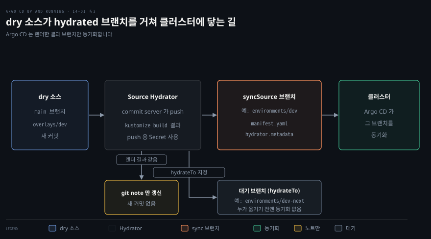
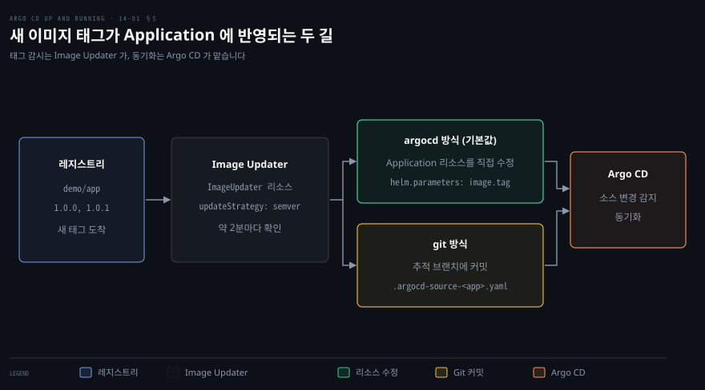

# GitOps 다음 걸음 — 저장소 구조·Rendered Manifests·승격
---

## 핵심 요약

> GitOps 저장소의 모양에는 정답이 없고 조직의 소통 구조가 정합니다. 그 안에서 지킬 규칙은 같은 YAML 을 한 번만 쓰고, 환경 차이는 브랜치가 아니라 폴더와 매개변수에 두고, 렌더 결과는 따로 쌓는 릴리스 산출물로 다루는 것입니다.

Helm 이나 Kustomize 로 YAML 을 줄이면 Git 에 적힌 것과 클러스터에 적용되는 것이 달라집니다. 그 틈을 메우려고 렌더한 결과를 Git 에 커밋하는 방식이 rendered manifests 패턴입니다. Argo CD 는 이 패턴을 Source Hydrator 라는 기능으로 들였습니다. v2.14 에 알파로 들어왔고 v3.5.0 부터 베타입니다.[^alpha][^ver]

새 버전이 나왔을 때 매니페스트를 고치는 승격은 Argo CD 가 직접 하지 않고 옆 도구가 맡습니다. Argo CD Image Updater v1.4.0 은 이미지 태그를 감시해 Application 이나 Git 을 고치고, Kargo 같은 도구는 여러 저장소를 묶어 승격합니다.


## 학습 목표

이 내용을 읽고 나면:

1. DRY 와 매개변수화가 각각 어떤 문제를 풀고 Kustomize 와 Helm 이 어느 경우에 맞는지 설명할 수 있습니다.
2. 설정 저장소를 소스 저장소에서 떼는 이유와 monorepo·polyrepo·control plane 저장소의 장단을 말할 수 있습니다.
3. rendered manifests 패턴이 푸는 문제와 치르는 값을 말하고 `sourceHydrator` 필드로 구성할 수 있습니다.
4. 환경 브랜치 대신 trunk 하나를 쓰는 이유와 렌더 결과 브랜치의 자리를 설명할 수 있습니다.
5. Argo CD 가 점진 배포를 하지 않는다는 점과 Image Updater 의 write-back 두 방식 및 한계를 설명할 수 있습니다.


## 1. DRY 와 매개변수화

> 같은 YAML 을 두 번 쓰지 않는 규칙이 DRY 이고, 배포 때에야 알 수 있는 값은 패치가 아니라 매개변수로 받습니다.

### DRY 로 본체 하나와 변경분

Git 에 모든 것을 두면 비슷한 워크로드가 환경마다 같은 YAML 로 되풀이됩니다. DRY(Don't Repeat Yourself, 반복하지 않는다)를 YAML 에 적용하면 기본 설정 하나를 두고 환경마다 다른 부분만 따로 적게 됩니다.

책은 Argo CD 가 기본 지원하는 도구 가운데 Kustomize 와 Helm 을 권합니다.[^src] Kustomize 는 기본 설정에 패치한 overlay 로 차이를 담고, Helm 은 환경마다 다른 values 파일로 담습니다. 두 도구의 사용법은 [04-01](./04-01.Application%20%EA%B4%80%EB%A6%AC%ED%95%98%EA%B8%B0%20%E2%80%94%20%EC%86%8C%EC%8A%A4%C2%B7%EB%8C%80%EC%83%81%C2%B7Helm%C2%B7Kustomize%20%EC%99%80%20%EC%82%AD%EC%A0%9C%C2%B7finalizer.md)에서 다뤘습니다.

책은 DRY 만 지키면 도구는 무엇이든 좋다고 봅니다. 맞는 도구가 없으면 [11-01](./11-01.Argo%20CD%20%ED%99%95%EC%9E%A5%ED%95%98%EA%B8%B0%20%E2%80%94%20Config%20Management%20Plugin%C2%B7UI%20%EB%A7%9E%EC%B6%A4.md)의 플러그인으로 직접 렌더할 수 있기 때문입니다.

### 배포 때 정해지는 값은 매개변수로

패치는 값을 미리 알 때 쉽습니다. Ingress 의 `host` 는 접근용 도메인 이름(FQDN)이라서, 클러스터마다 이름이 달라지는 플릿에 배포하면 배포 시점에야 값을 알게 됩니다.

이때는 필드를 매개변수로 열어 두는 Helm 이 맞습니다. 쿠버네티스 매니페스트의 세부를 가려 주므로 개발자가 앱 배포에만 집중하는 다중 테넌트 환경에서도 편합니다. 현실에서는 둘을 섞어 쓰는 경우가 많고, 이 책이 Helm 을 기본 도구로 고른 이유도 여기에 있습니다.


## 2. 저장소 분리와 구조 선택

> 첫 결정은 배포 설정을 앱 소스에서 떼는 것이고 다음은 설정 저장소의 개수입니다. 개수는 조직 구조를 따라갑니다.

### 설정과 소스 코드의 저장소 분리

배포 매니페스트는 앱 소스 코드와 다른 저장소에 두라는 것이 가장 널리 퍼진 모범 사례입니다. 둘의 수명주기가 다르고 보통 다른 팀이 다루기 때문입니다. Argo CD 공식 문서는 분리를 권장하는 이유를 다섯 가지로 듭니다.[^bp]

1. 매니페스트만 고칠 때 CI 빌드 전체를 돌리지 않아도 됩니다. 예를 들어 Deployment 의 replicas 를 올리려고 빌드를 돌릴 이유가 없습니다.
2. 설정만 담은 저장소는 개발 활동의 잡음이 없어 감사 로그가 깨끗합니다.
3. 여러 저장소에서 빌드한 서비스를 하나로 배포하는 앱은 매니페스트를 한 구성 요소의 소스 저장소에 둘 수 없습니다.
4. 앱을 만드는 개발자와 운영 환경에 push 할 사람이 다를 수 있어, 저장소를 나누면 커밋 권한도 나뉩니다.
5. CI 가 같은 저장소에 매니페스트를 push 하면 빌드와 커밋 트리거가 무한히 돌 수 있습니다.

### monorepo·polyrepo 와 Conway 법칙

저장소를 몇 개로 나눌지에는 보편적인 답이 없습니다. 책은 **Conway 법칙**을 기준으로 삼습니다. 시스템을 설계하는 조직은 그 조직의 소통 구조를 복사한 설계를 낳는다는 법칙입니다. 구조가 맞지 않으면 저장소 구조나 소통 구조를 바꿔야 하고, 보통 앞쪽이 훨씬 쉽습니다.

monorepo 는 조직의 모든 쿠버네티스 매니페스트를 저장소 하나에 두는 방식입니다. 처음에는 대개 여기서 시작하고 Kustomize 를 많이 씁니다. 한곳에서 관리하고 거버넌스를 한 점에 모을 수 있지만 Argo CD 는 큰 monorepo 에서 성능이 떨어지는 알려진 한계가 있습니다. 쓰려면 Argo CD 를 키우고 조정해야 하며, 그 방법은 [13-01](./13-01.Argo%20CD%20%EC%9A%B4%EC%98%81%ED%95%98%EA%B8%B0%20%E2%80%94%20%EB%A9%94%ED%8A%B8%EB%A6%AD%C2%B7%EC%95%8C%EB%A6%BC%C2%B7%EA%B3%A0%EA%B0%80%EC%9A%A9%EC%84%B1%C2%B7%EC%83%A4%EB%94%A9.md)에 있습니다.

polyrepo 는 저장소 여럿이 각자 맡은 일을 하는 방식입니다. 시작점은 control plane 저장소와 앱 배포 저장소 둘이 흔합니다. control plane 저장소는 Argo CD 자체를 관리하는 AppProject, Application, Argo CD 전용 Secret 과 ConfigMap 을 둡니다. 조직 정책과 거버넌스를 받치는 도구(Kyverno, Istio, External Secrets 등)의 매니페스트도 함께 둡니다. 보통 플랫폼 엔지니어링 팀이 맡습니다.

앱 배포 저장소는 Deployment, Secret, ConfigMap, Ingress 같은 실제 앱 매니페스트를 둡니다. 실제로는 둘보다 많아지는 일이 흔합니다. 대가는 저장소마다 릴리스 절차가 따로 있어 조율해야 한다는 점입니다. 책에 따르면 Argo 프로젝트를 만든 조직이 이 방식을 씁니다.

### 구조 예시 자료

보편적인 템플릿이 없으니 책은 참고 자료 다섯을 소개합니다. 저장소 하나가 클러스터 하나를 맡는 1:1 배치 예시와 monorepo 로 여러 클러스터를 다루는 표준, 팀별 저장소와 앱별 저장소의 장단을 비교한 글이 있습니다. 클라우드 인프라와 GitOps 배포를 잇는 GitOps Bridge 프로젝트와 Flux 문서의 저장소 구성 글도 있습니다. 이 자료는 시작점일 뿐이고 조직 구조에 맞춰 조정해야 합니다.


## 3. Rendered Manifests 패턴

> 렌더 결과를 Git 에 커밋하면 변경의 실제 효과가 diff 에 보입니다. 대신 렌더를 어딘가에서 맡아야 하고, Argo CD v3.6.1 의 Source Hydrator 가 그 일을 기능으로 맡습니다.

### 배포 시점 렌더링의 diff 문제

Argo CD 는 Helm 이나 Kustomize 소스를 직접 참조해 배포 때 렌더합니다. 그래서 desired state 인 Git 의 내용이 클러스터에 적용되기 전에 한 번 변형됩니다. 이 방식도 유효하지만 변경의 영향을 배포 전에 알기 어렵다는 약점이 있습니다.

책의 예는 Prometheus 우산 차트(umbrella chart)입니다. 차트 버전만 한 줄 바꾸는 diff 는 아래 모양인데, 메이저 버전이 바뀌었다는 것만 보일 뿐 실제로 달라지는 매니페스트는 보이지 않습니다.

```bash
diff new-Chart.yaml Chart.yaml
8c8
<   version: 58.6.1
---
>   version: 61.9.0
```

Argo CD 문서도 같은 위험을 짚습니다. 템플릿 도구를 쓰면 상류 Helm 저장소나 Kustomize base 가 바뀌어 매니페스트의 의미가 하루 사이에 달라질 수 있다고 하고, Git 태그나 커밋 SHA 로 고정하라고 권합니다.[^imm]

### 패턴의 이점과 대가

이런 불투명함을 없애려고 **rendered manifests 패턴**(hydrated manifests 라고도 합니다)이 나왔습니다. 핵심 원칙은 Git 에 둔 desired state 가 Argo CD 가 적용할 것과 같아야 하고 모호함이 없어야 한다는 것입니다. 컨테이너 이미지처럼 불변이어서 그대로 적용하는 대상이 됩니다.

렌더 결과는 환경별 브랜치에 담습니다. 브랜치에 갱신이 들어올 때마다 커밋 사이의 매니페스트 diff가 그대로 드러나서 각 환경에 미칠 효과를 읽을 수 있습니다.

이점은 네 가지입니다. 설정 관리 도구가 만드는 불투명함이 사라집니다. desired state 가 불변이 되어 위험이 줄어듭니다. Argo CD 가 렌더하지 않으므로 성능이 좋아집니다. 환경별 브랜치에 배포·보호 정책을 따로 걸 수 있습니다.

대가는 두 가지입니다. 렌더를 CI 로 옮기면 복잡도가 늘고, 렌더하면서 Secret 값을 매니페스트에 넣는 도구와는 맞지 않습니다.

책은 이런 도구의 예로 sealed secrets 를 듭니다. Argo CD 문서가 피하라고 하는 것은 Helm 과 SOPS 조합이나 Argo CD Vault Plugin 처럼 렌더 중에 값을 주입하는 도구입니다. 문서는 대신 대상 클러스터에서 값을 채우는 secrets operator 를 쓰라고 합니다.[^sec]

### Source Hydrator 설정과 출력

Source Hydrator 는 이 패턴을 Argo CD 기능으로 만든 것입니다. v3.6.1 문서는 이 기능이 v3.5.0 부터 베타 품질이고 렌더 결과를 클러스터에 동기화하기 전에 Git 에 push 한다고 설명합니다.[^hyd]

기능은 기본으로 꺼져 있습니다. 켜려면 commit server 구성 요소를 띄우고 `argocd-cmd-params-cm` 에 `hydrator.enabled: "true"` 를 넣은 뒤 컨트롤러와 API 서버를 재시작해야 합니다. `install.yaml` 대신 `install-with-hydrator.yaml` 로 설치하면 둘이 함께 들어옵니다.

```bash
kubectl apply -n argocd -f https://raw.githubusercontent.com/argoproj/argo-cd/v3.6.1/manifests/install-with-hydrator.yaml
kubectl -n argocd get deploy argocd-commit-server
kubectl -n argocd get cm argocd-cmd-params-cm -o jsonpath='{.data}'
```

실습에서 이렇게 설치하니 `argocd-commit-server` Deployment 가 있었고 ConfigMap 에는 `{"hydrator.enabled":"true"}` 가 들어 있었습니다.

저장소 접근에는 Secret 이 둘 필요합니다. 라벨이 `argocd.argoproj.io/secret-type: repository-write` 인 Secret 은 렌더 결과를 push 할 때, `repository` 인 Secret 은 pull 할 때 씁니다. 문서는 push 와 pull 에 서로 다른 Secret 을 요구해 격리를 높인다고 합니다.

Application 에는 `spec.sourceHydrator` 를 씁니다. `drySource` 가 렌더 전 원본을 가리키고, `syncSource` 가 렌더 결과를 쓸 브랜치와 경로입니다. 실습에서는 아래 Application 을 썼습니다.

```yaml
spec:
  sourceHydrator:
    drySource:
      repoURL: http://gitsrv.lab.svc.cluster.local/git/dry.git
      targetRevision: main
      path: overlays/dev
    syncSource:
      targetBranch: environments/dev
      path: overlays/dev
```

`syncSource.path` 는 필수이고 저장소 루트가 아닌 하위 디렉터리여야 합니다. 렌더가 전용 폴더 안에서만 일어나도록 하는 제약입니다.



위 그림이 한 번의 렌더입니다. dry 소스에 새 커밋이 들어오면 Source Hydrator 가 `drySource` 를 렌더합니다. 결과는 `syncSource` 브랜치의 `manifest.yaml` 로 커밋되고 Argo CD 는 그 브랜치를 읽어 동기화합니다.

실습에서 hydrated 브랜치의 `overlays/dev` 아래에는 `manifest.yaml` 과 함께 `README.md` 와 `hydrator.metadata` 가 생겼습니다. 저장소 루트에도 `hydrator.metadata` 가 하나 더 있었습니다.

루트 파일에는 dry 커밋의 SHA 와 작성자와 제목이 들어 있었습니다. `overlays/dev` 안의 파일에는 SHA 와 렌더 명령 `kustomize build ./overlays/dev` 가 들어 있었습니다. README 에는 dry 커밋을 checkout 해서 `kustomize build ./overlays/dev` 로 같은 결과를 다시 만드는 명령이 적혀 있었습니다.

dry 커밋이 매니페스트를 바꾸지 않으면 새 hydrated 커밋은 만들어지지 않습니다. 문서에 따르면 마지막으로 렌더한 dry SHA 를 git note 로 기록하고 매니페스트가 그대로면 note 만 갱신합니다.[^note]

실습에서 base 의 주석만 바꾼 dry 커밋 `50d433d` 를 올렸더니 `environments/dev` 에는 새 커밋이 생기지 않았습니다. 기존 hydrated 커밋 `874307d` 의 note 가 `ce03e3c` 에서 `50d433d` 로 옮겨 갔고, Application 의 `status.sourceHydrator` 도 dry `50d433d`, hydrated `874307d` 를 가리켰습니다.

### hydrateTo 와 승격 경계

렌더 결과를 곧바로 동기화하지 않고 대기시키려면 `hydrateTo` 를 씁니다. 렌더 결과는 이 브랜치로만 push 되고, 누군가 그 내용을 `syncSource` 브랜치로 옮기기 전에는 Argo CD 가 동기화하지 않습니다. 문서는 이 방식을 Pull Request(PR)로 하는 환경 승격에 쓸 수 있다고 설명합니다.[^stg]

다만 옮기는 일은 Argo CD 가 하지 않습니다. 문서에 따르면 PR 도 만들지 않으므로 CI 동작이나 별도 도구를 직접 붙여야 합니다.

실습의 `web-prod` 는 `syncSource` 를 `environments/prod`, `hydrateTo` 를 `environments/prod-next` 로 지정했습니다. 렌더 결과 커밋은 `environments/prod-next` 에 쌓였고 `environments/prod` 로는 git 으로 직접 옮겼습니다. `environments/prod` 가 같은 커밋 `e9a88af` 를 가리킨 뒤 `web-prod` 는 Synced, Healthy 가 되었습니다. `web` Deployment 는 prod overlay 의 replicas 4 가 모두 Ready 였습니다.


## 4. trunk 기반 GitOps 작업 흐름

> 앱 코드와 배포 설정은 저장소와 흐름을 따로 두고, 설정 저장소는 환경 브랜치 없이 trunk 하나로 갑니다.

### 앱 코드와 배포 설정의 분리

앱 코드에는 Git Flow 를 쓰는 조직이 많지만, 배포 설정 저장소에는 trunk-based development 를 쓰는 DevOps 엔지니어가 늘고 있습니다. 두 방식은 근본적으로 달라서 섞으면 문제가 생깁니다.

예를 들어 replicas 만 바꿔도 코드는 그대로인데 이미 운영 중인 코드베이스를 다시 빌드하고 테스트하게 됩니다. 환경 변경의 승인 절차도 코드 변경과 달라서 개발자의 CI 를 막으면 안 됩니다. 그래서 책은 앱이 어떤 개발 방식을 쓰든 GitOps 저장소에는 trunk-based development 를 쓰라고 권합니다.

### 환경 브랜치 없는 병합 전략

GitOps 에서는 소스 코드가 아니라 매니페스트를 승격합니다. 긴 수명의 브랜치로 환경을 나누는 Git Flow 식 운영은 맞지 않습니다. Secret 과 ConfigMap 같은 환경별 설정은 환경마다 고유해서 서로 병합하면 안 되고, 병합을 대신하는 cherry-pick 은 번거롭고 실수하기 쉽습니다.

대신 trunk-based development 에 Kustomize 와 Helm 을 합치면 `main` 에 단일 진실 공급원을 두고 환경별 설정은 자동화된 흐름이 관리할 수 있습니다. 앞 절의 rendered manifests 브랜치와 헷갈리기 쉬우니 구분이 필요합니다.

rendered manifests 의 브랜치는 환경 사이 승격 통로가 아닙니다. `main` 에서 자동으로 생성되는 릴리스 산출물이고 기여자가 직접 고치지 않습니다. 브랜치는 배포 번들을 담는 그릇이어서 서로 병합하지 않습니다.

실습에서 `environments/dev` 와 `environments/prod-next` 브랜치의 커밋은 모두 Argo CD 가 만들었습니다. 사람이 새로 만든 커밋은 `main` 에만 있었습니다. 앞 절의 `environments/prod-next` 에서 `environments/prod` 로 옮기는 일은 한 환경의 대기 브랜치를 승인하는 단계이지 환경끼리 병합하는 것이 아닙니다.


## 5. 점진 배포와 승격 도구

> Argo CD 는 점진 배포를 직접 하지 않고 새 버전이 나올 때 매니페스트를 고치는 일도 옆 도구에 맡깁니다. 이 절은 그 도구들의 지형입니다.

### Argo Rollouts 와 점진 배포

새 버전을 통제된 증분으로 내보내 배포 위험을 줄이는 방식을 **점진 배포**(progressive delivery)라고 합니다. 보통 자동화와 지표 분석으로 관찰한 성능에 따라 승격이나 롤백을 프로그램으로 결정합니다. 전략은 크게 둘입니다. 블루-그린은 새 버전을 기존 버전 옆에 띄워 통제된 방식으로 시험하고, 카나리는 일부 사용자에게만 새 버전을 먼저 내보냅니다.

Argo CD 자체는 점진 배포를 하지 않습니다. Argo 프로젝트의 Argo Rollouts 가 이 일을 맡고, 트래픽 제공자와 무관하게 선언적으로 동작합니다. Rollouts 는 단독으로도 Argo CD 와 함께도 쓸 수 있습니다. [10-01](./10-01.Application%20%EC%97%AC%EB%9F%BF%EC%9D%84%20%EC%88%9C%EC%84%9C%EB%8C%80%EB%A1%9C%20%E2%80%94%20%ED%97%AC%EC%8A%A4%20%EC%B2%B4%ED%81%AC%C2%B7App-of-Apps%20sync%20wave%C2%B7Progressive%20Sync.md)의 Progressive Sync 는 ApplicationSet 이 Application 을 단계별로 동기화하는 기능이어서 이와 다릅니다.

### Image Updater 설정과 write-back

새 이미지가 나올 때 매니페스트를 갱신하는 승격은 흔히 CI 가 새 매니페스트를 만들어 기능 브랜치에 쓰고 Argo CD 가 추적하는 브랜치로 PR 을 올리는 방식입니다. 마이크로서비스가 늘면 서비스마다 GitOps 흐름이 따로 있어 하나의 릴리스로 묶기가 어려워집니다. 그래서 CI 스크립트로 되돌아가는 조직이 많다고 책은 말합니다.

Argo CD Image Updater 는 이 가운데 이미지 갱신만 맡는 도구입니다. 책은 레지스트리의 새 이미지를 감지해 GitOps 저장소에 자동으로 커밋하는 단일 기능으로 소개합니다. Argo Project Labs 조직에 있습니다. 이 노트 작성 시점의 최신 릴리스는 v1.4.0(2026-10-22)입니다.[^iu]

설정의 중심은 v1.0.0 부터 주석이 아니라 `ImageUpdater` 커스텀 리소스(CRD)입니다. ApplicationSet 이 주석으로 설정을 찍어 내는 경우를 위해 v1.x 에서도 CR 에 `useAnnotations: true` 를 주면 옛 주석을 읽을 수 있습니다. 아래가 실습에서 쓴 리소스입니다.

```yaml
apiVersion: argocd-image-updater.argoproj.io/v1alpha1
kind: ImageUpdater
metadata:
  name: demo
  namespace: argocd
spec:
  writeBackConfig:
    method: argocd
  applicationRefs:
    - namePattern: demo
      images:
        - alias: app
          imageName: registry.lab.svc.cluster.local:5000/demo/app:1.x
          commonUpdateSettings:
            updateStrategy: semver
          manifestTargets:
            helm:
              name: image.name
              tag: image.tag
```

`namePattern` 으로 대상 Application 을 고르고 `images` 에 이미지별 규칙을 적습니다. `imageName` 끝의 `1.x` 는 허용할 버전 범위입니다. `manifestTargets.helm` 은 Helm 의 어느 값에 이름과 태그를 쓸지 정합니다. 갱신 전략은 다섯 가지입니다. 기본값은 `semver` 이고 나머지는 `newest-build`, `digest`, `alphabetical`, `calver` 입니다. 옛 이름 `latest` 와 `name` 은 각각 `newest-build` 와 `alphabetical` 의 별칭으로 아직 받아줍니다.[^strat]

적용 대상에는 제약이 있습니다. Kustomize, Helm, 설정 관리 플러그인으로 렌더하는 Application 만 갱신하고, Helm 은 템플릿이 `image.tag` 같은 매개변수로 태그를 받아야 합니다.

변경을 전달하는 write-back 방식은 둘입니다. `argocd` 는 기본값이고 Application 리소스를 쿠버네티스 API 로 직접 고칩니다. `argocd app set --parameter` 와 비슷하게 소스 매개변수를 덮습니다. 문서가 pseudo-persistent 라고 부르듯 Application 을 지우고 다시 만들거나 Git 에 있는 Application 이 클러스터 것을 덮으면 갱신이 사라집니다.[^wb]

`git` 방식은 Application 의 추적 브랜치에 커밋합니다. 기본으로 Application 의 소스 경로에 `.argocd-source-<appName>.yaml` 을 만듭니다. `writeBackTarget` 을 `kustomization` 이나 `helmvalues:<경로>` 로 바꾸면 kustomization 이나 values 파일을 직접 고칩니다. 기본 브랜치가 보호돼 있으면 `branch: "base:target"` 으로 새 브랜치를 따서 push 할 수 있습니다. Application 은 리비전이 아니라 브랜치를 추적해야 합니다.



환경을 나눌 때 두 가지를 조심합니다. 첫째, 같은 Application 에 맞는 `namePattern` 이 여러 `ImageUpdater` 에 있으면 문서 표현으로 서로 갱신을 계속 덮어쓰며 이미지 버전 사이를 오갑니다.

둘째, `git` 방식은 Application 이 렌더에 쓰는 values 파일을 직접 고칩니다. 그래서 여러 환경이 values 파일 하나를 함께 쓰면 한 환경을 위한 갱신이 다른 환경의 렌더에도 닿습니다.

갱신은 `namePattern` 이 고른 Application 에만 걸립니다. 문서는 `writeBackTarget: helmvalues:<경로>` 로 고칠 values 파일을 정하는 법을 보입니다. 환경마다 values 파일을 나누면 이 번짐을 피할 수 있습니다.

### Image Updater 실습 관찰

kind 클러스터 안에 `registry:2` 레지스트리를 띄우고 `demo/app` 에 `1.0.0` 과 `1.0.1` 태그를 올린 뒤 Helm 차트 Application `demo` 를 `1.0.0` 으로 배포했습니다. Image Updater v1.4.0 은 `install.yaml` 로 설치했습니다.[^lab]

처음에는 컨트롤러 로그에 `images_considered=0 images_skipped=1` 이 찍혔습니다. 차트의 Deployment 가 `replicas: 0` 이라서 Pod 가 없었고, Application 의 `status.summary` 가 `{}` 였습니다. replicas 를 1로 바꿔 push 하자 Pod 가 생겼고(이미지 pull 은 `ImagePullBackOff` 였습니다) 이미지가 `status.summary.images` 에 올라왔습니다. 그 뒤로 `images_considered=1` 이 되었습니다.

Image Updater 는 기본으로 Application 상태에 실린 이미지만 갱신합니다. 그 목록은 실제로 떠 있는 Pod 의 이미지로 채워지므로 Pod 가 없으면 갱신할 이미지도 없습니다. 아직 배포되지 않은 이미지를 갱신하려면 `commonUpdateSettings.forceUpdate: true` 를 씁니다.[^force]

`argocd` 방식으로 한 번 도는 동안 아래 로그가 이어졌습니다. 2분 주기의 한 사이클 안에서 `1.x` 범위의 최신인 `1.0.1` 이 선택되고 Application 이 고쳐졌습니다.

```bash
level=info msg="Setting new image to registry.lab.svc.cluster.local:5000/demo/app:1.0.1"
level=info msg="Successfully updated application spec for demo"
level=info msg="Processing results: applications=1 images_considered=1 images_skipped=0 images_updated=1 errors=0"
```

결과는 Application 과 Deployment 양쪽에서 확인했습니다. `spec.source.helm.parameters` 에 `image.name=registry.lab.svc.cluster.local:5000/demo/app` 과 `image.tag=1.0.1` 이 생겼습니다. Deployment 의 이미지도 `registry.lab.svc.cluster.local:5000/demo/app:1.0.1` 이 됐습니다.

```bash
kubectl -n argocd get app demo -o jsonpath='{.spec.source.helm.parameters}'
kubectl -n demo-app get deploy demo -o jsonpath='{.spec.template.spec.containers[0].image}'
```

`git` 방식의 `git:secret:` 자격 증명은 SSH 또는 HTTPS URL 에서만 만들어집니다. 평문 `http://` 저장소에는 `unknown repository type` 오류가 납니다.[^cred]

### Kargo·Telefonistka·Argo CD 제안

책은 Image Updater 보다 폭넓은 승격 방법으로 Argo CD 저장소의 제안 하나와 도구 둘을 더 소개합니다. 제안은 Git 커밋 감지까지 다루고, 진행은 해당 GitHub 페이지에서 추적합니다.

Kargo 는 Argo 프로젝트의 원 제작자들이 시작한 오픈소스입니다. Git, Helm, 이미지 저장소의 갱신을 추적하고 사용자가 정한 규칙에 따라 관련 Git 커밋을 조율합니다. 이 노트를 쓴 시점의 최신 릴리스는 v1.12.5(2026-10-27)입니다.[^kargo]

Telefonistka 는 한 기업의 엔지니어들이 만든 GitHub webhook 봇입니다. 환경을 폴더로 나눈 저장소에서 변경을 감지하고, 설정에 적힌 `sourcePaths` 의 컴포넌트를 `targetPaths` 로 옮기는 PR 을 엽니다. 사용자가 그 PR 을 승인하면 선택한 GitOps 컨트롤러가 동기화합니다.[^tele]

### Argo Project Labs 와 커뮤니티

Image Updater 가 있는 Argo Project Labs 는 Argo 메인테이너가 관리하는 실험의 장입니다. CNCF(Cloud Native Computing Foundation)의 졸업 프로젝트와 달리 공식 지위는 없지만 지원하지 않는 도구라는 뜻은 아니고, 질문과 기여는 CNCF Slack 과 GitHub 에서 시작합니다.


## 연습 문제

> 아래 여섯 문제는 DRY 와 저장소 구조, rendered manifests 와 Source Hydrator, trunk 흐름, 점진 배포와 Image Updater 를 하나씩 묻습니다. 답을 적은 뒤에 정답 절을 펼칩니다.

1. 팀 구조와 저장소 구조가 어긋나서 불편합니다. Conway 법칙은 무엇을 바꾸라고 하며, 둘 중 어느 쪽이 보통 쉽습니까? 배포 매니페스트를 앱 소스와 다른 저장소에 두는 이유를 둘 이상 드십시오.
2. 클러스터마다 Ingress 의 `host` 가 다르고 값은 배포 때에야 압니다. Kustomize 패치보다 Helm 이 맞는 이유는 무엇입니까? 현실에서는 두 도구를 어떻게 씁니까?
3. 차트 버전을 한 줄 바꾸는 PR 은 diff 만 보면 영향이 안 보입니다. rendered manifests 패턴은 이 문제를 어떻게 풉니까? 이점 둘과 대가 둘을 말하고, 이 패턴의 브랜치가 환경 승격 통로가 아닌 이유를 설명하십시오.
4. Source Hydrator 를 켜려면 무엇이 필요하며 push 용과 pull 용 Secret 은 어떻게 구분합니까? dry 커밋이 매니페스트를 바꾸지 않으면 hydrated 브랜치에 무슨 일이 생깁니까? `hydrateTo` 를 쓰면 누가 무엇을 합니까?
5. 앱 코드에 Git Flow 를 쓰더라도 GitOps 저장소에는 trunk-based development 를 권하는 이유는 무엇입니까? 환경별로 장수 브랜치를 두면 어떤 문제가 생깁니까?
6. Image Updater 의 write-back 방식 둘은 어떻게 다르고 어떤 상황에 맞습니까? 기본 갱신 대상과 아직 안 뜬 이미지용 설정은 무엇입니까? `git:secret:` 자격 증명은 어떤 URL 에서만 됩니까? Argo CD 는 점진 배포를 직접 합니까?


## 정답 (자답 후 펼치기)

### 정답 1

Conway 법칙은 시스템 구조가 조직의 소통 구조를 닮는다고 말합니다. 그래서 구조가 안 맞으면 저장소 구조를 바꾸거나 조직의 소통 구조를 바꿔야 하고, 책은 앞쪽이 보통 훨씬 쉽다고 합니다.

공식 문서가 드는 이유는 다섯 가지입니다. 매니페스트만 고칠 때 CI 빌드를 돌리지 않아도 됩니다. 감사 이력이 깨끗합니다. 접근 권한을 나눌 수 있습니다. CI 가 매니페스트를 push 해 빌드가 무한히 도는 일을 막습니다. 여러 저장소에서 빌드한 서비스를 하나로 배포할 때 매니페스트를 둘 자리가 생깁니다. 책이 드는 이유는 수명주기가 달라 따로 관리돼야 한다는 점입니다.

### 정답 2

Kustomize 패치는 값을 미리 알 때 쉽습니다. `host` 는 FQDN 이 클러스터마다 달라 배포 시점에야 알 수 있어서 패치로 적을 수 없습니다. Helm 은 필드를 매개변수로 열어 두므로 배포할 때 값을 넣을 수 있습니다.

현실에서는 둘을 섞어 씁니다. 책이 Helm 을 기본 도구로 고른 이유도 매개변수화입니다.

### 정답 3

desired state 를 렌더한 결과로 Git 에 두면 커밋 사이 diff 가 실제로 적용될 매니페스트의 변화를 그대로 보여 줍니다. 한 줄 버전 변경이 낳는 큰 차이도 환경 브랜치의 diff 에 드러납니다.

이점은 불투명함 제거, 불변 desired state, Argo CD 의 렌더 부담 제거로 인한 성능, 환경별 브랜치 정책 가능성 중 둘입니다. 대가는 렌더를 CI 로 옮기는 복잡도와, 렌더하면서 Secret 값을 매니페스트에 넣는 도구와 맞지 않는 점입니다. Argo CD 문서는 그런 도구 대신 대상 클러스터에서 값을 채우는 secrets operator 를 쓰라고 합니다.

이 브랜치는 `main` 에서 자동 생성되는 릴리스 산출물이고 기여자가 고치지 않으며 서로 병합하지 않습니다. 배포 번들을 담는 그릇일 뿐이어서 환경 사이 승격 통로가 아닙니다.

### 정답 4

commit server 구성 요소와 `argocd-cmd-params-cm` 의 `hydrator.enabled: "true"` 가 필요하고, 켠 뒤 컨트롤러와 API 서버를 재시작합니다. `install-with-hydrator.yaml` 이 둘을 함께 줍니다. 문서는 기본으로 꺼져 있다고 합니다.

push 용 Secret 의 라벨은 `argocd.argoproj.io/secret-type: repository-write` 이고, pull 용은 `repository` 입니다. dry 커밋이 매니페스트를 바꾸지 않으면 새 hydrated 커밋 없이 git note 의 dry SHA 만 갱신됩니다. 실습에서 주석만 바꾼 커밋이 이렇게 처리됐습니다.

`hydrateTo` 를 쓰면 렌더 결과가 그 브랜치에만 push 되고 Argo CD 는 동기화하지 않습니다. 그 내용을 `syncSource` 브랜치로 옮기는 일은 사용자 도구가 해야 하며, Argo CD 는 PR 도 만들지 않습니다.

### 정답 5

앱 코드의 빌드 흐름과 환경 변경의 승인 흐름이 다르기 때문입니다. replicas 만 바꿔도 이미 운영 중인 코드를 다시 빌드하고 테스트하게 되고, 환경 변경의 승인이 개발자의 CI 를 막아서는 안 됩니다.

환경별 장수 브랜치는 병합을 전제로 하는데, Secret 과 ConfigMap 같은 환경별 설정은 환경 사이에 병합하면 안 됩니다. 병합 대신 cherry-pick 을 하게 되고 번거롭고 오류가 나기 쉽습니다.

### 정답 6

`argocd` 방식은 Application 리소스를 직접 고치며 기본값입니다. Application 을 지우고 다시 만들거나 Git 이 덮으면 갱신이 사라지므로, UI 나 CLI 로 만든 Application 에 맞습니다. `git` 방식은 추적 브랜치에 커밋해 영구히 남기므로 Application 도 Git 으로 관리하는 쪽에 맞습니다.

Image Updater 는 기본으로 Application 상태에 실린 이미지만 갱신 대상으로 봅니다. 그 목록은 실제로 떠 있는 Pod 의 이미지로 채워지므로 Pod 가 없으면 `images_considered=0` 이 나오고, 실습의 `replicas: 0` Deployment 가 이런 경우였습니다. 아직 배포되지 않은 이미지를 갱신하려면 `commonUpdateSettings.forceUpdate: true` 를 켭니다.

`git:secret:` 자격 증명은 SSH 또는 HTTPS 저장소 URL 에서만 만들어집니다. 평문 `http://` URL 은 v1.4.0 의 `gitcreds.go` 에서 `unknown repository type` 으로 막힙니다.

Argo CD 는 점진 배포를 직접 하지 않습니다. Argo Rollouts 같은 도구가 맡으며 Argo CD 와 함께 쓸 수 있습니다.


## 참고 자료

- 《Argo CD: Up and Running》(Andrew Block · Christian Hernandez, O'Reilly, 2025, ISBN 978-1-098-14200-1) 14장
- [Argo CD v3.6.1 릴리스](https://github.com/argoproj/argo-cd/releases/tag/v3.6.1)
- [Source Hydrator](https://raw.githubusercontent.com/argoproj/argo-cd/v3.6.1/docs/user-guide/source-hydrator.md)
- [Best Practices](https://raw.githubusercontent.com/argoproj/argo-cd/v3.6.1/docs/user-guide/best_practices.md)
- [install-with-hydrator.yaml](https://raw.githubusercontent.com/argoproj/argo-cd/v3.6.1/manifests/install-with-hydrator.yaml)
- [Argo CD Image Updater v1.4.0 릴리스](https://github.com/argoproj-labs/argocd-image-updater/releases/tag/v1.4.0)
- [Image Updater 소개](https://raw.githubusercontent.com/argoproj-labs/argocd-image-updater/v1.4.0/docs/index.md)
- [Image Updater write-back 방식](https://raw.githubusercontent.com/argoproj-labs/argocd-image-updater/v1.4.0/docs/basics/update-methods.md)
- [Image Updater 갱신 전략](https://raw.githubusercontent.com/argoproj-labs/argocd-image-updater/v1.4.0/docs/basics/update-strategies.md)
- [Image Updater 대상 Application 선택](https://raw.githubusercontent.com/argoproj-labs/argocd-image-updater/v1.4.0/docs/configuration/applications.md)
- [Kargo v1.12.5 릴리스](https://github.com/akuity/kargo/releases/tag/v1.12.5)
- [Telefonistka README](https://raw.githubusercontent.com/wayfair-incubator/telefonistka/21b48f67f97abec2a498b2481a8ecbdedc82e724/README.md) (커밋 고정, 2026-11-08 조회)와 이전한 저장소 [commercetools/telefonistka](https://github.com/commercetools/telefonistka)
- 관련 노트: [이 책의 인덱스](./README.md)
- 관련 노트: [04-01 Application 관리하기](./04-01.Application%20%EA%B4%80%EB%A6%AC%ED%95%98%EA%B8%B0%20%E2%80%94%20%EC%86%8C%EC%8A%A4%C2%B7%EB%8C%80%EC%83%81%C2%B7Helm%C2%B7Kustomize%20%EC%99%80%20%EC%82%AD%EC%A0%9C%C2%B7finalizer.md), [10-01 Application 여럿을 순서대로](./10-01.Application%20%EC%97%AC%EB%9F%BF%EC%9D%84%20%EC%88%9C%EC%84%9C%EB%8C%80%EB%A1%9C%20%E2%80%94%20%ED%97%AC%EC%8A%A4%20%EC%B2%B4%ED%81%AC%C2%B7App-of-Apps%20sync%20wave%C2%B7Progressive%20Sync.md)
- 관련 노트: [11-01 Argo CD 확장하기](./11-01.Argo%20CD%20%ED%99%95%EC%9E%A5%ED%95%98%EA%B8%B0%20%E2%80%94%20Config%20Management%20Plugin%C2%B7UI%20%EB%A7%9E%EC%B6%A4.md), [12-01 CI 와 Argo CD 잇기](./12-01.CI%20%EC%99%80%20Argo%20CD%20%EC%9E%87%EA%B8%B0%20%E2%80%94%20%EC%A1%B0%EC%A0%95%20%EC%A3%BC%EA%B8%B0%C2%B7Webhook%C2%B7Tekton.md), [13-01 Argo CD 운영하기](./13-01.Argo%20CD%20%EC%9A%B4%EC%98%81%ED%95%98%EA%B8%B0%20%E2%80%94%20%EB%A9%94%ED%8A%B8%EB%A6%AD%C2%B7%EC%95%8C%EB%A6%BC%C2%B7%EA%B3%A0%EA%B0%80%EC%9A%A9%EC%84%B1%C2%B7%EC%83%A4%EB%94%A9.md)

[^ver]: 최신 릴리스는 Argo CD v3.6.1(2026-11-04)이고 설치 매니페스트는 `https://raw.githubusercontent.com/argoproj/argo-cd/v3.6.1/manifests/install.yaml` 입니다. Helm 차트는 argo-helm 의 `argo-cd` 10.15.0(appVersion v3.6.1)입니다. 문서와 소스는 v3.6.1 태그에 고정했습니다. 이 노트의 실습은 kind v0.31.0 이 만든 Kubernetes v1.35.0 클러스터에서 했고 `sourceHydrator` 때문에 `install.yaml` 이 아니라 `install-with-hydrator.yaml` 로 설치했습니다.
[^alpha]: v2.14.0 태그의 `docs/user-guide/source-hydrator.md` 첫머리는 "Current feature state: Alpha"이고, 같은 경로가 v2.13.0 태그에는 없습니다(2026-11-08 조회 시 404). v3.6.1 문서 첫머리는 "Beta Feature (Since v3.5.0)"입니다.
[^src]: `docs/user-guide/application_sources.md` 는 Argo CD 가 매니페스트를 정의하는 방법으로 Kustomize, Helm, OCI 이미지, YAML·JSON·Jsonnet 디렉터리, 설정 관리 플러그인을 듭니다.
[^bp]: 문서는 분리를 "Using a separate Git repository to hold your Kubernetes manifests, keeping the config separate from your application source code, is highly recommended"라고 적고 이유를 번호 다섯으로 듭니다. 다섯 번째는 "pushing manifest changes to the same Git repository can trigger an infinite loop of build jobs and Git commit triggers."입니다.
[^imm]: 문서의 "Ensuring Manifests At Git Revisions Are Truly Immutable" 절은 "it is possible for manifests to change their meaning from one day to the next."라고 적고, 상류 Helm 저장소나 Kustomize base 변경이 원인이라고 합니다. 예로 든 remote base 는 `?ref=v0.11.1` 처럼 Git 태그나 커밋 SHA 로 고정하는 쪽이 낫다고 합니다.
[^hyd]: 문서 첫머리는 "Beta Feature (Since v3.5.0)"이고, 기능을 "pushes hydrated manifests to git before syncing them to the cluster"라고 설명합니다. 활성화는 "The source hydrator is disabled by default."로 시작하며, "If you are using one of the `*-install.yaml` manifests to install Argo CD, you can use the `*-install-with-hydrator.yaml` version of that file instead."라고 안내합니다. Secret 은 "Argo CD requires different secrets for pushing and pulling to provide better isolation."이고, 경로는 "the `syncSource.path` field is required and must always point to a non-root directory in the repository"입니다.
[^sec]: 문서의 Prerequisites 절 「Handle Secrets on the Destination Cluster」는 "Do not use the source hydrator with any tool that injects secrets into your manifests as part of the hydration process (for example, Helm with SOPS or the Argo CD Vault Plugin). These secrets would be committed to git. Instead, use a secrets operator that populates the secret values on the destination cluster."라고 적습니다.
[^note]: 문서의 "Git Note-based Hydration State Tracking" 절은 "The Source Hydrator does not create a new hydrated commit for a DRY commit if the commit doesn't affect the hydrated manifests."라고 적고, 절차를 마지막으로 렌더한 dry SHA 의 note 를 확인해 "If manifests have not changed since that SHA, only updates the note."라고 설명합니다. 이 note 의 ref 는 `refs/notes/hydrator.metadata` 입니다.
[^stg]: 문서의 `Pushing to a "Staging" Branch` 절은 이 방식을 "providing a way to handle environment promotion via Pull Requests"라고 설명하고, "Argo CD will only push changes to the `hydrateTo` branch, it will not create a PR or otherwise facilitate moving those changes to the `syncSource` branch."라고 합니다. 옮기는 도구는 사용자가 마련합니다.
[^iu]: v1.4.0 문서 `docs/index.md` 는 "CRD-based configuration with the v1.0.0 release"라고 적고 v1.x 문서가 CRD 방식을 다룬다고 합니다. 같은 문서의 제약에는 "Argo CD Image Updater can only update container images for applications whose manifests are rendered using *Kustomize*, *Helm*, or a *Config Management Plugin*."이 있습니다. `docs/configuration/applications.md` 의 「Reading configuration from Application annotations」는 ApplicationSet 이 설정을 주석으로 찍어 내는 경우에 `useAnnotations: true` 를 쓰라고 하고, 이때 "all CR-based configuration is ignored"이며 컨트롤러가 Application 의 옛 `argocd-image-updater.argoproj.io/*` 주석에서 설정을 읽는다고 합니다. 릴리스 날짜는 GitHub 릴리스 페이지의 2026-10-22 입니다.
[^strat]: `docs/basics/update-strategies.md` 의 목록은 `semver`, `newest-build`(옛 별칭 `latest`), `digest`, `alphabetical`(옛 별칭 `name`), `calver` 이고, 기본값은 `semver` 입니다. 설정 위치는 `ImageUpdater` 의 `commonUpdateSettings.updateStrategy` 입니다.
[^wb]: `docs/basics/update-methods.md` 는 `argocd` 방식을 "This method is the default and requires no further configuration."로, `git` 방식의 흐름을 "Write-back is a commit to the tracking branch of the Application."로 정리합니다. `argocd` 방식은 "This method is pseudo-persistent."이고, `git` 방식의 기본 파일은 `.argocd-source-<appName>.yaml` 입니다. `writeBackTarget` 의 `kustomization`·`helmvalues:<경로>` 와 `branch: "base:target"` 도 같은 문서에 있고, `helmvalues` 는 "commits changes to the values file back that is used to render the Helm template"라고 설명합니다. 여러 `ImageUpdater` 가 같은 Application 에 맞을 때의 충돌은 `docs/configuration/applications.md` 의 경고에 "continuously overwrite each other's changes"로 적혀 있습니다.
[^lab]: 실습은 kind 클러스터 한 개에서 했습니다. Image Updater 는 `https://raw.githubusercontent.com/argoproj-labs/argocd-image-updater/v1.4.0/config/install.yaml` 로 `argocd` 네임스페이스에 설치했고, 레지스트리와 Git 서버는 클러스터 안에 직접 띄웠습니다(Git 서버는 평문 HTTP). 자격 증명 Secret 에는 `<username>`·`<password>` 자리의 실습용 값을 썼습니다. 이 노트가 근거로 삼는 것은 Application 의 `spec.source.helm.parameters` 와 Deployment 의 이미지 필드입니다. `git` 방식은 이 실습에서 커밋까지 이어지지 않았습니다. 기본 자격 증명 방식은 `credentials for 'http://…/app.git' are not configured in Argo CD settings` 로 실패했고 저장소 Secret 을 만들어도 같았으며, `git:secret:argocd/git-creds` 로 바꾸자 `unknown repository type` 이 났습니다.
[^cred]: v1.4.0 의 `pkg/argocd/gitcreds.go` 에서 `git:secret:` 방식은 `git.IsSSHURL(wbc.GitRepo)` 이면 SSH 키로, `git.IsHTTPSURL(wbc.GitRepo)` 이면 `username`·`password` 필드로 자격 증명을 만들고, 그 둘이 아니면 마지막 줄 `return nil, fmt.Errorf("unknown repository type")` 에 닿습니다. 기본 `repocreds` 방식의 오류는 같은 파일에서 `repo.HasCredentials()` 가 거짓일 때 나는 `credentials for '%s' are not configured in Argo CD settings` 입니다. 이 실습에서는 저장소 Secret 을 만든 뒤에도 이 오류가 났습니다.
[^force]: `docs/configuration/images.md` 의 「Forcing Image Updates」는 "By default, Image Updater will only update an image that is actually used in your Application (i.e., is it exported in the Status of your ArgoCD Application.)"라고 적고, 설정 표는 `forceUpdate` 를 "Force updates even if image is not currently deployed"로 설명합니다. v1.4.0 `pkg/argocd/argocd.go` 의 `GetImagesFromApplication` 은 `app.Status.Summary.Images` 를 읽습니다. Argo CD v3.6.1 `controller/cache/info.go` 에서 리소스의 `Images` 를 채우는 곳은 Pod 를 다루는 `populatePodInfo` 입니다.
[^kargo]: Kargo 최신 릴리스는 GitHub 릴리스 페이지 기준 v1.12.5(2026-10-27)입니다. 소개한 기능은 책의 설명입니다.
[^tele]: Telefonistka README 는 "Based on configuration in the IaC repo, the bot will open pull requests that sync components from "sourcePaths" to "targetPaths"."라고 적습니다. 첫머리는 개발이 commercetools GitHub 조직(`https://github.com/commercetools/telefonistka`)에서 이어진다고 안내합니다. README 는 위 커밋에 고정해 2026-11-08 에 조회했습니다.
