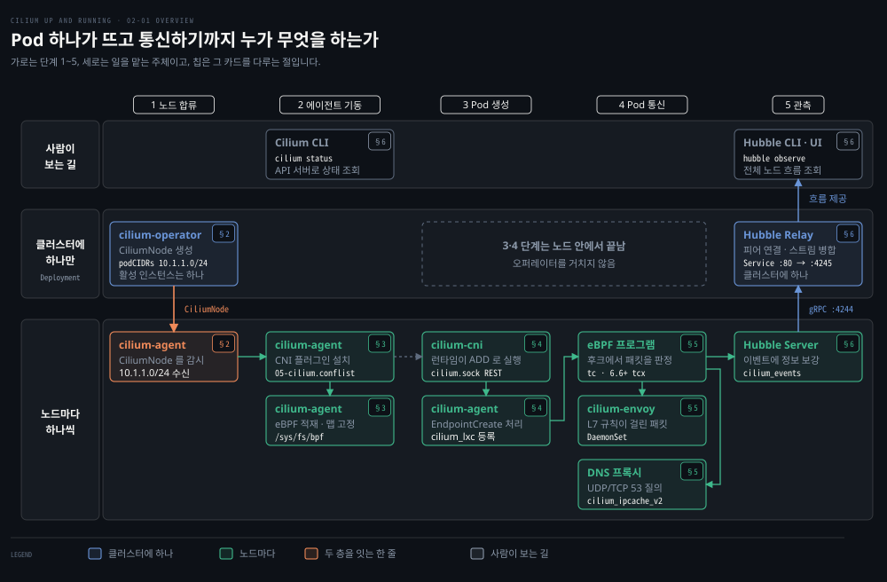
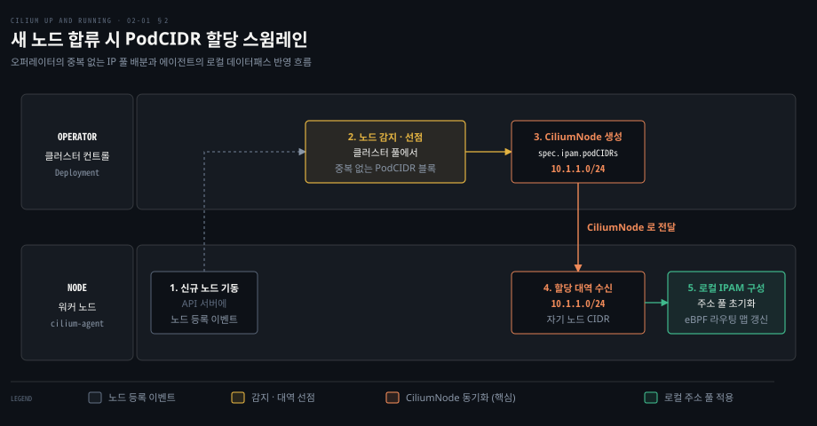
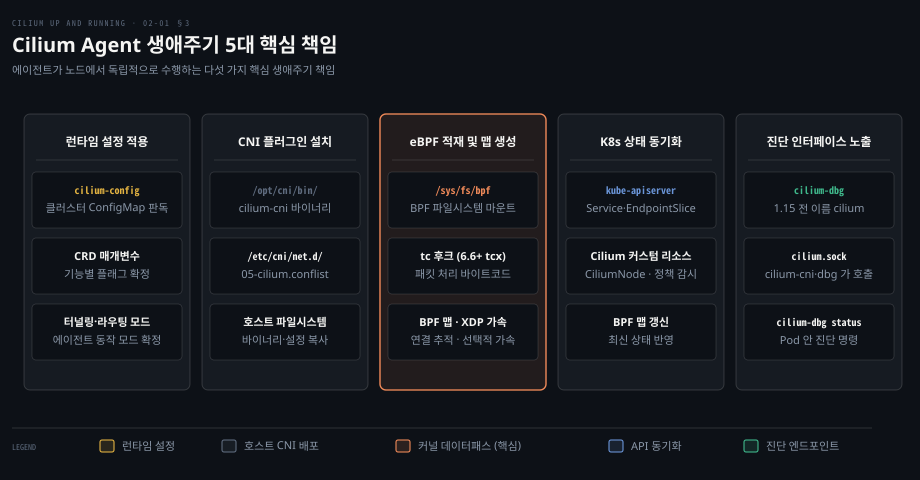
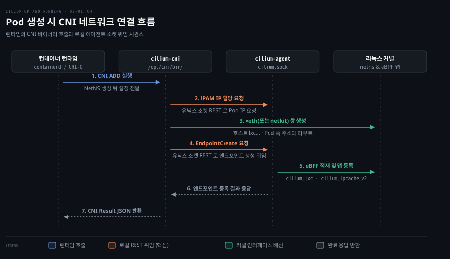
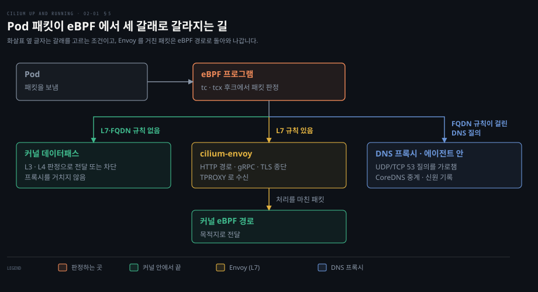
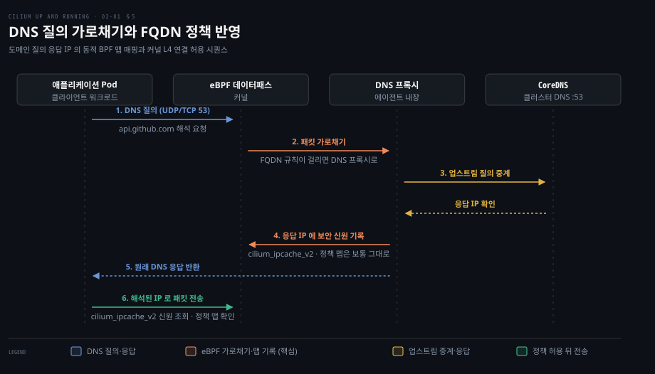
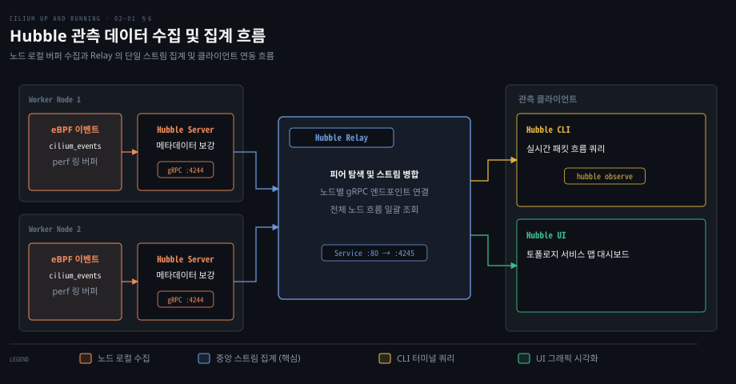

# Cilium 은 에이전트·CNI 플러그인·오퍼레이터로 나눠 노드와 클러스터를 맡는다

---

> Cilium 의 구성 요소가 노드와 클러스터에서 각각 무엇을 맡는지, Pod 하나가 뜨고 통신할 때 어떤 순서로 협력하는지를 설명합니다.


## 핵심 요약

> 노드 안의 일은 노드가 끝내고 클러스터에서 한 번만 해야 하는 일은 오퍼레이터 하나가 맡으므로, Cilium 은 노드가 늘어도 패킷 경로가 중앙에 기대지 않습니다. IP 주소와 포트만으로 판정할 수 없는 일은 사용자 공간 프록시가 이어받고, 사람은 CLI 와 Hubble 로 그 결과를 봅니다.

에이전트는 노드마다 DaemonSet 으로 뜹니다. DaemonSet 은 노드마다 Pod 를 하나씩 띄우는 쿠버네티스 배포 방식입니다. 에이전트는 리눅스 커널에 eBPF 프로그램을 적재하고 맵을 관리합니다. eBPF 프로그램은 커널 안에서 도는 작은 프로그램이고, 맵은 그 프로그램과 사용자 공간 프로세스가 함께 읽고 쓰는 커널 안 저장소입니다.

커널 검증기는 적재 전에 잘못된 메모리 접근과 무한 루프를 막아 이 프로그램이 커널을 망가뜨리지 못하게 합니다. 패킷이 실제로 지나며 검사되고 전달되는 경로를 데이터패스라 하며, Cilium 의 데이터패스는 이 프로그램과 맵이 이룹니다. eBPF 자체는 [01-01](./01-01.Cilium%20은%20eBPF%20데이터패스로%20iptables%20기반%20CNI%20의%20한계를%20넘는다.md)이 다룹니다.

컨테이너 런타임은 새 Pod 를 만들 때 CNI 규격의 플러그인 실행 파일을 불러 Pod 에 네트워크를 붙입니다. Cilium 의 CNI 플러그인은 Pod 쪽 인터페이스를 배선하고, 주소 할당과 엔드포인트 등록은 로컬 에이전트에 맡깁니다.[^cnisrc]

L7 검사는 HTTP 경로나 gRPC 호출 내용까지 보는 검사이고, FQDN 정책은 도메인 이름으로 허용 대상을 적는 정책입니다. 이런 규칙은 IP 주소와 포트(L3·L4)만으로는 판정할 수 없습니다. 그래서 eBPF 프로그램이 규칙이 걸린 트래픽만 골라 사용자 공간으로 넘깁니다. HTTP 와 TLS 는 Envoy 가, DNS 는 DNS 프록시가 받습니다.

클러스터 전체에서는 오퍼레이터가 활성 인스턴스 하나로 동작합니다. 오퍼레이터는 PodCIDR 할당과 Cilium 커스텀 리소스 관리를 맡습니다. PodCIDR 는 한 노드의 Pod 들이 받을 IP 범위입니다. Hubble 은 Cilium 의 관측 구성 요소입니다. 노드마다 있는 Hubble 서버가 흐름 이벤트를 모으고, 이를 클러스터 단위로 묶는 Hubble Relay 가 한곳에서 흐름을 보게 합니다.


## 학습 목표

> 이 편을 읽고 나면 다음을 설명할 수 있습니다.

1. Cilium 아키텍처가 에이전트와 오퍼레이터로 역할을 분리한 설계 이유를 제시할 수 있습니다.
2. 에이전트가 노드에서 맡는 다섯 가지 핵심 책임과 에이전트 장애 시 데이터패스 지속 원리를 설명할 수 있습니다.
3. 컨테이너 런타임과 CNI 바이너리, 에이전트가 Pod 네트워크를 배선하는 호출 흐름을 말할 수 있습니다.
4. 오퍼레이터가 IPAM 주소 할당과 CRD 동기화를 클러스터 중앙에서 맡아야 하는 배경을 분석할 수 있습니다.
5. L7 정책 처리를 위한 Envoy 및 FQDN 해석용 DNS 프록시의 패킷 가로채기 동작 방식을 비교할 수 있습니다.

아래 그림은 Pod 하나가 뜨고 통신하기까지를 가로 다섯 단계로 놓고, 그 일을 맡는 주체를 세로 세 줄로 나눈 것입니다. 파랑은 클러스터에 하나만 도는 것이고 초록은 노드마다 도는 것이며 회색은 사람이 상태를 들여다보는 길입니다. 코랄 한 줄은 두 층이 만나는 곳으로, 오퍼레이터가 `CiliumNode` 에 적은 PodCIDR 를 노드의 에이전트가 읽어 가는 부분입니다.

점선 칸은 3·4 단계가 노드 안에서 끝남을 보입니다. 카드의 칩은 그 카드를 다루는 절 번호입니다.




## Pod 하나가 뜰 때 누가 무엇을 하는가

> Pod 하나가 통신하기까지는 노드 합류, 에이전트 기동, Pod 생성, 통신, 관측 다섯 단계를 지나며 단계마다 일을 맡는 주체가 다릅니다. 노드 안의 일은 에이전트와 그 곁의 프록시가, 클러스터에서 한 번만 하는 일은 오퍼레이터가 맡습니다.

| 단계 | 주체 | 하는 일 | 받치는 개념 | 절 |
|---|---|---|---|---|
| 1 노드 합류 | 오퍼레이터 → 에이전트 | 오퍼레이터가 노드마다 만드는 Cilium 전용 리소스 `CiliumNode` 에 PodCIDR 를 적고, 에이전트가 그 값으로 로컬 IP 풀을 만듭니다 | IPAM(Pod 에 줄 IP 관리) · 리더 선출(활성 인스턴스를 하나만 두는 방식) | §2 |
| 2 에이전트 기동 | 에이전트 | 설정을 읽고 CNI 플러그인을 호스트에 설치하고 eBPF 프로그램과 맵을 커널에 적재합니다 | bpffs 핀 고정(맵을 파일 이름으로 커널에 남기는 일) | §3 |
| 3 Pod 생성 | 런타임 → `cilium-cni` → 에이전트 | 플러그인이 에이전트에서 IP 를 받아 veth(호스트와 Pod 를 잇는 가상 케이블)를 만들고, 에이전트가 엔드포인트(Pod 하나의 네트워크 연결)를 등록합니다 | CNI 규격 | §4 |
| 4 Pod 통신 | eBPF 프로그램 → Envoy · DNS 프록시 | IP 와 포트로 하는 L3·L4 판정은 커널이 끝내고, L7 규칙이 걸린 트래픽은 Envoy 가, FQDN 규칙이 걸린 DNS 질의는 DNS 프록시가 처리합니다 | L3·L4 와 L7 의 분업 · 보안 신원(정책 판정에 쓰는 번호) | §5 |
| 5 관측 | Hubble 서버 → Relay → CLI · UI | 노드마다 흐름을 모으고 Relay 가 묶어 한곳에서 보게 합니다 | perf 링 버퍼(커널이 이벤트를 넘기는 순환 버퍼) · gRPC | §6 |

§1 은 이 흐름 밖에서 일을 두 층으로 나누는 이유를 세웁니다. §6 은 마지막 단계와 함께 `cilium status` 로 구성 요소 상태를 보는 길도 다룹니다.


## 1. 노드 단위와 클러스터 단위

> 모든 노드가 쿠버네티스 전체 상태를 직접 조정하려 들면 API 서버 부하와 상태 불일치가 일어나고, 반대로 중앙 컨트롤러가 패킷 전달까지 원격 제어하면 컨트롤러 장애가 클러스터 전체 통신 마비로 번집니다. 그래서 일을 노드 단위와 클러스터 단위로 나눠 맡깁니다.

흐름 위치: 흐름 밖 — 일을 두 층으로 나누는 이유

### 왜 에이전트와 오퍼레이터로 분리했는가

노드가 수백 대인 클러스터를 생각해 봅시다. 각 노드가 중앙 API 서버에 접근해 전역 주소 블록을 직접 갱신하면 동기화 경합이 일어납니다. 반대로 중앙 컨트롤러가 각 노드의 인터페이스와 패킷 필터링까지 원격으로 제어하면, 그 컨트롤러가 멈출 때 클러스터 전체 통신이 마비됩니다.

Cilium 은 시스템을 노드 단위와 클러스터 단위로 나눠 이 두 문제를 풉니다.

| 층 | 구성 요소 | 맡는 일 |
|---|---|---|
| 노드 단위 (DaemonSet) | Cilium agent | 호스트 커널에 eBPF 프로그램을 적재하고 맵 상태를 유지합니다 |
| 노드 단위 | Cilium CNI plugin | Pod 생성 때 Pod 쪽 인터페이스를 배선하고, 주소 할당과 엔드포인트 등록은 로컬 에이전트에 맡깁니다 |
| 노드 단위 | Envoy · DNS 프록시 · Hubble 서버 | 노드 안에서 협력하며 L7 처리, FQDN 해석 가로채기, 패킷 이벤트 캡처를 맡습니다 |
| 클러스터 단위 (활성 인스턴스 하나) | Cilium operator | 노드 사이에 겹치지 않게 IP 대역을 나누고, 쿠버네티스에 새 리소스 종류를 더하는 정의인 CRD 를 등록합니다 |
| 클러스터 단위 | Hubble Relay · UI | 여러 노드의 관측 데이터를 하나로 묶습니다 |
| 클러스터 단위 | Cluster Mesh API Server | 멀티클러스터 메타데이터를 공유합니다 |

노드 안의 패킷 전달은 중앙 컨트롤러의 개입 없이 노드 커널에서 끝납니다. 클러스터 전역의 주소 체계와 정책 일관성은 오퍼레이터가 맞춥니다. 여러 클러스터를 하나의 망처럼 잇는 Cluster Mesh 는 [09-01](./09-01.Cluster%20Mesh%20는%20클러스터마다%20API%20서버를%20두고%20서로의%20상태를%20읽어%20하나의%20망을%20만든다.md)이 다룹니다.


## 2. 오퍼레이터와 클러스터 작업

> 노드마다 독립적으로 동작하는 에이전트들이 각자 IP 대역을 분배하거나 CRD 스키마를 등록하려 하면 경합과 대역 충돌이 발생합니다. 오퍼레이터는 클러스터 전체에서 단 한 번만 수행해야 하는 조정 작업을 맡습니다.

흐름 위치: 1 노드 합류 · 받치는 개념 — IPAM 과 리더 선출

### 왜 노드마다 하면 안 되는가

클러스터 수준의 조율 작업은 전역 가시성이 없으면 충돌을 피할 수 없습니다.

- IPAM 대역 분배: IPAM(IP Address Management)은 Pod 에 줄 IP 주소를 관리하는 일입니다. 노드별 PodCIDR 는 클러스터 전체 주소 풀을 한 주체가 쥐고 나눠 줘야 합니다. 각 노드가 자체적으로 대역을 고르면 CIDR 이 겹쳐 라우팅이 불가능해집니다. 모드별 차이는 [04-01](./04-01.Cilium%20IPAM%20모드는%20Pod%20대역을%20누가%20나눠%20주는지로%20갈린다.md)이 다룹니다.
- CRD 스키마 관리: Cilium 은 설치할 때 CRD 를 자동으로 깔지 않습니다. 오퍼레이터가 CRD 를 등록하고 갱신해 버전이 바뀌어도 호환을 지킵니다. 이 일은 한 번만 수행되어야 합니다. 수백 개의 에이전트가 동시 등록을 시도하면 API 서버에 부하가 걸립니다.
- 가비지 컬렉션: Pod 삭제 후 남은 오래된 `CiliumEndpoint` 객체나 해제된 보안 신원을 정리하는 일입니다. `CiliumEndpoint` 는 엔드포인트 하나를 나타내는 Cilium 커스텀 리소스입니다. 클러스터 전체 소유권을 대조해야 안전합니다.

### 새 노드 합류와 PodCIDR 배분 흐름

오퍼레이터는 여러 복제본으로 띄워도 리더 선출로 활성 인스턴스 하나만 동작합니다. 리더 선출은 복제본 가운데 일하는 쪽을 하나만 정해 경합을 막는 방식입니다. 새 워커 노드가 합류할 때의 흐름은 다음과 같습니다.



1. 신규 워커 노드가 기동하고 쿠버네티스 API 서버에 노드 등록 이벤트를 보냅니다.
2. 오퍼레이터가 노드 추가를 감지하고 클러스터 풀에서 중복 없는 PodCIDR 블록을 선점합니다.
3. 오퍼레이터가 `CiliumNode` CRD 객체를 생성하고 `spec.ipam.podCIDRs` 에 할당 대역(예: `10.1.1.0/24`)을 기록합니다.
4. 노드의 에이전트가 `CiliumNode` 를 감시하다가 자기 노드의 CIDR 정보를 수신합니다.
5. 에이전트가 로컬 IPAM 주소 풀을 초기화하고 eBPF 라우팅 맵을 갱신합니다.

### 오퍼레이터가 멈추면 무엇이 중단되는가

오퍼레이터가 중단되어도 기존 노드의 패킷 포워딩과 보안 정책에는 영향이 없습니다. 데이터패스는 노드 커널에서 자율 동작하기 때문입니다.

다만 클러스터 전역 조정 기능은 멈춥니다. 새로 합류한 워커 노드는 PodCIDR 를 받지 못해 그 노드의 Pod 에 줄 IP 풀을 만들 수 없습니다. 삭제된 Pod 의 리소스 정리도 지연됩니다. 오퍼레이터가 복구되면 리더 선출을 거쳐 전역 작업을 재개합니다.


## 3. 에이전트와 노드 데이터패스

> 에이전트는 노드마다 커널 데이터패스를 깔고 쿠버네티스 상태를 BPF 맵에 반영해 선언 상태와 실제 패킷 경로를 일치시킵니다. 에이전트가 재시작되어도 파일시스템에 고정된 맵 덕분에 기존 Pod 통신은 이어집니다.

흐름 위치: 2 에이전트 기동 · 받치는 개념 — bpffs 핀 고정

### 에이전트의 다섯 가지 핵심 책임

노드가 부팅되거나 DaemonSet Pod 가 새로 시작되면 에이전트는 다섯 가지 책임을 수행합니다.



- 런타임 설정 적용: `cilium-config` ConfigMap(클러스터 기본값)과 CRD(기능별 설정)를 기동 때 읽습니다. 터널링 여부나 라우팅 모드 같은 동작 모드가 여기서 정해집니다. 두 모드는 노드 사이에 Pod 패킷을 보내는 방식이고 [05-01](./05-01.Cilium%20데이터패스는%20같은%20노드는%20eBPF%20로%20바로%20넘기고%20다른%20노드는%20라우팅이나%20터널로%20잇는다.md)이 다룹니다.
- CNI 플러그인 설치: 바이너리 `/opt/cni/bin/cilium-cni` 와 설정 `/etc/cni/net.d/05-cilium.conflist` 를 호스트에 복사합니다.
  이로써 런타임이 CNI 를 호출할 준비가 끝납니다.
- eBPF 프로그램 및 맵 적재: BPF 파일시스템(bpffs)인 `/sys/fs/bpf` 를 마운트합니다. tc 후크(리눅스 커널 6.6 이상은 tcx)에 패킷 처리 바이트코드를 적재하고, 가속 옵션이 켜지면 XDP 후크에도 적재합니다.[^tcx] 연결 추적(패킷이 속한 연결의 상태를 기억하는 일)과 로드밸런싱 BPF 맵도 초기화합니다.
- 쿠버네티스 상태 동기화: `kube-apiserver` 의 Service·EndpointSlice 와 Cilium 커스텀 리소스를 감시합니다. EndpointSlice 는 Service 뒤의 Pod 주소 목록입니다. 커스텀 리소스는 `CiliumNode` 나 `CiliumNetworkPolicy` 같은 것이고, 뒤의 것은 Cilium 이 확장한 네트워크 정책입니다. 감시한 내용은 BPF 맵에 최신 상태로 반영합니다.
- 로컬 API 소켓 노출: `/var/run/cilium/cilium.sock` 을 열어 둡니다. `cilium-cni` 와 `cilium-dbg` 가 이 소켓으로 에이전트를 호출합니다.[^cnisrc]

후크는 패킷이 네트워크 인터페이스를 드나들 때 커널이 eBPF 프로그램을 실행하는 지점이고, XDP 는 그중 패킷이 드라이버를 막 벗어난 가장 이른 지점입니다.

### cilium-dbg 진단 도구

에이전트 Pod 안에는 노드 상태를 직접 들여다보는 진단 도구 `cilium-dbg` 가 있습니다. 클러스터 바깥에서 쓰는 Cilium CLI([§6](#6-cli-와-hubble))와는 다른 도구입니다. 1.15 이전에는 이 도구의 이름이 `cilium` 이라 CLI 와 헷갈렸습니다. 옛 이슈나 문서의 `cilium` 명령은 어느 쪽인지 가려 읽어야 합니다.[^dbg] 1.15 부터는 Pod 안 진단에 `cilium-dbg status` 나 `cilium-dbg bpf` 를 씁니다.

```bash
kubectl exec -n kube-system ds/cilium -c cilium-agent -- cilium-dbg status
```

### 에이전트가 죽으면 데이터패스는 어떻게 되는가

에이전트 Pod 하나가 재시작되는 동안에도 그 노드의 기존 Pod 들은 서로 통신합니다. 패킷 포워딩 엔진이 사용자 공간 데몬이 아니라 리눅스 커널 안의 eBPF 프로그램과 BPF 맵이기 때문입니다.

에이전트는 BPF 맵을 `/sys/fs/bpf` 파일시스템에 핀 고정합니다. 핀 고정은 맵에 파일 이름을 붙여 프로세스가 죽어도 커널에 남기는 일입니다. 재시작 중 무엇이 이어지고 무엇이 멈추는지는 아래와 같습니다.

| 에이전트가 재시작되는 동안 | 상태 | 이유 |
|---|---|---|
| 기존 Pod 간 L3/L4 포워딩과 로드밸런싱 | 이어집니다 | 커널의 eBPF 바이트코드와 연결 추적 맵이 그대로 남습니다 |
| DNS 프록시를 거치는 질의 | 일시 중단됩니다 | DNS 프록시가 에이전트 안에서 동작합니다 |
| 신규 Pod 의 네트워크 설정 | 일시 중단됩니다 | 에이전트가 엔드포인트 등록을 처리합니다 |
| 신규 Pod IP 의 맵 등록과 변경된 보안 정책 | 반영이 늦어집니다 | `kube-apiserver` 와의 동기화가 멈춥니다 |

에이전트가 복구되면 `/sys/fs/bpf` 의 기존 맵을 다시 바인딩하고 API 서버와 상태를 재대조해 차이를 복원합니다.


## 4. CNI 플러그인과 Pod 네트워크

> Pod 가 뜰 때마다 새로 실행되는 CNI 플러그인이 커널 맵까지 직접 쓰면 맵을 고치는 주체가 플러그인마다 흩어집니다. 플러그인은 Pod 쪽 인터페이스 배선만 하고, 주소 할당과 eBPF 적재와 엔드포인트 등록은 맵을 쥔 로컬 에이전트에 맡깁니다.

흐름 위치: 3 Pod 생성 · 받치는 개념 — CNI 규격

### CNI 스펙과 경량 위임 모델

Cilium 을 흔히 CNI 라고 부르지만, CNI 는 Cilium 이 쿠버네티스와 이어지는 한 부분일 뿐입니다. CNI(Container Network Interface)는 컨테이너 런타임이 컨테이너를 네트워크에 붙일 때 부르는 플러그인 규격입니다. 런타임의 예는 containerd 와 CRI-O 입니다. 규격의 동작은 [CNI와 kube-proxy 의 기본 원리](../networking-and-kubernetes/04-02.CNI와%20kube-proxy%20—%20Pod%20네트워크의%20배선공과%20로드밸런서.md)가 다룹니다.

CNI 명세 1.0 은 `ADD`, `DEL`, `CHECK`, `VERSION` 네 동작을 규정합니다. 현재 명세(1.1.0)는 여기에 리소스 회수용 `GC` 와 상태 검사용 `STATUS` 를 더합니다.[^cni] CNI 플러그인은 보통 포워딩과 로드밸런싱을 맡지 않고 그 일은 기본적으로 kube-proxy 가 합니다. Cilium 은 kube-proxy 를 eBPF 로 대신할 수 있으며 [06-01](./06-01.Cilium%20은%20kube-proxy%20를%20eBPF%20로%20대신하고%20외부%20서비스에%20IP%20와%20경로를%20붙인다.md)이 다룹니다.

컨테이너 런타임은 호스트의 `/etc/cni/net.d/05-cilium.conflist` 파일을 읽습니다. 이어 `/opt/cni/bin/cilium-cni` 바이너리를 실행합니다. 이때 `cilium-cni` 는 상주하는 `cilium-agent` 에 REST API 요청을 보냅니다. 통로는 `/var/run/cilium/cilium.sock` 입니다. 유닉스 도메인 소켓(UDS)은 같은 호스트의 프로세스끼리 파일 경로로 통신하는 소켓입니다.[^cnisrc]

```json
{
  "cniVersion": "0.3.1",
  "name": "cilium",
  "plugins": [
    {
      "type": "cilium-cni",
      "enable-debug": false,
      "log-file": "/var/run/cilium/cilium-cni.log"
    }
  ]
}
```

`type` 은 런타임이 실행할 플러그인 바이너리 이름이고, `cniVersion` 은 이 설정이 따르는 CNI 명세 버전입니다. 책의 예시 값은 0.3.1 입니다.

kind 는 노드를 도커 컨테이너로 띄우는 로컬 쿠버네티스 도구이고 설치는 [03-01](./03-01.Cilium%20은%20kind%20클러스터에%20Helm%20으로%20설치하고%20정책과%20Hubble%20로%20동작을%20확인한다.md)이 다룹니다. kind 클러스터에서는 워커 노드 컨테이너에서 이 파일을 바로 볼 수 있습니다. 명령 사용법은 [docker 명령 시트](../../docs/cmd/container/docker.md)에 있습니다.

```bash
docker exec -it kind-worker cat /etc/cni/net.d/05-cilium.conflist
```

### Pod 생성 시의 배선 시퀀스

Pod 생성 요청은 스케줄러가 Pod 를 노드에 배정한 뒤 그 노드의 kubelet 에 닿습니다. kubelet 은 노드에서 Pod 를 돌보는 에이전트입니다. kubelet 이 컨테이너 생성을 런타임에 맡기면 런타임이 Pod 환경과 새 네트워크 네임스페이스(NetNS)를 준비합니다. NetNS 는 프로세스 묶음마다 따로 갖는 네트워크 인터페이스와 라우팅 테이블입니다.

veth 는 한쪽 끝을 호스트에, 다른 쪽 끝을 Pod 의 NetNS 에 두는 가상 케이블입니다. netkit 은 같은 일을 BPF 로 하는 대체 인터페이스이고 [08-02](./08-02.DSR·Maglev·netkit%20은%20응답%20경로와%20백엔드%20선택과%20Pod%20연결의%20비용을%20줄인다.md)가 다룹니다. 엔드포인트는 Cilium 이 Pod 하나의 네트워크 연결을 가리키는 이름입니다. 이 NetNS 에 네트워크를 붙이는 순서는 다음과 같습니다.



1. 런타임이 NetNS 를 만들고 설정을 넘기며 `cilium-cni` 를 `ADD` 로 실행합니다.
2. `cilium-cni` 가 유닉스 도메인 소켓으로 `cilium-agent` REST API 를 호출해 Pod IP 를 할당받습니다.
3. `cilium-cni` 가 호스트와 Pod 의 NetNS 사이에 veth(또는 netkit) 쌍(`lxc...`)을 직접 만듭니다. 이어서 Pod 쪽 주소와 라우트를 구성합니다.
4. `cilium-cni` 가 에이전트에 엔드포인트 생성(EndpointCreate)을 요청합니다.
5. 에이전트가 eBPF 프로그램을 적재하고 맵 두 개에 등록합니다. `cilium_lxc` 는 로컬 엔드포인트 맵이고 `cilium_ipcache_v2` 는 IP 에서 보안 신원을 찾는 맵입니다.
6. 에이전트가 엔드포인트 등록 결과를 `cilium-cni` 에 응답합니다.
7. `cilium-cni` 가 컨테이너 런타임에 CNI Result JSON 응답을 반환합니다.

플러그인은 런타임이 Pod 마다 한 번 실행하고 끝나는 짧은 프로세스이고, 맵과 엔드포인트 상태는 상주하는 에이전트가 쥡니다. 모든 Pod 의 등록 요청이 에이전트 한 곳을 지나므로 커널 맵을 고치는 주체가 하나로 모입니다.


## 5. L7·FQDN 정책과 Envoy·DNS 프록시

> L7 과 FQDN 정책은 IP 주소와 포트만으로는 판정할 수 없어 Envoy 와 DNS 프록시를 거칩니다. eBPF 프로그램은 규칙이 걸린 트래픽만 골라 프록시로 넘기고 나머지는 커널에서 끝냅니다.

흐름 위치: 4 Pod 통신 · 받치는 개념 — L3·L4 와 L7 의 분업, 보안 신원

### eBPF 와 Envoy 의 분업

eBPF 는 IP 주소와 포트로 하는 L3·L4 필터링을 커널에서 끝내고, HTTP 경로·gRPC·TLS 종단 같은 L7 검사는 Envoy 가 맡습니다. TLS 종단은 암호화된 연결을 프록시에서 끝내 내용을 보는 일입니다. L4 너머의 애플리케이션 계층 내용이 필요한 일이기 때문입니다. eBPF 가 L3/L4 에 강한 이유는 [kube-proxy 세 기술 원리](../networking-and-kubernetes/02-03.iptables·IPVS·eBPF%20—%20kube-proxy를%20이해하는%20세%20기술.md)가 다룹니다.

아래 그림은 Pod 패킷이 eBPF 프로그램에서 세 갈래로 갈리는 모습입니다. L7·FQDN 규칙이 없으면 커널이 끝냅니다. L7 규칙이 걸리면 Envoy 를 거쳐 커널 경로로 돌아옵니다. FQDN 규칙이 걸린 Pod 의 DNS 질의는 다음 소절의 DNS 프록시로 갑니다.



Cilium 은 L7 검사가 필요한 트래픽만 골라 사용자 공간 프록시 Envoy 로 넘깁니다. Envoy 는 Lyft 가 만들고 지금은 CNCF 에 속한 오픈소스 L7 프록시입니다. Cilium 은 Ingress 와 Gateway API, L7 네트워크 정책, 애플리케이션 프로토콜 가시성에 Envoy 를 씁니다. Ingress 와 Gateway API 는 클러스터 밖의 HTTP 트래픽을 받는 리소스이고 [07-01](./07-01.Cilium%20Ingress%20는%20노드의%20Envoy%20로%20바깥%20HTTP%20를%20받고%20TLS%20를%20끝낸다.md)과 [07-02](./07-02.Gateway%20API%20는%20역할별%20객체로%20라우팅을%20나누고%20가중치·헤더·동서%20트래픽까지%20맡는다.md)가 다룹니다. Envoy 가 L7 프록시로 하는 일은 [Istio 와 Envoy](../istio-in-action/03-01.Envoy가%20맡는%20일과%20Istio가%20보태는%20일.md)가 다루고, Cilium 의 L7 정책은 [13-01](./13-01.L7%20정책은%20Envoy%20로%20HTTP%20메서드와%20경로를%20검사한다.md)이 다룹니다.

Envoy 는 노드마다 독립 DaemonSet `cilium-envoy` 로 뜨고, 에이전트는 같은 노드의 Envoy 와 통신합니다. 이 배포 방식은 Cilium 1.14 에서 선택지로 들어왔고 1.16 부터 신규 설치의 기본입니다. 1.15 이하의 기본은 Envoy 를 에이전트 Pod 안에 내장하는 방식이었습니다. 기존 클러스터를 올릴 때 Helm 값 `upgradeCompatibility` 를 1.15 이하로 두면 이 이전 동작을 유지합니다.[^envoy]

```bash
kubectl get daemonset -n kube-system cilium-envoy
# NAME           DESIRED   CURRENT   READY   UP-TO-DATE   AVAILABLE
# cilium-envoy   3         3         3       3            3
```

에이전트와 Envoy 는 유닉스 도메인 소켓으로 xDS 설정을 주고받습니다. xDS 는 Envoy 가 라우팅과 정책 설정을 동적으로 받는 API 입니다. eBPF 데이터패스는 TPROXY 로 L7 대상 패킷만 Envoy 에 넘깁니다.[^tproxy] TPROXY 는 목적지를 바꾸지 않고 패킷을 로컬 프록시 소켓으로 넘기는 리눅스 기능입니다. 심층 처리가 끝난 트래픽은 다시 커널 eBPF 경로로 돌아가 전송됩니다.

### DNS 프록시와 FQDN 보안 정책

Pod 는 고정 IP 대신 외부 도메인 이름(예: `api.github.com`)을 자주 부릅니다. 외부 서비스의 IP 는 수시로 바뀌므로, 정적 IP 로 적은 NetworkPolicy(쿠버네티스의 기본 방화벽 리소스)로는 안전한 통제가 불가능합니다.

Cilium 에이전트에 내장된 경량 DNS 프록시는 DNS 질의 응답을 가로채 해석된 IP 와 도메인 이름을 이어 두는 방식으로 이 문제를 풉니다.

DNS 프록시는 구성 요소로는 따로 나뉘지만 에이전트 Pod 안에서 노드마다 돌므로 DNS 트래픽이 노드 안에서 처리되고 노드 사이 통신이 생기지 않습니다. FQDN 규칙이 걸린 Pod 의 질의만 이 프록시를 거칩니다. 질의를 받는 업스트림은 클러스터 DNS 인 CoreDNS 입니다. Pod 가 표준 포트 53(UDP/TCP)으로 질의를 보내는 방식은 [NetworkPolicy와 DNS](../networking-and-kubernetes/04-03.NetworkPolicy와%20DNS%20—%20클러스터%20안의%20방화벽과%20이름.md)가 다룹니다. CoreDNS 가 이름 응답을 동적으로 바꾸는 방식은 [상태를 밖에 두어야 이름이 초 단위로 바뀐다](../learning-coredns/05-01.상태를%20밖에%20두어야%20이름이%20초%20단위로%20바뀐다.md)가 다룹니다.

보안 신원(identity)은 Cilium 이 Pod 라벨 묶음이나 FQDN 규칙의 도메인 대상마다 붙여 정책 판정에 쓰는 번호입니다. 정책 맵은 어떤 신원끼리 통신을 허용하는지 적어 둔 BPF 맵입니다. 처리 순서는 아래 그림과 같습니다.



1. FQDN 규칙이 걸린 Pod 가 외부 도메인 해석을 위해 UDP/TCP 53 포트로 DNS 질의를 보냅니다.
2. 커널 eBPF 프로그램이 패킷을 가로채 에이전트 로컬 DNS 프록시로 전달합니다.
3. DNS 프록시가 업스트림 CoreDNS 로 질의를 중계하고 응답 IP 를 확인합니다.
4. DNS 프록시는 응답 IP 에 보안 신원을 붙여 커널 `cilium_ipcache_v2` 맵에 기록합니다. 도메인 대상의 신원은 정책을 넣을 때 미리 할당되므로 정책 맵은 보통 다시 쓰지 않습니다([코드](https://github.com/cilium/cilium/blob/v1.20.2/pkg/fqdn/namemanager/preallocator.go)).
5. 원래의 DNS 응답을 Pod 에 반환합니다.
6. 이후 Pod 가 해당 IP 로 패킷을 보내면 eBPF 가 `cilium_ipcache_v2` 에서 보안 신원을 찾습니다. 이 맵은 LPM 트라이(가장 긴 접두사 일치로 IP 를 찾는 자료구조)입니다. 이어 정책 맵에서 그 신원이 허용되었는지 확인한 뒤 통과시킵니다.

애플리케이션 트래픽은 사용자 공간 프록시를 거치지 않고 커널 데이터패스로 바로 흐르며, 도메인 기준으로 나가는 트래픽을 세밀하게 통제할 수 있습니다. FQDN 정책의 설정은 [13-02](./13-02.FQDN%20정책은%20DNS%20프록시가%20본%20응답%20IP%20를%20정책%20identity%20로%20바꾼다.md)가 다룹니다.


## 6. CLI 와 Hubble

> Cilium CLI 는 구성 요소 상태를 점검하고, Hubble 은 노드마다 모은 패킷 이벤트를 Relay 로 묶어 클러스터 전체 흐름을 한곳에서 보여 줍니다. 수백 개 노드에 일일이 접속하지 않고도 정책 판정 결과까지 볼 수 있습니다.

흐름 위치: 5 관측 · 받치는 개념 — perf 링 버퍼와 gRPC 스트림

### Cilium CLI 와 상태 진단

클러스터 관리자는 외부 워크스테이션에서 독립 바이너리인 Cilium CLI 를 사용합니다. `kubeconfig`(kubectl 이 쓰는 클러스터 접속 설정 파일)로 API 서버와 통신하며 클러스터 구성 요소를 점검합니다. 설치와 제거, 업그레이드, 기능 켜고 끄기, 연결 테스트, 암호화 키 순환, sysdump 수집 같은 운영 명령도 이 도구가 맡습니다. sysdump 는 진단용으로 클러스터 상태와 로그를 한꺼번에 모은 묶음입니다. 에이전트 Pod 안의 `cilium-dbg`([§3](#3-에이전트와-노드-데이터패스))와는 다른 도구입니다.

기본 명령은 `cilium status` 입니다. 에이전트 DaemonSet, 오퍼레이터 Deployment, Envoy DaemonSet, Hubble Relay 의 동작 상태를 요약합니다. 아래 출력은 책의 출력 가운데 상태 줄과 DaemonSet·Deployment 줄만 옮긴 것입니다.

```bash
cilium status
```

```bash
Cilium:             OK
Operator:           OK
Envoy DaemonSet:    OK
Hubble Relay:       disabled
ClusterMesh:        disabled
DaemonSet     cilium           Desired: 4, Ready: 4/4
Deployment    cilium-operator  Desired: 1, Ready: 1/1
```

`Desired: 4` 는 노드 네 대에 에이전트가 하나씩 뜬다는 뜻이고, 오퍼레이터는 하나만 뜹니다.

### Hubble 관측 파이프라인

Hubble 은 네 가지 구성 요소로 나뉩니다. 노드 로컬 수집과 중앙 집계가 어떻게 이어지는지는 아래 그림과 같습니다.



- Hubble 서버: 각 노드의 에이전트 내부에서 동작합니다. 커널 eBPF perf 링 버퍼에서 패킷 이벤트를 읽어 Pod 이름, 네임스페이스, 정책 판정 같은 메타데이터를 덧붙입니다. perf 링 버퍼는 커널이 이벤트를 사용자 공간에 넘기는 순환 버퍼입니다. 실체는 `BPF_MAP_TYPE_PERF_EVENT_ARRAY` 타입의 [`cilium_events` 맵](https://github.com/cilium/cilium/blob/v1.20.2/bpf/lib/events.h)입니다. 로컬 유닉스 소켓 또는 TCP `4244` 포트로 gRPC 스트림을 내놓습니다. gRPC 스트림은 서버가 이벤트를 연속으로 내려 보내는 호출입니다.
- Hubble Relay: 클러스터 단위로 배포되는 Deployment 입니다. 클러스터 안 모든 Hubble 서버를 찾아 피어 연결을 맺습니다. 쿠버네티스 Service(`hubble-relay.kube-system.svc`)는 기본 `80`(TLS 활성화 시 `443`) 포트로 요청을 받습니다. Service 는 이 요청을 Relay 컨테이너의 `4245` 포트로 넘깁니다. 로컬에서는 `cilium hubble port-forward` 로 `127.0.0.1:4245` 에 접속해 전체 노드의 흐름을 한 번에 조회합니다. Relay 와 UI 는 기본으로 꺼져 있어 따로 배포해야 합니다.
- Hubble CLI: 실시간 트래픽을 터미널에서 거르며 보는 명령줄 도구입니다. Hubble Relay 에 연결하거나 에이전트 Pod 안에서 로컬 Hubble 서버에 직접 연결합니다.
- Hubble UI: 웹 대시보드로 서비스 간 호출 토폴로지와 지연 시간, 정책 판정 결과를 실시간 서비스 맵으로 보여 줍니다.

Hubble CLI 로 특정 Pod 에서 나가는 흐름을 확인하면 아래와 같습니다. `kind-worker` 노드의 `pod-worker` 가 `kind-worker2` 노드의 `pod-worker2` 로 보낸 ICMPv6 패킷입니다. `--from-pod` 는 지정한 Pod 에서 출발한 흐름만, `--ipv6` 는 IPv6 트래픽만 거릅니다. 옵션과 필터 전반은 [15-01](./15-01.Hubble%20은%20노드마다%20흐름을%20모아%20Relay%20로%20묶고%20L7%20가시성과%20지표로%20내보낸다.md)이 다룹니다.

```bash
hubble observe --ipv6 --from-pod pod-worker
```

```bash
Sep 7 15:11:18.288: default/pod-worker (ID:3211) ->
  default/pod-worker2 (ID:50760)
  to-overlay FORWARDED (ICMPv6 EchoRequest)
Sep 7 15:11:18.289: default/pod-worker (ID:3211) ->
  default/pod-worker2 (ID:50760)
  to-endpoint FORWARDED (ICMPv6 EchoRequest)
```

로그 한 줄에는 시각, 출발·도착 Pod, 전달 판정, 프로토콜이 들어 있습니다. 괄호 안 `ID` 는 Cilium 이 붙이는 보안 신원 번호입니다. 두 줄은 같은 ICMPv6 echo 요청이 오버레이 망을 건너(`to-overlay`) 도착 노드의 엔드포인트에 닿는(`to-endpoint`) 모습입니다. 오버레이 망은 노드 사이에서 Pod 패킷을 터널로 감싸 나르는 가상 망입니다.


## 면접 대비

> Cilium 내부 아키텍처와 컴포넌트 분리에 관한 핵심 기술 면접 질문입니다.

1. Cilium 에서 노드 데몬셋(Agent)과 클러스터 디플로이먼트(Operator)로 아키텍처를 분리한 이유는 무엇입니까?
2. 노드의 cilium-agent 가 일시적으로 중단되거나 재기동될 때 이미 실행 중인 Pod 의 네트워크 트래픽은 어떻게 동작합니까?
3. Pod 생성 시 컨테이너 런타임이 CNI 바이너리를 실행할 때 `cilium-cni` 가 직접 eBPF 프로그램과 맵을 다루지 않고 에이전트에 위임하는 이유는 무엇입니까?
4. eBPF 가 커널 내에서 동작함에도 불구하고 L7 네트워크 정책과 FQDN 정책 처리에 Envoy 와 DNS 프록시를 별도로 활용하는 이유는 무엇입니까?
5. 대규모 클러스터에서 노드마다 배치된 Hubble 서버를 직접 조회하지 않고 중앙에 Hubble Relay 를 두어 집계하는 구조적 이점은 무엇입니까?


## 정답 (자답 후 펼치기)

> 위 질문 5개에 먼저 자답한 뒤 아래를 읽으세요.

### 정답 1 — 데이터패스 로컬 완결성과 클러스터 조율

각 노드의 패킷 필터링과 eBPF 프로그램 관리는 로컬 커널에서 지연 없이 수행되어야 하므로 데몬셋 형태의 에이전트가 담당합니다. 반면 전체 노드 간 IP 대역 충돌 없는 PodCIDR 할당, CRD 등록, 미사용 엔드포인트 정리 같은 작업은 클러스터 전역의 단일 소유권이 필요합니다. 이를 노드 에이전트들이 각자 시도하면 동기화 충돌과 API 서버 부하가 발생하므로, 단일 리더 인스턴스를 갖는 오퍼레이터 디플로이먼트로 분리하여 전역 일관성을 보장합니다.

### 정답 2 — bpffs 핀 고정과 동기화 지연

Cilium 에이전트는 기동 시 eBPF 프로그램과 맵을 커널 BPF 파일시스템(`/sys/fs/bpf`)에 핀 고정합니다. 따라서 에이전트 데몬이 재시작되어도 커널 내 패킷 포워딩 및 연결 추적 맵은 유지되어 기존 Pod 간 L3/L4 트래픽은 이어집니다. 다만 에이전트 안의 DNS 프록시 질의나 신규 Pod 네트워크 설정은 멈추며, 정책 변경 사항도 복구 후 재동기화될 때까지 커널 맵에 반영되지 않습니다.

### 정답 3 — 단일 창구 위임

CNI 플러그인은 런타임이 Pod 마다 실행하고 끝나는 짧은 프로세스라서 맵과 엔드포인트 상태를 들고 있을 수 없습니다. 그 상태를 쥔 쪽은 상주하는 에이전트입니다. 따라서 `cilium-cni` 는 유닉스 도메인 소켓으로 `cilium-agent` 에 IP 할당을 요청하고, 인터페이스를 직접 연결한 뒤 엔드포인트 등록을 맡깁니다. 에이전트가 eBPF 적재와 맵 등록을 단일 창구로 처리하므로 모든 Pod 의 데이터패스 등록이 한 곳을 지나며 커널 맵을 고치는 주체가 하나로 모입니다.

### 정답 4 — L4 너머의 판정과 IP-신원 맵 바인딩

eBPF 데이터패스는 IP 주소와 포트로 하는 L3·L4 판정을 커널에서 끝냅니다. HTTP 메서드와 경로, gRPC, TLS 종단처럼 애플리케이션 계층 내용이 필요한 판정은 L4 너머의 일이라 eBPF 가 해당 트래픽만 전문 프록시인 Envoy 로 넘겨(TPROXY) 처리합니다.

반면 FQDN 정책에서는 DNS 프록시가 UDP/TCP 53 질의 응답을 가로채 해석된 IP 에 신원을 붙여 커널의 `cilium_ipcache_v2` 맵에 등록합니다. 도메인 대상의 신원은 정책을 넣을 때 미리 할당되므로 정책 맵은 보통 다시 쓰지 않습니다. 덕분에 실제 후속 데이터 트래픽은 프록시를 거치지 않고 L4 eBPF 계층에서 `cilium_ipcache_v2`(LPM 트라이) 신원 조회와 정책 맵 검증을 거쳐 통과합니다.

### 정답 5 — 링 버퍼 수집과 Relay 집계

노드마다 분산된 Hubble 서버는 로컬 커널 perf 링 버퍼의 이벤트를 수집하여 gRPC 포트(`:4244`)로 노출합니다. 만약 클러스터 관리자나 시각화 대시보드가 수백 대의 노드에 개별적으로 gRPC 연결을 맺고 흐름을 쿼리하면 클라이언트 측 연결 관리 복잡도가 급증합니다. 중앙의 Hubble Relay 가 모든 노드의 Hubble 피어를 사전에 풀링하여 쿠버네티스 Service(기본 `:80`, TLS 시 `:443`, 내부 타깃 `:4245`)로 스트림을 집계합니다. 덕분에 클라이언트는 분산 노드를 일일이 조회할 필요 없이 단일 엔드포인트 질의만으로 클러스터 전역의 네트워크 흐름을 파악할 수 있습니다.


## 참고 자료

[^tcx]: Cilium 1.16 업그레이드 노트. 리눅스 커널 6.6 이상에서는 tc BPF 프로그램을 tcx 링크로 붙이는 것이 기본입니다(2026-11-25 확인). <https://docs.cilium.io/en/v1.16/operations/upgrade/#current-release-required-changes>
[^dbg]: Cilium PR #28085 「Rename the CLI for local Cilium API access to 'cilium-dbg'」(2023-10-11 병합). <https://github.com/cilium/cilium/pull/28085>
[^cni]: CNI 명세 v1.0.0 은 `ADD`·`DEL`·`CHECK`·`VERSION` 을 규정하고, 최신 명세(1.1.0)는 `GC` 와 `STATUS` 절을 포함합니다(2026-11-25 확인). <https://github.com/containernetworking/cni/blob/spec-v1.0.0/SPEC.md>, <https://github.com/containernetworking/cni/blob/main/SPEC.md>
[^envoy]: Cilium 1.14 Helm 레퍼런스의 `envoy.enabled`(독립 DaemonSet 의 Envoy, 기본값 꺼짐)와 1.16 업그레이드 노트의 신규 설치 기본값 변경·`upgradeCompatibility` 안내(2026-11-25 확인). 1.18 정책 문서는 L7 정책용 Envoy 가 DaemonSet 으로 뜨거나 에이전트 Pod 안에 내장된다고 적습니다. <https://docs.cilium.io/en/v1.14/helm-reference/>, <https://docs.cilium.io/en/v1.16/operations/upgrade/#current-release-required-changes>, <https://docs.cilium.io/en/v1.18/security/policy/language/>
[^cnisrc]: Cilium v1.20.2 소스(2026-11-25 확인). `cilium-cni` 는 에이전트 API 로 `IPAMAllocate` 와 `EndpointCreate` 를 호출하고 veth 나 netkit 쌍을 직접 만들며, 에이전트의 로컬 API 소켓 경로는 `cilium.sock` 입니다. <https://github.com/cilium/cilium/blob/v1.20.2/plugins/cilium-cni/cmd/cmd.go>, <https://github.com/cilium/cilium/blob/v1.20.2/pkg/defaults/defaults.go>
[^tproxy]: Cilium 1.18 Ingress 문서는 노드로 들어온 Ingress 트래픽이 리눅스 커널의 TPROXY 로 Envoy 에 전달된다고 적습니다(2026-11-25 확인). <https://docs.cilium.io/en/v1.18/network/servicemesh/ingress/>

- Nico Vibert, Filip Nikolic, James Laverack, 《Cilium: Up and Running》, O'Reilly Media, 2026, ISBN 979-8-341-62299-9, Chapter 2 "Inside Cilium".
- Cilium 공식 문서 아키텍처 개요: https://docs.cilium.io/en/stable/overview/component-overview/
- Cilium 1.16 업그레이드 노트 (Envoy DaemonSet 기본 활성화): https://docs.cilium.io/en/v1.16/operations/upgrade/#current-release-required-changes
- Cilium 1.15 변경 기록 (cilium-dbg 이름 변경, PR #28085): https://github.com/cilium/cilium/pull/28085
- CNI (Container Network Interface) 공식 명세: https://github.com/containernetworking/cni/blob/spec-v1.0.0/SPEC.md
- CNI 명세 최신판 (1.1, GC·STATUS 동작 추가): https://github.com/containernetworking/cni/blob/main/SPEC.md


## 관련 문서

- [Cilium 은 eBPF 데이터패스로 iptables 기반 CNI 의 한계를 넘는다](./01-01.Cilium%20은%20eBPF%20데이터패스로%20iptables%20기반%20CNI%20의%20한계를%20넘는다.md)
- [CNI와 kube-proxy — Pod 네트워크의 배선공과 로드밸런서](../networking-and-kubernetes/04-02.CNI와%20kube-proxy%20—%20Pod%20네트워크의%20배선공과%20로드밸런서.md)
- [iptables·IPVS·eBPF — kube-proxy를 이해하는 세 기술](../networking-and-kubernetes/02-03.iptables·IPVS·eBPF%20—%20kube-proxy를%20이해하는%20세%20기술.md)
- [NetworkPolicy와 DNS — 클러스터 안의 방화벽과 이름](../networking-and-kubernetes/04-03.NetworkPolicy와%20DNS%20—%20클러스터%20안의%20방화벽과%20이름.md)
- [Envoy가 맡는 일과 Istio가 보태는 일](../istio-in-action/03-01.Envoy가%20맡는%20일과%20Istio가%20보태는%20일.md)
- [상태를 밖에 두어야 이름이 초 단위로 바뀐다](../learning-coredns/05-01.상태를%20밖에%20두어야%20이름이%20초%20단위로%20바뀐다.md)
