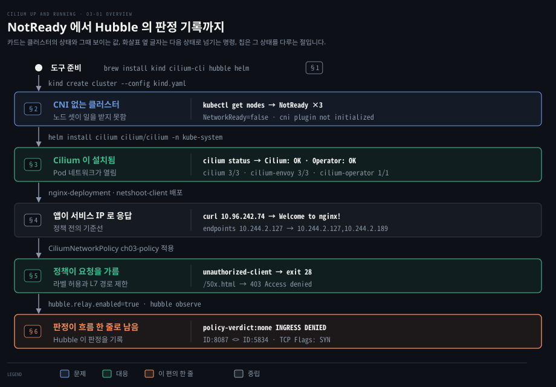
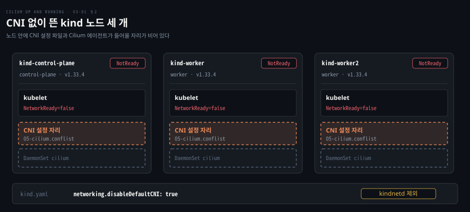
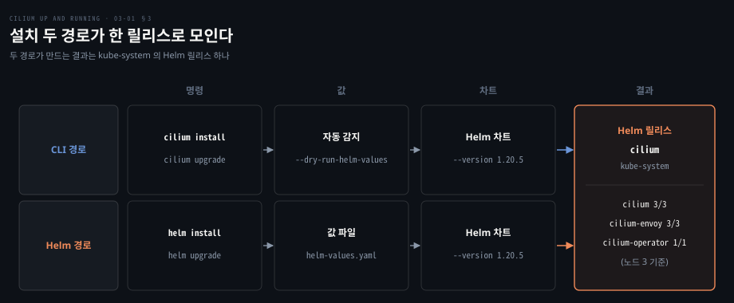
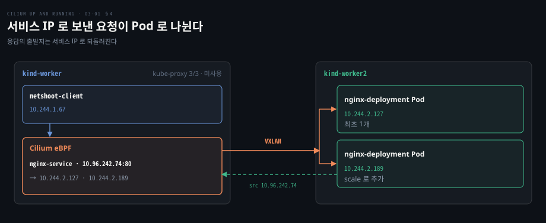
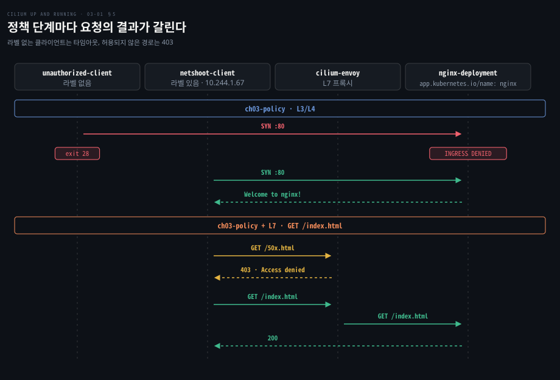
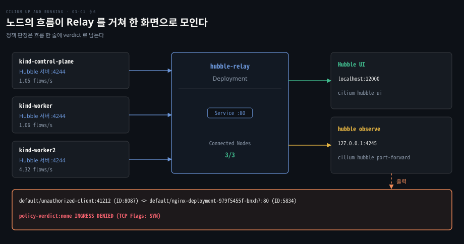

# Cilium 은 kind 클러스터에 Helm 으로 설치하고 정책과 Hubble 로 동작을 확인한다

---

> CNI 가 없는 kind 클러스터에 Helm 으로 Cilium 을 올리고, 예제 앱에 L3/L4 정책과 L7 정책을 걸어 그 판정을 Hubble 로 확인하는 첫 실습입니다.


## 핵심 요약

> 설치는 실습의 첫 단계일 뿐이고, 정책을 걸어 Hubble 로 그 판정을 눈으로 확인해야 한 사이클이 끝납니다. 정책은 두 층으로 걸리며 L3/L4 규칙은 패킷을 버려 타임아웃을 만들고 L7 규칙은 Envoy 가 403 을 돌려줍니다.

kind 에서 기본 CNI 를 끄면 노드가 `NotReady` 로 남고 Cilium 을 설치해야 Pod 네트워크가 열립니다. CNI 는 Pod 에 IP 를 주고 서로 닿게 하는 플러그인입니다. `cilium install` 과 `helm install` 은 같은 Helm 릴리스를 만들고, 책은 설정을 파일로 남기려면 Helm 을 권합니다.

라벨로 클라이언트를 가리는 L3/L4 규칙은 패킷을 조용히 버려 타임아웃이 됩니다. HTTP 경로까지 가르는 L7 규칙은 HTTP 검사를 맡은 프록시 Envoy 가 403 을 돌려줍니다. 두 결과는 `hubble observe` 가 찍는 판정(verdict) 줄에서도 갈립니다.


## 학습 목표

> 이 편을 읽고 나면 다음을 설명할 수 있습니다.

1. kind 에서 기본 CNI 를 끄는 이유와 CNI 가 없을 때 노드의 상태를 설명할 수 있습니다.
2. `cilium install` 과 `helm install` 이 같은 Helm 릴리스를 만든다는 점과 Helm 을 권하는 이유를 말할 수 있습니다.
3. `cilium status` 에서 에이전트·Envoy·오퍼레이터 수를 읽을 수 있습니다.
4. 서비스 IP 로 보낸 요청의 경로와 스케일 뒤 엔드포인트의 변화를 확인할 수 있습니다.
5. L3/L4 정책과 L7 정책의 거절 방식이 다른 이유를 설명하고 `hubble observe` 로 판정을 찾을 수 있습니다.

아래 그림은 실습 전체가 클러스터를 어떤 상태로 바꿔 가는지 한 줄기로 보여 줍니다. 카드는 클러스터의 상태와 그때 보이는 값이고, 화살표 옆 글자는 다음 상태로 넘기는 명령입니다.



파랑 카드는 이 편이 풀 문제인 `NotReady` 이고, 초록 카드는 그 문제에 대한 대응인 Cilium 설치와 정책입니다. 코랄 카드는 이 편의 한 줄, 곧 정책 판정이 Hubble 에 남은 기록입니다. 카드의 칩은 그 상태를 다루는 절 번호입니다.


## 빈 클러스터에서 정책 판정을 보기까지

> 실습은 CNI 없는 클러스터에서 출발해 설치, 예제 앱, 정책, 관측의 순서로 이어지고, 단계마다 클러스터에서 보이는 값 하나가 바뀝니다.

설치·정책·관측 명령을 차례로 치다 보면 지금 클러스터가 어느 상태이고 다음 명령이 무엇을 바꾸는지 헷갈립니다. 아래 표는 단계마다 누가 일하고 무엇이 보이는지, 그리고 그 단계를 받치는 개념을 어느 절이 푸는지 보여 줍니다. 표에 나오는 eBPF 는 리눅스 커널 안에서 돌며 패킷을 처리하는 프로그램이고, Cilium 은 이것으로 데이터 경로를 만듭니다([1편](./01-01.Cilium%20은%20eBPF%20데이터패스로%20iptables%20기반%20CNI%20의%20한계를%20넘는다.md)).

| 단계 | 주체와 하는 일 | 보이는 값 | 받치는 개념 | 절 |
|------|---------------|-----------|-------------|----|
| 1 도구 준비 | 내 터미널에 kind·helm·cilium·hubble CLI 를 갖춤 | `brew install kind cilium-cli hubble helm` | kind 노드는 Docker 컨테이너 하나 | 1 |
| 2 CNI 없는 클러스터 | kind 가 기본 CNI 를 뺀 노드 셋을 띄움 | `NotReady` ×3, `NetworkReady=false` | CNI 와 NetworkReady | 2 |
| 3 Cilium 설치 | Helm 이나 cilium CLI 가 릴리스 하나를 만듦 | `cilium 3/3`, `cilium-envoy 3/3`, `cilium-operator 1/1` | Helm 릴리스 | 3 |
| 4 앱 기준선 | Cilium eBPF 가 서비스 IP 를 Pod 로 이음 | `10.96.242.74` → `10.244.2.127` | ClusterIP 와 EndpointSlice | 4 |
| 5 정책 판정 | Cilium 이 패킷을 버리고 Envoy 가 HTTP 를 거절함 | `exit 28`, `403 Access denied` | 허용 목록과 L7 프록시 | 5 |
| 6 흐름 관측 | Hubble 서버와 Relay 가 흐름을 모아 CLI 에 줌 | `policy-verdict:none INGRESS DENIED` | Hubble 서버와 Relay | 6 |

7절은 이 흐름 밖에서 첫 사이클을 정리하고 다음 편으로 잇습니다.


## 1. kind 와 CLI 실습 환경

> 클러스터를 만드는 kind 와 클라이언트 도구 셋을 먼저 갖춰야 이 편의 명령이 돌아갑니다. 도구마다 맡은 일을 알면 명령이 헷갈리지 않습니다.

흐름 위치: 1 도구 준비 · 받치는 개념 — kind 노드는 Docker 컨테이너 하나

실습용 클러스터가 없으면 이 편의 명령은 한 줄도 돌지 못합니다. 그래서 로컬에서 가볍게 도는 **kind**(Kubernetes in Docker)로 클러스터를 만듭니다. 책은 kind 를 가볍고 CNCF 인증을 받은 쿠버네티스 설치 도구라는 이유로 권합니다. kind 는 노드 하나를 Docker 컨테이너 하나로 흉내 내어 컨트롤 플레인과 워커를 로컬 Docker 위에 올립니다. 그래서 Docker 같은 컨테이너 런타임이 먼저 깔려 있어야 합니다.

나머지 셋은 내 터미널에서 쓰는 클라이언트입니다. 설치 명령은 Homebrew 기준입니다.

| 도구 | 맡는 일 | 설치 |
|------|---------|------|
| kind | 노드 컨테이너로 클러스터 생성·삭제 | `brew install kind` |
| cilium CLI | Cilium 설치·상태 점검·기능 켜고 끄기 | `brew install cilium-cli` |
| hubble CLI | Hubble 이 모은 흐름 조회 | `brew install hubble` |
| Helm | 차트로 Cilium 설치·설정 관리 | `brew install helm` |

Homebrew 가 없으면 [공식 문서](https://docs.cilium.io/en/stable/gettingstarted/k8s-install-default/)의 tarball 설치를 따릅니다. 2026-11-25 기준 안정 버전은 cilium CLI [v0.20.3](https://raw.githubusercontent.com/cilium/cilium-cli/main/stable.txt), hubble CLI [v1.20.4](https://raw.githubusercontent.com/cilium/hubble/main/stable.txt), Cilium [1.20.5](https://github.com/cilium/cilium/releases/tag/v1.20.5) 입니다. Helm 은 [3.13.0 이상](https://docs.cilium.io/en/stable/installation/kind/)이 필요합니다. 이 편의 클러스터와 설정은 로컬 실습용이므로 운영 클러스터에는 돌리지 않습니다.


## 2. CNI 없는 kind 클러스터

> kind 는 기본으로 자체 CNI 를 설치하므로 Cilium 을 쓰려면 그것을 끈 클러스터를 만들어야 합니다. CNI 가 비어 있는 동안 노드는 `NotReady` 로 남습니다.

흐름 위치: 2 CNI 없는 클러스터 · 받치는 개념 — CNI 와 NetworkReady

kind 는 클러스터를 만들 때 kindnetd 를 CNI 로 깔아 두는데, Cilium 이 그 자리를 맡아야 하므로 처음부터 빼 두고 만듭니다. 아래 그림은 그렇게 만든 노드 셋이 CNI 를 기다리는 모습입니다.



그림의 점선 칸 둘이 비어 있습니다. 하나는 CNI 설정 파일 `05-cilium.conflist` 자리입니다. Cilium 에이전트가 시작할 때 노드의 CNI 설정 디렉터리 `/etc/cni/net.d` 에 이 파일을 씁니다([Helm 값 설명](https://github.com/cilium/cilium/blob/v1.20.5/install/kubernetes/cilium/values.yaml)). 다른 하나는 에이전트를 노드마다 띄우는 `cilium` DaemonSet(노드마다 Pod 하나를 두는 워크로드) 자리입니다. 다음 절의 설치가 이 두 칸을 채웁니다. 코랄 칸이 비어 있는 CNI 자리이고 빨강 칩과 글자는 노드가 겪는 증상이며 노랑 칩은 kindnetd 를 뺐다는 표시입니다.

Pod 에 IP 를 주고 서로 닿게 하는 일은 [CNI 의 몫](../networking-and-kubernetes/04-02.CNI와%20kube-proxy%20—%20Pod%20네트워크의%20배선공과%20로드밸런서.md)입니다. kind 의 [설정 문서](https://kind.sigs.k8s.io/docs/user/configuration/)는 `networking.disableDefaultCNI: true` 가 기본 CNI 를 설치하지 않게 한다고 설명합니다. 아래 설정을 `kind.yaml` 로 저장합니다.

```yaml
kind: Cluster
apiVersion: kind.x-k8s.io/v1alpha4
nodes:
- role: control-plane
- role: worker
- role: worker
networking:
  disableDefaultCNI: true
```

워커가 둘이라서 노드 사이 통신을 만들 수 있습니다. kube-proxy(서비스 IP 를 Pod 로 잇는 노드 데몬)는 건드리지 않아 kind 기본값인 iptables 모드로 뜹니다. `kind create cluster --config kind.yaml` 로 만든 이 실습의 클러스터에서 노드는 모두 `NotReady` 였습니다.

```bash
kubectl get nodes
NAME                 STATUS     ROLES           AGE   VERSION
kind-control-plane   NotReady   control-plane   6m    v1.33.4
kind-worker          NotReady   <none>          6m    v1.33.4
kind-worker2         NotReady   <none>          6m    v1.33.4
```

이유는 노드 YAML 의 상태 메시지에 있습니다. `kubectl get nodes kind-worker -o yaml` 로 보면 `NetworkReady=false` 와 `NetworkPluginNotReady`, `cni plugin not initialized` 가 나옵니다. 컨테이너 런타임이 CNI 플러그인을 초기화하지 못했다고 답합니다. 그래서 노드의 kubelet(Pod 를 실행하는 노드 에이전트)이 일을 받을 수 없다고 보고합니다.

Cilium 의 [kind 가이드](https://docs.cilium.io/en/stable/installation/kind/)도 설치 전 `NotReady` 는 정상이라고 적습니다. CNI 없는 클러스터의 Pod 는 [Kubernetes 네트워크 실습](../networking-and-kubernetes/04-04.Kubernetes%20네트워크%20실습%20—%20CNI%20부재부터%20정책·DNS까지.md)에서 따라 해 볼 수 있습니다.


## 3. Cilium CLI 와 Helm 설치

> 설치 경로가 둘이어도 결과는 같은 Helm 릴리스입니다. 차이는 값을 어디에 두고 어떻게 되풀이하느냐에 있습니다.

흐름 위치: 3 Cilium 설치 · 받치는 개념 — Helm 릴리스

Cilium 을 올리는 길은 `cilium install` 과 `helm install` 둘이라 어느 쪽을 쓸지 헷갈립니다. Helm 릴리스는 차트(패키지된 매니페스트 묶음) 하나를 클러스터에 설치한 결과물입니다. 아래 그림에서 두 경로는 명령과 값 단계에서 갈리고 같은 Helm 릴리스 하나로 모입니다.



줄 이름과 결과로 향하는 화살표가 파랑이면 CLI 경로, 코랄이면 책이 권장하는 Helm 경로입니다. [cilium CLI 저장소](https://github.com/cilium/cilium-cli)에 따르면 `cilium install` 도 Helm 릴리스를 만듭니다. `helm list -n kube-system` 으로 그 릴리스를 봅니다. `helm get values -n kube-system cilium` 으로는 CLI 가 고른 비기본 값을 확인합니다.

| 비교 | cilium CLI | Helm |
|------|------------|------|
| 값을 채우는 쪽 | 현재 kubectl 컨텍스트를 감지해 대신 채움 | 값 파일 `helm-values.yaml` 을 직접 씀 |
| 설정이 남는 곳 | 릴리스 값(`helm get values` 로 확인) | 값 파일, Git 에 두어 CI/CD·GitOps 에 올림 |
| 올릴 때 | `cilium upgrade` 는 비기본 값을 자동으로 바꾸지 않아 `--dry-run-helm-values` 로 먼저 확인([문서](https://github.com/cilium/cilium-cli)) | `helm upgrade` 에 값 파일을 넘겨 되풀이 |

### cilium CLI 가 채우는 값

cilium CLI 는 설치 전에 자기가 채울 값만 미리 보여 줍니다.

```bash
cilium install --dry-run-helm-values
cluster:
  name: kind-kind
ipam:
  mode: kubernetes
operator:
  replicas: 1
routingMode: tunnel
tunnelProtocol: vxlan
```

값의 뜻은 이렇습니다.

- `ipam.mode: kubernetes` 는 Pod IP 를 노드의 PodCIDR 에서 꺼내라는 뜻입니다. PodCIDR 은 쿠버네티스가 노드마다 배정하는 Pod IP 대역이며, 차트 기본값은 `cluster-pool` 입니다([IPAM 문서](https://docs.cilium.io/en/stable/network/concepts/ipam/kubernetes/)).
- `operator.replicas: 1` 은 차트 기본값 2 를 줄인 값입니다([Helm 레퍼런스](https://docs.cilium.io/en/stable/helm-reference/)).
- `routingMode: tunnel` 과 `tunnelProtocol: vxlan` 은 노드 사이 통신을 VXLAN 터널로 감싼다는 뜻이고 기본값과 같습니다.

IPAM(Pod 에 IP 를 나눠 주는 방식)과 라우팅은 [IPAM 편](./04-01.Cilium%20IPAM%20모드는%20Pod%20대역을%20누가%20나눠%20주는지로%20갈린다.md)과 [데이터패스 편](./05-01.Cilium%20데이터패스는%20같은%20노드는%20eBPF%20로%20바로%20넘기고%20다른%20노드는%20라우팅이나%20터널로%20잇는다.md)에서 다룹니다.

### Helm 으로 설치

책은 Helm 을 권장 경로로 둡니다. 이유는 다른 쿠버네티스 앱과 배포 흐름이 같아 CI/CD 와 GitOps(Git 에 둔 선언을 기준으로 클러스터를 맞추는 운영 방식)에 붙이기 쉽다는 것입니다. 값 파일을 Git 에 두면 설정 변경이 이력으로 남습니다.

```bash
helm repo add cilium https://helm.cilium.io/
helm install cilium cilium/cilium -n kube-system \
     --version 1.20.5 \
     --values helm-values.yaml
```

`helm-values.yaml` 은 책 저장소의 장별 폴더에 있는 값 파일입니다. 앞 소절의 `--dry-run-helm-values` 출력이 곧 Helm 값이라서 파일로 저장해 넘길 수도 있습니다. 값은 `--set cluster.name=kind-kind` 처럼 하나씩 넘겨도 됩니다.

`--version` 은 설치할 버전을 고정합니다. 생략하면 최신 안정 버전이 깔리는데 cilium CLI 는 CLI 가 빌드된 시점의 버전이라 환경마다 달라질 수 있습니다. 운영에서는 버전을 고정하고 올릴 때만 직접 바꿉니다.

### 설치 상태 확인

설치 뒤에는 `cilium status` 로 상태를 봅니다. 아래 출력은 책이 Cilium 1.18.4 로 설치한 클러스터의 것을 줄여 옮긴 것입니다. 위 명령의 `--version 1.20.5` 와 버전이 다르고 그 버전에서 받은 출력도 아닙니다. 여기서 볼 것은 버전이 아니라 컴포넌트별 개수와 상태입니다.

```bash
cilium status
Cilium:           OK
Operator:         OK
Envoy DaemonSet:  OK
Hubble Relay:     disabled
[...]
DaemonSet     cilium           Desired: 3, Ready: 3/3
DaemonSet     cilium-envoy     Desired: 3, Ready: 3/3
Deployment    cilium-operator  Desired: 1, Ready: 1/1
[...]
```

에이전트(`cilium`)는 노드마다 떠서 그 노드의 eBPF 프로그램을 관리합니다. 오퍼레이터(`cilium-operator`)는 클러스터 전체에 한 번만 하면 되는 일을 맡습니다([컴포넌트 문서](https://docs.cilium.io/en/v1.20/overview/component-overview/)).

노드가 셋이라 에이전트와 `cilium-envoy` 가 3개씩이고 오퍼레이터는 1개입니다. 이 분리는 [앞 편](./02-01.Cilium%20은%20에이전트·CNI%20플러그인·오퍼레이터로%20나눠%20노드와%20클러스터를%20맡는다.md)에서 본 구조 그대로입니다. `cilium-envoy` 는 L7 규칙을 처리하는 프록시를 노드마다 따로 띄운 DaemonSet 이고, 별도 Envoy 는 새 설치의 [기본값](https://docs.cilium.io/en/stable/helm-reference/)입니다. `Hubble Relay: disabled` 는 오류가 아니라 기본값이고 6절에서 켭니다.


## 4. 예제 앱과 서비스 IP

> 정책을 걸기 전에 앱이 서비스 IP 로 닿는지부터 확인합니다. 기준선이 있어야 정책 뒤의 변화가 보입니다.

흐름 위치: 4 앱 기준선 · 받치는 개념 — ClusterIP 와 EndpointSlice

정책 없이 통하는 요청이 먼저 확인되지 않으면 정책 뒤의 변화가 정책 탓인지 앱 탓인지 가려지지 않습니다. 아래 그림은 클라이언트가 서비스 IP 로 보낸 요청이 노드 사이를 건너 두 nginx Pod 로 나뉘는 길입니다.



그림의 `kube-proxy 3/3` 에 짚을 점이 있습니다. kube-proxy 가 떠 있어도 ClusterIP 는 Cilium 이 처리합니다. 차트의 `kubeProxyReplacement` 기본값은 `false` 입니다. 1.20.5 문서에 따르면 이 값은 클러스터 안 ClusterIP 서비스의 패킷 단위 로드밸런싱만 켭니다([공식 문서](https://docs.cilium.io/en/stable/network/kubernetes/kubeproxy-free/)). kube-proxy 를 완전히 없애는 구성은 뒤 편에서 다룹니다. 코랄 칸이 Cilium 이 서비스 IP 를 Pod 로 바꾸는 자리이고, 파랑은 클라이언트, 초록은 백엔드 Pod 입니다.

### Pod 배치와 서비스 IP

예제는 nginx 한 대와 클라이언트용 netshoot Pod 입니다. netshoot 은 네트워크 도구 모음 이미지인데 한 번 실행하고 끝나므로 `sleep infinity` 로 계속 띄워 둡니다. `nodeSelector` 로 nginx 는 `kind-worker2` 에, 클라이언트는 `kind-worker` 에 고정합니다. 그래야 노드 사이 통신이 VXLAN 터널을 탑니다.

```bash
kubectl get pods -o wide
NAME                               READY   IP             NODE
nginx-deployment-979f5455f-tjd2w   1/1     10.244.2.127   kind-worker2
netshoot-client                    1/1     10.244.1.67    kind-worker
```

두 IP 는 각 노드의 PodCIDR 안에 있습니다. `kind-worker` 는 `10.244.1.0/24` 이고 `kind-worker2` 는 `10.244.2.0/24` 입니다. 열은 일부 생략했고, 두 Pod 를 띄운 뒤의 출력을 합쳐 옮겼습니다.

Pod 는 다시 뜰 때마다 IP 가 바뀌므로 쿠버네티스는 서비스로 고정 가상 IP 를 줍니다. `nginx-service` 는 TCP 80 을 `app.kubernetes.io/name: nginx` 라벨 Pod 로 보내는 [ClusterIP](../networking-and-kubernetes/05-02.Service%205유형%20—%20ClusterIP에서%20LoadBalancer까지.md) 서비스입니다. 이 실습에서는 `10.96.242.74` 가 배정됐고 kind 의 기본 서비스 대역은 `10.96.0.0/16` 입니다([kind 설정 문서](https://kind.sigs.k8s.io/docs/user/configuration/#service-subnet)).

```bash
kubectl exec netshoot-client -- curl http://10.96.242.74
<h1>Welcome to nginx!</h1>
```

요청은 서비스 IP 로 가고 응답은 백엔드 Pod 가 만들지만, 클라이언트에는 출발지가 서비스 IP 로 보입니다. Cilium eBPF 가 주소를 되돌려 주기 때문입니다.

### 스케일 뒤의 엔드포인트

서비스에 속한 Pod 목록은 [EndpointSlice](../networking-and-kubernetes/05-01.StatefulSet·Endpoints·EndpointSlices%20—%20서비스의%20재료.md)가 관리합니다. 스케일하면 새 Pod 의 IP 가 이 목록에 자동으로 더해집니다. 처음에는 `10.244.2.127` 하나였습니다.

```bash
kubectl scale deployment nginx-deployment --replicas=2
kubectl get endpointslices.discovery.k8s.io nginx-service-66q4l
NAME                  ADDRESSTYPE   PORTS   ENDPOINTS
nginx-service-66q4l   IPv4          80      10.244.2.127,10.244.2.189
```


## 5. 라벨 허용과 L7 경로 제한

> Cilium 정책은 라벨로 대상을 가리고 한 방향에 정책이 걸리면 그 방향은 허용 목록 밖이 전부 막힙니다. L3/L4 에서는 패킷이 사라지고 L7 에서는 HTTP 응답이 돌아옵니다.

흐름 위치: 5 정책 판정 · 받치는 개념 — 허용 목록과 L7 프록시

nginx 는 기본으로 어느 Pod 의 요청이든 받으므로 `netshoot-client` 만 80 포트를 쓰게 하려면 정책이 필요합니다. 대조용으로 라벨 없는 `unauthorized-client` Pod 를 하나 더 띄웁니다. 아래 그림은 두 정책 단계에서 두 클라이언트의 요청이 어떻게 끝나는지 보입니다. L3/L4 는 IP·포트 수준의 규칙이고 L7 은 HTTP 메서드·경로 수준의 규칙입니다.



L3/L4 단계에서 라벨 없는 클라이언트는 `INGRESS DENIED` 로 버려져 `exit 28` 이 됩니다. L7 단계에서는 허용되지 않은 경로만 Envoy 에서 403 으로 끝납니다. 빨강은 버려진 요청, 노랑은 403 으로 거절된 요청, 초록은 통과한 요청입니다.

### 라벨로 허용하는 L3/L4 정책

정책은 **CiliumNetworkPolicy**(CNP)로 씁니다.

```yaml
apiVersion: cilium.io/v2
kind: CiliumNetworkPolicy
metadata:
  name: ch03-policy
  namespace: default
spec:
  endpointSelector:
    matchLabels:
      app.kubernetes.io/name: nginx
  ingress:
    - fromEndpoints:
        - matchLabels:
            app.kubernetes.io/name: netshoot-client
      toPorts:
        - ports:
            - port: "80"
              protocol: TCP
```

`endpointSelector` 는 적용 대상 Pod, `fromEndpoints` 는 허용할 출발지 라벨, `toPorts` 는 허용 포트입니다. 평소 모든 Pod 는 양방향이 열려 있다가 정책에 선택되는 순간 그 방향은 허용 목록만 통과합니다. [정책 문서](https://docs.cilium.io/en/stable/security/policy/intro/)에 따르면 이 전환은 방향별이라 `ingress`(Pod 로 들어오는 방향) 절이 있는 규칙은 ingress 만 기본 거부로 바꿉니다.

쿠버네티스 표준 NetworkPolicy 와 CNP 는 표현 범위가 다릅니다. Cilium 은 둘 다 지원하며 [공식 문서](https://docs.cilium.io/en/stable/network/kubernetes/policy/)에 따르면 표준 NetworkPolicy 는 L3·L4 규칙만 표현하고 CNP 는 L3~L7 규칙을 양방향에 씁니다. 표준 NetworkPolicy 의 기본은 [NetworkPolicy 와 DNS](../networking-and-kubernetes/04-03.NetworkPolicy와%20DNS%20—%20클러스터%20안의%20방화벽과%20이름.md)에 있습니다.

정책을 적용하고 두 클라이언트에서 요청하면 결과가 갈립니다.

```bash
kubectl exec unauthorized-client -- curl --max-time 3 -s http://nginx-service
command terminated with exit code 28

kubectl exec netshoot-client -- curl --max-time 3 -s http://nginx-service
<h1>Welcome to nginx!</h1>
```

허용되지 않은 요청은 거부 응답이 아니라 타임아웃(curl 종료 코드 28)으로 끝났습니다. L3/L4 에서 거부된 패킷은 응답 없이 버려지므로 보낸 쪽은 기다리다 끝납니다.

거절을 ICMP 오류 메시지로 알리는 `--policy-deny-response=icmp` 도 있지만 실험 기능입니다. 이 옵션은 egress(Pod 에서 나가는 방향)에만 적용됩니다([정책 문서](https://docs.cilium.io/en/stable/security/policy/intro/#policy-deny-response-handling)).

### L7 규칙으로 경로 좁히기

지금 정책은 `/50x.html` 같은 오류 페이지도 열어 줍니다. L7 은 같은 정책에 HTTP 규칙을 더해 이를 막습니다. `toPorts` 안에서 `ports` 와 같은 층에 `rules` 를 더해 허용을 `GET /index.html` 로 좁힙니다.

```yaml
      toPorts:
        - ports:
            - port: "80"
              protocol: TCP
          rules:
            http:
              - method: "GET"
                path: "/index.html"
```

L7 규칙에 걸리는 트래픽은 Envoy 가 HTTP 검사를 맡습니다([앞 편의 L7 분업](./02-01.Cilium%20은%20에이전트·CNI%20플러그인·오퍼레이터로%20나눠%20노드와%20클러스터를%20맡는다.md)). 정책을 덮어쓴 뒤 `/50x.html` 은 타임아웃 없이 Envoy 가 바로 거절합니다. 응답은 403 Forbidden 과 본문 `Access denied` 이고 `/index.html` 은 그대로 열립니다([cilium/proxy 소스](https://github.com/cilium/proxy/blob/main/cilium/l7policy.cc)).


## 6. Hubble 로 정책 판정 보기

> 응답만으로는 정책의 동작을 알기 어렵습니다. Hubble 은 어느 요청이 무슨 이유로 막혔는지 흐름 한 줄씩 보여 줍니다.

흐름 위치: 6 흐름 관측 · 받치는 개념 — Hubble 서버와 Relay

5절의 타임아웃은 정책이 막았는지 네트워크가 끊겼는지 응답만으로는 가려지지 않습니다. 이 구별을 하는 것이 Hubble 이고, 아래 그림은 노드의 흐름이 Relay 를 거쳐 CLI 와 UI 로 모이는 길입니다.



그림 아래쪽의 한 줄이 5절에서 본 거부 판정 기록입니다. 노드마다 Hubble 서버가 흐름을 쥐고 Relay 가 묶어 CLI 와 UI 에 내보냅니다. 파랑은 노드와 Relay 의 연결, 노랑은 CLI, 초록은 UI 이고 코랄 칸이 판정 기록입니다.

### Hubble 서버와 Relay 켜기

Hubble 은 기본으로 각 노드의 에이전트 안에서 돌며 그 노드의 트래픽만 압니다. 클러스터 전체는 Hubble Relay 가 묶습니다. [설정 문서](https://docs.cilium.io/en/stable/observability/hubble/setup/)에 따르면 `helm install` 한 설치에서 Hubble 은 켜져 있고 Relay 는 꺼져 있습니다. Relay 가 노드에 닿으려면 노드의 TCP 4244 가 열려 있어야 합니다.

```bash
helm upgrade cilium cilium/cilium --version 1.20.5 \
    -n kube-system --reuse-values \
    --set hubble.relay.enabled=true
```

`cilium status` 의 `Hubble Relay` 가 `OK` 면 됩니다.

### CLI 를 Relay 에 잇는 port-forward

Relay 는 클러스터 안의 서비스이고 hubble CLI 는 내 노트북에서 돌아서 직접 닿지 못합니다. 그래서 port-forward 를 씁니다. `cilium hubble port-forward` 는 로컬 4245 를 Relay 서비스의 80 포트로 잇습니다. hubble CLI 의 기본 서버 주소도 `localhost:4245` 입니다([설정 문서](https://docs.cilium.io/en/stable/observability/hubble/setup/)).

```bash
cilium hubble port-forward &
Hubble Relay is available at 127.0.0.1:4245
```

이어서 `hubble list nodes` 를 실행하면 세 노드가 `Connected` 로, 노드별 초당 흐름(1.05·1.06·4.32)과 함께 보입니다.

### 흐름 한 줄 읽기

`hubble observe` 는 흐름을 나열합니다. 이 실습의 클러스터에서 netshoot-client 가 만든 흐름입니다(읽기 좋게 줄을 나눴습니다).

```bash
hubble observe
Mar 14 11:22:41.654: default/netshoot-client:50976 (ID:18901) ->
  kube-system/coredns-668d6bf9bc-qdkn6:53 (ID:23236)
  to-overlay FORWARDED (UDP)
[...]
```

한 줄은 시각, 출발지(Pod:포트와, 라벨 조합마다 Cilium 이 매기는 번호인 보안 신원 `ID`), 방향 화살표, 도착지, 판정 순서입니다. `to-overlay` 는 패킷이 지난 자리입니다. CoreDNS 가 다른 노드에 있어 DNS 질의가 VXLAN 터널로 나갔다는 뜻입니다. `FORWARDED` 는 전달됐다는 결과입니다.

### 거부 판정 찾기

정책 판정만 모으는 `-t policy-verdict` 에서 거부된 줄이 보입니다. 드롭 이유는 판정 필드가 알려 줍니다.

```bash
hubble observe -t policy-verdict
Mar 21 12:15:40.016: default/unauthorized-client:41212 (ID:8087) <>
  default/nginx-deployment-979f5455f-bnxh7:80 (ID:5834)
  policy-verdict:none INGRESS DENIED (TCP Flags: SYN)
[...]
```

`policy-verdict:none INGRESS DENIED` 는 5절의 타임아웃이 정책 때문이라는 증거입니다. `none` 은 이 요청을 허용한 규칙이 없다는 뜻입니다. 거부된 줄은 방향 표시가 `->` 대신 `<>` 입니다. `--verdict DROPPED` 는 버려진 흐름을 `Policy denied DROPPED` 로 보여 줍니다. 공식 문서의 L7 정책 예제에서는 허용되지 않은 HTTP 요청이 `http-request DROPPED` 줄로 함께 찍힙니다([공식 문서](https://docs.cilium.io/en/stable/observability/hubble/hubble-cli/)).

필터는 겹쳐 쓸 수 있습니다. `--from-pod netshoot-client` 는 출발 Pod 로, `--http-path "/index.html"` 은 HTTP 경로로 흐름을 좁힙니다. `--label app.kubernetes.io/name=nginx` 는 라벨로 좁힙니다.

L7 정책 뒤 `--from-pod` 출력의 `to-proxy FORWARDED` 는 트래픽이 Envoy 로 넘어갔다는 확인입니다.

### Hubble UI

화면으로 보려면 Hubble UI 를 켭니다. [공식 문서](https://docs.cilium.io/en/stable/observability/hubble/hubble-ui/)(1.20.5)에 따르면 `cilium hubble enable --ui` 한 줄이면 됩니다. Helm 에서는 `hubble.ui.enabled=true` 를 더합니다. `cilium hubble ui` 가 로컬 12000 포트를 UI 로 잇습니다.

`default` 네임스페이스를 고르면 같은 흐름이 서비스 맵으로 그려집니다. L7 정책이 걸린 흐름에는 Envoy 가 덧붙인 HTTP 경로·메서드·지연이 `L7 info` 열에 보입니다.


## 7. 정리

> 설치·정책·관측의 첫 사이클을 돌았습니다. 다음 편은 Pod IP 가 어디서 나오는지 IPAM 으로 들어갑니다.

흐름 위치: 흐름 밖 — 첫 사이클을 정리하고 다음 편으로 잇는 절

기본 CNI 를 끈 kind 에 Helm 으로 Cilium 을 올리고 L3/L4 와 L7 정책의 결과를 Hubble 에서 확인했습니다. PodCIDR 에서 Pod IP 를 꺼내는 방식(IPAM)은 다음 편에서, VXLAN 터널은 [데이터패스 편](./05-01.Cilium%20데이터패스는%20같은%20노드는%20eBPF%20로%20바로%20넘기고%20다른%20노드는%20라우팅이나%20터널로%20잇는다.md)에서 다룹니다.


## 면접 대비

> 첫 실습의 이해를 확인하는 질문입니다.

1. kind 에서 `disableDefaultCNI: true` 를 쓰는 이유와 CNI 가 없을 때 노드의 상태는 무엇입니까?
2. `cilium install` 과 `helm install` 은 어떤 관계이며 운영에서 Helm 을 권하는 이유는 무엇입니까?
3. kube-proxy 가 떠 있는데도 ClusterIP 서비스를 Cilium 이 처리하는 이유는 무엇입니까?
4. L3/L4 정책으로 막힌 요청은 타임아웃이 되고 L7 정책으로 막힌 요청은 403 이 되는 이유는 무엇입니까?
5. 정책 때문에 막혔음을 `hubble observe` 로 확인하는 방법과 Relay 에 port-forward 로 접속하는 이유는 무엇입니까?


## 정답 (자답 후 펼치기)

> 면접 질문에 대한 키워드 중심의 모범 답안입니다.

### 정답 1 — CNI 교체와 NotReady

Cilium 이 CNI 를 맡도록 kind 의 기본 CNI(kindnetd)를 끕니다. CNI 가 비면 kubelet 이 `NetworkReady=false` 를 받아 노드가 `NotReady` 로 남고 Cilium 이 설치되면 `Ready` 가 됩니다.

### 정답 2 — 같은 Helm 릴리스와 선언적 설정

`cilium install` 도 Helm 릴리스를 만들어 `helm list` 로 확인되는 같은 차트의 경로입니다. cilium CLI 는 컨텍스트를 감지해 값을 채우고 Helm 은 값 파일을 넘기며, 값 파일은 Git·GitOps 로 환경을 재현하게 하므로 Helm 을 권합니다.

### 정답 3 — kubeProxyReplacement

`kubeProxyReplacement` 기본값 `false` 에서도 클러스터 안 ClusterIP 로드밸런싱은 Cilium eBPF 가 맡아 kube-proxy 는 서비스 조회에 쓰이지 않습니다.

### 정답 4 — 패킷 드롭과 Envoy 의 HTTP 응답

L3/L4 거부는 패킷을 조용히 버려 보낸 쪽이 타임아웃(curl 종료 코드 28)을 겪습니다. L7 규칙에 걸리는 트래픽은 Envoy 가 HTTP 를 파싱해 허용되지 않은 요청에 403 과 `Access denied` 로 답합니다.

### 정답 5 — policy-verdict 와 Relay

`hubble observe -t policy-verdict` 의 `policy-verdict:none INGRESS DENIED` 는 허용 규칙이 없어 거부됐다는 뜻입니다. Relay 는 클러스터 안의 서비스라 밖의 hubble CLI 가 `cilium hubble port-forward` 로 로컬 4245 를 이어 접속합니다.


## 참고 자료

- Nico Vibert 외, 《Cilium: Up and Running》, O'Reilly, 2026, ISBN 979-8-341-62299-9, Chapter 3.
- Cilium kind 설치: https://docs.cilium.io/en/stable/installation/kind/
- cilium CLI 저장소: https://github.com/cilium/cilium-cli
- Cilium Helm 레퍼런스: https://docs.cilium.io/en/stable/helm-reference/
- 네트워크 정책 개요: https://docs.cilium.io/en/stable/security/policy/intro/
- cilium/proxy L7 정책 필터: https://github.com/cilium/proxy/blob/main/cilium/l7policy.cc
- Hubble 설정: https://docs.cilium.io/en/stable/observability/hubble/setup/


## 관련 문서

- [Cilium 은 eBPF 데이터패스로 iptables 기반 CNI 의 한계를 넘는다](./01-01.Cilium%20은%20eBPF%20데이터패스로%20iptables%20기반%20CNI%20의%20한계를%20넘는다.md)
- [Cilium 은 에이전트·CNI 플러그인·오퍼레이터로 나눠 노드와 클러스터를 맡는다](./02-01.Cilium%20은%20에이전트·CNI%20플러그인·오퍼레이터로%20나눠%20노드와%20클러스터를%20맡는다.md)
- [NetworkPolicy와 DNS — 클러스터 안의 방화벽과 이름](../networking-and-kubernetes/04-03.NetworkPolicy와%20DNS%20—%20클러스터%20안의%20방화벽과%20이름.md)
