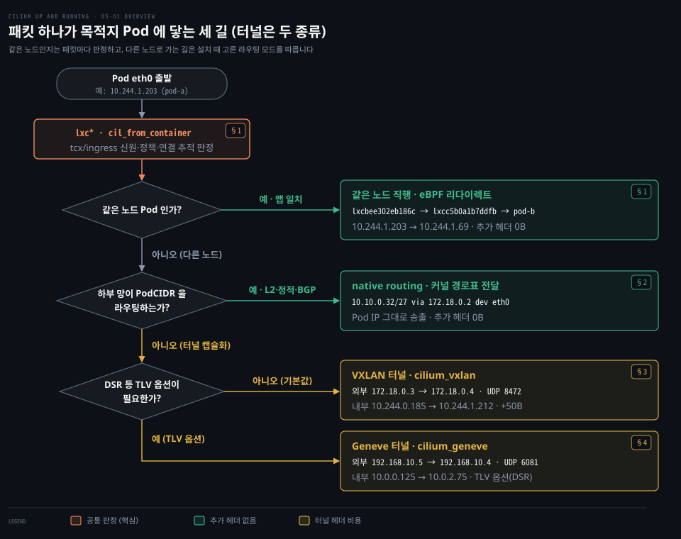
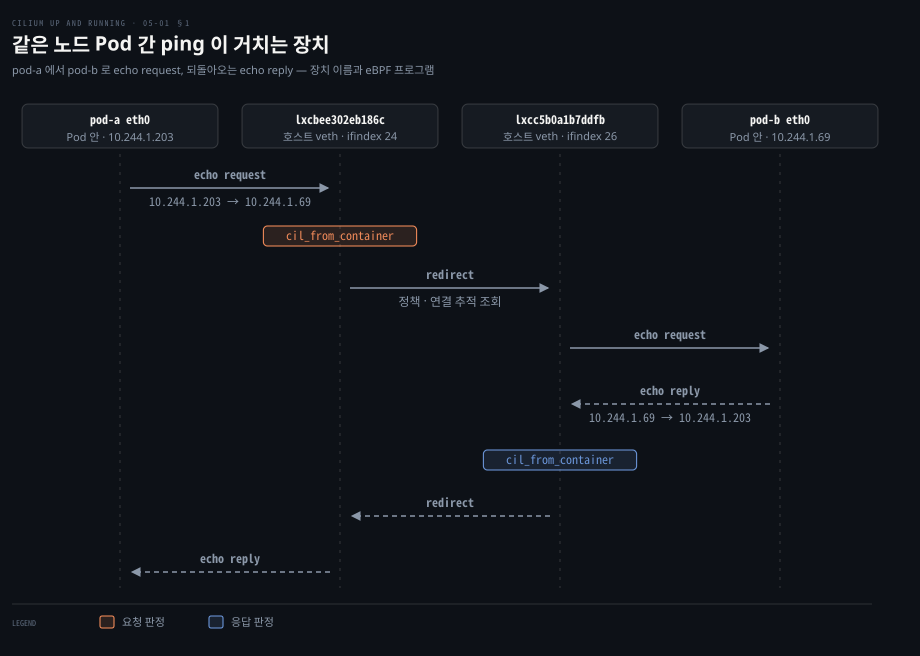
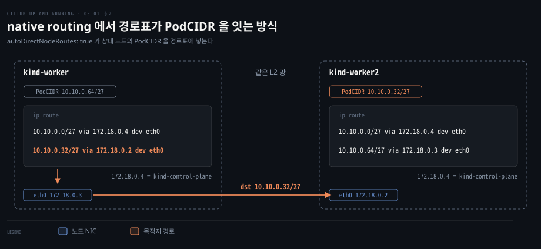
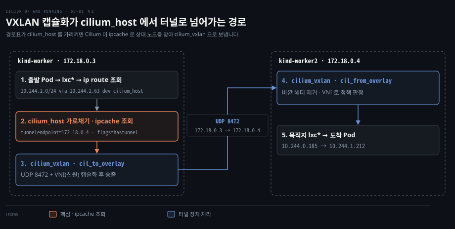
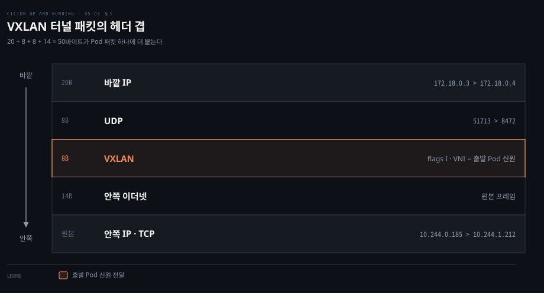
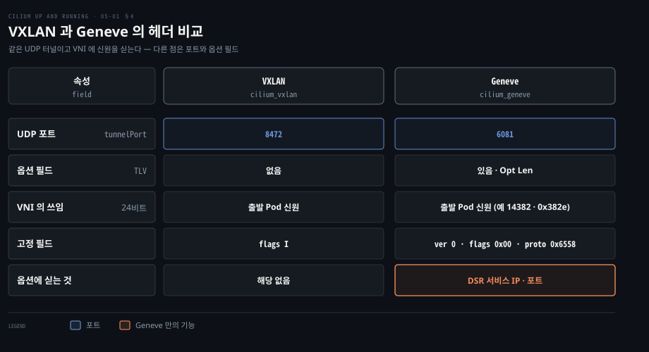

# Cilium 데이터패스는 같은 노드는 eBPF 로 바로 넘기고 다른 노드는 라우팅이나 터널로 잇는다

---

> 같은 노드의 Pod 는 veth 호스트 쪽 끝에 붙은 eBPF 프로그램이 곧바로 건네 주고, 다른 노드의 Pod 는 노드 경로표(native routing)나 UDP 터널(VXLAN·Geneve)로 잇습니다.

## 핵심 요약

> Cilium 은 호스트 쪽 veth 의 eBPF 프로그램으로 먼저 판정합니다. 노드 밖으로 나가는 길만 하부 망의 사정에 맞춰 고르며, 같은 노드는 리다이렉트하고 다른 노드는 경로표(native routing)나 UDP 터널(VXLAN·Geneve)로 잇습니다.

`veth` 는 한쪽에 넣은 패킷이 짝 쪽으로 나오는 가상 이더넷 장치 한 쌍입니다. Pod 마다 한쪽은 Pod 안의 `eth0` 이고 다른 쪽은 호스트의 `lxc*` 입니다.

eBPF 는 커널 안 지점에 붙여 실행하는 작은 프로그램입니다. `cil_from_container` 는 Cilium 이 `lxc*` 에 붙이는 eBPF 프로그램입니다.

같은 노드의 두 Pod 사이는 `lxc*` 에 붙은 `cil_from_container` 프로그램이 정책을 먼저 확인합니다. 확인이 끝나면 상대 veth 로 바로 리다이렉트(패킷을 다른 장치로 곧장 넘기는 동작)하므로 추가 헤더가 붙지 않습니다.

다른 노드로 가는 길은 하부 망(노드끼리 잇는 실제 네트워크)이 Pod IP 를 라우팅할 수 있는지에 따라 둘로 갈립니다. native routing 은 호스트 경로표대로 내보내므로 헤더가 늘지 않습니다. 다만 노드에 경로를 알릴 수단이 필요합니다. 하부 망을 건드릴 수 없으면 Pod 패킷을 UDP 로 감싸 보내며 패킷마다 50바이트 안팎의 헤더가 추가됩니다.


## 학습 목표

> 이 편을 읽고 나면 다음을 설명할 수 있습니다.

1. 같은 노드의 두 Pod 사이 패킷이 `lxc*` veth 와 `cil_from_container` 프로그램을 거쳐 전달되는 경로를 설명할 수 있습니다.
2. `cilium_host`, `cilium_net`, `cilium_vxlan` 장치가 각각 무엇을 위해 있는지 구분할 수 있습니다.
3. native routing 의 세 가지 경로 전파 방법이 맞는 환경을 비교할 수 있습니다.
4. VXLAN 터널 패킷의 헤더 구성과 약 50바이트의 대가를 설명할 수 있습니다.
5. Geneve 가 VXLAN 과 다른 점과 Cilium 이 그 옵션을 쓰는 곳을 말할 수 있습니다.

아래 그림은 Pod 하나를 떠난 패킷이 호스트 쪽 veth 에서 판정을 받은 뒤 목적지 위치와 하부 망 조건에 따라 어느 길로 갈리는지 보여 줍니다. 같은 노드 직행은 `§1`, native routing 은 `§2`, VXLAN 터널은 `§3`, Geneve 와 가변 옵션은 `§4` 가 다룹니다. 그림 속 주소는 갈래마다 해당 절의 실습 클러스터에서 얻은 값이라 서로 이어지지 않습니다.




## 패킷이 다른 Pod 에 닿는 세 길

> 출발 Pod 의 `eth0` 에서 나간 패킷은 호스트 쪽 `lxc*` 에서 먼저 판정받은 뒤 목적지 위치와 하부 망 조건에 따라 같은 노드 직행, native routing, 터널 중 한 길을 탑니다.

Pod 에 IP 를 받아도 패킷이 곧장 상대 Pod 에 닿지 못합니다. 격리된 네트워크 네임스페이스와 물리 망의 경계가 막기 때문입니다. 네트워크 네임스페이스는 인터페이스·경로표·방화벽 규칙을 따로 가진 네트워크 스택입니다. 같은 노드에서는 서로 안 보이는 네임스페이스를 건너야 합니다. 다른 노드에서는 하부 망이 Pod IP 대역을 알지 못해 패킷이 버려질 수 있습니다.

Cilium 은 이 문제를 공통 진입점과 갈래별 전달로 풉니다. 같은 노드인지는 패킷마다 판정합니다. native routing 인지 터널인지는 설치 때 `routingMode` 와 `tunnelProtocol` 로 정합니다. 아래 표는 패킷이 거치는 단계마다 처리 주체와 받치는 개념, 담당 절을 보입니다.

| 단계 | 누가 처리하는가 | 받치는 개념 | 절 |
|---|---|---|---|
| 1 호스트 진입과 판정 | `lxc*` 에 붙은 `cil_from_container` | 네트워크 네임스페이스, veth 쌍, eBPF 맵 | §1 |
| 2a 같은 노드 전달 | `cil_from_container` 의 `redirect` · `redirect_peer` | 엔드포인트 맵, TTL 1 감소 | §1 |
| 2b 다른 노드 경로 전달 | 커널 경로표(`ip route`)와 물리 NIC `eth0` | PodCIDR 전파(자동 주입·정적·BGP) | §2 |
| 2c 다른 노드 터널 캡슐화 | `cilium_host` 경로와 `cilium_vxlan` · `cilium_geneve` | UDP 캡슐화, VNI 신원, TLV 옵션 | §3, §4 |
| 3 목적지 노드 수신 | `eth0` 의 `cil_from_netdev` 또는 터널의 `cil_from_overlay` → `lxc*` | VNI 기반 정책 판정, 역캡슐화 | §1, §2, §3, §4 |

이어지는 `§1`~`§4` 가 각 단계와 갈래의 실제 장치·명령·패킷 값을 풉니다. `§5` 는 흐름 밖에서 세 경로의 선택 기준을 비교해 정리합니다.


## 1. 같은 노드의 veth 와 eBPF 전달

> 같은 노드의 Pod 끼리도 서로 다른 네트워크 네임스페이스에 있어 호스트 네임스페이스를 거쳐야 합니다. 그 길목인 veth 호스트 쪽 끝에서 Cilium 이 정책을 판정하고 상대 veth 로 넘깁니다.

흐름 위치: 1 호스트 진입과 판정 → 2a 같은 노드 전달 · 받치는 개념 — veth 와 eBPF 리다이렉트

Pod 둘이 한 노드에 있어도 각자 격리된 네트워크 네임스페이스를 쓰므로 서로의 인터페이스를 볼 수 없습니다. 많은 전통 CNI 는 호스트로 나온 패킷을 브리지나 iptables 체인에 태워 걸러 내고 길을 찾습니다. Cilium 은 그 앞의 veth 호스트 쪽 끝에서 바로 판정하므로 이 단계를 건너뜁니다.



위 시퀀스에서 `pod-a` 가 보낸 echo request 는 호스트 쪽 `lxcbee302eb186c` 로 나옵니다. 이어서 `cil_from_container` 가 판정한 뒤 곧바로 `lxcc5b0a1b7ddfb` 로 넘깁니다. 응답인 echo reply 도 반대 방향으로 같은 프로그램의 검사를 거칩니다. 패킷이 노드 밖을 나가지 않으므로 추가 헤더가 없습니다.

### veth 양 끝의 인터페이스 인덱스

veth 쌍의 기본기는 [커널이 패킷을 주고받는 자리](../networking-and-kubernetes/02-01.커널이%20패킷을%20주고받는%20자리%20—%20소켓·인터페이스·veth·브리지.md)에서 다뤘습니다. 예시는 kind 클러스터입니다. kind 는 Docker 컨테이너를 노드로 쓰는 로컬 쿠버네티스입니다. `kind-worker` 노드에 `pod-a`(10.244.1.203)와 `pod-b`(10.244.1.69)를 띄웠습니다. 다음은 `pod-a` 에서 `pod-b` 로 ping 을 보낸 결과입니다.

```bash
kubectl exec -it pod-a -- ping 10.244.1.69
# 64 bytes from 10.244.1.69: icmp_seq=1 ttl=63 time=0.223 ms
```

Pod 안에서 본 `eth0` 의 인덱스는 23 이고 `@if24` 는 짝이 24 번이라는 뜻입니다. 노드에서 `if23` 을 짝으로 가진 장치가 호스트 쪽 끝입니다.

```bash
# pod-a 안
23: eth0@if24: <BROADCAST,MULTICAST,UP,LOWER_UP> mtu 65520 ...
    inet 10.244.1.203/32 scope global eth0
# 노드 kind-worker 에서
24: lxcbee302eb186c@if23: <BROADCAST,MULTICAST,UP,LOWER_UP> mtu 65520 ...
```

`pod-b` 의 짝은 `lxcc5b0a1b7ddfb` 입니다. Pod 의 경로표는 두 줄입니다. 첫 줄 `default via 10.244.1.198 dev eth0` 이 기본 경로입니다. 둘째 줄 `10.244.1.198 dev eth0 scope link` 는 그 게이트웨이로 가는 경로입니다. 게이트웨이 주소가 `cilium_host` 입니다.

### cilium_host 와 cilium_net 쌍

`lxc*` 는 Pod 마다 하나씩 생기는 장치입니다. 이와 별개로 Cilium 은 초기화할 때 장치 셋을 만듭니다. 호스트 연결용 `cilium_host`·`cilium_net` 과 터널용 `cilium_vxlan`(Geneve 면 `cilium_geneve`)입니다.

`cilium_host` 는 Pod 대역의 주소 `10.244.1.198/32` 를 가진 Pod 의 기본 게이트웨이입니다. `cilium_net` 은 `cilium_host` 와 한 쌍인 veth 의 반대쪽 끝입니다. 노드에서 두 장치를 보면 서로를 짝(`@`)으로 가리킵니다.

```bash
# 노드 kind-worker 에서
ip address show cilium_host
ip address show cilium_net
```

```bash
13: cilium_host@cilium_net: <BROADCAST,MULTICAST,NOARP,UP,LOWER_UP> mtu 65520 ...
    inet 10.244.1.198/32 scope global cilium_host
12: cilium_net@cilium_host: <BROADCAST,MULTICAST,NOARP,UP,LOWER_UP> mtu 65520 ...
```

이 쌍 덕분에 Pod 와 호스트 사이 트래픽도 Cilium 데이터패스가 처리합니다. Pod 는 게이트웨이 주소를 향해 `eth0` 로 패킷을 내보내지만 호스트에 들어서자마자 `lxc*` 의 프로그램을 먼저 만납니다. 목적지가 같은 노드의 Pod 면 거기서 상대 `lxc*` 로 넘어가므로 `cilium_host` 까지 가지 않습니다.

### bpftool 로 본 장치별 eBPF 프로그램

노드마다 도는 Cilium 에이전트 Pod 안에서 `bpftool net show` 를 실행하면 장치별 프로그램이 나옵니다. `bpftool` 은 eBPF 프로그램을 조회하는 도구이고, `tcx` 는 tc(트래픽 제어) 훅의 eBPF 연결 방식입니다.

```bash
tc:
eth0(11)              tcx/ingress cil_from_netdev     prog_id 617
cilium_host(13)       tcx/ingress cil_to_host         prog_id 607
cilium_host(13)       tcx/egress  cil_from_host       prog_id 601
cilium_vxlan(14)      tcx/ingress cil_from_overlay    prog_id 598
cilium_vxlan(14)      tcx/egress  cil_to_overlay      prog_id 599
lxcbee302eb186c(24)   tcx/ingress cil_from_container  prog_id 1668
lxcc5b0a1b7ddfb(26)   tcx/ingress cil_from_container  prog_id 1695
[...]
```

읽을 곳은 `lxc*` 줄입니다. 호스트 입장에서 이 veth 로 들어오는 패킷은 Pod 를 막 떠난 패킷이라 붙은 자리가 `ingress` 입니다. Pod 에서 나온 패킷은 호스트에 들어서자마자 `cil_from_container` 를 만납니다. 이 프로그램이 eBPF 맵에서 신원·정책·연결 추적 정보를 찾아 그 자리에서 판정합니다. eBPF 맵은 커널 안에서 프로그램이 조회하는 키-값 표입니다. 신원(identity)은 Cilium 이 Pod 의 라벨에 대응시킨 숫자이고, 연결 추적은 이미 맺은 연결의 패킷인지 기억하는 기능입니다.

`eth0` 줄의 `cil_from_netdev` 는 물리 NIC 로 들어오는 패킷에 붙습니다. `cilium_vxlan` 줄의 `cil_from_overlay` 와 `cil_to_overlay` 는 터널로 들어오고 나가는 패킷에 붙습니다. 다른 노드에서 오는 패킷은 이 둘이 받으며 `§2`·`§3` 이 이어서 다룹니다.

목적지가 같은 노드의 엔드포인트면 대상 `lxc*` 로 리다이렉트합니다. 엔드포인트는 Cilium 이 관리하는 Pod 한 개입니다. BPF 호스트 라우팅은 호스트 네임스페이스의 일반 네트워크 스택을 건너뛰고 eBPF 로 보내는 설정입니다. 이 설정이 켜져 있으면 `redirect_peer` 로 목적지 Pod 의 네임스페이스에 바로 넘깁니다. 꺼져 있으면 일반 `redirect` 입니다([local_delivery.h](https://github.com/cilium/cilium/blob/v1.20.2/bpf/lib/local_delivery.h)). 브리지나 iptables 를 거치던 전통적인 CNI 와 달리 프로그램 한 번으로 끝납니다.

응답의 `ttl=63` 은 Cilium 이 같은 노드 전달에도 라우터 한 홉처럼 TTL 을 1 줄이기 때문입니다. 리눅스의 기본 TTL 은 64 입니다([ip-sysctl 문서](https://docs.kernel.org/networking/ip-sysctl.html)). `ipv4_local_delivery` 가 부르는 [l3.h](https://github.com/cilium/cilium/blob/v1.20.2/bpf/lib/l3.h)의 `ipv4_l3` 가 `ipv4_dec_ttl` 을 호출합니다.

### veth 를 대체하는 netkit

veth 대신 netkit 장치도 고를 수 있습니다. [netkit 문서](https://docs.cilium.io/en/v1.20/operations/performance/tuning/#netkit)에 따르면 netkit 은 Cilium 의 요구에 맞춰 커널에 만든 드라이버이고 veth 를 대체합니다. `bpf.datapathMode=netkit` 으로 켜고 커널 6.8 이상이 필요하며 v1.20 기준 베타입니다.


## 2. native routing 과 Pod 대역

> 다른 노드의 Pod 로 가려면 호스트 경로표나 하부 망이 그 노드의 PodCIDR 을 알아야 합니다. native routing 은 캡슐화 없이 이 정보를 경로로 퍼뜨리며 환경에 따라 세 방법으로 나뉩니다.

흐름 위치: 2b 다른 노드 경로 전달 → 3 목적지 노드 수신 · 받치는 개념 — 커널 경로표와 PodCIDR 전파

`pod-a` 의 패킷이 호스트에 들어왔는데 목적지가 다른 노드의 Pod 대역 `10.10.0.32/27` 안에 있다고 해 봅시다. 호스트 경로표가 그 대역을 모르면 패킷은 버려집니다. 쿠버네티스는 Pod 가 주소 변환 없이 서로의 Pod IP 로 닿기를 요구합니다. native routing 은 하부 망이 Pod IP 를 라우팅한다는 전제로 이를 풉니다. [공식 문서](https://docs.cilium.io/en/v1.20/network/concepts/routing/#native-routing)에 따르면 같은 노드의 다른 엔드포인트가 아닌 패킷은 모두 커널 라우팅에 넘깁니다.

기본 라우팅 모드는 encapsulation 이라 native 는 명시해야 합니다. 필요한 값은 `routingMode: native` 와 `ipv4NativeRoutingCIDR` 입니다. 뒤의 값은 하부 망이 이미 라우팅하는 CIDR 입니다. 그 범위로 가는 패킷은 SNAT(출발지 주소 변환) 없이 리눅스 스택에 넘깁니다. 설명은 [Helm 값 주석](https://github.com/cilium/cilium/blob/v1.20.2/install/kubernetes/cilium/values.yaml)에 있습니다.

노드에 다른 노드의 PodCIDR 을 알리는 방법은 클러스터 망 형태와 규모에 따라 아래 셋으로 갈립니다. L2 망은 노드들이 라우터 없이 같은 이더넷 구간에서 닿는 망입니다. BGP 는 라우터끼리 경로를 주고받는 프로토콜이며 아래 BGP 소절에서 다시 다룹니다.

| 전파 방식 | 요구 조건 | 경로 갱신 주체 | 맞는 환경 |
|---|---|---|---|
| 자동 경로 주입 | 노드가 같은 L2 망에 있어야 함 | Cilium 에이전트 | 단일 L2 서브넷 클러스터 |
| 정적 경로 | 노드 간 L3 도달성 | 운영자(`ip route add`) | 노드 변동이 거의 없는 소규모 실습 |
| BGP 동적 광고 | ToR(랙 맨 위 스위치) 같은 BGP 피어 | Cilium BGP Control Plane | 여러 랙이나 노드가 자주 바뀌는 운영망 |

### 같은 L2 망의 자동 경로 주입

`autoDirectNodeRoutes: true` 는 다른 노드의 PodCIDR 을 각 노드 경로표에 직접 넣습니다. 아래 그림은 같은 L2 망에서 `kind-worker` 가 상대 노드의 PodCIDR 을 보고 `eth0` 으로 내보내는 흐름입니다.



예시 kind 클러스터는 다음 Helm 값을 썼습니다.

```yaml
ipam:
  mode: multi-pool
  operator:
    autoCreateCiliumPodIPPools:
      default:
        ipv4:
          cidrs: ["10.10.0.0/16"]
          maskSize: 27

routingMode: native
endpointRoutes:
  enabled: true

autoDirectNodeRoutes: true
ipv4NativeRoutingCIDR: 10.0.0.0/8
```

`endpointRoutes.enabled` 는 [Helm 값 주석](https://github.com/cilium/cilium/blob/v1.20.2/install/kubernetes/cilium/values.yaml)대로 `cilium_host` 를 거치는 대신 Pod 마다 경로를 따로 만듭니다. IPAM 은 Pod 에 IP 대역을 나눠 주는 방식입니다. `multi-pool` 은 풀 여러 개에서 노드마다 작은 대역을 떼어 줍니다. `maskSize: 27` 이라 노드마다 `/27` 한 덩어리를 받습니다. 원리는 [IPAM 모드](./04-01.Cilium%20IPAM%20모드는%20Pod%20대역을%20누가%20나눠%20주는지로%20갈린다.md)에서 다뤘습니다.

`CiliumNode` 는 Cilium 이 노드마다 만드는 리소스이고 그 안에서 각 노드의 대역을 확인할 수 있습니다. `kind-worker` 는 `10.10.0.64/27` 을 받고 `kind-worker2` 는 `10.10.0.32/27` 을 받습니다. `kind-control-plane` 은 `10.10.0.0/27` 입니다. 노드 경로표에는 상대 대역이 노드 IP 를 다음 홉으로 들어갑니다.

```bash
docker exec kind-worker ip route
```

```bash
[...]
10.10.0.0/27 via 172.18.0.4 dev eth0 proto kernel
10.10.0.32/27 via 172.18.0.2 dev eth0 proto kernel
```

```bash
docker exec kind-worker2 ip route
```

```bash
[...]
10.10.0.0/27 via 172.18.0.4 dev eth0 proto kernel
10.10.0.64/27 via 172.18.0.3 dev eth0 proto kernel
```

`via` 값에서 노드 IP 를 읽을 수 있습니다. `kind-worker` 는 `172.18.0.3` 이고 `kind-worker2` 는 `172.18.0.2` 입니다. `kind-control-plane` 은 `172.18.0.4` 입니다. `kind-worker` 에서 `10.10.0.32/27` 로 가는 패킷은 둘째 줄에 걸려 `172.18.0.2` 로 나갑니다. 캡슐화가 없으므로 하부 망은 Pod IP 가 찍힌 패킷을 그대로 봅니다. 도착 노드에서는 물리 NIC `eth0` 에 붙은 `cil_from_netdev` 가 패킷을 받아 목적지 Pod 로 넘깁니다([bpf_host.c](https://github.com/cilium/cilium/blob/v1.20.2/bpf/bpf_host.c)).

### 소규모 고정 노드의 정적 경로

두 노드짜리 실습 환경이면 `ip route` 로 직접 넣습니다.

```bash
ip route add 10.10.0.32/27 via 172.18.0.2 dev eth0
```

모든 노드가 서로의 PodCIDR 을 이렇게 가져야 해서 노드가 바뀔 때마다 전 노드를 고칩니다.

### 다중 랙과 동적 노드의 BGP 광고

노드가 많거나 여러 랙에 걸치면 각 노드가 PodCIDR 을 BGP 로 광고하는 방식이 가장 확장성이 좋습니다. 보통 ToR 장비와 피어링(BGP 이웃 관계 맺기)하고 노드가 들고 나면 경로가 알아서 갱신됩니다. BGP 가 자율 시스템(AS, 한 조직이 하나의 라우팅 정책으로 운영하는 네트워크) 사이에서 경로를 주고받는 원리는 [AS 안과 AS 사이](../../../02_os/book/cntd_computer-networking-top-down/05-02.AS%20안과%20AS%20사이.md)에서 다뤘습니다.

Cilium 쪽 설정은 CRD(쿠버네티스에 새 리소스 종류를 더하는 정의) 세 개로 나뉩니다.

- `CiliumBGPClusterConfig`: 어느 노드가 어느 AS 번호(ASN)로 어느 장비와 피어링을 맺을지 정합니다.
- `CiliumBGPPeerConfig`: 피어 세션의 공통 설정입니다. `families` 가 `matchLabels` 로 광고를 골라 냅니다.
- `CiliumBGPAdvertisement`: `advertisementType: "PodCIDR"` 로 노드 자신의 PodCIDR 을 광고하게 합니다.

먼저 `CiliumBGPClusterConfig` 의 피어가 `peerConfigRef` 로 `CiliumBGPPeerConfig` 를 가리킵니다. 그 `CiliumBGPPeerConfig` 의 `families` 가 `CiliumBGPAdvertisement` 의 라벨을 골라야 광고가 나갑니다. 자세한 설정은 [BGP Control Plane 문서](https://docs.cilium.io/en/v1.20/network/bgp-control-plane/bgp-control-plane-configuration/)에 있습니다.

Cilium v1.20 문서에 따르면 `PodCIDR` 광고는 Kubernetes·ClusterPool IPAM 에서만 효과가 있습니다. 이 두 IPAM 은 노드마다 PodCIDR 하나를 배정합니다. 위 kind 예처럼 Multi-Pool 이면 광고 유형 `CiliumPodIPPool` 과 `selector` 로 풀을 고릅니다.


## 3. encapsulation 과 VXLAN 터널

> 하부 망의 경로표를 건드릴 수 없으면 Pod IP 를 받아 줄 라우터가 없습니다. 터널은 Pod 패킷을 노드 IP 끼리의 UDP 통신으로 바꿔 보내므로 노드끼리 IP 로 닿기만 하면 됩니다.

흐름 위치: 2c 다른 노드 터널 캡슐화 → 3 목적지 노드 수신 · 받치는 개념 — VXLAN UDP 터널과 VNI 신원

클라우드나 멀티테넌트 환경에서는 하부 망의 경로표를 고칠 수 없는 경우가 많습니다. Pod IP 가 찍힌 패킷을 그대로 내보내면 라우터가 경로를 몰라 버리므로, 하부 망이 아는 노드 IP 로 감싸 보내야 합니다.

이것이 encapsulation 모드이고 설정이 없을 때의 기본값입니다. [공식 문서](https://docs.cilium.io/en/v1.20/network/concepts/routing/#encapsulation)에 따르면 모든 노드 사이에 UDP 터널을 맺고 하부 망에는 노드끼리의 일반 통신으로 보입니다. 오버레이(실제 망 위에 겹쳐 만든 가상 망) 방식의 장단점은 [컨테이너 네트워킹 모드와 CNI](../networking-and-kubernetes/03-02.컨테이너%20네트워킹%20모드와%20CNI%20—%20격리와%20연결의%20거래.md)에서 다뤘습니다.

### VXLAN 의 L2 프레임 캡슐화

VXLAN(Virtual eXtensible LAN)은 이더넷 프레임을 UDP 패킷에 넣어 L2 구간을 L3 경계 너머로 늘립니다. 24비트 VNI(VXLAN Network Identifier)로 약 1,600만 개의 망을 구분해 VLAN 의 4,096개 한계를 넘습니다.

캡슐화와 VTEP(VXLAN 터널의 끝점 장치)의 기본은 [IP·라우팅·Ethernet](../networking-and-kubernetes/01-03.IP·라우팅·Ethernet%20—%20패킷이%20길을%20찾는%20법.md)의 VXLAN 절에 있습니다. 아래 그림은 패킷이 `cilium_host` 와 `ipcache` 조회를 거쳐 `cilium_vxlan` 으로 나가는 흐름입니다. `ipcache` 는 IP 대역마다 신원과 상대 노드의 터널 IP 를 적어 둔 eBPF 맵입니다.



VXLAN 모드로 설치하면 각 노드에 `cilium_vxlan` 장치가 생깁니다. 기본 설치 kind 클러스터에서 `kind-worker` 의 경로표는 이렇습니다.

```bash
docker exec kind-worker ip route
```

```bash
[...]
10.244.0.0/24 via 10.244.2.63 dev cilium_host [...]
10.244.1.0/24 via 10.244.2.63 dev cilium_host [...] mtu 65470
10.244.2.0/24 via 10.244.2.63 dev cilium_host [...] mtu 65470
```

모양은 자동 경로 주입과 비슷하지만 다음 홉이 상대 노드 IP 가 아니라 로컬 `cilium_host` 입니다. 패킷이 닿으면 Cilium 이 가로채 `cilium_vxlan` 의 `cil_to_overlay` 로 감싸 내보냅니다. 어느 노드로 보낼지는 경로표가 아니라 Cilium 의 IP 캐시에 있습니다. `§4` 의 `cilium-dbg bpf ipcache list` 명령에서 그 `tunnelendpoint` 를 봅니다. 그림의 `tunnelendpoint` 값은 바깥 헤더의 도착 노드 주소에 맞춘 예이고, VXLAN 클러스터에서 `ipcache` 를 직접 찍은 출력은 아닙니다.

### VXLAN 터널 패킷의 헤더 겹

Pod 패킷 하나는 노드 사이를 이동할 때 바깥에 네 겹이 더 붙습니다.



바깥 IP 헤더에는 노드 IP 가, UDP 목적지 포트에는 터널을 가리키는 `8472` 가 들어갑니다. VXLAN 헤더의 VNI 는 원래 오버레이 망을 가르는 번호인데 Cilium 은 여기에 출발 Pod 의 신원을 싣습니다. 그래서 목적지 노드는 신원을 다시 조회하지 않고 바로 정책을 판정할 수 있습니다. 안쪽은 원본 Pod 패킷입니다. 캡처 파일 `vxlan_traffic.pcap` 이 이 구조를 보여 줍니다. 출력에 `OTV` 라고 찍힌 이유는 확인하지 못했고, 내용이 VXLAN 이라는 것은 `flags [I]` 로 알 수 있습니다.

```bash
tcpdump -r vxlan_traffic.pcap
# IP 172.18.0.3.51713 > 172.18.0.4.8472: OTV, flags [I]
# IP 10.244.0.185.52442 > 10.244.1.212.4240: Flags [.], ack 1439317725, len ...
```

바깥 줄은 `kind-worker`(172.18.0.3)에서 `kind-worker2`(172.18.0.4)로 가는 UDP `8472` 패킷입니다. 끝의 `flags [I]` 는 VXLAN 헤더의 I 플래그입니다. [RFC 7348](https://www.rfc-editor.org/rfc/rfc7348)은 유효한 VNI 가 있을 때 1 로 두라고 정합니다. 안쪽 줄이 실제 트래픽입니다. 도착한 노드의 `cilium_vxlan` 은 `cil_from_overlay` 로 VXLAN 헤더를 떼어 Pod 에 전달합니다.

경로표 출력의 `cilium_host` 주소는 `10.244.2.63` 이고 캡처의 출발 Pod 는 `10.244.0.185` 입니다. 두 값의 대역이 달라 두 출력이 한 실행에서 나왔는지는 확인하지 못했습니다.

### 기본 포트 8472 와 IANA 포트 4789

IANA 가 VXLAN 에 할당한 포트는 4789 이고 리눅스 기본값은 8472 입니다. [vxlan_core.c](https://github.com/torvalds/linux/blob/master/drivers/net/vxlan/vxlan_core.c) 주석이 "The IANA assigned port is 4789, but the Linux default is 8472 for compatibility with early adopters" 라고 적었습니다. Cilium 도 8472 가 기본이고 `tunnelPort` 로 바꾸며 방화벽은 `8472/UDP` 를 열어야 합니다.

### 대가는 패킷마다 붙는 약 50바이트다

바깥 IP 20, UDP 8, VXLAN 8, 안쪽 이더넷 14를 더하면 50바이트입니다. VXLAN 헤더 8바이트는 [RFC 7348](https://www.rfc-editor.org/rfc/rfc7348)에 있고, 패킷마다 50바이트라는 합계는 [공식 문서](https://docs.cilium.io/en/v1.20/network/concepts/routing/#encapsulation)에 있습니다. 바깥 이더넷 헤더는 링크 계층이라 IP MTU 를 줄이지 않습니다. 그만큼 Pod 의 MTU 가 줄고 최대 처리량이 낮아집니다. 공식 문서는 점보 프레임을 켜면 1,500바이트당 50바이트가 9,000바이트당 50바이트로 줄어 대부분 완화된다고 설명합니다. 성능에 민감하고 하부 망이 허락하면 native routing 을 고릅니다.

### 노드 간 통신 장애 점검 순서

Pod 사이의 패킷이 노드를 건너지 못할 때는 하부 망부터 터널과 라우팅까지 다섯 단계로 원인을 좁힙니다.

1. 로컬 Pod 통신: 같은 노드의 Pod 끼리 먼저 통신을 시험합니다. 여기서 실패하면 veth 쌍이나 로컬 eBPF 프로그램 문제입니다.
2. 노드 간 물리 도달성: 노드 호스트 IP 사이로 `ping` 을 보내 물리 네트워크가 정상인지 확인합니다.
3. 터널 모드 확인: 오버레이 환경이면 UDP 포트 차단 여부를 살핍니다. VXLAN 은 8472 이고 Geneve(`§4`)는 6081 입니다. 클라우드 보안 그룹이나 방화벽 허용 여부를 점검합니다. 아울러 `ip link show cilium_vxlan` 으로 장치 상태를 확인합니다. 패킷 단편화(MTU 보다 큰 패킷을 쪼개는 일)를 막도록 MTU 에 50바이트 여유를 두었는지도 함께 봅니다. 원인을 확정할 때는 양쪽 노드에서 `tcpdump` 로 물리 인터페이스의 UDP 패킷과 터널 인터페이스의 내부 패킷을 대조합니다.
4. 네이티브 라우팅 확인: 네이티브 라우팅 환경이면 노드 경로표(`ip route`)에 상대 노드의 Pod CIDR 이 잡혔는지 확인합니다. BGP 를 쓴다면 `cilium bgp peers` 로 세션 상태를 점검합니다.
5. 외부 진입과 VIP 점검: 외부에서 서비스 VIP(Virtual IP, 가상 IP)로 닿지 않을 때 확인합니다. 상위 라우터의 BGP 세션과 광고된 프리픽스 목록을 대조합니다.


## 4. Geneve 터널과 가변 옵션

> Geneve 는 VXLAN 과 같은 UDP 터널이지만 길이가 가변인 TLV(Type-Length-Value, 종류·길이·값 순서로 적는 형식) 옵션을 헤더에 실을 수 있습니다. Cilium 은 백엔드가 클라이언트로 직접 응답하는 DSR(Direct Server Return)에서 서비스 IP 와 포트를 나를 때 이 옵션을 씁니다.

흐름 위치: 2c 다른 노드 터널 캡슐화 → 3 목적지 노드 수신 · 받치는 개념 — Geneve 가변 TLV 옵션과 DSR

VXLAN 헤더는 8바이트 고정이라 VNI 말고는 메타데이터를 실을 자리가 없습니다. [RFC 8926](https://www.rfc-editor.org/rfc/rfc8926)의 Geneve 는 옵션 길이 필드만큼 헤더가 늘어날 수 있는 구조입니다. Cilium 은 `tunnelProtocol: geneve` 로 고릅니다.

### Azure AKS 의 BYOCNI 구성

예시는 Azure Kubernetes Service 의 BYOCNI 모드로 구성합니다. CNI 없이 클러스터를 만들고(`--network-plugin none`) 원하는 CNI 를 직접 설치하는 방식입니다. 설치 값은 세 가지입니다.

```yaml
aksbyocni:
  enabled: true
ipam:
  mode: cluster-pool

tunnelProtocol: geneve
```

`aksbyocni.enabled` 는 BYOCNI 로 만든 AKS 용입니다. 예시 노드 IP 는 `192.168.10.4~6` 입니다. 다른 노드의 PodCIDR 이 어느 노드 IP 의 터널로 묶였는지는 에이전트의 IP 캐시에서 봅니다.

```bash
kubectl -n kube-system exec -it cilium-8z49v -- cilium-dbg bpf ipcache list
```

```bash
IP PREFIX/ADDRESS   IDENTITY
10.0.2.0/24   encryptkey=0 tunnelendpoint=192.168.10.4 flags=hastunnel
10.0.1.0/24   encryptkey=0 tunnelendpoint=192.168.10.6 flags=hastunnel
```

첫 줄은 `10.0.2.0/24` 로 가는 패킷을 노드 `192.168.10.4` 의 터널로 보내라는 뜻입니다. `tunnelendpoint` 가 그 노드이고 `hastunnel` 이 터널 경로 표시입니다. [v1.20.2 소스](https://github.com/cilium/cilium/blob/v1.20.2/pkg/maps/ipcache/ipcache.go)는 값 칸을 `identity=<번호>` 로 시작해 `encryptkey`, `tunnelendpoint`, `flags` 순으로 찍습니다. 그래서 위 출력은 `identity=` 항목이 없는 모양입니다. `list` 는 `bpf ipcache` 의 하위 명령이며 로컬과 원격 엔드포인트 IP 와 신원을 보여 줍니다([명령 레퍼런스](https://docs.cilium.io/en/v1.20/cmdref/cilium-dbg_bpf_ipcache_list/)).

### Geneve 헤더와 DSR 옵션

Geneve 헤더는 기본 구조가 VXLAN 과 같습니다. 다른 점은 UDP 포트(6081)와 가변 옵션(TLV) 필드 유무입니다.



캡처 파일 `geneve.pcap` 에서 읽은 한 줄입니다.

```bash
IP 192.168.10.5.49135 > 192.168.10.4.6081: Geneve, vni 0x382e:
  IP 10.0.0.125 > 10.0.2.75: ICMP echo request, length 64
```

바깥은 노드끼리의 UDP `6081` 통신이고 안쪽이 Pod 사이의 원본 요청입니다. 6081 은 IANA 가 Geneve 에 할당한 포트입니다. VNI `0x382e` 는 십진수 14382 이고 VXLAN 과 마찬가지로 출발 Pod 의 신원입니다. 목적지 노드는 이 값으로 신원을 다시 조회하지 않고 정책을 판정합니다.

이 신원은 `kubectl get ciliumid 14382 -o yaml` 로 확인합니다. 출력의 `security-labels` 에 `k8s:app: pod-worker` 가 들어 있습니다. 고정 필드는 버전 0, 플래그 `0x00` 이고 프로토콜 타입은 보통 `0x6558`(이더넷)입니다. 옵션 길이(Opt Len)는 TLV 유무를 알리는데 이 캡처에서는 0 입니다.

TLV 가 채워지는 때는 DSR 과 함께 쓸 때입니다. DSR 은 백엔드가 응답을 클라이언트로 직접 보내는 방식이라 응답에 쓸 서비스 IP 와 포트를 백엔드가 알아야 합니다. 기본 DSR 은 이 값을 Cilium 전용 IP 옵션에 싣습니다. 일부 데이터센터 라우터는 알 수 없는 IP 옵션 패킷을 소프트웨어 처리용 느린 경로로 넘기고 그 수가 한도를 넘으면 버립니다. [DSR with Geneve](https://docs.cilium.io/en/v1.20/network/kubernetes/kubeproxy-free/#direct-server-return-dsr-with-geneve)는 값을 Geneve 옵션에 실어 이 문제를 피하며 `loadBalancer.dsrDispatch=geneve` 로 켭니다.

Geneve 장치의 이름은 [defaults/node.go](https://github.com/cilium/cilium/blob/v1.20.2/pkg/defaults/node.go) 기준 `cilium_geneve` 입니다. AKS 로 클라우드 실습을 했다면 비용이 계속 나가므로 끝난 뒤 리소스 그룹을 삭제합니다.


## 5. 전달 경로 비교와 정리

> 세 경로 모두 호스트 쪽 veth 의 eBPF 프로그램에서 출발하고 노드 밖으로 나가는 길만 하부 망에 맞춰 고릅니다. 하부 망이 Pod 대역을 라우팅하면 native routing, 아니면 터널입니다.

흐름 위치: 흐름 밖 — 세 전달 경로의 선택 기준 비교

같은 노드는 `cil_from_container` 가 바로 넘깁니다. 다른 노드로 가는 길은 하부 망에 대한 통제력과 옵션 요구에 따라 아래처럼 갈립니다. 터널은 VXLAN 과 Geneve 두 가지라 표는 네 행입니다.

| 경로 방식 | 전제 조건 | 거치는 주요 장치 | 추가 헤더 · 포트 | 선택하는 때 |
|---|---|---|---|---|
| 같은 노드 직행 | 출발·도착 Pod 가 한 노드 | `lxc*` → `lxc*` (`cil_from_container`) | 없음 (0B) | 같은 노드 안 모든 Pod 통신 |
| 다른 노드 · native routing | 하부 망이나 노드가 PodCIDR 을 암 | `lxc*` → `eth0` (커널 경로표) | 없음 (0B) | L2 망·BGP·클라우드 VPC 라우팅 가능 |
| 다른 노드 · VXLAN | 노드 사이 IP 통신만 가능 | `lxc*` → `cilium_host` → `cilium_vxlan` | 약 50B · UDP 8472 | 기본 터널 모드, 경로표 제어 불가 |
| 다른 노드 · Geneve | 노드 사이 IP 통신만 가능 | `lxc*` → `cilium_host` → `cilium_geneve` | 50B + TLV 옵션 · UDP 6081 | DSR 등 터널 옵션 전달 필요 |

같은 L2 망이거나 BGP 로 경로를 알릴 수 있으면 native routing 이 헤더 비용 없이 가장 빠릅니다. 경로표를 건드릴 수 없으면 터널을 고릅니다. 기본은 VXLAN 으로 충분하고 DSR 처럼 옵션이 필요할 때 Geneve 를 씁니다. 서비스 IP 로 들어오는 트래픽은 별도 노트에서 다룹니다.


## 면접 대비

> Cilium 데이터패스의 같은 노드·다른 노드 전달 방식에 관한 면접 질문입니다.

1. 같은 노드의 두 Pod 가 통신할 때 패킷은 어떤 장치와 eBPF 프로그램을 거칩니까?
2. `cilium_host`, `cilium_net`, `cilium_vxlan` 은 각각 무엇을 위한 장치입니까?
3. native routing 에서 노드가 다른 노드의 PodCIDR 을 알게 하는 세 방법과 맞는 환경을 비교해 보십시오.
4. VXLAN 패킷은 어떤 헤더로 구성되고 그 대가는 무엇입니까?
5. Geneve 는 VXLAN 과 무엇이 다르고 Cilium 은 그 차이를 어디에 씁니까?


## 정답 (자답 후 펼치기)

> 위 질문 5개에 먼저 자답한 뒤 아래를 읽으세요.

### 정답 1 — veth 와 eBPF 리다이렉트

Pod 의 `eth0` 에서 나간 패킷은 호스트 쪽 `lxc*` 의 ingress 에 붙은 `cil_from_container` 를 만납니다. 이 프로그램이 신원·정책·연결 추적 맵을 확인하고 상대 `lxc*` 로 리다이렉트합니다.

### 정답 2 — Pod 게이트웨이, 그 짝, 터널 장치

`cilium_host` 는 Pod 의 기본 게이트웨이이고 `cilium_net` 은 그와 한 쌍인 veth 의 반대쪽 끝입니다. 둘 덕분에 Pod 와 호스트 사이 트래픽도 데이터패스가 처리합니다. `cilium_vxlan` 은 터널 장치입니다.

### 정답 3 — PodCIDR 전파 세 방법

자동 경로 주입은 노드가 같은 L2 망일 때 Cilium 이 경로를 넣어 줍니다. 정적 경로는 노드가 거의 안 바뀌는 아주 작은 환경용이고 변동마다 수동 수정이 필요합니다. BGP 는 랙이 여럿이거나 노드가 자주 바뀌는 큰 망에서 PodCIDR 을 광고해 경로를 자동 유지합니다.

### 정답 4 — VXLAN 헤더와 50바이트 대가

바깥 IP 에 노드 IP, UDP 에 포트 8472, VXLAN 헤더의 VNI 에 출발 Pod 신원이 들어가고 안쪽에 원본 패킷이 보존됩니다. IP 20·UDP 8·VXLAN 8·안쪽 이더넷 14 로 약 50바이트가 늘어 MTU 와 처리량이 줄어듭니다.

### 정답 5 — 가변 옵션(TLV) 과 DSR 에서의 사용

Geneve 는 옵션 길이 필드와 TLV 옵션을 지원하고 포트는 6081 입니다. VNI 에 신원을 싣는 점은 VXLAN 과 같습니다. Cilium 은 DSR 에서 서비스 IP 와 포트를 Geneve 옵션에 실어, IP 옵션을 느린 경로로 보내는 라우터의 문제를 피합니다.


## 참고 자료

- Nico Vibert, Filip Nikolic, James Laverack, 《Cilium: Up and Running》, O'Reilly Media, 2026, ISBN 979-8-341-62299-9, Chapter 5 "The Cilium Datapath".
- Cilium 공식 문서 라우팅: https://docs.cilium.io/en/v1.20/network/concepts/routing/
- Cilium 공식 문서 DSR with Geneve: https://docs.cilium.io/en/v1.20/network/kubernetes/kubeproxy-free/#direct-server-return-dsr-with-geneve
- Cilium 공식 문서 netkit·BGP: https://docs.cilium.io/en/v1.20/operations/performance/tuning/#netkit, https://docs.cilium.io/en/v1.20/network/bgp-control-plane/bgp-control-plane-configuration/
- Cilium v1.20.2 Helm 값과 소스(`bpf/bpf_host.c`, `bpf/lib/l3.h`, `bpf/lib/local_delivery.h`, `pkg/defaults/node.go`, `pkg/maps/ipcache/ipcache.go`): https://github.com/cilium/cilium/tree/v1.20.2
- 리눅스 커널 `vxlan_core.c`: https://github.com/torvalds/linux/blob/master/drivers/net/vxlan/vxlan_core.c
- 리눅스 커널 `ip-sysctl` 문서(기본 TTL): https://docs.kernel.org/networking/ip-sysctl.html
- RFC 7348 VXLAN, RFC 8926 Geneve: https://www.rfc-editor.org/rfc/rfc7348, https://www.rfc-editor.org/rfc/rfc8926


## 관련 문서

- [Cilium 은 eBPF 데이터패스로 iptables 기반 CNI 의 한계를 넘는다](./01-01.Cilium%20은%20eBPF%20데이터패스로%20iptables%20기반%20CNI%20의%20한계를%20넘는다.md)
- [Cilium 은 에이전트·CNI 플러그인·오퍼레이터로 나눠 노드와 클러스터를 맡는다](./02-01.Cilium%20은%20에이전트·CNI%20플러그인·오퍼레이터로%20나눠%20노드와%20클러스터를%20맡는다.md)
- [Cilium IPAM 모드는 Pod 대역을 누가 나눠 주는지로 갈린다](./04-01.Cilium%20IPAM%20모드는%20Pod%20대역을%20누가%20나눠%20주는지로%20갈린다.md)
- [커널이 패킷을 주고받는 자리 — 소켓·인터페이스·veth·브리지](../networking-and-kubernetes/02-01.커널이%20패킷을%20주고받는%20자리%20—%20소켓·인터페이스·veth·브리지.md)
- [컨테이너 네트워킹 모드와 CNI — 격리와 연결의 거래](../networking-and-kubernetes/03-02.컨테이너%20네트워킹%20모드와%20CNI%20—%20격리와%20연결의%20거래.md)
- [IP·라우팅·Ethernet — 패킷이 길을 찾는 법](../networking-and-kubernetes/01-03.IP·라우팅·Ethernet%20—%20패킷이%20길을%20찾는%20법.md)
- [AS 안과 AS 사이](../../../02_os/book/cntd_computer-networking-top-down/05-02.AS%20안과%20AS%20사이.md)
