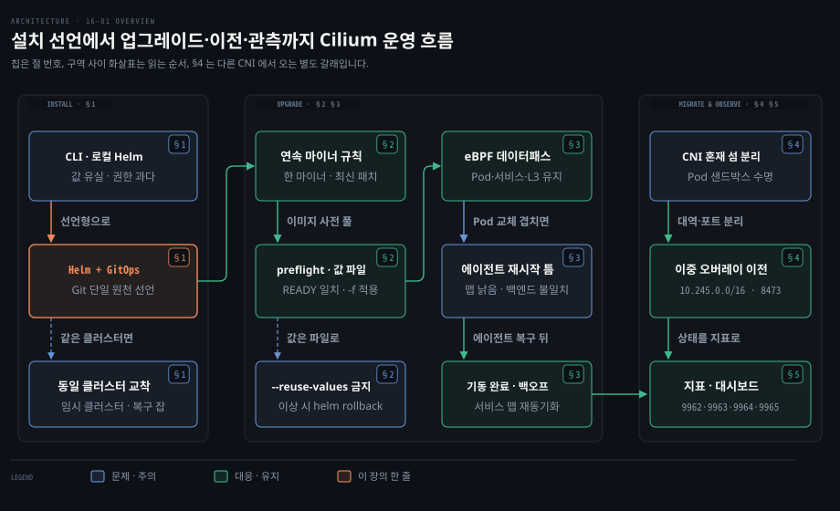
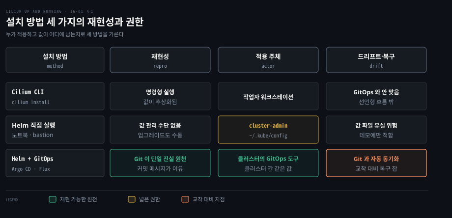
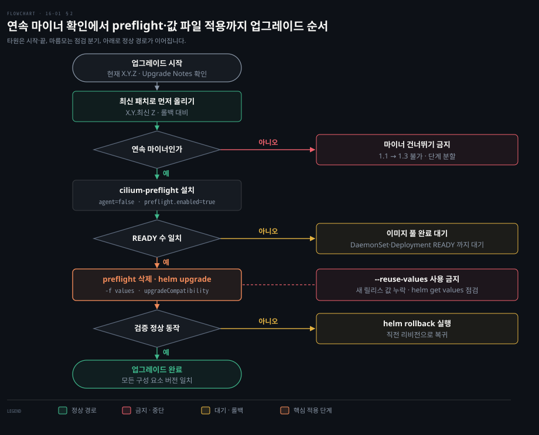
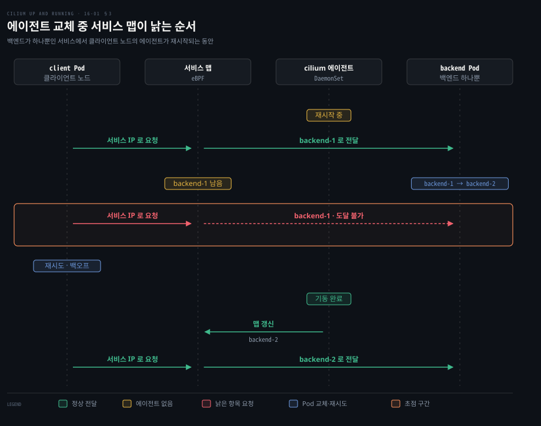
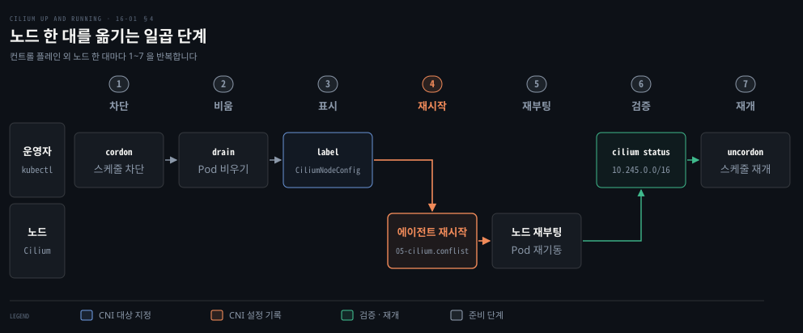

# Cilium 운영은 설치 도구와 업그레이드·CNI 이전 계획에서 시작한다

---

> 운영은 설치를 Helm 과 GitOps 로 선언하고, 업그레이드는 한 마이너씩 올리며, 다른 CNI 에서는 노드 단위로 옮기고, 지표를 켜서 상태를 보는 일로 이루어집니다.


## 핵심 요약

> Cilium 운영은 어떤 도구를 쓰느냐보다 값을 어디에 선언해 두고 한 번에 얼마나 바꾸느냐의 문제입니다. 설치는 Helm 과 GitOps 로 재현하고, 업그레이드와 CNI 이전은 공백과 충돌을 줄이는 순서로 나누며, 상태는 구성 요소별 지표 포트로 봅니다.

Cilium 은 리눅스 커널의 eBPF 프로그램으로 쿠버네티스 Pod 네트워킹과 정책, 관측을 맡는 CNI 플러그인입니다([1편](./01-01.Cilium%20은%20eBPF%20데이터패스로%20iptables%20기반%20CNI%20의%20한계를%20넘는다.md)). 저자는 설치에 CLI 보다 Helm 을, Helm 도 노트북에서 직접 돌리기보다 Git 을 단일 원천으로 삼는 GitOps 와 함께 쓰기를 권합니다. 다만 GitOps 도구가 같은 클러스터에서 돌면 Cilium 이 깨질 때 도구도 함께 멈추므로 복구 경로를 따로 둡니다.

업그레이드는 마이너 하나씩, 최신 패치에서 출발해 새 이미지를 미리 받아 둔 뒤 올립니다. 노드마다 도는 Cilium 에이전트가 재시작되는 동안에도 커널 안의 eBPF 데이터패스는 기존 트래픽을 나릅니다. 다만 eBPF 맵(에이전트와 커널이 함께 쓰는 저장소)이 갱신되지 못하는 틈에 백엔드가 바뀌면 요청이 끊길 수 있습니다. L7 프록시를 거치는 트래픽은 에이전트가 아니라 `cilium-envoy` Pod 가 교체될 때 끊깁니다([업그레이드 문서](https://docs.cilium.io/en/v1.20/operations/upgrade/)). 다른 CNI 에서는 노드를 한 대씩 옮기고, 상태는 9962·9963·9964·9965 포트의 지표로 봅니다.


## 학습 목표

> 이 편을 읽고 나면 다음을 설명할 수 있습니다.

1. CLI·Helm·GitOps 의 재현성과 권한을 비교하고 GitOps 의 순환 의존과 대비책을 설명할 수 있습니다.
2. 마이너 업그레이드 전에 지킬 규칙과 `--reuse-values` 를 쓰지 않는 이유를 말할 수 있습니다.
3. 에이전트 재시작 중 계속되는 것과 요청이 실패할 수 있는 조건을 구분할 수 있습니다.
4. 다른 CNI 에서 옮기는 네 가지 방법과 이중 오버레이 이전의 전제·절차를 말할 수 있습니다.
5. 에이전트·오퍼레이터·Envoy·Hubble 지표의 Helm 값과 포트를 구분할 수 있습니다.

아래 그림은 1절의 설치 선언에서 2·3절의 업그레이드와 데이터패스 유지를 지나 5절의 관측까지 이어지는 운영 흐름입니다. 카드 오른쪽 위 칩은 해당 절 번호입니다. 구역 사이 화살표는 읽는 순서이고, 구역 안 화살표 옆 글자는 두 카드의 관계입니다.



4절 카드는 앞 구역과 화살표로 이어지지 않습니다. 이미 다른 CNI 가 도는 클러스터에서만 따로 밟는 길이기 때문입니다.


## 설치에서 관측까지 운영의 순서

> Cilium 운영은 설치 선언에서 시작해 업그레이드, 데이터패스 유지, 기존 CNI 이전, 지표 관측 순서로 이어지며, 단계마다 적용 주체와 확인하는 값이 갈립니다.

설치·업그레이드·CNI 이전·관측 작업을 순서와 경계 없이 그때그때 실행하면 작업 중 통신이 끊기거나 설정을 되돌리지 못하는 막다른 상황에 빠집니다. 아래 표는 다섯 단계마다 누가 일하고 어떤 값으로 상태를 확인하는지, 그리고 각 단계를 받치는 개념을 어느 절이 푸는지 정리한 것입니다. 받치는 개념 칸의 낱말은 해당 절에서 풉니다.

| 단계 | 주체와 하는 일 | 확인하는 값·도구 | 받치는 개념 | 절 |
|---|---|---|---|---|
| 1 설치 선언 | GitOps 도구가 Git 의 값 파일로 차트 적용 | `helm install`, 복구용 CI·CD 잡 | 선언적 재현성과 순환 의존 | 1절 |
| 2 업그레이드 준비 | 운영자가 패치 정렬·이미지 사전 풀 뒤 차트 갱신 | `cilium-preflight`, `-f` 값 파일 | 연속 마이너 경로와 값 파일 | 2절 |
| 3 데이터패스 유지 | 커널 eBPF 가 트래픽을 나르고 에이전트가 맵 재동기화 | eBPF 서비스 맵, `cilium-envoy` | 데이터패스·에이전트 분리 | 3절 |
| 4 CNI 이전 | 운영자와 `CiliumNodeConfig` 가 노드를 한 대씩 전환 | `10.245.0.0/16`, `tunnelPort: 8473` | 이중 오버레이와 라우팅 테이블 | 4절 |
| 5 상태 관측 | 에이전트·오퍼레이터·Envoy·Hubble 이 지표를 노출 | `9962`~`9965` 포트, Grafana | Prometheus 스크래핑과 포트 분리 | 5절 |

4단계는 앞 단계의 다음 차례가 아니라 Cilium 을 들이는 다른 길입니다. 새로 설치하는 클러스터는 1단계로, 이미 다른 CNI 가 도는 클러스터는 4단계로 Cilium 을 들입니다. 2·3·5단계는 어느 길로 들였든 이어서 밟습니다.


## 1. 설치 도구 비교와 GitOps 선택

> 같은 차트라도 누가 어떻게 적용하느냐에 따라 재현성과 권한 범위가 갈립니다. 저자는 운영에서 Helm 을 쓰고 그 값과 적용을 Git 과 GitOps 도구에 맡기기를 권합니다.

흐름 위치: 1 설치 선언 · 받치는 개념 — 선언적 재현성과 순환 의존

`cilium install` 한 줄로 클러스터에 Cilium 을 올리면 빠르지만 운영에서는 설정 값이 작업자 환경에 흩어집니다. 아래 그림은 세 가지 설치 방법의 재현성, 적용 주체, 드리프트(Git 의 설정과 클러스터의 실제 상태가 어긋나는 일)와 복구 차이를 나란히 비교합니다.



Cilium CLI 는 환경을 자동 감지하고 Cluster Mesh(여러 클러스터의 네트워크를 잇는 기능) 구성을 해 주므로 빠른 시작에는 편합니다. 반면 내부 설정을 추상화해 가려서 Cilium 이 실제로 어떻게 동작하는지 배우기에는 맞지 않습니다. 워크스테이션에서 명령을 치는 명령형 방식은 선언적이고 재현 가능한 운영과도 맞지 않습니다.

클러스터 상태를 바꾸지 않는 조회(`cilium status`)는 CLI 로 해도 됩니다. `cilium install` 과 `helm install` 이 같은 Helm 릴리스를 만든다는 점은 [설치 편](./03-01.Cilium%20은%20kind%20클러스터에%20Helm%20으로%20설치하고%20정책과%20Hubble%20로%20동작을%20확인한다.md)에서 다룹니다. Helm 명령의 문법과 실행 패턴은 [IaC 문서](../../../07_devops/docs/iac/README.md)에 있습니다.

### 로컬과 bastion 직접 실행의 한계

노트북이나 bastion 에서 `helm` 을 직접 실행하면 호출 주체에 넓은 권한, 흔히 `cluster-admin` 이 필요합니다. bastion 은 외부에서 내부 클러스터로 접속할 때 거치는 경유 서버입니다. 온프레미스 환경에서는 암호화되지 않은 인증서가 `~/.kube/config` 에 놓일 수 있습니다. 적용한 값 파일을 관리할 수단도 없어 업그레이드와 설정 변경을 손으로 해야 하고, 값 파일을 잃으면 이전 설정을 되찾기 어렵습니다. 그래서 외부 클러스터에서는 데모 말고는 피하는 편이 낫습니다.

### GitOps 단일 원천과 순환 의존

GitOps 도구인 Argo CD 와 Flux 는 Git 저장소와 클러스터 상태를 감시하다가 차이를 적용하거나 제거해 둘을 맞춥니다. 저장소가 단일 진실 원천이 되고 커밋 메시지가 변경 이유를 남깁니다. 같은 구성을 여러 클러스터에 똑같이 배포할 수도 있습니다([ArgoCD GitOps 정독본](../../../07_devops/book/aic_ai-infra-claude/03-01.푸시%20배포의%20한계와%20ArgoCD%20GitOps%20—%20설치·연결·롤링·롤백.md)).

문제는 GitOps 도구가 자신이 관리할 클러스터 안에서 돌 때 생깁니다. GitOps 도구가 뜨려면 먼저 CNI 가 있어야 하는데, 그 CNI 를 GitOps 도구로 설치하려는 닭과 달걀의 상황이 됩니다. 해법은 두 가지입니다.

1. CNI 가 정상 동작하는 임시 클러스터(예: kind)에 GitOps 도구를 띄워 대상 클러스터에 Cilium 을 배포합니다. 대상이 올라온 뒤 GitOps 도구를 그 안으로 옮깁니다.
2. 클러스터를 만든 도구(Terraform, Ansible 등)가 첫 설치를 맡고 이후를 GitOps 가 이어받습니다.

같은 클러스터에서 관리하면 교착도 생깁니다. 잘못된 갱신으로 Cilium 이 멈추면 같은 클러스터 안의 GitOps 도구도 같이 멈춰 설정을 고칠 길이 막힙니다. 그래서 Cilium 을 복구하는 전용 CI·CD 잡 같은 재해 복구 경로를 클러스터 밖에 미리 둡니다.

GitOps 로 Cilium 차트와 정책 리소스를 함께 적용하면 적용 순서도 계획해야 합니다. 클러스터 전역 자원을 맡는 Cilium 오퍼레이터가 CRD 를 만듭니다([2편](./02-01.Cilium%20은%20에이전트·CNI%20플러그인·오퍼레이터로%20나눠%20노드와%20클러스터를%20맡는다.md)). CRD 는 쿠버네티스 확장 리소스 정의입니다.

CiliumNetworkPolicy 같은 리소스는 오퍼레이터가 한 번 돈 뒤에 적용합니다. v1.20.5 오퍼레이터는 리더(여러 복제본 가운데 일을 맡도록 뽑힌 하나)로 선출되면 [CRD 등록](https://github.com/cilium/cilium/blob/v1.20.5/operator/cmd/root.go)을 가장 먼저 수행하기 때문입니다(2026-11-25 확인).


## 2. 업그레이드 순서와 사전 점검

> 업그레이드는 한 마이너씩, 현재 버전의 최신 패치에서 출발해 새 이미지를 미리 받아 둔 뒤 값 파일로 올립니다.

흐름 위치: 2 업그레이드 준비 · 받치는 개념 — 연속 마이너 경로와 값 파일

Cilium 은 약 여섯 달마다 새 마이너 버전이 나오지만, 버전을 건너뛰거나 사전 점검을 빼먹으면 롤백 경로가 끊기고 데이터패스나 CRD 스키마가 어긋납니다. 아래 순서도는 패치 정렬에서 연속 마이너 확인, preflight 사전 점검, 값 파일 적용과 롤백 분기까지를 보여 줍니다.



버전 `X.Y.Z` 에서 `Y` 가 마이너이고 `Z` 는 보안과 버그 수정을 담는 패치입니다. 안정 브랜치는 최신 마이너 셋만 유지됩니다([릴리스 관리 문서](https://docs.cilium.io/en/v1.20/contributing/release/organization/)). v1.20 계열의 확인 시점 최신 패치는 [v1.20.5](https://github.com/cilium/cilium/releases/tag/v1.20.5) 입니다(2026-11-25 확인).

업그레이드마다 호환성 확인, 설정 백업, 단계별 연결 검증을 거쳐 점진적으로 적용합니다.

제자리 업그레이드 대신 새 클러스터를 세워 워크로드를 옮기는 방식도 있습니다. 이 길은 스택 다른 곳의 복잡도와 운영 성숙도, 중단 없이 옮길 수 있는 애플리케이션이 필요합니다. 클러스터 사이 트래픽 전환에는 [Cluster Mesh](./09-01.Cluster%20Mesh%20는%20클러스터마다%20API%20서버를%20두고%20서로의%20상태를%20읽어%20하나의%20망을%20만든다.md), BGP ECMP 라우팅, 외부 로드밸런서 계층을 쓸 수 있습니다. BGP ECMP 는 같은 비용의 여러 경로로 트래픽을 나누는 방식입니다. 저자는 이런 구성을 다루지 않고 Cilium 을 핵심 인프라로 보아 쿠버네티스 업그레이드와 같은 방식으로 올리기를 권합니다.

### 연속 마이너와 최신 패치 규칙

[v1.20 업그레이드 문서](https://docs.cilium.io/en/v1.20/operations/upgrade/)가 정한 세 가지 규칙은 다음과 같습니다.

- 테스트된 업그레이드와 롤백 경로는 연속한 마이너 사이뿐입니다. 예를 들어 `1.1` 에서 `1.3` 으로 바로 건너뛰지 않습니다.
- 마이너를 올리기 전에 현재 마이너의 최신 패치로 먼저 올립니다. 업그레이드 뒤 롤백이 필요할 때 가장 매끄럽게 되돌릴 수 있습니다.
- 모든 Cilium 구성 요소는 같은 버전이어야 합니다. 에이전트만 올리면 구성 요소 사이에 예기치 않은 동작이 납니다.

버전마다 Upgrade Notes 도 먼저 읽습니다. 예를 들어 v1.20 은 Gateway API v1.6.1 이상을 요구합니다([v1.20 업그레이드 문서](https://docs.cilium.io/en/v1.20/operations/upgrade/)).

### preflight 이미지 사전 다운로드

쿠버네티스는 DaemonSet(모든 노드에 Pod 하나씩을 띄우는 워크로드)을 갱신할 때 기존 Pod 를 먼저 지우고 새 이미지를 내려받습니다. 이미지를 받는 시간만큼 에이전트 공백이 길어지므로, 공식 문서는 새 이미지를 노드마다 미리 받아 두는 **preflight 검사**를 필수 단계로 둡니다.

kube-proxy(쿠버네티스 기본 서비스 프록시) 없이 도는 클러스터는 아래 명령에 `k8sServiceHost`, `k8sServicePort` 도 넘깁니다. 두 값은 API 서버의 IP 와 포트입니다.

```bash
helm install cilium-preflight cilium/cilium --version <new-version> \
    --namespace kube-system \
    --set preflight.enabled=true \
    --set agent=false \
    --set operator.enabled=false
```

`cilium-pre-flight-check` DaemonSet 의 READY 수가 `cilium` DaemonSet 의 Pod 수와 같아져야 합니다. `cilium-pre-flight-check` Deployment 도 READY 1/1 이어야 합니다. 이 Deployment 가 READY 0/1 이면 공식 문서의 CNP(CiliumNetworkPolicy) 검증 절을 보고 해결한 뒤 진행합니다. 조건이 맞으면 `helm delete cilium-preflight` 를 실행하고 본 업그레이드를 시작합니다.

### 값 파일 유지와 --reuse-values 금지

설정은 `helm upgrade -f my-values.yaml` 처럼 파일로 넘깁니다. 이때 `upgradeCompatibility` 를 클러스터에 처음 설치한 버전으로 둡니다. 이 값은 업그레이드 중에도 Cilium 설정이 핵심 값을 바꾸지 않게 합니다. 공식 문서는 데이터패스 중단을 줄이려고 처음 설치한 버전(표기는 `1.X`)을 넣으라고 안내합니다.

`--reuse-values` 플래그는 새 릴리스에 추가된 새 값을 무시해 템플릿이 잘못 렌더링될 수 있으므로 마이너 업그레이드에서는 쓰지 않습니다. 차트 버전을 올리지 않고 설정만 바꿀 때는 안전하게 쓸 수 있습니다. 대신 `helm get values` 로 기존 값을 꺼내 파일에 저장하고, 이름이 바뀌었거나 폐기된 항목을 점검한 뒤 값 파일로 넘깁니다.

롤아웃에 문제가 생기면 `helm history` 로 리비전(릴리스를 바꿀 때마다 붙는 번호)을 확인해 `helm rollback` 으로 되돌립니다.


## 3. 업그레이드 중 데이터패스 연결 유지

> 에이전트가 노드마다 재시작되어도 커널의 eBPF 프로그램과 맵은 남아 기존 트래픽을 나릅니다. 어긋나는 것은 에이전트가 맵을 갱신해야 하는 순간과 사용자 공간 프록시를 거치는 트래픽입니다.

흐름 위치: 3 데이터패스 유지 · 받치는 개념 — 데이터패스·에이전트 분리

업그레이드 중에는 노드마다 Cilium 에이전트를 재시작해야 해서, 에이전트가 내려가 있는 동안 서비스 맵이 갱신되지 않는 문제가 생깁니다. L7 프록시 연결은 이와 별개로, Envoy 를 띄우는 `cilium-envoy` DaemonSet 의 Pod 가 교체될 때 끊깁니다. 서비스 맵은 서비스 IP 가 어느 백엔드 Pod 로 가는지 담은 eBPF 맵입니다. 에이전트는 맵을 쓰고 커널 eBPF 프로그램은 맵을 읽습니다. 이 역할 분담 덕분에 에이전트가 내려가도 프로그램은 마지막 상태대로 패킷을 전달합니다([에이전트 중단 실험](./06-01.Cilium%20은%20kube-proxy%20를%20eBPF%20로%20대신하고%20외부%20서비스에%20IP%20와%20경로를%20붙인다.md)). 에이전트가 없는 동안에도 다음 동작은 계속됩니다.

- 노드의 Pod 로 들어오고 나가는 라우팅
- 클러스터 전체의 Pod IP 를 향한 라우팅
- 서비스 IP 를 향한 라우팅
- L3 네트워크 정책 강제(`toCIDRSet`, `toEntities` 등)

[공식 업그레이드 문서](https://docs.cilium.io/en/v1.20/operations/upgrade/)도 정책이 없거나 L3 와 L4 정책만 걸린 기존 연결은 영향이 최소라고 설명합니다. 반면 L7(애플리케이션 계층) 정책이나 Ingress·Gateway API 트래픽은 사용자 공간 프록시인 Envoy 를 거칩니다([L7 프록시 편](./13-01.L7%20정책은%20Envoy%20로%20HTTP%20메서드와%20경로를%20검사한다.md)). 이 연결들은 업그레이드 중 끊기므로 클라이언트가 다시 연결해야 합니다. 프록시 공백 시간의 상세는 [Day 2 점검 편](./16-02.Day%202%20장애는%20상태%20확인에서%20기능별%20점검%20순서로%20좁혀%20간다.md)에서 다룹니다.

### 에이전트 공백과 서비스 맵 불일치

데이터패스가 낡은 경로를 타는 틈이 하나 있습니다. 백엔드 Pod 가 `backend-1` 하나뿐인 서비스에서 클라이언트 노드의 에이전트가 재시작될 때 백엔드가 `backend-2` 로 바뀌는 경우입니다. 두 이름은 설명용 예시입니다. 에이전트가 꺼져 있어 바뀐 백엔드를 서비스 맵에 반영하지 못합니다. 그래서 데이터패스는 이미 사라진 `backend-1` 로 패킷을 계속 보냅니다.

아래 시퀀스 다이어그램은 이 경합이 일어나는 순서를 위에서 아래로 보여 줍니다.



이 장애는 클러스터의 Pod 교체가 에이전트 재시작과 겹쳐야 일어나므로 발생 확률은 Pod 변동량에 달렸습니다. 에이전트가 다시 뜨면 맵이 갱신되어 자동으로 풀리는 일시적 오류입니다. 애플리케이션에 지수 백오프(실패할 때마다 재시도 간격을 늘리는 방식) 같은 재시도 제어가 있으면 대개 운영자 개입 없이 넘어갑니다.


## 4. 다른 CNI 에서 노드 단위 이전

> Flannel·Calico·Canal·AWS VPC CNI 도 클러스터를 다시 만들지 않고 Cilium 으로 바꿀 수 있습니다. 새 Pod 부터 Cilium 이 맡게 하고 옛 Pod 는 다시 만들어야 하므로 과도기의 연결을 어떻게 잇느냐가 핵심입니다.

흐름 위치: 4 CNI 이전 · 받치는 개념 — 이중 오버레이와 라우팅 테이블

다른 CNI 로 이미 서비스 중인 클러스터는 `/etc/cni/net.d/` 설정만 바꾸면 기존 Pod 와 새 Pod 가 서로 닿지 못합니다. 노드의 `kubelet` 은 Pod 샌드박스를 처음 만들 때 `/etc/cni/net.d/` 에 설정된 CNI 플러그인을 부릅니다([CNI 동작 원리](../networking-and-kubernetes/04-02.CNI와%20kube-proxy%20—%20Pod%20네트워크의%20배선공과%20로드밸런서.md)). `kubelet` 은 컨테이너 실행을 관리하는 노드 에이전트입니다. 네트워크 설정은 샌드박스와 수명을 같이합니다.

그래서 이전하려면 새 Pod 가 쓸 플러그인을 바꾼 뒤 옛 Pod 도 모두 다시 띄워야 합니다. 중단을 얼마나 견디는지와 기존 네트워크 구성에 따라 아래 네 가지 방법 중 하나를 고릅니다.

아래 표의 PodCIDR 은 노드가 Pod 에 나눠 주는 IP 대역입니다. 오버레이는 노드 사이 패킷을 VXLAN 이나 Geneve 같은 UDP 캡슐화 프로토콜로 감싸 터널로 보내는 방식입니다([라우팅 문서](https://docs.cilium.io/en/v1.20/network/concepts/routing/)).

| 방법 | 방식 | 과도기의 차이 |
|---|---|---|
| 새 클러스터로 이전 | Cilium 클러스터를 만들고 워크로드를 다시 배포 | 준비와 일시 중단이 있지만 혼합 상태가 없고 롤백이 쉽습니다 |
| `/etc/cni/net.d/` 재설정 | 새 Pod 만 Cilium 으로 가고 옛 Pod 는 재시작 전까지 기존 CNI | 두 네트워크 사이의 라우팅을 직접 유지해야 합니다 |
| 노드 재부팅(big bang) | 모든 노드의 CNI 설정을 바꾸고 순서대로 재시작 | 끝나기 전에는 이전한 노드와 아직인 노드가 닿지 않는 섬이 됩니다 |
| 이중 오버레이 | Cilium 을 별도 PodCIDR·오버레이로 띄우고 노드를 하나씩 옮김 | CIDR 과 캡슐화 포트가 다르면 두 쪽의 Pod 가 서로 닿습니다 |

### 이중 오버레이 이전의 전제와 설정

넷째 방법은 [공식 이전 문서](https://docs.cilium.io/en/v1.20/installation/k8s-install-migration/)가 절차를 제공합니다. 한 노드의 Pod 는 하나의 네트워크에만 붙지만 리눅스 라우팅 테이블이 두 대역의 트래픽을 나눠 두 쪽 Pod 가 모두 닿습니다.

이 방식이 성립하려면 네 가지 전제가 필요합니다.

- 기존 대역과 겹치지 않는 새 클러스터 PodCIDR
- 주소 충돌이 없는 `cluster-pool` IPAM(오퍼레이터가 노드마다 Pod 대역을 나눠 주는 주소 할당 방식, [IPAM 편](./04-01.Cilium%20IPAM%20모드는%20Pod%20대역을%20누가%20나눠%20주는지로%20갈린다.md))
- 기존 망과 구분되는 오버레이 포트나 프로토콜([데이터패스 편](./05-01.Cilium%20데이터패스는%20같은%20노드는%20eBPF%20로%20바로%20넘기고%20다른%20노드는%20라우팅이나%20터널로%20잇는다.md))
- 리눅스 라우팅 스택을 쓰는 기존 플러그인

BGP 라우팅, IP 패밀리 변경, 체이닝 모드의 Cilium, 기존 NetworkPolicy 제공자는 시험되지 않았습니다. 이전 중에는 비 Cilium Pod 의 트래픽이 드롭되지 않도록 `policyEnforcementMode: "never"` 를 둡니다. 이전 절차 전체는 운영 클러스터에 적용하기 전에 시험 클러스터에서 먼저 해 봅니다.

예시 대역은 kind 기본 대역 `10.244.0.0/16` 과 겹치지 않는 `10.245.0.0/16` 입니다. 오버레이 포트는 기존 VXLAN 포트와 구분되는 `tunnelPort: 8473` 을 씁니다. 설치 값에는 이전 중에만 쓰는 네 키를 넣습니다.

- `cni.customConf: true` 는 Cilium 이 CNI 설정 파일을 쓰지 않게 합니다.
- `cni.uninstall: false` 는 에이전트가 종료될 때 CNI 설정을 지우지 않게 합니다.
- `bpf.hostLegacyRouting: true` 는 Cilium 과 기존 오버레이 사이의 라우팅을 허용합니다.
- `operator.unmanagedPodWatcher.restart: false` 는 아직 옮기지 않은 Pod 를 오퍼레이터가 재시작하지 않게 합니다.

각 키의 뜻은 [이전 문서](https://docs.cilium.io/en/v1.20/installation/k8s-install-migration/)의 값 예시 주석과 v1.20.5 [Helm 값 파일](https://github.com/cilium/cilium/blob/v1.20.5/install/kubernetes/cilium/values.yaml)의 주석에서 확인했습니다(2026-11-25).

이 값만으로는 CNI 설정 파일을 쓰지 않아 Cilium 이 관리하는 Pod 가 없습니다. **CiliumNodeConfig**(`cilium.io/v2`)는 라벨 셀렉터로 고른 노드에만 설정 값을 덮어쓰는 리소스입니다. 어느 노드가 Cilium 을 CNI 로 쓸지 이 리소스가 정합니다. 노드 셀렉터를 `io.cilium.migration/cilium-default: "true"` 라벨로 걸어 두면 처음에는 어느 노드에도 적용되지 않습니다. 이후 라벨을 붙인 노드에서만 에이전트가 `/etc/cni/net.d/05-cilium.conflist` 파일을 씁니다.

### 노드 단위 이전 일곱 단계

노드 하나는 일곱 단계로 옮기며 컨트롤 플레인 노드부터 시작하는 것은 권장되지 않습니다. 아래 그림은 운영자의 명령과 노드 안 Cilium 동작이 어떤 순서로 맞물려 한 노드를 옮기는지 보여 줍니다.



1. `kubectl cordon` 으로 해당 노드의 새 Pod 스케줄을 막습니다.
2. `kubectl drain` 으로 기존 Pod 를 비웁니다(권장 단계이며 생략하면 재부팅 중 Pod 가 잠깐 끊깁니다).
3. `kubectl label` 로 노드에 `io.cilium.migration/cilium-default=true` 를 붙여 대상으로 지정합니다.
4. 그 노드의 Cilium Pod 를 삭제해 에이전트를 재시작하면 `/etc/cni/net.d/05-cilium.conflist` 설정 파일이 쓰입니다.
5. 노드를 재부팅해 남은 Pod 가 새 CNI 로 재기동되게 합니다.
6. `cilium status` 와 Pod IP 가 `10.245.0.0/16` 안에 들어왔는지 검증합니다.
7. `kubectl uncordon` 으로 스케줄을 재개하고 다음 노드에서 1~7 을 반복합니다.

모든 노드를 옮긴 뒤에는 이전용 값을 되돌려 Cilium 을 주 CNI 로 둡니다. `cni.customConf=false`, `policyEnforcementMode=default`, `operator.unmanagedPodWatcher.restart=true` 를 적용합니다. `bpf.hostLegacyRouting=false` 는 선택입니다. eBPF 호스트 라우팅으로 성능이 오르는 대신 노드마다 에이전트가 재시작되는 동안 연결이 잠깐 끊깁니다. 마지막으로 `CiliumNodeConfig` 와 이전 플러그인을 지웁니다. 이전 플러그인이 남긴 iptables 규칙과 인터페이스는 다음 재부팅 때 정리됩니다.


## 5. 구성 요소별 지표와 대시보드 관측

> Cilium·오퍼레이터·Envoy·Hubble 은 Prometheus 형식의 지표를 엽니다. 켜는 값과 포트가 구성 요소마다 다르고 에이전트와 Hubble 흐름 지표는 기본으로 꺼져 있습니다.

흐름 위치: 5 상태 관측 · 받치는 개념 — Prometheus 스크래핑과 포트 분리

업그레이드나 CNI 이전을 마친 뒤 워크로드만 봐서는 에이전트, 오퍼레이터, Envoy 자체의 오류와 용량 포화를 놓치기 쉽습니다. [Hubble 편](./15-01.Hubble%20은%20노드마다%20흐름을%20모아%20Relay%20로%20묶고%20L7%20가시성과%20지표로%20내보낸다.md)이 워크로드 트래픽을 본다면 여기서는 Cilium 구성 요소 자신의 지표를 중심으로 봅니다. 같은 방식으로 켜는 Hubble 흐름 지표도 한 표에 함께 정리합니다.

지표 수집기인 Prometheus 가 각 포트를 긁어 가면 Grafana 대시보드로 추이를 볼 수 있습니다. Cilium 지표는 `cilium_` 이름공간(지표 이름 앞에 붙는 접두사)으로 나옵니다. Envoy 지표는 `envoy_` 로, Cilium 이 정의한 Envoy 지표는 `envoy_cilium_` 이름공간으로 나옵니다([지표 문서](https://docs.cilium.io/en/v1.20/observability/metrics/)).

| 구성 요소 | 켜는 Helm 값 | 포트 | v1.20.5 차트 기본값 |
|---|---|---|---|
| Cilium 에이전트 | `prometheus.enabled` | 9962 | 꺼짐(`false`) |
| Cilium 오퍼레이터 | `operator.prometheus.enabled` | 9963 | 켜짐(`true`) |
| Cilium Envoy | `envoy.prometheus.enabled` | 9964 | 켜짐(`true`) |
| Hubble 흐름 지표 | `hubble.metrics.enabled` 목록과 `hubble.enabled=true` | 9965 | 꺼짐(기본 `~`, 비어 있음) |

기본값은 v1.20.5 [Helm 값 파일](https://github.com/cilium/cilium/blob/v1.20.5/install/kubernetes/cilium/values.yaml) 기준입니다(2026-11-25 확인). 기본으로 켜진 값도 설치 값 파일에 명시해 두면 이후 차트 기본값이 바뀌어도 영향이 없습니다. 책의 설치 예제는 `hubble.metrics.enabled` 목록에 `dns`, `drop`, `tcp`, `flow`, `port-distribution`, `icmp`, `httpV2` 를 넣습니다.

시험 환경에서는 [공식 Prometheus·Grafana 예제](https://docs.cilium.io/en/v1.20/observability/grafana/)를 올려 확인합니다. 이 매니페스트는 `cilium-monitoring` 네임스페이스에 Prometheus 와 대시보드가 탑재된 Grafana 를 함께 만듭니다.

```bash
kubectl apply -f https://raw.githubusercontent.com/cilium/cilium/v1.20/examples/kubernetes/addons/prometheus/monitoring-example.yaml
kubectl -n cilium-monitoring port-forward service/grafana \
    --address 0.0.0.0 --address :: 3000:3000
```

브라우저에서 `http://localhost:3000` 을 열면 에이전트와 엔드포인트 상태, 정책 강제, Hubble 흐름 대시보드가 보입니다. 이 대시보드로 Prometheus 가 모든 노드에서 지표를 긁는지도 함께 확인합니다. 운영 환경에서는 포트 포워딩 대신 Ingress 나 Gateway API 로 노출합니다.


## 면접 대비

> Cilium 의 설치 도구 선택, 업그레이드, CNI 이전, 지표에 관한 면접 질문입니다.

1. 운영에서 CLI 대신 Helm 과 GitOps 를 권하는 이유와 같은 클러스터를 관리할 때의 문제를 설명해 보십시오.
2. 마이너 업그레이드 전에 지킬 규칙, preflight 검사, `--reuse-values` 금지의 이유를 말해 보십시오.
3. 에이전트 재시작 중 계속 동작하는 것과 요청이 실패할 수 있는 시나리오를 설명해 보십시오.
4. 다른 CNI 에서 옮기는 네 가지 방법과 이중 오버레이 이전의 전제를 비교해 보십시오.
5. 에이전트·오퍼레이터·Envoy·Hubble 지표를 켜는 값과 포트는 무엇입니까?


## 정답 (자답 후 펼치기)

> 위 질문 5개에 먼저 자답한 뒤 아래를 읽으세요.

### 정답 1 — 선언적 재현성과 순환 의존

CLI 는 설정을 추상화하고 명령형이라 선언적·재현 가능한 운영과 맞지 않습니다. GitOps 는 Git 을 단일 원천으로 삼지만 같은 클러스터에서는 순환 의존과 교착이 있어 임시 클러스터나 부트스트랩 도구로 첫 설치를 하고 복구용 CI·CD 잡을 둡니다.

### 정답 2 — 한 마이너씩과 값 파일

연속한 마이너 사이만 테스트된 경로이고 올리기 전에 최신 패치로 올립니다. preflight 검사는 새 이미지를 미리 받아 에이전트 공백을 줄입니다. `--reuse-values` 는 새 값을 무시해 잘못 렌더링될 수 있어 값 파일을 쓰고 `upgradeCompatibility` 로 처음 설치한 버전을 알립니다.

### 정답 3 — 맵 갱신 공백과 낡은 항목

에이전트가 없어도 eBPF 프로그램과 맵이 남아 Pod·서비스 IP 라우팅과 L3 정책이 계속 동작합니다. 에이전트 재시작과 백엔드 교체가 겹치면 맵이 낡아 일시적 오류가 나고 에이전트가 돌아오면 풀립니다. L7 프록시를 거치는 트래픽은 에이전트 재시작이 아니라 `cilium-envoy` Pod 가 교체될 때 끊깁니다.

### 정답 4 — 이중 오버레이와 노드 단위 절차

새 클러스터, `/etc/cni/net.d/` 재설정, 노드 재부팅(섬 분리), 이중 오버레이 순입니다. 이중 오버레이는 새 CIDR, cluster-pool IPAM, 다른 오버레이 포트, 리눅스 라우팅 플러그인이 전제이고 정책 강제를 끈 채 `CiliumNodeConfig` 로 노드를 하나씩 옮깁니다.

### 정답 5 — 값과 포트

에이전트는 `prometheus.enabled=true` 로 9962, 오퍼레이터는 `operator.prometheus.enabled=true` 로 9963 입니다. Envoy 는 `envoy.prometheus.enabled` 로 9964 이고 v1.20.5 차트 기본값은 켜짐입니다. Hubble 은 `hubble.enabled=true` 와 `hubble.metrics.enabled` 목록으로 9965 입니다. 에이전트와 Hubble 흐름 지표는 기본으로 꺼져 있고 v1.20.5 차트에서 오퍼레이터는 켜져 있습니다.


## 참고 자료

- Nico Vibert, Filip Nikolic, James Laverack, 《Cilium: Up and Running》, O'Reilly Media, 2026, ISBN 979-8-341-62299-9, Chapter 16 "Operations".
- Cilium 공식 문서 v1.20 (operations/upgrade, installation/k8s-install-migration, observability/metrics, observability/grafana): https://docs.cilium.io/en/v1.20/
- Cilium v1.20.5 소스와 Helm 값: https://github.com/cilium/cilium/tree/v1.20.5


## 관련 문서

- [Day 2 장애는 상태 확인에서 기능별 점검 순서로 좁혀 간다](./16-02.Day%202%20장애는%20상태%20확인에서%20기능별%20점검%20순서로%20좁혀%20간다.md)
- [Cilium 은 kind 클러스터에 Helm 으로 설치하고 정책과 Hubble 로 동작을 확인한다](./03-01.Cilium%20은%20kind%20클러스터에%20Helm%20으로%20설치하고%20정책과%20Hubble%20로%20동작을%20확인한다.md)
- [Hubble 은 노드마다 흐름을 모아 Relay 로 묶고 L7 가시성과 지표로 내보낸다](./15-01.Hubble%20은%20노드마다%20흐름을%20모아%20Relay%20로%20묶고%20L7%20가시성과%20지표로%20내보낸다.md)
