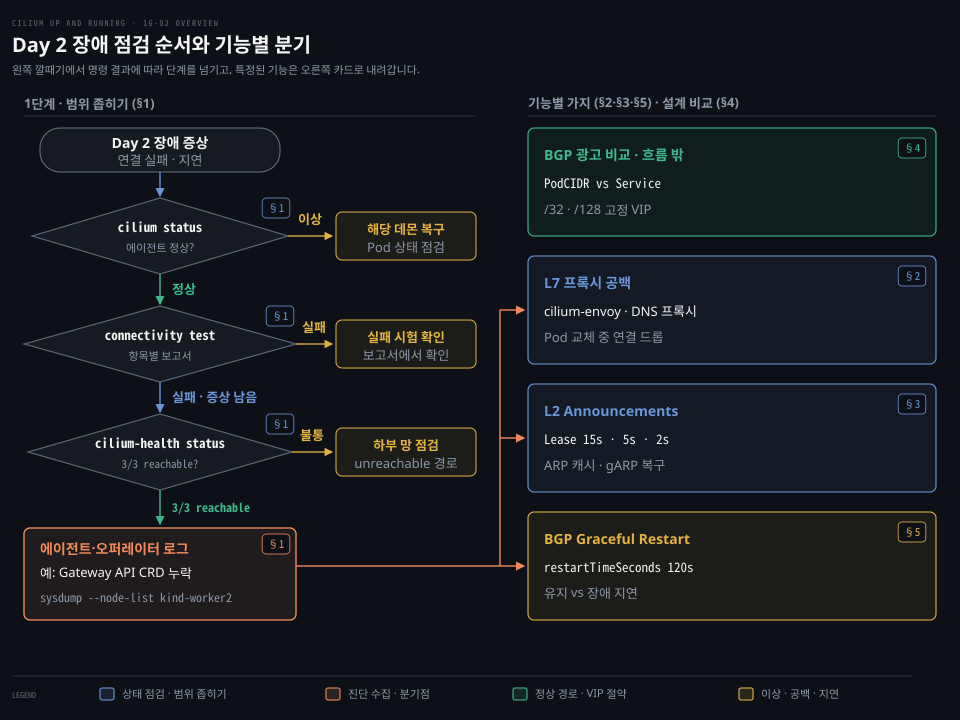
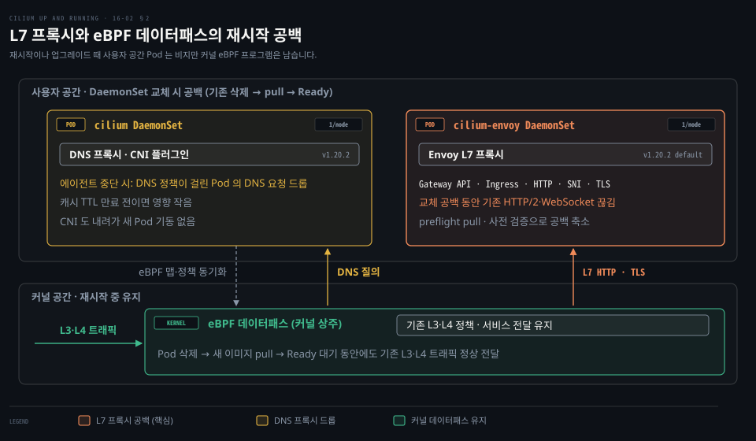
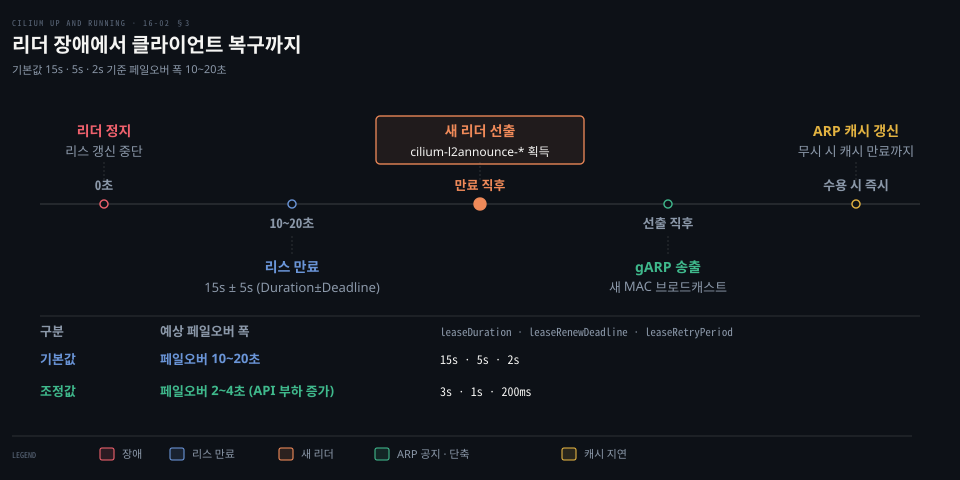
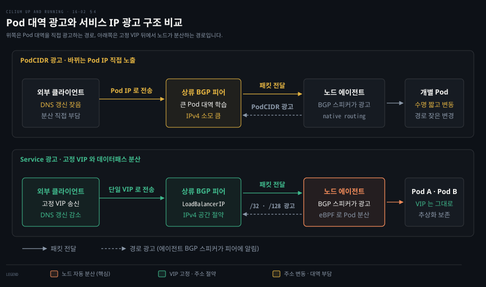
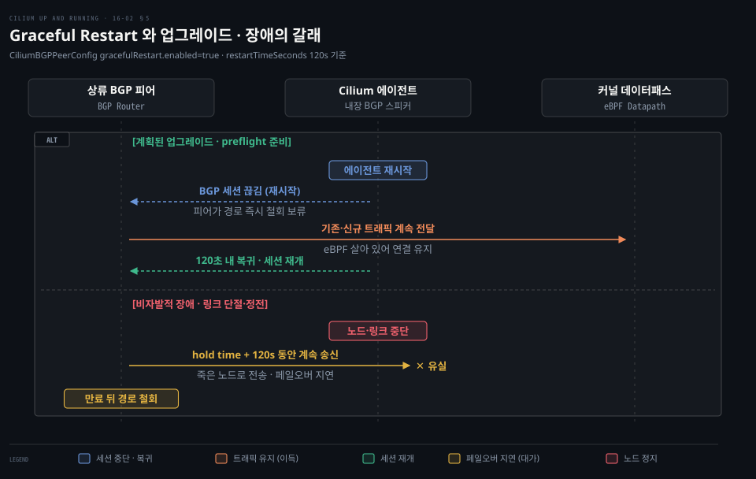

# Day 2 장애는 상태 확인에서 기능별 점검 순서로 좁혀 간다

---

> 운영 중 Cilium 이 이상하면 `cilium status` 에서 시작해 연결 시험, 노드 사이 점검, 로그, 진단 묶음 수집(`sysdump`) 순으로 범위를 좁힙니다. 그다음 증상에 따라 프록시, 리더 선출, BGP 세션 가운데 맞는 쪽으로 내려가 무엇에 기대는지와 어떤 타이머가 복구 시간을 정하는지 따집니다.

## 핵심 요약

> Cilium 장애는 넓은 상태 확인에서 좁은 진단 수집으로 범위를 거른 뒤 기능별로 무엇에 기대는지 짚어야 원인이 드러납니다. 패킷을 나르는 커널 경로는 에이전트가 내려가도 남지만, 프록시·리더 선출 잠금(리스)·BGP 경로 광고는 각자의 프로세스와 타이머에 묶여 끊기는 지점이 다릅니다.

eBPF 데이터패스는 커널 안에서 패킷을 직접 전달하고 정책을 검사하는 실행 경로입니다. 이 경로는 에이전트(노드마다 떠서 정책과 eBPF 프로그램을 관리하는 Cilium 데몬)가 재시작되어도 커널에 남습니다. 그래서 기존 L3·L4(IP·포트 기반) 연결은 대부분 유지됩니다.

그러나 Envoy(L7 프록시), DNS 프록시, L2 Announcements, BGP 세션은 각자의 프로세스가 살아 있어야 동작합니다. L2 Announcements 는 ARP 응답(IP 주소에 해당하는 MAC 주소를 알려 주는 응답)으로 서비스 IP 를 같은 L2 망에 알리는 기능입니다. BGP 는 외부 라우터와 경로를 주고받는 프로토콜입니다. L7 은 HTTP·DNS 같은 애플리케이션 계층을 뜻합니다. 그래서 같은 장애나 업그레이드라도 기능마다 끊기는 증상과 복구 시간이 다릅니다.

따라서 Day 2(설치가 끝난 뒤 실제 트래픽을 받으며 운영하는 단계) 점검은 두 부분으로 나뉩니다. 먼저 다섯 도구로 문제가 Cilium 내부인지 하부 망인지 가릅니다. 그다음 증상에 따라 갈라집니다. L7 은 Envoy 프록시 Pod(`cilium-envoy`)와 DNS 프록시를 보고, L2 Announcements 는 리스 타이머를 봅니다. BGP 세션은 Graceful Restart 를 봅니다. Graceful Restart 는 재시작 동안 피어가 경로를 붙잡아 두는 기능입니다. BGP 로 무엇을 알릴지 고르는 일은 장애 점검이 아니라 설계 선택이라 따로 비교합니다.


## 학습 목표

> 이 편을 읽고 나면 다음을 설명할 수 있습니다.

1. `cilium status` 에서 sysdump 까지 다섯 도구가 걸러 내는 범위를 순서대로 설명할 수 있습니다.
2. 에이전트 재시작에도 기존 연결이 유지되는 이유와 L7 기능이 끊기는 이유를 구분해 설명할 수 있습니다.
3. L2 Announcements 의 리스 타이머 세 값이 페일오버 시간을 정하는 방식을 설명할 수 있습니다.
4. BGP 에서 Pod 대역 광고와 서비스 IP 광고의 차이를 주소 안정성과 주소 소모로 비교할 수 있습니다.
5. Graceful Restart 의 이득과 비자발적 장애 때의 대가를 함께 설명할 수 있습니다.

아래 그림은 장애 증상이 생겼을 때 상태 확인에서 기능별 원인 지점까지 좁혀 가는 전체 흐름입니다. 왼쪽 깔때기(`§1`)는 명령 결과로 Cilium 내부 문제와 하부 망 문제를 가릅니다. 오른쪽에서 `§2`·`§3`·`§5` 는 증상에 따라 갈라지는 점검이고, `§4` 는 깔때기와 이어지지 않는 광고 설계 비교입니다.




## 증상에서 원인으로 좁히는 순서

> 트래픽이 끊기거나 응답이 늦을 때 원인 지점을 모르면 모든 노드의 로그를 뒤지다 시간을 잃습니다. 값싸고 넓은 확인에서 좁은 기능 점검으로 내려가는 순서를 먼저 세워야 막힌 층이 바로 갈립니다.

운영 클러스터에서 장애가 나면 문제가 커널 데이터패스인지, 노드 사이 물리 망인지, 특정 기능의 사용자 공간 데몬인지 한눈에 보이지 않습니다. 증상만 보고 바로 패킷을 잡거나 설정을 바꾸면 원인과 무관한 층을 건드리기 쉽습니다.

Cilium 장애 점검은 공통 깔때기로 범위를 좁힌 뒤 기능별 의존성으로 들어가는 순서를 따릅니다. 아래 표는 각 단계에서 실행할 도구와 다음 단계로 넘어가는 판단 기준입니다.

| 단계 | 무엇으로 확인하는가 | 무엇이 보이면 다음으로 가는가 | 받치는 개념 | 절 |
|---|---|---|---|---|
| 1 상태 확인 | `cilium status` | Cilium 구성 요소가 정상이면 연결 시험으로 | 데몬 생존 요약 | §1 |
| 2 연결 시험 | `cilium connectivity test` | 시험이 실패했거나 통과해도 증상이 남으면 노드 건강으로 | 일회성 시험 Pod | §1 |
| 3 노드 건강 | `cilium-health status` | `3/3 reachable` 이면 Cilium 내부 로그로, `unreachable` 이면 하부 망 점검 | 노드와 Pod 경로 점검 | §1 |
| 4 로그·수집 | 에이전트·오퍼레이터 로그, `cilium sysdump` | 오류 메시지로 문제 기능을 특정하면 아래 가지 중 증상에 맞는 쪽으로 | 로그의 오류 메시지 | §1 |
| 가지 L7 점검 | `cilium-envoy` Pod 와 에이전트 상태 | 증상: 업그레이드나 재시작 때 L7 연결이 끊기거나 DNS 조회가 떨어짐 | 사용자 공간 프록시와 Pod 교체 | §2 |
| 가지 L2 점검 | 리스 타이머와 클라이언트 ARP 캐시 | 증상: 리더 노드 장애 뒤 서비스 IP 접속이 한동안 끊김 | 리더 선출 잠금(Lease)과 ARP 캐시 | §3 |
| 가지 BGP 세션 점검 | BGP 피어 설정(`CiliumBGPPeerConfig`)의 Graceful Restart | 증상: 업그레이드나 노드 장애 때 외부 연결이 끊기거나 페일오버가 느림 | 에이전트 내장 스피커와 Graceful Restart | §5 |
| 흐름 밖 | 광고 설정(`CiliumBGPAdvertisement`)의 광고 대상 | 장애 단계가 아니라 Pod 대역과 서비스 VIP 중 무엇을 광고할지 고르는 설계 비교 | 주소 안정성과 주소 공간 | §4 |

`§1` 은 이 표의 1~4단계로 장애 범위를 좁히는 방법을 다룹니다. `§2`, `§3`, `§5` 는 4단계에서 문제 기능이 특정된 뒤 증상에 따라 고르는 가지로, 왜 연결이 끊기고 어떤 타이머가 복구 시간을 정하는지 풉니다. `§4` 는 BGP 로 무엇을 알릴지 고르는 설계 비교라서 같은 BGP 를 다루는 `§5` 앞에 두었습니다.


## 1. 상태 확인에서 sysdump 까지의 점검 순서

> 원인이 에이전트인지 망인지 정책인지 모르는 상태에서는 범위가 넓고 값싼 도구부터 쓰고 한 단계씩 좁혀 가는 편이 가장 적게 헛돕니다.

흐름 위치: 1 상태 확인 → 4 로그·수집 · 받치는 개념 — 범위 좁히기

접속이 안 되거나 지연이 튀는데 원인을 모르면 먼저 구성 요소가 살아 있는지 봅니다. 그다음 클러스터 안 경로, 노드 사이 물리 망, 오류 로그 순서로 가려 나갑니다.

### cilium status 와 연결 시험

`cilium status` 는 각 노드의 Cilium 에이전트와 클러스터 전역 작업을 맡는 오퍼레이터의 상태를 요약합니다. 네트워크 흐름 관측 도구인 Hubble 이나 멀티클러스터 연결 기능인 Cluster Mesh 같은 선택 구성 요소의 상태도 함께 보여 줍니다.

핵심 구성 요소가 정상이면 `cilium connectivity test` 로 클러스터 전체 연결을 시험합니다. 이 명령은 수명이 짧은 Pod 를 배포해 Pod 간 연결, 서비스, DNS 해석, 정책 적용을 노드를 가로지르며 확인하고 항목별 보고서를 냅니다. 업그레이드나 설정 변경 직후에 돌리면 데이터패스·정책·서비스가 그대로인지 검증됩니다.

기본 실행은 100개가 넘는 시험을 돌립니다. 시험이 실패하면 항목별 보고서에서 어느 항목이 실패했는지 확인합니다. `--test` 에 시험 이름이나 정규식을 넘기면 실행 범위를 좁힐 수 있습니다. 아래는 도메인 이름 기반 외부 접속 시험인 `to-fqdns` 로 시작하는 시험만 골라 돌리는 명령과 예시 출력입니다(시험 개수 123은 그 실행의 값입니다).

```bash
cilium connectivity test --test '^(to-fqdns.*)$'
```

```bash
# 예시 출력
# [...]
#     [cilium-test-1] Running 123 tests ...
# [...]
# [=] [cilium-test-1] Test [to-fqdns] [101/123]
# ............
# [=] [cilium-test-1] Test [to-fqdns-with-proxy] [102/123]
# ............
# [...]
#     [cilium-test-1] All 2 tests (24 actions) successful, 121 tests skipped,
#     0 scenarios skipped.
```

### cilium-health 노드 간 경로 프로브

연결 시험이 통과해도 노드 사이 물리 망 상태가 나쁠 수 있고, 시험이 실패했다면 그 원인이 망인지 가려야 합니다. 모든 에이전트는 내장 서비스 `cilium-health` 로 호스트와 엔드포인트 경로에 점검 패킷을 주기적으로 보냅니다. 결과는 에이전트가 보관합니다.[^trouble] 엔드포인트는 Pod 에 붙는 Cilium 네트워크 단위입니다. 아래 명령은 에이전트 Pod(예시 이름 `cilium-tlnw7`) 안에서 현재 상태를 조회합니다.

```bash
kubectl -n kube-system exec -ti cilium-tlnw7 -- cilium-health status
```

```bash
# 예시 출력
Cluster health:      3/3 reachable   (2025-11-03T11:38:19Z)
  (Probe interval: 1m56.754608943s)
Name                      IP           Node   Endpoint
  kind-control-plane (localhost)   172.18.0.3   1/1    1/1
# [...]
```

`3/3 reachable` 은 이 노드에서 세 노드 모두에 닿는다는 뜻입니다. 어떤 경로가 `unreachable` 이면 노드들을 잇는 기반 네트워크, 곧 Cilium 바깥의 문제일 가능성이 높습니다.

### 로그 확인과 cilium sysdump 수집

연결이 정상인데 워크로드가 계속 이상하면 에이전트와 오퍼레이터 로그를 봅니다. 두 구성 요소는 잘못된 구성을 대개 분명한 오류 메시지로 남깁니다. 예를 들어 Gateway API 를 켜면서 CRD(쿠버네티스 확장 리소스 정의)를 설치하지 않았다면 오퍼레이터가 리소스 종류가 없다고 알립니다. Gateway API 는 외부 HTTP 진입 규칙을 정하는 리소스입니다. 정책 파싱 오류, IPAM(Pod IP 할당 관리) 실패, eBPF 프로그램 로드 실패도 로그에 남습니다.

전체 진단 스냅샷이 필요하면 `cilium sysdump` 로 모든 구성 요소의 로그·설정·런타임 정보를 모읍니다. 노드가 20개를 넘는 큰 클러스터에서는 수집량을 줄이는 편이 좋습니다. `--node-list`, `--logs-since-time`, `--logs-limit-bytes` 옵션이 그 용도입니다.[^trouble]

```bash
cilium sysdump \
    --node-list kind-worker2 \
    --logs-since-time 2h
```

```bash
# 예시 출력
# Collecting sysdump with cilium-cli version: v0.18.7, args:
# [...]
# Compiling sysdump
# The sysdump has been saved to cilium-sysdump-20251103-122032.zip
```

생성된 zip 파일은 GitHub 이슈나 커뮤니티 Slack 에 공유할 수 있습니다. 다만 올리기 전에 압축을 열어 내용물을 확인해야 합니다. 업무 애플리케이션의 시크릿과 설정은 들어가지 않지만 Cilium 상세 정보와 모든 Pod·노드의 메타데이터가 포함됩니다. Hubble 흐름 로그를 통해 인증 토큰 같은 민감한 값이 섞일 수도 있습니다.


## 2. L7 기능과 프록시 Pod 공백

> 에이전트가 재시작되어도 데이터패스는 트래픽을 계속 나르지만, L7 기능은 별도 프록시에 기대므로 그 프록시가 비는 시간만큼 연결이 끊깁니다.

흐름 위치: 가지 L7 점검 · 받치는 개념 — 사용자 공간 프록시와 Pod 교체

Cilium 을 업그레이드하면 L3·L4 트래픽은 멀쩡한데 Gateway API 요청만 끊기는 장애가 자주 생깁니다. 두 기능이 의존하는 실행 위치가 커널과 사용자 공간으로 다르기 때문입니다.



위 그림처럼 커널의 eBPF 데이터패스는 에이전트가 재시작되는 동안에도 내려가지 않습니다. 그 사이 새 엔드포인트나 정책 변경은 동기화되지 않지만 기존 연결은 영향이 없습니다. 에이전트는 이런 정보를 eBPF 맵(커널 안 저장소)에 써 넣습니다. 정책이 없거나 L3/L4 정책만 걸린 연결은 업그레이드 때도 영향이 최소입니다.[^upgrade]

L7 정책이나 Ingress·Gateway API 는 사용자 공간 프록시를 거칩니다. 이 연결은 업그레이드 중 끊기므로 클라이언트가 다시 맺어야 합니다.[^upgrade] Ingress 는 클러스터 밖 HTTP 요청을 서비스로 들이는 리소스입니다. SNI 검사와 TLS interception 도 함께 멈춥니다. SNI 는 클라이언트가 TLS 연결 시 알리는 호스트 이름이고, TLS interception 은 암호화된 연결을 끊고 복호화해 경로를 검사하는 방식입니다.

| 기능 | 의존하는 구성 요소 | 내려갔을 때 |
|---|---|---|
| Gateway API, Ingress, HTTP·SNI·TLS interception 정책 | `cilium-envoy` DaemonSet 의 Envoy | 기존·새 연결이 모두 끊김. HTTP/2 스트림·WebSocket 포함 |
| DNS 정책 | Cilium DaemonSet 안의 DNS 프록시 | 에이전트가 내려가면 DNS 정책이 걸린 Pod 의 DNS 요청이 드롭됨 |

DaemonSet 은 노드마다 Pod 를 하나씩 띄우는 워크로드입니다. 신규 설치에서 Envoy 는 에이전트와 분리된 `cilium-envoy` DaemonSet 으로 뜹니다. 설치 도구 Helm 의 차트 v1.20.2 에서 `envoy.enabled` 기본값이 그렇습니다.[^envoy-ds] 그래서 에이전트 Pod 만 재시작해서는 Envoy 가 내려가지 않고, 업그레이드로 `cilium-envoy` Pod 가 교체될 때 L7 연결이 끊깁니다. Ingress 처리는 [Cilium Ingress](./07-01.Cilium%20Ingress%20는%20노드의%20Envoy%20로%20바깥%20HTTP%20를%20받고%20TLS%20를%20끝낸다.md)에서 다룹니다. L7 정책은 [L7 정책](./13-01.L7%20정책은%20Envoy%20로%20HTTP%20메서드와%20경로를%20검사한다.md)과 [HTTPS 정책](./13-03.HTTPS%20정책은%20TLS%20를%20끊어%20다시%20맺어야%20경로를%20볼%20수%20있다.md)에서 봅니다.

### DaemonSet 교체 공백의 두 원인

DaemonSet 은 이미지나 설정이 바뀌면 기존 Pod 를 먼저 삭제하고 새 Pod 를 만듭니다. 새 Pod 가 ready 상태가 될 때까지 그 노드에는 L7 기능을 맡을 프로세스가 없습니다. 그래서 장애와 계획된 업그레이드가 같은 단절 증상을 냅니다.

교체 공백이 길어지는 요인은 둘입니다.

1. 새 컨테이너 이미지를 내려받는 시간입니다. 업그레이드 전에 preflight 검사(모든 노드에 새 이미지를 미리 받아 두는 작업)를 먼저 돌리면 이 지연이 줄어듭니다.[^upgrade]
2. 설정 오류로 새 Pod 가 시작하다 실패하는 경우입니다. 원인을 찾고 이전 설정으로 되돌리는 시간이 더해지므로 중요하지 않은 클러스터에서 먼저 시험해야 합니다.

두 조치는 공백 시간을 줄일 뿐 완전히 없애지 못합니다. 새 Pod 가 기동해 준비될 때까지는 짧은 중단이 남습니다.

### 에이전트 중단과 DNS 프록시 드롭

Cilium 에이전트 Pod 가 내려가면 그 안에 포함된 DNS 프록시도 함께 사라집니다. 이 동안 DNS 정책이 걸린 Pod 가 보내는 이름 조회 요청은 모두 드롭됩니다.

대부분의 워크로드는 시작할 때 이름을 질의하고 응답의 TTL(Time To Live, 캐시 유효 시간)이 지나야 다시 묻습니다. 따라서 캐시가 살아 있는 동안은 영향이 작지만, TTL 이 아주 짧거나 캐싱을 쓰지 않는 워크로드는 장애를 겪습니다. 에이전트가 없으면 Pod 에 네트워크를 붙이는 CNI 플러그인도 함께 멈춥니다. CNI 가 내려가면 새 Pod 자체가 뜨지 않으므로 새 Pod 의 DNS 요청은 걱정하지 않아도 됩니다.


## 3. L2 Announcements 리스 타이머

> L2 Announcements 는 서비스마다 한 노드로만 트래픽을 받으므로, 그 노드가 죽은 뒤 새 리더가 서는 시간과 클라이언트가 그것을 알아채는 시간이 곧 중단 시간입니다.

흐름 위치: 가지 L2 점검 · 받치는 개념 — 리더 선출 잠금(Lease)과 ARP 캐시

L2 Announcements 는 여러 노드에 걸친 부하 분산 없이 리더 노드 한 곳으로 서비스 트래픽을 받습니다. 따라서 리더 노드가 죽으면 새 리더가 선출되고 클라이언트가 새 경로를 알아채기 전까지 서비스가 멈춥니다. 동작 원리는 [L2 Announcements](./10-01.L2%20Announcements%20는%20ARP%20응답으로%20서비스%20IP%20를%20같은%20L2%20망에%20알린다.md)에서 다룹니다.



위 타임라인에서 `0초`~`만료 직후` 는 Cilium 의 리스 타이머가 정합니다. `새 리더 선출` 과 `gARP 송출` 은 새 리더 노드의 Cilium 이 하는 일입니다. 마지막 `ARP 캐시 갱신` 시점은 클라이언트 OS 가 gARP 를 받아들이는지와 ARP 캐시 만료 시간이 정합니다.

### 리스 세 값과 페일오버 계산

L2 Announcement 정책을 만들면 Cilium 이 도는 네임스페이스에 서비스마다 쿠버네티스 Lease 객체가 생깁니다. Lease 는 한 시점에 한 리더만 뽑는 잠금 객체입니다. 객체 이름은 `cilium-l2announce-<namespace>-<service>` 형식입니다.[^l2-source] Helm 값 `l2announcements.leaseDuration` 은 이 Lease 의 `leaseDurationSeconds` 필드에 들어갑니다. 현재 리더는 그 시간 안에 리스를 갱신해야 하며, 못 하면 새 리더가 선출됩니다.

| Helm 값 | 기본값 | 뜻 | 제약 |
|---|---|---|---|
| `l2announcements.leaseDuration` | 15s | 갱신이 이 시간 동안 없으면 새 리더를 뽑음 | 1s 이상, `leaseRenewDeadline` 보다 큼 |
| `l2announcements.leaseRenewDeadline` | 5s | 리더가 갱신을 재시도하다 포기하기까지의 시간 | `leaseRetryPeriod` 의 1.2배보다 큼 |
| `l2announcements.leaseRetryPeriod` | 2s | 갱신을 시도하는 간격 | 1ns 이상 |

세 값의 뜻은 Cilium 이 그대로 넘겨 주는 쿠버네티스 Go 클라이언트 라이브러리 `client-go` 의 리더 선출 정의를 따릅니다. 갱신 루프는 `RetryPeriod` 간격으로 시도하고 `RenewDeadline` 안에 성공하지 못하면 리더 자리를 내려놓습니다.[^client-go] Helm 값 주석은 `leaseRenewDeadline` 을 "리더가 리스를 갱신하는 간격"으로 적었습니다. 그러나 실제 시도 간격을 정하는 값은 `leaseRetryPeriod` 입니다.[^helm-l2]

제약을 어긴 값을 넣어도 에이전트는 설정을 거부하지 않고 경고 로그를 남긴 뒤 보정한 값으로 덮어씁니다.[^l2-source] 타이머를 바꾼 뒤에는 에이전트 로그의 경고를 반드시 확인해야 합니다.

이론상 가장 짧은 페일오버 시간은 `leaseDuration - leaseRenewDeadline` 입니다. 가장 긴 시간은 `leaseDuration + leaseRenewDeadline` 입니다. 이 식은 공식 문서의 것이며 폭이 생기는 이유는 문서에 설명이 없습니다.[^l2-doc] 기본값(`15s`, `5s`, `2s`)에서는 10초에서 20초입니다. 문서의 예시처럼 `3s`, `1s`, `200ms` 로 줄이면 2초에서 4초입니다.[^l2-doc]

타이머를 낮추면 서비스마다 API 서버 호출이 늘어 부하가 커집니다. v1.20.2 에이전트의 기본 속도 제한은 초당 10건(QPS)에 burst 20 입니다.[^rate] burst 는 짧은 순간에 허용하는 최대 요청 수입니다. 서비스가 많으면 `k8sClientRateLimit` 값을 키워야 합니다. 또한 타이머를 API 서버 왕복 시간보다 짧게 잡으면 갱신이 계속 실패해 리더가 수시로 바뀝니다.

### 클라이언트 ARP 캐시와 gARP 갱신

새 노드가 리더십을 이어받아도 클라이언트가 곧장 새 노드로 보내지는 않습니다. 클라이언트는 IP 주소를 물리 MAC 주소로 푼 결과를 ARP 캐시에 저장해 둡니다. 이 캐시가 만료되기 전까지는 여전히 죽은 옛 리더의 MAC 주소로 패킷을 보냅니다.

클라이언트 쪽 처리라 Cilium 이 직접 바꿀 수는 없지만 두 가지 대응이 있습니다. 하나는 클라이언트의 ARP 캐시 타임아웃을 낮추는 것입니다. 페일오버가 빨라지는 대신 ARP 질의가 잦아져, 지연에 민감한 애플리케이션은 캐시가 만료될 때마다 질의 지연을 겪습니다.

다른 하나는 gratuitous ARP(gARP, 묻지 않아도 새 MAC 주소를 브로드캐스트하는 패킷)입니다. 노드가 리더십을 얻을 때마다 Cilium 이 gARP 를 보냅니다. 이를 받도록 설정한 클라이언트는 캐시를 즉시 갱신합니다. 다만 많은 클라이언트가 가짜 ARP 응답으로 트래픽을 가로채는 ARP 포이즈닝 우려 때문에 gARP 를 기본으로 무시합니다. 따라서 클라이언트에서 gARP 허용을 켜기 전에 보안 담당과 확인해야 합니다.


## 4. BGP Pod 대역과 서비스 IP 광고 비교

> 무엇을 광고할지는 외부 클라이언트가 향하는 주소가 바뀌는지 고정인지로 갈립니다. Pod 대역은 경로를 채울 때, 서비스 IP 는 클라이언트를 받을 때 맞습니다.

흐름 위치: 흐름 밖 — 장애 점검이 아니라 BGP 로 무엇을 광고할지 고르는 설계 비교

L2 Announcements 가 같은 L2 망에만 알리는 것과 달리 BGP 는 라우터를 건너 경로를 알리므로 무엇을 알릴지부터 골라야 합니다. 외부 클라이언트가 닿을 주소를 BGP 로 광고할 때 Pod 대역을 그대로 내보내면 문제가 생깁니다. Pod 가 죽고 새로 뜰 때마다 주소가 바뀌어 클라이언트와 DNS 가 함께 흔들리기 때문입니다. 어떤 대역을 광고할지는 외부 요청을 받는 방식과 IP 주소 공간의 여유에 따라 갈립니다. BGP 리소스 구조는 [BGP 광고](./10-02.BGP%20는%20피어%20라우터에%20Pod%20와%20서비스%20대역%20경로를%20광고한다.md)에서 다룹니다.



위 그림 위쪽은 클라이언트가 바뀌는 Pod IP 를 직접 치는 `PodCIDR` 광고 경로입니다. 아래쪽은 고정된 VIP 하나만 외부에 알리고 노드의 eBPF 데이터패스가 Pod 로 분산하는 `Service` 광고 경로입니다. VIP(Virtual IP)는 서비스 앞단에 놓이는 고정 가상 주소입니다. 점선은 에이전트 안에서 BGP 세션과 경로 광고를 맡는 BGP 스피커가 피어(경로를 주고받는 상대 라우터)에 경로를 알리는 방향입니다. 실선은 패킷이 전달되는 방향입니다.

### Pod IP 변동과 서비스 VIP 안정성

Pod IP 는 수명이 짧고 재시작마다 바뀝니다. 클라이언트가 어느 Pod IP 로 보낼지 직접 정해야 하고, DNS 로 풀어도 잦은 레코드 갱신 문제가 DNS 서버로 옮겨 갈 뿐입니다. Pod 사이 부하 분산도 클라이언트나 DNS 서버의 몫이 됩니다. 다만 native routing 환경에서는 경로 항목을 채우려 `PodCIDR` 을 광고하기도 합니다. native routing 은 터널 없이 Pod IP 를 그대로 라우팅하는 방식입니다([데이터패스 편](./05-01.Cilium%20데이터패스는%20같은%20노드는%20eBPF%20로%20바로%20넘기고%20다른%20노드는%20라우팅이나%20터널로%20잇는다.md)). `PodCIDR` 은 노드에 할당된 Pod IP 대역입니다.

반면 서비스 IP 는 오래 고정되어 있어 DNS 갱신이 줄어듭니다. 트래픽이 노드에 닿으면 eBPF 데이터패스가 살아 있는 Pod 로 자동 분산하므로 클라이언트는 단일 목적지 주소만 바라보면 됩니다.

주소 공간 관리도 갈립니다. BGP 를 쓰는 클러스터끼리는 경로 충돌을 막으려 IP 대역이 겹치지 않아야 합니다. 서비스 대역은 대개 Pod 대역보다 작기 때문에 특히 IPv4 환경에서는 서비스 IP 만 광고하는 쪽이 주소 공간을 아낍니다.

### advertisementType 별 광고 단위

실제 광고 대상은 `CiliumBGPAdvertisement` 리소스의 `advertisementType` 필드로 고릅니다.[^bgp-config] 각 선택지가 다루는 IPAM(IP 할당 방식)과 광고 단위는 아래 표처럼 갈립니다.

| `advertisementType` 비교 | 광고하는 주소 단위 | 전제 조건과 특징 | 적합한 쓰임 |
|---|---|---|---|
| `PodCIDR` | 노드에 할당된 Pod 대역 | Kubernetes 또는 ClusterPool IPAM(노드마다 Pod 대역을 떼어 주는 방식)에서만 동작 | native routing 경로 전파 |
| `CiliumPodIPPool` | MultiPool IPAM(용도별 IP 풀을 여럿 두는 방식)의 풀 대역 | 풀 선택자(selector)로 고른 대역 광고 | 풀 단위 격리·외부 노출 |
| `Service` | `/32`(IPv4)·`/128`(IPv6) VIP | `service.addresses` 로 `LoadBalancerIP`, `ClusterIP`, `ExternalIP` 선택 | 외부 클라이언트 안정적 진입 |

IPAM 모드별 차이는 [IPAM 편](./04-01.Cilium%20IPAM%20모드는%20Pod%20대역을%20누가%20나눠%20주는지로%20갈린다.md)에서 봅니다. 외부 클라이언트를 받는 서비스라면 `Service` 로 VIP 만 알리는 편이 주소 안정성과 IPv4 절약 면에서 유리합니다.


## 5. BGP 세션 단절과 운영 신뢰성

> BGP 스피커는 에이전트 안에서 돌기 때문에 에이전트 재시작이 곧 세션 단절입니다. Graceful Restart 는 이 단절을 줄이지만 비자발적 장애에서는 페일오버를 늦춥니다.

흐름 위치: 가지 BGP 세션 점검 · 받치는 개념 — 에이전트 내장 스피커와 Graceful Restart

업그레이드 중에도 커널의 eBPF 데이터패스는 살아 있는데 외부 BGP 연결은 끊어집니다. BGP 세션과 경로 광고를 맡는 BGP 스피커가 Cilium 에이전트 프로세스 안에서 돌기 때문입니다.[^bgp-operation] 계획된 업그레이드에서도 에이전트가 내려가면 피어 라우터(경로를 주고받는 상대)가 그 노드의 경로를 철회하므로 데이터패스가 멀쩡해도 클라이언트 연결이 떨어집니다.



위 시퀀스의 위쪽 구획은 계획된 업그레이드에서 에이전트가 `restartTimeSeconds` 안에 돌아와 연결을 지키는 흐름입니다. 아래쪽 구획은 실제 노드·링크 장애에서 같은 타이머 때문에 피어가 죽은 노드로 트래픽을 계속 보내 페일오버가 늦어지는 흐름입니다. `✕` 는 그 패킷이 노드에 닿지 못하고 유실되는 지점입니다.

### Graceful Restart 경로 유지 설정

Graceful Restart 를 켜면 에이전트와 세션이 끊겨도 피어 라우터가 경로를 바로 지우지 않고 정해진 시간 동안 붙잡습니다. 그 안에 에이전트가 다시 올라오면 노드는 기존 연결을 끊지 않고 계속 처리합니다.

설정은 `CiliumBGPPeerConfig` 리소스의 `gracefulRestart.enabled` 와 `restartTimeSeconds` 로 합니다. `restartTimeSeconds` 기본값은 120초이며 에이전트 재부팅 시간보다 길게 잡아야 합니다.[^bgp-config] 새 이미지를 받는 시간이 이 값을 넘기면 피어가 경로를 철회합니다. 따라서 업그레이드 전에 preflight 검사로 이미지를 미리 받아 두는 작업이 중요합니다.[^bgp-operation]

### 비자발적 장애 시 페일오버 지연

링크 단절이나 정전으로 노드가 갑자기 사라지면 Graceful Restart 가 오히려 복구를 늦춥니다. 피어는 Graceful Restart 타이머가 만료될 때까지 죽은 노드로 트래픽을 계속 보내므로 페일오버가 늦어집니다.

노드가 종료 알림이나 연결 종료 없이 사라질 때, 기능을 끄면 피어가 경로를 철회하는 최악 시간은 BGP hold time 입니다.[^bgp-operation] hold time 은 피어가 연결 단절을 판정하는 대기 시간입니다. 기능을 켜면 hold time 에 restart time 이 더해집니다.[^bgp-operation] 빠른 페일오버와 업그레이드 중 패킷 손실 감소 중 무엇이 더 중요한지에 따라 선택이 갈립니다.

에이전트가 내려갔는데 Graceful Restart 를 쓸 수 없는 환경에서는 광고 종류에 따라 대응이 다릅니다.[^bgp-operation]

- PodCIDR 경로: 장애 노드의 Pod 가 외부에서 닿지 못합니다. 일부 노드 장애라면 해당 노드를 drain(새 배치를 막고 기존 Pod 를 옮기는 작업)해 복구합니다.
- 서비스 경로: 경로가 철회된 뒤 상류 라우터가 ECMP(동등 비용 다중 경로 분산)로 트래픽을 다시 나누면 진행 중인 연결이 다른 노드로 옮겨 갑니다. 새 노드가 다른 백엔드 Pod 를 고르면 연결이 리셋될 수 있습니다.

### 점검 질문과 수명주기 도구

BGP 에만 해당하는 내용은 아닙니다. 이 편 전체를 묶어 Day 2 운영 장애를 막으려면 기능마다 세 질문을 미리 짚어 두어야 합니다.

- 이 기능은 커널과 사용자 공간 데몬 중 무엇에 의존하는가?
- 그 데몬이 내려가면 어떤 트래픽이 멈추는가?
- 업그레이드와 장애 복구 사이 공백은 얼마나 이어지는가?

수명주기 관리 도구 선택도 신뢰성과 이어집니다. Cilium CLI 는 초기 실험에는 단순하지만 반복성과 규모에는 맞지 않습니다. 운영 환경에서는 선언적 설정과 변경 이력을 지키는 Helm 과 GitOps 가 안전한 롤아웃을 뒷받침합니다([설치·업그레이드 편](./16-01.Cilium%20운영은%20설치%20도구와%20업그레이드·CNI%20이전%20계획에서%20시작한다.md)). GitOps 는 Git 저장소를 단일 원천으로 삼는 배포 방식입니다.


## 면접 대비

> Cilium Day 2 운영과 장애 점검 면접 질문입니다.

1. Cilium 이 이상할 때 점검 순서와 각 단계가 걸러 내는 범위는 무엇입니까?
2. 업그레이드 중 에이전트가 재시작되어도 기존 L3·L4 연결은 유지되는데 Gateway API 요청은 끊기는 이유는 무엇입니까?
3. L2 Announcements 에서 리더 장애 뒤 복구 시간을 정하는 요소와 값을 낮출 때의 위험은 무엇입니까?
4. BGP 에서 Pod IP 대신 서비스 IP 를 광고하는 편이 유리한 이유는 무엇입니까?
5. BGP Graceful Restart 가 득이 되는 경우와 해가 되는 경우를 설명해 주십시오.


## 정답 (자답 후 펼치기)

> 질문별 키워드 중심 모범 답안입니다.

### 정답 1 — 상태에서 sysdump 까지의 순서

`cilium status`, `connectivity test`, `cilium-health status`, 로그, `sysdump` 순입니다. `unreachable` 은 Cilium 바깥 망의 신호입니다.

### 정답 2 — 데이터패스 잔존과 L7 프록시 의존

eBPF 프로그램은 에이전트가 재시작되어도 커널에 남지만, Gateway API 같은 L7 기능은 별도 `cilium-envoy` DaemonSet 의 Envoy 에 의존해 그 Pod 가 교체되는 동안 끊깁니다. 에이전트만 내려가면 DNS 정책이 걸린 Pod 의 DNS 요청이 떨어집니다.

### 정답 3 — 리스 타이머와 API 서버 부하

기본값에서 10초에서 20초입니다. 값을 낮추면 API 서버 호출이 늘고, 클라이언트의 ARP 캐시와 gARP 수용 여부가 복구 시점을 정합니다.

### 정답 4 — 주소 안정성과 주소 공간 절약

Pod IP 는 자주 바뀌지만 서비스 IP 는 고정된 목적지 하나이고, 노드에서 데이터패스가 Pod 로 분산하며 IPv4 주소 공간도 아낍니다.

### 정답 5 — 재시작 완충과 비자발적 장애 지연

업그레이드 중 단절은 줄지만, 노드가 갑자기 사라지면 타이머 만료까지 피어가 그 노드로 트래픽을 보내 페일오버가 늦어집니다.


## 참고 자료

- Nico Vibert, Filip Nikolic, James Laverack, 《Cilium: Up and Running》, O'Reilly Media, 2026, ISBN 979-8-341-62299-9, Chapter 16 "Operations".
- Cilium 공식 문서 v1.20: https://docs.cilium.io/en/v1.20/


## 관련 문서

- [README](./README.md)
- [Cilium 운영은 설치 도구와 업그레이드·CNI 이전 계획에서 시작한다](./16-01.Cilium%20운영은%20설치%20도구와%20업그레이드·CNI%20이전%20계획에서%20시작한다.md)
- [L2 Announcements](./10-01.L2%20Announcements%20는%20ARP%20응답으로%20서비스%20IP%20를%20같은%20L2%20망에%20알린다.md)
- [BGP 광고](./10-02.BGP%20는%20피어%20라우터에%20Pod%20와%20서비스%20대역%20경로를%20광고한다.md)

[^trouble]: Cilium 공식 문서 Troubleshooting. <https://docs.cilium.io/en/v1.20/operations/troubleshooting/>
[^upgrade]: Cilium 공식 문서 Upgrade Guide. <https://docs.cilium.io/en/v1.20/operations/upgrade/>
[^envoy-ds]: Cilium v1.20.2 Helm values `envoy.enabled`. <https://github.com/cilium/cilium/blob/v1.20.2/install/kubernetes/cilium/values.yaml#L2741-L2744>
[^l2-source]: Cilium v1.20.2 소스, 리스 이름(L907-L913)과 `leaseTimings`(L798-L866). <https://github.com/cilium/cilium/blob/v1.20.2/pkg/l2announcer/l2announcer.go#L798-L866>
[^client-go]: client-go v0.36.4 `LeaderElectionConfig`, `renew`. <https://github.com/kubernetes/client-go/blob/v0.36.4/tools/leaderelection/leaderelection.go#L120-L141>, <https://github.com/kubernetes/client-go/blob/v0.36.4/tools/leaderelection/leaderelection.go#L279-L306>
[^helm-l2]: Cilium v1.20.2 Helm values `l2announcements`. <https://github.com/cilium/cilium/blob/v1.20.2/install/kubernetes/cilium/values.yaml#L499-L507>
[^l2-doc]: Cilium 공식 문서 L2 Announcements. <https://docs.cilium.io/en/v1.20/network/l2-announcements/>
[^rate]: Cilium v1.20.2 Helm values `k8sClientRateLimit`. <https://github.com/cilium/cilium/blob/v1.20.2/install/kubernetes/cilium/values.yaml#L97-L109>
[^bgp-config]: Cilium 공식 문서 BGP Control Plane 구성. <https://docs.cilium.io/en/v1.20/network/bgp-control-plane/bgp-control-plane-configuration/>
[^bgp-operation]: Cilium 공식 문서 BGP Control Plane 운영. <https://docs.cilium.io/en/v1.20/network/bgp-control-plane/bgp-control-plane-operation/>
