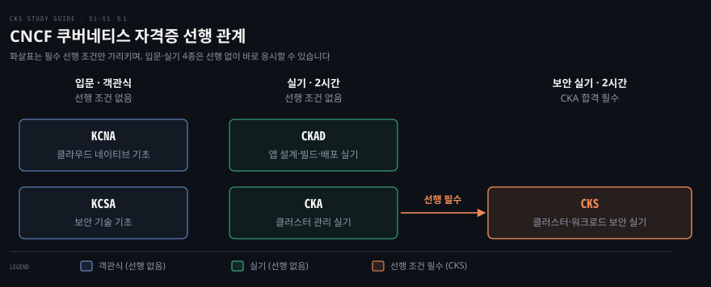
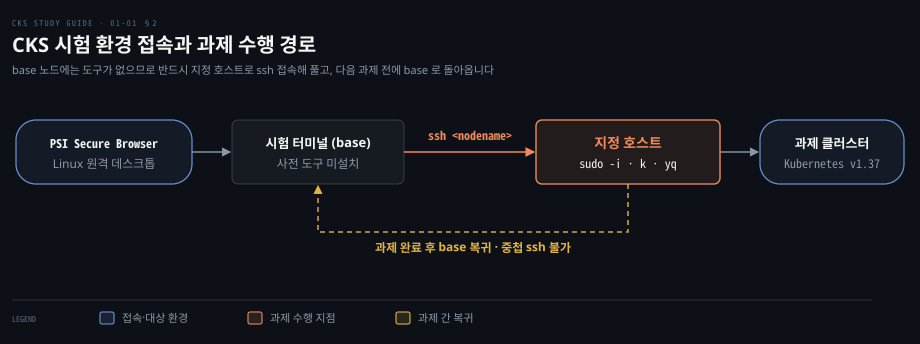
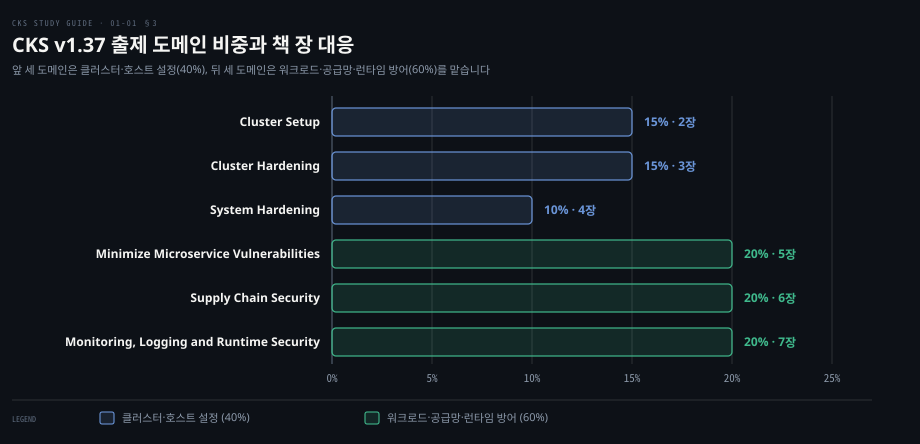

# CKS 시험의 범위와 준비 — 자격증 경로·출제 도메인·시험 환경
---

## 핵심 요약

> CKS 는 보안 지식을 외우는 시험이 아닙니다. 정해진 호스트에서 2시간 동안 클러스터 하드닝 과제를 명령으로 직접 풀어 내는 실기 시험이고, 이 책의 장 순서는 그 출제 도메인을 그대로 따릅니다.

CKS(Certified Kubernetes Security Specialist)는 CKA 합격자만 응시할 수 있습니다. CKA 는 Certified Kubernetes Administrator 의 약어입니다. 이 책도 독자가 관리자 수준의 쿠버네티스 지식을 이미 갖췄다고 보고 시작합니다.

시험은 여섯 도메인으로 나뉘며 비중이 10~20%입니다. 도메인마다 도구가 붙어 있어 어느 장에서 무엇을 다루는지 알면 공부 순서를 잡기 좋습니다. 시험 중에는 허용된 공식 문서만 열 수 있으므로 연습 단계부터 그 문서만 보고 찾는 편이 실전과 맞습니다.

이 노트의 값은 2026-11-27 에 공식 페이지에서 확인한 쿠버네티스 v1.37 기준입니다. 책의 명령과 YAML 은 쿠버네티스 1.26 기준으로 쓰였습니다.

## 학습 목표

이 내용을 읽고 나면:

1. KCNA·KCSA·CKAD·CKA·CKS 의 대상을 구분하고 CKS 응시에 CKA 합격이 필요하다는 점을 설명할 수 있습니다.
2. CKS 의 시험 형식(온라인 감독 실기, 2시간, 합격선 67%)과 시험 환경(지정 호스트에 ssh 접속)을 설명할 수 있습니다.
3. 출제 도메인 여섯과 비중을 말하고 각 도메인이 이 책의 몇 장에 대응하는지 짚을 수 있습니다.
4. 이 책이 다루는 보안 도구를 도메인과 짝지어 각각 무슨 일을 하는지 말할 수 있습니다.
5. 시험 중 열 수 있는 문서의 범위를 알고 그 범위에 맞춰 연습 환경을 고를 수 있습니다.

## 1. 자격증 경로에서 CKS 의 자리

> CKS 는 CKA 합격이 필수 선행 조건인 전문가 실기 시험입니다. 입문·실기 자격증 넷과 달리 선행 자격을 먼저 통과해야 응시할 수 있습니다.

선행 조건을 확인하지 않고 보안 자격증부터 신청하면 응시 자체가 막힙니다. CNCF 는 Cloud Native Computing Foundation 의 약어입니다. 아래 그림은 CNCF 쿠버네티스 자격증 다섯의 형식과 선행 조건 관계를 보여 줍니다.[^prereq][^certs]

그림에서 화살표가 놓인 자리는 CKA 에서 CKS 로 이어지는 한 곳뿐입니다. KCNA 와 KCSA 는 객관식 시험이고 CKAD 와 CKA 는 실기 시험입니다. 이 넷은 선행 조건 없이 바로 응시할 수 있습니다.[^certs] 책 1장은 CKS 가 관리자 수준의 쿠버네티스 이해를 전제하며 CNCF 가 CKA 합격을 선행 조건으로 요구한다고 설명합니다. 이 책도 CKA 와 겹치는 기초는 다시 설명하지 않습니다.

이하는 책(2023, 쿠버네티스 1.26) 이후 도입된 정책을 다룬 책 밖 보강입니다. Linux Foundation 은 2026-06-18 부터 CKA 경로에 **CARE 프로그램**을 적용했습니다. CARE 는 Certification Advancement & Recertification Experience 의 약어입니다. 이전에 CKA 에 합격했다면 만료 여부와 무관하게 2026-06-18 이후 CKS 를 취득·갱신할 때 기존 자격이 함께 연장됩니다. CKA 는 물론 이전에 취득한 KCSA 와 KCNA 유효 기간도 새 CKS 만료일에 맞춰 복원되거나 연장됩니다.[^care][^faq]

| 자격증 | 풀어 쓴 이름 | 대상과 초점 |
|--------|-------------|------------|
| KCNA | Kubernetes and Cloud Native Associate | 입문 자격증입니다. 쿠버네티스와 클라우드 네이티브 생태계의 기초 지식을 묻고 선행 조건이 없습니다 |
| KCSA | Kubernetes and Cloud Native Security Associate | 클라우드 네이티브 보안 기술의 기초 지식을 묻습니다. 선행 조건이 없고, 공식 페이지는 다음 단계로 CKA 를 안내합니다 |
| CKAD | Certified Kubernetes Application Developer | 클라우드 네이티브 애플리케이션을 쿠버네티스에 설계·빌드·배포하는 능력을 확인합니다 |
| CKA | Certified Kubernetes Administrator | 쿠버네티스 클러스터를 관리하는 능력을 확인합니다. 클러스터 구성·워크로드·네트워크·스토리지와 장애 해결을 다룹니다 |
| CKS | Certified Kubernetes Security Specialist | CKA 를 확장해 컨테이너 애플리케이션과 쿠버네티스 플랫폼을 빌드·배포·런타임 단계에서 지키는 방법을 다룹니다 |

## 2. 시험 방식과 쿠버네티스 버전

> CKS 는 2시간 동안 온라인 감독 아래 지정 호스트에 접속해 과제 15~20개를 푸는 실기 시험이며, 합격선은 67% 이상입니다.

시험 터미널이 처음 여는 기준 노드(`base`)에는 풀이 도구가 설치되어 있지 않아 그대로 명령을 치면 막힙니다. 응시자는 PSI Secure Browser 의 Linux 원격 데스크톱에서 터미널을 엽니다. 이어서 과제마다 안내된 지정 호스트로 `ssh` 접속해 클러스터를 다룹니다.[^exam][^env]

위 흐름처럼 과제 하나를 마칠 때마다 `base` 노드로 돌아와 다음 과제의 지정 호스트로 이동해야 합니다. 지정 호스트에서 다시 다른 호스트로 `ssh` 를 여는 중첩 접속은 지원되지 않습니다.[^env]

CKS 는 온라인 감독 아래 명령줄에서 과제 15~20개를 푸는 실기 시험이고 제한 시간은 2시간입니다.[^exam][^env] 합격선은 67% 이상이며 결과는 시험 종료 뒤 24시간 안에 이메일로 옵니다.[^faq]

지정 호스트의 풀이 규칙은 다음과 같습니다.

- 지정 호스트에는 `ssh <노드 이름>` 으로 접속합니다.
- `ssh` 안에서 다시 `ssh` 를 여는 중첩 접속은 지원되지 않습니다.
- 과제를 마치면 기준 노드(hostname `base`)로 돌아옵니다.
- 관리자 권한은 `sudo -i` 나 `sudo` 로 얻습니다.

지정 호스트에는 도구가 미리 설치되어 있습니다. `k` 별칭과 자동 완성이 붙은 kubectl, YAML 처리용 yq, curl·wget, man 문서가 그것입니다. `base` 에는 이 도구들이 없으므로 과제는 반드시 지정 호스트에서 풉니다.[^env]

시험 환경 버전과 응시료는 책(2023, 쿠버네티스 1.26) 이후 현행 기준으로 확인한 책 밖 보강입니다. 시험 환경은 쿠버네티스 v1.37 로 안내됩니다. 새 마이너 버전이 나오면 대략 4~8주 안에 그 버전으로 맞춰집니다.[^exam][^faq]

| 항목 | 값 | 확인한 곳 |
|------|----|----------|
| 제한 시간 | 2시간 | 공식 CKS 페이지 |
| 합격선 | 67% 이상 | 공식 FAQ |
| 응시료 | 시험만 $445 | 공식 CKS 페이지 |
| 재응시 | 한 번의 재응시 포함 | 공식 CKS 페이지 |
| 응시 가능 기간 | 등록 후 12개월 | 공식 CKS 페이지 |
| 인증 유효 기간 | 2년 | 공식 CKS 페이지·FAQ |
| 시험 환경 | 쿠버네티스 v1.37 | 공식 CKS 페이지·FAQ |

## 3. 출제 도메인 여섯과 책의 장 대응

> CKS 출제 도메인 여섯의 비중 합계는 100%이며, 책의 2~7장은 이 도메인 순서를 한 장에 하나씩 그대로 따릅니다.

비중이 큰 도메인에 공부 시간을 더 씁니다. 아래 막대 차트는 CNCF 커리큘럼 v1.37 의 도메인 비중과 각 도메인에 대응하는 책의 장 번호를 비교해 보여 줍니다.[^cur]

차트 위쪽의 세 도메인은 클러스터와 호스트 설정으로 40%를 차지합니다. 아래쪽의 세 도메인은 워크로드·공급망·런타임 방어로 각각 20%씩 모두 60%입니다. 책의 2~7장이 도메인 순서를 그대로 따르므로 비중이 큰 5·6·7장에 공부 시간을 더 배분할 수 있습니다.

| 도메인 | 비중 | 커리큘럼이 요구하는 능력 | 책의 장 |
|--------|----:|------------------------|--------|
| Cluster Setup | 15% | 네트워크 보안 정책으로 클러스터 수준 접근 제한, CIS(Center for Internet Security) 벤치마크로 구성 점검, Ingress 에 TLS(Transport Layer Security) 설정, 노드 메타데이터·엔드포인트 보호, 플랫폼 바이너리 검증 | 2장 |
| Cluster Hardening | 15% | RBAC(Role-Based Access Control)로 노출 최소화, 서비스 어카운트 사용 주의, 쿠버네티스 API 접근 제한, 취약점 회피를 위한 업그레이드 | 3장 |
| System Hardening | 10% | 호스트 OS 발자국 줄이기, 최소 권한 IAM(Identity and Access Management), 외부 네트워크 접근 줄이기, AppArmor·seccomp 같은 커널 하드닝 도구 사용 | 4장 |
| Minimize Microservice Vulnerabilities | 20% | Pod 보안 표준 적용, Secret 관리, 격리 기법(멀티테넌시·샌드박스 컨테이너), Pod 간 암호화(Cilium·Istio) | 5장 |
| Supply Chain Security | 20% | 베이스 이미지 최소화, 공급망 이해(SBOM(Software Bill of Materials)·CI·CD·아티팩트 저장소), 허용 레지스트리·서명 검증, 워크로드와 이미지의 정적 분석(Kubesec·KubeLinter) | 6장 |
| Monitoring, Logging and Runtime Security | 20% | 행위 분석으로 악성 활동 탐지, 인프라·앱·네트워크·워크로드 전반의 위협 탐지, 공격 단계 조사, 런타임 컨테이너 불변성, 감사 로그로 접근 감시 | 7장 |

책은 장마다 공격 시나리오를 먼저 보이고 그것을 막는 개념·방법·도구를 붙입니다. 위험의 크기를 먼저 가늠한 뒤 대응을 고르는 방식으로 연습할 수 있습니다.

## 4. 시험에 나오는 오브젝트와 외부 도구

> 시험 과제는 기본 쿠버네티스 오브젝트와 CRD, 그리고 여섯 도메인별 보안 도구를 함께 엮어 출제합니다.

RBAC 이나 NetworkPolicy 한 가지만 단독으로 고쳐서는 여러 계층을 엮어 묻는 실기 과제를 끝낼 수 없습니다. 시험 과제는 핵심 쿠버네티스 오브젝트와 오픈소스 프로젝트가 추가하는 **CRD** 를 함께 묻습니다. CRD 는 Custom Resource Definition(사용자 정의 리소스 정의)의 약어입니다. 예를 들어 OPA(Open Policy Agent) Gatekeeper 는 `ConstraintTemplate` 이라는 오브젝트를 추가합니다.

시험은 도메인별 보안 도구를 다룰 줄 아는지도 묻습니다. 아래 표는 각 도메인에서 쓰는 보안 도구와 그 도구를 다루는 책의 장을 정리한 목록입니다. 원리는 형제 노트가 맡으므로 여기서는 도구별 역할과 연결 장만 적습니다.

표의 KubeLinter 와 뒤의 bom 설명은 책(2023) 이후 갱신된 v1.37 커리큘럼 및 시험 허용 문서 목록을 반영한 책 밖 보강입니다.

| 도구 | 하는 일 | 도메인 | 책의 장 | 원리를 설명한 노트 |
|------|--------|--------|--------|------------------|
| kube-bench | CIS 벤치마크로 클러스터 구성을 점검해 고칠 항목 목록을 냅니다 | Cluster Setup | 2장 | |
| AppArmor | 프로세스가 접근할 수 있는 자원을 프로파일로 제한하는 커널 모듈입니다 | System Hardening | 4장 | [컨테이너 격리 강화](../container-security/08-01.%EC%BB%A8%ED%85%8C%EC%9D%B4%EB%84%88%20%EA%B2%A9%EB%A6%AC%20%EA%B0%95%ED%99%94%20%E2%80%94%20%EC%83%8C%EB%93%9C%EB%B0%95%EC%8B%B1%EC%9D%98%20%EC%84%B8%20%EA%B0%88%EB%9E%98.md) 3절 |
| seccomp | 프로세스가 부를 수 있는 시스템 콜을 좁힙니다 | System Hardening | 4장 | [컨테이너 격리 강화](../container-security/08-01.%EC%BB%A8%ED%85%8C%EC%9D%B4%EB%84%88%20%EA%B2%A9%EB%A6%AC%20%EA%B0%95%ED%99%94%20%E2%80%94%20%EC%83%8C%EB%93%9C%EB%B0%95%EC%8B%B1%EC%9D%98%20%EC%84%B8%20%EA%B0%88%EB%9E%98.md) 2절 |
| gVisor | 사용자 공간에서 커널을 다시 구현해 컨테이너를 샌드박싱하는 런타임입니다 | Minimize Microservice Vulnerabilities | 5장 | [컨테이너 격리 강화](../container-security/08-01.%EC%BB%A8%ED%85%8C%EC%9D%B4%EB%84%88%20%EA%B2%A9%EB%A6%AC%20%EA%B0%95%ED%99%94%20%E2%80%94%20%EC%83%8C%EB%93%9C%EB%B0%95%EC%8B%B1%EC%9D%98%20%EC%84%B8%20%EA%B0%88%EB%9E%98.md) 4절 |
| Kata Containers | 컨테이너를 경량 VM 안에서 실행하는 샌드박스 런타임입니다 | Minimize Microservice Vulnerabilities | 5장 | [컨테이너 격리 강화](../container-security/08-01.%EC%BB%A8%ED%85%8C%EC%9D%B4%EB%84%88%20%EA%B2%A9%EB%A6%AC%20%EA%B0%95%ED%99%94%20%E2%80%94%20%EC%83%8C%EB%93%9C%EB%B0%95%EC%8B%B1%EC%9D%98%20%EC%84%B8%20%EA%B0%88%EB%9E%98.md) 5절 |
| Cilium · Istio | Pod 간 트래픽을 암호화합니다. Cilium 은 CNI(Container Network Interface) 플러그인으로 WireGuard 암호화를, Istio 는 서비스 메시로 mTLS(mutual TLS, 양쪽이 서로 인증서를 확인하는 TLS)를 붙입니다 | Minimize Microservice Vulnerabilities | 5장 | |
| OPA Gatekeeper | 어드미션 단계에서 정책을 강제합니다. 5장은 Pod 보안 설정에, 6장은 허용 레지스트리 제한에 씁니다 | Minimize Microservice Vulnerabilities · Supply Chain Security | 5장·6장 | [Policy and Governance](../kubernetes-up-and-running/20-01.Policy%20and%20Governance%20%E2%80%94%20Gatekeeper%20%EB%A1%9C%20%EB%A7%8C%EB%93%A4%EA%B8%B0%20%EC%A0%84%EC%97%90%20%EB%A7%89%EA%B3%A0%20%EB%A7%8C%EB%93%A0%20%EB%92%A4%EC%97%90%20%EC%84%B8%EB%8A%94%20%EB%B2%95.md) |
| Trivy | 컨테이너 이미지의 알려진 취약점을 스캔합니다 | Supply Chain Security | 6장 | [이미지 속 소프트웨어 취약점](../container-security/07-01.%EC%9D%B4%EB%AF%B8%EC%A7%80%20%EC%86%8D%20%EC%86%8C%ED%94%84%ED%8A%B8%EC%9B%A8%EC%96%B4%20%EC%B7%A8%EC%95%BD%EC%A0%90%20%E2%80%94%20CVE%EB%B6%80%ED%84%B0%20%EC%8A%A4%EC%BA%94%20%EC%9A%B4%EC%98%81%EA%B9%8C%EC%A7%80.md) |
| Kubesec | 쿠버네티스 매니페스트를 정적 분석해 위험한 설정을 찾습니다 | Supply Chain Security | 6장 | |
| KubeLinter | 쿠버네티스 YAML·Helm 차트·Kustomize 매니페스트를 정적 분석해 위험한 설정을 찾습니다[^kl] | Supply Chain Security | — | |
| Falco | 런타임 행위를 관찰해 악성 활동을 탐지합니다 | Monitoring, Logging and Runtime Security | 7장 | [컨테이너 런타임 보호](../container-security/13-01.%EC%BB%A8%ED%85%8C%EC%9D%B4%EB%84%88%20%EB%9F%B0%ED%83%80%EC%9E%84%20%EB%B3%B4%ED%98%B8%20%E2%80%94%20%EC%A0%95%EC%83%81%EC%9D%84%20%EC%A0%95%EC%9D%98%ED%95%B4%20%EC%9D%B4%EC%83%81%EC%9D%84%20%EC%9E%A1%EB%8B%A4.md) 3절 |

커리큘럼 항목에는 SBOM 도 올라 있습니다.[^cur] SBOM 을 만들고 살펴보는 도구 bom 의 CLI 문서는 시험 중에 열 수 있습니다.[^bom]

## 5. 시험 중 문서와 연습 방법

> 시험 중에는 VM 브라우저의 허용 문서 8곳과 배포판 로컬 문서만 열 수 있으므로, 연습 단계부터 허용 문서와 시뮬레이터에 익숙해져야 합니다.

평소 일반 웹 검색에 기대어 YAML 예제를 찾으면 외부 검색이 막힌 시험 환경에서 과제를 시간 안에 풀기 어렵습니다. 시험 중에는 원격 데스크톱 안의 브라우저로 허용 목록에 있는 문서만 열 수 있습니다.[^allowed]

| 문서 | 주소 |
|------|------|
| 쿠버네티스 문서 | https://kubernetes.io/docs/ |
| 쿠버네티스 블로그 | https://kubernetes.io/blog/ |
| Falco | https://falco.org/docs/ |
| bom | https://kubernetes-sigs.github.io/bom/cli-reference/ |
| etcd | https://etcd.io/docs/ |
| NGINX Ingress Controller | https://kubernetes.github.io/ingress-nginx/user-guide/nginx-configuration/ |
| Cilium | https://docs.cilium.io/ |
| Istio | https://istio.io/latest/docs/ |

쿠버네티스 문서의 검색 기능은 쓸 수 있지만 외부 검색 결과를 여는 것은 안 됩니다. 과제의 빠른 참조(Quick Reference) 상자에도 필요한 문서 링크가 들어 있을 수 있습니다. 문서의 코드는 터미널에 복사해 붙일 수 있습니다. 터미널에서는 리눅스 단축키 `Ctrl+Shift+C`·`Ctrl+Shift+V` 를 씁니다.[^env] 터미널에서는 배포판이 설치한 문서(`/usr/share` 와 그 아래 디렉터리)도 읽을 수 있습니다.[^allowed] 허용 목록은 시험 전에 공식 안내에서 다시 확인합니다.

실기 시험은 손으로 명령을 치는 속도와 정확도가 합격을 좌우합니다. 그래서 실제로 동작하는 클러스터에서 반복해 연습해야 합니다. 책이 추천하는 방법은 다음과 같습니다.

- Vagrant 와 VirtualBox 로 가상머신 한 대 이상을 띄우면 격리된 클러스터를 만들고 지우기 쉽습니다. 책의 연습 문제 일부가 이 구성에서 출발합니다.
- 개발 머신에 Minikube 로 간단한 클러스터를 설치합니다. Ingress·스토리지 클래스 같은 기능은 애드온을 명령 하나로 켤 수 있어 실험하기 편합니다.
- O'Reilly 학습 플랫폼 구독자는 쿠버네티스 환경 실습과 CKS 연습 시험을 쓸 수 있습니다.

시험을 등록하면 Killer Shell(killer.sh)의 시험 시뮬레이터를 쓸 수 있습니다. 단, `CKS-SINGLE` 등록에는 시뮬레이터가 들어 있지 않습니다.

시뮬레이터는 두 번 시도할 수 있고 시도마다 활성화 시점부터 36시간 동안 열립니다. 한 세션은 17문항입니다. 두 번째 시도에는 첫 번째와 다른 17문항이 나옵니다. 끝나면 채점 결과를 받습니다.[^sim]

Killer Shell 은 CKA·CKAD 같은 다른 자격증의 시뮬레이터도 냅니다. 책 1장이 소개하는 상용 연습 환경으로 Study4exam 의 CKS 연습 시험이 있습니다.

## 참고 자료

- 원본: 《Certified Kubernetes Security Specialist (CKS) Study Guide》(Benjamin Muschko, O'Reilly, 2023, ISBN 978-1098132972) Chapter 1
- [Certified Kubernetes Security Specialist (CKS) — Linux Foundation](https://training.linuxfoundation.org/certification/certified-kubernetes-security-specialist/) — 시험 형식·버전·응시료·선행 조건·도메인 비중
- [CARE Program — Linux Foundation](https://training.linuxfoundation.org/care-program/) — CKS 취득·갱신 시 CKA·KCSA·KCNA 자동 연장 정책
- [CKA, CKAD, CKS FAQ](https://docs.linuxfoundation.org/tc-docs/certification/faq-cka-ckad-cks) — 합격선·유효 기간·CARE 적용일
- [CKS 시험 안내](https://docs.linuxfoundation.org/tc-docs/certification/important-instructions-cks) — 시험 환경
- [시험 중 허용 자료](https://docs.linuxfoundation.org/tc-docs/certification/certification-resources-allowed#certified-kubernetes-security-specialist-cks) — CKS 항목
- [CNCF CKS 커리큘럼 v1.37](https://github.com/cncf/curriculum/blob/main/CKS_Curriculum%20v1.37.pdf) — 도메인과 항목
- [CNCF 자격증 목록](https://www.cncf.io/training/certification/)
- [KubeLinter](https://github.com/stackrox/kube-linter) · [bom](https://github.com/kubernetes-sigs/bom) · [Killer Shell](https://killer.sh/)
- [CKS Study Guide 정독 인덱스](./README.md) — 이 책의 장별 목표와 진행 상태
- [컨테이너 격리 강화](../container-security/08-01.%EC%BB%A8%ED%85%8C%EC%9D%B4%EB%84%88%20%EA%B2%A9%EB%A6%AC%20%EA%B0%95%ED%99%94%20%E2%80%94%20%EC%83%8C%EB%93%9C%EB%B0%95%EC%8B%B1%EC%9D%98%20%EC%84%B8%20%EA%B0%88%EB%9E%98.md) · [이미지 공급망 보안](../container-security/06-02.%EC%9D%B4%EB%AF%B8%EC%A7%80%20%EA%B3%B5%EA%B8%89%EB%A7%9D%20%EB%B3%B4%EC%95%88%20%E2%80%94%20%EB%B9%8C%EB%93%9C%EB%B6%80%ED%84%B0%20%EB%B0%B0%ED%8F%AC%EA%B9%8C%EC%A7%80.md) · [컨테이너 런타임 보호](../container-security/13-01.%EC%BB%A8%ED%85%8C%EC%9D%B4%EB%84%88%20%EB%9F%B0%ED%83%80%EC%9E%84%20%EB%B3%B4%ED%98%B8%20%E2%80%94%20%EC%A0%95%EC%83%81%EC%9D%84%20%EC%A0%95%EC%9D%98%ED%95%B4%20%EC%9D%B4%EC%83%81%EC%9D%84%20%EC%9E%A1%EB%8B%A4.md) — 4절 표의 도구 원리를 맡는 형제 노트

[^prereq]: Linux Foundation CKS 페이지의 Prerequisites 항목. "CKS candidates must have taken and passed the CKA exam prior to attempting the CKS exam." <https://training.linuxfoundation.org/certification/certified-kubernetes-security-specialist/> (2026-11-27 조회)
[^care]: Linux Foundation CARE Program 페이지와 FAQ. 2026-06-18 이후 CKS 취득·갱신 시 기존 CKA(만료 상태 포함) 및 이전에 취득한 KCSA·KCNA 유효 기간이 새 CKS 만료일에 맞춰 연장·복원됩니다. <https://training.linuxfoundation.org/care-program/>, <https://docs.linuxfoundation.org/tc-docs/certification/faq-cka-ckad-cks> (2026-11-27 조회)
[^certs]: KCNA·KCSA 는 온라인 감독 객관식, CKAD·CKA 는 온라인 감독 실기 시험이고, KCNA·KCSA·CKAD·CKA 모두 선행 조건이 없습니다. <https://www.cncf.io/training/certification/>, <https://training.linuxfoundation.org/certification/kubernetes-cloud-native-associate/>, <https://training.linuxfoundation.org/certification/kubernetes-and-cloud-native-security-associate-kcsa/>, <https://training.linuxfoundation.org/certification/certified-kubernetes-application-developer-ckad/>, <https://training.linuxfoundation.org/certification/certified-kubernetes-administrator-cka/> (2026-11-27 조회)
[^exam]: 시험 시간 2시간, 온라인 감독 실기 형식, 응시료 시험만 $445, 한 번의 재응시, 등록 후 12개월 응시 가능, 인증 유효 2년, 쿠버네티스 v1.37. <https://training.linuxfoundation.org/certification/certified-kubernetes-security-specialist/> (2026-11-27 조회)
[^faq]: CKS 합격선 67% 이상, 결과 이메일 통보는 시험 종료 24시간 이내, CKS 인증 유효 2년, CKS 시험 환경 쿠버네티스 v1.37. <https://docs.linuxfoundation.org/tc-docs/certification/faq-cka-ckad-cks> (2026-11-27 조회)
[^env]: 과제 15~20개, 지정 호스트·ssh·`sudo -i`·사전 설치 도구(kubectl·yq·curl·wget·man)·`base` 노드의 제약, 터미널 복사·붙여넣기 단축키. <https://docs.linuxfoundation.org/tc-docs/certification/important-instructions-cks> (2026-11-27 조회)
[^cur]: CNCF 커리큘럼 CKS v1.37 의 도메인과 비중. 같은 값이 Linux Foundation CKS 페이지의 Domains & Competencies 에도 있습니다. <https://github.com/cncf/curriculum/blob/main/CKS_Curriculum%20v1.37.pdf> (2026-11-27 조회)
[^allowed]: 시험 중 허용되는 문서와 조건. <https://docs.linuxfoundation.org/tc-docs/certification/certification-resources-allowed#certified-kubernetes-security-specialist-cks> (2026-11-27 조회)
[^sim]: 시도 2회, 회당 36시간, 세션당 17문항, 채점 결과 제공은 CKS 페이지, CKS-SINGLE 등록 제외는 FAQ 의 practice questions 항목, 다른 자격증 시뮬레이터는 Killer Shell 첫 화면, 두 시도의 문항이 다르다는 것은 CKS 페이지와 Killer Shell FAQ. <https://training.linuxfoundation.org/certification/certified-kubernetes-security-specialist/>, <https://docs.linuxfoundation.org/tc-docs/certification/faq-cka-ckad-cks>, <https://killer.sh/>, <https://killer.sh/faq> (2026-11-27 조회)
[^kl]: <https://github.com/stackrox/kube-linter> README (2026-11-27 조회)
[^bom]: bom 은 SBOM 을 만들고 살펴보는 도구입니다. <https://github.com/kubernetes-sigs/bom> README. 시험 중 열 수 있다는 것은 <https://docs.linuxfoundation.org/tc-docs/certification/certification-resources-allowed#certified-kubernetes-security-specialist-cks> (2026-11-27 조회)
