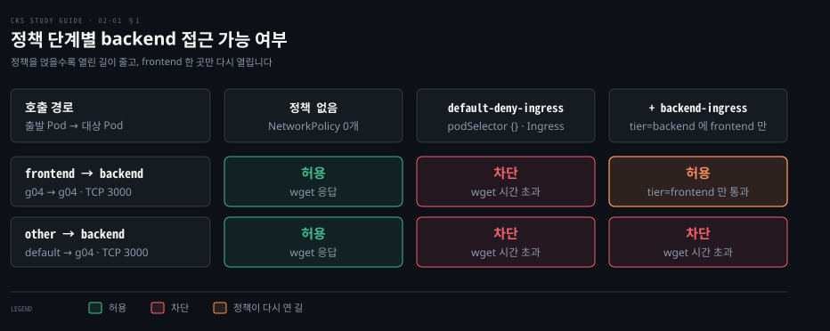
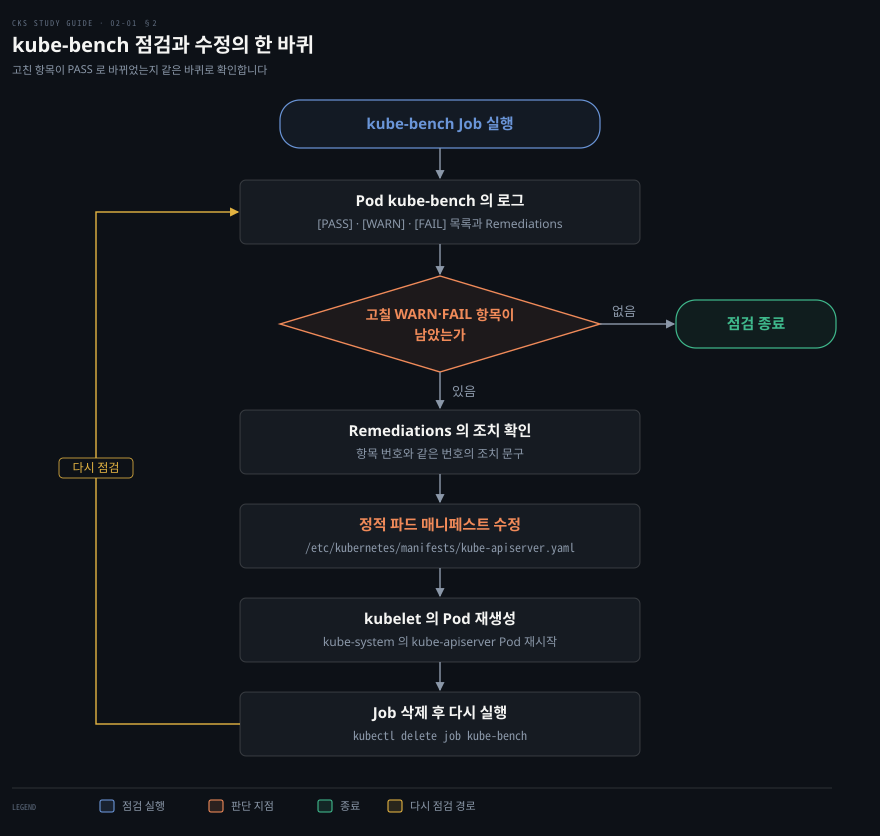
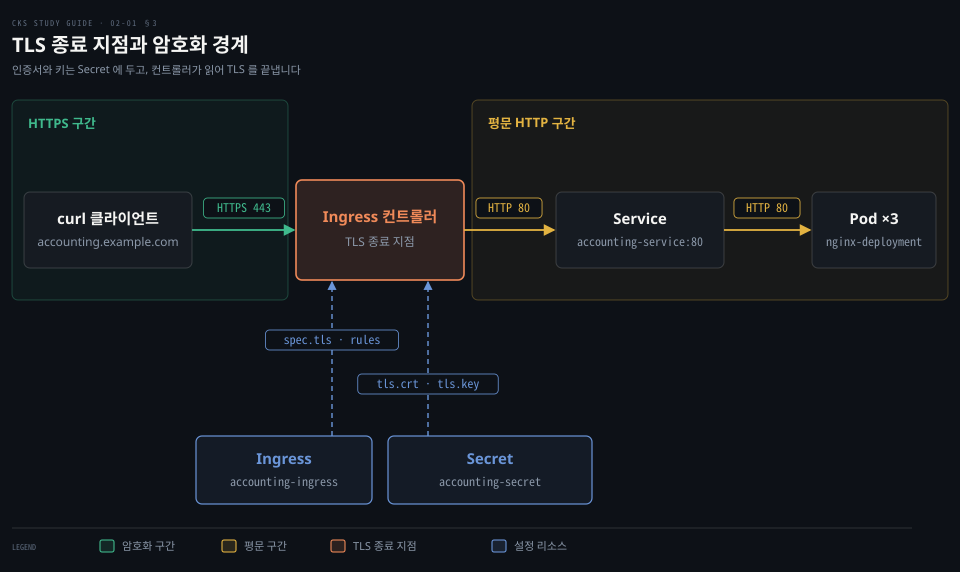

# 클러스터 경계 세우기 — NetworkPolicy·CIS 벤치마크·TLS Ingress
---

## 핵심 요약

> 쿠버네티스는 기본값이 열려 있는 시스템이라, 클러스터 경계는 네트워크 정책으로 닫고 벤치마크 도구로 점검하고 입구의 TLS 로 감싸는 세 단계로 세웁니다.

파드 사이 통신은 NetworkPolicy 가 고르기 전까지 막히는 곳이 없으므로, 네임스페이스를 기본 거부로 잠근 뒤 필요한 호출만 라벨로 다시 엽니다.

클러스터 구성요소의 설정은 CIS(Center for Internet Security) 벤치마크 항목으로 kube-bench 가 자동 점검하고, 지적은 정적 파드 매니페스트나 kubelet 설정에서 고칩니다.

클러스터 밖에서 오는 요청은 Ingress 가 받아 그 지점에서 TLS 를 끝내며, 인증서와 키는 `kubernetes.io/tls` Secret 에 둡니다.


## 학습 목표

이 내용을 읽고 나면:

1. 정책이 없는 클러스터에서 파드 하나가 뚫렸을 때 공격이 어디까지 번지는지 설명할 수 있습니다.
2. 기본 거부 정책과 허용 정책을 겹쳐 특정 파드의 호출만 열어 주는 NetworkPolicy 를 쓸 수 있습니다.
3. kube-bench Job 을 돌려 결과의 PASS·WARN·FAIL 을 읽고 조치할 위치를 찾을 수 있습니다.
4. 정적 파드 매니페스트를 고쳐 지적을 해소하고 같은 Job 으로 결과를 다시 확인할 수 있습니다.
5. 인증서와 키로 TLS Secret 과 `spec.tls` Ingress 를 만들고 curl 로 HTTPS 응답을 확인할 수 있습니다.


## 본문 정리

### 1. NetworkPolicy 로 파드 사이 통신 막기

파드는 NetworkPolicy 가 고르기 전까지 들어오는 방향과 나가는 방향 모두 격리되지 않습니다. 그래서 공격자가 파드 하나를 장악하면 다른 네임스페이스의 파드까지 포함해 클러스터 안의 어느 파드에든 연결을 시도할 수 있습니다.[^np-default] 정책은 네트워크 플러그인(CNI, Container Network Interface 플러그인)이 구현해야 효력이 생기므로, NetworkPolicy 를 지원하지 않는 플러그인 위에서는 정책을 만들어도 아무것도 막히지 않습니다.[^np-cni]

정책의 선택과 잠금 원리는 [04-03 의 「NetworkPolicy — 선택과 잠금」 절](../networking-and-kubernetes/04-03.NetworkPolicy%EC%99%80%20DNS%20%E2%80%94%20%ED%81%B4%EB%9F%AC%EC%8A%A4%ED%84%B0%20%EC%95%88%EC%9D%98%20%EB%B0%A9%ED%99%94%EB%B2%BD%EA%B3%BC%20%EC%9D%B4%EB%A6%84.md)에서 다뤘습니다. 여기서는 시험에서 자주 만드는 모양, 곧 기본 거부 하나와 허용 하나를 겹치는 순서만 따라갑니다.

실습에 쓸 파드는 세 개입니다. `g04` 네임스페이스에 `backend` 와 `frontend` 파드를 두고, `default` 네임스페이스에 `other` 파드를 둡니다. 네임스페이스와 파드의 라벨은 뒤의 정책이 고르는 대상이 되므로 눈여겨봅니다.

```yaml
apiVersion: v1
kind: Namespace
metadata:
  name: g04
  labels:
    app: orion
---
apiVersion: v1
kind: Pod
metadata:
  name: backend
  namespace: g04
  labels:
    tier: backend
spec:
  containers:
  - name: hello
    image: bmuschko/nodejs-hello-world:1.0.0
    ports:
    - containerPort: 3000
  restartPolicy: Never
---
apiVersion: v1
kind: Pod
metadata:
  name: frontend
  namespace: g04
  labels:
    tier: frontend
spec:
  containers:
  - name: frontend
    image: alpine
    args:
    - /bin/sh
    - -c
    - while true; do sleep 5; done;
  restartPolicy: Never
---
apiVersion: v1
kind: Pod
metadata:
  name: other
  labels:
    tier: outside
spec:
  containers:
  - name: other
    image: alpine
    args:
    - /bin/sh
    - -c
    - while true; do sleep 5; done;
  restartPolicy: Never
```

`backend` 의 파드 IP 를 변수에 담아 두 파드에서 3000 번 포트를 호출해 봅니다. 정책이 없는 지금은 `frontend` 와 `other` 모두 응답을 받습니다.

```bash
BACKEND_IP=$(kubectl get pod backend -n g04 -o jsonpath='{.status.podIP}')
kubectl exec frontend -n g04 -- wget --spider --timeout=1 "$BACKEND_IP:3000"
kubectl exec other -- wget --spider --timeout=1 "$BACKEND_IP:3000"
```

기본 거부는 빈 `podSelector` 로 네임스페이스의 모든 파드를 고르고 허용 규칙을 하나도 달지 않는 정책입니다. `policyTypes` 에 `Ingress` 만 적었으므로 막히는 것은 들어오는 방향뿐이고, 나가는 방향은 그대로 열려 있습니다.

```yaml
apiVersion: networking.k8s.io/v1
kind: NetworkPolicy
metadata:
  name: default-deny-ingress
  namespace: g04
spec:
  podSelector: {}
  policyTypes:
  - Ingress
```

이 정책을 적용한 뒤 같은 호출을 다시 보내면 두 파드 모두 `wget: download timed out` 으로 끝납니다. `other` 는 다른 네임스페이스에 있어도 막힙니다. 정책이 고른 파드로 들어오는 연결은 출발지가 어디든 허용 규칙이 있어야만 통과하기 때문입니다.

열어 줄 길은 허용 정책을 따로 하나 더 만들어 적습니다. 정책끼리는 충돌하지 않고 허용하는 연결의 합집합으로 합쳐지므로, 기본 거부는 그대로 둔 채 허용 정책만 늘리면 됩니다.[^np-add]

```yaml
apiVersion: networking.k8s.io/v1
kind: NetworkPolicy
metadata:
  name: backend-ingress
  namespace: g04
spec:
  podSelector:
    matchLabels:
      tier: backend
  policyTypes:
  - Ingress
  ingress:
  - from:
    - namespaceSelector:
        matchLabels:
          app: orion
      podSelector:
        matchLabels:
          tier: frontend
    ports:
    - protocol: TCP
      port: 3000
```

`from` 항목 하나에 `namespaceSelector` 와 `podSelector` 를 함께 적으면 두 조건을 모두 만족하는 파드만 고릅니다. 위 정책이 허용하는 것은 `app=orion` 라벨이 붙은 네임스페이스 안의 `tier=frontend` 파드뿐입니다. 두 셀렉터를 `-` 로 갈라 항목 둘로 적으면 합집합이 되어 허용 범위가 크게 넓어지므로 들여쓰기를 주의합니다.[^np-and] 네임스페이스를 이름으로 고르고 싶다면 컨트롤 플레인이 모든 네임스페이스에 붙이는 불변 라벨 `kubernetes.io/metadata.name` 을 씁니다.[^np-meta]

허용 정책까지 적용하면 `frontend` 의 호출은 다시 응답을 받고 `other` 의 호출은 계속 시간 초과로 끝납니다. 세 단계에서 두 호출 경로가 어떻게 달라지는지는 아래 행렬이 한눈에 보입니다.



같은 방식으로 나가는 방향을 기본 거부하면 DNS 조회도 함께 막힙니다. 이름 해석이 필요한 파드라면 클러스터 DNS 로 가는 53 번 포트를 허용하는 정책을 따로 둬야 합니다.[^np-dns] 연습 문제 1 이 바로 이 모양입니다. 네트워크 방어를 계층별로 나눠 보는 관점은 [10-01 의 네트워크 보안 노트](../container-security/10-01.%EC%BB%A8%ED%85%8C%EC%9D%B4%EB%84%88%20%EB%84%A4%ED%8A%B8%EC%9B%8C%ED%81%AC%20%EB%B3%B4%EC%95%88%20%E2%80%94%20%EA%B3%84%EC%B8%B5%EB%B3%84%EB%A1%9C%20%EB%82%98%EB%88%A0%20%EB%A7%89%EA%B8%B0.md)에 있습니다.


### 2. CIS 벤치마크와 kube-bench 점검

컨트롤 플레인과 노드의 설정은 기본값 그대로 두면 불필요한 공격 면을 남기기 때문에, 사람이 항목을 외워 점검하는 대신 CIS 벤치마크를 자동으로 돌리는 도구를 씁니다. CIS Kubernetes Benchmark 는 쿠버네티스 구성요소별 권장 설정을 점검 항목으로 모아 둔 목록이고, kube-bench 는 그 항목을 노드에서 검사해 결과와 조치 문구를 돌려주는 도구입니다.

kube-bench 의 최신 릴리스는 2026-08-05 의 v0.16.0 입니다.[^kb-rel] 실행 중인 쿠버네티스 버전을 자동으로 감지해 대응하는 벤치마크 버전을 고르므로 점검할 벤치마크를 직접 지정하지 않아도 됩니다.[^kb-auto] v0.16.0 의 지원 목록에는 CIS Kubernetes Benchmark 1.12 까지 들어 있습니다.[^kb-platforms]

CIS 1.12 는 쿠버네티스 1.32~1.34 용입니다. 그보다 새 클러스터는 대응표에서 가장 가까운 아래 버전을 찾아 1.12 로 점검됩니다.[^kb-map]

관리형 클라우드 클러스터(GKE·EKS·AKS 등)는 컨트롤 플레인 노드에 접근할 수 없어 워커 노드 설정만 검사할 수 있고, 클라우드별 Job 파일이 저장소에 따로 있습니다.[^kb-managed]

가장 간단한 실행은 클러스터 안에서 Job 으로 돌리는 방법입니다. 저장소 루트의 `job.yaml` 은 `kube-bench` 라는 이름의 Job 이고, 노드의 설정 디렉터리를 읽기 전용으로 마운트하며 `hostPID: true` 로 노드의 프로세스를 봅니다.[^kb-job] 태그를 고정한 주소로 적용하면 실행할 때마다 같은 매니페스트가 쓰입니다.

```bash
kubectl apply -f https://raw.githubusercontent.com/aquasecurity/kube-bench/v0.16.0/job.yaml
kubectl get pods -l app=kube-bench
kubectl logs job/kube-bench > kube-bench-results.txt
```

파드가 `Completed` 가 되면 검사가 끝난 것이며 결과는 파드 로그에 있습니다.

위 Job 은 어느 노드에 뜰지 정해 두지 않아 기본 상태에서는 워커 노드가 검사 대상이 되기 쉽습니다. 컨트롤 플레인을 검사하려면 파드가 그 노드에서 실행되도록 배치 조건을 더해야 합니다.[^kb-cp]

kubeadm 으로 만든 컨트롤 플레인 노드에는 `node-role.kubernetes.io/control-plane` 라벨이 있습니다. 같은 이름의 `NoSchedule` 테인트도 걸려 있으므로 라벨의 존재를 조건으로 삼고 테인트를 허용하는 두 항목을 `spec.template.spec` 에 더합니다.[^label]

```yaml
affinity:
  nodeAffinity:
    requiredDuringSchedulingIgnoredDuringExecution:
      nodeSelectorTerms:
      - matchExpressions:
        - key: node-role.kubernetes.io/control-plane
          operator: Exists
tolerations:
- key: node-role.kubernetes.io/control-plane
  operator: Exists
  effect: NoSchedule
```

결과 로그는 점검 구간의 제목과 항목별 줄, 조치 모음, 개수 요약으로 이어집니다. 항목 줄은 판정, 항목 번호, 점검 내용, 점검 방식이 한 줄에 놓입니다.

```bash
[PASS] 1.1.1 Ensure that the API server pod specification file permissions are set to 600 or more restrictive (Automated)
[WARN] 1.2.1 Ensure that the --anonymous-auth argument is set to false (Manual)
[FAIL] 1.2.5 Ensure that the --kubelet-certificate-authority argument is set as appropriate (Automated)
```

위 세 줄은 벤치마크 1.12 항목의 문구이며 실제 판정은 클러스터 설정에 따라 달라집니다. `[PASS]` 는 통과, `[FAIL]` 은 기준 위반, `[WARN]` 은 사람이 직접 확인하라는 표시입니다.

점검 방식이 `Manual` 인 항목은 점수에 들어가지 않아(`scored: false`) 검사가 실패해도 `[FAIL]` 이 아니라 `[WARN]` 으로 나옵니다. 검사 명령 없이 `type: manual` 로 표시된 항목(예: 1.2.20 `--request-timeout`)만 kube-bench 가 판정하지 않고 늘 `[WARN]` 을 냅니다.[^kb-check] WARN 이 많다고 설정이 나쁘다는 뜻은 아니므로 값을 한 번 열어 보라는 안내로 읽으면 됩니다. 한꺼번에 모두 없앨 필요도 없습니다.

항목 번호는 로그 뒤쪽 `Remediations` 구간의 조치 번호와 같습니다. 컨트롤 플레인 항목의 조치는 대개 `kube-apiserver.yaml` 같은 정적 파드 매니페스트를 고치라는 내용입니다.

kubeadm 클러스터에서 컨트롤 플레인 구성요소는 정적 파드이고 매니페스트는 노드의 `/etc/kubernetes/manifests` 에 있습니다. kubelet 이 이 디렉터리를 주기적으로 살펴 파일이 생기거나 바뀌면 정적 파드를 만들고 다시 만듭니다.[^static]

벤치마크 1.2.11(AlwaysPullImages)의 조치는 API 서버의 `--enable-admission-plugins` 값에 `AlwaysPullImages` 를 포함하라는 것입니다.[^kb-items] 이 어드미션 플러그인은 새 파드의 이미지 풀 정책을 `Always` 로 강제합니다.[^adm]

```bash
sudo cp /etc/kubernetes/manifests/kube-apiserver.yaml ~/kube-apiserver.yaml.orig
sudo vim /etc/kubernetes/manifests/kube-apiserver.yaml
```

수정 전에 사본을 매니페스트 디렉터리 바깥에 둡니다. kubelet 은 점으로 시작하지 않는 파일을 모두 매니페스트로 읽으므로 사본이 안에 있으면 의도하지 않은 파드가 생길 수 있습니다.[^static] 파일에서 `--enable-admission-plugins=` 줄 끝에 쉼표와 `AlwaysPullImages` 를 붙이고 저장하면, kubelet 이 `kube-system` 의 `kube-apiserver` 파드를 다시 만듭니다. 다시 뜨는 데 몇 초 걸리므로 `kubectl get pods -n kube-system` 이 응답할 때까지 기다립니다.

워커 노드 항목은 kubelet 쪽을 고칩니다. 벤치마크 1.12 의 4.2.1 은 kubelet 설정 파일에서 `authentication.anonymous.enabled` 를 `false` 로 두고 kubelet 서비스를 다시 시작하라고 안내합니다.[^kb-worker]

Job 은 한 번 끝나면 다시 실행되지 않으므로 지우고 새로 만들어야 고친 결과를 볼 수 있습니다. 1.2.11 은 컨트롤 플레인 항목입니다. 그래서 저장소의 `job.yaml` 을 그대로 다시 적용하지 않고 앞의 배치 조건을 더한 사본(여기서는 `job-control-plane.yaml`)을 적용합니다.

```bash
kubectl delete job kube-bench
kubectl apply -f job-control-plane.yaml   # job.yaml 에 affinity·tolerations 를 더한 사본
kubectl logs job/kube-bench | grep 1.2.11
```

고친 항목이 `[PASS]` 로 바뀌면 한 바퀴가 끝난 것입니다. 점검, 조치 확인, 매니페스트 수정, 파드 재생성, 재실행의 순환은 아래 흐름도와 같습니다.




### 3. TLS 종료 Ingress 만들기

Ingress 는 클러스터 밖의 HTTP(S) 요청을 규칙에 따라 Service 로 보내는 객체이고, 그 규칙을 실제로 처리하는 것은 Ingress 컨트롤러입니다. 컨트롤러 없이 Ingress 객체만 만들면 아무 일도 일어나지 않습니다.[^ing-ctrl] 규칙의 문법과 컨트롤러가 스펙과 분리되는 이유는 [05-03 의 「Ingress — 스펙과 구현의 분리」 절](../networking-and-kubernetes/05-03.Ingress%EC%99%80%20Service%20Mesh%20%E2%80%94%20L7%EC%9D%98%20%EB%91%90%20%EC%B8%B5.md)에서 다뤘습니다.

예제를 따라 하기 전에 알아 둘 현재 상태가 둘 있습니다. 하나는 Ingress API 가 동결되었다는 점입니다. 쿠버네티스 프로젝트는 새 구성에 Gateway API 를 권고합니다.[^ing-frozen]

다른 하나는 예제에서 흔히 쓰이는 Ingress NGINX 컨트롤러의 유지보수가 2026년 3월에 끝났다는 점입니다. 그 뒤로 릴리스·버그 수정·보안 취약점 수정이 없고 저장소는 읽기 전용으로 보관되었습니다.[^ing-retire]

그래서 아래 매니페스트의 `ingressClassName` 값은 예시입니다. 실제 값은 `kubectl get ingressclass` 로 클러스터에 설치된 컨트롤러의 IngressClass 이름을 확인해 넣습니다. Ingress 와 `spec.tls` 를 적는 모양은 컨트롤러와 상관없이 같지만 지원하는 TLS 기능에는 컨트롤러마다 차이가 있으므로, 쓰는 컨트롤러의 문서를 함께 확인합니다.[^ing-tls-gap]

TLS 는 Ingress 가 받는 지점에서 끝나고, 그 뒤 Service 와 파드까지의 구간은 평문입니다.[^ing-tls] 그래서 이 설정은 Service 마다 TLS 를 따로 다루는 부담을 덜어 주는 대신, 컨트롤러 뒤쪽 구간이 신뢰할 수 있는 네트워크일 때만 적절합니다. 흐름은 아래 구조도와 같습니다.



먼저 백엔드를 `t75` 네임스페이스에 만듭니다. 파드 셋을 가진 Deployment `nginx-deployment` 와, 그 파드를 라벨 `app=nginx` 로 고르는 Service `accounting-service` 입니다.

```yaml
apiVersion: v1
kind: Namespace
metadata:
  name: t75
---
apiVersion: apps/v1
kind: Deployment
metadata:
  name: nginx-deployment
  namespace: t75
  labels:
    app: nginx
spec:
  replicas: 3
  selector:
    matchLabels:
      app: nginx
  template:
    metadata:
      labels:
        app: nginx
    spec:
      containers:
      - name: nginx
        image: nginx:1.29.0
        ports:
        - containerPort: 80
---
apiVersion: v1
kind: Service
metadata:
  name: accounting-service
  namespace: t75
spec:
  selector:
    app: nginx
  ports:
  - protocol: TCP
    port: 80
    targetPort: 80
```

다음은 인증서와 키입니다. 시험과 실습에서는 자체 서명 인증서면 충분합니다. 운영에서는 인증 기관(CA)에서 받은 인증서를 쓰며, 키·인증서·CA 의 관계는 [11-01 의 TLS 노트](../container-security/11-01.TLS%EB%A1%9C%20%EC%BB%B4%ED%8F%AC%EB%84%8C%ED%8A%B8%20%EC%95%88%EC%A0%84%ED%95%98%EA%B2%8C%20%EC%97%B0%EA%B2%B0%ED%95%98%EA%B8%B0%20%E2%80%94%20%ED%82%A4%C2%B7%EC%9D%B8%EC%A6%9D%EC%84%9C%C2%B7CA%EC%9D%98%20%EC%97%AD%ED%95%A0.md)에 있습니다. 클라이언트는 접속한 호스트 이름을 인증서의 SAN(Subject Alternative Name)과 맞춰 보므로 호스트 이름을 SAN 에 넣어 둡니다.

```bash
openssl req -x509 -newkey rsa:2048 -nodes -days 365 \
  -keyout accounting.key \
  -out accounting.crt \
  -subj "/CN=accounting.example.com" \
  -addext "subjectAltName=DNS:accounting.example.com"
```

- `-x509` 는 인증서 요청 대신 자체 서명 인증서를 바로 만듭니다.
- `-newkey rsa:2048 -nodes` 는 암호 없는 2048비트 RSA 키를 함께 만듭니다.
- `-days 365` 는 유효 기간입니다.
- `-subj` 와 `-addext` 는 이름과 SAN 입니다.

인증서와 키는 `kubernetes.io/tls` 타입의 Secret 에 담습니다. 이 타입은 `tls.crt` 와 `tls.key` 두 키를 요구하고,[^secret-tls] `kubectl create secret tls` 가 파일에서 읽어 base64 로 인코딩해 줍니다.[^kcst]

```bash
kubectl create secret tls accounting-secret \
  --cert=accounting.crt \
  --key=accounting.key \
  -n t75
```

Ingress 는 `spec.tls` 에 호스트와 Secret 이름을 적고, `rules` 에서 같은 호스트를 Service 로 연결합니다.

```yaml
apiVersion: networking.k8s.io/v1
kind: Ingress
metadata:
  name: accounting-ingress
  namespace: t75
spec:
  ingressClassName: nginx   # kubectl get ingressclass 로 확인한 이름으로 바꿉니다
  tls:
  - hosts:
    - accounting.example.com
    secretName: accounting-secret
  rules:
  - host: accounting.example.com
    http:
      paths:
      - path: /
        pathType: Prefix
        backend:
          service:
            name: accounting-service
            port:
              number: 80
```

한 줄 명령으로도 같은 객체를 만들 수 있습니다. 규칙 문자열은 `host/path=service:port,tls=secret` 모양이고, 경로를 `/*` 로 적어야 `pathType` 이 `Prefix` 가 됩니다.[^kci] 규칙 형식에 공백이 없으므로 쉼표 뒤도 붙여 씁니다.

```bash
kubectl create ingress accounting-ingress \
  -n t75 \
  --class=nginx \
  --rule="accounting.example.com/*=accounting-service:80,tls=accounting-secret"
```

만든 뒤 `kubectl get ingress -n t75` 의 `PORTS` 열에 443 이 보이면 TLS 항목이 반영된 것입니다. 마지막으로 curl 로 응답을 확인합니다. 컨트롤러의 주소는 같은 출력의 `ADDRESS` 열에서 읽습니다. `--resolve` 는 `/etc/hosts` 를 고치지 않고 호스트 이름을 그 주소로 연결해 주고, `--cacert` 는 자체 서명 인증서를 신뢰할 CA 로 지정합니다.

```bash
curl --cacert accounting.crt \
  --resolve accounting.example.com:443:<컨트롤러 주소> \
  https://accounting.example.com/
```

인증서 검증을 끄는 `-k` 없이 nginx 의 기본 페이지가 오면, 호스트 이름과 SAN 이 맞고 컨트롤러가 Secret 의 인증서로 TLS 를 끝냈다는 뜻입니다.


## 연습 문제

> 세 문제는 나가는 방향을 막는 정책 하나를 만들고, 라벨이 다른 두 파드로 정책이 적용되는지 확인합니다.

1. 클러스터 밖의 도메인으로 나가는 트래픽을 막는 NetworkPolicy 를 만드십시오. 이 정책은 라벨 `app=backend` 가 붙은 파드에 적용하고, 다른 모든 네임스페이스의 파드로 가는 53 번 포트의 UDP 와 TCP 는 허용합니다.
2. `busybox:1.36.0` 이미지를 80 번 포트로 실행하는 파드 `allowed` 를 만들고 라벨 `app=frontend` 를 붙이십시오. 이 파드에서 `http://google.com` 으로 HTTP 호출을 보내십시오. 정책이 이 파드에 적용되지 않으므로 호출은 허용되어야 합니다.
3. `busybox:1.36.0` 이미지를 80 번 포트로 실행하는 파드 `denied` 를 하나 더 만들고 라벨 `app=backend` 를 붙이십시오. 이 파드에서 `http://google.com` 으로 HTTP 호출을 보내십시오. 호출은 차단되어야 합니다.


## 참고 자료

- 원본: 《Certified Kubernetes Security Specialist (CKS) Study Guide》(Benjamin Muschko, O'Reilly, 2023, ISBN 978-1098132972) Chapter 2
- [Network Policies — Kubernetes](https://kubernetes.io/docs/concepts/services-networking/network-policies/) — 기본 비격리·가산 결합·셀렉터·DNS 주의
- [Ingress — Kubernetes](https://kubernetes.io/docs/concepts/services-networking/ingress/) — 컨트롤러 요건·동결·TLS 종료 지점
- [Secrets — Kubernetes](https://kubernetes.io/docs/concepts/configuration/secret/) — `kubernetes.io/tls` 타입
- [kubectl create secret tls](https://kubernetes.io/docs/reference/kubectl/generated/kubectl_create/kubectl_create_secret_tls/) · [kubectl create ingress](https://kubernetes.io/docs/reference/kubectl/generated/kubectl_create/kubectl_create_ingress/)
- [Ingress NGINX Retirement: What You Need to Know](https://kubernetes.io/blog/2025/11/11/ingress-nginx-retirement/) · [kubernetes/ingress-nginx](https://github.com/kubernetes/ingress-nginx)
- [aquasecurity/kube-bench v0.16.0](https://github.com/aquasecurity/kube-bench/releases/tag/v0.16.0) — 실행 방법은 [docs/running.md](https://github.com/aquasecurity/kube-bench/blob/v0.16.0/docs/running.md)
- [정적 파드 만들기 — Kubernetes](https://kubernetes.io/docs/tasks/configure-pod-container/static-pod/) · [어드미션 컨트롤러 — Kubernetes](https://kubernetes.io/docs/reference/access-authn-authz/admission-controllers/) · [라벨·어노테이션·테인트 — Kubernetes](https://kubernetes.io/docs/reference/labels-annotations-taints/)
- [CKS Study Guide 정독 인덱스](./README.md) — 이 책의 장별 목표와 진행 상태
- [시험 중 문서와 연습 방법](./01-01.CKS%20%EC%8B%9C%ED%97%98%EC%9D%98%20%EB%B2%94%EC%9C%84%EC%99%80%20%EC%A4%80%EB%B9%84%20%E2%80%94%20%EC%9E%90%EA%B2%A9%EC%A6%9D%20%EA%B2%BD%EB%A1%9C%C2%B7%EC%B6%9C%EC%A0%9C%20%EB%8F%84%EB%A9%94%EC%9D%B8%C2%B7%EC%8B%9C%ED%97%98%20%ED%99%98%EA%B2%BD.md) — 시험 중 열 수 있는 문서 목록
- [NetworkPolicy 와 DNS](../networking-and-kubernetes/04-03.NetworkPolicy%EC%99%80%20DNS%20%E2%80%94%20%ED%81%B4%EB%9F%AC%EC%8A%A4%ED%84%B0%20%EC%95%88%EC%9D%98%20%EB%B0%A9%ED%99%94%EB%B2%BD%EA%B3%BC%20%EC%9D%B4%EB%A6%84.md) · [Ingress 와 Service Mesh](../networking-and-kubernetes/05-03.Ingress%EC%99%80%20Service%20Mesh%20%E2%80%94%20L7%EC%9D%98%20%EB%91%90%20%EC%B8%B5.md) · [TLS 로 컴포넌트 안전하게 연결하기](../container-security/11-01.TLS%EB%A1%9C%20%EC%BB%B4%ED%8F%AC%EB%84%8C%ED%8A%B8%20%EC%95%88%EC%A0%84%ED%95%98%EA%B2%8C%20%EC%97%B0%EA%B2%B0%ED%95%98%EA%B8%B0%20%E2%80%94%20%ED%82%A4%C2%B7%EC%9D%B8%EC%A6%9D%EC%84%9C%C2%B7CA%EC%9D%98%20%EC%97%AD%ED%95%A0.md) · [컨테이너 네트워크 보안](../container-security/10-01.%EC%BB%A8%ED%85%8C%EC%9D%B4%EB%84%88%20%EB%84%A4%ED%8A%B8%EC%9B%8C%ED%81%AC%20%EB%B3%B4%EC%95%88%20%E2%80%94%20%EA%B3%84%EC%B8%B5%EB%B3%84%EB%A1%9C%20%EB%82%98%EB%88%A0%20%EB%A7%89%EA%B8%B0.md)


## 정답 (자답 후 펼치기)

### 정답 1 — 나가는 트래픽을 막는 정책

`app=backend` 파드의 나가는 방향만 막고 모든 네임스페이스로 가는 53 번 포트만 열어 둡니다. `to` 의 `namespaceSelector: {}` 는 모든 네임스페이스의 파드를 고릅니다. 여기에 53 번 UDP·TCP 를 붙였으므로 클러스터 안 파드의 53 번 포트로 가는 연결만 통과하고, 그래서 클러스터 DNS 로 가는 이름 조회는 됩니다.

이름 해석은 되지만 그 밖의 포트로 나가는 연결은 열리지 않습니다.

```yaml
apiVersion: networking.k8s.io/v1
kind: NetworkPolicy
metadata:
  name: deny-egress-external
spec:
  podSelector:
    matchLabels:
      app: backend
  policyTypes:
  - Egress
  egress:
  - to:
    - namespaceSelector: {}
    ports:
    - port: 53
      protocol: UDP
    - port: 53
      protocol: TCP
```

```bash
kubectl apply -f deny-egress-external.yaml
```

### 정답 2 — 정책 밖 파드의 호출

`allowed` 는 라벨이 `app=frontend` 라서 위 정책이 고르지 않습니다. 이 파드의 나가는 방향은 격리되지 않은 상태 그대로이므로 호출이 응답을 받고 끝납니다. busybox 이미지에는 curl 이 없으니 같은 이미지의 `wget` 으로 HTTP 호출을 대신합니다.

```bash
kubectl run allowed \
  --image=busybox:1.36.0 \
  --labels=app=frontend \
  --port=80 \
  --restart=Never \
  -it --rm \
  -- wget --spider --timeout=5 --tries=1 http://google.com
```

- `--labels=app=frontend` 는 정책이 고르지 않는 라벨입니다.
- `-it --rm` 은 터미널에 연결해 결과를 보고 끝나면 파드를 지웁니다.
- `--spider` 는 내용을 받지 않고 응답 여부만 확인합니다.
- `--timeout=5` 는 응답을 5초까지 기다립니다.
- `--tries=1` 은 busybox 가 무시하는 GNU wget 호환 옵션이고, busybox 는 원래 한 번만 시도합니다.

### 정답 3 — 정책 대상 파드의 호출

`denied` 는 라벨이 `app=backend` 라서 정책의 대상입니다. 53 번 포트는 열려 있어 도메인 이름은 해석되지만 80 번 포트로의 연결은 허용 규칙이 없어 막히고, 호출은 시간 초과로 끝납니다.

```bash
kubectl run denied \
  --image=busybox:1.36.0 \
  --labels=app=backend \
  --port=80 \
  --restart=Never \
  -it --rm \
  -- wget --spider --timeout=5 --tries=1 http://google.com
```

`wget: download timed out` 이 나오면 정책이 동작한 것입니다. 정책 적용 전에 같은 명령이 응답을 받는지 먼저 확인해 두면, 시간 초과의 원인이 정책이라는 것을 더 분명히 알 수 있습니다.

[^np-default]: Kubernetes — Network Policies 문서. "By default, a pod is non-isolated for egress; all outbound connections are allowed." 와 "By default, a pod is non-isolated for ingress; all inbound connections are allowed." <https://kubernetes.io/docs/concepts/services-networking/network-policies/> (2026-11-05 조회)
[^np-cni]: Kubernetes — Network Policies 문서. "Your cluster must use a network plugin that supports NetworkPolicy enforcement." <https://kubernetes.io/docs/concepts/services-networking/network-policies/> (2026-11-05 조회)
[^np-add]: Kubernetes — Network Policies 문서. "Network policies do not conflict; they are additive." <https://kubernetes.io/docs/concepts/services-networking/network-policies/> (2026-11-05 조회)
[^np-and]: Kubernetes — Network Policies 문서의 selectors 절. "A single `to`/`from` entry that specifies both `namespaceSelector` and `podSelector` selects particular Pods within particular namespaces." <https://kubernetes.io/docs/concepts/services-networking/network-policies/> (2026-11-05 조회)
[^np-meta]: Kubernetes — Network Policies 문서. "The Kubernetes control plane sets an immutable label `kubernetes.io/metadata.name` on all namespaces, the value of the label is the namespace name." <https://kubernetes.io/docs/concepts/services-networking/network-policies/> (2026-11-05 조회)
[^np-dns]: Kubernetes — Network Policies 문서. "A default deny-all egress policy also blocks DNS traffic." <https://kubernetes.io/docs/concepts/services-networking/network-policies/> (2026-11-05 조회)
[^kb-rel]: kube-bench 릴리스 v0.16.0, 2026-08-05 게시. <https://github.com/aquasecurity/kube-bench/releases/tag/v0.16.0> (2026-11-05 조회)
[^kb-auto]: kube-bench docs/running.md. "By default kube-bench attempts to auto-detect the running version of Kubernetes, and map this to the corresponding CIS Benchmark version." <https://github.com/aquasecurity/kube-bench/blob/v0.16.0/docs/running.md> (2026-11-05 조회)
[^kb-platforms]: kube-bench v0.16.0 docs/platforms.md 의 CIS Kubernetes Benchmark 지원 표(1.12 까지). 표의 한 줄은 "CIS | 1.12 | cis-1.12 | 1.32-1.34" 입니다. <https://github.com/aquasecurity/kube-bench/blob/v0.16.0/docs/platforms.md> (2026-11-05 조회)
[^kb-managed]: kube-bench docs/running.md. "It is impossible to inspect the master nodes of managed clusters, e.g. GKE, EKS, AKS and ACK, using kube-bench as one does not have access to such nodes, although it is still possible to use kube-bench to check worker node configuration in these environments." 같은 문서에 `job-eks.yaml`·`job-gke.yaml` 등의 안내가 있습니다. <https://github.com/aquasecurity/kube-bench/blob/v0.16.0/docs/running.md> (2026-11-05 조회)
[^kb-job]: kube-bench v0.16.0 저장소 루트의 `job.yaml`. Job 이름 `kube-bench`, 파드 라벨 `app: kube-bench`, `hostPID: true`, 노드 디렉터리 hostPath 읽기 전용 마운트. <https://github.com/aquasecurity/kube-bench/blob/v0.16.0/job.yaml> (2026-11-05 조회)
[^kb-cp]: kube-bench docs/running.md. "To run tests on the master node, the pod needs to be scheduled on that node. This involves setting a nodeSelector and tolerations in the pod spec." 노드 어피니티와 톨러레이션 매니페스트는 이 안내에 맞춰 직접 구성한 것입니다. <https://github.com/aquasecurity/kube-bench/blob/v0.16.0/docs/running.md> (2026-11-05 조회)
[^label]: Kubernetes — Well-Known Labels, Annotations and Taints. `node-role.kubernetes.io/control-plane` 은 라벨로서 "The kubeadm tool applies this label to the control plane nodes that it manages." 이고, 같은 이름의 테인트 예시는 `node-role.kubernetes.io/control-plane:NoSchedule` 입니다. <https://kubernetes.io/docs/reference/labels-annotations-taints/> (2026-11-05 조회)
[^kb-map]: kube-bench v0.16.0 `cfg/config.yaml` 의 `version_mapping` 마지막 항목은 `"1.34": "cis-1.12"` 이고, `cmd/common.go` 의 `mapToBenchmarkVersion` 은 대응이 없으면 마이너 버전을 하나씩 내려 가며 찾습니다. <https://github.com/aquasecurity/kube-bench/blob/v0.16.0/cmd/common.go> (2026-11-05 조회)
[^kb-check]: kube-bench v0.16.0 `check/check.go`. "If check type is manual force result to WARN" 는 `c.Type` 이 manual 일 때의 분기이고, 검사 결과가 실패일 때는 `if c.Scored { c.State = FAIL } else { c.State = WARN }` 으로 갈립니다. `cfg/cis-1.12/master.yaml` 의 1.2.11 은 문구 끝이 `(Manual)` 이지만 `tests` 가 있고 `scored: false` 입니다. <https://github.com/aquasecurity/kube-bench/blob/v0.16.0/check/check.go> (2026-11-05 조회)
[^static]: Kubernetes — Create static Pods. kubelet 이 설정된 디렉터리를 주기적으로 살펴 YAML/JSON 파일이 생기고 사라질 때 정적 파드를 만들고 지웁니다. 점으로 시작하는 파일은 무시하고 나머지 파일을 읽습니다. <https://kubernetes.io/docs/tasks/configure-pod-container/static-pod/> (2026-11-05 조회)
[^kb-items]: kube-bench v0.16.0 `cfg/cis-1.12/master.yaml` 의 1.2.11. "Ensure that the admission control plugin AlwaysPullImages is set (Manual)", 조치는 `--enable-admission-plugins=...,AlwaysPullImages,...`. 1.2.1 은 `--anonymous-auth`(Manual), 1.2.5 는 `--kubelet-certificate-authority`(Automated). <https://github.com/aquasecurity/kube-bench/blob/v0.16.0/cfg/cis-1.12/master.yaml> (2026-11-05 조회)
[^adm]: Kubernetes — Admission Controllers 의 AlwaysPullImages 항목. 새 파드의 이미지 풀 정책을 `Always` 로 강제합니다. <https://kubernetes.io/docs/reference/access-authn-authz/admission-controllers/> (2026-11-05 조회)
[^kb-worker]: kube-bench v0.16.0 `cfg/cis-1.12/node.yaml` 의 4.2.1. "If using a Kubelet config file, edit the file to set `authentication: anonymous: enabled` to `false`." 뒤에 kubelet 서비스를 다시 시작하라는 안내가 이어집니다. <https://github.com/aquasecurity/kube-bench/blob/v0.16.0/cfg/cis-1.12/node.yaml> (2026-11-05 조회)
[^ing-ctrl]: Kubernetes — Ingress 문서의 Prerequisites. "You must have an Ingress controller to satisfy an Ingress. Only creating an Ingress resource has no effect." <https://kubernetes.io/docs/concepts/services-networking/ingress/> (2026-11-05 조회)
[^ing-frozen]: Kubernetes — Ingress 문서. "The Kubernetes project recommends using Gateway instead of Ingress. The Ingress API has been frozen." <https://kubernetes.io/docs/concepts/services-networking/ingress/> (2026-11-05 조회)
[^ing-retire]: Kubernetes 블로그 "Ingress NGINX Retirement: What You Need to Know". "Best-effort maintenance will continue until March 2026. Afterward, there will be no further releases, no bugfixes, and no updates to resolve any security vulnerabilities that may be discovered." 저장소 안내도 같은 내용이고 저장소는 보관(archived) 상태입니다. <https://kubernetes.io/blog/2025/11/11/ingress-nginx-retirement/>, <https://github.com/kubernetes/ingress-nginx> (2026-11-05 조회)
[^ing-tls-gap]: Kubernetes — Ingress 문서의 TLS 절. "There is a gap between TLS features supported by various ingress controllers. You should refer to the documentation for the ingress controller(s) you've chosen to understand how TLS works in your environment." <https://kubernetes.io/docs/concepts/services-networking/ingress/> (2026-11-05 조회)
[^ing-tls]: Kubernetes — Ingress 문서의 TLS 절. "The Ingress resource only supports a single TLS port, 443, and assumes TLS termination at the ingress point (traffic to the Service and its Pods is in plaintext)." <https://kubernetes.io/docs/concepts/services-networking/ingress/> (2026-11-05 조회)
[^secret-tls]: Kubernetes — Secrets 문서의 타입 표와 Ingress 문서의 TLS 절. `kubernetes.io/tls` 는 TLS 클라이언트나 서버용 데이터이고, Secret 에는 `tls.crt` 와 `tls.key` 키가 있어야 합니다. <https://kubernetes.io/docs/concepts/configuration/secret/>, <https://kubernetes.io/docs/concepts/services-networking/ingress/> (2026-11-05 조회)
[^kcst]: kubectl create secret tls 레퍼런스. `--cert` 와 `--key` 옵션으로 파일을 지정합니다. <https://kubernetes.io/docs/reference/kubectl/generated/kubectl_create/kubectl_create_secret_tls/> (2026-11-05 조회)
[^kci]: kubectl create ingress 레퍼런스. 규칙 형식은 `host/path=service:port[,tls=secretname]` 이고, `*` 를 쓴 경로는 `pathType=Prefix` 로 처리됩니다. 예시 `--rule="foo.com/*=svc:8080,tls=secret1"`. <https://kubernetes.io/docs/reference/kubectl/generated/kubectl_create/kubectl_create_ingress/> (2026-11-05 조회)
