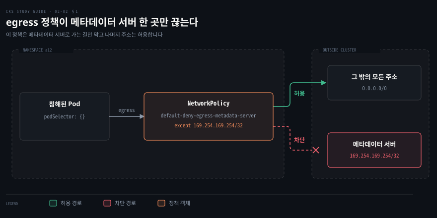
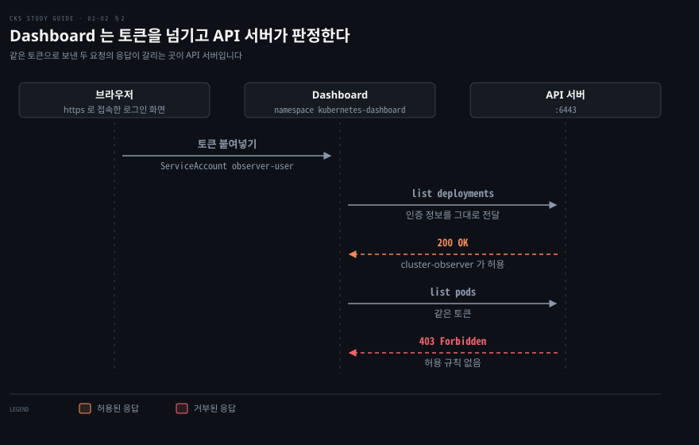
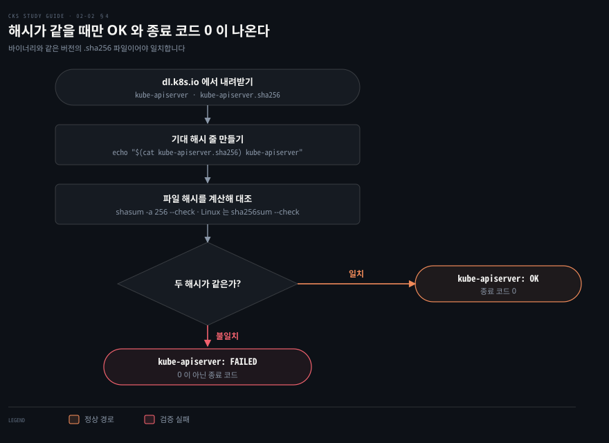

# 노드와 접근 지점 지키기 — 메타데이터·Dashboard·설정 인자·바이너리 검증
---

## 핵심 요약

> 클러스터가 바깥과 만나는 접점마다 오갈 수 있는 것을 규칙으로 좁히면 한 곳이 뚫려도 피해가 거기서 멈춥니다. 노드 포트와 메타데이터 서버는 방화벽과 egress NetworkPolicy 로, Dashboard 는 토큰의 권한으로, 내려받은 바이너리는 체크섬 대조로 좁힙니다.

Dashboard 는 인증 정보를 API 서버에 넘기기만 합니다. 그래서 토큰의 RBAC(Role-Based Access Control, 역할 기반 접근 제어) 권한을 최소로 줍니다.

이 노트의 값은 2026-11-05 에 공식 페이지에서 확인한 쿠버네티스 v1.37 기준입니다.


## 학습 목표

이 내용을 읽고 나면:

1. 컨트롤 플레인과 워커 노드의 기본 포트를 공식 표로 짚고 포트를 바꿨을 때 방화벽에서 열 곳을 설명할 수 있습니다.
2. 침해된 Pod 가 클라우드 메타데이터 서버에 닿는 경로를 설명하고 그 주소로 나가는 egress 만 끊는 NetworkPolicy 를 쓸 수 있습니다.
3. 보기 전용 사용자를 ServiceAccount·ClusterRole·ClusterRoleBinding 으로 만들고 토큰을 발급할 수 있습니다.
4. Dashboard 의 HTTPS 인증서 인자와 HTTP 포트 인자의 기본값을 말하고 접근 경로를 넓히는 설정을 가릴 수 있습니다.
5. kube-apiserver 바이너리와 sha256 파일로 체크섬을 대조해 OK 와 FAILED 를 읽을 수 있습니다.


## 본문 정리

> 포트·Dashboard 설치 방법·다운로드 주소는 바뀔 수 있는 값이므로 링크와 조회일을 함께 적었습니다. 실습 전에 한 번 더 확인합니다.

### 1. 노드 포트와 메타데이터 서버 보호

노드가 여는 포트는 공식 「Ports and Protocols」 표의 기본값으로 알아 두어야 방화벽에서 열고 닫을 곳을 가릴 수 있습니다.[^ports] 컨트롤 플레인 노드는 API 서버와 etcd 를 포함한 다섯 항목을 씁니다. 워커 노드는 kubelet API 와 kube-proxy 와 NodePort 범위를 엽니다.

| 노드 | 프로토콜 | 포트 | 용도 |
|------|---------|------|------|
| 컨트롤 플레인 | TCP | 6443 | Kubernetes API 서버 |
| 컨트롤 플레인 | TCP | 2379-2380 | etcd 서버 클라이언트 API |
| 컨트롤 플레인 | TCP | 10250 | kubelet API |
| 컨트롤 플레인 | TCP | 10259 | kube-scheduler |
| 컨트롤 플레인 | TCP | 10257 | kube-controller-manager |
| 워커 | TCP | 10250 | kubelet API |
| 워커 | TCP | 10256 | kube-proxy |
| 워커 | TCP·UDP | 30000-32767 | NodePort Service(기본 범위) |

모든 기본 포트는 바꿀 수 있습니다. 바꾼 클러스터에서는 기본값 대신 바꾼 포트를 열어야 합니다.[^ports] API 서버 포트는 kube-apiserver 의 `--secure-port` 인자이고 기본값은 6443 입니다.[^apiserver] 밖에서 닿을 필요가 없는 포트는 방화벽으로 막아 접점을 줄입니다. API 서버를 사내망 밖에 열지 않으면 사내망이나 VPN(가상 사설망)에 들어온 클라이언트만 `kubectl` 로 명령을 보낼 수 있습니다.

클라우드 메타데이터 서버로 가는 길은 Pod 에서 나가는 egress 를 NetworkPolicy 로 막아 끊습니다. 클라우드 제공자는 VM 과 Pod 가 추가 인가 없이 값을 가져가는 메타데이터 API 를 둡니다. 이 API 에는 인증 토큰 같은 민감한 값이 있을 수 있습니다.[^book] AWS 에서는 IMDS(Instance Metadata Service)가 인스턴스마다 로컬로 돕니다. IPv4 주소는 `169.254.169.254` 입니다.[^imds] egress 규칙이 없는 네임스페이스에서는 침해된 Pod 가 이 주소로 요청을 보낼 수 있습니다. 공격자는 거기서 얻은 값으로 다음 침입 경로를 찾습니다.

`0.0.0.0/0` 전체를 허용하되 `169.254.169.254/32` 만 `except` 로 빼는 NetworkPolicy 를 네임스페이스에 둡니다. 이 정책만 놓고 보면 그 네임스페이스의 Pod 에서 메타데이터 서버로 나가는 연결이 끊깁니다.

```yaml
apiVersion: networking.k8s.io/v1
kind: NetworkPolicy
metadata:
  name: default-deny-egress-metadata-server
  namespace: a12
spec:
  podSelector: {}
  policyTypes:
  - Egress
  egress:
  - to:
    - ipBlock:
        cidr: 0.0.0.0/0
        except:
        - 169.254.169.254/32
```

`podSelector: {}` 는 네임스페이스 `a12` 의 모든 Pod 를 고릅니다. `policyTypes` 에 `Egress` 가 있으므로 고른 Pod 의 나가는 연결은 `egress` 규칙이 허용한 곳으로만 갑니다.[^np]

허용 목록은 `ipBlock` 으로 적습니다. `ipBlock` 은 클러스터 밖 IP 대역을 가리키는 필드입니다.[^np] `cidr: 0.0.0.0/0` 과 `except: 169.254.169.254/32` 를 함께 적었으므로 허용 목록은 메타데이터 서버 주소를 뺀 전체입니다. 선택·잠금 규칙과 `ipBlock`·`namespaceSelector`·`podSelector` 의 조합은 [NetworkPolicy 노트](../networking-and-kubernetes/04-03.NetworkPolicy%EC%99%80%20DNS%20%E2%80%94%20%ED%81%B4%EB%9F%AC%EC%8A%A4%ED%84%B0%20%EC%95%88%EC%9D%98%20%EB%B0%A9%ED%99%94%EB%B2%BD%EA%B3%BC%20%EC%9D%B4%EB%A6%84.md)에서 다뤘습니다.

egress 허용은 그 Pod 를 고른 정책들의 합집합이라 다른 정책이 이 주소를 허용하면 막히지 않습니다.[^np-add] 네임스페이스에 default-deny egress 가 이미 있었다면 이 정책은 메타데이터 서버를 뺀 나머지를 새로 열어 줍니다. `0.0.0.0/0` 이 클러스터 안 Pod 와 DNS 트래픽까지 덮는지는 네트워크 플러그인마다 다릅니다.[^np-add]



NetworkPolicy 는 이를 지원하는 CNI(Container Network Interface) 플러그인이 있어야 동작합니다. 구현하는 컨트롤러가 없으면 오브젝트를 만들어도 효과가 없습니다.[^np] `hostNetwork` Pod 에 대한 동작은 정의돼 있지 않습니다. 가장 흔한 구현은 이런 Pod 를 `podSelector` 매칭에서 빼고 노드 IP 의 트래픽과 같게 다룹니다.[^np]

### 2. Dashboard 접근과 사용자 권한

Dashboard 는 로그인에 쓴 인증 정보를 API 서버에 그대로 넘기기만 합니다. 그래서 화면에서 무엇을 보고 바꿀 수 있는지는 그 토큰에 묶인 RBAC 권한이 정합니다.[^dash-ac] 권한이 모자란 요청에는 Dashboard 가 경고를 보여 줍니다.

Dashboard 는 클러스터를 웹 화면으로 다루는 GUI(graphical user interface) 도구입니다. 프로젝트는 보관(archived) 상태이고 설치는 Helm 차트만 지원합니다.[^dash] 설치 명령은 아래 한 줄입니다.

```bash
helm upgrade --install kubernetes-dashboard \
  https://github.com/kubernetes/dashboard/releases/download/kubernetes-dashboard-7.14.0/kubernetes-dashboard-7.14.0.tgz \
  --create-namespace --namespace kubernetes-dashboard
```

CKS 커리큘럼 v1.37 의 Cluster Setup 에는 GUI 보호 항목이 없습니다. 항목은 다섯 가지입니다. NetworkPolicy, CIS(Center for Internet Security) 벤치마크, TLS 를 단 Ingress, 노드 메타데이터·엔드포인트 보호, 플랫폼 바이너리 검증입니다.[^cur]

Dashboard 는 외부에 직접 열지 않고 `kubectl port-forward` 로 요청한 사람의 PC 에만 엽니다. Helm 설치에서는 Kong 게이트웨이가 화면을 내보내므로 대상은 `kubernetes-dashboard-kong-proxy` Service 입니다.[^dash-acc]

```bash
kubectl -n kubernetes-dashboard port-forward svc/kubernetes-dashboard-kong-proxy 8443:443
```

브라우저로 `https://localhost:8443` 에 접속합니다. 문서는 토큰 로그인이 https 로 접속할 때만 허용된다고 적습니다.[^dash-sample] `kubectl proxy` 의 http 주소로 접속하면 invalid token 오류로 로그인이 실패합니다. 그래서 토큰 로그인에는 포트 포워딩의 https 주소를 씁니다.

로그인한 사용자가 볼 수 있는 범위는 ServiceAccount·ClusterRole·ClusterRoleBinding 세 오브젝트가 정합니다. ServiceAccount 는 로그인에 쓸 신분이고 ClusterRole 은 허용할 동작의 목록이며 ClusterRoleBinding 이 둘을 잇습니다. 세 오브젝트의 매니페스트는 정답 1 에 있습니다. RBAC 설계 원칙은 같은 책 3장(Cluster Hardening)에서 다루고 운영은 [RBAC 노트](../kubernetes-up-and-running/14-01.RBAC%20%E2%80%94%20%EC%9D%B8%EA%B0%80%EB%A5%BC%20%EC%84%A4%EA%B3%84%ED%95%98%EA%B3%A0%20%EC%9A%B4%EC%98%81%ED%95%98%EB%8A%94%20%EB%B2%95.md)에 있습니다.

토큰의 권한이 넓을수록 유출 피해가 커집니다. 관리자용 사용자는 `roleRef` 를 기본 제공 ClusterRole `cluster-admin` 으로 두면 만들어집니다. 그 토큰으로 로그인한 사람은 `cluster-admin` 의 모든 권한을 가집니다.[^dash-sample]

읽기 전용 역할도 `resources: '*'` 에 `get`·`list`·`watch` 를 주면 Secret 내용까지 읽힙니다. 공식 문서는 `list` 와 `watch` 접근만으로도 Secret 내용이 드러날 수 있다고 적고 모든 리소스에 대한 와일드카드 권한을 피하라고 권합니다.[^rbacgp] 그래서 ClusterRole 에는 `pods`·`deployments` 처럼 리소스 이름을 나열합니다.

로그인 토큰은 만료가 있는 토큰을 씁니다. `kubectl create token` 은 기간이 정해진 토큰을 발급하고 `--duration` 을 생략하거나 0 으로 주면 기간은 서버가 정합니다.[^sa] 서버가 요청보다 길거나 짧은 토큰을 돌려줄 수도 있어서 `--duration 0s` 는 만료 없는 토큰이 아닙니다.[^kct]

```bash
kubectl -n kubernetes-dashboard create token observer-user
```

만료 없는 토큰이 꼭 필요하면 `kubernetes.io/service-account-token` 타입 Secret 을 만들 수 있습니다. 공식 문서는 TokenRequest 로 받는 방식을 권장합니다. 이 Secret 의 내용은 화면에 드러내지 않도록 주의합니다.[^sa]



### 3. 안전하지 않은 설정 인자 피하기

아래 인자는 Dashboard 의 api·web 모듈 컨테이너에 주는 인자입니다. Helm 설치에서 브라우저가 닿는 HTTPS 는 Kong 게이트웨이가 처리합니다. 그래서 이 인자는 모듈 컨테이너 자체의 HTTPS·HTTP 서비스를 정합니다.[^args]

| 인자 | 기본값 | 역할 |
|------|--------|------|
| `--tls-cert-file` | - | HTTPS 용 기본 x509 인증서 파일 |
| `--tls-key-file` | - | 위 인증서와 짝이 되는 x509 개인 키 파일 |
| `--auto-generate-certificates` | false | true 면 Dashboard 가 HTTPS 용 인증서를 자동으로 만듭니다 |
| `--port` | 8001 | HTTPS 요청을 받는 포트 |
| `--insecure-port` | 8000 | HTTP 요청을 받는 포트 |
| `--insecure-bind-address` | 127.0.0.1 | `--insecure-port` 를 서비스할 IP 주소(loopback 에만 열 때 127.0.0.1) |

개인 키 인자의 이름은 `--tls-key-file` 입니다. `--auto-generate-certificates` 는 기본이 false 이므로 자동 생성에 기대려면 직접 켜야 합니다.

`--insecure-bind-address` 의 플래그 기본값은 127.0.0.1 입니다. 그러나 공식 api·web 이미지는 ENTRYPOINT 에서 `--insecure-bind-address=0.0.0.0` 을 넘깁니다.[^img] 그래서 Helm 설치본에서는 각 모듈의 평문 HTTP 포트 8000 이 클러스터 네트워크에 열려 있습니다. 브라우저 쪽 HTTPS 는 Kong 이 맡습니다.

모듈 Service 를 NodePort 나 Ingress 로 직접 내보내면 평문 HTTP 가 클러스터 밖으로 나갑니다. 접근 제어 문서는 평문 HTTP 로 보내는 인증 정보가 중간자 공격에 취약하다고 적습니다.[^dash-ac] 토큰 로그인이 https 접속에서만 허용된다는 점도 같은 방향의 제약입니다.[^dash-sample]

Dashboard v2 에는 로그인 화면을 건너뛰게 하는 `--enable-skip-login` 과 HTTP 로그인을 허용하는 `--enable-insecure-login` 이 있었습니다. 둘 다 켜지 않는 것이 원칙이었습니다. 현재 인자 문서에는 두 인자가 없습니다.[^args]

### 4. 플랫폼 바이너리 체크섬 검증

내려받은 바이너리는 같은 버전의 `.sha256` 파일로 해시를 대조해 통과한 것만 씁니다. 공식 다운로드 주소는 `https://dl.k8s.io/release/<버전>/bin/<OS>/<아키텍처>/<파일>` 형식입니다. 체크섬 파일은 같은 주소 끝에 `.sha256` 을 붙입니다.[^inst] 현재 안정 버전은 `https://dl.k8s.io/release/stable.txt` 에서 읽습니다.[^inst]

`.sha256` 파일에는 해시 값만 들어 있습니다. 그래서 `echo` 로 `해시 값` 공백 두 칸 `파일 이름` 순서의 한 줄을 직접 만들어 `--check` 에 넘깁니다.[^inst]

```bash
VERSION="$(curl -L -s https://dl.k8s.io/release/stable.txt)"
curl -LO "https://dl.k8s.io/release/${VERSION}/bin/linux/amd64/kube-apiserver"
curl -LO "https://dl.k8s.io/release/${VERSION}/bin/linux/amd64/kube-apiserver.sha256"
echo "$(cat kube-apiserver.sha256)  kube-apiserver" | sha256sum --check
```

macOS 에서는 마지막 줄의 `sha256sum --check` 를 `shasum -a 256 --check` 로 바꿉니다.[^inst-mac] 두 해시가 같으면 `kube-apiserver: OK` 가 나오고 종료 코드는 0 입니다. 다르면 `kube-apiserver: FAILED` 와 경고가 나오고 종료 코드는 0 이 아닙니다.[^inst-mac] 바이너리와 다른 버전의 `.sha256` 으로 대조해도 같은 이유로 FAILED 가 나옵니다. 그래서 두 파일의 버전을 맞춥니다.



체크섬으로 파일이 바뀌지 않았음을 확인하는 생각은 컨테이너 이미지에도 그대로 쓰입니다. 이미지 단위의 무결성은 [이미지 공급망 보안 노트](../container-security/06-02.%EC%9D%B4%EB%AF%B8%EC%A7%80%20%EA%B3%B5%EA%B8%89%EB%A7%9D%20%EB%B3%B4%EC%95%88%20%E2%80%94%20%EB%B9%8C%EB%93%9C%EB%B6%80%ED%84%B0%20%EB%B0%B0%ED%8F%AC%EA%B9%8C%EC%A7%80.md)의 이미지 무결성 절에서 다룹니다.


## 연습 문제

> 세 문제는 이 노트의 Dashboard 사용자·토큰·체크섬 절차를 직접 해 보는 실습입니다. 1번과 2번은 Dashboard 가 설치된 클러스터에서 풉니다.

1. Dashboard 는 어떻게 설치합니까? 네임스페이스 `kubernetes-dashboard` 의 ServiceAccount `observer-user` 가 Deployment 만 볼 수 있으려면 어떤 오브젝트가 필요하고 권한은 어떻게 확인합니까?
2. `observer-user` 의 만료되지 않는 토큰은 어떻게 만듭니까? 그 토큰으로 Dashboard 에 로그인하면 어떤 오브젝트만 볼 수 있어야 합니까?
3. Linux AMD64 용 `kube-apiserver` 를 같은 버전의 `.sha256` 파일로 대조하면 결과가 어떻게 나옵니까? 이전 버전의 `.sha256` 파일로 대조하면 어떻게 달라집니까?


## 참고 자료

- 원본: 《Certified Kubernetes Security Specialist (CKS) Study Guide》(Benjamin Muschko, O'Reilly, 2023, ISBN 978-1098132972) Chapter 2
- [Ports and Protocols](https://kubernetes.io/docs/reference/networking/ports-and-protocols/) — 노드 기본 포트 표
- [kube-apiserver 레퍼런스](https://kubernetes.io/docs/reference/command-line-tools-reference/kube-apiserver/) — `--secure-port`
- [Network Policies](https://kubernetes.io/docs/concepts/services-networking/network-policies/) — `ipBlock`·네트워크 플러그인·`hostNetwork`
- [Configure the Instance Metadata Service options — AWS](https://docs.aws.amazon.com/AWSEC2/latest/UserGuide/configuring-instance-metadata-options.html) — IMDS 주소
- [Kubernetes Dashboard](https://github.com/kubernetes/dashboard) · [접근](https://github.com/kubernetes/dashboard/blob/master/docs/user/accessing-dashboard/README.md) · [접근 제어](https://github.com/kubernetes/dashboard/blob/master/docs/user/access-control/README.md) · [샘플 사용자](https://github.com/kubernetes/dashboard/blob/master/docs/user/access-control/creating-sample-user.md) · [인자](https://github.com/kubernetes/dashboard/blob/master/docs/common/arguments.md)
- [RBAC good practices](https://kubernetes.io/docs/concepts/security/rbac-good-practices/) — 와일드카드와 Secret 읽기
- [kubectl create token](https://kubernetes.io/docs/reference/kubectl/generated/kubectl_create/kubectl_create_token/) · [ServiceAccount 설정](https://kubernetes.io/docs/tasks/configure-pod-container/configure-service-account/) — 토큰 발급과 장기 토큰 Secret
- [Linux 에 kubectl 설치](https://kubernetes.io/docs/tasks/tools/install-kubectl-linux/) · [macOS 에 kubectl 설치](https://kubernetes.io/docs/tasks/tools/install-kubectl-macos/) — 다운로드 주소와 체크섬 검증
- [CNCF CKS 커리큘럼 v1.37](https://github.com/cncf/curriculum/blob/main/CKS_Curriculum%20v1.37.pdf) — Cluster Setup 항목
- [CKS Study Guide 정독 인덱스](./README.md) — 이 책의 장별 목표와 진행 상태
- [NetworkPolicy 노트](../networking-and-kubernetes/04-03.NetworkPolicy%EC%99%80%20DNS%20%E2%80%94%20%ED%81%B4%EB%9F%AC%EC%8A%A4%ED%84%B0%20%EC%95%88%EC%9D%98%20%EB%B0%A9%ED%99%94%EB%B2%BD%EA%B3%BC%20%EC%9D%B4%EB%A6%84.md) · [RBAC 노트](../kubernetes-up-and-running/14-01.RBAC%20%E2%80%94%20%EC%9D%B8%EA%B0%80%EB%A5%BC%20%EC%84%A4%EA%B3%84%ED%95%98%EA%B3%A0%20%EC%9A%B4%EC%98%81%ED%95%98%EB%8A%94%20%EB%B2%95.md) · [이미지 공급망 보안 노트](../container-security/06-02.%EC%9D%B4%EB%AF%B8%EC%A7%80%20%EA%B3%B5%EA%B8%89%EB%A7%9D%20%EB%B3%B4%EC%95%88%20%E2%80%94%20%EB%B9%8C%EB%93%9C%EB%B6%80%ED%84%B0%20%EB%B0%B0%ED%8F%AC%EA%B9%8C%EC%A7%80.md) — 이 노트가 개념 설명을 맡긴 형제 노트

[^ports]: Kubernetes 문서 「Ports and Protocols」의 Control plane·Worker node(s) 표와 "All default port numbers can be overridden." 문장. <https://kubernetes.io/docs/reference/networking/ports-and-protocols/> (2026-11-05 조회)
[^apiserver]: kube-apiserver 레퍼런스의 `--secure-port int` 항목, 기본값 6443. <https://kubernetes.io/docs/reference/command-line-tools-reference/kube-apiserver/> (2026-11-05 조회)
[^book]: 메타데이터 서비스가 인가 없이 인증 토큰 같은 민감한 값을 줄 수 있다는 설명은 책 2장 「Protecting Node Metadata and Endpoints」 절을 따랐습니다. 《Certified Kubernetes Security Specialist (CKS) Study Guide》 Ch2.
[^imds]: AWS 문서 「Configure the Instance Metadata Service options」. "The Instance Metadata Service (IMDS) runs locally on every EC2 instance." 와 IPv4 엔드포인트 169.254.169.254. <https://docs.aws.amazon.com/AWSEC2/latest/UserGuide/configuring-instance-metadata-options.html> (2026-11-05 조회)
[^np]: Network Policies 문서. 빈 `podSelector` 가 네임스페이스의 모든 Pod 를 고르는 규칙, `ipBlock` 이 클러스터 밖 IP 를 대상으로 한다는 설명, 네트워크 플러그인 요구("Creating a NetworkPolicy resource without a controller that implements it will have no effect."), "NetworkPolicy and `hostNetwork` pods" 절. <https://kubernetes.io/docs/concepts/services-networking/network-policies/> (2026-11-05 조회)
[^np-add]: Network Policies 문서. "When a pod is isolated for egress, the only allowed connections from the pod are those allowed by the `egress` list of some NetworkPolicy that applies to the pod for egress." "The effects of those `egress` lists combine additively." "it is not defined whether this happens before or after NetworkPolicy processing, and the behavior may be different for different combinations of network plugin, cloud provider, `Service` implementation, etc." <https://kubernetes.io/docs/concepts/services-networking/network-policies/> (2026-11-05 조회)
[^img]: Dashboard 저장소의 `modules/api/Dockerfile` 73행 `ENTRYPOINT ["/dashboard-api", "--insecure-bind-address=0.0.0.0", "--bind-address=0.0.0.0"]` 와 `modules/web/Dockerfile` 102행. 차트 7.14.0 을 `helm template` 으로 렌더하면 api·web·auth Service 가 포트 8000 이고 Kong 이 `KONG_PROXY_LISTEN` 으로 HTTPS 를 받습니다. <https://github.com/kubernetes/dashboard/blob/master/modules/api/Dockerfile> <https://github.com/kubernetes/dashboard/blob/master/modules/web/Dockerfile> (2026-11-05 조회)
[^dash-ac]: Kubernetes Dashboard 접근 제어 문서. "Dashboard only acts as a proxy and passes all auth information to it." 와 평문 HTTP 가 중간자(MITM) 공격에 취약하다는 설명. <https://github.com/kubernetes/dashboard/blob/master/docs/user/access-control/README.md> (2026-11-05 조회)
[^dash]: Dashboard 저장소 README. 프로젝트 보관 상태, Headlamp 권고, 7.0.0 부터 매니페스트 설치 지원 중단, Helm 설치. README 의 차트 저장소 주소 `https://kubernetes.github.io/dashboard/index.yaml` 은 2026-11-05 에 404 라서 `helm repo add` 가 실패했고 차트 7.14.0 은 GitHub Release 주소에서 받아 `helm template` 으로 렌더했습니다(Release 주소 HTTP 200). <https://github.com/kubernetes/dashboard> <https://github.com/kubernetes/dashboard/releases/download/kubernetes-dashboard-7.14.0/kubernetes-dashboard-7.14.0.tgz> (2026-11-05 조회)
[^cur]: CNCF 커리큘럼 CKS v1.37 의 Cluster Setup 항목. <https://github.com/cncf/curriculum/blob/main/CKS_Curriculum%20v1.37.pdf> (2026-11-05 조회)
[^dash-acc]: Dashboard 접근 문서의 `kubectl port-forward` 와 `kubectl proxy` 절. <https://github.com/kubernetes/dashboard/blob/master/docs/user/accessing-dashboard/README.md> (2026-11-05 조회)
[^dash-sample]: Dashboard 샘플 사용자 문서. `cluster-admin` 바인딩, `kubectl create token`, "Token login is ONLY allowed when the browser is accessing the UI over https." <https://github.com/kubernetes/dashboard/blob/master/docs/user/access-control/creating-sample-user.md> (2026-11-05 조회)
[^rbacgp]: RBAC good practices 문서. "list and watch access also effectively allow for users to reveal the Secret contents." 와 와일드카드 권한을 피하라는 권고. <https://kubernetes.io/docs/concepts/security/rbac-good-practices/> (2026-11-05 조회)
[^sa]: ServiceAccount 설정 문서. TokenRequest 로 토큰을 받는 방식을 권장하고 만료 없는 토큰이 필요하면 `kubernetes.io/service-account-token` Secret 을 만들 수 있다는 설명. <https://kubernetes.io/docs/tasks/configure-pod-container/configure-service-account/> (2026-11-05 조회)
[^kct]: `kubectl create token` 레퍼런스의 `--duration`. "If not set or if set to 0, the lifetime will be determined by the server automatically. The server may return a token with a longer or shorter lifetime." <https://kubernetes.io/docs/reference/kubectl/generated/kubectl_create/kubectl_create_token/> (2026-11-05 조회)
[^args]: Dashboard 인자 문서의 `tls-cert-file`·`tls-key-file`·`auto-generate-certificates`·`insecure-port`·`insecure-bind-address` 행. <https://github.com/kubernetes/dashboard/blob/master/docs/common/arguments.md> (2026-11-05 조회) 두 로그인 인자는 v2.7.0 의 `docs/common/dashboard-arguments.md` 표에 있고(<https://github.com/kubernetes/dashboard/blob/v2.7.0/docs/common/dashboard-arguments.md>) 현재 `arguments.md` 에는 없습니다.
[^inst]: kubectl 설치 문서(Linux)의 다운로드 주소 형식과 `.sha256` 파일과 `echo "$(cat kubectl.sha256)  kubectl" | sha256sum --check`. 주소 형식은 같은 릴리스 경로의 kube-apiserver 에도 같습니다. <https://kubernetes.io/docs/tasks/tools/install-kubectl-linux/> 안정 버전 <https://dl.k8s.io/release/stable.txt> (2026-11-05 조회)
[^inst-mac]: kubectl 설치 문서(macOS)의 `shasum -a 256 --check` 와 "If the check fails, `shasum` exits with nonzero status and prints output similar to:" 문장. <https://kubernetes.io/docs/tasks/tools/install-kubectl-macos/> (2026-11-05 조회)


## 정답 (자답 후 펼치기)

> 위 연습 문제에 먼저 자답한 뒤 아래를 읽으세요. 자답 없이 먼저 읽으면 학습 효과가 없습니다.

### 1. Dashboard 설치와 보기 전용 사용자

네임스페이스 `kubernetes-dashboard` 가 없으면 아직 설치하지 않은 것입니다. 있으면 `helm list` 로 릴리스가 있는지 확인합니다.

```bash
kubectl get ns kubernetes-dashboard
helm list -n kubernetes-dashboard
```

설치하지 않았다면 2절의 `helm upgrade --install` 명령으로 설치합니다. 그다음 `dashboard-observer-user.yaml` 에 ServiceAccount·ClusterRole·ClusterRoleBinding 을 적습니다. ClusterRole 은 `apps` 그룹의 `deployments` 에 읽기 동사만 줍니다.

```yaml
apiVersion: v1
kind: ServiceAccount
metadata:
  name: observer-user
  namespace: kubernetes-dashboard
---
apiVersion: rbac.authorization.k8s.io/v1
kind: ClusterRole
metadata:
  name: cluster-observer
rules:
- apiGroups: ["apps"]
  resources: ["deployments"]
  verbs: ["get", "list", "watch"]
---
apiVersion: rbac.authorization.k8s.io/v1
kind: ClusterRoleBinding
metadata:
  name: observer-user
roleRef:
  apiGroup: rbac.authorization.k8s.io
  kind: ClusterRole
  name: cluster-observer
subjects:
- kind: ServiceAccount
  name: observer-user
  namespace: kubernetes-dashboard
```

보여 줄 Deployment 는 `default` 네임스페이스에 만들어 둡니다.

```bash
kubectl apply -f dashboard-observer-user.yaml
kubectl create deployment deploy --image=nginx --replicas=3
```

권한은 ServiceAccount 를 흉내 내는 `kubectl auth can-i` 로 확인합니다. Deployment 목록은 `yes` 가 나옵니다. Pod 와 Secret 목록은 `no` 가 나옵니다.

```bash
kubectl auth can-i list deployments.apps -A --as=system:serviceaccount:kubernetes-dashboard:observer-user
kubectl auth can-i list pods -A --as=system:serviceaccount:kubernetes-dashboard:observer-user
kubectl auth can-i list secrets -A --as=system:serviceaccount:kubernetes-dashboard:observer-user
```

### 2. 만료 없는 토큰과 로그인

만료 없는 토큰은 `kubernetes.io/service-account-token` 타입 Secret 으로 만듭니다. `kubectl create token --duration 0s` 는 기간을 서버가 정하라는 뜻이라 만료 없는 토큰이 아닙니다.[^kct]

```yaml
apiVersion: v1
kind: Secret
metadata:
  name: observer-user-token
  namespace: kubernetes-dashboard
  annotations:
    kubernetes.io/service-account.name: observer-user
type: kubernetes.io/service-account-token
```

Secret 을 `kubectl apply` 로 만든 뒤 토큰을 읽어 복사합니다.

```bash
kubectl get secret observer-user-token -n kubernetes-dashboard -o jsonpath='{.data.token}' | base64 -d
```

`kubectl -n kubernetes-dashboard port-forward svc/kubernetes-dashboard-kong-proxy 8443:443` 를 띄우고 `https://localhost:8443` 에서 Token 방식으로 로그인합니다. `observer-user` 는 Deployment 만 볼 수 있어야 합니다. Pod 같은 다른 오브젝트는 권한이 없어 막힙니다. 이 토큰은 만료되지 않으므로 화면에 드러내거나 저장소에 넣지 않습니다.[^sa]

### 3. 같은 버전과 이전 버전의 체크섬

같은 버전의 `.sha256` 로 대조하면 OK 가 나옵니다. 이전 버전의 `.sha256` 로 대조하면 FAILED 가 나옵니다. 아래는 macOS 에서 `shasum -a 256 --check` 로 돌린 결과이고 이전 버전은 v1.37.1 입니다.

```bash
VERSION="$(curl -L -s https://dl.k8s.io/release/stable.txt)"
curl -LO "https://dl.k8s.io/release/${VERSION}/bin/linux/amd64/kube-apiserver"
curl -LO "https://dl.k8s.io/release/${VERSION}/bin/linux/amd64/kube-apiserver.sha256"
echo "$(cat kube-apiserver.sha256)  kube-apiserver" | shasum -a 256 --check
# 출력: kube-apiserver: OK
```

```bash
curl -L "https://dl.k8s.io/release/v1.37.1/bin/linux/amd64/kube-apiserver.sha256" -o kube-apiserver-old.sha256
echo "$(cat kube-apiserver-old.sha256)  kube-apiserver" | shasum -a 256 --check
# 출력: kube-apiserver: FAILED
# 출력: shasum: WARNING: 1 computed checksum did NOT match
```
