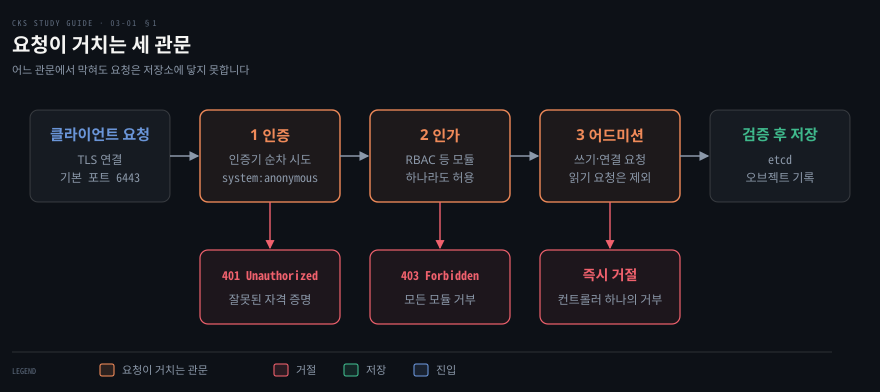
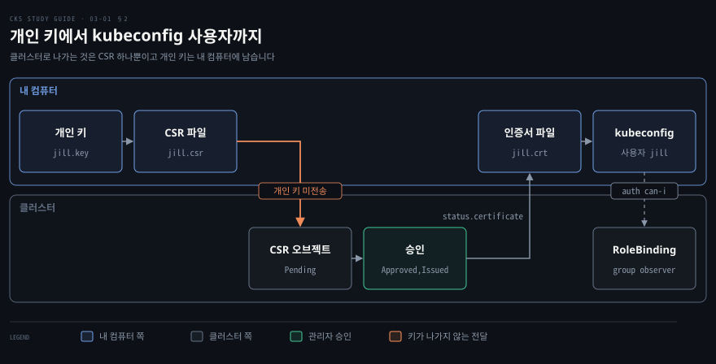
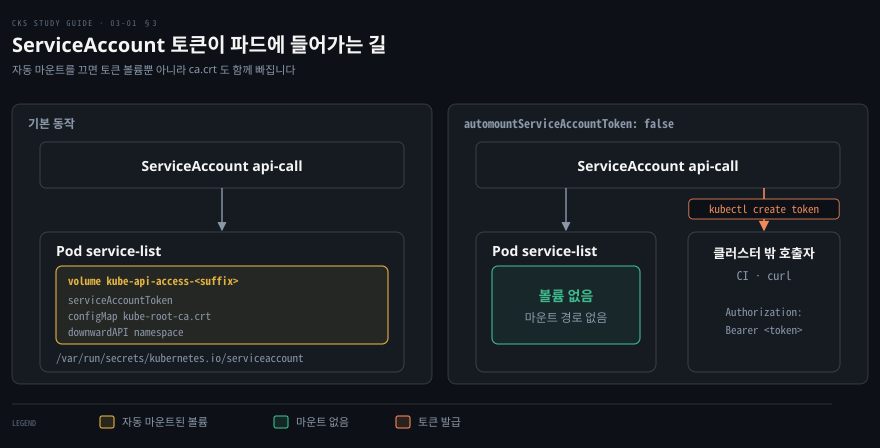

# 클러스터 굳히기 — API 접근·RBAC·ServiceAccount·업그레이드
---

## 핵심 요약

> 클러스터 하드닝의 뼈대는 API 서버에 닿는 요청을 인증, 인가, 어드미션 세 관문에서 좁히고, 쿠버네티스 자체는 지원 중인 버전으로 유지하는 것입니다.

사람 사용자는 쿠버네티스 안에 오브젝트로 존재하지 않으므로 인증서로 만듭니다. 개인 키로 CertificateSigningRequest(CSR)를 만들어 클러스터 CA(Certificate Authority)에 서명을 받고, 권한은 Role 과 RoleBinding 으로 따로 묶습니다.

파드가 API 서버에 말을 걸 때는 ServiceAccount 가 신원이 됩니다. 토큰이 파드에 기본으로 자동 마운트되므로 필요한 동작만 허용하고, API 를 쓰지 않는 파드는 자동 마운트를 끕니다.

보안 수정은 지원 중인 릴리스 브랜치에만 들어갑니다. 지원 중인 마이너 버전은 세 개이고 kubeadm 은 마이너 버전을 하나씩만 올릴 수 있습니다. 이 노트의 값은 2026-11-05 에 공식 페이지에서 확인한 쿠버네티스 v1.37 기준입니다.


## 학습 목표

이 내용을 읽고 나면:

1. API 서버가 요청을 인증, 인가, 어드미션 컨트롤 순서로 처리한다는 점과 단계마다 거절 결과가 다르다는 점을 설명할 수 있습니다.
2. 익명 접근이 기본으로 켜져 있어도 인가 단계에서 막히는 이유를 설명하고, 필요하면 `--anonymous-auth=false` 로 끌 수 있습니다.
3. 개인 키, CertificateSigningRequest, 승인, kubeconfig 등록으로 사람 사용자를 만들고 Role·RoleBinding 으로 권한을 줄 수 있습니다.
4. ServiceAccount 를 파드에 붙이고 필요한 동작만 허용하며, 토큰 자동 마운트를 끄고 `kubectl create token` 으로 만료 있는 토큰을 쓸 수 있습니다.
5. kubeadm 으로 컨트롤 플레인과 워커 노드를 정해진 순서로 한 마이너 버전씩 업그레이드할 수 있습니다.


## 본문 정리

### 1. API 서버의 요청 처리 순서와 접속 경로

API 서버는 모든 요청에 인증, 인가, 어드미션 컨트롤을 이 순서로 적용합니다. 어느 관문에서 막혀도 요청은 저장소에 닿지 못합니다.[^stages] 클라이언트는 먼저 TLS 연결을 맺고, 인증서를 낸다면 이 시점에 냅니다. 인증(authentication)은 설정된 인증기를 차례로 시도해 하나라도 신원을 확인하면 통과시킵니다.

자격 증명을 냈는데 모든 인증기가 거절하면 401 을 돌려줍니다. 자격 증명을 아예 내지 않은 요청은 익명 접근이 켜져 있으면 `system:anonymous` 로 통과하고, 그다음 인가 단계에서 403 으로 거절됩니다.

인가(authorization)는 모듈 가운데 하나라도 허용하면 통과이고 전부 거부하면 403 입니다. 어드미션 컨트롤은 생성·수정·삭제·연결 요청에만 적용되고 읽기 요청은 건너뜁니다. 컨트롤러가 하나라도 거부하면 요청은 그 자리에서 거절되고, 모두 통과한 요청은 검증을 거쳐 etcd 에 기록됩니다.



클러스터 안의 파드는 `default` 네임스페이스의 `kubernetes` Service 로 API 서버에 접속합니다. 파드 안에서는 DNS 이름 `kubernetes.default.svc` 나 환경 변수 `KUBERNETES_SERVICE_HOST`·`KUBERNETES_SERVICE_PORT_HTTPS` 로 주소를 얻습니다.[^inpod] 이 Service 는 443 포트로 받은 요청을 API 서버의 보안 포트(기본 6443)로 보내고, 실제 API 서버 주소는 EndpointSlice 에서 읽습니다.[^eps]

```bash
kubectl get endpointslices -l kubernetes.io/service-name=kubernetes
```

API 서버가 듣는 보안 포트는 `--secure-port` 로 정하고 기본값은 6443 입니다.[^apiserver]

자격 증명이 없어서 다른 인증기가 거절하지 않은 요청은 **익명 요청**이 됩니다. 이 요청의 사용자 이름은 `system:anonymous`, 그룹은 `system:unauthenticated` 입니다. 인가 모드가 `AlwaysAllow` 가 아니면 익명 접근은 기본으로 켜져 있고, 끄려면 kube-apiserver 에 `--anonymous-auth=false` 를 줍니다.[^anon] 켜 둔 상태에서도 RBAC(Role-Based Access Control)는 익명 사용자와 그룹에 권한을 명시적으로 줘야만 허용합니다. 앞에서 본 403 이 이 경우입니다. 익명으로 파드 목록을 부르면 다음 메시지가 나옵니다.

```bash
pods is forbidden: User "system:anonymous" cannot list resource "pods" in API group "" in the namespace "default"
```

익명 접근을 경로별로 좁히는 설정은 `AuthenticationConfiguration` 파일의 anonymous 항목이고, v1.34 부터 Stable 입니다.[^anonconf]

인증서를 쓰는 접근에서는 클라이언트가 TLS 연결 때 인증서를 냅니다. API 서버는 그 인증서가 `--client-ca-file` 로 지정한 CA 의 서명을 받았는지 확인합니다. 인증서와 CA 가 신뢰를 만드는 방식은 [TLS로 컴포넌트 안전하게 연결하기](../container-security/11-01.TLS%EB%A1%9C%20%EC%BB%B4%ED%8F%AC%EB%84%8C%ED%8A%B8%20%EC%95%88%EC%A0%84%ED%95%98%EA%B2%8C%20%EC%97%B0%EA%B2%B0%ED%95%98%EA%B8%B0%20%E2%80%94%20%ED%82%A4%C2%B7%EC%9D%B8%EC%A6%9D%EC%84%9C%C2%B7CA%EC%9D%98%20%EC%97%AD%ED%95%A0.md)에서 설명했습니다. 요청이 두 관문을 거치는 구조는 [RBAC](../kubernetes-up-and-running/14-01.RBAC%20%E2%80%94%20%EC%9D%B8%EA%B0%80%EB%A5%BC%20%EC%84%A4%EA%B3%84%ED%95%98%EA%B3%A0%20%EC%9A%B4%EC%98%81%ED%95%98%EB%8A%94%20%EB%B2%95.md)의 「인증과 인가 — 요청이 거치는 두 관문」 절과 「익명 사용자에게 열린 문」 절에서 다뤘습니다.

### 2. 사람 사용자 만들기와 권한 줄이기

사람 사용자는 쿠버네티스에 오브젝트가 없습니다. 이 장에서는 클러스터 CA 가 서명한 클라이언트 인증서로 사용자를 인증합니다.[^authn] 그 인증서를 받는 길이 CSR 입니다. 인증서 안의 CN(Common Name)이 사용자 이름, O(Organization)가 그룹이 됩니다.

사용자를 만드는 일은 다섯 단계입니다. 개인 키, CSR 오브젝트, 승인, 인증서 내보내기, kubeconfig 등록의 순서이고, 권한은 그 뒤에 Role 과 RoleBinding 으로 따로 줍니다.



개인 키와 CSR 파일은 내 컴퓨터에서 `openssl` 로 만듭니다. 사용자는 `jill`, 그룹은 `observer` 로 합니다.

```bash
openssl genrsa -out jill.key 2048
openssl req -new -key jill.key -out jill.csr -subj "/CN=jill/O=observer"
```

CSR 오브젝트에는 CSR 파일을 base64 로 인코딩한 값을 넣습니다. `signerName` 은 API 서버에 접속하는 클라이언트 인증서용 서명자 `kubernetes.io/kube-apiserver-client` 로 씁니다. 이 서명자의 CSR 은 자동 승인되지 않습니다.[^csr] `usages` 는 `client auth` 여야 하고 `expirationSeconds` 의 최소값은 600초이며, 아래 예는 하루입니다.

```bash
cat <<EOF | kubectl apply -f -
apiVersion: certificates.k8s.io/v1
kind: CertificateSigningRequest
metadata:
  name: jill
spec:
  request: $(base64 < jill.csr | tr -d "\n")
  signerName: kubernetes.io/kube-apiserver-client
  expirationSeconds: 86400
  usages:
  - client auth
EOF
```

관리자가 승인하면 서명된 인증서가 `status.certificate` 에 들어갑니다. 승인되거나 거부되거나 실패한 CSR 은 한 시간 뒤, 대기 중인 CSR 은 24시간 뒤에 삭제되므로 승인한 직후에 인증서를 파일로 내보냅니다.[^csr]

```bash
kubectl certificate approve jill
kubectl get csr jill -o jsonpath='{.status.certificate}' | base64 -d > jill.crt
```

개인 키는 CSR 에 들어가지 않으므로 클러스터에는 가지 않습니다. 내보낸 인증서와 키는 kubeconfig 의 사용자 항목으로 등록하고, 그 사용자를 쓰는 컨텍스트를 만듭니다. `--cluster` 에는 `kubectl config get-clusters` 가 보여 주는 이름을 씁니다(kubeadm 기본값은 `kubernetes`).

```bash
kubectl config set-credentials jill --client-key=jill.key --client-certificate=jill.crt --embed-certs=true
kubectl config set-context jill --cluster=kubernetes --user=jill
kubectl --context jill auth whoami
```

`auth whoami` 는 클러스터가 이 인증서에서 읽은 사용자 이름과 그룹을 보여 줍니다.[^authn] `jill` 과 함께 `observer` 와 `system:authenticated` 그룹이 나오면 신원은 맞게 만들어진 것입니다. O 를 `system:masters` 로 쓴 CSR 은 `CertificateSubjectRestriction` 어드미션 플러그인이 막습니다.[^csr]

신원이 생겼으니 권한을 줍니다. 인증서의 O 가 그룹이므로 사용자 한 명이 아니라 그룹에 권한을 묶으면, 같은 그룹의 인증서를 새로 발급해도 RoleBinding 을 다시 만들지 않습니다.

```bash
kubectl create role observer --verb=get --verb=list --verb=watch --resource=pods --resource=configmaps --resource=secrets
kubectl create rolebinding observer-binding --role=observer --group=observer
```

권한이 의도대로 걸렸는지는 `kubectl auth can-i` 로 묻습니다. 그룹 소속은 인증서에 들어 있으므로 `--as=jill` 만 쓰면 그룹으로 받은 권한이 빠져서 `no` 가 나옵니다. 그룹까지 함께 지정합니다.

```bash
kubectl auth can-i list pods --as=jill --as-group=observer
kubectl auth can-i delete pods --as=jill --as-group=observer
```

첫 명령은 `yes`, 두 번째는 `no` 입니다. 컨텍스트를 `jill` 로 바꿔 `kubectl get configmaps` 는 성공하고 `kubectl get nodes` 는 `Forbidden` 으로 막히는 것도 같은 결과입니다. `can-i` 사용법은 [RBAC](../kubernetes-up-and-running/14-01.RBAC%20%E2%80%94%20%EC%9D%B8%EA%B0%80%EB%A5%BC%20%EC%84%A4%EA%B3%84%ED%95%98%EA%B3%A0%20%EC%9A%B4%EC%98%81%ED%95%98%EB%8A%94%20%EB%B2%95.md)의 「can-i로 권한을 물어봅니다」 절에서, Role·RoleBinding 의 범위 조합은 같은 노트의 「Role과 Binding — 네 리소스의 범위 조합」 절에서 정리했습니다.

### 3. ServiceAccount 조심해서 쓰기

파드는 ServiceAccount 로 API 서버에 신원을 보입니다. `serviceAccountName` 을 적지 않으면 같은 네임스페이스의 `default` ServiceAccount 가 붙고, 그 토큰이 파드에 자동으로 들어옵니다.[^sa] 사람 사용자와 달리 ServiceAccount 는 네임스페이스에 속한 오브젝트입니다. `default` ServiceAccount 는 기본으로 API 발견 권한만 가지므로, 파드가 API 를 부르려면 필요한 동작을 따로 허용해야 합니다.

파드를 만들 때 ServiceAccount 어드미션 컨트롤러가 파드 스펙에 `kube-api-access-<접미사>` 라는 투사 볼륨을 추가합니다. kubelet 은 TokenRequest API 로 토큰을 받아 이 볼륨에 넣습니다.

이 볼륨은 세 곳에서 가져온 파일로 이루어집니다. `serviceAccountToken` 이 만든 파드에 묶인 만료 토큰, `kube-root-ca.crt` ConfigMap 의 `ca.crt`, 그리고 파드의 네임스페이스입니다.[^sa] 이 파일들은 `/var/run/secrets/kubernetes.io/serviceaccount/` 에 마운트되고, 토큰은 kubelet 이 만료 전에 갱신합니다.



필요한 동작만 허용하려면 ClusterRole 로 권한을 정의하고 RoleBinding 으로 한 네임스페이스에 묶습니다. 파드가 `t23` 에서 ServiceAccount `api-call` 로 돌며 `default` 의 Service 목록만 읽어야 한다고 합시다. `list-services-clusterrole` 은 `services` 의 `list` 하나만 허용하는 ClusterRole 입니다. RoleBinding 은 권한이 적용될 `default` 에 만들고, 주체의 `namespace` 에는 ServiceAccount 가 있는 `t23` 을 적습니다.

```yaml
apiVersion: rbac.authorization.k8s.io/v1
kind: RoleBinding
metadata:
  name: serviceaccount-service-rolebinding
  namespace: default
subjects:
- kind: ServiceAccount
  name: api-call
  namespace: t23
roleRef:
  kind: ClusterRole
  name: list-services-clusterrole
  apiGroup: rbac.authorization.k8s.io
```

이렇게 하면 `api-call` 은 `default` 에서 Service 목록을 읽을 수 있습니다. `default` 의 Pod 목록은 ClusterRole 에 `pods` 규칙이 없어서 읽지 못합니다. `t23` 의 Service 목록은 RoleBinding 이 `default` 에만 있어서 읽지 못합니다. ClusterRole 을 RoleBinding 으로 묶으면 권한은 RoleBinding 이 있는 네임스페이스 하나에만 적용됩니다.

API 를 부르지 않는 파드에는 토큰이 필요 없으므로 자동 마운트를 끕니다. ServiceAccount 나 파드 스펙에 `automountServiceAccountToken: false` 를 쓰면 되고, 둘이 다르면 파드 스펙이 우선합니다.[^automount]

```yaml
apiVersion: v1
kind: Pod
metadata:
  name: service-list
  namespace: t23
spec:
  serviceAccountName: api-call
  automountServiceAccountToken: false
  containers:
  - name: service-list
    image: alpine/curl:3.14
    command: ['sh', '-c', 'sleep 3600']
```

자동 마운트를 끄면 `kube-api-access-*` 볼륨이 통째로 빠지므로 토큰뿐 아니라 `ca.crt` 도 파드 안에 없습니다. 그 파드가 API 서버를 `curl` 로 부를 때는 CA 를 따로 줘야 하고, 환경 변수 `KUBERNETES_SERVICE_HOST` 는 그대로 남습니다.

파드 밖에서 API 를 부를 사람이나 도구에는 토큰을 직접 만들어 줍니다. `kubectl create token` 은 TokenRequest API 로 만료가 있는 토큰을 발급합니다.[^createtoken]

```bash
kubectl create token api-call -n t23 --duration 1h
```

`--duration` 은 요청하는 값입니다. 서버가 다른 길이로 조정할 수 있고, 값을 주지 않으면 서버가 정합니다. 최소는 10분(600초)입니다.[^tokenmin]

같은 ServiceAccount 로 토큰을 다시 만들어도 앞서 만든 토큰이 무효가 되지는 않습니다. TokenRequest 로 발급한 토큰을 따로 무효화하는 방법은 없으므로 짧은 `--duration` 으로 노출 시간을 줄입니다. 파드에 묶인 토큰은 그 파드를 지우면 만료됩니다.[^sadmin]

만료 없는 토큰이 꼭 필요하면 `kubernetes.io/service-account-token` 타입의 Secret 을 만듭니다. 어노테이션 `kubernetes.io/service-account.name` 에 ServiceAccount 이름을 적으면 컨트롤 플레인이 토큰을 채워 줍니다.

```yaml
apiVersion: v1
kind: Secret
metadata:
  name: api-call-token
  namespace: t23
  annotations:
    kubernetes.io/service-account.name: api-call
type: kubernetes.io/service-account-token
```

이 토큰은 Secret 이 있는 동안 계속 유효하므로 노출되면 피해가 오래갑니다. 쿠버네티스 프로젝트가 피하라고 권장하는 방법이므로 TokenRequest 를 쓸 수 없을 때만 고려합니다.[^sadmin]

컨테이너에 토큰이나 시크릿을 넘기는 다른 경로는 [컨테이너에 시크릿 전달하기](../container-security/12-01.%EC%BB%A8%ED%85%8C%EC%9D%B4%EB%84%88%EC%97%90%20%EC%8B%9C%ED%81%AC%EB%A6%BF%20%EC%A0%84%EB%8B%AC%ED%95%98%EA%B8%B0%20%E2%80%94%20%EB%8B%A4%EC%84%AF%20%EA%B2%BD%EB%A1%9C%EC%99%80%20root%EB%9D%BC%EB%8A%94%20%EC%B2%9C%EC%9E%A5.md)에서 다뤘습니다. 토큰이 기본으로 들어오는 모양은 [Securing Applications](../kubernetes-up-and-running/19-01.Securing%20Applications%20%E2%80%94%20%EC%A3%BD%EC%9D%80%20%EC%8B%A4%EC%8A%B5%20%EC%9D%B4%EB%AF%B8%EC%A7%80%EC%99%80%20proc%20%EB%A1%9C%20%EB%8B%A4%EC%8B%9C%20%EC%84%B8%EC%9A%B4%20%EB%9E%A9.md)의 「ServiceAccount 토큰은 기본으로 들어옵니다」 절에서 실습했습니다.

### 4. 버전 체계와 kubeadm 업그레이드 순서

보안 수정은 지원 중인 릴리스 브랜치에만 들어갑니다. 그래서 클러스터는 지원 중인 마이너 버전 위에 두고 kubeadm 으로 마이너 버전을 하나씩 올립니다.

쿠버네티스 버전은 `x.y.z` 로 쓰고 y 가 마이너, z 가 패치입니다. 새 마이너 릴리스는 대략 1년에 세 번 나옵니다.[^cycle]

프로젝트는 가장 최근 세 마이너 브랜치를 유지합니다. 각 브랜치는 약 1년 동안 패치를 받습니다.[^releases]

2026-11-05 기준으로 유지되는 브랜치는 1.37·1.36·1.35 이고, 1.37 은 2027-10-28 에 지원이 끝납니다.[^patch]

컴포넌트마다 허용되는 버전 차이가 있어서 업그레이드 순서도 정해집니다. kubelet 은 kube-apiserver 보다 새로우면 안 되고 세 마이너 버전까지 낮을 수 있습니다. kubectl 은 kube-apiserver 와 마이너 버전 하나 차이까지 지원됩니다.[^skew]

그래서 kube-apiserver 를 먼저, 그다음 컨트롤러 매니저와 스케줄러, 마지막으로 kubelet 과 kube-proxy 를 올립니다. kubeadm 에서는 kube-proxy 가 애드온이라 마지막 컨트롤 플레인 노드를 올릴 때 함께 올라갑니다. kubeadm 은 마이너 버전을 건너뛰는 업그레이드를 지원하지 않습니다.[^kubeadmup]

| 순서 | 대상 | 핵심 명령 |
|------|------|----------|
| 0 | 모든 노드 | 패키지 저장소를 올릴 마이너 버전으로 바꿉니다 |
| 1 | 첫 컨트롤 플레인 노드 | `kubeadm upgrade plan`, `kubeadm upgrade apply v1.37.x` |
| 2 | 나머지 컨트롤 플레인 노드 | `kubeadm upgrade node` |
| 3 | 워커 노드 | `kubeadm upgrade node` |

패키지 저장소는 마이너 버전마다 따로 있습니다. 올릴 마이너가 1.37 이면 `/etc/apt/sources.list.d/kubernetes.list` 의 주소를 `https://pkgs.k8s.io/core:/stable:/v1.37/deb/` 로 바꿉니다.[^repo] 첫 컨트롤 플레인 노드는 kubeadm 을 올린 뒤 `apply` 하고, 노드를 비운 다음 kubelet 과 kubectl 을 올립니다. 아래에서 `x` 는 패치 번호입니다.[^kubeadmup]

```bash
sudo apt-mark unhold kubeadm
sudo apt-get update && sudo apt-get install -y kubeadm='1.37.x-*'
sudo apt-mark hold kubeadm
sudo kubeadm upgrade plan
sudo kubeadm upgrade apply v1.37.x

kubectl drain <노드 이름> --ignore-daemonsets
sudo apt-mark unhold kubelet kubectl
sudo apt-get update && sudo apt-get install -y kubelet='1.37.x-*' kubectl='1.37.x-*'
sudo apt-mark hold kubelet kubectl
sudo systemctl daemon-reload
sudo systemctl restart kubelet
kubectl uncordon <노드 이름>
```

`drain` 은 노드를 스케줄 불가로 표시하고 파드를 축출합니다. 컨트롤러가 관리하는 파드는 다른 노드에 다시 만들어지고, `uncordon` 이 스케줄링을 다시 엽니다.

나머지 컨트롤 플레인 노드는 `kubeadm upgrade apply` 대신 `kubeadm upgrade node` 를 씁니다. 워커 노드는 kubeadm 과 kubectl 을 올리고 `sudo kubeadm upgrade node` 를 실행합니다. 그 뒤에는 같은 방식으로 drain, kubelet 업그레이드, 재시작, uncordon 을 합니다. `drain` 과 `uncordon` 은 클러스터에 접근할 수 있는 컴퓨터에서 실행합니다.[^workers]


## 연습 문제

> 1~3번은 사람 사용자, 4~6번은 ServiceAccount, 7번은 kubeadm 업그레이드를 묻습니다. 풀이는 파일 맨 끝의 정답에 있습니다.

1. 클라이언트 인증서와 키를 만들어 사용자 `jill`(그룹 `observer`)을 클러스터에 추가하고, 관리자 컨텍스트에서 `jill` 용 컨텍스트를 만들려면 어떤 명령을 어떤 순서로 실행합니까?
2. `default` 네임스페이스에서 그룹 `observer` 에 Pod·ConfigMap·Secret 의 `get`·`list`·`watch` 를 허용하려면 Role 과 RoleBinding 을 어떻게 만듭니까? 사용자가 아니라 그룹에 묶어야 합니다.
3. 컨텍스트를 `jill` 로 바꿔 허용된 명령 하나와 허용되지 않은 명령 하나를 실행하고, 관리자 컨텍스트로 돌아오려면 어떻게 합니까?
4. 네임스페이스 `t23` 에서 ServiceAccount `api-call` 을 붙인 파드 `service-list`(이미지 `alpine/curl:3.14`)가 `default` 의 Service 목록을 반복 조회하게 하면 로그에는 어떤 응답이 나옵니까?
5. 파드에 꼭 필요한 동작만 허용하도록 ServiceAccount 에 ClusterRole 과 RoleBinding 을 주고 나면 `curl` 응답은 어떻게 바뀝니까?
6. 파드의 ServiceAccount 토큰 자동 마운트를 끄고, 토큰 값을 직접 만들어 `curl` 명령에 넣어도 인가가 계속 통과하게 하려면 어떻게 합니까?
7. kubeadm 으로 만든 클러스터(컨트롤 플레인 노드 하나, 워커 노드 하나)의 모든 노드를 현재 지원 중인 한 마이너 버전 위로 올리려면 어떤 순서로 무엇을 실행합니까?


## 참고 자료

- 원본: 《Certified Kubernetes Security Specialist (CKS) Study Guide》(Benjamin Muschko, O'Reilly, 2023, ISBN 978-1098132972) Chapter 3
- [Controlling Access to the Kubernetes API](https://kubernetes.io/docs/concepts/security/controlling-access/) — 요청 처리 순서와 401·403
- [Authenticating](https://kubernetes.io/docs/reference/access-authn-authz/authentication/) — 익명 요청, 클라이언트 인증서, `auth whoami`
- [kube-apiserver 레퍼런스](https://kubernetes.io/docs/reference/command-line-tools-reference/kube-apiserver/) — `--anonymous-auth`, `--secure-port`
- [Accessing the Kubernetes API from a Pod](https://kubernetes.io/docs/tasks/run-application/access-api-from-pod/) · [EndpointSlices](https://kubernetes.io/docs/concepts/services-networking/endpoint-slices/)
- [Certificates and Certificate Signing Requests](https://kubernetes.io/docs/reference/access-authn-authz/certificate-signing-requests/) · [Issue a Certificate for a Kubernetes API Client](https://kubernetes.io/docs/tasks/tls/certificate-issue-client-csr/)
- [Service Accounts](https://kubernetes.io/docs/concepts/security/service-accounts/) · [Managing Service Accounts](https://kubernetes.io/docs/reference/access-authn-authz/service-accounts-admin/) · [Configure Service Accounts for Pods](https://kubernetes.io/docs/tasks/configure-pod-container/configure-service-account/) · [kubectl create token](https://kubernetes.io/docs/reference/kubectl/generated/kubectl_create/kubectl_create_token/)
- [Releases](https://kubernetes.io/releases/) · [Release Cycle](https://kubernetes.io/releases/release/) · [Patch Releases](https://kubernetes.io/releases/patch-releases/) · [Version Skew Policy](https://kubernetes.io/releases/version-skew-policy/)
- [Upgrading kubeadm clusters](https://kubernetes.io/docs/tasks/administer-cluster/kubeadm/kubeadm-upgrade/) · [Changing the Kubernetes package repository](https://kubernetes.io/docs/tasks/administer-cluster/kubeadm/change-package-repository/) · [Upgrading Linux nodes](https://kubernetes.io/docs/tasks/administer-cluster/kubeadm/upgrading-linux-nodes/)
- [CKS Study Guide 정독 인덱스](./README.md) — 이 책의 장별 목표와 진행 상태
- [RBAC](../kubernetes-up-and-running/14-01.RBAC%20%E2%80%94%20%EC%9D%B8%EA%B0%80%EB%A5%BC%20%EC%84%A4%EA%B3%84%ED%95%98%EA%B3%A0%20%EC%9A%B4%EC%98%81%ED%95%98%EB%8A%94%20%EB%B2%95.md) · [Securing Applications](../kubernetes-up-and-running/19-01.Securing%20Applications%20%E2%80%94%20%EC%A3%BD%EC%9D%80%20%EC%8B%A4%EC%8A%B5%20%EC%9D%B4%EB%AF%B8%EC%A7%80%EC%99%80%20proc%20%EB%A1%9C%20%EB%8B%A4%EC%8B%9C%20%EC%84%B8%EC%9A%B4%20%EB%9E%A9.md) · [TLS로 컴포넌트 안전하게 연결하기](../container-security/11-01.TLS%EB%A1%9C%20%EC%BB%B4%ED%8F%AC%EB%84%8C%ED%8A%B8%20%EC%95%88%EC%A0%84%ED%95%98%EA%B2%8C%20%EC%97%B0%EA%B2%B0%ED%95%98%EA%B8%B0%20%E2%80%94%20%ED%82%A4%C2%B7%EC%9D%B8%EC%A6%9D%EC%84%9C%C2%B7CA%EC%9D%98%20%EC%97%AD%ED%95%A0.md) · [컨테이너에 시크릿 전달하기](../container-security/12-01.%EC%BB%A8%ED%85%8C%EC%9D%B4%EB%84%88%EC%97%90%20%EC%8B%9C%ED%81%AC%EB%A6%BF%20%EC%A0%84%EB%8B%AC%ED%95%98%EA%B8%B0%20%E2%80%94%20%EB%8B%A4%EC%84%AF%20%EA%B2%BD%EB%A1%9C%EC%99%80%20root%EB%9D%BC%EB%8A%94%20%EC%B2%9C%EC%9E%A5.md) — 같은 주제를 다른 책에서 정리한 형제 노트

[^stages]: 요청 처리 단계. TLS 연결 뒤 인증, 인가, 어드미션 컨트롤 순서이고, 인증 실패는 401, 인가 거부는 403, 어드미션은 쓰기·연결 요청에만 적용되며 거부가 하나라도 있으면 요청이 즉시 거절됩니다. <https://kubernetes.io/docs/concepts/security/controlling-access/> (2026-11-05 조회)
[^inpod]: 파드 안에서 API 서버 주소를 얻는 방법. DNS 이름 `kubernetes.default.svc`, 환경 변수 `KUBERNETES_SERVICE_HOST`·`KUBERNETES_SERVICE_PORT_HTTPS`. <https://kubernetes.io/docs/tasks/run-application/access-api-from-pod/> (2026-11-05 조회)
[^eps]: v1 Endpoints API 는 v1.33 부터 사용 중단(deprecated)이라 EndpointSlice 를 라벨 `kubernetes.io/service-name` 으로 조회합니다. <https://kubernetes.io/docs/concepts/services-networking/endpoint-slices/> (2026-11-05 조회)
[^apiserver]: `--secure-port` 기본값 6443. <https://kubernetes.io/docs/reference/command-line-tools-reference/kube-apiserver/> (2026-11-05 조회)
[^anon]: 익명 요청의 사용자 이름 `system:anonymous`·그룹 `system:unauthenticated`, 인가 모드가 `AlwaysAllow` 가 아닐 때 기본 활성, `--anonymous-auth=false` 로 비활성(기본값 true), RBAC 은 익명 사용자와 그룹에 명시적 허용이 필요합니다. <https://kubernetes.io/docs/reference/access-authn-authz/authentication/>, <https://kubernetes.io/docs/reference/command-line-tools-reference/kube-apiserver/> (2026-11-05 조회)
[^anonconf]: `AuthenticationConfiguration` 의 anonymous 설정은 v1.31 에 처음 나왔고 v1.34 에서 Stable 입니다. <https://kubernetes.io/docs/reference/access-authn-authz/authentication/> (2026-11-05 조회)
[^authn]: 쿠버네티스에는 사용자를 나타내는 오브젝트가 없고, 클라이언트 인증서에서 CN 이 사용자 이름, O 가 그룹이 되며, `kubectl auth whoami` 로 인증된 신원을 확인합니다. <https://kubernetes.io/docs/reference/access-authn-authz/authentication/>, <https://kubernetes.io/docs/tasks/tls/certificate-issue-client-csr/> (2026-11-05 조회)
[^csr]: `signerName` `kubernetes.io/kube-apiserver-client` 는 자동 승인되지 않고, `usages` 는 `client auth`, `expirationSeconds` 최소 600초, 승인·거부·실패 CSR 은 1시간 뒤 대기 CSR 은 24시간 뒤 삭제, `CertificateSubjectRestriction` 이 `system:masters` 를 제한합니다. <https://kubernetes.io/docs/reference/access-authn-authz/certificate-signing-requests/> (2026-11-05 조회)
[^sa]: `default` ServiceAccount 는 기본 API 발견 권한만 가지며, ServiceAccount 어드미션 컨트롤러가 `serviceAccountToken`·`kube-root-ca.crt` ConfigMap·`downwardAPI` 네임스페이스로 된 `kube-api-access-<접미사>` 투사 볼륨을 파드에 추가하고, kubelet 이 TokenRequest API 로 토큰을 받아 마운트하고 갱신합니다. <https://kubernetes.io/docs/concepts/security/service-accounts/>, <https://kubernetes.io/docs/reference/access-authn-authz/service-accounts-admin/> (2026-11-05 조회)
[^automount]: `automountServiceAccountToken: false` 는 ServiceAccount 와 파드 스펙 양쪽에 쓸 수 있고, 충돌하면 파드 스펙이 우선합니다. <https://kubernetes.io/docs/tasks/configure-pod-container/configure-service-account/> (2026-11-05 조회)
[^createtoken]: `--duration` 은 요청 값이고 서버가 길이를 조정할 수 있으며, 값을 주지 않으면 서버가 정합니다. <https://kubernetes.io/docs/reference/kubectl/generated/kubectl_create/kubectl_create_token/> (2026-11-05 조회)
[^tokenmin]: 서비스 어카운트 토큰의 `expirationSeconds` 는 10분(600초) 이상이어야 합니다. <https://kubernetes.io/docs/concepts/storage/projected-volumes/> (2026-11-05 조회)
[^sadmin]: TokenRequest 로 발급한 토큰을 따로 무효화하는 방법은 없고 파드를 지우면 그 파드의 토큰이 만료됩니다. 수동 Secret 토큰은 만료가 없고, 쿠버네티스 프로젝트는 Secret 에 저장되는 장기 토큰을 피하고 TokenRequest 를 쓰라고 권장합니다. v1.29 부터 자동 생성된 옛 토큰은 일정 기간 쓰이지 않으면 무효 처리됩니다. <https://kubernetes.io/docs/reference/access-authn-authz/service-accounts-admin/>, <https://kubernetes.io/docs/concepts/security/service-accounts/> (2026-11-05 조회)
[^cycle]: 릴리스는 대략 1년에 세 번 나옵니다. <https://kubernetes.io/releases/release/> (2026-11-05 조회)
[^releases]: 가장 최근 세 마이너 릴리스의 브랜치를 유지하고 1.19 이후 릴리스는 약 1년의 패치를 받습니다. <https://kubernetes.io/releases/> (2026-11-05 조회)
[^patch]: v1.37 지원 종료일 2027-10-28, 유지 브랜치 1.37·1.36·1.35. <https://kubernetes.io/releases/patch-releases/> (2026-11-05 조회)
[^skew]: kubelet 은 kube-apiserver 보다 새로우면 안 되고 세 마이너 버전까지 낮을 수 있으며, kubectl 은 마이너 버전 하나 위아래까지 지원됩니다. <https://kubernetes.io/releases/version-skew-policy/> (2026-11-05 조회)
[^kubeadmup]: 마이너 버전 건너뛰기는 지원되지 않고, 첫 컨트롤 플레인은 `upgrade plan`·`upgrade apply`, 나머지는 `upgrade node`. <https://kubernetes.io/docs/tasks/administer-cluster/kubeadm/kubeadm-upgrade/> (2026-11-05 조회)
[^repo]: 저장소는 마이너 버전별로 나뉘고 주소는 `https://pkgs.k8s.io/core:/stable:/v1.37/deb/` 형태입니다. <https://kubernetes.io/docs/tasks/administer-cluster/kubeadm/change-package-repository/> (2026-11-05 조회)
[^workers]: 워커 노드의 kubeadm·kubectl 업그레이드, `kubeadm upgrade node`, drain 은 클러스터에 접근할 수 있는 컴퓨터에서 실행. <https://kubernetes.io/docs/tasks/administer-cluster/kubeadm/upgrading-linux-nodes/> (2026-11-05 조회)


## 정답 (자답 후 펼치기)

### 정답 1

개인 키와 CSR 파일을 만들고, CSR 오브젝트를 만들어 승인한 뒤 인증서를 내보내 kubeconfig 에 사용자와 컨텍스트를 추가합니다. 클러스터 이름은 `kubectl config get-clusters` 로 확인합니다(kubeadm 기본값은 `kubernetes`).

```bash
openssl genrsa -out jill.key 2048
openssl req -new -key jill.key -out jill.csr -subj "/CN=jill/O=observer"

cat <<EOF | kubectl apply -f -
apiVersion: certificates.k8s.io/v1
kind: CertificateSigningRequest
metadata:
  name: jill
spec:
  request: $(base64 < jill.csr | tr -d "\n")
  signerName: kubernetes.io/kube-apiserver-client
  expirationSeconds: 86400
  usages:
  - client auth
EOF

kubectl certificate approve jill
kubectl get csr jill -o jsonpath='{.status.certificate}' | base64 -d > jill.crt

kubectl config set-credentials jill --client-key=jill.key --client-certificate=jill.crt --embed-certs=true
kubectl config set-context jill --cluster=kubernetes --user=jill
```

### 정답 2

`default` 네임스페이스에서 실행하는 명령입니다. 허용 동사는 `get`·`list`·`watch` 이고, 리소스는 `pods`·`configmaps`·`secrets` 입니다. 인증서의 O 가 그룹이므로 RoleBinding 은 `--user` 가 아니라 `--group` 으로 묶습니다.

```bash
kubectl create role observer --verb=get --verb=list --verb=watch --resource=pods --resource=configmaps --resource=secrets
kubectl create rolebinding observer-binding --role=observer --group=observer
```

### 정답 3

컨텍스트를 `jill` 로 바꾸고 허용된 ConfigMap 조회와 허용되지 않은 노드 조회를 실행합니다. 노드는 네임스페이스에 속하지 않는 클러스터 범위 리소스라서 `observer` Role 이 닿지 않습니다.

```bash
kubectl config use-context jill
kubectl get configmaps
kubectl get nodes
kubectl config use-context <관리자 컨텍스트 이름>
```

`get configmaps` 는 `kube-root-ca.crt` 를 목록으로 보여 줍니다. `get nodes` 는 다음 오류로 거절됩니다.

```bash
Error from server (Forbidden): nodes is forbidden: User "jill" cannot list resource "nodes" in API group "" at the cluster scope
```

컨텍스트를 바꾸지 않고 확인하려면 `kubectl auth can-i list pods --as=jill --as-group=observer` 처럼 그룹까지 지정합니다. `--as=jill` 만 쓰면 그룹에서 받은 권한이 빠져 `no` 가 나옵니다.

### 정답 4

네임스페이스와 ServiceAccount 를 만들고 파드를 `serviceAccountName: api-call` 로 띄웁니다. 파드는 마운트된 `ca.crt` 로 API 서버를 검증하고 토큰을 `Authorization` 헤더에 넣어 10초마다 Service 목록을 조회합니다.

```bash
kubectl create namespace t23
kubectl create serviceaccount api-call -n t23
```

```yaml
apiVersion: v1
kind: Pod
metadata:
  name: service-list
  namespace: t23
spec:
  serviceAccountName: api-call
  containers:
  - name: service-list
    image: alpine/curl:3.14
    command: ['sh', '-c', 'while true; do curl -s --cacert /var/run/secrets/kubernetes.io/serviceaccount/ca.crt -m 5 -H "Authorization: Bearer $(cat /var/run/secrets/kubernetes.io/serviceaccount/token)" https://kubernetes.default.svc.cluster.local/api/v1/namespaces/default/services; sleep 10; done']
```

```bash
kubectl apply -f pod.yaml
kubectl logs service-list -n t23
```

기대하는 응답은 403 `Forbidden` 입니다. `api-call` 에 아직 어떤 권한도 주지 않았기 때문입니다.

```bash
"message": "services is forbidden: User \"system:serviceaccount:t23:api-call\" cannot list resource \"services\" in API group \"\" in the namespace \"default\"",
"reason": "Forbidden",
"code": 403
```

### 정답 5

파드가 `default` 네임스페이스의 Service 만 읽으므로 ClusterRole 에는 `services` 의 `list` 만 주고, RoleBinding 은 `default` 네임스페이스에 만들어 `t23` 의 `api-call` 을 주체로 적습니다.

```yaml
apiVersion: rbac.authorization.k8s.io/v1
kind: ClusterRole
metadata:
  name: list-services-clusterrole
rules:
- apiGroups: [""]
  resources: ["services"]
  verbs: ["list"]
---
apiVersion: rbac.authorization.k8s.io/v1
kind: RoleBinding
metadata:
  name: serviceaccount-service-rolebinding
  namespace: default
subjects:
- kind: ServiceAccount
  name: api-call
  namespace: t23
roleRef:
  kind: ClusterRole
  name: list-services-clusterrole
  apiGroup: rbac.authorization.k8s.io
```

두 오브젝트를 `kubectl apply -f` 로 만든 뒤 로그를 다시 봅니다. 응답이 `ServiceList` 로 바뀌고 `kubernetes` Service 가 항목에 들어 있습니다. `default` 에 이 Service 가 항상 있기 때문입니다.

```bash
kubectl logs service-list -n t23
kubectl auth can-i list services -n default --as=system:serviceaccount:t23:api-call
kubectl auth can-i list pods -n default --as=system:serviceaccount:t23:api-call
```

`can-i` 는 첫 명령이 `yes`, 두 번째가 `no` 입니다.

### 정답 6

토큰을 만들고, 파드를 지운 뒤 `automountServiceAccountToken: false` 를 넣고 토큰 값을 `curl` 명령에 직접 적어 다시 만듭니다. 토큰은 만료가 있으므로 `--duration` 으로 쓸 기간을 정합니다.

```bash
kubectl create token api-call -n t23 --duration 1h
kubectl delete pod service-list -n t23
```

```yaml
apiVersion: v1
kind: Pod
metadata:
  name: service-list
  namespace: t23
spec:
  serviceAccountName: api-call
  automountServiceAccountToken: false
  containers:
  - name: service-list
    image: alpine/curl:3.14
    command: ['sh', '-c', 'while true; do curl -s -k -m 5 -H "Authorization: Bearer <위에서 만든 토큰>" https://kubernetes.default.svc.cluster.local/api/v1/namespaces/default/services; sleep 10; done']
```

`ca.crt` 도 마운트되지 않으므로 `--cacert` 대신 `-k` 가 필요합니다. `kubectl logs service-list -n t23` 에 `ServiceList` 가 나오면 인증과 인가가 모두 통과한 것입니다. `kubectl exec service-list -n t23 -- ls /var/run/secrets/kubernetes.io/serviceaccount` 는 디렉터리가 없다는 오류를 냅니다. 토큰이 만료되면 인증에 실패하므로 파드에 직접 적는 방식은 연습용으로만 씁니다.

### 정답 7

모든 노드에서 먼저 패키지 저장소를 `https://pkgs.k8s.io/core:/stable:/v1.37/deb/` 처럼 올릴 마이너 버전으로 바꿉니다. 컨트롤 플레인 노드에 접속해 kubeadm 을 올리고 업그레이드를 적용합니다. 아래에서 `x` 는 패치 번호입니다.

```bash
sudo apt-mark unhold kubeadm
sudo apt-get update && sudo apt-get install -y kubeadm='1.37.x-*'
sudo apt-mark hold kubeadm
sudo kubeadm upgrade plan
sudo kubeadm upgrade apply v1.37.x
```

노드를 비우고 kubelet 과 kubectl 을 올린 뒤 재시작하고 스케줄링을 다시 엽니다.

```bash
kubectl drain <컨트롤 플레인 노드 이름> --ignore-daemonsets
sudo apt-mark unhold kubelet kubectl
sudo apt-get update && sudo apt-get install -y kubelet='1.37.x-*' kubectl='1.37.x-*'
sudo apt-mark hold kubelet kubectl
sudo systemctl daemon-reload
sudo systemctl restart kubelet
kubectl uncordon <컨트롤 플레인 노드 이름>
kubectl get nodes
```

워커 노드에서는 kubeadm 과 kubectl 을 올리고 `kubeadm upgrade node` 를 실행합니다.

```bash
sudo apt-mark unhold kubeadm kubectl
sudo apt-get update && sudo apt-get install -y kubeadm='1.37.x-*' kubectl='1.37.x-*'
sudo apt-mark hold kubeadm kubectl
sudo kubeadm upgrade node
```

클러스터에 접근할 수 있는 컴퓨터에서 워커 노드를 비웁니다.

```bash
kubectl drain <워커 노드 이름> --ignore-daemonsets
```

워커 노드로 돌아와 kubelet 을 올리고 재시작합니다.

```bash
sudo apt-mark unhold kubelet
sudo apt-get update && sudo apt-get install -y kubelet='1.37.x-*'
sudo apt-mark hold kubelet
sudo systemctl daemon-reload
sudo systemctl restart kubelet
```

클러스터에 접근할 수 있는 컴퓨터에서 스케줄링을 다시 열고 버전을 확인합니다.

```bash
kubectl uncordon <워커 노드 이름>
kubectl get nodes
```

두 노드의 VERSION 열이 올린 버전으로 바뀌면 끝입니다.
