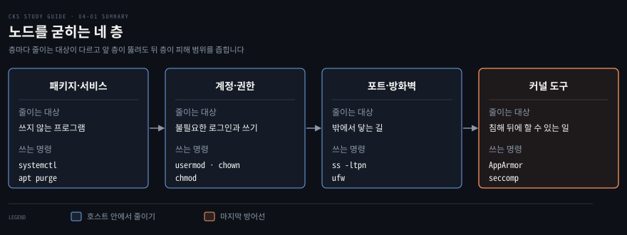
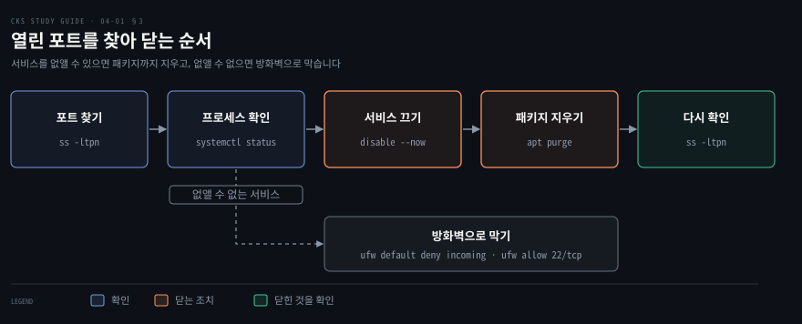
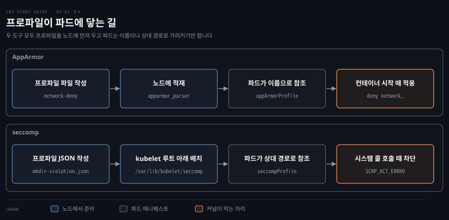

# 노드 호스트 굳히기 — 패키지·계정·포트·AppArmor·seccomp
---

## 핵심 요약

> 노드 호스트를 굳히는 일은 공격자가 쓸 수 있는 프로그램, 계정, 포트, 시스템 콜을 층마다 줄여서 노드가 뚫린 뒤의 피해까지 좁히는 일입니다.



쓰지 않는 서비스는 `systemctl` 로 끄고 `apt purge` 로 지웁니다. 계정은 로그인이 필요 없으면 `nologin` 쉘로 만들고, 파일은 `chown` 과 `chmod` 로 소유자와 권한을 좁힙니다.

열린 포트는 `ss` 로 프로세스까지 찾아 서비스째 닫고, 닫을 수 없는 포트는 ufw(Uncomplicated Firewall)로 막습니다.

마지막 방어선은 커널 쪽입니다. AppArmor 프로파일은 노드에 적재해 두고 파드가 이름으로 부르며, seccomp 프로파일은 kubelet 의 seccomp 디렉터리에 두고 상대 경로로 부릅니다. 이 노트의 값은 2026-11-05 에 공식 페이지에서 확인한 쿠버네티스 v1.37 문서 기준입니다.


## 학습 목표

이 내용을 읽고 나면:

1. 호스트의 서비스와 패키지를 줄이는 이유를 설명하고, `systemctl` 과 `apt purge` 로 서비스를 끄고 패키지를 지울 수 있습니다.
2. 사용자와 그룹을 조회, 추가, 삭제, 전환하고 `chown`·`chmod` 로 파일의 소유자와 권한을 읽고 바꿀 수 있습니다.
3. `ss` 로 열린 포트와 프로세스를 찾아 서비스를 닫고, ufw 로 필요한 포트만 허용하는 규칙을 세울 수 있습니다.
4. AppArmor 프로파일을 노드에 적재하고 `securityContext.appArmorProfile` 로 파드에 적용할 수 있습니다.
5. seccomp 의 `RuntimeDefault` 와 `Localhost` 프로파일을 파드에 적용하고, 막힌 시스템 콜과 기록된 시스템 콜을 확인할 수 있습니다.


## 본문 정리

### 1. 호스트 OS 줄이기

노드에는 쿠버네티스를 돌리는 데 필요한 프로그램만 남기는 것이 호스트 하드닝의 출발점입니다. 공격 표면(attack surface)은 공격자가 건드릴 수 있는 프로그램, 포트, 계정을 모두 합친 범위이고, 호스트에 깔린 서비스가 하나 늘 때마다 취약점이 들어올 문도 하나 늘어납니다. 워커 노드가 하는 일은 컨테이너 런타임과 kubelet 으로 파드를 돌리는 것이라서 FTP 서버나 메일 서버 같은 프로그램은 필요하지 않습니다. 노드가 받아야 하는 포트는 [노드와 접근 지점 지키기](./02-02.%EB%85%B8%EB%93%9C%EC%99%80%20%EC%A0%91%EA%B7%BC%20%EC%A7%80%EC%A0%90%20%EC%A7%80%ED%82%A4%EA%B8%B0%20%E2%80%94%20%EB%A9%94%ED%83%80%EB%8D%B0%EC%9D%B4%ED%84%B0%C2%B7Dashboard%C2%B7%EC%84%A4%EC%A0%95%20%EC%9D%B8%EC%9E%90%C2%B7%EB%B0%94%EC%9D%B4%EB%84%88%EB%A6%AC%20%EA%B2%80%EC%A6%9D.md)의 「노드 포트와 메타데이터 서버 보호」 절에서 다뤘습니다.[^ports]

서비스는 `systemctl` 로 찾아서 끕니다. 먼저 실행 중인 서비스와 부팅 때 켜지는 서비스를 나열합니다.

```bash
systemctl list-units --type=service --state=running
systemctl list-unit-files --type=service --state=enabled
```

목록에서 쓰지 않는 서비스를 골라 상태를 확인하고 끕니다. `stop` 은 지금 돌고 있는 프로세스를 멈추고 `disable` 은 부팅 때 다시 뜨지 않게 하므로 둘은 하는 일이 다릅니다. `disable --now` 를 쓰면 한 번에 둘 다 합니다.[^systemctl]

```bash
sudo systemctl status vsftpd
sudo systemctl disable --now vsftpd
```

`status` 의 `Loaded:` 줄에 `enabled` 가 보이면 부팅 때 켜지는 서비스입니다. `disable --now` 뒤에 `systemctl is-enabled vsftpd` 를 실행하면 `disabled` 가 나옵니다.

멈춰 둔 서비스도 패키지가 남아 있으면 누군가 다시 켤 수 있으므로 쓰지 않는 패키지는 `apt purge` 로 지웁니다. `purge` 는 패키지와 설정 파일을 함께 지우고, `--auto-remove` 는 `autoremove` 를 함께 실행해 의존성으로 자동 설치됐다가 이제 쓰이지 않는 패키지를 모두 지웁니다.[^apt]

```bash
sudo apt purge --auto-remove -y vsftpd
```

이 명령은 Debian 계열 배포판의 `apt` 기준입니다. 지운 뒤에는 포트가 닫혔는지 「외부 네트워크 접근 줄이기」 절의 방법으로 확인합니다.

### 2. 사용자·그룹·파일 권한 줄이기

노드의 계정은 필요한 사람과 프로그램에만 만들고, 계정마다 필요한 파일 권한만 줍니다. 클라우드의 IAM(Identity and Access Management)이 말하는 최소 권한 원칙을 노드 안의 사용자와 파일에 적용하는 셈입니다.

사용자와 그룹의 목록은 텍스트 파일 두 개에 있습니다. `/etc/passwd` 한 줄은 `name:password:UID:GID:GECOS:directory:shell` 의 일곱 필드입니다. `/etc/group` 한 줄은 `group_name:password:GID:user_list` 의 네 필드입니다.[^passwd] `password` 자리의 `x` 는 암호 해시가 `/etc/shadow` 에 따로 있다는 표시입니다.

```bash
getent passwd svc1
getent group team
```

```bash
svc1:x:1001:1001::/home/svc1:/usr/sbin/nologin
team:x:1002:svc1
```

사람이 로그인할 일이 없는 서비스 계정은 로그인 쉘을 `/usr/sbin/nologin` 으로 지정해 만듭니다. `-m` 은 홈 디렉터리를 만들고 `-s` 는 로그인 쉘을 정합니다. 그룹은 `groupadd` 로 만들고 사용자를 `usermod -aG` 로 넣습니다.

```bash
sudo useradd -m -s /usr/sbin/nologin svc1
sudo groupadd team
sudo usermod -aG team svc1
id svc1
```

```bash
uid=1001(svc1) gid=1001(svc1) groups=1001(svc1),1002(team)
```

`usermod` 에서 `-a` 는 `-G` 와 함께 써야 하고 보조 그룹 목록에 더하는 뜻입니다. `-a` 없이 `-G` 만 쓰면 목록에 없는 그룹에서 빠집니다. 기본 그룹을 바꾸는 옵션은 `-g` 입니다.[^usermod]

삭제는 순서가 있습니다. 어떤 사용자의 기본 그룹인 그룹은 지울 수 없습니다. `team` 이 `svc1` 의 기본 그룹일 때 `sudo groupdel team` 을 실행하면 다음 오류가 납니다.

```bash
groupdel: cannot remove the primary group of user 'svc1'
```

사용자는 `sudo userdel -r svc1` 로 지우며 `-r` 은 홈 디렉터리도 함께 지웁니다. 그 사용자의 프로세스가 돌고 있으면 `userdel` 이 거절하므로 먼저 `sudo pkill -u svc1` 로 끝냅니다.

다른 사용자로 바꾸는 방법은 `su` 와 `sudo -u` 두 가지입니다. 로그인 쉘이 `nologin` 인 계정으로 `sudo su - svc1` 을 실행하면 `This account is currently not available.` 가 나오고 쉘이 열리지 않습니다. 명령 하나만 그 계정으로 돌릴 때는 `sudo -u svc1 id` 를 씁니다.

파일 권한은 `ls -l` 출력 맨 앞의 10글자로 읽습니다. 첫 글자는 파일 종류이고 나머지 아홉 글자는 소유자, 그룹, 그 밖의 사용자의 읽기(`r`)·쓰기(`w`)·실행(`x`) 권한입니다. 비트 구조는 [Linux 시스템 콜·권한·capability](../container-security/02-01.Linux%20%EC%8B%9C%EC%8A%A4%ED%85%9C%20%EC%BD%9C%C2%B7%EA%B6%8C%ED%95%9C%C2%B7capability%20%E2%80%94%20%EC%BB%A8%ED%85%8C%EC%9D%B4%EB%84%88%20%EB%B3%B4%EC%95%88%EC%9D%98%20%EB%B0%94%EB%8B%A5.md)의 「파일 권한 — 보안의 주춧돌」 절에서 설명했습니다.

```bash
-rw-r----- 1 svc1 team 0 Nov  5 06:27 /tmp/f
```

소유자와 그룹은 `chown` 으로, 권한은 `chmod` 로 바꿉니다. 숫자 `640` 은 소유자 `rw-`, 그룹 `r--`, 그 밖의 사용자 `---` 입니다. `o-rwx` 나 `g+r` 같은 글자 표기로도 같은 일을 합니다.

```bash
sudo chown svc1:team /tmp/f
sudo chmod 640 /tmp/f
```

두 명령을 실행할 수 있는 주체는 정해져 있습니다. 소유자를 바꾸는 일은 CAP_CHOWN capability 를 가진 특권 프로세스만 할 수 있습니다. 파일 소유자는 자기가 속한 그룹으로만 그룹을 바꿀 수 있습니다. `chmod` 는 파일 소유자나 CAP_FOWNER capability 를 가진 프로세스가 합니다.[^chown] capability 는 [Linux 시스템 콜·권한·capability](../container-security/02-01.Linux%20%EC%8B%9C%EC%8A%A4%ED%85%9C%20%EC%BD%9C%C2%B7%EA%B6%8C%ED%95%9C%C2%B7capability%20%E2%80%94%20%EC%BB%A8%ED%85%8C%EC%9D%B4%EB%84%88%20%EB%B3%B4%EC%95%88%EC%9D%98%20%EB%B0%94%EB%8B%A5.md)의 「Linux capability — 통짜 권한을 조각으로」 절에서 다뤘습니다.

### 3. 외부 네트워크 접근 줄이기

밖에서 닿을 이유가 없는 포트는 열린 채로 두지 않습니다. 포트는 서비스가 듣고 있어야 열리므로, 열린 포트를 찾으면 그 포트를 연 서비스를 끄는 것이 가장 확실한 방법입니다.

열린 포트는 `ss` 로 프로세스까지 찾습니다. `ss` 는 소켓 통계를 보이는 명령이고 `netstat` 와 비슷한 정보를 더 많은 TCP 상태와 함께 보여 줍니다.[^ss] `-l` 은 듣고 있는 소켓, `-t` 는 TCP, `-p` 는 프로세스, `-n` 은 포트 이름 대신 숫자를 보입니다.

```bash
sudo ss -ltpn
```

```bash
State  Recv-Q Send-Q Local Address:Port Peer Address:PortProcess
LISTEN 0      32                 *:21              *:*    users:(("vsftpd",pid=4497,fd=3))
```

포트 하나만 보려면 `sudo ss -ltpn 'sport = :21'` 이나 `sudo lsof -i :21` 을 씁니다. 프로세스 이름을 찾았으면 `systemctl status` 로 서비스인지 확인하고, 「호스트 OS 줄이기」 절에서 한 대로 서비스를 끄고 패키지를 지웁니다. 지운 뒤 `ss` 나 `lsof` 를 다시 실행하면 그 줄이 사라집니다.



서비스를 없앨 수 없는 노드라면 방화벽으로 들어오는 트래픽을 좁힙니다. ufw 는 netfilter 방화벽을 관리하는 명령이고 Ubuntu 에 들어 있습니다. netfilter 의 규칙 체계는 [iptables·IPVS·eBPF](../networking-and-kubernetes/02-03.iptables%C2%B7IPVS%C2%B7eBPF%20%E2%80%94%20kube-proxy%EB%A5%BC%20%EC%9D%B4%ED%95%B4%ED%95%98%EB%8A%94%20%EC%84%B8%20%EA%B8%B0%EC%88%A0.md)의 「iptables의 두 축 — 구성과 실행」 절에서 설명했습니다. 설치 직후 ufw 는 꺼져 있고 기본 정책은 들어오는 트래픽 거부, 나가는 트래픽 허용입니다.[^ufw] 그래서 허용할 포트를 먼저 정하고 나서 켭니다.

SSH 포트를 허용하는 규칙 없이 ufw 를 켜면 이후 새 접속이 막혀 노드에 다시 들어가지 못할 수 있습니다. 워커 노드는 SSH 22번과 공식 「Ports and Protocols」 표의 kubelet API 10250번, kube-proxy 10256번, NodePort 범위 30000부터 32767까지를 허용합니다.[^ports] CNI 플러그인이 노드끼리 쓰는 포트는 그 표에 없으므로 플러그인 문서에서 따로 확인합니다.

```bash
sudo ufw default deny incoming
sudo ufw allow 22/tcp
sudo ufw allow 10250/tcp
sudo ufw allow 10256/tcp
sudo ufw allow 30000:32767/tcp
sudo ufw allow 30000:32767/udp
sudo ufw enable
sudo ufw status verbose
```

출발지를 좁히려면 `sudo ufw allow from 192.0.2.10 to any port 10250 proto tcp` 처럼 `from` 으로 주소를 줍니다. 규칙은 `sudo ufw status numbered` 로 번호를 확인하고 `sudo ufw delete allow 10250/tcp` 처럼 지웁니다.

나가는 트래픽의 기본 정책은 `allow` 로 둡니다. `deny` 로 바꾸면 DNS 와 HTTPS 요청부터 막히므로 필요한 `ufw allow out` 규칙을 먼저 갖춘 뒤에만 바꿉니다.

### 4. 커널 하드닝 도구

컨테이너는 호스트 커널을 공유하므로 AppArmor 와 seccomp 로 컨테이너가 커널에 할 수 있는 일을 따로 좁힙니다. 둘 다 프로파일, 곧 커널이 지킬 규칙을 적은 파일을 만들고 파드가 그 프로파일을 가리키게 하는 같은 길을 씁니다. AppArmor 는 노드의 커널에 적재한 프로파일을 이름으로 가리킵니다. seccomp 는 kubelet 의 seccomp 디렉터리 아래에 둔 파일을 상대 경로로 가리킵니다. 두 도구가 컨테이너 격리를 어떻게 강화하는지는 [컨테이너 격리 강화](../container-security/08-01.%EC%BB%A8%ED%85%8C%EC%9D%B4%EB%84%88%20%EA%B2%A9%EB%A6%AC%20%EA%B0%95%ED%99%94%20%E2%80%94%20%EC%83%8C%EB%93%9C%EB%B0%95%EC%8B%B1%EC%9D%98%20%EC%84%B8%20%EA%B0%88%EB%9E%98.md)의 「seccomp — 시스템 콜을 좁히다」 절에서 다뤘습니다.



AppArmor 는 프로그램마다 접근할 수 있는 파일, 네트워크, capability 를 프로파일로 적어 두고 그 밖의 접근을 커널이 거부하게 합니다. 시험에서 쓰는 프로파일 모드는 둘입니다. `enforce` 는 허용하지 않은 동작을 막고, `complain` 은 허용하지만 위반을 기록합니다. 모드를 적지 않으면 `enforce` 입니다.[^aad] 새 프로파일은 `complain` 으로 먼저 올려 무엇이 걸리는지 본 뒤 `enforce` 로 올립니다. 이 순서는 [컨테이너 격리 강화](../container-security/08-01.%EC%BB%A8%ED%85%8C%EC%9D%B4%EB%84%88%20%EA%B2%A9%EB%A6%AC%20%EA%B0%95%ED%99%94%20%E2%80%94%20%EC%83%8C%EB%93%9C%EB%B0%95%EC%8B%B1%EC%9D%98%20%EC%84%B8%20%EA%B0%88%EB%9E%98.md)의 「complain 모드 — 프로파일을 길들이는 법」 절에서 설명했습니다.

AppArmor 는 노드 커널에 모듈이 켜져 있어야 동작합니다. `cat /sys/module/apparmor/parameters/enabled` 가 `Y` 를 내면 켜진 노드입니다. 파드에 AppArmor 가 명시돼 있으면 kubelet 이 파드를 받기 전에 이 조건을 확인합니다.[^aa] 프로파일은 파드가 뜰 수 있는 모든 노드에 적재해야 합니다.

프로파일 파일은 `/etc/apparmor.d/` 아래에 둡니다. 다음 프로파일은 파일 접근은 허용하고 네트워크 접근은 거부합니다. `network,` 만 적으면 모든 네트워킹을 허용하는 규칙이 되므로 막으려면 `deny` 한정자를 붙입니다.[^aad]

```bash
#include <tunables/global>

profile network-deny flags=(attach_disconnected) {
  #include <abstractions/base>

  file,
  deny network,
}
```

프로파일은 `apparmor_parser` 로 커널에 적재합니다. 기본 동작은 추가이고 `-a` 로도 씁니다. 같은 이름의 프로파일이 이미 있으면 `-r` 로 바꿉니다. `-C` 는 `complain` 모드로 적재하는 옵션이고 `-Q -T` 는 커널에 올리지 않고 문법만 검사합니다.[^aaparser]

적재된 프로파일은 `/sys/kernel/security/apparmor/profiles` 에서 이름과 모드로 확인합니다. 출력은 `network-deny (enforce)` 처럼 이름 뒤에 모드가 붙습니다. `aa-status` 는 모드별 머리줄 아래에 이름만 늘어놓으므로 `grep` 없이 실행해 `enforce` 절 아래에 이름이 있는지 봅니다.

```bash
sudo apparmor_parser -Q -T /etc/apparmor.d/network-deny
sudo apparmor_parser /etc/apparmor.d/network-deny
sudo cat /sys/kernel/security/apparmor/profiles | grep network-deny
```

파드는 컨테이너의 `securityContext.appArmorProfile` 로 프로파일을 지정합니다. `type` 은 `RuntimeDefault`, `Unconfined`, `Localhost` 중 하나이고 기본값은 `RuntimeDefault` 입니다. `localhostProfile` 은 `type: Localhost` 일 때만 쓰며 노드에 적재된 프로파일 이름을 줍니다.[^aa]

이 필드는 v1.31 부터 Stable 입니다. v1.30 이전에는 `container.apparmor.security.beta.kubernetes.io/<컨테이너 이름>` 어노테이션으로 지정했습니다.[^aa]

```yaml
apiVersion: v1
kind: Pod
metadata:
  name: network-call
spec:
  containers:
  - name: network-call
    image: alpine/curl:3.14
    command: ["sh", "-c", "while true; do ping -c 1 google.com; sleep 5; done"]
    securityContext:
      appArmorProfile:
        type: Localhost
        localhostProfile: network-deny
```

적용 여부는 컨테이너의 첫 프로세스에 붙은 프로파일로 확인합니다. `kubectl exec network-call -- cat /proc/1/attr/current` 를 실행하면 프로파일 이름과 모드가 나옵니다.[^aa]

seccomp 는 컨테이너 프로세스가 커널에 요청할 수 있는 시스템 콜을 걸러 냅니다. 시스템 콜이 무엇인지는 [Linux 시스템 콜·권한·capability](../container-security/02-01.Linux%20%EC%8B%9C%EC%8A%A4%ED%85%9C%20%EC%BD%9C%C2%B7%EA%B6%8C%ED%95%9C%C2%B7capability%20%E2%80%94%20%EC%BB%A8%ED%85%8C%EC%9D%B4%EB%84%88%20%EB%B3%B4%EC%95%88%EC%9D%98%20%EB%B0%94%EB%8B%A5.md)의 「시스템 콜 — 유저 공간이 커널에 일을 시키는 통로」 절에서 다뤘습니다.

파드의 `securityContext.seccompProfile.type` 은 세 값 중 하나입니다. `RuntimeDefault` 는 컨테이너 런타임이 주는 기본 프로파일이고 `Localhost` 는 노드에 둔 파일이며 `Unconfined` 는 제한이 없는 상태입니다.[^seccomp]

`localhostProfile` 은 kubelet 의 seccomp 디렉터리를 기준으로 한 상대 경로입니다. 그 디렉터리는 kubelet 의 `--root-dir` 아래 `seccomp/` 입니다. `--root-dir` 의 기본값이 `/var/lib/kubelet` 이므로 기본 위치는 `/var/lib/kubelet/seccomp` 입니다.[^seccomp] 다음 파드는 `/var/lib/kubelet/seccomp/profiles/audit.json` 을 가리킵니다.

```yaml
apiVersion: v1
kind: Pod
metadata:
  name: network-call
spec:
  securityContext:
    seccompProfile:
      type: Localhost
      localhostProfile: profiles/audit.json
  containers:
  - name: network-call
    image: alpine/curl:3.14
    command: ["sh", "-c", "while true; do ping -c 1 google.com; sleep 5; done"]
    securityContext:
      allowPrivilegeEscalation: false
```

`audit.json` 은 모든 시스템 콜을 기록하는 프로파일입니다. `defaultAction` 은 프로파일에 따로 적히지 않은 시스템 콜에 하는 동작입니다. 이 장에서 쓰는 값은 `SCMP_ACT_LOG` 기록, `SCMP_ACT_ERRNO` 거부, `SCMP_ACT_ALLOW` 허용입니다.[^seccomp]

```json
{
    "defaultAction": "SCMP_ACT_LOG"
}
```

기록은 노드 커널 로그에 `audit: type=1326` 줄로 남습니다. Ubuntu 에서는 `sudo grep 'type=1326' /var/log/syslog` 나 `sudo dmesg | grep 'type=1326'` 로 찾습니다. 줄의 `comm` 은 시스템 콜을 부른 프로세스 이름이고 `syscall` 은 시스템 콜 번호입니다.

특정 시스템 콜만 막으려면 기본 동작은 허용으로 두고 막을 이름을 `syscalls` 에 적습니다. 한 동작이 시스템 콜 몇 개로 나뉘고 아키텍처마다 쓰는 것이 다르므로 이름을 모두 적어야 합니다. `mkdir` 는 아키텍처에 따라 `mkdir` 나 `mkdirat` 로 호출되므로 둘 다 적습니다.[^mkdir]

```json
{
    "defaultAction": "SCMP_ACT_ALLOW",
    "syscalls": [
        {
            "names": [
                "mkdir",
                "mkdirat"
            ],
            "action": "SCMP_ACT_ERRNO"
        }
    ]
}
```

이 파일을 `/var/lib/kubelet/seccomp/profiles/mkdir-violation.json` 에 둡니다. 파드가 `localhostProfile: profiles/mkdir-violation.json` 으로 가리키면 컨테이너 안의 `mkdir test` 가 `Operation not permitted` 로 실패합니다.

프로파일을 파드마다 지정하지 않고 노드의 모든 워크로드에 `RuntimeDefault` 를 기본으로 거는 설정도 있습니다. kubelet 에 `--seccomp-default` 를 주거나 설정 파일에 `seccompDefault: true` 를 씁니다. 이 기능은 v1.27 부터 Stable 입니다.[^seccomp]

파드의 커널 파라미터인 sysctl 도 `securityContext.sysctls` 로 정하고, 지정할 수 있는 범위가 따로 있습니다. 파드마다 따로 둘 수 있는 것은 네임스페이스를 가진 sysctl 뿐입니다. 그중 파드끼리 영향을 주지 않는 안전한 목록만 기본으로 열려 있고 `kernel.shm_rmid_forced` 가 그 예입니다.

안전하지 않은 sysctl 은 노드의 kubelet 에 `--allowed-unsafe-sysctls` 로 허용하기 전에는 파드가 시작하지 못합니다. 이때 파드 상태는 `SysctlForbidden` 입니다.[^sysctl]


## 연습 문제

> 1번은 서비스와 포트, 2번은 AppArmor, 3번은 seccomp, 4번은 sysctl 을 묻습니다. 풀이는 파일 맨 끝의 정답에 있습니다.

2번과 3번은 `default` 네임스페이스에서 `alpine/curl:3.14` 이미지로 `ping google.com` 을 5초마다 반복하는 파드 `network-call` 이 돌고 있다고 가정합니다.

1. kubeadm 으로 만든 클러스터의 워커 노드에 접속해 포트 21 을 듣고 있는 프로세스를 찾고, 그 포트를 노출하지 않도록 해당 서비스를 멈추고 패키지를 지운 뒤 포트가 닫혔는지 확인하려면 어떻게 합니까?
2. 워커 노드에 접속해 네트워크 트래픽을 모두 막는 AppArmor 프로파일 `network-deny` 를 `enforce` 모드로 적재하고 파드 `network-call` 에 적용하려면 어떻게 합니까? 네트워크 호출이 막혔는지는 어떻게 확인합니까?
3. 워커 노드의 표준 seccomp 디렉터리에 모든 시스템 콜을 기록하는 프로파일 `audit.json` 을 만들고 파드 `network-call` 에 적용하려면 어떻게 합니까? 기록은 어디서 찾습니까?
4. 이미지 `nginx:1.23.1` 로 파드 `sysctl-pod` 를 만들고 `net.core.somaxconn` 을 1024 로, `debug.iotrace` 를 1 로 지정하면 파드 상태는 어떻게 됩니까? 이유는 어디서 확인합니까?


## 정답 (자답 후 펼치기)

### 정답 1

포트 21 을 듣는 프로세스는 `lsof` 나 `ss` 로 찾습니다. 프로세스가 `vsftpd` 라면 서비스로 돌고 있으므로 서비스를 끄고 패키지를 지웁니다.

```bash
sudo lsof -i :21
sudo ss -ltpn 'sport = :21'
sudo systemctl status vsftpd
sudo systemctl disable --now vsftpd
sudo apt purge --auto-remove -y vsftpd
sudo lsof -i :21
```

마지막 `lsof` 가 아무것도 출력하지 않으면 포트가 닫힌 것입니다. `ss -ltpn` 에서도 `:21` 줄이 없어집니다.

### 정답 2

프로파일 파일을 만들고 적재한 뒤 파드를 지우고 프로파일을 붙여 다시 만듭니다. 실행 중인 파드의 `securityContext` 는 바꿀 수 없기 때문입니다.

```bash
#include <tunables/global>

profile network-deny flags=(attach_disconnected) {
  #include <abstractions/base>

  file,
  deny network,
}
```

`/etc/apparmor.d/network-deny` 에 위 내용을 저장하고 워커 노드에서 적재합니다. 노드가 여러 대면 파드가 갈 수 있는 모든 워커에 적재합니다.

```bash
sudo apparmor_parser /etc/apparmor.d/network-deny
sudo cat /sys/kernel/security/apparmor/profiles | grep network-deny
```

다음에는 관리자 컴퓨터에서 파드 정의를 저장하고 파드를 지웁니다. 저장한 파일에서 `status` 와 자동으로 붙은 필드를 걷어 내고 컨테이너에 `securityContext` 를 더합니다.

```bash
kubectl get pod network-call -o yaml > pod.yaml
kubectl delete pod network-call
```

```yaml
apiVersion: v1
kind: Pod
metadata:
  name: network-call
spec:
  containers:
  - name: network-call
    image: alpine/curl:3.14
    command: ["sh", "-c", "while true; do ping -c 1 google.com; sleep 5; done"]
    securityContext:
      appArmorProfile:
        type: Localhost
        localhostProfile: network-deny
```

```bash
kubectl create -f pod.yaml
kubectl get pod network-call
kubectl exec network-call -- cat /proc/1/attr/current
kubectl logs network-call
```

`/proc/1/attr/current` 에는 프로파일 이름과 모드가 나옵니다. `deny network,` 때문에 `ping` 이 소켓을 만들지 못하므로 로그에는 `ping` 이 성공했다는 줄이 나오지 않고 실패 메시지만 반복됩니다.

### 정답 3

seccomp 디렉터리에 프로파일을 두고 파드를 지운 뒤 `localhostProfile` 로 가리켜 다시 만듭니다.

```bash
sudo mkdir -p /var/lib/kubelet/seccomp/profiles
sudo tee /var/lib/kubelet/seccomp/profiles/audit.json <<'EOF'
{
    "defaultAction": "SCMP_ACT_LOG"
}
EOF
```

```bash
kubectl get pod network-call -o yaml > pod.yaml
kubectl delete pod network-call
```

```yaml
apiVersion: v1
kind: Pod
metadata:
  name: network-call
spec:
  securityContext:
    seccompProfile:
      type: Localhost
      localhostProfile: profiles/audit.json
  containers:
  - name: network-call
    image: alpine/curl:3.14
    command: ["sh", "-c", "while true; do ping -c 1 google.com; sleep 5; done"]
    securityContext:
      allowPrivilegeEscalation: false
```

```bash
kubectl create -f pod.yaml
kubectl get pod network-call
```

기록은 파드가 도는 워커 노드의 커널 로그에서 찾습니다. Ubuntu 에서는 `sudo grep 'type=1326' /var/log/syslog` 이고, `syslog` 가 없으면 `sudo dmesg | grep 'type=1326'` 을 씁니다. `comm="sleep"` 처럼 컨테이너가 부른 프로세스 이름과 `syscall=` 번호가 줄마다 남습니다.

### 정답 4

파드 상태가 `SysctlForbidden` 입니다. `net.core.somaxconn` 은 네임스페이스 sysctl 이지만 안전한 목록에 없으므로 노드가 허용하지 않았다면 파드가 거부됩니다.

```yaml
apiVersion: v1
kind: Pod
metadata:
  name: sysctl-pod
spec:
  securityContext:
    sysctls:
    - name: net.core.somaxconn
      value: "1024"
    - name: debug.iotrace
      value: "1"
  containers:
  - name: nginx
    image: nginx:1.23.1
```

```bash
kubectl create -f pod.yaml
kubectl get pods
kubectl describe pod sysctl-pod
```

`kubectl get pods` 의 `STATUS` 열에 `SysctlForbidden` 이 나옵니다. `kubectl describe pod sysctl-pod` 의 `Events` 에는 kubelet 이 남긴 `forbidden sysctl: "net.core.somaxconn" not allowlisted` 경고가 있습니다. 위쪽 `Message:` 줄에는 같은 문구가 `Pod was rejected:` 뒤에 붙어 나옵니다.

`net.core.somaxconn` 을 쓰려면 파드가 갈 노드의 kubelet 에 `--allowed-unsafe-sysctls=net.core.somaxconn` 을 주거나 설정 파일의 `allowedUnsafeSysctls` 에 넣습니다. `debug.iotrace` 는 `debug.*` 영역이 네임스페이스에 속하지 않아 파드에 지정할 수 없고 이 방법으로도 열 수 없습니다. 안전한 목록의 `kernel.shm_rmid_forced` 같은 sysctl 은 노드 설정 없이 통과합니다.


## 참고 자료

- 원본: 《Certified Kubernetes Security Specialist (CKS) Study Guide》(Benjamin Muschko, O'Reilly, 2023, ISBN 978-1098132972) Chapter 4
- [Ports and Protocols](https://kubernetes.io/docs/reference/networking/ports-and-protocols/) — 노드가 받는 포트 표
- [Restrict a Container's Access to Resources with AppArmor](https://kubernetes.io/docs/tutorials/security/apparmor/)
- [Restrict a Container's Syscalls with seccomp](https://kubernetes.io/docs/tutorials/security/seccomp/)
- [Configure a Security Context for a Pod or Container](https://kubernetes.io/docs/tasks/configure-pod-container/security-context/)
- [Using sysctls in a Kubernetes Cluster](https://kubernetes.io/docs/tasks/administer-cluster/sysctl-cluster/) · [kubelet 레퍼런스](https://kubernetes.io/docs/reference/command-line-tools-reference/kubelet/) · [Kubelet Configuration (v1beta1)](https://kubernetes.io/docs/reference/config-api/kubelet-config.v1beta1/)
- [systemctl(1)](https://man7.org/linux/man-pages/man1/systemctl.1.html) · [apt(8)](https://manpages.ubuntu.com/manpages/noble/man8/apt.8.html) · [ss(8)](https://man7.org/linux/man-pages/man8/ss.8.html) · [ufw(8)](https://manpages.ubuntu.com/manpages/noble/man8/ufw.8.html)
- [passwd(5)](https://man7.org/linux/man-pages/man5/passwd.5.html) · [group(5)](https://man7.org/linux/man-pages/man5/group.5.html) · [usermod(8)](https://manpages.ubuntu.com/manpages/noble/man8/usermod.8.html) · [chown(2)](https://man7.org/linux/man-pages/man2/chown.2.html) · [chmod(2)](https://man7.org/linux/man-pages/man2/chmod.2.html) · [mkdir(2)](https://man7.org/linux/man-pages/man2/mkdir.2.html)
- [apparmor_parser(8)](https://manpages.ubuntu.com/manpages/noble/man8/apparmor_parser.8.html) · [apparmor.d(5)](https://manpages.ubuntu.com/manpages/noble/man5/apparmor.d.5.html)
- [CKS Study Guide 정독 인덱스](./README.md) — 이 책의 장별 목표와 진행 상태
- [노드와 접근 지점 지키기](./02-02.%EB%85%B8%EB%93%9C%EC%99%80%20%EC%A0%91%EA%B7%BC%20%EC%A7%80%EC%A0%90%20%EC%A7%80%ED%82%A4%EA%B8%B0%20%E2%80%94%20%EB%A9%94%ED%83%80%EB%8D%B0%EC%9D%B4%ED%84%B0%C2%B7Dashboard%C2%B7%EC%84%A4%EC%A0%95%20%EC%9D%B8%EC%9E%90%C2%B7%EB%B0%94%EC%9D%B4%EB%84%88%EB%A6%AC%20%EA%B2%80%EC%A6%9D.md) · [Linux 시스템 콜·권한·capability](../container-security/02-01.Linux%20%EC%8B%9C%EC%8A%A4%ED%85%9C%20%EC%BD%9C%C2%B7%EA%B6%8C%ED%95%9C%C2%B7capability%20%E2%80%94%20%EC%BB%A8%ED%85%8C%EC%9D%B4%EB%84%88%20%EB%B3%B4%EC%95%88%EC%9D%98%20%EB%B0%94%EB%8B%A5.md) · [컨테이너 격리 강화](../container-security/08-01.%EC%BB%A8%ED%85%8C%EC%9D%B4%EB%84%88%20%EA%B2%A9%EB%A6%AC%20%EA%B0%95%ED%99%94%20%E2%80%94%20%EC%83%8C%EB%93%9C%EB%B0%95%EC%8B%B1%EC%9D%98%20%EC%84%B8%20%EA%B0%88%EB%9E%98.md) · [iptables·IPVS·eBPF](../networking-and-kubernetes/02-03.iptables%C2%B7IPVS%C2%B7eBPF%20%E2%80%94%20kube-proxy%EB%A5%BC%20%EC%9D%B4%ED%95%B4%ED%95%98%EB%8A%94%20%EC%84%B8%20%EA%B8%B0%EC%88%A0.md) — 같은 주제를 앞 장이나 다른 책에서 정리한 형제 노트

[^ports]: 워커 노드가 받는 TCP 포트는 kubelet API 10250, kube-proxy 10256, NodePort 기본 범위 30000-32767 이고 NodePort 범위는 UDP 도 같습니다. 기본 포트는 모두 바꿀 수 있습니다. <https://kubernetes.io/docs/reference/networking/ports-and-protocols/> (2026-11-05 조회)
[^systemctl]: `disable` 은 유닛 파일의 심볼릭 링크를 지워 `enable` 이 한 일을 되돌리고, `--now` 를 주면 같은 명령에서 유닛도 멈춥니다. <https://man7.org/linux/man-pages/man1/systemctl.1.html> (2026-11-05 조회)
[^apt]: `purge` 는 `remove` 와 같되 설정 파일까지 지우고, `autoremove` 는 의존성으로 자동 설치됐다가 더는 필요 없어진 패키지를 지웁니다. <https://manpages.ubuntu.com/manpages/noble/man8/apt.8.html> · `--auto-remove` 옵션은 <https://manpages.ubuntu.com/manpages/noble/man8/apt-get.8.html> (2026-11-05 조회)
[^passwd]: `/etc/passwd` 는 줄마다 `name:password:UID:GID:GECOS:directory:shell` 일곱 필드이고, `/etc/group` 은 `group_name:password:GID:user_list` 입니다. <https://man7.org/linux/man-pages/man5/passwd.5.html>, <https://man7.org/linux/man-pages/man5/group.5.html> (2026-11-05 조회)
[^usermod]: `-a` 는 보조 그룹에 더하며 `-G` 와 함께만 쓰고, `-G` 는 목록에 없는 그룹에서 사용자를 빼며, `-g` 는 새 기본 그룹입니다. <https://manpages.ubuntu.com/manpages/noble/man8/usermod.8.html> (2026-11-05 조회)
[^chown]: 소유자 변경은 특권 프로세스(Linux 에서 CAP_CHOWN)만, 파일 소유자는 자기가 속한 그룹으로만 그룹을 바꿀 수 있고, 권한 변경은 소유자나 CAP_FOWNER 가 합니다. <https://man7.org/linux/man-pages/man2/chown.2.html>, <https://man7.org/linux/man-pages/man2/chmod.2.html> (2026-11-05 조회)
[^ss]: `ss` 는 소켓 통계를 덤프하는 도구이고 `-n` 숫자, `-l` 듣는 소켓, `-p` 프로세스, `-t` TCP 입니다. <https://man7.org/linux/man-pages/man8/ss.8.html> (2026-11-05 조회)
[^ufw]: 설치 시 ufw 는 꺼져 있고 들어오는 기본 정책 deny, 전달 기본 정책 deny, 나가는 기본 정책 allow 입니다. `default allow|deny|reject [incoming|outgoing|routed]` 로 바꿉니다. <https://manpages.ubuntu.com/manpages/noble/man8/ufw.8.html> (2026-11-05 조회)
[^aad]: 프로파일 모드 `enforce`·`complain` 등, 규칙에는 `allow`·`deny` 한정자가 있고 `network,` 는 모든 네트워킹을 허용하는 규칙입니다. <https://manpages.ubuntu.com/manpages/noble/man5/apparmor.d.5.html> (2026-11-05 조회)
[^aa]: AppArmor 는 v1.31 부터 Stable 이고 v1.30 이전에는 어노테이션으로 지정했으며, 커널 모듈이 켜져 있어야 하고 `/sys/module/apparmor/parameters/enabled` 로 확인합니다. kubelet 은 AppArmor 가 명시된 파드를 받기 전에 호스트에서 켜져 있는지 확인합니다. `type` 은 `RuntimeDefault`(기본)·`Unconfined`·`Localhost`, 프로파일은 파드가 갈 수 있는 모든 노드에 적재해야 하고, `/proc/1/attr/current` 로 적용을 확인합니다. <https://kubernetes.io/docs/tutorials/security/apparmor/>, <https://kubernetes.io/docs/tasks/configure-pod-container/security-context/> (2026-11-05 조회)
[^aaparser]: `-a` 추가(기본), `-r` 같은 이름이 이미 있을 때 교체, `-C` complain 모드 강제, `-Q` 커널 적재를 건너뜀. <https://manpages.ubuntu.com/manpages/noble/man8/apparmor_parser.8.html> (2026-11-05 조회)
[^seccomp]: `seccompProfile.type` 은 `RuntimeDefault`·`Localhost`·`Unconfined` 이고 `localhostProfile` 은 kubelet 의 `--root-dir` 아래 `seccomp/` 기준 상대 경로입니다. `--seccomp-default` 는 v1.27 부터 Stable 이고 설정 파일 필드는 `seccompDefault` 입니다. `--root-dir` 기본값은 `/var/lib/kubelet` 입니다. <https://kubernetes.io/docs/tutorials/security/seccomp/>, <https://kubernetes.io/docs/tasks/configure-pod-container/security-context/>, <https://kubernetes.io/docs/reference/command-line-tools-reference/kubelet/>, <https://kubernetes.io/docs/reference/config-api/kubelet-config.v1beta1/> (2026-11-05 조회)
[^mkdir]: `mkdir` 와 `mkdirat` 는 같은 매뉴얼 페이지에 나오는 서로 다른 시스템 콜입니다. <https://man7.org/linux/man-pages/man2/mkdir.2.html> (2026-11-05 조회)
[^sysctl]: 안전한 sysctl 은 네임스페이스가 있고 파드끼리 영향을 주지 않는 것이고, 안전하지 않은 sysctl 은 기본으로 꺼져 있으며 노드별로 kubelet 의 `--allowed-unsafe-sysctls` 로 열고 이때 열 수 있는 것은 네임스페이스 sysctl 뿐입니다. 막힌 sysctl 을 지정한 파드는 스케줄은 되지만 시작하지 못합니다. <https://kubernetes.io/docs/tasks/administer-cluster/sysctl-cluster/> (2026-11-05 조회)
