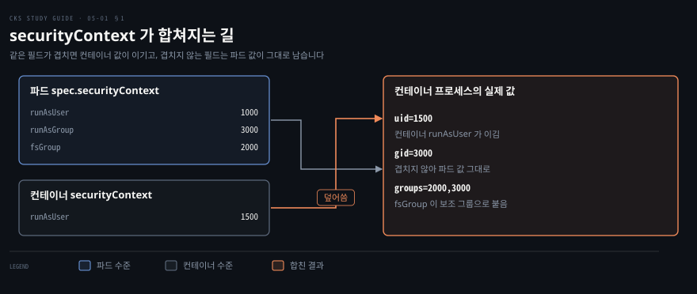
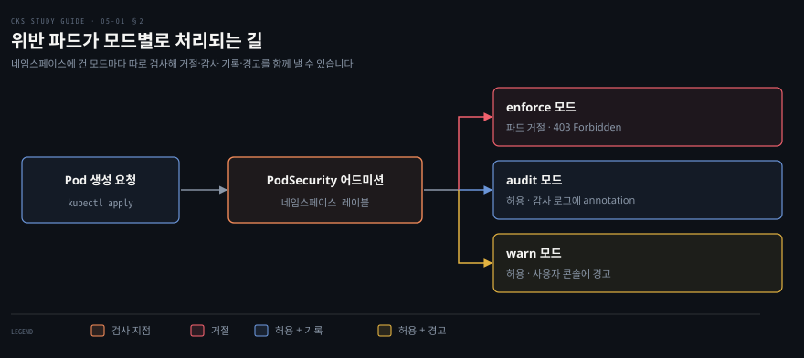
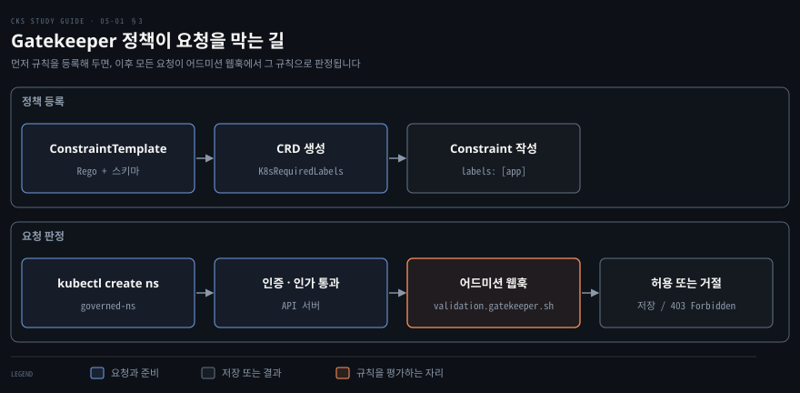

# 파드 보안 설정 강제하기 — securityContext·Pod Security Admission·Gatekeeper
---

## 핵심 요약

> 파드의 OS 권한을 좁히는 설정은 `securityContext` 에 적고, 그 설정이 빠진 파드를 어드미션 단계에서 걸러 내는 일은 네임스페이스에는 Pod Security Admission 이, 조직 고유 규칙에는 OPA Gatekeeper 가 맡습니다.

`securityContext` 는 사용자 ID, 그룹 ID, 권한 상승, 특권 모드, capability 를 정합니다. 파드 수준과 컨테이너 수준에 같은 필드가 있으면 컨테이너 값이 적용됩니다.

Pod Security Admission(PSA)은 네임스페이스 레이블 `pod-security.kubernetes.io/<MODE>: <LEVEL>` 로 Pod Security Standards(PSS)의 세 수준 중 하나를 겁니다. 모드는 위반 파드를 거절하는 enforce, 감사 로그에 남기는 audit, 경고만 내는 warn 입니다.

Gatekeeper 는 ConstraintTemplate 에 Rego 규칙을, Constraint 에 적용 대상과 값을 적어 모든 종류의 객체에 직접 쓴 정책을 겁니다. 이 노트의 값은 2026-11-05 에 공식 페이지에서 확인한 쿠버네티스 v1.37 문서와 Gatekeeper v3.23.1 기준입니다.[^psa]


## 학습 목표

이 내용을 읽고 나면:

1. 파드 수준과 컨테이너 수준의 `securityContext` 필드를 구분하고 겹칠 때 어느 값이 적용되는지 `id` 출력으로 확인할 수 있습니다.
2. `runAsNonRoot`·`runAsUser`·`runAsGroup`·`fsGroup`·`allowPrivilegeEscalation`·`privileged` 가 컨테이너에 하는 일을 설명할 수 있습니다.
3. PSS 의 세 수준과 PSA 의 세 모드를 구분하고 네임스페이스 레이블로 기준을 걸 수 있습니다.
4. 위반 파드가 enforce·audit·warn 에서 각각 어떻게 처리되는지, Deployment 로 만들 때는 어떻게 달라지는지 설명할 수 있습니다.
5. Gatekeeper 를 설치하고 ConstraintTemplate 과 Constraint 로 정책을 만들어 거절 메시지를 읽을 수 있습니다.


## 본문 정리

### 1. securityContext 로 컨테이너의 OS 권한 정하기

컨테이너가 쓰는 OS 권한은 파드나 컨테이너의 `securityContext` 에 적어 정하고 같은 필드가 양쪽에 있으면 컨테이너 값이 적용됩니다. 컨테이너는 사용자를 따로 정하지 않으면 root, 곧 사용자 ID(UID) 0 으로 돕니다. 이 root 는 호스트의 root 와 같은 번호라서 애플리케이션 취약점으로 들어온 공격자가 root 권한으로 파일을 읽고 도구를 설치할 수 있습니다. 기본 root 가 왜 위험한지는 [컨테이너 격리 깨뜨리기](../container-security/09-01.%EC%BB%A8%ED%85%8C%EC%9D%B4%EB%84%88%20%EA%B2%A9%EB%A6%AC%20%EA%B9%A8%EB%9C%A8%EB%A6%AC%EA%B8%B0%20%E2%80%94%20%EC%84%A4%EC%A0%95%20%ED%95%98%EB%82%98%EB%A1%9C%20%EB%AC%B4%EB%84%88%EC%A7%80%EB%8A%94%20%EA%B2%BD%EA%B3%84.md)의 「컨테이너는 기본으로 root로 돕니다」 절에서 다뤘습니다.

`securityContext` 는 쿠버네티스 리소스가 아니라 파드 스펙 안의 필드 묶음입니다. 파드 수준은 `spec.securityContext` 이고 모든 컨테이너에 적용됩니다. 컨테이너 수준은 `spec.containers[].securityContext` 이고 그 컨테이너에만 적용됩니다. 필드마다 있는 수준이 정해져 있고 양쪽에 있는 필드에서만 덮어쓰기가 일어납니다.[^sc]

| 있는 수준 | 필드 |
|-----------|------|
| 파드에만 | `fsGroup`·`supplementalGroups`·`sysctls` |
| 컨테이너에만 | `privileged`·`allowPrivilegeEscalation`·`capabilities`·`readOnlyRootFilesystem` |
| 양쪽 | `runAsUser`·`runAsGroup`·`runAsNonRoot`·`seccompProfile`·`appArmorProfile` |

다음 파드는 파드 수준에 사용자 1000, 그룹 3000, `fsGroup` 2000 을 주고 컨테이너 수준에서 사용자만 1500 으로 다시 정합니다.

```yaml
apiVersion: v1
kind: Pod
metadata:
  name: user-id
spec:
  securityContext:
    runAsUser: 1000
    runAsGroup: 3000
    fsGroup: 2000
  containers:
  - name: busybox
    image: busybox:1.36
    command: ["sh", "-c", "sleep 1h"]
    securityContext:
      runAsUser: 1500
```

```bash
kubectl exec user-id -- id
```

```bash
uid=1500 gid=3000 groups=2000,3000
```

`uid` 는 겹친 필드라서 컨테이너 값 1500 이 이깁니다. `gid` 는 컨테이너 수준에 `runAsGroup` 이 없으므로 파드 값 3000 이 그대로 남습니다. `groups` 에는 `fsGroup` 2000 이 보조 그룹으로 붙습니다.



`runAsNonRoot: true` 는 사용자를 정하는 필드가 아니라 root 로 시작하는 컨테이너를 막는 검사입니다. 이미지가 root 로 돌도록 만들어졌으면 kubelet 이 컨테이너를 시작하지 않고 파드가 `CreateContainerConfigError` 상태에 머뭅니다.

```yaml
apiVersion: v1
kind: Pod
metadata:
  name: non-root-error
spec:
  containers:
  - name: nginx
    image: nginx:1.23.1
    securityContext:
      runAsNonRoot: true
```

`kubectl describe pod non-root-error` 를 실행하면 이벤트에 다음 경고가 남습니다.

```bash
Error: container has runAsNonRoot and image will run as root (pod: "non-root-error_default(...)", container: nginx)
```

임의의 사용자 ID 로 돌 수 있는 이미지라면 `runAsUser` 를 root 가 아닌 값으로 함께 주어 검사를 통과시킵니다.

```yaml
apiVersion: v1
kind: Pod
metadata:
  name: non-root-ok
spec:
  containers:
  - name: busybox
    image: busybox:1.36
    command: ["sh", "-c", "sleep 1h"]
    securityContext:
      runAsNonRoot: true
      runAsUser: 1000
```

이 파드에서 `kubectl exec non-root-ok -- id` 를 실행하면 `uid=1000 gid=0(root) groups=0(root)` 가 나옵니다. `runAsGroup` 을 주지 않으면 그룹 번호가 root 그룹인 0 으로 남아 root 그룹 소유 파일에 접근할 수 있으므로 사용자와 그룹을 함께 정합니다.

`fsGroup` 은 파드가 쓰는 볼륨의 그룹 소유자를 정합니다. 컨테이너 프로세스에는 그 그룹이 보조 그룹으로 붙습니다. 마운트 디렉터리에는 setgid 비트가 붙어 `drwxrwsrwx` 로 보입니다. 그래서 그 안에 새로 만든 파일의 그룹은 프로세스의 기본 그룹이 3000 이어도 `fsGroup` 값 2000 이 됩니다.[^sc] 이 동작은 정답 1 에서 직접 확인합니다.

`allowPrivilegeEscalation` 은 프로세스가 부모 프로세스보다 많은 권한을 얻을 수 있는지를 정합니다. setuid 바이너리를 실행해 권한이 올라가는 경우가 그 예입니다. 이 값은 프로세스의 `no_new_privs` 플래그와 반대로 움직입니다.

컨테이너에 이 필드를 적지 않으면 기본값은 `true` 입니다.[^sc] 컨테이너에서 `grep NoNewPrivs /proc/1/status` 를 실행하면 필드를 적지 않았을 때 `0`, `false` 로 적었을 때 `1` 이 나옵니다.

`privileged: true` 와 함께 `false` 로 주면 API 서버가 파드를 거절합니다. 공식 문서는 `CAP_SYS_ADMIN` 을 가진 컨테이너도 같다고 적지만 API 검증은 `capabilities.add` 에 `CAP_SYS_ADMIN` 이라고 적은 경우만 막고 `SYS_ADMIN` 으로 적으면 파드가 만들어집니다. setuid 의 동작은 [Linux 시스템 콜·권한·capability](../container-security/02-01.Linux%20%EC%8B%9C%EC%8A%A4%ED%85%9C%20%EC%BD%9C%C2%B7%EA%B6%8C%ED%95%9C%C2%B7capability%20%E2%80%94%20%EC%BB%A8%ED%85%8C%EC%9D%B4%EB%84%88%20%EB%B3%B4%EC%95%88%EC%9D%98%20%EB%B0%94%EB%8B%A5.md)의 「setuid — 권한을 통째로 넘겨주는 오래된 장치」 절에서 설명했습니다.

`privileged: true` 는 컨테이너에 호스트 장치 접근과 호스트에 가까운 권한을 주므로 거의 쓰지 않아야 합니다. 일반 컨테이너에서는 `sysctl kernel.hostname=test` 가 `Read-only file system` 으로 실패하지만 특권 컨테이너에서는 통과합니다. 특권 컨테이너가 어떤 경계를 무너뜨리는지는 [컨테이너 격리 깨뜨리기](../container-security/09-01.%EC%BB%A8%ED%85%8C%EC%9D%B4%EB%84%88%20%EA%B2%A9%EB%A6%AC%20%EA%B9%A8%EB%9C%A8%EB%A6%AC%EA%B8%B0%20%E2%80%94%20%EC%84%A4%EC%A0%95%20%ED%95%98%EB%82%98%EB%A1%9C%20%EB%AC%B4%EB%84%88%EC%A7%80%EB%8A%94%20%EA%B2%BD%EA%B3%84.md)의 「`--privileged` — 가장 위험한 플래그」 절에서 다뤘습니다.

`capabilities` 는 root 권한을 조각으로 나눈 capability 를 컨테이너에서 빼거나 더하는 필드입니다. `drop: ["ALL"]` 로 전부 뺀 뒤 필요한 것만 `add` 하는 방식을 권합니다. 다음 절의 `restricted` 수준이 이 설정을 요구합니다. capability 의 정의는 [Linux 시스템 콜·권한·capability](../container-security/02-01.Linux%20%EC%8B%9C%EC%8A%A4%ED%85%9C%20%EC%BD%9C%C2%B7%EA%B6%8C%ED%95%9C%C2%B7capability%20%E2%80%94%20%EC%BB%A8%ED%85%8C%EC%9D%B4%EB%84%88%20%EB%B3%B4%EC%95%88%EC%9D%98%20%EB%B0%94%EB%8B%A5.md)의 「Linux capability — 통짜 권한을 조각으로」 절에서 설명했습니다.

이 설정들은 파드를 만드는 개발자가 직접 적어야 효과가 납니다. 개발자는 인터넷에서 복사한 매니페스트의 `privileged: true` 를 모른 채 쓸 수 있으므로 빠진 설정을 클러스터가 걸러 내는 장치가 필요합니다.

### 2. Pod Security Admission 으로 네임스페이스에 기준 걸기

Pod Security Admission(PSA)은 네임스페이스에 레이블을 붙이면 그 네임스페이스의 모든 파드를 한 수준으로 검사하는 내장 어드미션 컨트롤러입니다. 기준은 Pod Security Standards(PSS)가 정하고 PSA 는 그 기준을 집행합니다. PSA 는 v1.23 에서 베타로 기본 활성화됐고 v1.25 부터 정식 버전입니다.[^nslabel]

예전의 PodSecurityPolicy 는 v1.25 부터 제공되지 않으므로 파드 보안 기준은 PSA 로 겁니다.[^psp] PSA 의 기본 설정은 레이블이 없는 네임스페이스에 `privileged` 를 적용하므로 레이블을 붙이기 전에는 아무것도 막지 않습니다. 어드미션 설정 파일로 클러스터 전체 기본 수준을 바꿀 수도 있습니다.[^psadef]

PSS 는 세 수준입니다. 높은 수준일수록 허용하는 파드 설정이 줄어듭니다.[^pss]

| 수준 | 성격 | 걸러 내는 예 |
|------|------|-------------|
| `privileged` | 제한 없음 | 없음 |
| `baseline` | 알려진 권한 상승만 막는 최소 제한 | 호스트 네임스페이스 공유(`hostNetwork` 등)·특권 컨테이너 |
| `restricted` | 파드 하드닝 모범 사례를 따르는 강한 제한 | `allowPrivilegeEscalation` 이 `false` 가 아님·capability 를 `ALL` 로 빼지 않음·root 로 실행·seccomp 프로파일 없음 |

모드는 위반을 어떻게 다룰지 정합니다. 한 네임스페이스에 모드를 여러 개 걸 수 있고 모드마다 다른 수준을 줄 수도 있습니다.[^psa]

| 모드 | 위반 파드 |
|------|----------|
| `enforce` | 거절 |
| `audit` | 허용하고 감사 로그의 이벤트에 audit annotation 을 추가 |
| `warn` | 허용하고 사용자에게 경고를 표시 |

레이블은 `pod-security.kubernetes.io/<MODE>: <LEVEL>` 형식입니다. `<MODE>` 는 `enforce`·`audit`·`warn` 이고 `<LEVEL>` 은 `privileged`·`baseline`·`restricted` 입니다. 정책 버전을 고정하려면 `pod-security.kubernetes.io/<MODE>-version: <VERSION>` 레이블을 더합니다. `<VERSION>` 은 `v1.37` 같은 쿠버네티스 마이너 버전이나 `latest` 입니다.[^psa]



다음 네임스페이스는 `restricted` 수준을 `enforce` 로 겁니다.

```yaml
apiVersion: v1
kind: Namespace
metadata:
  name: psa
  labels:
    pod-security.kubernetes.io/enforce: restricted
```

이 네임스페이스에 `securityContext` 없이 busybox 파드를 만들면 거절됩니다. 메시지가 위반 항목을 하나씩 알려 줍니다.

```bash
Error from server (Forbidden): error when creating "psa-bad.yaml": pods "busybox" is forbidden: violates PodSecurity "restricted:latest": allowPrivilegeEscalation != false (container "busybox" must set securityContext.allowPrivilegeEscalation=false), unrestricted capabilities (container "busybox" must set securityContext.capabilities.drop=["ALL"]), runAsNonRoot != true (pod or container "busybox" must set securityContext.runAsNonRoot=true), seccompProfile (pod or container "busybox" must set securityContext.seccompProfile.type to "RuntimeDefault" or "Localhost")
```

메시지가 요구한 네 가지를 모두 채우면 파드가 만들어집니다. `restricted` 는 capability 를 전부 뺀 뒤 `NET_BIND_SERVICE` 만 더하도록 허용합니다.[^pss]

```yaml
apiVersion: v1
kind: Pod
metadata:
  name: busybox
  namespace: psa
spec:
  containers:
  - name: busybox
    image: busybox:1.36
    command: ["sh", "-c", "sleep 1h"]
    securityContext:
      allowPrivilegeEscalation: false
      capabilities:
        drop: ["ALL"]
      runAsNonRoot: true
      runAsUser: 2000
      runAsGroup: 3000
      seccompProfile:
        type: RuntimeDefault
```

`enforce` 는 Deployment 나 Job 같은 워크로드 리소스에는 걸리지 않고 그 리소스가 만드는 파드에만 걸립니다. `audit` 과 `warn` 은 워크로드 리소스에도 적용되어 위반을 일찍 알립니다.[^psa]

`restricted` 를 `enforce` 로 건 네임스페이스에 Deployment 를 만들면 Deployment 는 경고와 함께 만들어집니다. `warn` 레이블이 없으면 PSA 가 `warn` 수준을 `enforce` 수준으로 채우기 때문입니다.[^warn] 하지만 ReplicaSet 이 파드를 만들지 못하고 `FailedCreate` 이벤트를 남깁니다. 그래서 `kubectl get pods` 에는 아무것도 보이지 않고 `kubectl describe rs` 에서 원인을 찾아야 합니다.

기존 네임스페이스에 `enforce` 를 붙일 때는 이미 떠 있는 파드가 지워지지 않고 경고만 납니다. 적용 전에 `kubectl label --dry-run=server --overwrite ns --all pod-security.kubernetes.io/enforce=baseline` 처럼 서버 쪽 dry-run 으로 영향을 확인할 수 있습니다.[^nslabel]

PSA 는 PSS 의 세 수준 안에서만 고르며 규칙을 직접 쓰거나 메시지를 바꾸거나 위반 파드를 고쳐 주지는 못합니다. 그보다 세밀한 규칙이 필요하면 다음 절의 Gatekeeper 가 맡습니다.

### 3. OPA Gatekeeper 로 조직 정책 강제하기

Gatekeeper 는 쿠버네티스 API 요청을 어드미션 단계에서 정책으로 판정하는 확장입니다. 어떤 종류의 객체에도 조직이 직접 쓴 규칙을 강제할 수 있습니다. 정책 엔진은 Open Policy Agent(OPA)입니다. OPA 는 쿠버네티스에 매이지 않는 범용 오픈소스 엔진입니다. 규칙은 OPA 의 질의 언어 Rego 로 쓰고 그 검증 로직이 객체를 받아들일지 거절할지 정합니다.

Gatekeeper 로 쓸 수 있는 정책의 예로는 모든 Service 에 `team` 키 레이블을 요구하는 정책이 있습니다. 사내 레지스트리의 이미지만 허용하거나 Deployment 의 레플리카를 3개 이상으로 제한하는 정책도 쓸 수 있습니다.

Gatekeeper 가 끼어드는 자리는 요청 처리 순서의 어드미션 단계입니다. 요청은 인증과 인가를 지난 뒤 어드미션 컨트롤러를 거칩니다. Gatekeeper 는 이 단계에서 검증 웹훅 `validation.gatekeeper.sh` 로 요청을 받아 판정합니다. 요청 처리 순서는 [클러스터 굳히기](./03-01.%ED%81%B4%EB%9F%AC%EC%8A%A4%ED%84%B0%20%EA%B5%B3%ED%9E%88%EA%B8%B0%20%E2%80%94%20API%20%EC%A0%91%EA%B7%BC%C2%B7RBAC%C2%B7ServiceAccount%C2%B7%EC%97%85%EA%B7%B8%EB%A0%88%EC%9D%B4%EB%93%9C.md)의 「API 서버의 요청 처리 순서와 접속 경로」 절에서 설명했습니다.

설치는 클러스터 관리자 권한으로 릴리스 매니페스트를 적용하는 것입니다. 다음은 최신 릴리스 v3.23.1 의 태그를 고정한 명령입니다.[^gkinstall]

```bash
kubectl apply -f https://raw.githubusercontent.com/open-policy-agent/gatekeeper/v3.23.1/deploy/gatekeeper.yaml
kubectl get pods -n gatekeeper-system
```

Gatekeeper 객체는 `gatekeeper-system` 네임스페이스에 만들어집니다. 그 안의 파드가 모두 `Running` 이 된 뒤에 정책을 만듭니다.

정책은 두 객체로 나눠 씁니다. ConstraintTemplate 은 Rego 로 쓴 규칙과, 그 규칙을 쓰는 Constraint 의 스키마를 정의합니다. Constraint 는 템플릿이 정의한 kind 의 객체입니다. 어떤 리소스에 적용할지(`match`)와 규칙에 넘길 값(`parameters`)을 적습니다.[^gkhowto] 템플릿을 적용하면 그 `kind` 이름의 CRD(CustomResourceDefinition)가 새로 생기며 Constraint 는 그 CRD 의 객체입니다.



다음 템플릿은 네임스페이스처럼 레이블을 가진 객체가 `parameters.labels` 에 적힌 키를 모두 갖게 요구합니다.

```yaml
apiVersion: templates.gatekeeper.sh/v1
kind: ConstraintTemplate
metadata:
  name: k8srequiredlabels
spec:
  crd:
    spec:
      names:
        kind: K8sRequiredLabels
      validation:
        openAPIV3Schema:
          type: object
          properties:
            labels:
              type: array
              items:
                type: string
  targets:
    - target: admission.k8s.gatekeeper.sh
      rego: |
        package k8srequiredlabels

        violation[{"msg": msg, "details": {"missing_labels": missing}}] {
          provided := {label | input.review.object.metadata.labels[label]}
          required := {label | label := input.parameters.labels[_]}
          missing := required - provided
          count(missing) > 0
          msg := sprintf("you must provide labels: %v", [missing])
        }
```

`crd.spec.names.kind` 는 Constraint 가 쓸 kind 이름이고 `openAPIV3Schema` 는 `parameters` 의 모양입니다. Rego 의 `violation` 규칙은 요구한 레이블 집합에서 객체가 가진 레이블 집합을 뺀 `missing` 이 비어 있지 않을 때 위반 메시지를 냅니다. 위반이 하나라도 나오면 요청이 거절됩니다.

Constraint 는 템플릿이 만든 `K8sRequiredLabels` 의 객체이며 네임스페이스에 `app` 레이블 키를 요구합니다.

```yaml
apiVersion: constraints.gatekeeper.sh/v1beta1
kind: K8sRequiredLabels
metadata:
  name: ns-must-have-app-label-key
spec:
  match:
    kinds:
      - apiGroups: [""]
        kinds: ["Namespace"]
  parameters:
    labels: ["app"]
```

```bash
kubectl apply -f constraint-template-labels.yaml
kubectl get constrainttemplate k8srequiredlabels
kubectl apply -f constraint-ns-labels.yaml
kubectl create ns governed-ns
```

템플릿을 만든 직후에는 CRD 가 아직 없을 수 있어서 `get` 으로 템플릿이 보이는 것을 확인한 뒤 Constraint 를 적용합니다. 레이블 없는 네임스페이스는 웹훅이 거절하고 오류 메시지에 Constraint 이름과 위반 내용이 들어 있습니다.

```bash
Error from server (Forbidden): admission webhook "validation.gatekeeper.sh" denied the request: [ns-must-have-app-label-key] you must provide labels: {"app"}
```

`app` 레이블을 붙인 네임스페이스는 만들어집니다.

```yaml
apiVersion: v1
kind: Namespace
metadata:
  name: governed-ns
  labels:
    app: orion
```

Constraint 는 `enforcementAction` 으로 위반을 처리하는 방식을 고릅니다. 기본값 `deny` 는 요청을 거절하고 `dryrun` 은 기록만 하며 `warn` 은 경고만 냅니다.[^gkhowto] 검증이 아니라 객체를 고치는 일에는 별도의 mutation 정책을 씁니다.[^gkhowto]

Gatekeeper 웹훅은 기본값이 `failurePolicy: Ignore` 입니다. 웹훅에 닿을 수 없으면 Constraint 가 집행되지 않고 요청이 통과하며, 이후 감사(audit) 기능이 위반 리소스를 찾아 알립니다. 웹훅이 죽어도 요청을 막으려면 `ValidatingWebhookConfiguration` 의 `failurePolicy` 를 `Fail` 로 바꿉니다.[^gkclosed]

쿠버네티스 안에도 CEL(Common Expression Language) 식으로 규칙을 쓰는 내장 대안 ValidatingAdmissionPolicy 가 있고 v1.30 부터 Stable 입니다.[^vap]


## 연습 문제

> 1번은 securityContext, 2번은 PSA, 3번은 Gatekeeper 를 묻습니다. 풀이는 파일 맨 끝의 정답에 있습니다.

1. 이미지 `busybox:1.28` 로 파드 `busybox-security-context` 를 만들고 명령 `sh -c "sleep 1h"` 를 실행합니다. 타입 `emptyDir` 볼륨을 `/data/test` 에 마운트합니다. 파드 수준 `securityContext` 에는 `runAsUser: 1000`·`runAsGroup: 3000`·`fsGroup: 2000` 을, 컨테이너에는 `allowPrivilegeEscalation: false` 를 줍니다. 컨테이너에 들어가 `/data/test` 에서 `hello.txt` 를 만들면 파일의 그룹은 무엇입니까?
2. 네임스페이스 `audited` 에 `baseline` 수준이 콘솔 경고로 나오게 PSA 레이블을 붙입니다. 이 네임스페이스에 PSS 를 위반하는 파드를 만들면 파드는 만들어집니까? 파드가 만들어지지 않게 하려면 레이블을 어떻게 바꿉니까?
3. 클러스터에 Gatekeeper 를 설치합니다. Deployment 의 레플리카 수에 최솟값과 최댓값을 정하는 ConstraintTemplate 을 만들고 Constraint 로 최소 3, 최대 10 을 지정합니다. 레플리카 15 인 Deployment 는 어떻게 되며 7 로 바꾸면 어떻게 됩니까?


## 참고 자료

- 원본: 《Certified Kubernetes Security Specialist (CKS) Study Guide》(Benjamin Muschko, O'Reilly, 2023, ISBN 978-1098132972) Chapter 5
- [Configure a Security Context for a Pod or Container](https://kubernetes.io/docs/tasks/configure-pod-container/security-context/) · [Pod API 레퍼런스](https://kubernetes.io/docs/reference/kubernetes-api/workload-resources/pod-v1/)
- [Pod Security Admission](https://kubernetes.io/docs/concepts/security/pod-security-admission/) · [Pod Security Standards](https://kubernetes.io/docs/concepts/security/pod-security-standards/) · [Enforce Pod Security Standards with Namespace Labels](https://kubernetes.io/docs/tasks/configure-pod-container/enforce-standards-namespace-labels/)
- [Gatekeeper 설치](https://open-policy-agent.github.io/gatekeeper/website/docs/install/) · [How to use Gatekeeper](https://open-policy-agent.github.io/gatekeeper/website/docs/howto/) · [Failing Closed](https://open-policy-agent.github.io/gatekeeper/website/docs/failing-closed/) · [Gatekeeper Library](https://github.com/open-policy-agent/gatekeeper-library)
- [Validating Admission Policy](https://kubernetes.io/docs/reference/access-authn-authz/validating-admission-policy/) · [Deprecated API Migration Guide](https://kubernetes.io/docs/reference/using-api/deprecation-guide/)
- [CKS Study Guide 정독 인덱스](./README.md) — 이 책의 장별 목표와 진행 상태
- [클러스터 굳히기](./03-01.%ED%81%B4%EB%9F%AC%EC%8A%A4%ED%84%B0%20%EA%B5%B3%ED%9E%88%EA%B8%B0%20%E2%80%94%20API%20%EC%A0%91%EA%B7%BC%C2%B7RBAC%C2%B7ServiceAccount%C2%B7%EC%97%85%EA%B7%B8%EB%A0%88%EC%9D%B4%EB%93%9C.md) · [노드 호스트 굳히기](./04-01.%EB%85%B8%EB%93%9C%20%ED%98%B8%EC%8A%A4%ED%8A%B8%20%EA%B5%B3%ED%9E%88%EA%B8%B0%20%E2%80%94%20%ED%8C%A8%ED%82%A4%EC%A7%80%C2%B7%EA%B3%84%EC%A0%95%C2%B7%ED%8F%AC%ED%8A%B8%C2%B7AppArmor%C2%B7seccomp.md) · [Linux 시스템 콜·권한·capability](../container-security/02-01.Linux%20%EC%8B%9C%EC%8A%A4%ED%85%9C%20%EC%BD%9C%C2%B7%EA%B6%8C%ED%95%9C%C2%B7capability%20%E2%80%94%20%EC%BB%A8%ED%85%8C%EC%9D%B4%EB%84%88%20%EB%B3%B4%EC%95%88%EC%9D%98%20%EB%B0%94%EB%8B%A5.md) · [컨테이너 격리 깨뜨리기](../container-security/09-01.%EC%BB%A8%ED%85%8C%EC%9D%B4%EB%84%88%20%EA%B2%A9%EB%A6%AC%20%EA%B9%A8%EB%9C%A8%EB%A6%AC%EA%B8%B0%20%E2%80%94%20%EC%84%A4%EC%A0%95%20%ED%95%98%EB%82%98%EB%A1%9C%20%EB%AC%B4%EB%84%88%EC%A7%80%EB%8A%94%20%EA%B2%BD%EA%B3%84.md) — 같은 주제를 앞 장이나 다른 책에서 정리한 형제 노트

[^sc]: 컨테이너의 `securityContext` 는 겹치는 필드에서 파드 수준 설정을 덮어쓰며 `fsGroup` 은 파드 볼륨에 적용됩니다. `allowPrivilegeEscalation` 은 컨테이너 명세에 적지 않으면 `true` 이고 `privileged` 와 함께 `false` 로 둘 수 없습니다. 공식 문서는 `CAP_SYS_ADMIN` 도 같다고 적지만 API 검증 소스는 `capabilities.add` 의 문자열이 `CAP_SYS_ADMIN` 일 때만 거절합니다. <https://github.com/kubernetes/kubernetes/blob/v1.35.0/pkg/apis/core/validation/validation.go#L8398-L8404> 공식 예시에서 `fsGroup` 2000 인 볼륨 디렉터리는 그룹 2000 과 setgid 비트를 갖고 새 파일의 그룹도 2000 입니다. <https://kubernetes.io/docs/tasks/configure-pod-container/security-context/>, <https://kubernetes.io/docs/reference/kubernetes-api/workload-resources/pod-v1/> (2026-11-05 조회)
[^nslabel]: PSA 는 v1.23 에서 베타로 기본 제공됐고 v1.25 부터 GA 입니다. `enforce` 정책 레이블을 추가하거나 바꾸면 네임스페이스의 기존 파드를 새 정책으로 검사해 위반을 경고로 돌려주며, `--dry-run=server` 로 영향을 미리 볼 수 있습니다. <https://kubernetes.io/docs/tasks/configure-pod-container/enforce-standards-namespace-labels/> (2026-11-05 조회)
[^psp]: `policy/v1beta1` 의 PodSecurityPolicy 는 v1.25 부터 제공되지 않고 Pod Security Admission 이나 서드파티 어드미션 웹훅으로 옮기라고 안내합니다. <https://kubernetes.io/docs/reference/using-api/deprecation-guide/> (2026-11-05 조회)
[^pss]: 세 수준은 privileged(제한 없음)·baseline(알려진 권한 상승을 막는 최소 제한)·restricted(하드닝 모범 사례를 따르는 강한 제한)입니다. restricted 는 `allowPrivilegeEscalation` 이 `false`, capability 는 `ALL` 을 빼고 `NET_BIND_SERVICE` 만 더하기, root 로 실행하지 않기, seccomp 프로파일 명시를 요구합니다. baseline 은 호스트 네임스페이스 공유와 특권 컨테이너를 허용하지 않습니다. <https://kubernetes.io/docs/concepts/security/pod-security-standards/> (2026-11-05 조회)
[^psa]: 모드는 enforce(거절)·audit(감사 로그 이벤트에 annotation 추가, 허용)·warn(사용자 경고, 허용)이고 한 네임스페이스에 일부 또는 전부를 서로 다른 수준으로 걸 수 있습니다. 레이블은 `pod-security.kubernetes.io/<MODE>: <LEVEL>` 과 선택 사항인 `pod-security.kubernetes.io/<MODE>-version: <VERSION>` 입니다. audit 과 warn 은 워크로드 리소스에도 적용되고 enforce 는 만들어진 파드 객체에만 적용됩니다. <https://kubernetes.io/docs/concepts/security/pod-security-admission/> (2026-11-05 조회)
[^gkinstall]: 릴리스 매니페스트를 적용하는 명령은 `kubectl apply -f https://raw.githubusercontent.com/open-policy-agent/gatekeeper/v3.23.1/deploy/gatekeeper.yaml` 이고 클러스터 관리자 권한이 필요합니다. 최신 릴리스는 v3.23.1(2026-08-27)입니다. <https://open-policy-agent.github.io/gatekeeper/website/docs/install/>, <https://github.com/open-policy-agent/gatekeeper/releases/tag/v3.23.1> (2026-11-05 조회)
[^gkhowto]: ConstraintTemplate 은 제약을 집행하는 Rego 와 제약의 스키마를 정의하고, Constraint 는 `match` 로 적용 대상을, `parameters` 로 입력값을 정합니다. `enforcementAction` 의 기본값은 `deny` 이고 `dryrun`·`warn` 도 지원합니다. 어드미션 중 리소스를 바꾸려면 mutation 정책을 씁니다. <https://open-policy-agent.github.io/gatekeeper/website/docs/howto/> (2026-11-05 조회)
[^gkclosed]: Gatekeeper 는 어드미션 웹훅 오류에 `failurePolicy: Ignore` 를 기본으로 써서 웹훅이 내려가면 Constraint 가 집행되지 않고 감사가 뒤늦게 위반을 보여 줍니다. 닫으려면 `ValidatingWebhookConfiguration` 의 `failurePolicy` 를 `Fail` 로 바꿉니다. <https://open-policy-agent.github.io/gatekeeper/website/docs/failing-closed/> (2026-11-05 조회)
[^warn]: PSA 는 `warn` 레이블이 없고 `enforce` 수준이 더 엄격하면 `warn` 수준과 버전을 `enforce` 값으로 채웁니다. 소스 주석은 `// Default warn to the enforce level when explicitly set to a more restrictive level.` 입니다. <https://github.com/kubernetes/kubernetes/blob/v1.35.0/staging/src/k8s.io/pod-security-admission/api/helpers.go#L228-L234> (2026-11-05 조회)
[^psadef]: 어드미션 설정 파일의 `defaults` 는 모드 레이블이 없을 때 적용할 수준을 정하고 기본값은 모두 `privileged` 입니다. 같은 파일로 클러스터 전체 기본값과 예외를 설정합니다. <https://kubernetes.io/docs/tasks/configure-pod-container/enforce-standards-admission-controller/> (2026-11-05 조회)
[^vap]: ValidatingAdmissionPolicy 는 v1.30 부터 Stable 입니다. <https://kubernetes.io/docs/reference/access-authn-authz/validating-admission-policy/> (2026-11-05 조회)


## 정답 (자답 후 펼치기)

### 정답 1

파드 정의를 만들고 컨테이너에서 파일을 만들어 그룹을 봅니다.

```yaml
apiVersion: v1
kind: Pod
metadata:
  name: busybox-security-context
spec:
  securityContext:
    runAsUser: 1000
    runAsGroup: 3000
    fsGroup: 2000
  volumes:
  - name: vol
    emptyDir: {}
  containers:
  - name: busybox
    image: busybox:1.28
    command: ["sh", "-c", "sleep 1h"]
    volumeMounts:
    - name: vol
      mountPath: /data/test
    securityContext:
      allowPrivilegeEscalation: false
```

```bash
kubectl apply -f busybox-security-context.yaml
kubectl get pod busybox-security-context
kubectl exec busybox-security-context -- sh -c 'cd /data/test && touch hello.txt && ls -l'
```

```bash
total 0
-rw-r--r--    1 1000     2000             0 Nov  5 08:55 hello.txt
```

파일의 소유자는 사용자 1000 이고 그룹은 2000 입니다. 프로세스의 기본 그룹은 3000 이지만 `/data/test` 가 `fsGroup` 의 그룹 2000 으로 setgid 된 디렉터리라서 새 파일의 그룹이 2000 이 됩니다. 같은 컨테이너에서 `ls -ld /data/test` 는 `drwxrwsrwx` 와 그룹 2000 을 보여 줍니다.

### 정답 2

네임스페이스에 `warn` 모드 레이블을 붙이고 위반하는 파드를 만듭니다. `hostNetwork: true` 는 호스트 네임스페이스 공유라서 `baseline` 에서도 위반입니다.

```yaml
apiVersion: v1
kind: Namespace
metadata:
  name: audited
  labels:
    pod-security.kubernetes.io/warn: baseline
```

```yaml
apiVersion: v1
kind: Pod
metadata:
  name: busybox
  namespace: audited
spec:
  hostNetwork: true
  containers:
  - name: busybox
    image: busybox:1.36
    command: ["sh", "-c", "sleep 1h"]
```

```bash
kubectl apply -f psa-namespace.yaml
kubectl apply -f psa-pod.yaml
```

```bash
Warning: would violate PodSecurity "baseline:latest": host namespaces (hostNetwork=true)
pod/busybox created
```

파드는 만들어집니다. `warn` 은 경고만 내는 모드이기 때문입니다. 파드를 막는 것은 수준이 아니라 모드이므로 `enforce` 레이블을 더합니다. 이 파드의 위반은 `baseline` 에서 이미 걸리므로 `restricted` 로 올릴 필요가 없습니다.

```bash
kubectl label --overwrite ns audited pod-security.kubernetes.io/enforce=baseline
kubectl delete pod busybox -n audited
kubectl apply -f psa-pod.yaml
```

```bash
Error from server (Forbidden): error when creating "psa-pod.yaml": pods "busybox" is forbidden: violates PodSecurity "baseline:latest": host namespaces (hostNetwork=true)
```

레이블을 붙이는 순간 이미 떠 있던 파드는 지워지지 않고 경고만 나오므로 파드를 직접 지운 뒤 다시 만듭니다.

### 정답 3

Gatekeeper 를 설치하고 라이브러리의 레플리카 제한 템플릿을 적용합니다. 템플릿의 kind 는 `K8sReplicaLimits` 입니다. 템플릿 주소는 2026-11-05 기준 이 파일의 최신 커밋으로 고정했고 템플릿 버전은 1.0.2 입니다.

```bash
kubectl apply -f https://raw.githubusercontent.com/open-policy-agent/gatekeeper/v3.23.1/deploy/gatekeeper.yaml
kubectl get pods -n gatekeeper-system
kubectl apply -f https://raw.githubusercontent.com/open-policy-agent/gatekeeper-library/3f72d582297a2b224b866035b3fb21844f5e5cbd/library/general/replicalimits/template.yaml
kubectl get constrainttemplate
```

템플릿이 만들어진 것을 확인한 뒤 Constraint 를 만듭니다. `ranges` 의 최솟값과 최댓값은 포함 범위입니다.

```yaml
apiVersion: constraints.gatekeeper.sh/v1beta1
kind: K8sReplicaLimits
metadata:
  name: replica-limits
spec:
  match:
    kinds:
      - apiGroups: ["apps"]
        kinds: ["Deployment"]
  parameters:
    ranges:
    - min_replicas: 3
      max_replicas: 10
```

```bash
kubectl apply -f replica-limits-constraint.yaml
kubectl create deployment nginx --image=nginx:1.27 --replicas=15
kubectl create deployment nginx --image=nginx:1.27 --replicas=7
```

```bash
error: failed to create deployment: admission webhook "validation.gatekeeper.sh" denied the request: [replica-limits] The provided number of replicas is not allowed for Deployment: nginx. Allowed ranges: {"ranges": [{"max_replicas": 10, "min_replicas": 3}]}
deployment.apps/nginx created
```

레플리카 15 는 Deployment 를 만드는 요청이 웹훅에서 거절되므로 ReplicaSet 과 파드도 생기지 않습니다. 7 은 범위 안이라서 Deployment 가 만들어지고 이어서 ReplicaSet 과 파드가 만들어집니다.
