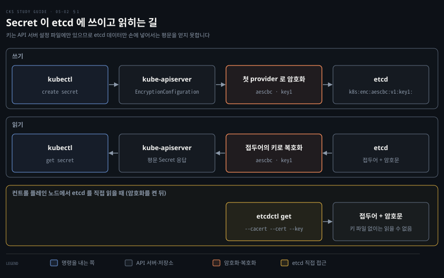
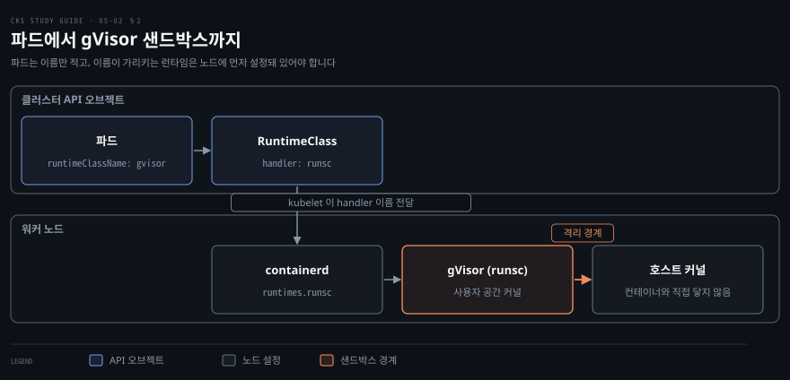
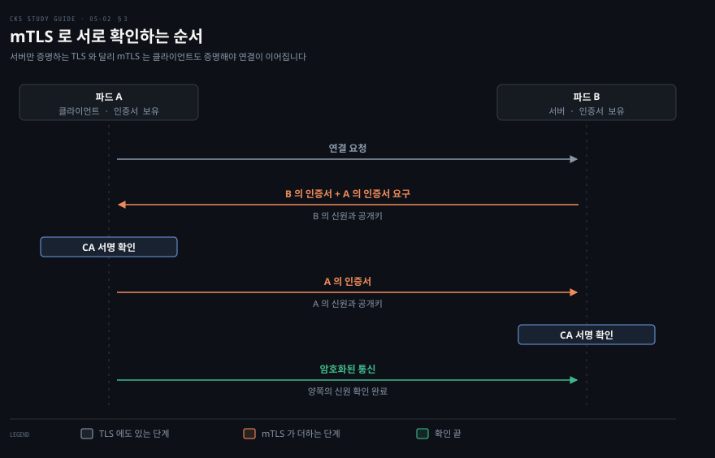

# 데이터와 실행 경계 지키기 — etcd 암호화·런타임 샌드박스·mTLS
---

## 핵심 요약
> 파드 설정을 아무리 조여도 저장소, 커널, 네트워크라는 세 경계가 열려 있으면 뚫립니다. 이 노트는 그 세 경계를 etcd 암호화, 런타임 샌드박스, mTLS 로 지킵니다.

Secret 은 기본 상태에서 etcd 에 평문으로 저장되므로 `EncryptionConfiguration` 에 암호화 provider 를 적고 kube-apiserver 의 `--encryption-provider-config` 인자로 넘깁니다. 첫 번째 provider 가 쓰기를 암호화하고, 설정 전에 저장된 Secret 은 다시 써야 암호화됩니다.

컨테이너는 호스트 커널을 함께 쓰기 때문에 출처를 믿을 수 없는 이미지는 gVisor 나 Kata Containers 같은 런타임 샌드박스에서 돌립니다.

설정은 세 단계입니다. 먼저 노드의 containerd 에 handler 를 등록합니다. 다음에 같은 이름을 가리키는 RuntimeClass 를 만듭니다. 마지막으로 파드가 `runtimeClassName` 으로 그 이름을 부릅니다.

파드 사이 통신은 기본적으로 암호화도 인증도 없습니다. mTLS(mutual TLS)는 양쪽이 인증서를 내밀어 서로를 확인하며, 인증서 관리가 어려워서 서비스 메시나 WireGuard 에 맡기는 경우가 많습니다. 이 노트의 값은 2026-11-05 에 쿠버네티스, gVisor, Istio, Cilium, Calico 의 공식 페이지에서 확인한 내용 기준입니다.


## 학습 목표

이 내용을 읽고 나면:

1. etcd 에 저장된 Secret 이 평문인 이유를 설명하고, `etcdctl` 로 저장된 값을 읽어 암호화 여부를 확인할 수 있습니다.
2. `EncryptionConfiguration` 을 작성해 kube-apiserver 에 적용하고, 기존 Secret 까지 암호화되게 다시 쓸 수 있습니다.
3. 런타임 샌드박스가 필요한 상황을 설명하고, RuntimeClass 와 `runtimeClassName` 으로 파드를 gVisor 에서 돌릴 수 있습니다.
4. TLS 와 mTLS 의 차이를 설명하고, 파드 사이 통신을 암호화하는 방법 두 가지를 구분할 수 있습니다.


## 본문 정리

### 1. etcd 암호화로 Secret 지키기

Secret 은 이름과 달리 저장될 때 암호화되지 않으므로, etcd 가 도는 컨트롤 플레인 노드에 들어온 공격자는 클러스터의 모든 Secret 을 읽을 수 있습니다. 공식 문서는 Secret 이 기본적으로 API 서버의 저장소인 etcd 에 암호화 없이 저장되며 API 접근 권한이 있는 사람과 etcd 에 접근할 수 있는 사람 모두 읽거나 바꿀 수 있다고 적습니다. base64 인코딩은 값을 가릴 뿐 기밀성을 주지 못한다고도 설명합니다.[^secret] Secret 을 컨테이너에 전달하는 다섯 경로와 그 한계는 [컨테이너에 시크릿 전달하기](../container-security/12-01.%EC%BB%A8%ED%85%8C%EC%9D%B4%EB%84%88%EC%97%90%20%EC%8B%9C%ED%81%AC%EB%A6%BF%20%EC%A0%84%EB%8B%AC%ED%95%98%EA%B8%B0%20%E2%80%94%20%EB%8B%A4%EC%84%AF%20%EA%B2%BD%EB%A1%9C%EC%99%80%20root%EB%9D%BC%EB%8A%94%20%EC%B2%9C%EC%9E%A5.md)의 「Kubernetes 기본 시크릿」 절에서 다뤘습니다.

공격자는 컨트롤 플레인 노드에서 etcd 클라이언트 도구인 `etcdctl` 로 저장된 값을 읽습니다. 먼저 Secret 하나를 만든 뒤 etcd 의 키 `/registry/secrets/<네임스페이스>/<이름>` 을 조회합니다.

```bash
kubectl create secret generic app-config --from-literal=password=demo-not-a-secret
```

```bash
sudo ETCDCTL_API=3 etcdctl \
  --cacert=/etc/kubernetes/pki/etcd/ca.crt \
  --cert=/etc/kubernetes/pki/etcd/server.crt \
  --key=/etc/kubernetes/pki/etcd/server.key \
  get /registry/secrets/default/app-config | hexdump -C
```

`--cacert` 는 etcd 서버를 검증할 CA(certificate authority) 인증서이고 `--cert` 와 `--key` 는 클라이언트로서 내미는 인증서와 개인 키입니다. `--cacert` 값은 `/etc/kubernetes/manifests/kube-apiserver.yaml` 의 `--etcd-cafile` 과 같습니다. 위 명령의 `--cert` 와 `--key` 는 etcd 자신의 서버 인증서와 개인 키입니다. 둘은 `/etc/kubernetes/manifests/etcd.yaml` 의 `--cert-file` 과 `--key-file` 에 적혀 있습니다.

kube-apiserver.yaml 의 `--etcd-certfile` 과 `--etcd-keyfile` 이 가리키는 `apiserver-etcd-client.crt` 와 `.key` 를 대신 넣어도 됩니다.

kubeadm 이 만든 클러스터에서 인증서는 `/etc/kubernetes/pki/etcd/` 에 있습니다. 인증서 문서는 `server.crt` 외에 etcdctl 용으로 `healthcheck-client.crt` 도 따로 만든다고 적습니다.[^certs]

출력 오른쪽 문자 칸에 `password` 와 값이 그대로 읽힙니다.

저장 시점의 암호화는 `EncryptionConfiguration` 오브젝트에 provider 를 적어 정합니다. provider 는 데이터를 어떤 방식으로 암호화할지 정한 모듈이며, 같은 설정 파일에 여러 개를 나열할 수 있습니다.[^enc]

| provider | 방식 | 공식 문서의 평가 |
|----------|------|-----------------|
| identity | 암호화하지 않음 | 지정하지 않으면 기본값 |
| aescbc | AES-CBC(Advanced Encryption Standard, Cipher Block Chaining) | CBC 의 padding oracle 공격 취약성 때문에 권장하지 않음 |
| aesgcm | AES-GCM(Galois/Counter Mode) | 쓰기 200,000 번마다 키를 교체해야 하며 자동 교체가 없으면 권장하지 않음 |
| secretbox | XSalsa20 과 Poly1305 | 강함, 빠름, 32바이트 키 |
| kms v2 | KMS(Key Management Service) 로 봉투 암호화 | 가장 강함, v1.29 부터 Stable |

kms v1 은 v1.28 부터 deprecated 입니다.[^enc] aescbc, aesgcm, secretbox 의 키는 컨트롤 플레인 호스트의 설정 파일에 있으므로 호스트까지 뚫리면 키도 읽힙니다. 이 노트의 실습은 aescbc 를 씁니다.

provider 의 순서가 동작을 정합니다. 첫 번째 provider 가 저장소에 쓰는 데이터를 암호화합니다. 읽을 때는 저장된 형식과 맞는 provider 가 차례로 복호화를 시도합니다.[^enc] 그래서 `identity` 를 첫째에 두면 아무것도 암호화되지 않고, 둘째에 두면 설정 전에 평문으로 저장된 Secret 도 읽을 수 있습니다.



설정 파일에 넣을 키는 32바이트 난수를 base64 로 인코딩해 만듭니다.

```bash
head -c 32 /dev/urandom | base64
```

출력을 아래 `<BASE64_ENCODED_SECRET>` 자리에 넣어 `/etc/kubernetes/enc/enc.yaml` 로 저장합니다.

```yaml
apiVersion: apiserver.config.k8s.io/v1
kind: EncryptionConfiguration
resources:
  - resources:
      - secrets
    providers:
      - aescbc:
          keys:
            - name: key1
              secret: <BASE64_ENCODED_SECRET>
      - identity: {}
```

`resources` 는 암호화할 API 리소스이며 여기서는 `secrets` 만 적었습니다. 이 파일에는 etcd 의 내용을 풀 수 있는 키가 들어 있으므로, kube-apiserver 를 실행하는 사용자만 읽도록 모든 컨트롤 플레인 호스트에서 권한을 좁혀야 합니다.[^enc]

kube-apiserver 는 static pod 라서 `/etc/kubernetes/manifests/kube-apiserver.yaml` 을 고치면 kubelet 이 이 디렉터리를 주기적으로 훑어 변화를 감지하고 파드를 다시 만듭니다.[^static] 인자와 설정 파일을 담을 볼륨 두 가지를 더합니다.

```yaml
spec:
  containers:
  - command:
    - kube-apiserver
    - --encryption-provider-config=/etc/kubernetes/enc/enc.yaml
    volumeMounts:
    - name: enc
      mountPath: /etc/kubernetes/enc
      readOnly: true
  volumes:
  - name: enc
    hostPath:
      path: /etc/kubernetes/enc
      type: DirectoryOrCreate
```

위 조각은 기존 `command`, `volumeMounts`, `volumes` 목록 안에 항목을 덧붙이는 자리만 보인 것입니다.

매니페스트를 고치기 전에 백업이 필요하면 `kube-apiserver.yaml.backup` 처럼 같은 디렉터리에 두지 않습니다. kubelet 은 점으로 시작하지 않는 파일을 확장자와 상관없이 모두 읽어 파드를 만들려 하기 때문입니다. 같은 이름의 파드를 정의한 파일이 둘이면 옛 설정이 조용히 적용될 수 있으므로 백업은 `/etc/kubernetes/backup/` 처럼 디렉터리 밖에 둡니다.[^static]

이 절차는 [클러스터 경계 세우기](./02-01.%ED%81%B4%EB%9F%AC%EC%8A%A4%ED%84%B0%20%EA%B2%BD%EA%B3%84%20%EC%84%B8%EC%9A%B0%EA%B8%B0%20%E2%80%94%20NetworkPolicy%C2%B7CIS%20%EB%B2%A4%EC%B9%98%EB%A7%88%ED%81%AC%C2%B7TLS%20Ingress.md)의 「CIS 벤치마크와 kube-bench 점검」 절에서 한 static pod 매니페스트 수정과 같습니다.

저장하면 kube-apiserver 파드가 다시 뜹니다. 이 노트의 실습 클러스터에서는 약 14초가 걸렸고, `kubectl get pods -n kube-system` 에서 `kube-apiserver-*` 파드가 `1/1 Running` 이 될 때까지 기다립니다.

설정 뒤에 만든 Secret 은 자동으로 암호화되지만 설정 전에 저장된 Secret 은 평문으로 남습니다. 암호화는 쓰는 순간에 일어나므로, 모든 Secret 을 읽어 그대로 다시 쓰면 됩니다.

```bash
kubectl get secrets --all-namespaces -o json | kubectl replace -f -
```

다시 `etcdctl get` 을 실행하면 값이 `k8s:enc:aescbc:v1:key1:` 로 시작하고 뒤는 읽을 수 없는 바이트입니다. 접두어의 `aescbc` 는 쓴 provider 이고 `key1` 은 설정 파일의 키 이름이므로, 접두어와 키 이름이 설정과 같으면 적용된 것입니다.[^enc]

반대로 `kubectl get secret app-config -o jsonpath='{.data.password}' | base64 -d` 는 여전히 평문을 돌려줍니다. kube-apiserver 가 읽을 때 복호화하기 때문입니다. 이 암호화는 etcd 의 데이터 파일이나 백업이 새는 경우를 막을 뿐이며, API 로 Secret 을 읽을 권한이 있는 사용자와 컨트롤 플레인 호스트의 키 파일은 막지 못합니다. 키를 호스트에 두지 않으려면 kms v2 처럼 외부 KMS 를 쓰는 provider 를 고릅니다.

### 2. 런타임 샌드박스로 커널 나누기

컨테이너는 서로 격리돼 있어도 같은 노드의 컨테이너가 호스트 커널 하나를 함께 쓰므로, 한 컨테이너에서 커널 취약점을 건드리면 같은 노드의 다른 컨테이너까지 위험해집니다. 런타임 샌드박스는 일반 컨테이너 런타임 옆에서 돌면서 프로세스 격리를 한 겹 더 두껍게 만듭니다. 여러 고객의 워크로드를 한 클러스터에서 돌리는 멀티테넌트 환경이나 공개 레지스트리에서 받은 이미지를 검증하지 못한 채 돌릴 때가 대표적인 쓰임입니다.

구현은 두 가지가 대표적입니다. Kata Containers 는 컨테이너를 경량 가상 머신 안에서 돌리고, gVisor 는 리눅스 커널의 동작을 사용자 공간에서 다시 구현해 컨테이너의 시스템 콜을 호스트 커널이 아니라 이 커널이 받게 합니다. 두 방식의 구조는 [컨테이너 격리 강화](../container-security/08-01.%EC%BB%A8%ED%85%8C%EC%9D%B4%EB%84%88%20%EA%B2%A9%EB%A6%AC%20%EA%B0%95%ED%99%94%20%E2%80%94%20%EC%83%8C%EB%93%9C%EB%B0%95%EC%8B%B1%EC%9D%98%20%EC%84%B8%20%EA%B0%88%EB%9E%98.md)의 「gVisor — 사용자 공간에서 커널을 다시 구현하다」와 「VM 격리를 빌려 오는 세 방식」 절에서 다뤘습니다.

gVisor 는 OCI(Open Container Initiative) 런타임 `runsc` 를 제공합니다. 파드가 갈 수 있는 모든 워커 노드에 설치해야 하며, 시험에서는 이미 설치돼 있다고 가정하므로 순서만 알면 됩니다.

```bash
sudo apt-get update && sudo apt-get install -y runsc
```

gVisor 공식 문서는 apt 저장소를 등록한 뒤 `runsc` 패키지를 설치하는 방식을 안내합니다.[^gvinstall] 설치 뒤에는 containerd 가 `runsc` 를 알도록 `/etc/containerd/config.toml` 에 런타임을 등록하고 재시작합니다.

```toml
version = 2
[plugins."io.containerd.runtime.v1.linux"]
  shim_debug = true
[plugins."io.containerd.grpc.v1.cri".containerd.runtimes.runc]
  runtime_type = "io.containerd.runc.v2"
[plugins."io.containerd.grpc.v1.cri".containerd.runtimes.runsc]
  runtime_type = "io.containerd.runsc.v1"
```

```bash
sudo systemctl restart containerd
```

`runtimes.runsc` 의 `runsc` 가 handler 이름이고, 이 이름이 아래 RuntimeClass 에서 그대로 쓰입니다. gVisor 문서는 containerd 2.x 를 쓰면 `version = 3` 헤더를 고려하라고 덧붙입니다.[^gvcontainerd]

파드가 샌드박스를 쓰는 방법은 두 단계입니다. 먼저 RuntimeClass 를 만들어 handler 이름을 가리키고, 파드가 `spec.runtimeClassName` 으로 그 RuntimeClass 의 이름을 부릅니다. RuntimeClass 는 `node.k8s.io/v1` 의 API 리소스이고 v1.20 부터 Stable 입니다.[^rc]

```yaml
apiVersion: node.k8s.io/v1
kind: RuntimeClass
metadata:
  name: gvisor
handler: runsc
```

```yaml
apiVersion: v1
kind: Pod
metadata:
  name: nginx
spec:
  runtimeClassName: gvisor
  containers:
  - name: nginx
    image: nginx:1.23.2
```

```bash
kubectl apply -f runtimeclass.yaml
kubectl apply -f pod.yaml
```

kubelet 은 `runtimeClassName` 으로 RuntimeClass 를 찾아 handler 이름을 CRI(Container Runtime Interface)에 넘깁니다. containerd 는 그 이름의 런타임으로 파드 샌드박스를 만듭니다.



노드에 handler 가 없으면 파드가 시작하지 못합니다. containerd 설정에 `runsc` 를 등록하지 않은 노드에서 위 파드를 만들어 봅니다. `kubectl get pod nginx` 의 `STATUS` 는 `ContainerCreating` 에 머물고 phase 는 `Pending` 입니다. `kubectl describe pod nginx` 의 Events 에는 `FailedCreatePodSandBox ... no runtime for "runsc" is configured` 가 계속 쌓입니다. 이 동작은 kind v1.35 에서 확인했습니다.

RuntimeClass 오브젝트가 없을 때는 모습이 다릅니다. API 서버가 파드 생성 자체를 거부하며 kind v1.35 에서 `kubectl apply` 가 다음 오류를 돌려줬습니다.

```bash
Error from server (Forbidden): error when creating "pod-norc.yaml": pods "nginx-norc" is forbidden: pod rejected: RuntimeClass "does-not-exist" not found
```

파드가 만들어지지 않으므로 이벤트는 남지 않고 오류는 `kubectl apply` 응답에만 나옵니다. 파드가 시작하지 못할 때는 이벤트에서 오류 메시지를 찾습니다.[^rc]

일부 노드에만 샌드박스를 설치했다면 RuntimeClass 의 `scheduling.nodeSelector` 로 그 노드에만 파드가 가게 제한합니다. `scheduling` 을 적지 않으면 모든 노드가 지원한다고 간주합니다.[^rc]

gVisor 안에서 `kubectl exec nginx -- dmesg` 를 실행하면 호스트 커널의 로그가 아니라 `Starting gVisor...` 로 시작하는 gVisor 자신의 부팅 메시지가 나옵니다. 컨테이너가 보는 커널이 호스트 커널이 아니라는 직접적인 증거입니다.

### 3. mTLS 로 파드 사이 통신 지키기

기본 상태에서 파드는 가상 IP 로 다른 어떤 파드에도 말을 걸 수 있고, 그 통신은 암호화도 인증도 없습니다.

파드 안에 들어오지 않은 공격자도 두 파드 사이의 경로에서 보내는 쪽이나 받는 쪽을 가장하면 통신 내용을 엿볼 수 있습니다. 엿본 내용은 더 큰 공격의 재료가 됩니다.

NetworkPolicy 로 통신 대상을 좁히는 방법은 [클러스터 경계 세우기](./02-01.%ED%81%B4%EB%9F%AC%EC%8A%A4%ED%84%B0%20%EA%B2%BD%EA%B3%84%20%EC%84%B8%EC%9A%B0%EA%B8%B0%20%E2%80%94%20NetworkPolicy%C2%B7CIS%20%EB%B2%A4%EC%B9%98%EB%A7%88%ED%81%AC%C2%B7TLS%20Ingress.md)의 「NetworkPolicy 로 파드 사이 통신 막기」 절에서 다뤘으며, 이 절은 허용된 통신의 내용을 지키는 방법입니다.

TLS(Transport Layer Security)는 통신을 암호화하면서 서버가 자기 인증서로 신원을 증명하게 합니다. 서버는 클라이언트가 누구인지 확인하지 않으므로, 웹 브라우저가 페이지를 열 때처럼 서버의 신원만 중요한 경우에 맞습니다. mTLS 는 클라이언트도 인증서를 내밀어 양쪽이 서로를 확인합니다. 암호화로 통신을 지키고, 상대의 신원을 확인하므로 공격자가 다른 파드를 쉽게 가장하지 못합니다. TLS 연결이 맺어지는 과정과 인증서, 키, CA 의 역할은 [TLS로 컴포넌트 안전하게 연결하기](../container-security/11-01.TLS%EB%A1%9C%20%EC%BB%B4%ED%8F%AC%EB%84%8C%ED%8A%B8%20%EC%95%88%EC%A0%84%ED%95%98%EA%B2%8C%20%EC%97%B0%EA%B2%B0%ED%95%98%EA%B8%B0%20%E2%80%94%20%ED%82%A4%C2%B7%EC%9D%B8%EC%A6%9D%EC%84%9C%C2%B7CA%EC%9D%98%20%EC%97%AD%ED%95%A0.md)의 「TLS 연결이 맺어지는 과정」 절에서 설명했습니다.



어려운 부분은 인증서 관리입니다. 마이크로서비스마다 인증서가 필요하며 신뢰할 수 있도록 CA 가 서명해야 합니다.

인증서를 받으려면 CSR(certificate signing request)을 CA 에 보냅니다. CA 가 승인하면 인증서를 만들어 서명한 뒤 돌려줍니다.

인증서의 수명은 짧게 두고 만료 전에 새로 발급받습니다. 이 과정을 인증서 교체(rotation)라고 합니다. 파드가 수백 개인 클러스터에서 이 과정을 손으로 하기는 현실적이지 않습니다.

그래서 보통 두 방법 중 하나를 씁니다.

서비스 메시(Linkerd, Istio)는 관측성(observability)과 보안 같은 공통 기능을 클러스터에 더하는 도구이고 mTLS 를 기능으로 제공합니다. Istio 에서는 `PeerAuthentication` 으로 요구 수준을 정합니다. 공식 문서는 `STRICT` 모드를 메시를 우회하는 연결이 불가능하도록 보장하는 데 쓸모 있다고 설명합니다.[^istio]

```yaml
apiVersion: security.istio.io/v1
kind: PeerAuthentication
metadata:
  name: default
  namespace: foo
spec:
  mtls:
    mode: STRICT
```

위 정책은 `foo` 네임스페이스의 모든 워크로드에 mTLS 트래픽만 받게 합니다.[^istio]

WireGuard 투명 암호화는 CNI(Container Network Interface) 플러그인이 노드 사이 트래픽을 터널로 암호화합니다. Cilium 은 노드마다 암호화 키 쌍을 자동으로 만들고 공개 키를 `CiliumNode` 오브젝트의 어노테이션으로 나눠 주므로 인증서를 직접 관리하지 않습니다.[^cilium] Calico 도 WireGuard 암호화를 지원하지만, 사이드카 구조가 아니어서 호스트와 호스트 사이 구간만 암호화되고 같은 노드의 호스트와 파드 사이 구간은 평문입니다.[^calico] 시험에서는 두 방법의 구현보다 mTLS 가 필요한 이유를 설명하는 쪽에 무게가 실립니다.


## 연습 문제

> 1번은 etcd 암호화, 2번은 RuntimeClass, 3번은 기존 Secret 의 재암호화, 4번은 mTLS 를 묻습니다. 풀이는 파일 맨 끝의 정답에 있습니다.

1. 컨트롤 플레인 노드에서 `aescbc` provider 로 etcd 암호화를 설정하려면 어떻게 합니까?
   설정 뒤 `api-key=demo-not-a-secret` 인 `Opaque` 타입 Secret `db-credentials` 를 만들면 etcd 에 저장된 값은 어떻게 확인합니까?
2. 워커 노드에 gVisor 가 설치돼 있습니다. `runsc` 를 handler 로 하는 RuntimeClass `container-runtime-sandbox` 를 만들고, 이미지 `nginx:1.23.2` 파드 `nginx` 가 이 RuntimeClass 를 쓰게 하려면 어떻게 합니까?
3. 암호화를 설정하기 전에 만든 Secret 이 etcd 에서 여전히 평문입니다. 이유는 무엇이고 어떻게 고칩니까?
4. 클러스터에 서비스 메시가 없을 때 파드 사이 통신을 암호화하는 방법은 무엇입니까? 메시를 쓰는 mTLS 와 비교해 인증서 관리 부담은 어떻게 다릅니까?


## 참고 자료

- 원본: 《Certified Kubernetes Security Specialist (CKS) Study Guide》(Benjamin Muschko, O'Reilly, 2023, ISBN 978-1098132972) Chapter 5
- [Secrets](https://kubernetes.io/docs/concepts/configuration/secret/) · [Encrypting Confidential Data at Rest](https://kubernetes.io/docs/tasks/administer-cluster/encrypt-data/) · [PKI certificates and requirements](https://kubernetes.io/docs/setup/best-practices/certificates/) · [Create static Pods](https://kubernetes.io/docs/tasks/configure-pod-container/static-pod/)
- [Runtime Class](https://kubernetes.io/docs/concepts/containers/runtime-class/)
- [gVisor 설치](https://gvisor.dev/docs/user_guide/install/) · [Containerd Quick Start](https://gvisor.dev/docs/user_guide/containerd/quick_start/) · [Kubernetes Quick Start](https://gvisor.dev/docs/user_guide/quick_start/kubernetes/)
- [Istio PeerAuthentication](https://istio.io/latest/docs/reference/config/security/peer_authentication/) · [Cilium WireGuard](https://docs.cilium.io/en/stable/security/network/encryption-wireguard/) · [Calico 파드 트래픽 암호화](https://docs.tigera.io/calico/latest/network-policy/encrypt-cluster-pod-traffic)
- [CKS Study Guide 정독 인덱스](./README.md) — 이 책의 장별 목표와 진행 상태
- [클러스터 경계 세우기](./02-01.%ED%81%B4%EB%9F%AC%EC%8A%A4%ED%84%B0%20%EA%B2%BD%EA%B3%84%20%EC%84%B8%EC%9A%B0%EA%B8%B0%20%E2%80%94%20NetworkPolicy%C2%B7CIS%20%EB%B2%A4%EC%B9%98%EB%A7%88%ED%81%AC%C2%B7TLS%20Ingress.md) · [컨테이너에 시크릿 전달하기](../container-security/12-01.%EC%BB%A8%ED%85%8C%EC%9D%B4%EB%84%88%EC%97%90%20%EC%8B%9C%ED%81%AC%EB%A6%BF%20%EC%A0%84%EB%8B%AC%ED%95%98%EA%B8%B0%20%E2%80%94%20%EB%8B%A4%EC%84%AF%20%EA%B2%BD%EB%A1%9C%EC%99%80%20root%EB%9D%BC%EB%8A%94%20%EC%B2%9C%EC%9E%A5.md) · [컨테이너 격리 강화](../container-security/08-01.%EC%BB%A8%ED%85%8C%EC%9D%B4%EB%84%88%20%EA%B2%A9%EB%A6%AC%20%EA%B0%95%ED%99%94%20%E2%80%94%20%EC%83%8C%EB%93%9C%EB%B0%95%EC%8B%B1%EC%9D%98%20%EC%84%B8%20%EA%B0%88%EB%9E%98.md) · [TLS로 컴포넌트 안전하게 연결하기](../container-security/11-01.TLS%EB%A1%9C%20%EC%BB%B4%ED%8F%AC%EB%84%8C%ED%8A%B8%20%EC%95%88%EC%A0%84%ED%95%98%EA%B2%8C%20%EC%97%B0%EA%B2%B0%ED%95%98%EA%B8%B0%20%E2%80%94%20%ED%82%A4%C2%B7%EC%9D%B8%EC%A6%9D%EC%84%9C%C2%B7CA%EC%9D%98%20%EC%97%AD%ED%95%A0.md) — 같은 주제를 앞 장이나 다른 책에서 정리한 형제 노트

[^secret]: "Kubernetes Secrets are, by default, stored unencrypted in the API server's underlying data store (etcd). Anyone with API access can retrieve or modify a Secret, and so can anyone with access to etcd." TLS Secret 예시의 주석은 base64 값이 "obscures them but does NOT provide any useful level of confidentiality" 라고 적습니다. <https://kubernetes.io/docs/concepts/configuration/secret/> (2026-11-05 조회)
[^certs]: kubeadm 의 etcd 인증서는 `/etc/kubernetes/pki/etcd/` 에 있고, etcdctl 에는 `--cacert` 로 `etcd/ca.crt`, `--cert` 와 `--key` 로 `etcd/healthcheck-client.crt`·`.key` 를 쓰도록 표에 나열합니다. API 서버는 `--etcd-cafile`, `--etcd-certfile`, `--etcd-keyfile` 로 etcd 에 연결합니다. <https://kubernetes.io/docs/setup/best-practices/certificates/> (2026-11-05 조회)
[^enc]: "The first provider in the list is used to encrypt resources written into the storage. When reading resources from storage, each provider that matches the stored data attempts in order to decrypt the data." provider 표는 identity 를 기본값, aescbc 를 "Not recommended due to CBC's vulnerability to padding oracle attacks", aesgcm 을 "Must be rotated every 200,000 writes", secretbox 를 XSalsa20 과 Poly1305, kms v2 를 "Available as stable from Kubernetes v1.29", kms v1 을 "deprecated since Kubernetes v1.28" 로 적습니다. 저장된 Secret 은 `k8s:enc:aescbc:v1:` 접두어로 확인하고 기존 Secret 은 `kubectl get secrets --all-namespaces -o json | kubectl replace -f -` 로 다시 씁니다. 설정 파일은 "restrict permissions on all your control plane hosts so only the user who runs the kube-apiserver can read" 해야 합니다. <https://kubernetes.io/docs/tasks/administer-cluster/encrypt-data/> (2026-11-05 조회)
[^reload]: 문서는 identity 를 지운 뒤 "restart each API server in turn" 이라고 안내하고, `--encryption-provider-config-automatic-reload=true` 를 켜면 설정 파일 변경을 1분마다 확인해 다시 읽는다고 설명합니다. <https://kubernetes.io/docs/tasks/administer-cluster/encrypt-data/> (2026-11-05 조회)
[^static]: kubelet 은 `staticPodPath` 디렉터리를 주기적으로 훑어 YAML·JSON 파일이 생기고 사라지는 데 맞춰 static pod 를 만들고 지우며, 점으로 시작하지 않는 파일은 확장자와 상관없이 모두 처리합니다. 백업은 디렉터리 밖(예: `/etc/kubernetes/backup/`)에 두라고 안내합니다. <https://kubernetes.io/docs/tasks/configure-pod-container/static-pod/> (2026-11-05 조회)
[^rc]: RuntimeClass 는 v1.20 부터 Stable 이고 handler 는 유효한 DNS 레이블 이름이어야 하며, containerd 의 handler 는 `[plugins."io.containerd.grpc.v1.cri".containerd.runtimes.${HANDLER_NAME}]` 아래에 설정합니다. 파드가 시작하지 못하면 이벤트에서 오류 메시지를 찾으라고 안내합니다. `scheduling` 필드는 v1.16 부터 Beta 이고, 적지 않으면 모든 노드가 지원한다고 간주합니다. <https://kubernetes.io/docs/concepts/containers/runtime-class/> (2026-11-05 조회)
[^gvinstall]: apt 저장소를 등록한 뒤 `sudo apt-get update && sudo apt-get install -y runsc` 로 설치합니다. <https://gvisor.dev/docs/user_guide/install/> (2026-11-05 조회)
[^gvcontainerd]: `runtime_type = "io.containerd.runsc.v1"` 로 등록하고 containerd 를 재시작하며, containerd 2.x 에서는 "Consider using the version header version = 3" 라고 안내합니다. <https://gvisor.dev/docs/user_guide/containerd/quick_start/> (2026-11-05 조회) 쿠버네티스에서 쓰는 절차는 <https://gvisor.dev/docs/user_guide/quick_start/kubernetes/> (2026-11-05 조회)
[^istio]: "STRICT mode is useful to ensure that connections that bypass the mesh are not possible." 예시는 "Policy to require mTLS traffic for all workloads under namespace foo" 입니다. <https://istio.io/latest/docs/reference/config/security/peer_authentication/> (2026-11-05 조회)
[^cilium]: "Each node automatically creates its own encryption key-pair and distributes its public key via the network.cilium.io/wg-pub-key annotation in the Kubernetes CiliumNode custom resource object." <https://docs.cilium.io/en/stable/security/network/encryption-wireguard/> (2026-11-05 조회)
[^calico]: Calico 는 사이드카로 구현되지 않아 "traffic is only encrypted on the host-to-host portion of the journey" 이고, `FelixConfiguration` 의 `wireguardEnabled` 로 켭니다. <https://docs.tigera.io/calico/latest/network-policy/encrypt-cluster-pod-traffic> (2026-11-05 조회)


## 정답 (자답 후 펼치기)

### 정답 1

키를 만들어 설정 파일을 쓰고, kube-apiserver 매니페스트에 인자와 볼륨을 더합니다.

```bash
sudo mkdir -p /etc/kubernetes/enc
head -c 32 /dev/urandom | base64
sudo vim /etc/kubernetes/enc/enc.yaml
```

`enc.yaml` 에는 본문의 `EncryptionConfiguration` 을 쓰고 `<BASE64_ENCODED_SECRET>` 자리에 난수 키를 넣습니다.

이어서 `/etc/kubernetes/manifests/kube-apiserver.yaml` 에 인자 `--encryption-provider-config=/etc/kubernetes/enc/enc.yaml` 을 더합니다. 설정 파일이 든 디렉터리는 `enc` 볼륨(hostPath `/etc/kubernetes/enc`)으로 컨테이너에 마운트합니다.

kube-apiserver 파드가 `1/1 Running` 이 될 때까지 `kubectl get pods -n kube-system` 으로 기다린 뒤 Secret 을 만들고 etcd 를 조회합니다.

```bash
kubectl create secret generic db-credentials --from-literal=api-key=demo-not-a-secret
sudo ETCDCTL_API=3 etcdctl \
  --cacert=/etc/kubernetes/pki/etcd/ca.crt \
  --cert=/etc/kubernetes/pki/etcd/server.crt \
  --key=/etc/kubernetes/pki/etcd/server.key \
  get /registry/secrets/default/db-credentials | hexdump -C
```

저장된 값은 `k8s:enc:aescbc:v1:key1:` 로 시작하고 뒤는 읽을 수 없는 바이트입니다. 암호문은 키와 난수에 따라 매번 달라지므로 고정된 "암호화된 값" 은 없습니다. 접두어가 `aescbc` 와 `key1` 을 보이면 암호화가 적용된 것입니다.

### 정답 2

노드에 handler 가 이미 등록돼 있으므로 쿠버네티스 쪽 오브젝트만 만듭니다. 필요하면 워커 노드에 SSH 로 들어가 `runsc` 가 설치돼 있는지만 봅니다.

```yaml
apiVersion: node.k8s.io/v1
kind: RuntimeClass
metadata:
  name: container-runtime-sandbox
handler: runsc
```

```yaml
apiVersion: v1
kind: Pod
metadata:
  name: nginx
spec:
  runtimeClassName: container-runtime-sandbox
  containers:
  - name: nginx
    image: nginx:1.23.2
```

```bash
kubectl apply -f runtime-class.yaml
kubectl apply -f pod.yaml
kubectl get pod nginx
```

`STATUS` 가 `Running` 이면 성공입니다. 파드가 `Running` 에 들어서지 못하면 `kubectl describe pod nginx` 의 Events 에서 `FailedCreatePodSandBox` 를 찾고, `handler` 의 이름이 노드의 containerd 설정과 같은지 봅니다. `kubectl exec nginx -- dmesg` 에 gVisor 메시지가 나오면 샌드박스 안에서 도는 것입니다.

### 정답 3

암호화는 쓰는 순간에 일어나므로 설정 전에 저장된 Secret 은 평문으로 남습니다. 모든 Secret 을 읽어 그대로 다시 쓰면 첫 번째 provider 로 암호화됩니다.

```bash
kubectl get secrets --all-namespaces -o json | kubectl replace -f -
```

다시 `etcdctl get /registry/secrets/<네임스페이스>/<이름>` 으로 조회해 접두어가 `k8s:enc:aescbc:v1:key1:` 인지 확인합니다. 모든 Secret 이 암호화된 것을 확인한 뒤에는 설정 파일에서 `identity: {}` 를 지우고 kube-apiserver 를 재시작합니다.

kube-apiserver 는 이 설정 파일을 시작할 때 한 번 읽습니다. `--encryption-provider-config-automatic-reload=true` 를 켜지 않았다면 파일만 고쳐서는 바뀐 설정이 적용되지 않습니다.[^reload] `enc.yaml` 은 static pod 매니페스트가 아니므로 kubelet 이 파드를 다시 만들지도 않습니다.

재시작은 `kube-apiserver.yaml` 을 `/etc/kubernetes/backup/` 으로 옮겼다가 되돌리는 방법이 있습니다. 파일이 사라졌다가 돌아오면 kubelet 이 파드를 지웠다가 다시 만듭니다. 재시작 뒤에는 암호화되지 않은 Secret 을 읽을 수 없습니다.

### 정답 4

서비스 메시 없이 파드 사이 통신을 암호화하는 방법은 CNI 플러그인의 WireGuard 투명 암호화입니다. Calico 는 `FelixConfiguration` 의 `wireguardEnabled` 를 켜고, Cilium 은 WireGuard 암호화를 설정해 켭니다.

두 방법은 인증서를 다루는 방식이 다릅니다. mTLS 는 파드마다 인증서를 발급하고 교체해야 하며 서비스 메시를 쓰면 메시의 제어 평면이 이 일을 자동으로 합니다. Cilium 의 WireGuard 는 노드가 키 쌍을 자동으로 만들고 공개 키를 나눠 주므로 인증서를 직접 관리하지 않습니다. 다만 WireGuard 는 노드 사이 구간을 암호화할 뿐 파드의 신원을 인증서로 확인하지 않으며, Calico 에서는 같은 노드의 호스트와 파드 사이 구간이 평문입니다.
