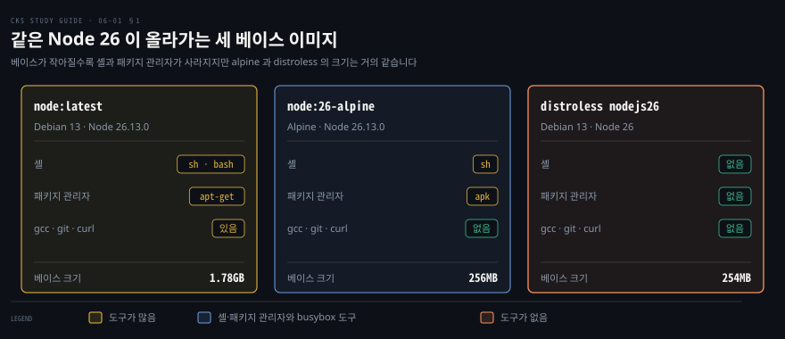
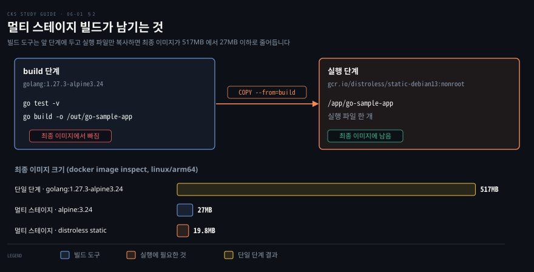
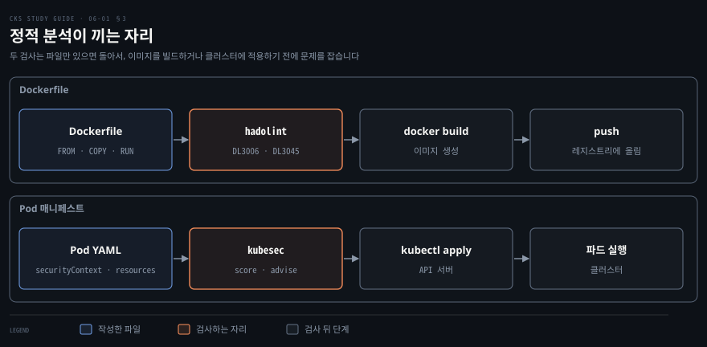

# 이미지 작게 만들고 미리 검사하기 — 베이스 이미지·멀티 스테이지·Hadolint·Kubesec
---

## 핵심 요약

> 컨테이너 이미지는 작을수록 공격자가 쓸 것이 줄어들고, 이를 위해 작은 베이스 이미지를 고르고 멀티 스테이지 빌드로 빌드 도구를 떼어 내며 Hadolint 와 Kubesec 으로 배포 전에 파일을 검사합니다.

베이스 이미지는 alpine 이나 distroless 처럼 셸과 패키지 관리자가 없거나 적은 쪽이 안전하지만 그만큼 컨테이너 안에서 디버깅하기가 어렵습니다. 태그는 가리키는 이미지가 바뀔 수 있어서 `latest` 대신 버전 태그를 쓰면 메이저 버전이 바뀌는 일은 막습니다. 다만 버전 태그도 새 패치로 옮겨 가므로 늘 같은 이미지를 받으려면 digest 로 고정합니다.

멀티 스테이지 빌드는 앞 단계에서 컴파일하고 마지막 단계에는 실행 파일만 복사해 빌드 도구를 최종 이미지에서 뺍니다. Hadolint 는 Dockerfile 을, Kubesec 은 파드 매니페스트를 읽어 문제를 알려 줍니다. 둘 다 파일만 있으면 돌아서 CI/CD(지속적 통합·배포) 파이프라인의 이른 단계에 넣을 수 있습니다. 이 노트의 크기 수치는 직접 잰 값이고 도구 버전은 2026-11-05 공식 페이지 기준입니다.[^measure]


## 학습 목표

이 내용을 읽고 나면:

1. 이미지에 든 프로그램이 공격 면을 넓히는 이유를 설명하고 `latest` 대신 고정 태그나 digest 를 쓰는 이유를 말할 수 있습니다.
2. alpine 과 distroless 베이스의 이점과 비용을 비교하고 셸이 없는 컨테이너를 디버깅하는 방법을 말할 수 있습니다.
3. 멀티 스테이지 Dockerfile 을 쓰고 `RUN` 을 합쳤을 때 층 수와 크기가 어떻게 달라지는지 `docker image inspect` 로 확인할 수 있습니다.
4. Hadolint 로 Dockerfile 을 검사해 경고 코드를 읽고 고칠 수 있습니다.
5. Kubesec 으로 매니페스트를 검사해 score·critical·advise 를 읽고 필드를 보강해 advise 를 비울 수 있습니다.


## 본문 정리

### 1. 작은 베이스 이미지 고르고 태그 고정하기

베이스 이미지는 앱 실행에 필요한 것만 든 작은 이미지를 고릅니다. 이미지에 든 프로그램은 컨테이너가 뚫렸을 때 공격자가 그대로 쓰는 도구이고 취약점이 숨는 자리이기도 합니다. 이렇게 공격자가 파고들 수 있는 표면을 **공격 면**(attack surface)이라 부릅니다.

Node.js 앱의 베이스로 쓰는 세 이미지를 나란히 놓으면 차이가 보입니다. `node:latest` 는 Debian 13 위에 셸(`sh`·`bash`)과 패키지 관리자(`apt-get`)에 컴파일러(gcc)·git·curl 까지 들어 있습니다. `node:26-alpine` 은 busybox 의 `sh` 와 `apk` 가 남고 gcc·git·curl 은 없습니다. 다만 busybox 가 `wget`·`nc` 같은 작은 도구를 함께 넣어 둡니다. distroless 이미지는 셸도 패키지 관리자도 없습니다.[^distroless]



크기만 보면 alpine 과 distroless 는 거의 같습니다. `alpine:3.24` 가 14.5MB 인데 `node:26-alpine` 이 256MB 이므로 크기의 대부분은 베이스 OS 가 아니라 Node 쪽에서 나옵니다. 줄어든 것은 용량이 아니라 공격자가 쓸 프로그램의 수입니다. 크기가 크게 달라지는 경우는 컴파일해서 실행 파일 한 개만 남기는 언어이고, 다음 절의 Go 예제가 그렇습니다.

작은 이미지의 대가는 컨테이너 안에서 쓸 도구가 없다는 점입니다. distroless 이미지에서 `sh` 를 실행하면 `exec: "sh": executable file not found in $PATH` 로 실패합니다.

그래서 Dockerfile 에 `ENTRYPOINT` 를 정의할 때는 셸을 거치지 않도록 벡터 형식으로 적어야 합니다. distroless 의 nodejs 이미지는 `ENTRYPOINT` 가 `/nodejs/bin/node` 로 정해져 있어서 `CMD` 에는 스크립트 이름만 적습니다.

문제가 생겼을 때는 이미 도는 파드에 임시 컨테이너를 붙이는 `kubectl debug` 를 쓰거나, busybox 셸이 든 `:debug` 태그 이미지를 따로 띄웁니다. 기본 `admin`·`edit` 역할에는 `pods/ephemeralcontainers` 권한이 없습니다. 그래서 임시 컨테이너를 붙이려면 이 서브리소스의 `patch` 권한을 따로 줘야 합니다.[^eph]

태그는 가리키는 이미지가 바뀔 수 있습니다. 그래서 `latest` 를 쓰면 같은 Dockerfile 이 날마다 다른 이미지를 만들 수 있습니다. Docker 문서는 `alpine:3.21` 같은 버전 태그도 최신 패치로 풀린다고 설명하고, 공급망 무결성을 지키려면 digest 로 고정하라고 안내합니다.[^bp] digest 는 이미지 내용의 해시라서 태그가 옮겨 가도 같은 이미지를 받습니다. 태그와 digest 가 이미지를 가리키는 방식은 [컨테이너 이미지 해부](../container-security/06-01.%EC%BB%A8%ED%85%8C%EC%9D%B4%EB%84%88%20%EC%9D%B4%EB%AF%B8%EC%A7%80%20%ED%95%B4%EB%B6%80%20%E2%80%94%20%EB%91%90%20%EB%B6%80%EB%B6%84%EA%B3%BC%20%EC%B8%B5%EA%B3%BC%20%EC%8B%9D%EB%B3%84%EC%9E%90.md)에서 다룹니다. 아래 `FROM` 은 이 노트가 쓴 `node:26-alpine` 을 측정 시점의 digest 로 고정한 형태입니다.

```dockerfile
FROM node:26-alpine@sha256:c6ad9e9c1d80f6eb607c26b4b0a132ff7a2344fad1c78ea3baa2a7d4c8de6d94
```

### 2. 멀티 스테이지 빌드로 최종 이미지 줄이기

빌드에만 필요한 도구는 앞 단계에 두고 최종 이미지에는 실행 파일만 복사하면 이미지가 작아집니다. **멀티 스테이지 빌드**는 Dockerfile 에 `FROM` 을 여러 번 쓰는 방식입니다. 각 `FROM` 이 새 단계를 시작하고 `COPY --from=<단계 이름>` 이 앞 단계의 산출물만 골라 가져오므로 나머지는 최종 이미지에 남지 않습니다.[^multi]

Go 앱으로 재면 효과가 큽니다. 컴파일러가 든 `golang` 이미지 하나에서 빌드하고 그대로 실행하면 517MB 입니다. 앞 단계에서 컴파일하고 `alpine:3.24` 로 복사하면 27MB 입니다. 베이스를 distroless static 으로 바꾸면 19.8MB 입니다.[^measure] 아래가 마지막 경우의 Dockerfile 입니다.

```dockerfile
FROM golang:1.27.3-alpine3.24 AS build
WORKDIR /app
COPY go.mod .
RUN go mod download
COPY . .
RUN CGO_ENABLED=0 go test -v
RUN CGO_ENABLED=0 go build -o /out/go-sample-app .

FROM gcr.io/distroless/static-debian13:nonroot
COPY --from=build /out/go-sample-app /app/go-sample-app
CMD ["/app/go-sample-app"]
```

`AS build` 가 첫 단계의 이름이고 두 번째 `FROM` 부터가 최종 이미지입니다. `CGO_ENABLED=0` 은 C 라이브러리에 기대지 않는 정적 실행 파일로 컴파일하게 하며, 이렇게 만든 파일이 위 static 이미지에서 실제로 돌았습니다. 테스트(`go test`)도 앞 단계에서 돌기 때문에 최종 이미지에는 테스트 도구가 들어가지 않습니다.



층을 줄이려고 `RUN` 을 합칠 때는 같은 `RUN` 안에서 지워야 크기가 줄어듭니다. 층은 한 번 만들어지면 바뀌지 않고, 이후 층에서 파일을 지워도 앞 층에는 그대로 남기 때문입니다.[^layers] 지운 파일이 이미지에 남는 이유는 [컨테이너 이미지 해부](../container-security/06-01.%EC%BB%A8%ED%85%8C%EC%9D%B4%EB%84%88%20%EC%9D%B4%EB%AF%B8%EC%A7%80%20%ED%95%B4%EB%B6%80%20%E2%80%94%20%EB%91%90%20%EB%B6%80%EB%B6%84%EA%B3%BC%20%EC%B8%B5%EA%B3%BC%20%EC%8B%9D%EB%B3%84%EC%9E%90.md)의 「4. 층 — 지워도 남는다」가 설명합니다. 아래는 `ubuntu:24.04` 에 curl 을 설치하는 Dockerfile 네 가지를 만들어 층 수와 크기를 잰 결과입니다.[^measure]

| Dockerfile | `RUN` 수 | 층 수 | 크기 |
|------------|---------|------|------|
| `apt-get update`·`upgrade`·`install` 을 `RUN` 셋으로 | 3 | 4 | 260MB |
| 같은 세 명령을 `&&` 로 `RUN` 하나에 | 1 | 2 | 259MB |
| `update` 와 `install` 은 한 `RUN`, `rm -rf /var/lib/apt/lists/*` 는 다음 `RUN` | 2 | 3 | 246MB |
| 설치와 `rm` 을 같은 `RUN` 에 | 1 | 2 | 147MB |

표의 두 쌍은 따로 비교합니다. 첫 두 줄은 `upgrade` 를 넣고 추천 패키지도 설치하며, 뒤 두 줄은 `upgrade` 가 없고 `--no-install-recommends` 를 붙였기 때문입니다. 첫 두 줄은 `RUN` 을 합치면 층만 줄고 크기는 거의 그대로임을 보여 줍니다. 뒤 두 줄은 apt 목록을 지우는 `rm` 이 설치와 같은 `RUN` 에 있어야 그 크기가 이미지에서 빠짐을 보여 줍니다.

마지막 줄의 Dockerfile 은 Docker 문서의 모범 사례 예제와 같은 모양입니다.[^bp] 다만 이 Dockerfile 을 뒤에서 쓰는 Hadolint 로 검사하면 설치 패키지 버전을 고정하라는 DL3008 경고가 나옵니다.

```dockerfile
FROM ubuntu:24.04
RUN apt-get update -y && apt-get install -y --no-install-recommends curl \
    && rm -rf /var/lib/apt/lists/*
```

층 수와 크기는 다음 명령으로 같은 방식으로 잽니다.

```bash
docker image inspect --format '{{.Size}} {{len .RootFS.Layers}}' <이미지>
```

이미지를 더 줄이거나 층을 들여다볼 때는 최적화 도구를 씁니다. dive 는 이미지를 층별로 열어 각 층이 무엇을 더하고 바꿨는지, 낭비된 공간이 얼마인지 보여 줍니다. 사용법은 `dive <이미지>` 이고 환경 변수 `CI=true` 를 주면 효율 기준을 넘지 못할 때 실패하므로 파이프라인에도 넣을 수 있습니다. Slim 은 이미지를 분석해 실행에 필요한 파일만 남긴 새 이미지를 만드는 도구이며 `slim build <이미지>` 로 돌립니다.[^tools]

### 3. 배포 전에 Hadolint·Kubesec 으로 검사하기

Dockerfile 은 Hadolint 로, 파드 매니페스트는 Kubesec 으로 배포 전에 검사합니다. 이렇게 파일을 실행하지 않고 읽어서 문제를 찾는 방식을 **정적 분석**이라 부릅니다. 두 도구는 파일만 있으면 돌기 때문에 이미지를 빌드하기 전과 클러스터에 적용하기 전에 CI/CD 의 검사 단계로 넣을 수 있습니다. 이미지 안 패키지의 알려진 취약점은 이 두 도구의 범위 밖입니다.



Hadolint 는 Dockerfile 을 구문 트리로 파싱해 규칙에 어긋난 줄을 알려 주는 린터이고, `RUN` 안의 셸 명령은 ShellCheck 로 검사합니다.[^hadolint] 실행은 컨테이너로 하고 Dockerfile 을 표준 입력으로 넘깁니다.

```bash
docker run --rm -i hadolint/hadolint < Dockerfile
```

다음 Dockerfile 을 검사하면 경고가 둘 나옵니다.

```dockerfile
FROM golang
COPY main.go .
RUN go build main.go
CMD ["./main"]
```

```bash
-:1 DL3006 warning: Always tag the version of an image explicitly
-:2 DL3045 warning: `COPY` to a relative destination without `WORKDIR` set.
```

`-:1` 은 표준 입력의 1번째 줄이라는 뜻입니다. DL3006 은 태그 없는 `FROM` 이고 앞 절의 고정 태그로 풉니다. DL3045 는 `WORKDIR` 없이 상대 경로로 `COPY` 한 줄이며 `WORKDIR /app` 을 더해 풉니다. 두 줄을 `FROM golang:1.27.3-alpine3.24` 와 `WORKDIR /app` 으로 고치면 출력이 없고 종료 코드가 0 입니다.

경고가 있으면 종료 코드가 1 이라 CI 가 실패로 처리하며, `--failure-threshold error` 를 주면 error 등급만 실패로 칩니다. 이때 경고는 계속 출력됩니다. Dockerfile 쪽 보안 모범 사례 전반은 [이미지 공급망 보안](../container-security/06-02.%EC%9D%B4%EB%AF%B8%EC%A7%80%20%EA%B3%B5%EA%B8%89%EB%A7%9D%20%EB%B3%B4%EC%95%88%20%E2%80%94%20%EB%B9%8C%EB%93%9C%EB%B6%80%ED%84%B0%20%EB%B0%B0%ED%8F%AC%EA%B9%8C%EC%A7%80.md)의 「Dockerfile 보안 모범 사례」가 정리합니다.

Kubesec 은 쿠버네티스 리소스의 보안 위험을 분석해 점수와 권장 사항을 돌려주는 도구입니다.[^kubesec] 실행은 마찬가지로 컨테이너에 매니페스트를 표준 입력으로 넘깁니다.

```bash
docker run -i --platform linux/amd64 kubesec/kubesec:v2 scan /dev/stdin < pod.yaml
```

이 이미지에는 linux/arm64 매니페스트가 없어서 Apple Silicon 맥에서는 `--platform linux/amd64` 를 붙입니다. 붙이지 않으면 플랫폼이 다르다는 경고가 나옵니다.

읽기 전용 루트 파일시스템만 지정한 파드를 검사해 봅니다.

```yaml
apiVersion: v1
kind: Pod
metadata:
  name: kubesec-demo
spec:
  containers:
  - name: kubesec-demo
    image: gcr.io/google-samples/node-hello:1.0
    securityContext:
      readOnlyRootFilesystem: true
```

출력은 JSON 배열이며 이 파드의 결과 중 앞부분만 줄이면 다음과 같습니다. 바깥을 감싼 배열과 `fileName` 필드, 각 항목의 `selector`·`reason` 필드, 나머지 `advise` 항목 열두 개는 생략했습니다.

```json
{
  "object": "Pod/kubesec-demo.default",
  "valid": true,
  "message": "Passed with a score of 1 points",
  "score": 1,
  "scoring": {
    "passed": [
      { "id": "ReadOnlyRootFilesystem", "points": 1 }
    ],
    "advise": [
      { "id": "ApparmorAny", "points": 3 },
      { "id": "ServiceAccountName", "points": 3 }
    ]
  }
}
```

`score` 는 `passed` 와 `critical` 에 든 점검의 `points` 를 더한 값입니다. `advise` 는 넣으면 점수가 오르는 권장 필드이고, `critical` 은 점수를 깎는 위험한 설정이라 해당할 때만 나타납니다. 같은 파드를 보강하면서 `score` 가 어떻게 달라지는지 세 경우로 잰 결과는 다음과 같습니다.

| 매니페스트 | score | critical | advise |
|------------|------|----------|--------|
| 읽기 전용 루트 파일시스템만 | 1 | 없음 | 14개 |
| 위에 리소스 요청·제한, `runAsNonRoot`, `runAsUser: 20000`, `drop: ["ALL"]` 추가 | 9 | 없음 | 6개 |
| `privileged: true` 만 지정 | -30 | `Privileged`(-30) | 15개 |

보강한 두 번째 경우에도 `ApparmorAny`·`ServiceAccountName`·`AutomountServiceAccountToken`·`HostUsers`·`SeccompAny`·`RunAsGroup` 이 advise 에 남습니다.

세 번째처럼 `critical` 이 나오면 `message` 가 `Failed with a score of -30 points` 로 바뀝니다. Kubesec 은 점수가 0 이하이면 종료 코드 2 로 끝납니다(`--exit-code` 로 바꿀 수 있음). 그래서 파이프라인은 이 종료 코드로 실패를 판단할 수 있습니다. 연습 2 의 원본처럼 `Passed with a score of 0 points` 여도 종료 코드는 2 입니다. 각 `securityContext` 필드가 하는 일은 [파드 보안 설정 강제하기](./05-01.%ED%8C%8C%EB%93%9C%20%EB%B3%B4%EC%95%88%20%EC%84%A4%EC%A0%95%20%EA%B0%95%EC%A0%9C%ED%95%98%EA%B8%B0%20%E2%80%94%20securityContext%C2%B7Pod%20Security%20Admission%C2%B7Gatekeeper.md)의 「1. securityContext 로 컨테이너의 OS 권한 정하기」에서 다룹니다.


## 연습 문제

> 1번은 Dockerfile 최적화를, 2번은 Kubesec 권고 해소를 묻습니다. 풀이는 파일 맨 끝의 정답에 있습니다.

1. 다음 Dockerfile 을 보세요. 만들어지는 컨테이너 이미지의 크기를 줄일 방법이 보입니까? Dockerfile 모범 사례를 적용해 이미지 크기를 줄입니다. 최적화 전후에 `docker build` 를 실행합니다. 결과 이미지는 더 작아야 하고 애플리케이션은 계속 동작해야 합니다.

   ```dockerfile
   FROM node:latest
   ENV NODE_ENV development
   WORKDIR /app
   COPY package.json .
   RUN npm install
   COPY . .
   EXPOSE 3001
   CMD ["node", "app.js"]
   ```

2. Kubesec 으로 다음 `pod.yaml` 매니페스트를 분석합니다. Kubesec 이 내놓는 권고를 확인합니다. seccomp 와 AppArmor 에 대한 권고는 무시합니다. 나머지 모든 권고의 원인을 고쳐서 도구를 다시 실행했을 때 추가 권고가 나오지 않게 합니다.

   ```yaml
   apiVersion: v1
   kind: Pod
   metadata:
     name: hello-world
   spec:
     securityContext:
       runAsUser: 0
     containers:
     - name: linux
       image: hello-world:linux
   ```


## 정답 (자답 후 펼치기)

### 정답 1

먼저 샘플 앱을 준비합니다. 앱은 `package.json`·`app.js`·`.dockerignore` 를 다음처럼 둡니다.

```json
{
  "name": "node-app",
  "version": "0.0.1",
  "main": "app.js",
  "dependencies": { "express": "^5.0.0" }
}
```

```javascript
const express = require('express');
const app = express();

app.get('/', (req, res) => res.send('Hello World'));

app.listen(3001, () => console.log('listening on 3001'));
```

```bash
node_modules
Dockerfile*
```

최적화 전 Dockerfile 로 빌드하고 크기를 잽니다. Hadolint 는 `FROM node:latest` 에 DL3007(`latest` 는 이미지가 바뀌면 오류가 나기 쉬우니 릴리스 태그로 고정하라는 경고)을 냅니다.

```bash
docker build -t node-app:before .
docker image inspect --format '{{.Size}}' node-app:before
docker run --rm -i hadolint/hadolint < Dockerfile
```

최적화한 Dockerfile 은 다음과 같습니다. 베이스를 `node:26-alpine` 으로 바꿔 `latest` 를 없애고 `node` 사용자를 숫자 ID 로 지정해 root 로 돌지 않게 했습니다. 필요한 파일만 복사하고 개발 의존성은 설치하지 않습니다.

```dockerfile
FROM node:26-alpine
ENV NODE_ENV=production
WORKDIR /app
COPY package.json .
RUN npm install --omit=dev
COPY app.js .
EXPOSE 3001
USER 1000
CMD ["node", "app.js"]
```

`USER` 에 이름 대신 숫자를 쓰면 DL3066(숫자가 아닌 사용자 ID 는 호스트가 해석하지 못할 수 있다는 정보 등급 항목)을 피합니다. 파드에서 사용자를 정하는 방법은 [파드 보안 설정 강제하기](./05-01.%ED%8C%8C%EB%93%9C%20%EB%B3%B4%EC%95%88%20%EC%84%A4%EC%A0%95%20%EA%B0%95%EC%A0%9C%ED%95%98%EA%B8%B0%20%E2%80%94%20securityContext%C2%B7Pod%20Security%20Admission%C2%B7Gatekeeper.md)에 있습니다. 같은 방식으로 빌드하고 Hadolint 를 돌리면 출력이 없고 종료 코드가 0 이며, 컨테이너는 `uid=1000(node)` 로 돌고 `curl http://localhost:3001/` 이 `Hello World` 를 돌려줍니다.

```bash
docker build -t node-app:after .
docker run --rm -d -p 3001:3001 node-app:after
curl http://localhost:3001/
```

더 줄이려면 멀티 스테이지로 만들어 distroless 에 복사합니다. 응답은 같습니다. 이 이미지의 `ENTRYPOINT` 가 `/nodejs/bin/node` 이므로 `CMD` 에는 스크립트 이름만 둡니다. 이 앱은 네이티브 모듈이 없어서 alpine 에서 설치한 `node_modules` 를 그대로 옮겨도 됩니다. 네이티브 모듈이 있으면 빌드 단계도 같은 Debian 13 계열(예: `node:26-trixie-slim`)로 맞춥니다.

```dockerfile
FROM node:26-alpine AS build
ENV NODE_ENV=production
WORKDIR /app
COPY package.json .
RUN npm install --omit=dev
COPY app.js .

FROM gcr.io/distroless/nodejs26-debian13:nonroot
WORKDIR /app
COPY --from=build /app /app
EXPOSE 3001
CMD ["app.js"]
```

`docker image inspect --format '{{.Config.Entrypoint}}' <이미지>` 로 `[/nodejs/bin/node]` 를 볼 수 있습니다. 세 이미지의 크기는 다음과 같습니다.[^measure]

| 이미지 | 크기 |
|--------|------|
| 원본 Dockerfile(`node:latest`) | 1.79GB |
| `node:26-alpine` 로 바꾼 Dockerfile | 272MB |
| distroless 멀티 스테이지 | 259MB |

### 정답 2

매니페스트를 `pod.yaml` 로 저장하고 Kubesec 을 돌립니다.

```bash
docker run -i kubesec/kubesec:v2 scan /dev/stdin < pod.yaml
```

원본은 `score` 가 0 이고 advise 가 열다섯 개입니다. 무시하라는 `ApparmorAny`·`SeccompAny` 를 빼면 열세 개가 남습니다.

| 영역 | 남은 advise 의 `id` |
|------|---------------------|
| 계정과 토큰 | `ServiceAccountName`·`AutomountServiceAccountToken`·`HostUsers` |
| 실행 사용자 | `RunAsGroup`·`RunAsNonRoot`·`RunAsUser` |
| 자원 | `LimitsCPU`·`LimitsMemory`·`RequestsCPU`·`RequestsMemory` |
| 컨테이너 권한 | `CapDropAny`·`CapDropAll`·`ReadOnlyRootFilesystem` |

이 열세 개를 모두 채운 매니페스트는 다음과 같습니다.

```yaml
apiVersion: v1
kind: Pod
metadata:
  name: hello-world
spec:
  serviceAccountName: default
  automountServiceAccountToken: false
  hostUsers: false
  securityContext:
    runAsUser: 20000
    runAsGroup: 20000
    runAsNonRoot: true
  containers:
  - name: linux
    image: hello-world:linux
    resources:
      requests:
        memory: "64Mi"
        cpu: "250m"
      limits:
        memory: "128Mi"
        cpu: "500m"
    securityContext:
      readOnlyRootFilesystem: true
      capabilities:
        drop: ["ALL"]
```

다시 돌리면 `score` 가 15 이고 advise 에는 `ApparmorAny` 와 `SeccompAny` 둘만 남아 문제의 요구를 채웁니다. 이 둘까지 비우려면 파드 `securityContext` 에 두 필드를 더합니다. 그러면 `score` 가 19 이고 advise 가 빈 배열입니다.

```yaml
    seccompProfile:
      type: RuntimeDefault
    appArmorProfile:
      type: RuntimeDefault
```

고친 필드를 하나씩 보면 다음과 같습니다. `runAsUser: 0` 은 컨테이너를 root 로 돌리므로 `runAsUser`·`runAsGroup` 을 20000 으로 정하고 `runAsNonRoot: true` 로 root 실행을 막습니다. `resources` 는 요청과 제한을 CPU·메모리 모두에 적고, `readOnlyRootFilesystem` 과 `drop: ["ALL"]` 은 쓰기와 capability 를 막습니다. `automountServiceAccountToken: false` 는 API 토큰을 파드에 마운트하지 않게 합니다.

`serviceAccountName: default` 는 필드를 채워 점검을 통과시킬 뿐 `default` 계정을 그대로 쓰는 것입니다. 실무에서는 필요한 권한만 가진 전용 ServiceAccount 를 만들어 그 이름을 적습니다. 계정을 다루는 방법은 [클러스터 굳히기](./03-01.%ED%81%B4%EB%9F%AC%EC%8A%A4%ED%84%B0%20%EA%B5%B3%ED%9E%88%EA%B8%B0%20%E2%80%94%20API%20%EC%A0%91%EA%B7%BC%C2%B7RBAC%C2%B7ServiceAccount%C2%B7%EC%97%85%EA%B7%B8%EB%A0%88%EC%9D%B4%EB%93%9C.md)의 「3. ServiceAccount 조심해서 쓰기」에 있습니다.

`hostUsers: false` 는 사용자 네임스페이스를 켜는 필드이며 리눅스 6.3 이상과 지원하는 런타임과 파일시스템이 필요하므로 클러스터가 그 조건을 채우는지 먼저 봅니다.[^userns]

seccomp 와 AppArmor 프로파일은 [노드 호스트 굳히기](./04-01.%EB%85%B8%EB%93%9C%20%ED%98%B8%EC%8A%A4%ED%8A%B8%20%EA%B5%B3%ED%9E%88%EA%B8%B0%20%E2%80%94%20%ED%8C%A8%ED%82%A4%EC%A7%80%C2%B7%EA%B3%84%EC%A0%95%C2%B7%ED%8F%AC%ED%8A%B8%C2%B7AppArmor%C2%B7seccomp.md)의 「4. 커널 하드닝 도구」에서 다룹니다. Kubesec 은 파일의 내용만 보므로 이 이미지가 실제로 20000 번 사용자로 시작하는지는 클러스터에서 따로 확인해야 합니다.


## 참고 자료

- 원본: 《Certified Kubernetes Security Specialist (CKS) Study Guide》(Benjamin Muschko, O'Reilly, 2023, ISBN 978-1098132972) Chapter 6
- [Multi-stage builds](https://docs.docker.com/build/building/multi-stage/) · [Building best practices](https://docs.docker.com/build/building/best-practices/) · [Understanding the image layers](https://docs.docker.com/get-started/docker-concepts/building-images/understanding-image-layers/)
- [Distroless](https://github.com/GoogleContainerTools/distroless) · [Ephemeral Containers](https://kubernetes.io/docs/concepts/workloads/pods/ephemeral-containers/) · [User Namespaces](https://kubernetes.io/docs/concepts/workloads/pods/user-namespaces/)
- [dive](https://github.com/wagoodman/dive) · [Slim](https://github.com/slimtoolkit/slim) · [Hadolint](https://github.com/hadolint/hadolint) · [Kubesec](https://github.com/controlplaneio/kubesec)
- [CKS Study Guide 정독 인덱스](./README.md) — 이 책의 장별 목표와 진행 상태
- [클러스터 굳히기](./03-01.%ED%81%B4%EB%9F%AC%EC%8A%A4%ED%84%B0%20%EA%B5%B3%ED%9E%88%EA%B8%B0%20%E2%80%94%20API%20%EC%A0%91%EA%B7%BC%C2%B7RBAC%C2%B7ServiceAccount%C2%B7%EC%97%85%EA%B7%B8%EB%A0%88%EC%9D%B4%EB%93%9C.md) · [노드 호스트 굳히기](./04-01.%EB%85%B8%EB%93%9C%20%ED%98%B8%EC%8A%A4%ED%8A%B8%20%EA%B5%B3%ED%9E%88%EA%B8%B0%20%E2%80%94%20%ED%8C%A8%ED%82%A4%EC%A7%80%C2%B7%EA%B3%84%EC%A0%95%C2%B7%ED%8F%AC%ED%8A%B8%C2%B7AppArmor%C2%B7seccomp.md) · [파드 보안 설정 강제하기](./05-01.%ED%8C%8C%EB%93%9C%20%EB%B3%B4%EC%95%88%20%EC%84%A4%EC%A0%95%20%EA%B0%95%EC%A0%9C%ED%95%98%EA%B8%B0%20%E2%80%94%20securityContext%C2%B7Pod%20Security%20Admission%C2%B7Gatekeeper.md)
- [컨테이너 이미지 해부](../container-security/06-01.%EC%BB%A8%ED%85%8C%EC%9D%B4%EB%84%88%20%EC%9D%B4%EB%AF%B8%EC%A7%80%20%ED%95%B4%EB%B6%80%20%E2%80%94%20%EB%91%90%20%EB%B6%80%EB%B6%84%EA%B3%BC%20%EC%B8%B5%EA%B3%BC%20%EC%8B%9D%EB%B3%84%EC%9E%90.md) · [이미지 공급망 보안](../container-security/06-02.%EC%9D%B4%EB%AF%B8%EC%A7%80%20%EA%B3%B5%EA%B8%89%EB%A7%9D%20%EB%B3%B4%EC%95%88%20%E2%80%94%20%EB%B9%8C%EB%93%9C%EB%B6%80%ED%84%B0%20%EB%B0%B0%ED%8F%AC%EA%B9%8C%EC%A7%80.md)

[^measure]: 크기는 Docker 29.8.2(linux/arm64)에서 `docker image inspect --format '{{.Size}}' <이미지>` 로 잰 값이고 1MB 는 10^6 바이트입니다. 이 Docker 는 containerd 이미지 저장소를 써서 `.Size` 가 `docker image ls` 의 DISK USAGE 열과 같습니다. 레지스트리에서 받는 압축 크기(CONTENT SIZE)는 이보다 작아 `alpine:3.24` 가 4.28MB, `node:latest` 가 452MB 입니다. `node:latest` 는 Node 26.13.0·Debian 13 이고 digest 는 `sha256:19f8f8e74820809004eed8f88824ccfa76e89ae79cf0f6a7a38fddf3c470a5b7` 입니다. `node:26-alpine` 은 `sha256:c6ad9e9c1d80f6eb607c26b4b0a132ff7a2344fad1c78ea3baa2a7d4c8de6d94`, `gcr.io/distroless/nodejs26-debian13:nonroot` 는 `sha256:9b945e92c1b5463a4b75f11e8417515e4bea7355f6adfd79ec220fbbe905dda8`, `gcr.io/distroless/static-debian13:nonroot` 는 `sha256:25ac8f0c3b2334a9eb05452266bd4697864a8c8ef0ef71e5e6480d7f92868329`, `alpine:3.24` 는 `sha256:be2656061b536c1883c4034790e21d0a09c5aaaf51968b89368a3c0371ea2c9a`, `ubuntu:24.04` 는 `sha256:fe81560990fae86dc4743202b2cb4d3df98d0bcf949173cecef15ce1127ef852` 입니다. `golang:1.27.3-alpine3.24` 는 태그로 가져왔습니다. Kubesec 이미지에는 linux/arm64 매니페스트가 없어 `--platform linux/amd64` 를 붙여 `kubesec/kubesec:v2.15.0` 으로 돌렸습니다. (2026-11-05 측정)
[^distroless]: distroless 이미지는 패키지 관리자와 셸, 그 밖에 표준 리눅스 배포판에 있는 프로그램을 담지 않고, 기본적으로 셸이 없어서 `ENTRYPOINT` 를 정의하려면 벡터 형식으로 써야 합니다. 각 이미지의 태그는 `latest`·`nonroot`·`debug`·`debug-nonroot` 이며 `debug` 이미지는 busybox 셸을 제공합니다. <https://github.com/GoogleContainerTools/distroless> (2026-11-05 조회)
[^eph]: 임시 컨테이너는 v1.25 부터 stable 이고 `kubectl debug` 로 붙입니다. `pods/ephemeralcontainers` 서브리소스는 기본 `admin`·`edit` ClusterRole 에 들어 있지 않아서 관리자가 `patch`(보통 `update` 도) 동사를 명시해서 줘야 합니다. <https://kubernetes.io/docs/concepts/workloads/pods/ephemeral-containers/> (2026-11-05 조회)
[^bp]: 이미지 태그는 바뀔 수 있고 `FROM alpine:3.21` 은 3.21 의 최신 패치 버전으로 풀립니다. 공급망 무결성을 위해 이미지 버전을 특정 digest 로 고정할 수 있고, 같은 문서의 예제는 `apt-get update && apt-get install -y --no-install-recommends … && rm -rf /var/lib/apt/lists/*` 를 한 `RUN` 에 묶습니다. <https://docs.docker.com/build/building/best-practices/> (2026-11-05 조회)
[^multi]: Docker 문서는 멀티 스테이지 빌드를 한 단계의 산출물을 골라 다른 단계로 복사하고 최종 이미지에 원하지 않는 것을 남기지 않는 방식으로 설명합니다. <https://docs.docker.com/build/building/multi-stage/> (2026-11-05 조회)
[^layers]: 이미지의 각 층은 파일시스템의 추가·삭제·수정을 담고 있고, 한 번 만들어진 층은 바뀌지 않습니다. <https://docs.docker.com/get-started/docker-concepts/building-images/understanding-image-layers/> (2026-11-05 조회)
[^tools]: dive 는 `dive <이미지>` 로 층별 내용과 변경을 보여 주고 `CI=true dive <이미지>` 로 이미지 효율과 낭비 공간에 따른 통과·실패를 냅니다. 최신 릴리스는 v0.13.1(2025-03-29)입니다. <https://github.com/wagoodman/dive> (2026-11-05 조회) Slim 은 `slim build` 명령으로 이미지를 줄이며 최신 릴리스는 1.40.11(2024-02-02)입니다. <https://github.com/slimtoolkit/slim> (2026-11-05 조회)
[^hadolint]: Hadolint 는 Dockerfile 을 구문 트리(AST)로 파싱해 규칙을 적용하고 `RUN` 안의 셸은 ShellCheck 로 검사합니다. 규칙별 기본 등급은 README 의 표에 있으며 DL3006·DL3007·DL3045 는 Warning, DL3066(숫자가 아닌 사용자 ID)은 Info 입니다. `--failure-threshold` 값은 error·warning·info·style·ignore·none 이고 최신 릴리스는 v2.15.1(2026-07-31)입니다. <https://github.com/hadolint/hadolint> (2026-11-05 조회)
[^kubesec]: README 의 실행 예는 `docker run -i kubesec/kubesec:v2 scan /dev/stdin < kubesec-test.yaml` 이며 보안 점수와 상세 분석을 출력합니다. 최신 릴리스는 v2.15.0(2026-10-08)입니다. <https://github.com/controlplaneio/kubesec> (2026-11-05 조회)
[^userns]: `hostUsers: false` 는 파드가 사용자 네임스페이스를 쓰게 하며, 리눅스 6.3 이상과 사용자 네임스페이스를 지원하는 컨테이너 런타임이 필요하고 파드 볼륨에 쓰는 파일시스템도 idmap 마운트를 지원해야 합니다. <https://kubernetes.io/docs/concepts/workloads/pods/user-namespaces/> (2026-11-05 조회)
