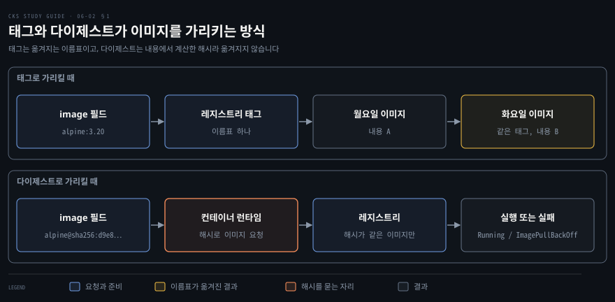
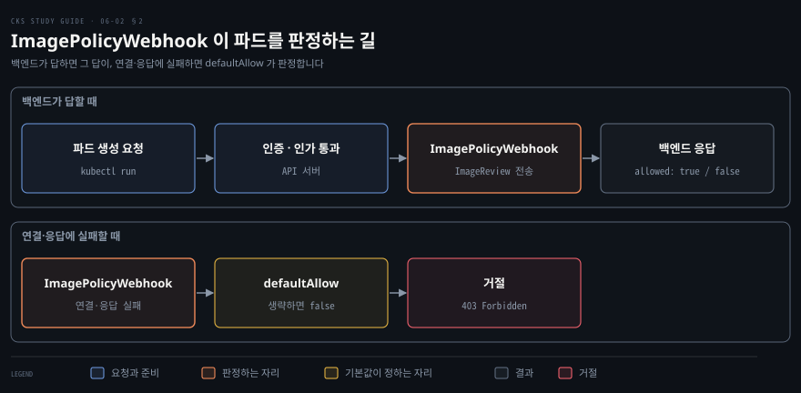
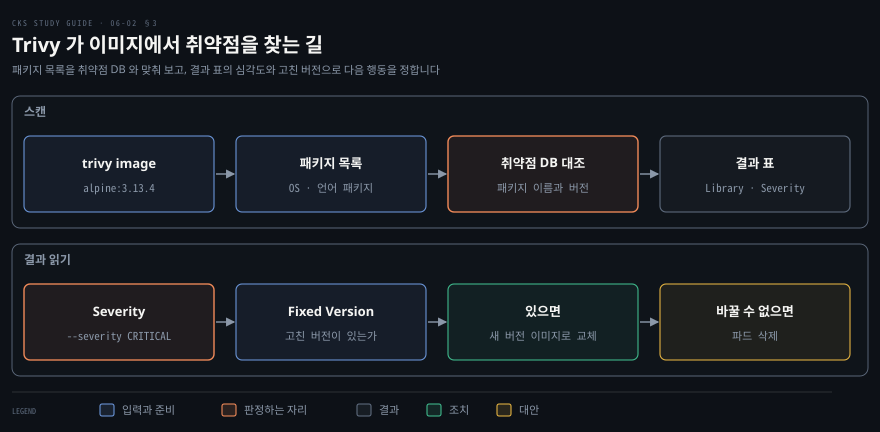

# 믿을 수 있는 이미지만 들이기 — 서명·digest·레지스트리 허용 목록·Trivy
---

## 핵심 요약

> 클러스터에 들어오는 이미지는 내용이 그대로인지, 허용한 레지스트리에서 왔는지, 알려진 취약점이 없는지를 차례로 확인한 뒤에 실행합니다.

내용이 그대로인지는 이미지를 `name@sha256:…` 처럼 다이제스트로 가리켜 확인합니다. 태그는 다른 이미지로 옮겨질 수 있지만 다이제스트는 이미지 내용에서 계산한 해시여서 내용이 달라지면 값도 달라집니다. 서명은 누가 발행했는지를 더합니다. 서명 방식 가운데 Docker Content Trust 는 폐지 중입니다.

출처는 이미지 이름의 앞부분으로 판정하고 그 판정을 어드미션 단계에서 집행합니다. Gatekeeper 의 허용 목록 정책과 ImagePolicyWebhook 이 그 방법이며 Kyverno 도 같은 정책을 지원합니다. 알려진 취약점은 Trivy 가 이미지의 패키지 목록을 취약점 데이터베이스(DB)와 대조해 심각도별로 보여 줍니다. 이 노트의 값은 2026-11-05 에 공식 페이지에서 확인한 버전 기준입니다. 버전은 Gatekeeper v3.23.1, Kyverno v1.19.2, Trivy v0.76.1 입니다.[^ver]


## 학습 목표

이 내용을 읽고 나면:

1. 태그와 다이제스트의 차이를 설명하고 잘못된 해시가 `ImagePullBackOff` 가 되는 이유를 말할 수 있습니다.
2. 서명이 다이제스트에 더하는 보증과 Docker Content Trust 의 현재 상태를 설명할 수 있습니다.
3. 이미지 이름에서 레지스트리 호스트를 읽고, Gatekeeper 허용 목록 Constraint 의 접두사를 빠뜨림 없이 쓸 수 있습니다.
4. ImagePolicyWebhook 의 설정이 나뉜 세 곳을 연결하고 `defaultAllow` 의 효과를 설명할 수 있습니다.
5. Trivy 로 이미지를 스캔해 심각도와 고친 버전을 읽고 이미지 교체나 파드 삭제를 정할 수 있습니다.


## 본문 정리

### 1. 이미지가 바뀌지 않았음을 확인하기

이미지가 바뀌지 않았음은 태그가 아니라 다이제스트로 가리켜야 확인할 수 있습니다. 태그는 레지스트리 안에서 다른 이미지로 옮겨질 수 있는 이름표입니다. 그래서 `nginx:1.23.3-alpine` 같은 이름이 어제와 오늘 다른 내용을 내려받게 할 수 있습니다. 공격자가 레지스트리의 태그를 악성 이미지로 옮겨 놓으면 파드 정의는 그대로인데 실행되는 내용만 바뀝니다.

**다이제스트(digest)** 는 이미지 내용에서 계산한 해시이며 `sha256:` 뒤에 해시 값을 붙여 씁니다. 내용이 한 바이트라도 달라지면 해시가 달라지므로 다이제스트가 가리키는 이미지는 옮겨지지 않습니다.[^digest]



다이제스트는 `docker buildx imagetools inspect` 출력의 `Digest` 줄에서 얻습니다. 파드의 `image` 필드에서는 이름 뒤에 `@` 로 붙입니다.

```bash
docker buildx imagetools inspect alpine:3.20
```

여러 CPU(중앙 처리 장치) 아키텍처용 이미지를 묶은 인덱스는 맨 위의 `Digest` 가 인덱스 자체의 값입니다. 인덱스의 다이제스트를 쓰면 노드의 아키텍처에 맞는 이미지가 골라지고, 플랫폼별 다이제스트를 쓰면 그 아키텍처의 이미지 하나만 가리킵니다. 다음 파드는 alpine:3.20 인덱스의 다이제스트로 이미지를 가리킵니다.

```yaml
apiVersion: v1
kind: Pod
metadata:
  name: alpine-digest
spec:
  containers:
  - name: alpine
    image: alpine@sha256:d9e853e87e55526f6b2917df91a2115c36dd7c696a35be12163d44e6e2a4b6bc
    command: ["sleep", "3600"]
```

이 파드는 `Running` 이 되고 `imageID` 에도 같은 다이제스트가 찍힙니다. 해시의 마지막 글자만 `d` 로 바꾼 파드는 `ErrImagePull` 을 거쳐 `ImagePullBackOff` 가 됩니다. 이벤트의 `rpc error: code = NotFound` 는 컨테이너 런타임이 돌려준 응답입니다. 런타임이 레지스트리에 그 해시의 이미지를 요청했는데 없어서 `failed to resolve reference` 로 실패한 것입니다. kubelet 은 그 응답을 파드 이벤트로 올립니다.

```bash
Warning  Failed  kubelet  Failed to pull image "alpine@sha256:d9e8…b6bd": rpc error: code = NotFound desc = failed to pull and unpack image "docker.io/library/alpine@sha256:d9e8…b6bd": failed to resolve reference "docker.io/library/alpine@sha256:d9e8…b6bd": … not found
Warning  Failed  kubelet  Error: ErrImagePull
Warning  Failed  kubelet  Error: ImagePullBackOff
```

`image` 필드에 다이제스트를 쓰고 `imagePullPolicy` 를 적지 않으면 기본값은 `IfNotPresent` 입니다.[^digest] 노드에 같은 다이제스트의 이미지가 이미 있으면 다시 내려받지 않습니다. 다이제스트 지정은 파드를 정의하는 사람이 컨테이너마다 직접 적어야 켜지는 선택 사항입니다. 클러스터가 태그를 다이제스트로 바꿔 주지는 않습니다.

다이제스트는 내용이 그대로인지만 말해 주고 누가 발행했는지는 말해 주지 않습니다. 발행자는 **서명**이 보증합니다. 서명은 발행자가 개인 키로 이미지 다이제스트에 서명하고 사용하는 쪽이 공개 키로 검증하는 방식입니다. `docker trust sign <이미지>:<태그>` 는 이 방식을 쓰는 Docker Content Trust(DCT)의 명령입니다.

DCT 와 그 서명 서비스인 Notary v1(`notary.docker.io`)은 폐지 중이며 서비스는 2026-12-08 에 완전히 종료됩니다.[^dct] Docker 의 이전 안내 글은 대안으로 Sigstore/Cosign 과 Notation 을 듭니다.[^dctblog]

서명 방식의 전체 그림은 [이미지 공급망 보안](../container-security/06-02.%EC%9D%B4%EB%AF%B8%EC%A7%80%20%EA%B3%B5%EA%B8%89%EB%A7%9D%20%EB%B3%B4%EC%95%88%20%E2%80%94%20%EB%B9%8C%EB%93%9C%EB%B6%80%ED%84%B0%20%EB%B0%B0%ED%8F%AC%EA%B9%8C%EC%A7%80.md)의 「이미지 서명」 절에서 다뤘습니다. 이미지를 가리키는 두 방식은 [컨테이너 이미지 해부](../container-security/06-01.%EC%BB%A8%ED%85%8C%EC%9D%B4%EB%84%88%20%EC%9D%B4%EB%AF%B8%EC%A7%80%20%ED%95%B4%EB%B6%80%20%E2%80%94%20%EB%91%90%20%EB%B6%80%EB%B6%84%EA%B3%BC%20%EC%B8%B5%EA%B3%BC%20%EC%8B%9D%EB%B3%84%EC%9E%90.md)의 「이미지를 가리키는 두 방식」 절에서 설명했습니다.

### 2. 허용한 레지스트리만 들이기

클러스터가 받아들일 레지스트리는 이미지 이름의 앞부분을 기준으로 정하고 그 기준을 어드미션 단계에서 집행합니다. 이미지 이름은 `레지스트리 호스트/경로:태그` 로 읽습니다. 호스트를 생략하면 쿠버네티스는 Docker 공개 레지스트리로 간주하므로 `nginx:1.27` 은 `docker.io/library/nginx:1.27` 과 같습니다.[^digest] 허용 목록은 이 이름을 문자열로 다룹니다. 그래서 호스트가 생략된 이름을 어떻게 처리하는지가 규칙의 정확도를 가릅니다.

Gatekeeper 로 허용 목록을 만들려면 gatekeeper-library 의 `K8sAllowedRepos` 템플릿을 적용합니다. 허용할 접두사는 Constraint 에 적습니다. ConstraintTemplate 과 Constraint 의 구조는 [파드 보안 설정 강제하기](./05-01.%ED%8C%8C%EB%93%9C%20%EB%B3%B4%EC%95%88%20%EC%84%A4%EC%A0%95%20%EA%B0%95%EC%A0%9C%ED%95%98%EA%B8%B0%20%E2%80%94%20securityContext%C2%B7Pod%20Security%20Admission%C2%B7Gatekeeper.md)의 「OPA Gatekeeper 로 조직 정책 강제하기」 절에서 다뤘습니다. 템플릿은 고정한 커밋의 것을 씁니다.[^repos]

```bash
kubectl apply -f https://raw.githubusercontent.com/open-policy-agent/gatekeeper-library/3f72d582297a2b224b866035b3fb21844f5e5cbd/library/general/allowedrepos/template.yaml
```

템플릿을 적용해 CRD(CustomResourceDefinition)가 생긴 뒤에 Constraint 를 적용합니다. 순서가 바뀌면 `no matches for kind` 오류가 납니다. 다음 Constraint 는 `registry.k8s.io/` 로 시작하는 이미지만 허용합니다.

```yaml
apiVersion: constraints.gatekeeper.sh/v1beta1
kind: K8sAllowedRepos
metadata:
  name: repo-is-registry-k8s
spec:
  match:
    kinds:
      - apiGroups: [""]
        kinds: ["Pod"]
  parameters:
    repos:
      - "registry.k8s.io/"
```

`nginx:1.27` 이미지의 파드는 어드미션에서 거절되고 `registry.k8s.io/pause:3.10` 이미지의 파드는 만들어집니다. 거절 메시지는 어느 Constraint 가 어느 이미지를 막았는지 알려 줍니다.

```bash
[repo-is-registry-k8s] container <nginx> has an invalid image repo <nginx:1.27>, allowed repos are ["registry.k8s.io/"]
```

템플릿은 이미지 문자열이 `repos` 의 항목으로 시작하는지만 봅니다. 그래서 접두사를 쓸 때 두 가지를 틀리기 쉽습니다. 호스트가 생략된 이름은 `docker.io/` 항목으로 허용되지 않으므로 허용할 이미지는 호스트까지 적어 파드를 정의합니다. 호스트 뒤의 `/` 를 빠뜨리면 이름이 같은 글자로 시작하는 다른 도메인도 통과합니다. 정확 일치와 glob 을 쓰는 `k8sallowedreposv2` 정책이 [gatekeeper-library](https://github.com/open-policy-agent/gatekeeper-library/blob/e3855f5ffb127e928728b54711c3bf0ca28d0972/library/general/allowedreposv2/template.yaml)에 있습니다.

| `repos` 의 항목 | 검사하는 이미지 | 판정 |
|-----------------|-----------------|------|
| `docker.io/` | `nginx:1.27` | 거절 |
| `docker.io/` | `docker.io/library/nginx:1.27` | 허용 |
| `gcr.io` | `gcr.io.evil.example/x:1` | 허용 |
| `gcr.io/` | `gcr.io.evil.example/x:1` | 거절 |

템플릿은 `containers`·`initContainers`·`ephemeralContainers` 를 모두 검사합니다. Constraint 에 네임스페이스를 적지 않으면 모든 네임스페이스에 적용됩니다.

Gatekeeper 의 기본 설치는 `admission.gatekeeper.sh/ignore` 레이블이 붙은 네임스페이스와 `gatekeeper-system` 을 건너뜁니다. 면제할 네임스페이스는 [Gatekeeper 설정](https://open-policy-agent.github.io/gatekeeper/website/docs/exempt-namespaces/)에서 따로 정합니다. 면제하지 않은 `kube-system` 의 파드도 검사 대상입니다. 구성 요소가 허용 목록 밖의 이미지를 쓰면 새로 뜰 때 거절되니 그 이미지의 레지스트리도 목록에 넣습니다.

두 번째 방법은 쿠버네티스에 내장된 **ImagePolicyWebhook** 입니다. 이 어드미션 컨트롤러 플러그인은 기본으로 꺼져 있습니다. 켜면 API(Application Programming Interface) 서버가 파드 생성·수정 요청의 이미지 목록을 `ImageReview` 객체에 담아 외부 서비스에 보냅니다. 그 서비스를 백엔드라고 부릅니다. 백엔드가 `allowed` 로 답하면 요청이 이어지고 거절하면 파드는 만들어지지 않습니다.

백엔드는 TLS(Transport Layer Security)로 통신해야 합니다. 어떤 기준으로 판정할지는 백엔드를 만드는 쪽이 정합니다. 파드를 만들거나 고칠 때 보내는 `ImageReview` 에는 `containers` 와 `initContainers` 의 이미지가 담깁니다. `ephemeralContainers` 의 이미지는 임시 컨테이너를 추가하는 요청에서 따로 보냅니다.[^ipw] 요청이 어드미션에 이르기까지의 순서는 [클러스터 굳히기](./03-01.%ED%81%B4%EB%9F%AC%EC%8A%A4%ED%84%B0%20%EA%B5%B3%ED%9E%88%EA%B8%B0%20%E2%80%94%20API%20%EC%A0%91%EA%B7%BC%C2%B7RBAC%C2%B7ServiceAccount%C2%B7%EC%97%85%EA%B7%B8%EB%A0%88%EC%9D%B4%EB%93%9C.md)의 「API 서버의 요청 처리 순서와 접속 경로」 절에서 설명했습니다.



플러그인을 연결하는 설정은 세 곳에 나뉘어 있습니다. 플러그인의 동작은 AdmissionConfiguration 파일이 정합니다. 백엔드의 주소와 인증서는 kubeconfig 파일에 적습니다. 플러그인을 켜고 두 파일이 든 디렉터리를 마운트하는 일은 API 서버 매니페스트의 옵션이 맡습니다. 먼저 `/etc/kubernetes/admission-control/image-policy-webhook-admission-config.yaml` 입니다.

```yaml
apiVersion: apiserver.config.k8s.io/v1
kind: AdmissionConfiguration
plugins:
  - name: ImagePolicyWebhook
    configuration:
      imagePolicy:
        kubeConfigFile: /etc/kubernetes/admission-control/imagepolicywebhook.kubeconfig
        allowTTL: 50
        denyTTL: 50
        retryBackoff: 500
        defaultAllow: false
```

`allowTTL` 과 `denyTTL` 은 허용과 거절 판정을 캐시하는 시간(TTL, time to live)이고 단위는 초입니다. `retryBackoff` 는 백엔드 재시도 사이의 간격이고 단위는 밀리초입니다. `defaultAllow` 는 백엔드에 닿지 못했거나 2xx 가 아닌 상태로 답했거나 응답을 읽지 못했을 때 요청을 허용할지 정합니다. 생략하면 `false` 라서 거절합니다.[^ipw]

다음은 `imagepolicywebhook.kubeconfig` 입니다. 백엔드의 주소(URL, Uniform Resource Locator)와 서버 인증서를 검증할 CA(certificate authority) 파일을 적습니다. API 서버가 쓸 클라이언트 인증서와 키도 적습니다.

```yaml
apiVersion: v1
kind: Config
preferences: {}
clusters:
  - name: image-validation-webhook
    cluster:
      certificate-authority: /etc/kubernetes/admission-control/ca.crt
      server: https://image-validation-webhook:8080/validate
contexts:
  - context:
      cluster: image-validation-webhook
      user: api-server-client
    name: image-validation-webhook
current-context: image-validation-webhook
users:
  - name: api-server-client
    user:
      client-certificate: /etc/kubernetes/admission-control/api-server-client.crt
      client-key: /etc/kubernetes/admission-control/api-server-client.key
```

API 서버 매니페스트 `/etc/kubernetes/manifests/kube-apiserver.yaml` 에서는 플러그인 이름을 `--enable-admission-plugins` 목록에 더합니다. `--admission-control-config-file` 은 설정 파일을 가리킵니다. 두 파일이 든 디렉터리는 API 서버 컨테이너 안에서 보여야 하므로 볼륨으로 마운트합니다. 옵션에 적은 경로는 실제 파일 이름과 글자까지 같아야 합니다.

```yaml
spec:
  containers:
  - command:
    - kube-apiserver
    - --enable-admission-plugins=NodeRestriction,ImagePolicyWebhook
    - --admission-control-config-file=/etc/kubernetes/admission-control/image-policy-webhook-admission-config.yaml
    # ... 기존 옵션 생략 ...
    volumeMounts:
    - name: admission-control
      mountPath: /etc/kubernetes/admission-control
      readOnly: true
  volumes:
  - name: admission-control
    hostPath:
      path: /etc/kubernetes/admission-control
      type: DirectoryOrCreate
```

매니페스트를 저장하면 API 서버 파드가 다시 뜨고 그동안 `kubectl` 이 잠시 응답하지 않습니다. 백엔드의 호스트를 찾을 수 없는 상태에서 파드를 만들면 `defaultAllow` 가 `false` 이므로 거절됩니다.

```bash
Error from server (Forbidden): pods "ipw-test" is forbidden: Post "https://image-validation-webhook:8080/validate?timeout=30s": dial tcp: lookup image-validation-webhook on 0.250.250.254:53: no such host
```

설정 파일의 `defaultAllow` 를 `true` 로 고치고 API 서버를 다시 시작하면 같은 파드가 만들어집니다. 백엔드가 죽었을 때도 요청을 막고 싶으면 `false` 로 두고, 가용성을 우선하면 `true` 로 둡니다.

세 번째 방법은 Kyverno 입니다. Kyverno 는 정책을 쿠버네티스 리소스로 쓰는 정책 엔진입니다. 허용 레지스트리 정책은 공식 정책 목록에 있습니다.[^kyverno] 이 정책은 연습 문제 1 에서 직접 만들어 봅니다.

### 3. 알려진 취약점 스캔하기

이미지의 알려진 취약점은 스캐너가 패키지 목록을 취약점 DB 와 대조해 찾고, 결과는 심각도와 고친 버전으로 읽습니다. 공개된 취약점에는 CVE(Common Vulnerabilities and Exposures) 번호가 붙고 DB 에 등록됩니다. 스캐너는 이미지 안의 패키지 이름과 버전을 뽑아 DB 의 항목과 맞춥니다.

Trivy 는 OS 패키지에는 해당 OS 벤더의 권고 DB 를 쓰고 언어 패키지에는 주로 GitHub Advisory Database 를 씁니다. 심각도는 선택한 데이터 소스의 값이며 벤더의 값이 우선합니다.[^trivy]

같은 이미지라도 스캐너와 DB 날짜에 따라 결과가 달라지는 이유는 [이미지 속 소프트웨어 취약점](../container-security/07-01.%EC%9D%B4%EB%AF%B8%EC%A7%80%20%EC%86%8D%20%EC%86%8C%ED%94%84%ED%8A%B8%EC%9B%A8%EC%96%B4%20%EC%B7%A8%EC%95%BD%EC%A0%90%20%E2%80%94%20CVE%EB%B6%80%ED%84%B0%20%EC%8A%A4%EC%BA%94%20%EC%9A%B4%EC%98%81%EA%B9%8C%EC%A7%80.md)의 「왜 스캐너마다 답이 다른가」 절에서 다뤘습니다.



기본 명령은 `trivy image <이미지>` 이고 `--severity` 로 보고 싶은 심각도만 고릅니다. 다음은 Trivy v0.76.1 을 컨테이너로 실행하는 예입니다.

```bash
docker run --rm -v <캐시 디렉터리>:/root/.cache/ aquasec/trivy:0.76.1 image --severity CRITICAL alpine:3.13.4
```

출력은 대상별 요약 표로 시작합니다. 그 아래에 대상마다 `Total` 줄과 취약점 표가 나옵니다.

```bash
Report Summary

┌───────────────────────────────┬────────┬─────────────────┬─────────┐
│            Target             │  Type  │ Vulnerabilities │ Secrets │
├───────────────────────────────┼────────┼─────────────────┼─────────┤
│ alpine:3.13.4 (alpine 3.13.4) │ alpine │        4        │    -    │
└───────────────────────────────┴────────┴─────────────────┴─────────┘
Legend:
- '-': Not scanned
- '0': Clean (no security findings detected)

alpine:3.13.4 (alpine 3.13.4)
=============================
Total: 4 (CRITICAL: 4)
```

취약점 표에는 `Library`·`Vulnerability`·`Severity`·`Status`·`Installed Version`·`Fixed Version`·`Title` 열이 있습니다. 앞쪽 열의 일부는 다음과 같습니다. 개수와 항목은 스캔한 날의 DB 에 따라 달라집니다.

| Library | Vulnerability | Severity | Installed Version | Fixed Version |
|---------|---------------|----------|-------------------|---------------|
| apk-tools | CVE-2021-36159 | CRITICAL | 2.12.4-r0 | 2.12.6-r0 |
| libcrypto1.1 | CVE-2021-3711 | CRITICAL | 1.1.1k-r0 | 1.1.1l-r0 |

`Library` 는 취약점이 든 패키지이고 `Installed Version` 은 이미지에 든 버전이며 `Fixed Version` 은 고쳐진 버전입니다. HIGH 와 CRITICAL 은 고치는 것을 먼저 검토합니다. `--ignore-unfixed` 는 아직 고친 버전이 없는 취약점을 결과에서 숨깁니다.[^trivy] 이미지의 OS(운영체제) 버전이 배포판의 지원 기간을 넘기면 Trivy 가 `This OS version is no longer supported by the distribution` 경고를 냅니다. 보안 업데이트가 제공되지 않아 탐지가 부족할 수 있다는 뜻입니다.

결과를 읽었으면 조치를 정합니다. 고친 버전이 있으면 그 버전 이상을 담은 이미지로 교체합니다. 이미지를 바꿀 수 없으면 그 이미지를 쓰는 파드를 지워 노출을 멈춥니다. 연습 문제 3 은 파드를 지우는 쪽을 택합니다. 파드가 어떤 이미지를 쓰는지는 `jsonpath` 로 한 번에 뽑을 수 있습니다.

```bash
kubectl get pods -n r61 -o jsonpath='{range .items[*]}{.metadata.name}{"\t"}{.spec.containers[*].image}{"\n"}{end}'
```


## 연습 문제

> 1번은 Kyverno 정책, 2번은 다이제스트, 3번은 Trivy 를 묻습니다. 풀이는 파일 맨 끝의 정답에 있습니다.

1. 클러스터에 Kyverno 를 설치하고 `gcr.io/` 로 시작하는 이미지만 허용하는 정책 `restrict-image-registries` 를 위반 시 거절하도록 만듭니다. `nginx:1.23.3` 이미지로 만든 파드와 `gcr.io/google-containers/busybox:1.27.2` 이미지로 만든 파드는 각각 어떻게 됩니까?
2. 이미지 `nginx:1.23.3-alpine` 의 다이제스트를 찾아 파드 `nginx` 의 이미지를 태그 대신 다이제스트로 지정합니다. 파드는 실행됩니까? 다이제스트의 마지막 글자를 바꾸면 어떻게 됩니까?
3. 네임스페이스 `r61` 에 이미지 `bmuschko/nodejs-hello-world:1.0.0`, `alpine:3.13.4`, `elastic/logstash:7.13.3` 를 쓰는 파드를 하나씩 만듭니다. 파드가 쓰는 이미지를 명령으로 확인하고 세 이미지를 Trivy 로 스캔합니다. CRITICAL 심각도 취약점이 나온 이미지를 쓰는 파드를 모두 지우면 파드는 몇 개가 남습니까?


## 정답 (자답 후 펼치기)

### 정답 1

Kyverno 는 릴리스의 설치 매니페스트로 설치하고 파드가 모두 `Running` 이 된 뒤에 정책을 만듭니다.[^kyverno]

```bash
kubectl create -f https://github.com/kyverno/kyverno/releases/download/v1.19.2/install.yaml
kubectl get pods -n kyverno
```

정책은 파드의 `containers` 와 `initContainers` 이미지가 모두 `gcr.io/` 로 시작해야 한다고 CEL 식으로 씁니다. `validationActions: [Deny]` 가 위반 요청을 거절하게 합니다. 예시에서 자주 보는 `kyverno.io/v1` 의 `ClusterPolicy` 는 v1.19 에서 deprecated 이라 적용하면 경고가 나오므로 `ValidatingPolicy` 로 씁니다.

```yaml
apiVersion: policies.kyverno.io/v1
kind: ValidatingPolicy
metadata:
  name: restrict-image-registries
spec:
  validationActions: [Deny]
  matchConstraints:
    resourceRules:
    - apiGroups: [""]
      apiVersions: ["v1"]
      operations: ["CREATE", "UPDATE"]
      resources: ["pods"]
  validations:
  - expression: >-
      object.spec.containers.all(c, c.image.startsWith('gcr.io/'))
      && (!has(object.spec.initContainers)
      || object.spec.initContainers.all(c, c.image.startsWith('gcr.io/')))
    message: Unknown image registry.
```

```bash
kubectl apply -f restrict-image-registries.yaml
kubectl run nginx --image=nginx:1.23.3
kubectl run busybox --image=gcr.io/google-containers/busybox:1.27.2
```

`nginx:1.23.3` 파드는 거절됩니다. 호스트가 없는 이름은 `gcr.io/` 로 시작하지 않기 때문입니다.

```bash
Error from server: admission webhook "vpol.validate.kyverno.svc-fail" denied the request: Policy restrict-image-registries failed: Unknown image registry.
```

`gcr.io/google-containers/busybox:1.27.2` 파드는 `pod/busybox created` 로 만들어집니다. 이후 컨테이너가 하는 일이 없어 곧 종료되는 것은 이미지의 동작이며 정책과 관계가 없습니다.

### 정답 2

레지스트리에서 다이제스트를 찾습니다. 다음 명령은 2026-11-05 에 인덱스의 다이제스트로 `sha256:6318314189b40e73145a48060bff4783a116c34cc7241532d0d94198fb2c9629` 를 보여 줍니다.

```bash
docker buildx imagetools inspect nginx:1.23.3-alpine
```

파드의 이미지를 태그 대신 다이제스트로 적습니다.

```yaml
apiVersion: v1
kind: Pod
metadata:
  name: nginx
spec:
  containers:
  - name: nginx
    image: nginx@sha256:6318314189b40e73145a48060bff4783a116c34cc7241532d0d94198fb2c9629
```

```bash
kubectl apply -f pod-validate-image.yaml
kubectl get pod nginx
```

파드는 `1/1 Running` 이 됩니다. 다이제스트의 마지막 글자 `9` 를 `8` 로 바꾸고 다시 만들면 레지스트리에 그 해시의 이미지가 없어 `ImagePullBackOff` 가 됩니다. 실행 중인 파드가 실제로 쓴 이미지는 `kubectl get pod nginx -o jsonpath='{.status.containerStatuses[0].imageID}'` 로 확인합니다. 값은 `docker.io/library/nginx@sha256:6318…9629` 입니다.

### 정답 3

먼저 네임스페이스와 파드 세 개를 만들고 파드별 이미지를 확인합니다.

```bash
kubectl create namespace r61
kubectl run hello --image=bmuschko/nodejs-hello-world:1.0.0 -n r61
kubectl run alpine --image=alpine:3.13.4 -n r61 -- sleep 3600
kubectl run logstash --image=elastic/logstash:7.13.3 -n r61
kubectl get pods -n r61 -o jsonpath='{range .items[*]}{.metadata.name}{"\t"}{.spec.containers[*].image}{"\n"}{end}'
```

이미지마다 CRITICAL 만 추려 스캔합니다.

```bash
trivy image --severity CRITICAL bmuschko/nodejs-hello-world:1.0.0
trivy image --severity CRITICAL alpine:3.13.4
trivy image --severity CRITICAL elastic/logstash:7.13.3
```

2026-11-05 에 Trivy v0.76.1 로 스캔하면 세 이미지 모두 CRITICAL 이 나옵니다. 그래서 세 파드를 모두 지우고 남는 파드는 없습니다. 날이 지나면 DB 가 달라지므로 같은 결과를 기대하지 말고 직접 스캔해서 판단합니다.

```bash
kubectl delete pod hello alpine logstash -n r61
```


## 참고 자료

- 원본: 《Certified Kubernetes Security Specialist (CKS) Study Guide》(Benjamin Muschko, O'Reilly, 2023, ISBN 978-1098132972) Chapter 6
- [Images](https://kubernetes.io/docs/concepts/containers/images/) · [Admission Controllers Reference](https://kubernetes.io/docs/reference/access-authn-authz/admission-controllers/) · [imagepolicy.k8s.io/v1alpha1](https://kubernetes.io/docs/reference/config-api/imagepolicy.v1alpha1/) · [AdmissionConfiguration](https://kubernetes.io/docs/reference/config-api/apiserver-admission.v1/)
- [Docker Content Trust 폐지 안내](https://docs.docker.com/engine/security/trust/) · [Retired Docker products](https://docs.docker.com/retired/) · [DCT 폐지와 이전 안내](https://www.docker.com/blog/docker-content-trust-retirement-and-migration-guidance/)
- [Gatekeeper: 네임스페이스 면제](https://open-policy-agent.github.io/gatekeeper/website/docs/exempt-namespaces/) · [Gatekeeper Library: allowedrepos](https://github.com/open-policy-agent/gatekeeper-library/blob/3f72d582297a2b224b866035b3fb21844f5e5cbd/library/general/allowedrepos/template.yaml) · [Kyverno: Restrict Image Registries](https://kyverno.io/policies/best-practices/restrict-image-registries/restrict-image-registries/) · [Kyverno: 정책 CEL 로 옮기기](https://kyverno.io/docs/guides/migration-to-cel/)
- [Trivy: Container Image](https://trivy.dev/docs/v0.76/guide/target/container_image/) · [Trivy: Vulnerability](https://trivy.dev/docs/v0.76/guide/scanner/vulnerability/)
- [CKS Study Guide 정독 인덱스](./README.md) — 이 책의 장별 목표와 진행 상태
- [파드 보안 설정 강제하기](./05-01.%ED%8C%8C%EB%93%9C%20%EB%B3%B4%EC%95%88%20%EC%84%A4%EC%A0%95%20%EA%B0%95%EC%A0%9C%ED%95%98%EA%B8%B0%20%E2%80%94%20securityContext%C2%B7Pod%20Security%20Admission%C2%B7Gatekeeper.md) · [클러스터 굳히기](./03-01.%ED%81%B4%EB%9F%AC%EC%8A%A4%ED%84%B0%20%EA%B5%B3%ED%9E%88%EA%B8%B0%20%E2%80%94%20API%20%EC%A0%91%EA%B7%BC%C2%B7RBAC%C2%B7ServiceAccount%C2%B7%EC%97%85%EA%B7%B8%EB%A0%88%EC%9D%B4%EB%93%9C.md) · [컨테이너 이미지 해부](../container-security/06-01.%EC%BB%A8%ED%85%8C%EC%9D%B4%EB%84%88%20%EC%9D%B4%EB%AF%B8%EC%A7%80%20%ED%95%B4%EB%B6%80%20%E2%80%94%20%EB%91%90%20%EB%B6%80%EB%B6%84%EA%B3%BC%20%EC%B8%B5%EA%B3%BC%20%EC%8B%9D%EB%B3%84%EC%9E%90.md) · [이미지 공급망 보안](../container-security/06-02.%EC%9D%B4%EB%AF%B8%EC%A7%80%20%EA%B3%B5%EA%B8%89%EB%A7%9D%20%EB%B3%B4%EC%95%88%20%E2%80%94%20%EB%B9%8C%EB%93%9C%EB%B6%80%ED%84%B0%20%EB%B0%B0%ED%8F%AC%EA%B9%8C%EC%A7%80.md) · [이미지 속 소프트웨어 취약점](../container-security/07-01.%EC%9D%B4%EB%AF%B8%EC%A7%80%20%EC%86%8D%20%EC%86%8C%ED%94%84%ED%8A%B8%EC%9B%A8%EC%96%B4%20%EC%B7%A8%EC%95%BD%EC%A0%90%20%E2%80%94%20CVE%EB%B6%80%ED%84%B0%20%EC%8A%A4%EC%BA%94%20%EC%9A%B4%EC%98%81%EA%B9%8C%EC%A7%80.md) — 같은 주제를 앞 장이나 다른 책에서 정리한 형제 노트

[^ver]: 최신 릴리스는 Gatekeeper v3.23.1(2026-08-27), Kyverno v1.19.2(2026-10-20), Trivy v0.76.1(2026-10-21)입니다. <https://github.com/open-policy-agent/gatekeeper/releases/tag/v3.23.1>, <https://github.com/kyverno/kyverno/releases/tag/v1.19.2>, <https://github.com/aquasecurity/trivy/releases/tag/v0.76.1> (2026-11-05 조회)
[^digest]: 공식 문서는 "Digests are hashes of the image's content, and are immutable. Tags can be moved to point to different images, but digests are fixed." 라고 적습니다. 레지스트리 호스트를 생략하면 Docker 공개 레지스트리로 간주하고, 태그와 다이제스트를 함께 쓰면 다이제스트만 pull 에 쓰이며, 다이제스트를 쓰고 pull 정책을 적지 않은 컨테이너의 기본값은 `IfNotPresent` 입니다. 태그를 생략했거나 `:latest` 이면 기본값은 `Always` 입니다. <https://kubernetes.io/docs/concepts/containers/images/> (2026-11-05 조회)
[^dct]: "Docker Content Trust (DCT) and the Notary v1 service at notary.docker.io are being fully retired … The service shuts down completely on December 8, 2026" 입니다. <https://docs.docker.com/retired/>, <https://docs.docker.com/engine/security/trust/> (2026-11-05 조회)
[^dctblog]: 2026-06-16 에 게시된 Docker 블로그 글이 DCT 폐지 뒤의 이전 대안으로 Sigstore/Cosign 과 Notation 을 듭니다. <https://www.docker.com/blog/docker-content-trust-retirement-and-migration-guidance/> (2026-11-05 조회)
[^repos]: 고정 커밋의 템플릿(버전 1.0.1)은 종류가 `K8sAllowedRepos` 이고 `strings.any_prefix_match(container.image, input.parameters.repos)` 로 이미지 문자열과 `repos` 항목의 접두사 일치를 봅니다. `containers`·`initContainers`·`ephemeralContainers` 에 각각 위반 규칙이 있습니다. 이후 커밋의 버전 1.0.2 는 규칙은 같고 설명에 호스트 뒤 `/` 를 붙이라는 경고를 더했습니다. 표의 네 경우는 kind v1.35.0 에 Gatekeeper v3.23.1 을 설치해 파드 생성으로 확인했습니다. <https://github.com/open-policy-agent/gatekeeper-library/blob/3f72d582297a2b224b866035b3fb21844f5e5cbd/library/general/allowedrepos/template.yaml> (2026-11-05 조회)
[^ipw]: 백엔드는 `imagepolicy.k8s.io/v1alpha1` 의 `ImageReview` 를 받으며 TLS 로 통신해야 합니다. 공식 문서는 API 서버에 `--runtime-config=imagepolicy.k8s.io/v1alpha1=true` 를 켜라고 적지만 kind v1.35.0 에서는 `--runtime-config=` 가 빈 채로도 플러그인이 백엔드로 요청을 보냈습니다. `defaultAllow` 는 설정 구조체에서 `bool` 이고 값을 채우는 코드가 없어 생략하면 `false` 이며, `admission.go` 의 `webhookError` 가 `defaultAllow` 가 `false` 일 때 요청을 거절합니다. 두 파일은 v1.35.0 과 v1.37.2 태그에서 같습니다. 같은 클러스터에서 `defaultAllow` 를 생략한 경우와 `false` 로 쓴 경우는 거절됐고 `true` 로 쓴 경우는 파드가 만들어졌습니다. `admission.go` 는 `allowTTL`·`denyTTL` 에 초를, `retryBackoff` 에 밀리초를 곱해 쓰고 주석에도 같은 단위를 적습니다. `webhookError` 는 연결 실패뿐 아니라 HTTP 상태가 2xx 범위 밖이거나 응답을 읽지 못할 때도 불립니다. `ImageReview` 는 파드 생성·수정 때 `containers` 와 `initContainers` 를, `ephemeralcontainers` 하위 리소스 요청 때 `ephemeralContainers` 를 담습니다. <https://kubernetes.io/docs/reference/access-authn-authz/admission-controllers/>, <https://github.com/kubernetes/kubernetes/blob/v1.37.2/plugin/pkg/admission/imagepolicy/config.go>, <https://github.com/kubernetes/kubernetes/blob/v1.37.2/plugin/pkg/admission/imagepolicy/admission.go> (2026-11-05 조회)
[^kyverno]: Kyverno 의 `ClusterPolicy`·`Policy`·`CleanupPolicy` 와 옛 `PolicyException` 은 v1.19 부터 deprecated 이고 v1.20 에서 제거될 예정입니다. 대체는 CEL(Common Expression Language) 기반의 `ValidatingPolicy`(`policies.kyverno.io/v1`)입니다. 설치 매니페스트는 릴리스의 `install.yaml` 입니다. <https://kyverno.io/docs/guides/migration-to-cel/>, <https://kyverno.io/policies/best-practices/restrict-image-registries/restrict-image-registries/>, <https://github.com/kyverno/kyverno/releases/tag/v1.19.2> (2026-11-05 조회)
[^trivy]: OS 패키지는 해당 OS 벤더의 권고 DB 로, 언어 패키지는 대부분 GitHub Advisory Database 로 탐지하며 심각도는 선택한 데이터 소스에서 가져옵니다. 취약점 스캔과 시크릿 스캔은 기본으로 켜져 있고 `--ignore-unfixed` 는 아직 패치가 제공되지 않은 취약점을 숨깁니다. <https://trivy.dev/docs/v0.76/guide/scanner/vulnerability/>, <https://trivy.dev/docs/v0.76/guide/target/container_image/> (2026-11-05 조회)
