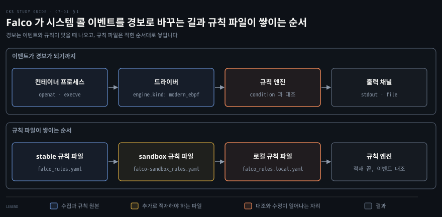
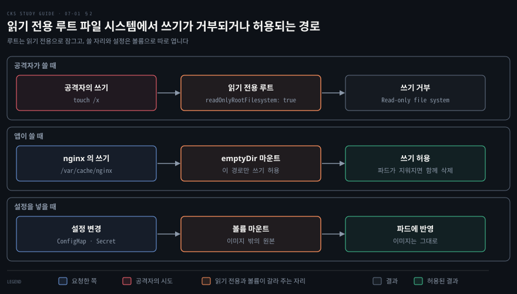
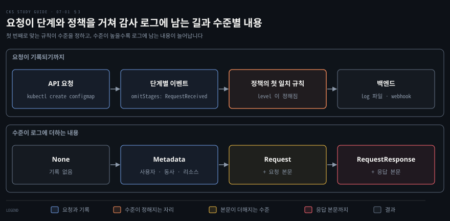

# 실행 중인 클러스터 지켜보기 — Falco·불변 컨테이너·감사 로그
---

## 핵심 요약

> 실행 중인 클러스터는 Falco 로 이상 행위를 탐지하고, 컨테이너를 불변으로 두어 침입 뒤의 변경을 막고, 감사 로그로 API 요청을 기록해서 지킵니다.

Falco 는 시스템 콜 이벤트를 규칙과 맞대어 보고 맞으면 출력 채널로 경보를 보냅니다. 기본 규칙은 `falco_rules.local.yaml` 의 `override` 로 고칩니다. 불변 컨테이너는 루트 파일 시스템을 읽기 전용으로 두고 쓰기가 필요한 경로에만 `emptyDir` 볼륨을 붙여 만듭니다. 감사 로그는 정책 파일에서 첫 번째로 맞는 규칙이 기록 수준을 정하고 API 서버의 플래그와 볼륨 마운트로 켭니다. 이 노트의 값은 2026-11-06 에 공식 페이지에서 확인한 버전 기준이며 Falco 는 0.45.2 입니다.[^ver]


## 학습 목표

이 내용을 읽고 나면:

1. 행위 분석이 시스템 콜 이벤트를 보는 방식과 Falco 의 구성 요소 셋을 설명할 수 있습니다.
2. Falco 의 설정 파일과 규칙 파일 위치 및 적재 순서를 말하고 `override` 로 기본 규칙의 출력과 우선순위를 바꿀 수 있습니다.
3. Falco 의 경보를 표준 출력 대신 파일로 보내도록 `falco.yaml` 을 설정할 수 있습니다.
4. 컨테이너를 불변으로 두는 이유를 설명하고 `readOnlyRootFilesystem` 과 `emptyDir` 로 읽기 전용 파드를 쓸 수 있습니다.
5. 감사 정책의 단계와 수준과 첫 일치 규칙을 읽고 API 서버에 정책 파일과 로그 경로를 연결할 수 있습니다.


## 본문 정리

### 1. Falco로 이상 행위 잡기

컨테이너가 이미 뚫린 뒤의 이상 행위는 이미지 검사로 잡히지 않으므로 실행 중인 노드를 계속 지켜보는 도구가 필요합니다. 노드에서 평소와 다른 활동을 찾는 일을 **행위 분석**(behavior analytics)이라 부릅니다. 사람이 노드에 로그인해 프로세스를 하나씩 보는 방식은 비효율적이어서 걸러 내고 기록하고 알리는 일을 도구에 맡깁니다.

Falco 는 프로세스가 커널에 보내는 요청인 **시스템 콜**(system call) 이벤트를 모아 규칙과 대조하는 행위 분석 도구입니다. 시스템 콜이 무엇인지는 [Linux 시스템 콜·권한·capability](../container-security/02-01.Linux%20%EC%8B%9C%EC%8A%A4%ED%85%9C%20%EC%BD%9C%C2%B7%EA%B6%8C%ED%95%9C%C2%B7capability%20%E2%80%94%20%EC%BB%A8%ED%85%8C%EC%9D%B4%EB%84%88%20%EB%B3%B4%EC%95%88%EC%9D%98%20%EB%B0%94%EB%8B%A5.md)에 정리돼 있습니다. 컨테이너는 호스트 커널을 함께 쓰므로 컨테이너 안에서 일어난 파일 열기나 프로그램 실행도 같은 자리에서 보입니다.

Falco 는 세 부분으로 이뤄집니다.[^falcocfg]

| 구성 요소 | 하는 일 | 정하는 곳 |
|-----------|---------|-----------|
| 드라이버 | 커널에서 시스템 콜 이벤트를 모읍니다 | `falco.yaml` 의 `engine.kind` |
| 규칙 엔진 | 이벤트를 규칙의 조건식과 맞대어 봅니다 | `rules_files` 가 가리키는 규칙 파일 |
| 출력 채널 | 규칙에 맞은 이벤트를 경보로 내보냅니다 | `falco.yaml` 의 `*_output` 키 |

드라이버 종류는 `engine.kind` 로 고릅니다. 종류는 `kmod`·`modern_ebpf`·`replay`·`nodriver` 이고 0.45.2 의 기본값은 `modern_ebpf` 입니다. `kmod` 는 커널 모듈로 이벤트를 모으고 `replay` 는 저장해 둔 캡처를 재생하며 `nodriver` 는 시스템에 드라이버를 넣지 않습니다. `modern_ebpf` 는 eBPF(extended Berkeley Packet Filter)로 커널 안에서 이벤트를 모읍니다. eBPF 도구가 하는 일은 [컨테이너 런타임 보호](../container-security/13-01.%EC%BB%A8%ED%85%8C%EC%9D%B4%EB%84%88%20%EB%9F%B0%ED%83%80%EC%9E%84%20%EB%B3%B4%ED%98%B8%20%E2%80%94%20%EC%A0%95%EC%83%81%EC%9D%84%20%EC%A0%95%EC%9D%98%ED%95%B4%20%EC%9D%B4%EC%83%81%EC%9D%84%20%EC%9E%A1%EB%8B%A4.md)의 2절에서 다룹니다.

설정과 규칙은 `/etc/falco/` 아래의 파일로 나뉩니다. 기본 규칙은 성숙도에 따라 stable·incubating·sandbox 세 파일로 나뉘지만 패키지에 함께 들어 있는 것은 stable 파일 하나입니다. incubating·sandbox 파일은 `falcoctl` 로 따로 받아야 `/etc/falco/` 에 생깁니다. `falcoctl` 은 Falco 의 규칙 파일 같은 산출물을 설치하는 도구입니다.[^rules]

| 파일 | 담는 것 |
|------|---------|
| `falco.yaml` | 드라이버, 규칙 파일 목록, 출력 채널 같은 Falco 설정 |
| `falco_rules.yaml` | stable 기본 규칙 |
| `falco-incubating_rules.yaml` | 따로 받아야 생기는 incubating 규칙 |
| `falco-sandbox_rules.yaml` | 따로 받아야 생기는 sandbox 규칙 |
| `falco_rules.local.yaml` | 내 규칙과 기본 규칙의 수정분 |
| `rules.d/` | 규칙 파일을 더 두는 폴더 |
| `config.d/` | 설정 조각을 더 두는 폴더 |

규칙 파일은 `rules_files` 에 적힌 순서대로 적재되고 뒤에 오는 파일이 앞에서 정의된 규칙을 고칩니다. 기본값은 다음과 같습니다.

```yaml
rules_files:
  - /etc/falco/falco_rules.yaml
  - /etc/falco/falco_rules.local.yaml
  - /etc/falco/rules.d
```



규칙 하나는 `rule`·`desc`·`condition`·`output`·`priority` 다섯 키가 필수입니다. `tags`·`exceptions`·`enabled` 같은 나머지 키는 선택입니다.[^elements]

`condition` 은 이벤트 필드로 쓴 참·거짓 식입니다. `output` 은 규칙에 맞았을 때 찍는 문장이며 `%user.name` 처럼 `%` 를 붙여 이벤트 필드 값을 끼웁니다. `priority` 는 `emergency` 부터 `debug` 까지 여덟 값 가운데 하나이고 `emergency` 가 가장 심각합니다.

값을 모아 둔 **list** 와 조건 조각에 이름을 붙인 **macro** 는 규칙 안에서 이름으로 불러 씁니다. 다음은 5.2.0 stable 파일의 `Terminal shell in container` 규칙에서 `desc` 와 `output` 을 줄인 것입니다.[^rules]

```yaml
- list: shell_binaries
  items: [ash, bash, csh, ksh, sh, tcsh, zsh, dash]

- macro: shell_procs
  condition: (proc.name in (shell_binaries))

- rule: Terminal shell in container
  desc: …                       # 규칙이 잡는 상황의 설명
  condition: >
    spawned_process
    and container
    and shell_procs
    and proc.tty != 0
    and container_entrypoint
    and not user_expected_terminal_shell_in_container_conditions
  output: …                     # 경보 문장, %필드로 값을 채움
  priority: NOTICE
  tags: [maturity_stable, container, shell, mitre_execution, T1059]
```

기본 규칙을 바꿀 때는 규칙 전체를 복사하지 않고 `falco_rules.local.yaml` 에 `override` 를 적어 바꿀 키만 지정합니다. `override` 아래의 키마다 값을 덧붙이는 `append` 나 바꾸는 `replace` 를 하나 정합니다. 한 규칙에서 키마다 다른 동작을 줄 수 있지만 한 키에 두 동작을 함께 줄 수는 없습니다. `priority` 는 `replace` 로만 바꿀 수 있습니다.[^override] 다음은 셸 규칙의 출력과 우선순위를 바꿉니다.

```yaml
- rule: Terminal shell in container
  output: "Opened shell: %evt.time,%user.name,%container.name"
  priority: ALERT
  override:
    output: replace
    priority: replace
```

`override` 는 이미 적재된 규칙에만 적용할 수 있습니다. 그래서 대상 규칙이 든 파일이 `falco_rules.local.yaml` 보다 앞에 오도록 `rules_files` 순서를 맞춥니다. 대상 규칙이 먼저 적재되지 않으면 검증이 실패합니다. 오류 메시지는 `An 'override.<key>: replace' to a rule was requested but no rule by that name already exists` 입니다. 규칙 파일은 Falco 를 띄우지 않고도 `falco --validate` 로 검사합니다.

```bash
falco --validate /etc/falco/falco_rules.yaml --validate /etc/falco/falco_rules.local.yaml
```

위 셸 규칙을 바꾼 뒤 컨테이너에서 셸을 열면 바뀐 우선순위와 출력 문장이 찍힙니다. 문장 끝의 `container_id=…` 와 `container_name=…` 은 규칙이 정한 출력이 아니라 container 플러그인이 덧붙인 필드입니다.[^falcocfg] 아래 줄은 쿠버네티스 밖의 도커 컨테이너로 재현한 것이라 `k8s_pod_name` 과 `k8s_ns_name` 이 `<NA>` 입니다.

```bash
00:50:01.930362761: Alert Opened shell: 00:50:01.930362761,root,demo-shell container_id=eeefed843c34 container_name=demo-shell container_image_repository=alpine container_image_tag=3.20 k8s_pod_name=<NA> k8s_ns_name=<NA>
```

경보를 내보낼 자리는 `falco.yaml` 의 출력 채널 키로 정하고 여러 채널을 동시에 켤 수 있습니다. 기본으로 켜진 채널은 `stdout_output` 과 `syslog_output` 이고 `file_output` 은 꺼져 있습니다. 경보를 파일로만 받으려면 표준 출력을 끄고 파일 출력을 켭니다.

```yaml
stdout_output:
  enabled: false
file_output:
  enabled: true
  keep_alive: false
  filename: /var/log/falco.log
```

`keep_alive: false` 는 메시지마다 파일을 다시 열고 `true` 는 한 번 연 파일에 계속 씁니다. 새 경보는 파일에 한 줄씩 덧붙지만 Falco 가 이 파일을 회전시키지는 않으므로 로그 회전은 따로 맡겨야 합니다.

패키지로 설치하면 드라이버별 유닛 `falco-modern-bpf.service` 와 `falco-kmod.service` 가 생깁니다. `systemctl enable falco-modern-bpf.service` 는 별칭 `falco.service` 를 함께 만듭니다.[^unit]

`watch_config_files` 는 기본으로 `true` 라서 Falco 가 설정과 규칙 파일의 변경을 스스로 감지해 다시 읽습니다. 서비스를 재시작해도 결과는 같습니다.

### 2. 컨테이너를 불변으로 두기

컨테이너는 시작된 뒤에 파일을 바꿀 수 없게 두어 **불변**(immutable) 상태로 운영합니다. 컨테이너는 기본적으로 가변이어서 시작한 뒤에도 셸을 열고 소프트웨어를 설치하고 파일과 설정을 바꿀 수 있습니다. 공격자는 이 여지로 악성 소프트웨어를 내려받아 설치합니다. 컨테이너가 불변이면 침입한 뒤의 쓰기가 거부되어 이 단계가 막힙니다. 앱과 패키지를 바꾸는 길은 이미지를 새로 만들어 배포하는 것뿐입니다.

불변으로 만드는 수단은 셋입니다.

| 수단 | 막는 것 | 쓰는 곳 |
|------|---------|---------|
| distroless 이미지 | 셸과 패키지 관리자를 쓰는 길 | 이미지 빌드 |
| 설정을 이미지 밖에 두기 | 설정을 바꾸려고 컨테이너 안의 파일을 고치는 일 | ConfigMap·Secret 볼륨 |
| 읽기 전용 루트 파일 시스템 | 루트 파일 시스템에 대한 쓰기(볼륨으로 연 경로는 제외) | `securityContext.readOnlyRootFilesystem` |

distroless 는 앱 실행에 필요한 것만 담아 셸과 패키지 관리자가 없는 이미지이며 [이미지 작게 만들고 미리 검사하기](./06-01.%EC%9D%B4%EB%AF%B8%EC%A7%80%20%EC%9E%91%EA%B2%8C%20%EB%A7%8C%EB%93%A4%EA%B3%A0%20%EB%AF%B8%EB%A6%AC%20%EA%B2%80%EC%82%AC%ED%95%98%EA%B8%B0%20%E2%80%94%20%EB%B2%A0%EC%9D%B4%EC%8A%A4%20%EC%9D%B4%EB%AF%B8%EC%A7%80%C2%B7%EB%A9%80%ED%8B%B0%20%EC%8A%A4%ED%85%8C%EC%9D%B4%EC%A7%80%C2%B7Hadolint%C2%B7Kubesec.md)의 1절에서 다뤘습니다. 설정 파일은 이미지에 굽지 않고 ConfigMap 이나 Secret 을 볼륨으로 마운트해서 넣습니다. 설정이 바뀌어도 이미지를 다시 만들지 않고 볼륨의 원본만 바꾸면 됩니다. 시크릿을 파일로 넣는 이유는 [컨테이너에 시크릿 전달하기](../container-security/12-01.%EC%BB%A8%ED%85%8C%EC%9D%B4%EB%84%88%EC%97%90%20%EC%8B%9C%ED%81%AC%EB%A6%BF%20%EC%A0%84%EB%8B%AC%ED%95%98%EA%B8%B0%20%E2%80%94%20%EB%8B%A4%EC%84%AF%20%EA%B2%BD%EB%A1%9C%EC%99%80%20root%EB%9D%BC%EB%8A%94%20%EC%B2%9C%EC%9E%A5.md)에서 설명합니다.

`readOnlyRootFilesystem: true` 는 컨테이너 수준의 `securityContext` 필드로 루트 파일 시스템을 읽기 전용으로 마운트합니다. 이 필드가 어느 수준에 있는지는 [파드 보안 설정 강제하기](./05-01.%ED%8C%8C%EB%93%9C%20%EB%B3%B4%EC%95%88%20%EC%84%A4%EC%A0%95%20%EA%B0%95%EC%A0%9C%ED%95%98%EA%B8%B0%20%E2%80%94%20securityContext%C2%B7Pod%20Security%20Admission%C2%B7Gatekeeper.md)의 1절에 있습니다.

필드를 켜면 앱도 루트 파일 시스템에 쓰지 못하므로 앱이 쓰는 경로는 볼륨으로 열어 줘야 합니다. nginx 파드에 이 필드만 켜면 컨테이너가 시작되지 않습니다. 로그에는 `[emerg] mkdir() "/var/cache/nginx/client_temp" failed (30: Read-only file system)` 가 남습니다.[^ro] nginx 가 쓰는 `/var/run` 과 `/var/cache/nginx` 에 `emptyDir` 를 붙이면 파드가 `Running` 이 됩니다.

```yaml
apiVersion: v1
kind: Pod
metadata:
  name: ro-min
spec:
  containers:
  - name: nginx
    image: nginx:1.27
    securityContext:
      readOnlyRootFilesystem: true
    volumeMounts:
    - name: nginx-run
      mountPath: /var/run
    - name: nginx-cache
      mountPath: /var/cache/nginx
  volumes:
  - name: nginx-run
    emptyDir: {}
  - name: nginx-cache
    emptyDir: {}
```



`emptyDir` 는 파드가 지워지면 데이터도 함께 영구히 지워지는 볼륨입니다.[^empty] 그래서 임시 파일 자리로만 쓰고 열어 주는 경로는 앱이 실제로 쓰는 곳으로 한정합니다. 쓰기가 막혀 앱이 죽으면 로그에서 `Read-only file system` 이 찍힌 경로를 찾아 그 경로에만 볼륨을 붙입니다. Pod Security Standards 의 통제 항목에는 `readOnlyRootFilesystem` 이 없습니다.[^pss] 그래서 파드 보안 어드미션만으로는 읽기 전용 루트를 강제할 수 없습니다.

### 3. 감사 로그로 접근 기록하기

API 서버로 들어온 요청을 남기려면 감사 정책으로 무엇을 어디까지 기록할지 정하고 API 서버에 정책 파일과 로그 경로를 알려 줍니다. 감사 로그는 API 서버가 받은 요청을 시간순으로 보여 주는 기록이어서 침입을 알아채는 데 쓰고 설정이 언제 바뀌었는지 추적하는 데도 씁니다.

요청 하나는 단계마다 이벤트를 만들 수 있고 단계는 넷입니다.[^stages]

| 단계 | 이벤트가 생기는 때 |
|------|--------------------|
| `RequestReceived` | 감사 핸들러가 요청을 받은 즉시 |
| `ResponseStarted` | 응답 헤더를 보낸 뒤 본문을 보내기 전, `watch` 같은 오래 걸리는 요청에만 생깁니다 |
| `ResponseComplete` | 응답 본문 전송이 끝난 뒤 |
| `Panic` | 패닉이 일어났을 때 |

정책의 `omitStages` 에 단계를 적으면 그 단계의 이벤트를 만들지 않습니다. 요청 하나가 단계마다 이벤트를 남기므로 필요 없는 단계는 빼서 로그 양을 줄입니다.

감사 수준은 이벤트에 무엇을 담을지 정하며 넷입니다.

| 수준 | 로그에 남는 것 |
|------|----------------|
| `None` | 이 규칙에 맞는 이벤트를 기록하지 않습니다 |
| `Metadata` | 요청한 사용자·시각·리소스·동사 같은 메타데이터만 남기고 요청과 응답 본문은 남기지 않습니다 |
| `Request` | 메타데이터와 요청 본문을 남기고 응답 본문은 남기지 않습니다 |
| `RequestResponse` | 메타데이터와 요청 본문과 응답 본문을 남깁니다 |

`Request` 와 `RequestResponse` 는 리소스가 아닌 요청에는 적용되지 않습니다. 시크릿처럼 값이 민감한 리소스는 `Metadata` 로 두어야 값이 로그에 남지 않습니다.[^audit]



정책 파일의 규칙은 위에서부터 차례로 맞춰 보고 첫 번째로 맞는 규칙이 수준을 정합니다. 맞는 규칙이 하나도 없는 요청은 기록되지 않습니다.[^audit] `rules` 필드는 반드시 있어야 하고 규칙이 0개인 정책은 올바르지 않습니다. `--audit-policy-file` 플래그를 빼면 어떤 이벤트도 기록되지 않습니다. 모든 요청을 `Metadata` 수준으로 남기는 가장 작은 정책은 다음과 같습니다.

```yaml
apiVersion: audit.k8s.io/v1
kind: Policy
rules:
- level: Metadata
```

API 서버에는 플래그 셋으로 정책과 로그 백엔드를 연결합니다. 로그 백엔드는 이벤트를 JSONlines 형식의 파일로 씁니다.[^backend]

| 플래그 | 뜻 |
|--------|----|
| `--audit-policy-file` | 정책 파일의 경로. 빼면 이벤트를 기록하지 않습니다 |
| `--audit-log-path` | 로그 파일의 경로. 빼면 로그 백엔드가 꺼지고 `-` 는 표준 출력입니다 |
| `--audit-log-maxage` | 오래된 로그 파일을 보관하는 최대 일수 |

kubeadm 클러스터에서 API 서버는 `/etc/kubernetes/manifests/kube-apiserver.yaml` 의 정적 파드로 돕니다. 플래그가 가리키는 파일은 컨테이너 안에서 읽고 쓰므로 정적 파드 매니페스트의 `volumes` 와 `volumeMounts` 에도 올려야 합니다. 정책 파일은 호스트의 파일을 `File` 타입의 `hostPath` 로 마운트합니다. 로그 디렉터리도 `hostPath` 로 마운트하므로 파드가 다시 떠도 로그가 호스트에 남습니다. 타입을 `DirectoryOrCreate` 로 두면 호스트에 그 디렉터리가 없을 때 만들어 줍니다.[^hostpath]

로그 백엔드 말고 웹훅 백엔드도 있습니다. 웹훅 백엔드는 이벤트를 원격 HTTP API 로 보냅니다. `--audit-webhook-config-file` 에 kubeconfig 형식의 파일을 줘서 주소와 인증 정보를 정합니다. 두 백엔드는 묶음 처리 기본값도 다릅니다. 웹훅 백엔드는 이벤트를 모아 비동기로 보내는 `batch` 가 기본이고 로그 백엔드는 요청마다 응답을 막고 처리하는 `blocking` 이 기본입니다.[^backend]


## 연습 문제

> 1번은 Falco 규칙 수정, 2번은 불변 컨테이너, 3번은 감사 정책을 묻습니다. 풀이는 아래 정답 절에 있습니다.

1. kubeadm 으로 만든 클러스터의 워커 노드에 접속합니다. 이 노드에서 Falco 는 systemd 서비스로 실행 중이고 파드 `malicious` 가 돌고 있습니다. 파드의 컨테이너가 실행하는 프로세스를 살펴보고 Falco 로그에서 이 프로세스에 대해 규칙이 남긴 로그를 찾습니다. 그 로그를 만드는 기존 규칙의 출력을 `<타임스탬프>,<사용자 이름>,<컨테이너 ID>` 로 바꾸고 바뀐 로그 항목을 Falco 로그에서 찾습니다. 이어서 Falco 가 로그를 파일 `/var/log/falco.log` 에 쓰도록 설정하고 표준 출력 채널은 끕니다. 새 메시지가 로그 파일에 덧붙는지 확인합니다.
2. 기본 네임스페이스에 파드 `hash` 가 실행 중입니다. 이 파드의 컨테이너는 `/var/config/hash.txt` 에 해시를 무한 반복으로 덧붙입니다. 이 파드를 고쳐서 컨테이너를 불변으로 볼 수 있게 만듭니다. 해시를 덧붙이는 동작은 계속 돼야 합니다.
3. kubeadm 으로 만든 클러스터의 컨트롤 플레인 노드에 접속합니다. 감사 정책 파일 `/etc/kubernetes/audit/rules/audit-policy.yaml` 이 이미 있습니다. 이 파일에 규칙 둘을 더합니다. 하나는 ConfigMap 과 Secret 이벤트를 `Metadata` 수준으로 기록합니다. 다른 하나는 Service 이벤트를 `Request` 수준으로 기록합니다. API 서버가 이 정책 파일을 읽게 하고 로그는 파일 `/var/log/kubernetes/audit/logs/apiserver.log` 에 쓰게 합니다. 로그 파일은 최대 5일 보관합니다. 로그 파일이 만들어졌고 설정한 이벤트에 맞는 항목이 하나 이상 있는지 확인합니다.


## 정답 (자답 후 펼치기)

### 정답 1

먼저 파드가 무엇을 하는지 봅니다. `args` 에는 `/etc/threat` 에 5초마다 한 줄씩 덧붙이는 셸 반복문이 있습니다.

```bash
kubectl get pod malicious -o jsonpath='{.spec.containers[0].args}'
```

`/etc` 아래에 쓰는 동작을 잡는 규칙은 `Write below etc` 입니다. 이 규칙은 sandbox 규칙 파일에 있고 이 파일은 패키지에 들어 있지 않아서 기본 `rules_files` 로는 적재되지 않습니다.[^rules] 먼저 `falcoctl` 로 sandbox 파일을 받습니다.

```bash
sudo falcoctl artifact install falco-sandbox-rules
```

`/etc/falco/falco-sandbox_rules.yaml` 이 생기면 노드의 `/etc/falco/falco.yaml` 에서 `rules_files` 를 고치고 출력 채널도 함께 바꿉니다.

```yaml
rules_files:
  - /etc/falco/falco_rules.yaml
  - /etc/falco/falco-sandbox_rules.yaml
  - /etc/falco/falco_rules.local.yaml

stdout_output:
  enabled: false
file_output:
  enabled: true
  keep_alive: false
  filename: /var/log/falco.log
```

sandbox 파일을 `falco_rules.local.yaml` 보다 앞에 두는 이유는 `override` 가 이미 적재된 규칙에만 적용되기 때문입니다. `/etc/falco/falco_rules.local.yaml` 에는 `Write below etc` 의 출력만 `replace` 합니다.

```yaml
- rule: Write below etc
  output: "%evt.time,%user.name,%container.id"
  override:
    output: replace
```

세 파일을 함께 검증하고 서비스를 재시작합니다. 서비스 이름은 설치한 드라이버에 따르며 `modern_ebpf` 를 썼다면 `falco-modern-bpf.service` 입니다.[^unit]

```bash
sudo falco --validate /etc/falco/falco_rules.yaml --validate /etc/falco/falco-sandbox_rules.yaml --validate /etc/falco/falco_rules.local.yaml
sudo systemctl restart falco-modern-bpf.service
sudo tail -f /var/log/falco.log
```

`/etc` 아래에 쓰는 컨테이너가 있으면 로그 파일에 바뀐 출력이 한 줄씩 덧붙습니다. 끝의 `container_id=…` 부터는 container 플러그인이 붙인 필드입니다. 아래 줄은 쿠버네티스 밖의 도커 컨테이너로 재현한 것이라 `k8s_pod_name` 이 `<NA>` 입니다.

```bash
00:49:39.711955491: Error 00:49:39.711955491,root,736dfcb668ed container_id=736dfcb668ed container_name=demo-writer container_image_repository=alpine container_image_tag=3.20 k8s_pod_name=<NA> k8s_ns_name=<NA>
```

### 정답 2

컨테이너를 불변으로 만들려면 루트 파일 시스템을 읽기 전용으로 바꾸고 쓰기가 필요한 `/var/config` 에만 볼륨을 붙입니다. 파드 정의에서 `readOnlyRootFilesystem: true` 를 켜고 `emptyDir` 볼륨을 `/var/config` 에 마운트합니다.

```yaml
apiVersion: v1
kind: Pod
metadata:
  name: hash
spec:
  containers:
  - name: hash
    image: alpine:3.20
    securityContext:
      readOnlyRootFilesystem: true
    volumeMounts:
    - name: hash-vol
      mountPath: /var/config
    command: ["sh", "-c", "if [ ! -d /var/config ]; then mkdir -p /var/config; fi; while true; do echo $RANDOM | md5sum | head -c 20 >> /var/config/hash.txt; sleep 20; done"]
  volumes:
  - name: hash-vol
    emptyDir: {}
```

위 YAML 을 `hash.yaml` 로 저장해 적용합니다. 파드의 이 필드들은 실행 중에 바꿀 수 없어서 `kubectl apply` 는 변경을 거부합니다.[^podupd] 파드를 지우고 다시 만드는 `kubectl replace --force` 로 적용합니다.

```bash
kubectl replace --force -f hash.yaml
```

파드는 `Running` 이 되고 `/var/config/hash.txt` 에는 해시가 계속 쌓입니다. 루트 파일 시스템은 `ro` 로 마운트되어 `/var` 나 `/etc` 아래의 새 파일 쓰기는 거부됩니다.

```bash
kubectl exec hash -- ls -l /var/config/hash.txt
kubectl exec hash -- touch /var/x
```

두 번째 명령은 `Read-only file system` 으로 실패해야 합니다.

### 정답 3

정책 파일에는 문제가 요구한 규칙 둘을 둡니다. `omitStages` 로 `RequestReceived` 단계는 기록하지 않습니다.

```yaml
apiVersion: audit.k8s.io/v1
kind: Policy
omitStages:
  - "RequestReceived"
rules:
  - level: Metadata
    resources:
    - group: ""
      resources: ["secrets", "configmaps"]
  - level: Request
    resources:
    - group: ""
      resources: ["services"]
```

`/etc/kubernetes/manifests/kube-apiserver.yaml` 에는 플래그 셋과 두 볼륨을 더합니다. 이 파일을 저장하면 kubelet 이 API 서버 정적 파드를 다시 띄웁니다.

```yaml
spec:
  containers:
  - command:
    - kube-apiserver
    - --audit-policy-file=/etc/kubernetes/audit/rules/audit-policy.yaml
    - --audit-log-path=/var/log/kubernetes/audit/logs/apiserver.log
    - --audit-log-maxage=5
    volumeMounts:
    - mountPath: /etc/kubernetes/audit/rules/audit-policy.yaml
      name: audit
      readOnly: true
    - mountPath: /var/log/kubernetes/audit/logs/
      name: audit-log
  volumes:
  - name: audit
    hostPath:
      path: /etc/kubernetes/audit/rules/audit-policy.yaml
      type: File
  - name: audit-log
    hostPath:
      path: /var/log/kubernetes/audit/logs/
      type: DirectoryOrCreate
```

API 서버가 다시 뜨면 ConfigMap 을 만들고 로그에서 해당 항목을 찾습니다. ConfigMap 은 `Metadata` 수준이라 항목에 요청과 응답 본문이 없습니다.[^audit]

```bash
kubectl create configmap db-user --from-literal=username=tom
sudo jq -c 'select(.objectRef.name=="db-user" and .stage=="ResponseComplete") | {level, stage, verb, user: .user.username, resource: .objectRef.resource, name: .objectRef.name, code: .responseStatus.code}' /var/log/kubernetes/audit/logs/apiserver.log
```

```bash
{"level":"Metadata","stage":"ResponseComplete","verb":"create","user":"kubernetes-admin","resource":"configmaps","name":"db-user","code":201}
```

문제가 요구한 규칙은 아니지만 `RequestResponse` 수준이 로그에 무엇을 더하는지 비교하려면 정책의 `rules` 에 파드 규칙을 하나 더합니다. 정책에 일치하는 규칙이 없는 요청은 기본 수준 `None` 이라 기록되지 않으므로 이 규칙을 더하기 전에는 파드 요청이 로그에 남지 않습니다.

```yaml
  - level: RequestResponse
    resources:
    - group: ""
      resources: ["pods"]
```


## 참고 자료

- 원본: 《Certified Kubernetes Security Specialist (CKS) Study Guide》(Benjamin Muschko, O'Reilly, 2023, ISBN 978-1098132972) Chapter 7
- [falco.yaml (0.45.2)](https://github.com/falcosecurity/falco/blob/0.45.2/falco.yaml) · [Falco systemd 유닛 (0.45.2)](https://github.com/falcosecurity/falco/tree/0.45.2/scripts/systemd) · [Falco 0.45.2 릴리스](https://github.com/falcosecurity/falco/releases/tag/0.45.2)
- [falco_rules.yaml (5.2.0)](https://github.com/falcosecurity/rules/blob/falco-rules-5.2.0/rules/falco_rules.yaml) · [falco-sandbox_rules.yaml (6.2.0)](https://github.com/falcosecurity/rules/blob/falco-sandbox-rules-6.2.0/rules/falco-sandbox_rules.yaml) · [규칙 저장소 README (6.2.0)](https://github.com/falcosecurity/rules/blob/falco-sandbox-rules-6.2.0/README.md) · [Falco 0.45.2 rules.cmake](https://github.com/falcosecurity/falco/blob/0.45.2/cmake/modules/rules.cmake) · [falcoctl 인덱스](https://falcosecurity.github.io/falcoctl/index.yaml)
- [Falco 문서: Basic Elements](https://github.com/falcosecurity/falco-website/blob/e95b7d7fac4cb7dc69cc707ec47e5e7b03fe8597/content/en/docs/concepts/rules/basic-elements.md) · [Falco 문서: Overriding Rules](https://github.com/falcosecurity/falco-website/blob/e95b7d7fac4cb7dc69cc707ec47e5e7b03fe8597/content/en/docs/concepts/rules/overriding.md) · [Falco 문서: Packages](https://github.com/falcosecurity/falco-website/blob/e95b7d7fac4cb7dc69cc707ec47e5e7b03fe8597/content/en/docs/setup/packages.md)
- [Configure a Security Context](https://kubernetes.io/docs/tasks/configure-pod-container/security-context/) · [Volumes: emptyDir](https://kubernetes.io/docs/concepts/storage/volumes/) · [Pods](https://kubernetes.io/docs/concepts/workloads/pods/) · [Pod Security Standards](https://kubernetes.io/docs/concepts/security/pod-security-standards/)
- [Auditing](https://kubernetes.io/docs/tasks/debug/debug-cluster/audit/) · [Audit Policy API 레퍼런스](https://kubernetes.io/docs/reference/config-api/apiserver-audit.v1/) · [kind: Auditing](https://kind.sigs.k8s.io/docs/user/auditing/)
- [CKS Study Guide 정독 인덱스](./README.md) — 이 책의 장별 목표와 진행 상태
- [파드 보안 설정 강제하기](./05-01.%ED%8C%8C%EB%93%9C%20%EB%B3%B4%EC%95%88%20%EC%84%A4%EC%A0%95%20%EA%B0%95%EC%A0%9C%ED%95%98%EA%B8%B0%20%E2%80%94%20securityContext%C2%B7Pod%20Security%20Admission%C2%B7Gatekeeper.md) · [이미지 작게 만들고 미리 검사하기](./06-01.%EC%9D%B4%EB%AF%B8%EC%A7%80%20%EC%9E%91%EA%B2%8C%20%EB%A7%8C%EB%93%A4%EA%B3%A0%20%EB%AF%B8%EB%A6%AC%20%EA%B2%80%EC%82%AC%ED%95%98%EA%B8%B0%20%E2%80%94%20%EB%B2%A0%EC%9D%B4%EC%8A%A4%20%EC%9D%B4%EB%AF%B8%EC%A7%80%C2%B7%EB%A9%80%ED%8B%B0%20%EC%8A%A4%ED%85%8C%EC%9D%B4%EC%A7%80%C2%B7Hadolint%C2%B7Kubesec.md) · [Linux 시스템 콜·권한·capability](../container-security/02-01.Linux%20%EC%8B%9C%EC%8A%A4%ED%85%9C%20%EC%BD%9C%C2%B7%EA%B6%8C%ED%95%9C%C2%B7capability%20%E2%80%94%20%EC%BB%A8%ED%85%8C%EC%9D%B4%EB%84%88%20%EB%B3%B4%EC%95%88%EC%9D%98%20%EB%B0%94%EB%8B%A5.md) · [컨테이너에 시크릿 전달하기](../container-security/12-01.%EC%BB%A8%ED%85%8C%EC%9D%B4%EB%84%88%EC%97%90%20%EC%8B%9C%ED%81%AC%EB%A6%BF%20%EC%A0%84%EB%8B%AC%ED%95%98%EA%B8%B0%20%E2%80%94%20%EB%8B%A4%EC%84%AF%20%EA%B2%BD%EB%A1%9C%EC%99%80%20root%EB%9D%BC%EB%8A%94%20%EC%B2%9C%EC%9E%A5.md) · [컨테이너 런타임 보호](../container-security/13-01.%EC%BB%A8%ED%85%8C%EC%9D%B4%EB%84%88%20%EB%9F%B0%ED%83%80%EC%9E%84%20%EB%B3%B4%ED%98%B8%20%E2%80%94%20%EC%A0%95%EC%83%81%EC%9D%84%20%EC%A0%95%EC%9D%98%ED%95%B4%20%EC%9D%B4%EC%83%81%EC%9D%84%20%EC%9E%A1%EB%8B%A4.md)

[^ver]: 최신 릴리스는 Falco 0.45.2 이고 이 패키지에 든 규칙은 stable 5.2.0 입니다. 따로 받는 incubating·sandbox 규칙은 6.0.1·6.2.0 을 기준으로 했습니다. 쿠버네티스 동작은 kind v0.31.0 이 만든 v1.35.0 클러스터에서 실행해 확인했습니다. <https://github.com/falcosecurity/falco/releases/tag/0.45.2>, <https://github.com/falcosecurity/falco/blob/0.45.2/cmake/modules/rules.cmake>, <https://github.com/falcosecurity/rules/blob/falco-rules-5.2.0/rules/falco_rules.yaml>, <https://github.com/falcosecurity/rules/blob/falco-sandbox-rules-6.2.0/rules/falco-sandbox_rules.yaml> (2026-11-06 조회)
[^falcocfg]: 0.45.2 의 `falco.yaml` 에서 `engine.kind` 는 `kmod`·`modern_ebpf`·`replay`·`nodriver` 이고 기본값은 `modern_ebpf` 입니다. 출력 채널 키는 `stdout_output`·`syslog_output`·`file_output`·`program_output`·`http_output` 입니다. `append_output` 의 `suggested_output` 이 기본으로 켜져 있어서 플러그인이 권하는 필드가 규칙 출력 뒤에 `foo_bar=값` 꼴로 덧붙으며, container 플러그인은 `config.d/falco.container_plugin.yaml` 의 `load_plugins: [container]` 로 켜집니다. <https://github.com/falcosecurity/falco/blob/0.45.2/falco.yaml> (2026-11-06 조회)
[^rules]: 기본 규칙은 `tags` 의 `maturity_stable`·`maturity_sandbox` 같은 성숙도 태그로 구분됩니다. `Terminal shell in container` 는 5.2.0 stable 파일에 있고 `Write below etc` 는 `maturity_sandbox` 태그로 6.2.0 sandbox 파일에만 있습니다. 기본 `rules_files` 는 `falco_rules.yaml`·`falco_rules.local.yaml`·`rules.d` 입니다. 규칙 저장소 README 는 "Other maturity-level rules are released separately, requiring explicit installation" 이라고 적고 stable 을 "the only ones that are bundled in the Falco by default" 라고 합니다. `falcoctl` 인덱스에는 `falco-incubating-rules` 와 `falco-sandbox-rules` 가 있고 `falcoctl artifact install falco-sandbox-rules` 는 `/etc/falco` 에 `falco-sandbox_rules.yaml` 을 설치했습니다. <https://github.com/falcosecurity/rules/blob/falco-sandbox-rules-6.2.0/README.md>, <https://falcosecurity.github.io/falcoctl/index.yaml>, <https://github.com/falcosecurity/rules/blob/falco-rules-5.2.0/rules/falco_rules.yaml>, <https://github.com/falcosecurity/rules/blob/falco-sandbox-rules-6.2.0/rules/falco-sandbox_rules.yaml>, <https://github.com/falcosecurity/falco/blob/0.45.2/falco.yaml> (2026-11-06 조회)
[^hostpath]: 볼륨 문서의 `hostPath` 타입 표는 `DirectoryOrCreate` 를 "If nothing exists at the given path, an empty directory will be created there as needed with permission set to 0755, having the same group and ownership with Kubelet." 라고 설명합니다. <https://kubernetes.io/docs/concepts/storage/volumes/> (2026-11-06 조회)
[^podupd]: 공식 문서는 "Pod updates may not change fields other than `spec.containers[*].image`, `spec.initContainers[*].image`, `spec.activeDeadlineSeconds`, `spec.terminationGracePeriodSeconds`, `spec.tolerations` or `spec.schedulingGates`." 라고 적습니다. <https://kubernetes.io/docs/concepts/workloads/pods/> (2026-11-06 조회)
[^elements]: 공식 문서의 규칙 키 표에서 `rule`·`condition`·`desc`·`output`·`priority` 는 필수(yes)이고 `exceptions`·`enabled`·`tags` 를 비롯한 나머지 키는 선택(no)입니다. `priority` 는 `emergency`·`alert`·`critical`·`error`·`warning`·`notice`·`informational`·`debug` 가운데 하나이며 대소문자를 가리지 않습니다. <https://github.com/falcosecurity/falco-website/blob/e95b7d7fac4cb7dc69cc707ec47e5e7b03fe8597/content/en/docs/concepts/rules/basic-elements.md> (2026-11-06 조회)
[^override]: 공식 문서는 "Note that when overriding existing lists, macro, or rule the order of the rule configuration files matters." 라고 적고 "`append` and `replace` cannot be used together. Trying to apply both will result in an error." 라고 경고합니다. 규칙에서 `append` 할 수 있는 키는 `condition`·`output`·`desc`·`tags`·`exceptions` 이고 `replace` 로만 바꿀 수 있는 키는 `priority`·`enabled`·`warn_evttypes`·`skip-if-unknown-filter` 입니다. 같은 문서의 "Append and replace items in a rule" 예시는 한 규칙에서 `condition: append` 와 `output: replace` 를 함께 쓰며 0.45.2 의 `falco --validate` 가 이 예시를 `Ok` 로 통과시켰습니다. 한 키에 `condition: [append, replace]` 처럼 두 동작을 주면 `bad conversion` 오류가 났고, 이전 방식 `append: true` 를 `override` 와 같은 규칙에 쓰면 "Keys 'override' and 'append: true' cannot be used together." 오류가 났습니다. 이전의 `append: true` 방식은 deprecated 이며 Falco 1.0.0 에서 제거될 예정입니다. <https://github.com/falcosecurity/falco-website/blob/e95b7d7fac4cb7dc69cc707ec47e5e7b03fe8597/content/en/docs/concepts/rules/overriding.md> (2026-11-06 조회)
[^unit]: 패키지 문서는 `falco-kmod.service` 와 `falco-modern-bpf.service` 를 보여 주고 `systemctl enable falco-modern-bpf.service` 가 `/etc/systemd/system/falco.service` 심볼릭 링크를 만든다고 출력합니다. <https://github.com/falcosecurity/falco-website/blob/e95b7d7fac4cb7dc69cc707ec47e5e7b03fe8597/content/en/docs/setup/packages.md>, <https://github.com/falcosecurity/falco/tree/0.45.2/scripts/systemd> (2026-11-06 조회)
[^ro]: `readOnlyRootFilesystem: true` 만 켠 `nginx:1.27` 파드는 시작하지 못했고 `/var/run` 과 `/var/cache/nginx` 에 `emptyDir` 를 붙인 파드는 `Running` 이 됐습니다(kind v1.35.0). 이 필드는 컨테이너 수준 `securityContext` 에 있습니다. <https://kubernetes.io/docs/tasks/configure-pod-container/security-context/> (2026-11-06 조회)
[^empty]: 공식 문서는 파드가 노드에서 어떤 이유로든 지워지면 "the data in the emptyDir is deleted permanently" 라고 적습니다. <https://kubernetes.io/docs/concepts/storage/volumes/> (2026-11-06 조회)
[^pss]: Pod Security Standards 페이지의 Baseline 과 Restricted 통제 항목 표에 `readOnlyRootFilesystem` 은 없습니다. <https://kubernetes.io/docs/concepts/security/pod-security-standards/> (2026-11-06 조회)
[^stages]: 공식 문서는 `ResponseStarted` 를 "This stage is only generated for long-running requests (e.g. watch)." 라고 적습니다. <https://kubernetes.io/docs/tasks/debug/debug-cluster/audit/> (2026-11-06 조회)
[^audit]: 공식 문서는 "The first matching rule sets the audit level of the event." 라고 적고, 정책 레퍼런스는 규칙이 "strictly ordered" 라고 적습니다. kind v1.35.0 에서 이 노트의 정답 3 정책에 파드용 `RequestResponse` 규칙을 더해 요청을 보내자 ConfigMap·Secret 은 `Metadata`(본문 없음), Service 는 `Request`(요청 본문만), 파드는 `RequestResponse`(요청과 응답 본문)로 남았고 `nodes`·`namespaces` 요청은 이벤트가 없었습니다. `RequestReceived` 단계 이벤트도 없었고 Secret 의 값은 로그에 나타나지 않았습니다. <https://kubernetes.io/docs/tasks/debug/debug-cluster/audit/>, <https://kubernetes.io/docs/reference/config-api/apiserver-audit.v1/> (2026-11-06 조회)
[^backend]: 로그 백엔드는 `--audit-log-path` 를 주지 않으면 꺼지고 `--audit-log-maxage` 는 오래된 로그 파일을 보관하는 최대 일수입니다. 웹훅 백엔드는 `--audit-webhook-config-file` 이 kubeconfig 형식 파일을 가리킵니다. 묶음 처리는 웹훅 백엔드에서 기본으로 켜지고 로그 백엔드에서는 꺼져 있으며, 웹훅 모드 기본은 `batch`, 로그 모드 기본은 `blocking` 입니다. 컨트롤 플레인이 파드로 돌면 정책 파일과 로그 위치에 `hostPath` 를 마운트하라고 안내하며 kind 는 `extraMounts` 와 `kubeadmConfigPatches` 로 같은 일을 합니다. <https://kubernetes.io/docs/tasks/debug/debug-cluster/audit/>, <https://kind.sigs.k8s.io/docs/user/auditing/> (2026-11-06 조회)
