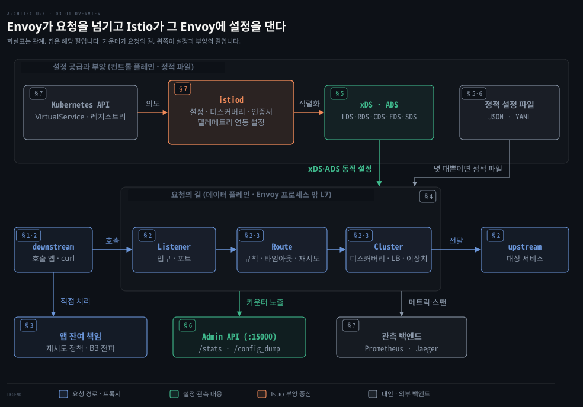
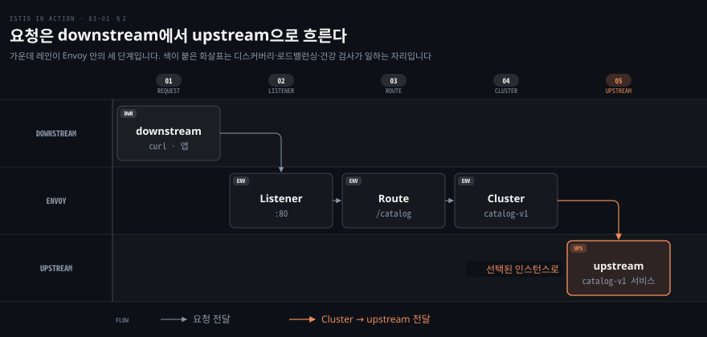
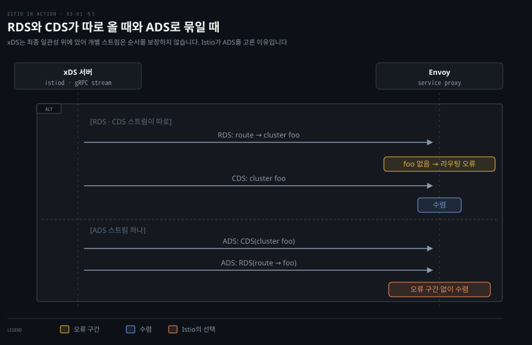
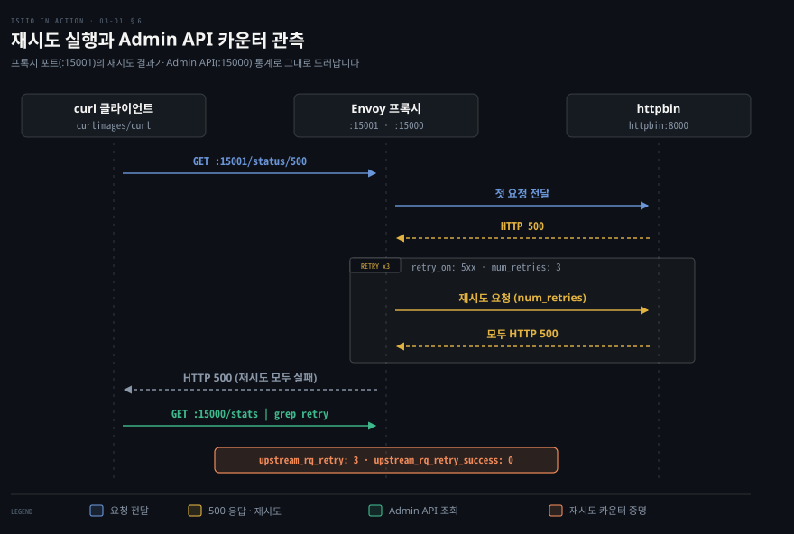
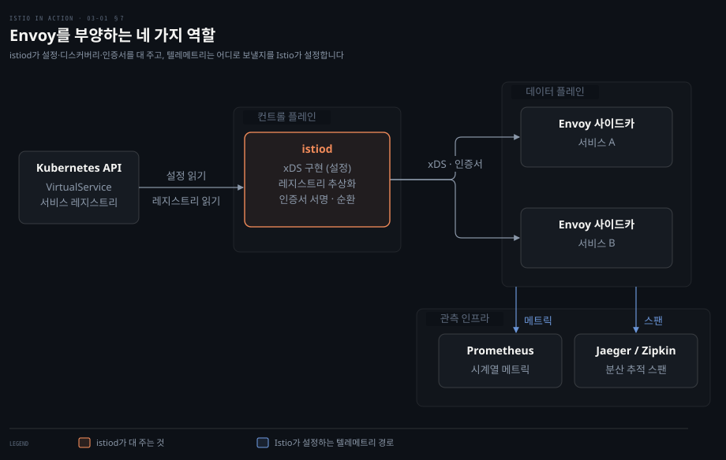

# Envoy가 맡는 일과 Istio가 보태는 일

---

> Istio 기능이라고 부르는 것 대부분은 실은 데이터 플레인 프록시인 Envoy가 수행합니다. Istio는 그 Envoy 여러 대에 설정·인증서·디스커버리를 대 주는 컨트롤 플레인입니다.


## 핵심 요약

> Istio 기능의 대부분은 Envoy가 실행하고, Istio는 그 Envoy 무리에 설정·디스커버리·인증서를 대 주는 컨트롤 플레인입니다. L7 프로토콜을 이해하는 프록시에 요청 처리와 관측을 맡기고, 정적 파일 대신 xDS 스트림으로 대량의 프록시를 재시작 없이 제어합니다.

이 문서에 처음 나오는 말을 먼저 풉니다.

- 데이터 플레인: 요청을 실제로 나르는 프록시 계층입니다. 컨트롤 플레인은 그 프록시에 설정을 대 주는 계층입니다.
- downstream·upstream: 요청을 보내는 쪽이 downstream이고 받는 쪽이 upstream입니다.
- xDS: 설정을 gRPC 스트림으로 내려보내는 동적 설정 API 묶음입니다. ADS는 모든 설정 변경을 스트림 하나에 순서대로 싣는 방식입니다.
- `istiod`: Istio의 컨트롤 플레인 프로세스입니다.

프록시가 클라이언트와 서버 사이에 서면 엔드포인트(서비스 인스턴스의 주소) 은닉과 로드밸런싱이 가능합니다. HTTP·gRPC 같은 L7 프로토콜을 이해하면 요청 단위 타임아웃·재시도·서킷 브레이킹을 애플리케이션 밖으로 옮길 수 있습니다. 서킷 브레이킹은 장애 난 대상으로 가는 요청을 끊어 연쇄 장애를 막는 일입니다.

이 기능은 Listener·Route·Cluster 세 요소의 설정으로 동작합니다. 실제 적용 상태와 재시도 여부는 Admin API(프록시 내부 상태를 보여 주는 관리 포트)로 관측합니다. 프록시 수가 늘어나면 정적 파일 대신 xDS로 설정을 내려보내는 컨트롤 플레인이 필요합니다.


## 학습 목표

이 내용을 읽고 나면:

1. Envoy가 만들어진 두 원칙을 말하고 L3/L4 프록시와 무엇이 다른지 설명할 수 있습니다.
2. 요청이 Listener·Route·Cluster를 지나 downstream에서 upstream으로 흐르는 경로를 그릴 수 있습니다.
3. Envoy가 맡는 기능과 여전히 애플리케이션 책임으로 남는 부분을 갈라 말할 수 있습니다.
4. xDS 여섯 API의 역할과 ADS가 필요한 이유를 순서 경쟁 사례로 설명할 수 있습니다.
5. Admin API의 `/stats`로 재시도가 실제로 일어났는지 확인할 수 있습니다.

아래 그림은 요청 경로와 설정 공급 경로가 Envoy 안에서 만나는 구조를 한 장에 담았습니다. 요청은 downstream에서 Listener·Route·Cluster를 거쳐 upstream으로 흐릅니다. 설정은 정적 파일이나 `istiod`의 xDS·ADS 스트림에서 내려옵니다. §1~§4가 프록시 역할과 경계를, §5~§6이 설정과 Admin API 검증을, §7이 `istiod`의 부양 책임을 다룹니다.




## 요청의 길과 설정의 길

> 요청 한 건이 Envoy를 지나 upstream에 닿는 길과, 그 동작을 결정하는 설정이 프록시에 내려오는 길은 서로 다른 축으로 맞물립니다.

애플리케이션마다 네트워킹 코드와 설정을 직접 쥐면 언어가 달라질 때마다 같은 장애 대응을 다시 짜야 합니다. 반면 요청 전달은 데이터 플레인에, 설정과 인증서 공급은 컨트롤 플레인에 나누면 두 축이 독립적으로 움직입니다.

| 단계 | 주체 | 받치는 개념 | 절 |
|---|---|---|---|
| 1 프록시 개입과 위치 | Envoy (가장자리·공유·사이드카) | 프로세스 밖 L7 중개 | §1 |
| 2 요청 전달 | Envoy (downstream → upstream) | Listener · Route · Cluster | §2 |
| 3 기능 위임과 앱 잔여 책임 | Envoy / 애플리케이션 | L7 정책·재시도·B3 헤더 전파 | §3 |
| 4 프록시 선택 근거 | Envoy | C++ 무-GC·Wasm·동적 설정 | §4 |
| 5 설정 전달 | 정적 파일 / xDS·ADS 서버 | v3 gRPC 스트리밍·최종 일관성 | §5 |
| 6 동작·관측 검증 | Envoy (`:15001`, `:15000`) | 타임아웃 힌트·재시도·Admin API | §6 |
| 7 데이터 플레인 부양 | `istiod` / Istio | xDS·레지스트리 추상화·mTLS·텔레메트리 | §7 |

표에서 처음 나오는 말은 다음과 같습니다.

- 사이드카: 서비스 인스턴스 옆에 하나씩 붙어 도는 프록시입니다.
- 무-GC: 가비지 컬렉션 지연이 없다는 뜻입니다. Wasm은 WebAssembly로 필터를 덜 침습적으로 확장하는 방식입니다.
- 최종 일관성: 변경이 모든 곳에 한꺼번에 반영되지 않고 시간이 지나며 같은 상태로 맞춰지는 성질입니다.
- mTLS: 클라이언트와 서버가 서로 인증서를 확인하는 양방향 TLS입니다. 텔레메트리는 메트릭·스팬 같은 관측 데이터입니다.


## 이 문서가 다루지 않는 것

> 이 문서는 Envoy 단독 실행·정적 설정·Admin API와 xDS의 개념적 역할만 다룹니다. 각 기능의 Istio 설정 리소스(CRD)와 프로토콜 규격 세부사항은 해당 주제를 전담하는 장과 공식 문서로 넘깁니다.

- 메트릭 수집의 세부와 Prometheus 연동 → [미리 정하지 않았던 것을 나중에 세려면](07-01.%EB%AF%B8%EB%A6%AC%20%EC%A0%95%ED%95%98%EC%A7%80%20%EC%95%8A%EC%95%98%EB%8D%98%20%EA%B2%83%EC%9D%84%20%EB%82%98%EC%A4%91%EC%97%90%20%EC%84%B8%EB%A0%A4%EB%A9%B4.md)
- Envoy 필터 작성·Lua·Wasm 확장, 전역 rate limiting(공유 호출량 제한) 연동 → [Envoy를 새로 빌드하지 않으려고 낸 네 개의 문](14-01.Envoy%EB%A5%BC%20%EC%83%88%EB%A1%9C%20%EB%B9%8C%EB%93%9C%ED%95%98%EC%A7%80%20%EC%95%8A%EC%9C%BC%EB%A0%A4%EA%B3%A0%20%EB%82%B8%20%EB%84%A4%20%EA%B0%9C%EC%9D%98%20%EB%AC%B8.md)
- 클러스터 진입 게이트웨이 → [문을 여는 일과 길을 내는 일을 가른다](04-01.%EB%AC%B8%EC%9D%84%20%EC%97%AC%EB%8A%94%20%EC%9D%BC%EA%B3%BC%20%EA%B8%B8%EC%9D%84%20%EB%82%B4%EB%8A%94%20%EC%9D%BC%EC%9D%84%20%EA%B0%80%EB%A5%B8%EB%8B%A4.md)
- xDS 프로토콜 자체의 규격 → [Envoy xDS 프로토콜 문서](https://www.envoyproxy.io/docs/envoy/latest/api-docs/xds_protocol)

xDS는 "정적 설정을 누가 대신 내려보내는가"라는 질문에 답하는 범위까지만 다룹니다.


## 1. 프록시가 가운데 서면 무엇이 가능해지는가

> 애플리케이션이 호스트·포트·재시도를 직접 쥐면 언어가 바뀔 때마다 네트워킹 코드를 다시 짜야 합니다. 프로세스 밖에서 L7을 이해하는 Envoy가 가운데 서면 이 책임을 인프라로 옮기면서 문제 원인도 드러낼 수 있습니다.

흐름 위치: 1 프록시 개입과 위치 · 받치는 개념 — 프로세스 밖 L7 중개

분산 시스템에서는 서비스가 여러 인스턴스로 늘고 줄며 간헐적인 네트워크 지연과 오류가 겹칩니다. 이 문제를 각 애플리케이션 코드가 직접 풀면 언어와 프레임워크마다 구현이 갈리고 운영 추적도 어려워집니다. Envoy는 Lyft가 이 애플리케이션 네트워킹 문제를 풀려고 만들었습니다. 2016년 9월 오픈소스로 공개한 뒤 2017년 9월 CNCF(클라우드 네이티브 재단)에 합류했습니다. 구현 언어로 C++을 택한 이유는 성능뿐 아니라 높은 부하에서도 가비지 컬렉션 지연 없이 안정적이고 결정적으로 동작하게 하려는 것입니다.

Envoy가 만들어진 두 원칙은 다음과 같습니다.

> 네트워크는 애플리케이션에 투명해야 합니다. 네트워크와 애플리케이션 문제가 발생했을 때 원인을 찾기 쉬워야 합니다.
>
> — Envoy 발표문

첫 문장은 네트워킹을 애플리케이션 밖 인프라로 밀어낸다는 뜻이고, 두 번째 문장은 거기에 관측성을 보태는 축입니다. 네트워크를 투명하게 감추기만 하면 장애가 났을 때 원인을 찾기가 더 막막해집니다. 그래서 Envoy는 감추는 동시에 텔레메트리와 Admin API로 속을 드러냅니다.

프록시 자체는 클라이언트와 서버 사이에 놓인 중개자입니다. 가운데 위치 덕분에 보안·프라이버시·정책을 얹을 수 있습니다. 무엇보다 클라이언트가 알아야 할 것을 줄여 줍니다. 서비스가 동일한 인스턴스 여러 개로 떠 있어도 클라이언트는 어느 IP를 불러야 할지 몰라도 됩니다. 프록시가 단일 식별자로 서서 인스턴스 사이에 부하를 나누고 건강 검사로 고장 난 인스턴스를 비켜 갑니다.

Envoy가 일반 리버스 프록시와 갈리는 지점은 애플리케이션 계층(L7)을 이해한다는 점입니다. HTTP 1.1·HTTP 2·gRPC를 기본으로 알아들어 요청 단위 타임아웃, 재시도, 재시도별 타임아웃, 서킷 브레이킹을 붙일 수 있습니다. 커넥션만 아는 L3/L4 프록시는 요청 경계를 모르므로 이런 일을 할 수 없습니다. 필터를 더 쓰면 MongoDB·DynamoDB·AMQP(메시지 큐 프로토콜) 같은 프로토콜도 이해합니다.

프로세스 밖에서 돌기 때문에 언어와 프레임워크를 가리지 않습니다. 마이크로서비스뿐 아니라 모놀리스나 레거시 애플리케이션도 Envoy가 아는 프로토콜로 말하기만 하면 이 기능을 얻습니다.

배포 역할은 셋으로 나뉩니다.

- 클러스터 가장자리의 프록시: 클러스터 바깥 요청이 처음 들어오는 진입점(ingress)
- 호스트 하나 또는 서비스 묶음이 공유하는 프록시
- 서비스 인스턴스마다 하나씩 붙는 프록시: Istio의 사이드카

Istio는 유연성·성능·제어를 최대로 얻으려고 세 번째를 택했습니다. 사이드카를 쓴다고 가장자리까지 다른 프록시 구현을 둘 필요는 없습니다. 가장자리와 사이드카가 같은 구현이면 운영과 추론이 쉬워지므로 Istio 게이트웨이([문을 여는 일과 길을 내는 일을 가른다](04-01.%EB%AC%B8%EC%9D%84%20%EC%97%AC%EB%8A%94%20%EC%9D%BC%EA%B3%BC%20%EA%B8%B8%EC%9D%84%20%EB%82%B4%EB%8A%94%20%EC%9D%BC%EC%9D%84%20%EA%B0%80%EB%A5%B8%EB%8B%A4.md))도 Envoy 위에 놓입니다.


## 2. 요청이 Envoy를 지나는 길

> Envoy에서 L7 트래픽을 다루려면 요청이 들어오는 입구, 경로를 가르는 규칙, 나가는 목적지 묶음을 세 개념으로 분리해 다뤄야 합니다. downstream에서 온 요청은 Listener·Route·Cluster를 차례로 거쳐 upstream으로 전달됩니다.

흐름 위치: 2 요청 전달 · 받치는 개념 — Listener · Route · Cluster

배포 위치를 정했으면 다음은 프록시 안에서 요청이 지나는 구조입니다. 요청이 들어오는 입구, 경로를 가르는 규칙, 나가는 대상을 한곳에 뒤섞으면 L7 정책을 독립적으로 바꿀 수 없습니다.



도식은 요청 하나가 지나는 자리를 세 레인으로 나눴습니다. 위 레인이 요청을 보내는 downstream, 가운데가 Envoy 안의 세 단계, 아래가 요청을 받는 upstream입니다. 트래픽은 downstream 시스템에서 리스너로 들어와 라우트를 거쳐 클러스터에 닿습니다. 클러스터가 그것을 upstream 시스템으로 보냅니다. 색이 붙은 마지막 화살표가 클러스터에서 upstream으로 넘어가는 지점입니다. 서비스 디스커버리·로드밸런싱·건강 검사는 이 화살표에 걸린 일입니다.

- **Listener**: 바깥 세상에 포트를 열어 애플리케이션이 접속하게 합니다. 포트 80의 리스너가 트래픽을 받아 설정된 동작을 적용하는 식입니다.
- **Route**: 리스너로 들어온 트래픽을 어떻게 다룰지 정하는 규칙입니다. `/catalog`에 매칭되면 catalog 클러스터로 보내는 식입니다. 리스너가 거느린 필터 체인 가운데 HTTP 요청을 다루는 필터 안에 라우트 규칙이 들어갑니다.
- **Cluster**: Envoy가 트래픽을 보낼 수 있는 upstream 서비스입니다. `catalog-v1`과 `catalog-v2`를 별개 클러스터로 두고 라우트가 둘 중 하나를 고릅니다.

이 세 단어가 Envoy 설정 파일의 뼈대가 됩니다. 각 필터와 라우팅의 세부 동작은 [Envoy를 새로 빌드하지 않으려고 낸 네 개의 문](14-01.Envoy%EB%A5%BC%20%EC%83%88%EB%A1%9C%20%EB%B9%8C%EB%93%9C%ED%95%98%EC%A7%80%20%EC%95%8A%EC%9C%BC%EB%A0%A4%EA%B3%A0%20%EB%82%B8%20%EB%84%A4%20%EA%B0%9C%EC%9D%98%20%EB%AC%B8.md)에서 다룹니다.


## 3. Envoy가 맡는 것과 앱에 남는 것

> 애플리케이션 네트워킹 기능을 Envoy로 옮겨도 재시도 정책 조정과 분산 추적 헤더 전파는 애플리케이션에 남습니다. 프록시가 볼 수 없는 비즈니스 실패 기준과 프로세스 내부 호출 맥락은 앱이 직접 이어 주어야 하기 때문입니다.

흐름 위치: 3 기능 위임과 앱 잔여 책임 · 받치는 개념 — L7 정책·재시도·B3 헤더 전파

요청이 지나는 길을 알았으니 그 길 위에서 Envoy가 맡는 기능과 앱에 남는 일을 가릅니다. 네트워킹을 프록시로 옮겼을 때 애플리케이션에서 무엇이 사라지고 무엇이 남는지를 기능 묶음별로 가르면 다음과 같습니다.

| 기능 묶음 | Envoy가 맡는 것 | 애플리케이션에 남는 것 |
|---|---|---|
| 서비스 디스커버리 | 단순 REST 디스커버리 API로 엔드포인트를 찾음. 서비스 레지스트리 도구인 Consul·ZooKeeper·Eureka를 감쌀 수 있고 Istio 컨트롤 플레인이 이 API를 구현 | 없음. 단, 카탈로그가 최종 일관성이라 가장 최신 상태를 알 수 없다는 전제를 받아들여야 함 |
| 로드밸런싱 | Random·Round robin·Weighted least request(처리 중인 요청이 적은 쪽에 가중)·Consistent hashing(같은 키는 같은 엔드포인트로, sticky). locality-aware로 같은 지역 안에 트래픽을 묶음 | 없음 |
| 라우팅 | 가상 호스트(호스트 이름별 규칙 묶음)·경로 접두사·헤더·우선순위 기반 라우팅, 라우팅용 재시도·타임아웃, 장애 주입(일부러 지연·오류를 넣는 시험) | 없음 |
| 트래픽 전환·섀도잉 | 가중치 기반 분할, 라이브 트래픽 복제를 응답을 기다리지 않는 fire-and-forget 방식으로 새 버전에 보냄 | 없음 |
| 네트워크 레질리언스 | 요청 타임아웃, 재시도별 타임아웃을 둔 재시도, 벌크헤드(커넥션과 처리 중 요청 수에 상한을 두고 넘으면 바로 실패시킴, jitter), 이상치 감지(오류를 반복하는 엔드포인트를 풀에서 뺌) | 파라미터 조정은 앱 책임. 재시도 증폭이 연쇄 장애로 가니 제한 필요. 앱 수준 재시도가 여전히 필요할 수 있음 |
| HTTP/2·gRPC | 1.1↔2 양방향 프록시, gRPC 네이티브 지원 | 없음 |
| 메트릭 | counter·gauge·histogram으로 downstream·서버·upstream 차원 추적. StatsD·Datadog(DogStatsD)·Hystrix 형식·generic metrics service로 내보냄 | 없음 |
| 분산 추적 | Zipkin·Jaeger·Datadog 같은 외부 트레이서 엔진에 스팬(호출 한 구간의 기록) 보고.[^envoy-tracing] `x-request-id` 생성, 추적 시작 시 `x-b3*` 초기 헤더 생성 | Zipkin B3 헤더 다섯 개를 다음 호출로 전파하는 일 |
| TLS | 가장자리와 메시 내부에서 종료, upstream으로 TLS 시작(origination, 앱 대신 TLS 연결을 맺음). mTLS까지 | 없음. 언어별 keystore·truststore 설정이 사라짐 |
| Rate limiting | 전역 rate-limiting 서비스와 네트워크(커넥션)·HTTP(요청) 두 수준에서 연동 | 없음. 전역 rate-limiting 서비스는 별도 인프라 |
| 확장 | C++ 필터를 컴파일해 넣거나 Lua·Wasm으로 덜 침습적으로 확장 | 없음. 필터·Lua·Wasm은 Envoy 쪽 확장 |

표에서 애플리케이션 책임이 명시된 행은 레질리언스와 분산 추적 둘뿐입니다. 이 둘이 "코드 변경 없이"라는 말의 예외입니다.

예를 들어 `retry_on: 5xx` 설정(§6에서 직접 확인합니다)처럼 Envoy는 응답 코드 같은 프로토콜 신호로 재시도 조건을 판별합니다. 그래서 비즈니스 의미로 실패한 200 응답은 Envoy가 알 수 없습니다.

분산 추적에서 Envoy는 내장 트레이서 클라이언트로 외부 트레이서 백엔드에 스팬을 보냅니다.[^envoy-tracing] 지원 목록에는 Zipkin·Jaeger·Datadog·SkyWalking·AWS X-Ray·Fluentd가 포함됩니다. `envoy.tracers.opentelemetry` 확장도 있습니다. 다만 2026-11-24 기준 공식 문서는 아직 프로덕션 용도가 아니라고 표시합니다.[^envoy-otel] 서비스 안에서 들어온 B3 헤더를 나가는 요청에 옮겨 적는 일은 여전히 애플리케이션 몫입니다. 전파할 다섯 헤더는 다음과 같습니다.

- `x-b3-traceid`
- `x-b3-spanid`
- `x-b3-parentspanid`
- `x-b3-sampled`
- `x-b3-flags`

자주 확인하는 대표 통계 여섯 가지는 다음과 같습니다. 이 중 `upstream_rq_retry`는 뒤의 Admin API 실습 출력에서 재시도 여부를 확인하는 지표로 다시 등장합니다.

| 통계 | 뜻 |
|---|---|
| `downstream_cx_total` | 총 커넥션 수 |
| `downstream_cx_http1_active` | 활성 HTTP/1.1 커넥션 수 |
| `downstream_rq_http2_total` | HTTP/2 요청 총수 |
| `cluster.<name>.upstream_cx_overflow` | 클러스터 커넥션 상한(서킷 브레이커)을 넘긴 횟수 |
| `cluster.<name>.upstream_rq_retry` | 요청 재시도 총수 |
| `cluster.<name>.ejections_detected_consecutive_5xx` | 연속 5xx로 감지된 엔드포인트 퇴출 수(실제 퇴출을 강제하지 않은 감지 포함) |


## 4. 다른 프록시와 견주면

> 기존 로드밸런서·웹 서버 기반 프록시는 클로즈드 소스이거나 발전 속도가 느려 마이크로서비스 간 통신 요구를 따라가기 어려웠습니다. Envoy는 처음부터 서비스 프록시를 목표로 설계돼 가비지 컬렉션 없는 C++ 성능, 양방향 HTTP/2, 동적 설정에서 앞섭니다.

흐름 위치: 4 프록시 선택 근거 · 받치는 개념 — C++ 무-GC·Wasm·동적 설정

Envoy가 맡는 일을 봤으니 왜 다른 프록시가 아니라 Envoy인지를 가릅니다. 기존 리버스 프록시 대부분은 웹 서버나 경계 로드밸런서에서 출발해 점차 기능을 키워 왔습니다. 반면 Envoy는 처음부터 서비스 프록시로 설계됐습니다. 서비스끼리 프록시를 거쳐 대화할 때 생기는 신뢰성과 관측성 문제를 직접 풉니다.

다른 프록시와 견주어 드러나는 Envoy의 강점은 일곱 가지입니다.

- WebAssembly 확장성: 필터를 컴파일해 넣지 않고 덜 침습적으로 확장합니다.
- 열린 커뮤니티
- 유지보수와 확장을 위해 모듈화된 코드베이스
- upstream·downstream 양쪽 HTTP/2 지원: HTTP/1.1과 HTTP/2 사이를 양방향으로 중개합니다.
- 깊은 프로토콜 메트릭 수집: 요청 단위 통계를 냅니다.
- C++ / 가비지 컬렉션 없음: 높은 부하에서도 지연이 덜 흔들립니다.
- 동적 설정, hot restart 불필요: 프로세스를 다시 띄우지 않고 설정을 바꿉니다.

마지막 항목인 동적 설정이 다음 절과 이어집니다. 설정을 바꿀 때 프로세스를 다시 띄우지 않아도 되는 성질이 xDS의 존재 이유입니다. 


## 5. 정적 설정과 xDS

> Envoy 설정은 JSON이나 YAML로 리스너·라우트·클러스터와 서버 옵션을 정의하며, 현재 공식 지원 버전은 gRPC 스트리밍 기반 v3입니다. 프록시 수가 늘어나면 정적 파일 대신 xDS, 특히 모든 변경을 한 스트림으로 직렬화하는 ADS로 설정 수렴 시간과 순서 경쟁을 함께 줄입니다.

흐름 위치: 5 설정 전달 · 받치는 개념 — v3 gRPC 스트리밍·최종 일관성

Envoy 인스턴스가 몇 대뿐이면 설정 파일 하나로도 충분하지만, 수백 대로 늘어나면 재시작 없이 설정을 밀어 넣는 API가 없으면 수렴이 지연됩니다.

### 정적 설정과 v3 문법

Envoy는 JSON 또는 YAML 설정 파일로 움직입니다. 파일에는 리스너·라우트·클러스터와 함께 Admin API 활성화 여부, 접근 로그 경로, 추적 엔진 같은 서버 설정이 들어갑니다.

설정 API에는 버전이 있습니다. 초기 v1과 v2는 폐기됐습니다. v2 xDS API 지원은 2021년 1분기에 종료됐습니다. 현재 공식 지원 버전은 v3뿐이며 Istio 역시 v3 API를 씁니다.[^envoy-v2]

v3 API는 gRPC 위에 놓여 있습니다. 스트리밍이 가능하므로 Envoy가 주기적으로 API를 폴링할 필요가 없습니다. 서버가 변경 사항을 바로 밀어 넣으니 프록시들이 올바른 설정으로 수렴하는 시간이 줄어듭니다. Envoy 수십, 수백 대를 관리할 때 이 차이가 커집니다.

Envoy는 `--mode validate` 로 설정이 읽히는지만 확인하고 종료할 수 있습니다. 이 절의 예제 세 개는 Envoy v1.19.0 이미지로 이 방식으로 확인했습니다. Istio 부트스트랩 예제는 `--service-node` 와 `--service-cluster` 도 함께 줘야 합니다.

```bash
docker run --rm -v "$PWD/static.yaml:/c.yaml:ro" envoyproxy/envoy:v1.19.0 envoy --mode validate -c /c.yaml
```

v3 문법에서 HTTP 커넥션 매니저는 `typed_config` 를 씁니다. 이름은 `envoy.filters.network.http_connection_manager` 입니다.[^envoy-v3-hcm] 클러스터 엔드포인트는 `hosts` 대신 `load_assignment` 로 씁니다.[^envoy-cluster]

```yaml
# 정적 설정 첫 예제 — 구조만. 리스너 하나, 라우트 하나, 클러스터 하나
static_resources:
  listeners:
  - name: httpbin-demo
    address:
      socket_address: { address: 0.0.0.0, port_value: 15001 }   # 15001 포트에 소켓
    filter_chains:
    - filters:
      - name: envoy.filters.network.http_connection_manager      # HTTP 필터
        typed_config:
          "@type": type.googleapis.com/envoy.extensions.filters.network.http_connection_manager.v3.HttpConnectionManager
          stat_prefix: egress_http
          route_config:
            name: httpbin_local_route
            virtual_hosts:
            - name: httpbin_local_service
              domains: ["*"]                                     # 모든 가상 호스트
              routes:
              - match: { prefix: "/" }
                route:
                  auto_host_rewrite: true
                  cluster: httpbin_service                       # 이 클러스터로
          http_filters:
          - name: envoy.filters.http.router
            typed_config:
              "@type": type.googleapis.com/envoy.extensions.filters.http.router.v3.Router
  clusters:
  - name: httpbin_service                                        # upstream 클러스터
    connect_timeout: 5s
    type: LOGICAL_DNS
    dns_lookup_family: V4_ONLY
    lb_policy: ROUND_ROBIN
    load_assignment:                                             # v2 의 hosts 대신
      cluster_name: httpbin
      endpoints:
      - lb_endpoints:
        - endpoint:
            address:
              socket_address: { address: httpbin, port_value: 8000 }
```

리스너가 15001 포트에 소켓을 열고 필터 체인을 붙입니다. 필터는 `http_connection_manager`에 라우팅 지시를 넣습니다. 가상 호스트 `*`에 매칭되는 모든 트래픽을 `httpbin_service` 클러스터로 보내는 규칙입니다. 클러스터는 엔드포인트 디스커버리로 `LOGICAL_DNS`, 로드밸런싱으로 `ROUND_ROBIN`을 씁니다.

클러스터 `type`은 엔드포인트를 찾는 방식입니다.

- `STATIC`: 설정에 적은 주소를 그대로 씁니다.
- `STRICT_DNS`: DNS 조회로 얻은 IP를 모두 엔드포인트로 봅니다.
- `LOGICAL_DNS`: 새 연결을 맺을 때 처음 반환된 IP만 씁니다.[^envoy-sd]

리스너·라우트·클러스터가 전부 파일에 적혀 있으니 완전 정적 설정입니다.

### 동적 설정과 xDS 여섯 API

Envoy는 부트스트랩 파일(처음 읽는 최소 설정 파일) 하나만 있으면 나머지 설정을 API로 받아 옵니다. 다운타임이나 재시작 없이 설정을 바꾸는 방법입니다. 이를 위한 API가 여섯입니다.

| API | 역할 | 관계 |
|---|---|---|
| LDS (Listener discovery service) | 이 프록시가 어떤 리스너를 열어야 하는지 조회 | |
| RDS (Route discovery service) | 리스너 설정 중 어떤 라우트를 쓸지 | LDS의 부분집합. 리스너 안의 라우트만 따로 갱신할 때 씀 |
| CDS (Cluster discovery service) | 어떤 클러스터를 어떤 설정으로 가질지 | |
| EDS (Endpoint discovery service) | 특정 클러스터가 어떤 엔드포인트를 쓸지 | CDS의 부분집합. 클러스터 안의 엔드포인트 목록만 따로 갱신할 때 씀 |
| SDS (Secret discovery service) | 인증서 배포 | |
| ADS (Aggregate discovery service) | 위 API들의 모든 변경을 직렬화한 스트림 하나 | 이 하나로 순서대로 다 받음 |

이 여섯을 묶어 xDS라고 부릅니다. 전부 쓸 필요는 없고 하나만 쓰거나 조합해도 됩니다.

리스너만 동적으로 받는 최소 예제는 어떤 API를 어디서 받을지와 그 API가 사는 클러스터 정의 두 조각으로 이뤄집니다. v3에서는 API 버전을 `V3`로 명시하고 `hosts` 대신 `load_assignment`를 씁니다.[^envoy-cluster]

```yaml
# LDS 최소 동적 설정 — 리스너는 API로 받고, API가 사는 클러스터만 정적으로
dynamic_resources:
  lds_config:                         # 리스너 설정을 LDS로
    resource_api_version: V3
    api_config_source:
      api_type: GRPC
      transport_api_version: V3
      grpc_services:
      - envoy_grpc:
          cluster_name: xds_cluster   # 이 클러스터에 LDS가 있다
static_resources:
  clusters:
  - name: xds_cluster                 # LDS를 구현한 gRPC 클러스터
    connect_timeout: 0.25s
    type: STATIC
    lb_policy: ROUND_ROBIN
    typed_extension_protocol_options: # HTTP/2 설정(gRPC 에 필요)
      envoy.extensions.upstreams.http.v3.HttpProtocolOptions:
        "@type": type.googleapis.com/envoy.extensions.upstreams.http.v3.HttpProtocolOptions
        explicit_http_config:
          http2_protocol_options: {}
    load_assignment:
      cluster_name: xds_cluster
      endpoints:
      - lb_endpoints:
        - endpoint:
            address:
              socket_address: { address: 127.0.0.3, port_value: 5678 }
```

리스너를 파일에 하나도 적지 않고 `xds_cluster` 하나만 정적으로 적었습니다. 리스너는 그 클러스터의 LDS API에서 런타임에 받아 옵니다. xDS를 써도 API가 어디 있는지만은 부트스트랩 파일에 정적으로 있어야 합니다.

### 도착 순서 경쟁과 ADS

xDS는 최종 일관성 위에 서 있습니다. 설정이 한꺼번에 적용되지 않고 리소스별로 따로 도착하므로, 개별 스트림으로 받으면 순서 경쟁이 생깁니다.



위 구간처럼 Envoy가 RDS로 새 라우트를 먼저 받을 수 있습니다. 이때 그 라우트가 가리키는 클러스터 `foo`가 아직 CDS로 오지 않았으면 라우팅 오류가 납니다. ADS는 이 순서 경쟁 때문에 도입됐습니다. 모든 변경을 스트림 하나에 순서대로 실어 아래 구간처럼 클러스터를 먼저, 라우트를 뒤에 오게 합니다. Istio는 프록시 설정 변경에 ADS를 씁니다.

### Istio 부트스트랩 구조

Istio 1.5(2020-03)부터 Pilot·Galley·Citadel·사이드카 인젝터가 하던 일이 단일 바이너리 `istiod`로 합쳐졌습니다. 2026-11-24 기준 Istio 1.32 문서도 `istiod` 단일 구조를 유지합니다.[^istiod]

초기 컨트롤 플레인 컴포넌트 가운데 Mixer는 `istiod`에 합쳐지지 않았습니다.[^istiod] 2020년 3월 Istio 1.5에서는 Mixer를 거치지 않는 Telemetry v2가 기본값이 됐습니다. 같은 판에서 확장 모델도 WebAssembly로 Envoy 쪽과 합쳐졌습니다.[^istio-15] Mixer 자체는 2020년 11월 Istio 1.8에서 완전히 제거됐습니다.[^istio-18]

아래는 Istio 사이드카 부트스트랩의 구조를 v3 형식으로 옮긴 예입니다. ADS 서버 주소는 `istiod.istio-system`의 15012 포트입니다. Istio 문서가 프로덕션에 권하는 TLS·mTLS xDS 포트입니다.[^istio-ports] 사이드카마다 붙는 istio-agent가 Envoy에 설정과 인증서를 안전하게 전달합니다.[^istiod]

```yaml
# Istio 부트스트랩 구조 — 리스너·클러스터 모두 ADS로, ADS가 사는 곳만 정적으로
dynamic_resources:
  lds_config:
    resource_api_version: V3
    ads: {}                            # 리스너는 ADS로
  cds_config:
    resource_api_version: V3
    ads: {}                            # 클러스터도 ADS로
  ads_config:
    api_type: GRPC
    transport_api_version: V3
    grpc_services:
    - envoy_grpc:
        cluster_name: xds-grpc         # xds-grpc 클러스터에 ADS가 있다
    refresh_delay: 1.000s
static_resources:
  clusters:
  - name: xds-grpc                     # 그 클러스터의 정의
    type: STRICT_DNS
    connect_timeout: 10.000s
    load_assignment:
      cluster_name: xds-grpc
      endpoints:
      - lb_endpoints:
        - endpoint:
            address:
              socket_address:
                address: istiod.istio-system
                port_value: 15012      # TLS·mTLS xDS 포트
    circuit_breakers:                  # 컨트롤 플레인 연결의 신뢰성 설정
      thresholds:
      - max_connections: 100000
        max_pending_requests: 100000
        max_requests: 100000
      - priority: HIGH
        max_connections: 100000
        max_pending_requests: 100000
        max_requests: 100000
    typed_extension_protocol_options:
      envoy.extensions.upstreams.http.v3.HttpProtocolOptions:
        "@type": type.googleapis.com/envoy.extensions.upstreams.http.v3.HttpProtocolOptions
        explicit_http_config:
          http2_protocol_options: {}
```

`xds-grpc` 클러스터는 서킷 브레이커 상한(연결·대기 요청·요청)을 각각 10만으로 둡니다. 컨트롤 플레인 연결의 신뢰성을 위한 설정입니다.


## 6. 정적 설정으로 Envoy 띄우기

> Istio 없이 Docker에서 Envoy를 단독으로 띄워 보면 프록시가 요청에 붙이는 헤더와 Admin API 카운터를 직접 관찰할 수 있습니다. 이를 통해 Istio 없이도 Envoy 자체가 L7 타임아웃 힌트와 재시도를 수행한다는 사실을 확인합니다.

흐름 위치: 6 동작·관측 검증 · 받치는 개념 — 타임아웃 힌트·재시도·Admin API

동적 설정은 xDS 서버가 있어야 확인할 수 있습니다. 컨트롤 플레인 없이 Envoy 단독으로 L7 동작을 검증하지 못하면 Istio가 보태는 기능과 Envoy 자체 기능을 구분하기 어렵습니다. 그래서 실습은 정적 파일로 Envoy 하나만 띄웁니다.

### 컨테이너 띄우기와 v3 설정 실행

Envoy 동작을 독립 환경에서 검증하기 위해 세 Docker 이미지를 사용합니다.

```bash
docker pull envoyproxy/envoy:v1.19.0
docker pull curlimages/curl
docker pull citizenstig/httpbin
```

httpbin은 호출에 쓰인 헤더를 돌려주거나 지연·오류를 만들어 주는 서비스입니다. 실습은 httpbin을 먼저 띄우고 모든 트래픽을 httpbin으로 넘기는 Envoy를 띄운 뒤 curl로 Envoy를 호출하는 세 단계로 진행합니다.

```bash
docker run -d --name httpbin citizenstig/httpbin
docker run -it --rm --link httpbin curlimages/curl curl -X GET http://httpbin:8000/headers
```

```bash
{
  "headers": {
    "Accept": "*/*",
    "Host": "httpbin:8000",
    "User-Agent": "curl/7.80.0"
  }
}
```

Envoy는 설정 없이 띄우면 바로 종료합니다.

```bash
docker run -it --rm envoyproxy/envoy:v1.19.0 envoy
```

```bash
[2021-11-21 21:28:37.347][1][info][main] [source/server/server.cc:855] exiting
At least one of --config-path or --config-yaml or Options::configProto() should be non-empty
```

`envoy --help`에서 자주 쓰는 주요 플래그는 다음과 같습니다.

- `-c`: 설정 파일 경로를 전달합니다.
- `--service-zone`: 프록시가 배치된 가용 영역을 지정합니다.
- `--service-node`: 프록시에 고유 이름을 부여합니다.
- `--log-level`: 로그 상세도를 조절합니다.
- `--config-yaml`: 설정을 파일 경로가 아니라 문자열로 넘깁니다. 아래 실습은 `-c` 대신 이것을 씁니다.

실행에 쓰는 `ch3/simple.yaml`은 §5의 정적 설정 첫 예제와 같은 구조입니다. 실습 파일은 책 예제 저장소의 `ch3/`에 있습니다. 직접 만들 때는 15000 포트로 Admin API를 여는 `admin` 블록을 예제 맨 위에 더해 같은 경로에 저장합니다.

```yaml
# 정적 설정 첫 예제 맨 위에 더하는 Admin API 블록
admin:
  address:
    socket_address: { address: 0.0.0.0, port_value: 15000 }
```

파일을 통째로 `--config-yaml`에 넘겨 Envoy를 띄웁니다.

```bash
docker run --name proxy --link httpbin envoyproxy/envoy:v1.19.0 --config-yaml "$(cat ch3/simple.yaml)"
docker logs proxy
```

```bash
[2018-08-09 22:57:50.769][5][info][config] all dependencies initialized. starting workers
[2018-08-09 22:57:50.769][5][info][main] starting main dispatch loop
```

### 프록시 경유 요청과 생성 헤더

프록시가 15001 포트에서 리스닝하고 있으므로 이제 httpbin이 아니라 프록시를 부릅니다.

```bash
docker run -it --rm --link proxy curlimages/curl curl -X GET http://proxy:15001/headers
```

```bash
{
  "headers": {
    "Accept": "*/*",
    "Content-Length": "0",
    "Host": "httpbin",
    "User-Agent": "curl/7.80.0",
    "X-Envoy-Expected-Rq-Timeout-Ms": "15000",
    "X-Request-Id": "45f74d49-7933-4077-b315-c15183d1da90"
  }
}
```

요청은 httpbin에 닿았고 헤더 둘이 새로 생겼습니다. Envoy는 기본 라우팅만 켰는데도 요청 추적과 타임아웃 협조를 위한 값을 덧붙입니다.

- `X-Request-Id`: 클러스터 안에서, 그리고 요청이 여러 홉을 거칠 때 호출을 하나의 요청 흐름으로 묶어 추적하는 식별자입니다.
- `X-Envoy-Expected-Rq-Timeout-Ms`: 이 요청이 15,000ms 뒤에 타임아웃될 것이라는 힌트입니다. `15000`은 라우트 `timeout`을 따로 지정하지 않았을 때 Envoy가 적용하는 기본값 15초입니다.[^envoy-router]

두 번째 헤더가 필요한 이유는 타임아웃이 Envoy 혼자만의 결정으로 끝나지 않기 때문입니다. Envoy가 연결을 끊더라도 upstream이 이미 처리 중인 작업을 멈추지 않으면 자원이 샙니다. Envoy 문서는 이 헤더를 라우터가 요청 완료를 기대하는 시간이라고 정의합니다. upstream은 이 값을 읽어 처리 마감 시각(deadline)을 정하고 조기 종료할 수 있습니다.[^envoy-router]

라우트에 `timeout: 1s`를 더한 `simple_change_timeout.yaml`로 다시 띄우면 같은 호출의 헤더가 `1000`으로 바뀝니다. 설정 한 줄이 upstream에 전달되는 힌트까지 바꾼다는 확인입니다.

```yaml
- match: { prefix: "/" }
  route:
    auto_host_rewrite: true
    cluster: httpbin_service
    timeout: 1s
```

```bash
docker rm -f proxy
docker run --name proxy --link httpbin envoyproxy/envoy:v1.19.0 --config-yaml "$(cat ch3/simple_change_timeout.yaml)"
```

### Admin API와 재시도 관측

Admin API는 프록시가 어떻게 동작하는지, 메트릭과 설정이 무엇인지 보여 주는 15000번 포트 인터페이스입니다. 상태 변화가 실제 카운터로 어떻게 드러나는지 재시도 실습으로 확인합니다.

먼저 재시도를 켜기 전의 `/stats` 출력을 조회합니다.

```bash
docker run -it --rm --link proxy curlimages/curl curl -X GET http://proxy:15000/stats | grep retry
```

```bash
cluster.httpbin_service.retry_or_shadow_abandoned: 0
cluster.httpbin_service.upstream_rq_retry: 0
cluster.httpbin_service.upstream_rq_retry_overflow: 0
cluster.httpbin_service.upstream_rq_retry_success: 0
```

`/stats` 없이 루트를 부르면 엔드포인트 목록이 나옵니다. 주요 엔드포인트 일곱 가지는 다음과 같습니다.

| 엔드포인트 | 내용 |
|---|---|
| `/certs` | 머신의 인증서 |
| `/clusters` | 설정된 클러스터 |
| `/config_dump` | Envoy 설정 덤프 |
| `/listeners` | 설정된 리스너 |
| `/logging` | 로깅 설정 조회·변경 |
| `/stats` | Envoy 통계 |
| `/stats/prometheus` | Prometheus 형식의 통계 |

트러블슈팅에서는 이 인터페이스의 `:15000/config_dump`를 읽습니다. 전체 설정이 너무 길어 `istioctl proxy-config`로 필요한 부분만 걸러 봅니다([프록시는 다 알고 있고 사람은 못 읽는다](10-01.%ED%94%84%EB%A1%9D%EC%8B%9C%EB%8A%94%20%EB%8B%A4%20%EC%95%8C%EA%B3%A0%20%EC%9E%88%EA%B3%A0%20%EC%82%AC%EB%9E%8C%EC%9D%80%20%EB%AA%BB%20%EC%9D%BD%EB%8A%94%EB%8B%A4.md#4-13934줄을-네-칸으로-자른다)). 다만 `/logging`처럼 상태를 바꾸거나 서버를 종료하는 파괴적 작업과 민감 정보 노출 위험이 있습니다. Envoy 공식 문서는 Admin API 접근을 반드시 보안된 네트워크로만 허용하라고 명시합니다.[^envoy-admin]

이제 라우트에 재시도 정책을 붙여 같은 통계가 어떻게 바뀌는지 봅니다. 아래 그림은 프록시 포트(`:15001`)로 `/status/500` 요청을 보내 재시도를 유발하는 흐름입니다. 그다음 관리 포트(`:15000/stats`)에서 재시도 통계를 읽습니다.



재시도 정책을 붙인 `simple_retry.yaml`로 프록시를 다시 띄웁니다.

```yaml
- match: { prefix: "/" }
  route:
    auto_host_rewrite: true
    cluster: httpbin_service
    retry_policy:
      retry_on: 5xx        # 5xx 응답이면 재시도
      num_retries: 3       # 횟수
```

```bash
docker rm -f proxy
docker run --name proxy --link httpbin envoyproxy/envoy:v1.19.0 --config-yaml "$(cat ch3/simple_retry.yaml)"
```

httpbin의 `/status/500`은 항상 500을 반환합니다. 프록시를 통해 그 경로를 부르면 재시도가 모두 실패한 뒤 500 응답이 돌아옵니다.

```bash
docker run -it --rm --link proxy curlimages/curl curl -v http://proxy:15001/status/500
```

무슨 일이 있었는지 Admin API에 묻습니다.

```bash
docker run -it --rm --link proxy curlimages/curl curl -X GET http://proxy:15000/stats | grep retry
```

```bash
cluster.httpbin_service.retry.upstream_rq_500: 3
cluster.httpbin_service.retry.upstream_rq_5xx: 3
cluster.httpbin_service.retry_or_shadow_abandoned: 0
cluster.httpbin_service.upstream_rq_retry: 3
cluster.httpbin_service.upstream_rq_retry_overflow: 0
cluster.httpbin_service.upstream_rq_retry_success: 0
```

Envoy는 upstream에서 500을 받았고 `upstream_rq_retry: 3`이 말하듯 세 번 다시 시도했습니다. 세 번 다 500이라 `upstream_rq_retry_success`는 0입니다. 재시도가 일어났다는 사실을 애플리케이션 코드 한 줄 없이 프록시의 카운터로 확인했습니다.

정적 파일로는 이처럼 동작을 쉽게 추론할 수 있습니다. 그래도 Istio는 동적 설정을 씁니다. 저마다 복잡한 설정을 가진 Envoy 대군을 일일이 파일로 관리할 수 없기 때문입니다.


## 7. Envoy를 부양하는 것

> Envoy가 데이터 플레인 기능 대부분을 실행하더라도, 설정·디스커버리·인증서·텔레메트리 연동을 대는 컨트롤 플레인이 없으면 대규모로 동작할 수 없습니다. Istio에서는 istiod가 앞의 셋을 직접 제공하고, 데이터 플레인이 관측 백엔드로 데이터를 보내도록 설정합니다.

흐름 위치: 7 데이터 플레인 부양 · 받치는 개념 — xDS·레지스트리 추상화·mTLS·텔레메트리

Envoy는 Istio 기능의 대부분을 실제로 수행합니다. 하지만 사용자 설정·보안 정책·런타임 설정을 공급하는 부양 인프라 없이는 단독으로 메시를 이룰 수 없습니다. 이 역할을 컨트롤 플레인이 맡습니다. 데이터 플레인 안에서 Envoy와 함께 도는 지원 요소는 [사이드카를 이루는 넷과 VM이 받는 다섯 파일](a0-02.%EB%B6%80%EB%A1%9D%20%E2%80%94%20%EC%82%AC%EC%9D%B4%EB%93%9C%EC%B9%B4%EB%A5%BC%20%EC%9D%B4%EB%A3%A8%EB%8A%94%20%EB%84%B7%EA%B3%BC%20VM%20%EC%9D%B4%20%EB%B0%9B%EB%8A%94%20%EB%8B%A4%EC%84%AF%20%ED%8C%8C%EC%9D%BC.md)에서 다룹니다.



도식은 Istio가 Envoy를 부양하는 네 가지 역할을 한 장에 모았습니다. 색이 붙은 `istiod`가 설정·디스커버리·인증서 셋을 맡습니다. 넷째인 텔레메트리는 서비스 A·B의 Envoy가 Prometheus·Jaeger로 보내도록 컨트롤 플레인이 설정하는 경로입니다.

- **설정**: Envoy는 정적 파일로도, xDS로도 설정할 수 있습니다. Istio는 그 xDS API를 `istiod`에 구현했습니다. `istiod`는 Kubernetes API에서 Istio 설정을 읽어 프록시를 동적으로 설정합니다. 예를 들어 VirtualService(Istio의 라우팅 규칙 리소스)를 읽습니다.
- **디스커버리**: Envoy의 서비스 디스커버리는 서비스 레지스트리(서비스와 엔드포인트 목록을 모아 둔 곳)를 전제합니다. `istiod`는 이 API를 구현하면서 특정 레지스트리 구현을 Envoy에게서 감춥니다. Kubernetes 위에서는 Kubernetes의 서비스 레지스트리를 쓰며 Envoy는 그 사실을 모릅니다.
- **인증서**: Envoy가 TLS를 종료하고 시작하려면 인증서를 만들고 서명하고 순환하는 인프라가 있어야 합니다. `istiod`가 애플리케이션별 인증서를 배달해 서비스 간 mTLS를 세웁니다.

- **텔레메트리 연동**: Envoy가 내보내는 메트릭과 스팬은 수집 백엔드로 가야 하고, 어디로 보낼지는 컨트롤 플레인이 설정합니다. Istio는 데이터 플레인을 Prometheus 같은 시계열 시스템과 연동하고, 분산 추적 스팬은 Jaeger나 Zipkin으로 보내게 설정합니다.

Istio를 다루는 이후 문서에서는 Envoy를 Istio 서비스 프록시라고 부르며 Istio API로 제어합니다. 그래도 실제 데이터 플레인에서 동작하는 기능 대부분은 Envoy가 구현하고 실행합니다.


## 결정 치트시트

> 이 문서의 원리와 실습에서 끌어낸 Envoy 도입·설정·관측 판단 기준입니다.

| 상황 | 판단 | 근거 |
|---|---|---|
| 재시도·타임아웃을 Envoy로 옮기려 함 | 옮기되 앱 재시도 코드를 다 걷어내지 않음 | 파라미터 조정은 앱 책임이고 앱 수준 재시도가 여전히 필요할 수 있음 |
| 재시도를 켰더니 장애가 번짐 | 재시도 횟수·조건을 제한 | 재시도 증폭은 연쇄 장애로 이어짐 |
| 분산 추적이 서비스 경계에서 끊김 | `x-b3-*` 다섯 헤더 전파를 앱에서 점검 | Envoy는 스팬을 보내지만 헤더 전파는 앱 책임 |
| upstream이 이미 타임아웃된 요청을 계속 처리 | `X-Envoy-Expected-Rq-Timeout-Ms`로 deadline 구현 | Envoy가 힌트를 주고 끊는 일은 upstream이 함 |
| Envoy 몇 대를 손으로 관리 | 정적 설정으로 충분 | 추론하기 쉽고 파일이 곧 설정 |
| Envoy 대군을 재시작 없이 바꿔야 함 | xDS, 그중에서도 ADS | 순서 경쟁을 스트림 하나로 없앰. Istio의 선택 |
| 재시도가 실제로 일어났는지 모름 | Admin API `/stats`에서 `upstream_rq_retry` 확인 | 앱 로그가 아니라 프록시 카운터가 사실 |
| 프록시를 가장자리와 사이드카에 따로 두려 함 | 같은 구현으로 통일 | 운영과 추론이 쉬워짐. Istio 게이트웨이가 Envoy인 이유 |


## 적용 관점

> 이 문서를 읽고 실제로 바꿀 행동 하나를 규칙으로 잡습니다. Envoy가 대신할 수 없는 자리를 아는 채로 재시도를 옮기는 규칙입니다.

Envoy에 재시도를 켜는 PR에는 "앱 쪽 재시도 코드를 남기는 이유"를 한 줄 적습니다. 걷어낼 수 있으면 걷어내고, 못 걷어낸다면 Envoy가 볼 수 없는 실패 조건이 무엇인지 그 줄에 밝힙니다.

Spring 앱을 운영하는 관점에서 Envoy가 대신할 수 없는 두 자리가 드러납니다. 하나는 비즈니스 의미로 실패한 200 응답의 재시도입니다. `retry_on: 5xx`처럼 Envoy는 응답 코드 같은 프로토콜 신호로 재시도를 판단하므로 업무 오류 여부는 앱이 직접 판단해야 합니다.

다른 하나는 추적 헤더 전파입니다. Spring Boot는 OpenTelemetry와 Zipkin 계열 트레이서인 Brave를 자동 설정합니다.[^spring-tracing] 코드 대신 B3 전파 설정만 챙기면 됩니다. 어느 쪽이든 "코드 변경 없이"가 아니라 "앱이 무엇을 남기는지 아는 채로"가 정확한 표현입니다.


## 면접에서 받을 만한 질문
> 답을 먼저 떠올린 뒤 아래 정답 절을 펼칩니다.

1. Envoy와 Istio의 역할 분담을 한 줄로 정의하면 무엇입니까?
2. Envoy가 L3/L4 프록시와 갈리는 지점은 무엇이고, 그 차이가 무엇을 가능하게 합니까?
3. 요청 하나가 Envoy를 지나며 거치는 구성요소를 순서대로 짚고, 들어오는 쪽과 나가는 쪽을 무엇이라 부르는지 말해 보십시오.
4. xDS 리소스를 종류별로 따로 받으면 어떤 문제가 생기고, Istio는 그것을 어떻게 피합니까?
5. Envoy에 재시도를 맡기면 애플리케이션 재시도는 없애도 됩니까?
6. 정적 설정과 xDS 중 무엇을 씁니까?
7. Admin API는 무엇에 씁니까?


## 정답 (자답 후 펼치기)

> 위 면접 질문 7개에 먼저 자답한 뒤 읽으십시오. 자답 없이 먼저 읽으면 학습 효과가 0입니다. 질문 번호와 1:1로 대응합니다.

### 정답 1 — 한 줄 정의

"Envoy는 애플리케이션 프로세스 밖에서 L7을 이해하는 서비스 프록시이고, Istio는 그 Envoy 무리에 xDS로 설정과 인증서와 디스커버리를 대 주는 컨트롤 플레인입니다."

### 정답 2 — L3/L4 프록시와 갈리는 지점

Envoy가 L3/L4 프록시와 다른 점은 HTTP·gRPC를 이해한다는 점입니다. 그래서 요청 단위 타임아웃·재시도·서킷 브레이킹이 가능합니다.

### 정답 3 — 요청이 Envoy를 지나는 순서

요청은 downstream에서 Listener로 들어와 Route를 거쳐 Cluster에 닿고 upstream으로 나갑니다. 이 세 단어가 설정 파일의 뼈대입니다.

### 정답 4 — xDS 순서 경쟁과 ADS

xDS는 최종 일관성이라 RDS와 CDS가 따로 오면 순서 경쟁이 생깁니다. ADS는 그 변경을 스트림 하나로 직렬화합니다. Istio가 이것을 씁니다.

### 정답 5 — 앱 수준 재시도 유지 여부

그렇지 않습니다. 파라미터 조정은 앱 책임이고, 앱 수준 재시도가 여전히 필요할 수 있습니다. Envoy는 `5xx` 같은 응답 코드 신호로 재시도 여부를 판단하므로 비즈니스 의미의 실패는 알 수 없습니다. 반대로 재시도 증폭이 연쇄 장애를 만들 수 있어 제한도 함께 걸어야 합니다.

### 정답 6 — 정적 설정과 xDS 선택

파일 하나로 추론할 수 있는 규모면 정적 설정이 쉽습니다. Istio처럼 Envoy 대군을 재시작 없이 관리해야 하면 xDS입니다. xDS를 쓰더라도 API가 어디 있는지만은 부트스트랩 파일에 정적으로 적어야 합니다.

### 정답 7 — Admin API는 무엇에 씁니까

프록시의 동작·메트릭·설정을 들여다봅니다. `/stats`로 재시도 카운터를 확인하고, `/config_dump`로 실제 적용된 설정을 봅니다. 트러블슈팅이 이 엔드포인트 위에서 이뤄집니다.


## 핵심 개념 체크리스트

- [ ] Envoy의 두 원칙을 말하고 두 번째 원칙이 왜 필요한지 설명할 수 있는가?
- [ ] Listener·Route·Cluster를 각각 한 문장으로 정의할 수 있는가?
- [ ] downstream과 upstream이 무엇을 가리키는지 헷갈리지 않는가?
- [ ] "코드 변경 없이"의 예외 둘(재시도 파라미터와 앱 재시도, 추적 헤더 전파)을 들 수 있는가?
- [ ] xDS 여섯 API 중 부분집합 관계 둘(RDS⊂LDS, EDS⊂CDS)을 말할 수 있는가?
- [ ] ADS가 없을 때 생기는 순서 경쟁을 예로 들 수 있는가?
- [ ] `X-Envoy-Expected-Rq-Timeout-Ms`가 힌트인 이유와 upstream이 할 일을 말할 수 있는가?
- [ ] `upstream_rq_retry: 3`이 무엇을 증명하는지 설명할 수 있는가?
- [ ] Istio가 Envoy를 부양하는 네 가지 역할(설정·디스커버리·텔레메트리 연동·인증서)을 들 수 있는가?


## 관련 문서

- [서비스 메시는 무엇을 인프라로 밀어냈는가](01-01.%EC%84%9C%EB%B9%84%EC%8A%A4%20%EB%A9%94%EC%8B%9C%EB%8A%94%20%EB%AC%B4%EC%97%87%EC%9D%84%20%EC%9D%B8%ED%94%84%EB%9D%BC%EB%A1%9C%20%EB%B0%80%EC%96%B4%EB%83%88%EB%8A%94%EA%B0%80.md) — 라이브러리에서 프록시로 옮긴 결정. 이 문서는 그 프록시의 정체를 다룹니다
- [배포와 릴리스를 가르는 첫 실습](02-01.%EB%B0%B0%ED%8F%AC%EC%99%80%20%EB%A6%B4%EB%A6%AC%EC%8A%A4%EB%A5%BC%20%EA%B0%80%EB%A5%B4%EB%8A%94%20%EC%B2%AB%20%EC%8B%A4%EC%8A%B5.md) — `istiod`가 의도를 Envoy 설정으로 번역하는 장면. 이 문서는 그 번역의 목적지인 xDS를 다룹니다
- [프록시는 다 알고 있고 사람은 못 읽는다](10-01.%ED%94%84%EB%A1%9D%EC%8B%9C%EB%8A%94%20%EB%8B%A4%20%EC%95%8C%EA%B3%A0%20%EC%9E%88%EA%B3%A0%20%EC%82%AC%EB%9E%8C%EC%9D%80%20%EB%AA%BB%20%EC%9D%BD%EB%8A%94%EB%8B%A4.md) — `:15000/config_dump`와 `istioctl proxy-config` 트러블슈팅
- [Envoy xDS 프로토콜 문서](https://www.envoyproxy.io/docs/envoy/latest/api-docs/xds_protocol) — 이 문서가 개념으로 다룬 xDS의 규격


## 참고 자료

- 원본: 《Istio in Action》 3장 "Istio's data plane: The Envoy proxy" (Christian E. Posta·Rinor Maloku, Manning)
- [Envoy 공식 문서](https://www.envoyproxy.io/docs/envoy/latest/) — Envoy v3 API 및 운영 레퍼런스 (2026-11-24 확인)
- [책 예제 소스 코드](https://github.com/istioinaction/book-source-code) — `ch3/simple.yaml` 등 실습 파일


[^envoy-v2]: Envoy — Supported API versions(2026-11-24 확인). "v2 xDS API. Support for this was removed in Q1 2021." <https://www.envoyproxy.io/docs/envoy/latest/api/api_supported_versions>
[^envoy-v3-hcm]: Envoy — `config.listener.v3.Filter`와 `HttpConnectionManager`(2026-11-24 확인). `typed_config`에 `envoy.filters.network.http_connection_manager`를 지정합니다. <https://www.envoyproxy.io/docs/envoy/latest/api-v3/config/listener/v3/listener_components.proto>
[^envoy-sd]: Envoy — Service discovery 개요(2026-11-24 확인). Static은 "The configuration explicitly specifies the resolved network name", Logical DNS는 "only uses the first IP address returned when a new connection needs to be initiated". <https://www.envoyproxy.io/docs/envoy/latest/intro/arch_overview/upstream/service_discovery>
[^istio-ports]: Istio — Requirements for Pods and Services의 istiod 포트 표(2026-11-24 확인). "15012 GRPC XDS and CA services (TLS and mTLS, recommended for production use)". <https://istio.io/latest/docs/ops/deployment/application-requirements/>
[^envoy-cluster]: Envoy — `config.cluster.v3.Cluster`의 `load_assignment` 필드(2026-11-24 확인). "Setting this is required for specifying members of STATIC, STRICT_DNS or LOGICAL_DNS clusters. … This field supersedes the hosts field in the v2 API." <https://www.envoyproxy.io/docs/envoy/latest/api-v3/config/cluster/v3/cluster.proto>
[^envoy-router]: Envoy — Router filter의 `x-envoy-expected-rq-timeout-ms`와 `RouteAction.timeout` 기본값 15s(2026-11-24 확인). "If not specified, the default is 15s." <https://www.envoyproxy.io/docs/envoy/latest/configuration/http/http_filters/router_filter> · <https://www.envoyproxy.io/docs/envoy/latest/api-v3/config/route/v3/route_components.proto>
[^istiod]: Istio 블로그 — "Introducing istiod: simplifying the control plane"(2020-03-19, 2026-11-24 확인). "istiod unifies functionality that Pilot, Galley, Citadel and the sidecar injector previously performed, into a single binary. A separate component, the istio-agent, helps each sidecar connect to the mesh by securely passing configuration and secrets to the Envoy proxies." <https://istio.io/latest/blog/2020/istiod/>
[^envoy-tracing]: Envoy — Tracing 아키텍처 개요(2026-11-24 확인). 외부 트레이서 목록(Zipkin, Jaeger, Datadog, SkyWalking, AWS X-Ray, Fluentd)과 B3 HTTP 헤더 5종 전파 조건. <https://www.envoyproxy.io/docs/envoy/latest/intro/arch_overview/observability/tracing>
[^envoy-otel]: Envoy — `config.trace.v3.OpenTelemetryConfig`(`envoy.tracers.opentelemetry`, 2026-11-24 확인). "This extension is work-in-progress. Functionality is incomplete and it is not intended for production use." <https://www.envoyproxy.io/docs/envoy/latest/api-v3/config/trace/v3/opentelemetry.proto>
[^envoy-admin]: Envoy — Administration interface(2026-11-24 확인). "It is critical that access to the administration interface is only allowed via a secure network." <https://www.envoyproxy.io/docs/envoy/latest/operations/admin>
[^spring-tracing]: Spring Boot — Actuator Tracing(2026-11-24 확인). "Spring Boot ships auto-configuration for the following tracers: OpenTelemetry with OTLP, OpenZipkin Brave with Zipkin." <https://docs.spring.io/spring-boot/reference/actuator/tracing.html>
[^istio-15]: Istio 1.5 릴리스 공지 — "Announcing Istio 1.5" (2020-03-05, 2026-11-27 확인). "a new model that unifies Istio’s extensibility model with Envoy’s, using WebAssembly (Wasm)", "eliminating the need for running a Mixer component separately", "Telemetry v2 is now used by default." <https://istio.io/latest/news/releases/1.5.x/announcing-1.5/>
[^istio-18]: Istio 1.8 릴리스 공지 — "Announcing Istio 1.8" (2020-11-19, 2026-11-27 확인). "the Mixer component, which is now removed in 1.8." <https://istio.io/latest/news/releases/1.8.x/announcing-1.8/>
