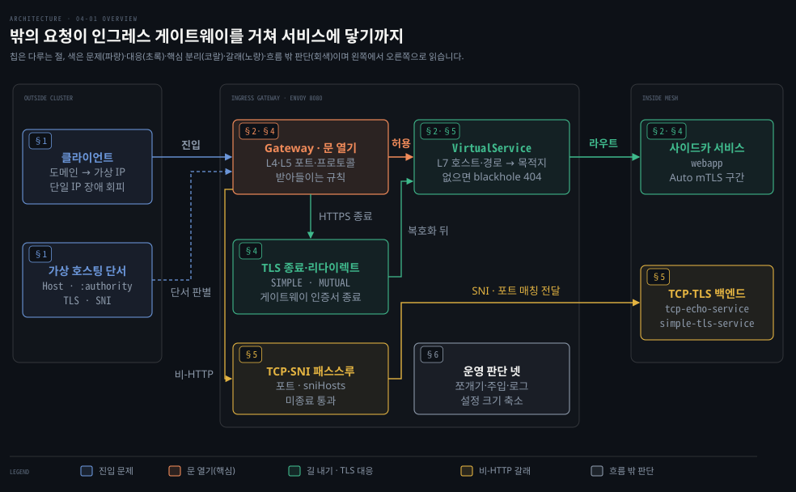
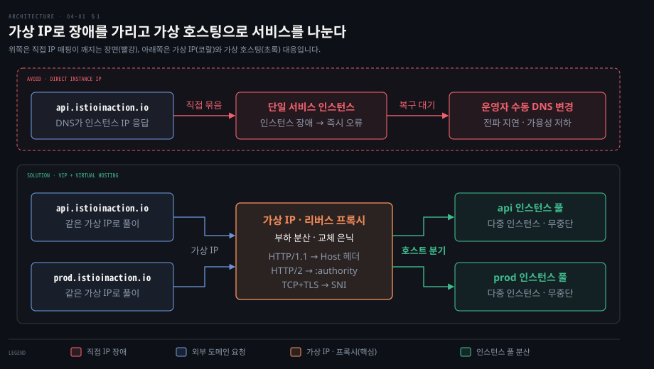
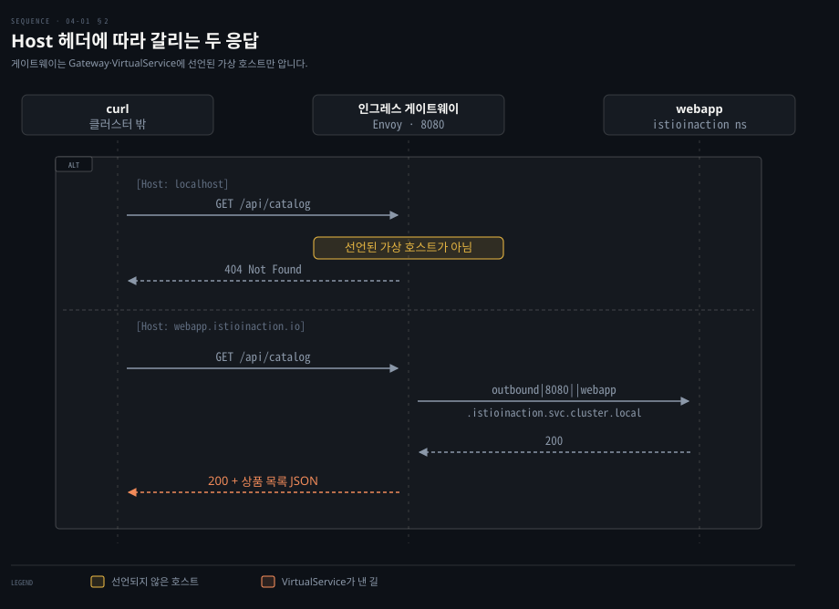
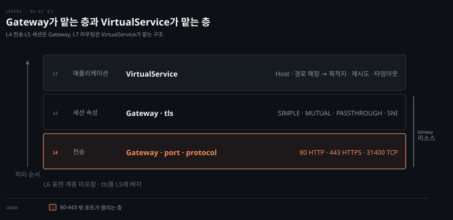
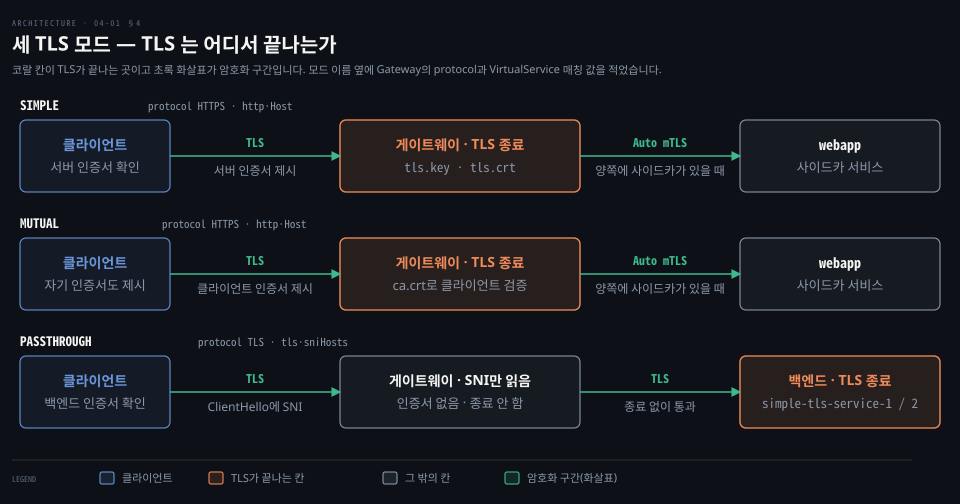
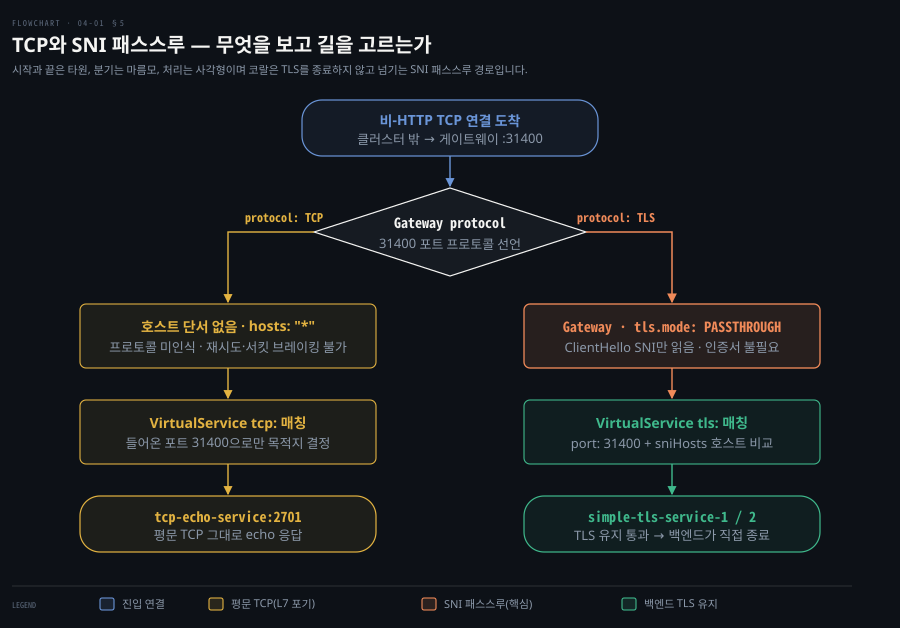

# 문을 여는 일과 길을 내는 일을 가른다

---

> 클러스터 밖의 클라이언트를 안의 서비스에 잇는 진입점에서 무엇을 받아들일지(Gateway)와 어디로 보낼지(VirtualService)를 다른 리소스로 가른 이유를 다룹니다. L4·L5와 L7의 분리 위에서 TLS 세 모드, TCP·SNI 패스스루, 게이트웨이 운영 판단까지 정리합니다.

《Istio in Action》 4장을 읽고 인그레스 게이트웨이의 설계 판단과 트래픽 진입 규칙을 정리한 정독 노트입니다.


## 핵심 요약

> 이 장 전체가 매달린 하나의 생각은 진입점에서 **L4·L5 속성**(포트·프로토콜·TLS)을 다루는 일과 **L7 라우팅**을 다루는 일을 서로 다른 리소스로 갈라야 한다는 것입니다. 문을 여는 Gateway와 길을 내는 VirtualService가 나뉘어야 80·443 밖의 포트와 여러 프로토콜을 벤더마다 다른 애노테이션 없이 다룰 수 있습니다.

클러스터 진입점은 가상 IP와 가상 호스팅이라는 오래된 두 장치 위에서 동작합니다. Istio 인그레스 게이트웨이는 Envoy 프록시 하나입니다.

Envoy는 [3장 노트](./03-01.Envoy가%20맡는%20일과%20Istio가%20보태는%20일.md)에서 다룬 L4·L7 프록시입니다. 서비스 Pod 옆에 붙는 사이드카와 달리 여기서는 클러스터 가장자리에 홀로 섭니다. 이 게이트웨이를 거친 요청이 닿는 서비스 집합, 곧 Istio가 사이드카로 묶어 관리하는 범위를 메시라고 부릅니다.

그 위에서 Gateway가 문을 열고 VirtualService가 길을 냅니다. 이 분리는 Kubernetes Ingress v1 명세의 한계 셋에서 나왔습니다. 뒤이어 TLS 세 모드와 TCP·SNI 패스스루, 게이트웨이 운영 판단 넷으로 이어집니다.


## 학습 목표

> 이 편을 읽고 나면 진입점 설계부터 TLS·TCP·운영 판단까지 다섯 가지를 설명하고 적용할 수 있습니다.

1. 가상 IP와 가상 호스팅이 푸는 문제와 프로토콜별 호스트 단서를 말할 수 있습니다.
2. Gateway와 VirtualService의 계층 책임과 Ingress v1 대신 새 리소스를 만든 근거 셋을 들 수 있습니다.
3. SIMPLE·MUTUAL·PASSTHROUGH 세 TLS 모드의 인증서 위치와 TLS 종료 지점을 비교할 수 있습니다.
4. 평문 TCP로 통과할 때 잃는 기능과 SNI 패스스루가 그 사이를 메우는 방식을 설명할 수 있습니다.
5. 게이트웨이 분리, 주입, 접근 로그, 설정 크기 축소까지 운영 판단 네 가지의 이유를 말할 수 있습니다.

아래 그림은 클러스터 밖 요청 한 건이 인그레스 게이트웨이를 거쳐 서비스에 닿기까지의 전체 줄기입니다. 파란 칸은 진입 앞단 문제를, 코랄 칸은 문 열기 핵심을, 초록 칸은 길 내기와 TLS 종료 대응을 뜻합니다. 노란 칸은 비-HTTP·SNI 패스스루 갈래이며 회색 칸은 흐름 밖의 운영 판단입니다.




## 밖의 요청이 서비스에 닿기까지

> 클러스터 밖 요청은 가상 IP와 가상 호스팅을 거쳐 Envoy 게이트웨이에 닿고, Gateway의 수락 검사와 VirtualService의 라우팅을 차례로 지나 서비스에 도착합니다.

Gateway만 만들고 VirtualService를 빠뜨리면 요청은 전부 404로 실패합니다. 밖의 요청이 서비스에 닿기까지의 네 단계와 각 단계가 기대는 개념을 표로 엮었습니다.

| 단계 | 누가 처리하는가 | 무엇을 하는가 | 받치는 개념 | 절 |
|---|---|---|---|---|
| 1 진입 | DNS · 리버스 프록시 | 도메인을 단일 가상 IP로 풀고 호스트 단서 추출 | 가상 IP · 가상 호스팅 | §1 |
| 2 문 열기 | 인그레스 게이트웨이 (`Gateway`) | 열 포트·프로토콜·허용 호스트·TLS 모드 검사 | L4·L5 수락 경계 | §2·§4 |
| 3 TLS 갈래 | Envoy 게이트웨이 또는 백엔드 | SIMPLE·MUTUAL은 게이트웨이 종료, PASSTHROUGH는 통과 | SNI · SDS | §4·§5 |
| 4 길 내기 | 인그레스 게이트웨이 (`VirtualService`) | 호스트·경로·포트·SNI로 목적지 서비스 결정 | L7 라우팅 · blackhole | §2·§5 |

§1이 클러스터 밖에서 진입점까지 오는 앞단을 다룹니다. §2는 Gateway와 VirtualService의 분업을 보이고, §3은 흐름 밖에서 대안과의 경계를 세웁니다.

§4는 문 열기에서 TLS 갈래로 이어지는 종료 방식을 가릅니다. §5는 TLS 갈래에서 길 내기로 이어지는 비-HTTP 경로(TCP 포트 매칭, SNI 패스스루)를 다룹니다. §6은 흐름 밖에서 게이트웨이를 여럿 띄우고 관측·설정 크기를 다스리는 기준을 정리합니다.


## 이 문서가 다루지 않는 것

> 이 노트는 인그레스 게이트웨이의 계층 분리와 트래픽 진입 원리에 집중합니다. 전체 리소스 필드 명세와 메시 내부·후속 장 주제는 공식 레퍼런스와 해당 장으로 넘깁니다.

- Gateway·VirtualService 전체 필드 명세 → [Istio Gateway 레퍼런스](https://istio.io/latest/docs/reference/config/networking/gateway/)
- 인증서 발급 자동화와 사설 PKI 통합 → [cert-manager 문서](https://cert-manager.io/docs)
- VirtualService 세부 라우팅 규칙 전체 → [5장 노트](./05-01.위험에%20노출되는%20트래픽을%20줄여%20가는%20순서.md)
- 메시 안 서비스 간 mTLS와 SPIFFE → [9장 노트](./09-01.거의%20안전한%20기본값을%20닫아%20가는%20순서.md) · [부록 C](./a0-03.부록%20%E2%80%94%20%EC%8B%A0%EC%9B%90%EC%9D%84%20%EB%AC%B8%EC%84%9C%EB%A1%9C%20%EB%A7%8C%EB%93%9C%EB%8A%94%20%EB%84%A4%20%EA%B7%9C%EA%B2%A9.md)
- `Sidecar` 리소스로 프록시 설정 줄이기 → [11장 노트](./11-01.컨트롤%20플레인의%20성능은%20낡은%20설정의%20수명이다.md)
- `pilot-agent`의 DNS 프록시 → [13장 노트](./13-01.자동으로%20되던%20일이%20목록이%20되어%20나타난다.md)


## 1. 진입점 앞의 두 장치

> 서비스 인스턴스 IP를 DNS에 직접 묶으면 인스턴스가 죽을 때마다 오류가 이어집니다. 가상 IP와 가상 호스팅이 진입점 앞단에서 이 취약점과 다중 서비스 수용 문제를 풉니다.

흐름 위치: 1 진입 · 받치는 개념 — 가상 IP·가상 호스팅

클러스터 안의 서비스끼리 대화하기 전에 밖의 요청이 먼저 닿아야 합니다. 상품을 사는 사용자나 API를 부르는 클라이언트는 모두 클러스터 밖에서 옵니다. 네트워크 커뮤니티는 이 자리를 **ingress point**라고 부릅니다. 밖에서 시작해 안의 엔드포인트로 향하는 트래픽이 먼저 닿는 문지기입니다. 허용 규칙에 맞으면 안의 엔드포인트로 프록시하고, 맞지 않으면 거절합니다.



위쪽 붉은 구간이 인스턴스 IP에 DNS를 직접 묶었을 때 깨지는 흐름입니다. 아래쪽이 가상 IP와 가상 호스팅의 대응입니다.

**가상 IP**는 단일 인스턴스 장애를 가립니다. `api.istioinaction.io`를 외부에 열려면 먼저 DNS가 그 이름을 IP로 풀어야 합니다. 그 IP를 서비스 인스턴스 하나에 직접 매핑하면 인스턴스가 죽는 순간 클라이언트는 오류를 봅니다. 운영자가 DNS를 다른 IP로 바꾸고 전파될 때까지 오류가 이어집니다. 이렇게 매번 DNS를 바꾸는 방식은 느리고 실수하기 쉬우며 가용성이 낮습니다.

그래서 이름은 서비스를 대표하는 가상 IP에 매핑합니다. 가상 IP는 리버스 프록시에 묶습니다. 리버스 프록시는 특정 인스턴스에 묶이지 않는 중개자라 뒤의 인스턴스가 바뀌어도 이름은 그대로입니다. 부하 분산도 여기서 처리합니다.

**가상 호스팅**은 가상 IP 하나에 호스트 이름 여러 개를 얹습니다. `prod.istioinaction.io`와 `api.istioinaction.io`가 같은 IP로 풀리면 같은 리버스 프록시가 요청을 받습니다. 프록시가 요청을 어느 서비스 묶음으로 보낼지 가르려면 프로토콜마다 다른 단서가 필요합니다.

| 프로토콜 | 호스트를 가르는 단서 |
|---|---|
| HTTP/1.1 | `Host` 헤더 |
| HTTP/2 | `:authority` 헤더 |
| TCP + TLS | ClientHello의 SNI(Server Name Indication) |

세 번째 줄의 SNI는 TLS 핸드셰이크 첫 메시지인 ClientHello에 클라이언트가 찾는 호스트 이름을 담는 TLS 확장입니다. 이 SNI가 TLS 다중 호스트 수용과 SNI 패스스루의 기반이 됩니다. Istio가 클러스터 가장자리에서 맡는 진입 기능은 이 가상 IP 라우팅과 가상 호스팅으로 트래픽을 클러스터 안으로 들입니다.


## 2. 문을 여는 일과 길을 내는 일

> Gateway가 문을 열기만 하면 모든 요청이 blackhole 404로 떨어지고, VirtualService를 붙여야 비로소 서비스로 길이 열립니다.

흐름 위치: 2 문 열기 → 4 길 내기 · 받치는 개념 — Gateway·VirtualService·Envoy

Istio 인그레스 게이트웨이는 네트워크 ingress point 역할을 맡는 Envoy 프록시 하나입니다. 3장에서 본 Envoy가 서비스 사이가 아니라 가장자리에 서 있을 뿐이라 Envoy의 기능이 게이트웨이에서도 그대로 동작합니다. 게이트웨이 Pod 안에서는 `pilot-agent`와 `envoy` 두 프로세스가 돕니다. `pilot-agent`가 Envoy를 띄우고 초기 설정을 넣어 주며, 13장에서 다루는 DNS 프록시 역할도 맡습니다. 데모 설치의 `istio-egressgateway`는 밖으로 나가는 트래픽을 맡는 쌍둥이이며 같은 리소스로 설정합니다.

트래픽을 들이는 두 리소스는 역할이 나뉩니다.

- **Gateway**: 어떤 포트를 열지, 어떤 프로토콜을 기대할지, 어떤 가상 호스트를 허용할지 정합니다.
- **VirtualService**: 들어온 트래픽을 메시 안 어느 서비스로 보낼지 정합니다.

### Gateway — 문을 여는 리소스

Gateway는 리스너가 열어 둘 포트·프로토콜·허용 호스트를 선언합니다. 아래는 80 포트에 HTTP로 `webapp.istioinaction.io` 하나를 여는 최소 Gateway 예제입니다.

```yaml
apiVersion: networking.istio.io/v1alpha3
kind: Gateway
metadata:
  name: coolstore-gateway
spec:
  selector:
    istio: ingressgateway
  servers:
  - port:
      number: 80
      name: http
      protocol: HTTP
    hosts:
    - "webapp.istioinaction.io"
```

`spec.selector`는 이 설정을 적용할 게이트웨이 Pod를 고릅니다. `servers[]`는 80 포트에서 `webapp.istioinaction.io`를 수락하도록 선언합니다. 이 리소스만 적용하고 `istioctl proxy-config listener` 명령(`istioctl`은 Istio의 명령줄 도구입니다)으로 보면 80이 아니라 8080 리스너가 열려 있습니다. 기본 `istio-ingressgateway` 컨테이너가 시스템 포트 80이 아니라 8080에서 듣기 때문입니다. 비특권 포트라 루트 권한이 필요 없고, 밖에서 보이는 80은 앞단의 Service나 로드밸런서가 받아 넘겨 주는 포트입니다.

게이트웨이 Pod는 클러스터 밖에 노출된 포트나 IP에서 받아야 하므로 클라우드에서는 `LoadBalancer` 타입 서비스가 필요합니다.

같은 방식으로 `istioctl proxy-config route --name http.8080`을 보면 `blackhole:80` 기본 라우트 하나뿐입니다. `blackhole`은 일치하는 목적지가 없어 모든 요청을 HTTP 404로 돌려보내는 라우트입니다. 문은 열렸지만 길이 없는 상태입니다.

### VirtualService — 길을 내는 리소스

VirtualService는 Gateway가 받아들인 요청을 실제 메시 안 서비스로 잇고, 재시도·요청 타임아웃 같은 라우팅 속성도 정합니다. 아래는 `coolstore-gateway`로 들어온 요청을 `webapp` 서비스의 8080 포트로 보내는 예제입니다.

```yaml
apiVersion: networking.istio.io/v1alpha3
kind: VirtualService
metadata:
  name: webapp-vs-from-gw
spec:
  hosts:
  - "webapp.istioinaction.io"
  gateways:
  - coolstore-gateway
  http:
  - route:
    - destination:
        host: webapp
        port:
          number: 8080
```

`spec.gateways`는 이 규칙을 적용할 Gateway 이름을 묶고 `destination`은 목적지를 가리킵니다. VirtualService를 적용한 뒤 같은 `route` 명령을 다시 실행하면 `blackhole:80` 대신 `webapp-vs-from-gw:80` 가상 호스트가 나타납니다. 이 가상 호스트가 도메인 `webapp.istioinaction.io`로 오는 요청에 Envoy 라우트를 만듭니다.

이 라우트의 목적지는 `outbound|8080||webapp.istioinaction.svc.cluster.local`이라는 이름의 Envoy 업스트림 클러스터, 곧 트래픽을 보낼 백엔드 엔드포인트 묶음입니다. 선언한 의도가 Envoy 설정으로 번역되는 과정이 게이트웨이에서도 똑같이 일어납니다.

### Host 헤더가 가르는 404와 200

Gateway와 VirtualService를 적용하고 `webapp`을 띄운 뒤에도 `Host` 헤더가 선언과 다르면 요청은 404로 실패합니다.



위 시퀀스는 같은 경로를 `Host` 헤더만 바꿔 두 번 부릅니다. `curl http://localhost/api/catalog`는 `Host: localhost`를 전송합니다. 게이트웨이도 VirtualService도 그 호스트를 모르므로 404가 반환됩니다. `-H "Host: webapp.istioinaction.io"`를 붙이면 라우트를 타고 `webapp`까지 닿아 200을 받습니다.


## 3. Kubernetes Ingress·API 게이트웨이와 견주면

> Kubernetes Ingress v1은 HTTP와 80·443 포트 중심의 얕은 명세라 벤더 애노테이션에 기대게 되므로, Istio는 L4·L5와 L7을 나눈 전용 리소스를 택했습니다.

흐름 위치: 흐름 밖 — 설계 경계와 대안 비교



위 계층도는 두 리소스의 책임 경계를 OSI 계층으로 쌓아 보입니다. 아래 두 층인 L4 전송과 L5 세션 속성이 Gateway 리소스 하나에 들어갑니다. 맨 위 L7 애플리케이션 라우팅이 VirtualService에 들어갑니다. 색이 붙은 맨 아래 L4 층이 80과 443 밖의 포트를 여는 자리입니다.

| 비교 기준 | Kubernetes Ingress v1 | Istio Gateway · VirtualService | API 게이트웨이 |
|---|---|---|---|
| 대상 포트·프로토콜 | HTTP · 80·443 중심 | 임의 포트 · HTTP·TLS·TCP | L7 API 중심 |
| 라우팅·확장 표현 | 구현별 비표준 애노테이션 | L4·L5와 L7을 나눈 전용 리소스 | 정책·변환·포털 내장 |
| 주된 역할 | 단순 HTTP 인그레스 | 메시 진입과 트래픽 라우팅 | 클라이언트 추상화·비즈니스 게이트 |

### Kubernetes Ingress v1의 한계 셋

Istio는 Kubernetes Ingress v1을 지원하지만 명세 자체에 세 가지 한계가 있습니다.

1. Ingress v1은 HTTP 워크로드를 겨냥한 단순한 명세라 고려하는 포트가 80과 443뿐입니다. Kafka나 NATS.io로 직접 TCP 연결을 열 수 없습니다.
2. 복잡한 라우팅 규칙, 트래픽 분할, 섀도잉(실제 요청을 복제해 다른 대상에도 보내 보는 방식)을 적는 공통 방법이 없어 HAProxy·Nginx 같은 구현마다 설정 방식이 갈립니다.
3. 빈자리를 벤더들이 고유 애노테이션으로 메웠습니다. 애노테이션은 이식되지 않습니다. Envoy의 기능을 모두 애노테이션으로 담으려면 개수가 훨씬 더 늘어납니다.

그래서 Istio는 백지에서 시작해 **L4 전송·L5 세션 속성을 L7 애플리케이션 라우팅에서 떼어 냈습니다.** Gateway가 L4·L5를 맡고 VirtualService가 L7을 맡습니다.

Kubernetes의 차기 표준인 **Gateway API**는 2026년 11월 기준 안정 버전으로 자리 잡았습니다[^gateway-api]. API 그룹은 `gateway.networking.k8s.io/v1`입니다. 안정 리소스는 `GatewayClass`·`Gateway`·`HTTPRoute`·`GRPCRoute`입니다. Istio도 이 API를 지원합니다. 장래에는 Gateway API를 트래픽 관리의 기본 API로 삼을 계획입니다[^istio-gwapi]. 이 노트가 다루는 Istio `Gateway`와 `VirtualService`는 그 전환 이전에 먼저 설계된 API입니다.

### API 게이트웨이와의 경계

API 게이트웨이는 서비스 묶음을 소비하는 클라이언트를 구현 세부에서 떼어 놓는 장치입니다. 그러려면 다음 네 가지 기능이 필요합니다.

- OIDC·OAuth 2.0·LDAP 같은 방식의 클라이언트 식별
- SOAP↔REST·gRPC↔REST, 본문·헤더 텍스트 변환 같은 메시지 변환
- 비즈니스 수준의 rate limiting
- 셀프 가입 또는 개발자 포털

Istio 인그레스 게이트웨이는 이것들을 기본으로 제공하지 않습니다. 저자는 이 역할이 필요하면 Envoy 위에 지은 Solo.io Gloo Edge 같은 API 게이트웨이를 보라고 권고합니다.


## 4. TLS 세 모드와 하나의 리다이렉트

> 밖에서 안으로 트래픽을 들일 때 게이트웨이는 서버 신원을 증명하고 통신을 암호화해야 하며, TLS 종료 위치와 클라이언트 검증 여부에 따라 세 모드가 갈립니다.

흐름 위치: 2 문 열기 → 3 TLS 갈래 · 받치는 개념 — SIMPLE·MUTUAL·PASSTHROUGH·SNI

외부 트래픽이 평문으로 들어오면 도청이나 중간자 공격을 막을 수 없습니다. Istio 게이트웨이는 네 가지로 이 문제를 다룹니다. TLS 종료는 들어오는 TLS를 게이트웨이에서 끝냅니다. 통과는 TLS를 풀지 않고 백엔드로 넘깁니다. 리다이렉트는 평문 요청을 TLS 포트로 돌려보냅니다. mTLS(양방향 TLS)는 클라이언트 인증서까지 확인합니다.



위 그림은 클라이언트에서 게이트웨이를 거쳐 백엔드까지 TLS가 어디서 끝나는지를 세 모드별로 보입니다. 코랄 칸이 TLS가 끝나는 곳이고, 초록 화살표가 암호화 구간입니다. 모드 이름 옆에는 Gateway의 `protocol`과 VirtualService가 매칭하는 값을 적었습니다. 이 절은 게이트웨이가 TLS를 종료하는 SIMPLE·리다이렉트·MUTUAL을 다룹니다. 종료 없이 넘기는 PASSTHROUGH는 비-HTTP 트래픽과 함께 5절에서 다룹니다.

### SIMPLE — 게이트웨이에서 TLS 종료

**SIMPLE**은 표준 단방향 TLS로 서버 인증서를 통해 중간자 공격(MITM)을 완화합니다. 인증서와 키를 Kubernetes secret으로 만들고 Gateway의 `tls.credentialName`으로 가리킵니다.

```yaml
apiVersion: networking.istio.io/v1alpha3
kind: Gateway
metadata:
  name: coolstore-gateway
spec:
  selector:
    istio: ingressgateway
  servers:
  - port:
      number: 443
      name: https
      protocol: HTTPS
    tls:
      mode: SIMPLE
      credentialName: webapp-credential
    hosts:
    - "webapp.istioinaction.io"
```

위 설정에서 `tls.mode: SIMPLE`이 게이트웨이 종료를 지정하고 `credentialName`이 TLS secret 이름을 가리킵니다. 인증서와 게이트웨이 배치에는 세 가지 제약과 권고가 따릅니다.

- Istio 1.13.0 기준으로 게이트웨이가 쓸 secret은 게이트웨이 Pod와 같은 네임스페이스에 있어야 했습니다. 1.32 문서에서는 이 조건을 직접 밝힌 문장을 찾지 못했습니다. 다만 1.32의 Secure Gateways 문서는 secret을 기본 게이트웨이가 도는 `istio-system`에 만들고, `credentialName`을 secret 이름과 같게 둡니다[^istio-secure-ingress].
- Kubernetes secret은 사실상 평문으로 저장되므로 비밀 저장소가 아닙니다. 저자는 키와 인증서에 더 안전한 저장 방식을 고려하라고 권고합니다.
- 프로덕션에서는 게이트웨이를 `istio-system`과 다른 네임스페이스에 배포하는 것이 보안 모범 사례입니다[^istio-gw-setup]. 게이트웨이를 옮기면 1.13.0 기준으로는 secret도 그 네임스페이스에 둬야 합니다.

SIMPLE 모드로 바꾼 게이트웨이를 `curl`로 부르면 두 번 실패한 뒤에야 성공합니다. 이 과정이 서버 인증서가 호스트 이름에 묶여 있음을 보여 줍니다.

```bash
# 1차 실패: 기본 CA 목록으로는 서버 인증서를 검증할 수 없다
curl -H "Host: webapp.istioinaction.io" https://localhost/api/catalog

# 2차 실패: CA 체인을 줘도 인증서는 webapp.istioinaction.io 용인데 localhost 를 불렀다
curl -H "Host: webapp.istioinaction.io" https://localhost/api/catalog \
  --cacert ch4/certs/2_intermediate/certs/ca-chain.cert.pem

# 성공: 이름은 인증서대로 부르고 실제 접속만 127.0.0.1 로 보낸다
curl -H "Host: webapp.istioinaction.io" \
  https://webapp.istioinaction.io:443/api/catalog \
  --cacert ch4/certs/2_intermediate/certs/ca-chain.cert.pem \
  --resolve webapp.istioinaction.io:443:127.0.0.1
```

첫 실패는 서버 인증서를 서명한 CA의 체인(`ca-chain.cert.pem`)이 curl의 기본 CA 목록에 없어서입니다. `--cacert`로 그 체인을 줘도 인증서가 `webapp.istioinaction.io`용인데 `localhost`를 불렀기 때문에 두 번째로 실패합니다. `--resolve`는 이름과 포트를 실제 IP에 묶어 이름은 인증서대로 부르게 합니다. 그러면 200 응답과 상품 목록 JSON을 받습니다.

게이트웨이가 외부 TLS를 종료한 뒤 메시 안의 `webapp`까지 가는 구간도 암호화됩니다. 양쪽 워크로드에 프록시가 있으면 Istio의 **Auto mutual TLS**가 동작해 별도 설정 없이 mTLS를 씁니다[^istio-authn]. 다만 메시 안 서비스 사이의 mTLS 수준을 정하는 `PeerAuthentication` 리소스의 기본 모드는 `PERMISSIVE`라 평문도 함께 받습니다[^istio-security]. 평문을 완전히 막는 `STRICT` 강제는 9장에서 다룹니다.

### HTTPS 리다이렉트 — 평문 80을 443으로

리다이렉트는 SIMPLE 설정 위에 80 포트 서버 블록 하나를 더한 형태입니다.

```yaml
  - port:
      number: 80
      name: http
      protocol: HTTP
    hosts:
    - "webapp.istioinaction.io"
    tls:
      httpsRedirect: true
```

80 포트에 `tls.httpsRedirect: true`를 두면 HTTP 요청에 `301 Moved Permanently`가 돌아옵니다. 응답의 `location` 헤더는 `https://…`를 가리킵니다[^istio-gateway]. 클라이언트가 HTTPS 포트로 옮겨 가도록 강제해 게이트웨이 진입 트래픽을 전부 암호화할 수 있습니다.

### MUTUAL — 클라이언트 인증서까지 검증

**MUTUAL**은 서버 증명 위에 클라이언트 검증을 더합니다. 클러스터가 외부 클라이언트의 신원을 먼저 확인하고 싶을 때 씁니다. 게이트웨이가 클라이언트 인증서를 검증하려면 CA 체인이 필요합니다. 그래서 `tls.key`·`tls.crt`에 `ca.crt`를 더한 generic secret을 만듭니다[^istio-secure-ingress]. `tls.mode: MUTUAL`로 바꾸면 위의 성공 명령(`--cacert`와 `--resolve`만 쓴 `curl`)은 `handshake failure`로 거절됩니다. 같은 명령에 `--cert`와 `--key`로 클라이언트 인증서를 함께 보내야 200이 옵니다.

게이트웨이는 `istio-agent`에 내장된 **SDS**(secret discovery service)로 인증서를 받습니다. `istio-agent`는 앞서 본 `pilot-agent`가 Envoy를 띄우는 그 에이전트를 가리키는 이름입니다. SDS는 Envoy가 설정을 동적으로 받는 xDS API 여섯 개(LDS·RDS·CDS·EDS·SDS·ADS) 중 하나이며 [3장 노트](./03-01.Envoy가%20맡는%20일과%20Istio가%20보태는%20일.md)에서 다룹니다. 동적 API라 인증서 갱신이 자동으로 전파됩니다. 그래도 새 인증서 설정이 반영되지 않으면 `istio-ingressgateway` Pod를 재시작해 확인합니다.

현재 Istio 1.32 Gateway 레퍼런스에는 SIMPLE·MUTUAL·PASSTHROUGH 외에 세 모드가 더 있습니다[^istio-gateway]. `AUTO_PASSTHROUGH`는 VirtualService 없이 SNI로 통과시킵니다. `ISTIO_MUTUAL`은 Istio가 발급한 인증서로 mTLS를 맺습니다. `OPTIONAL_MUTUAL`은 클라이언트 인증서를 요청하되 제출하지 않아도 연결을 허용합니다.

### SNI로 같은 443 포트에 여러 호스트 수용

같은 443 포트 위에 서로 다른 호스트와 인증서를 여럿 얹을 수 있습니다. 포트 번호와 `HTTPS` 프로토콜이 같은 `servers` 항목을 `port.name`만 달리해(예: `https-webapp`, `https-catalog`) 여러 개 둡니다. 각 항목이 자기 `credentialName`을 가리킵니다. 포트가 하나인데도 게이트웨이가 올바른 인증서를 내미는 이유는 TLS ClientHello의 SNI 때문입니다. 클라이언트가 핸드셰이크 첫 단계에서 찾으려는 호스트 이름을 먼저 밝히면 Envoy가 SNI를 보고 맞는 인증서와 서비스 라우트를 고릅니다.


## 5. TCP와 SNI 패스스루

> 평문 TCP를 게이트웨이로 통과시키면 호스트 단서가 없어 포트로만 라우팅하고 L7 기능을 잃지만, TLS 위의 TCP 서비스는 SNI 패스스루로 암호화를 유지한 채 라우팅할 수 있습니다.

흐름 위치: 3 TLS 갈래 → 4 길 내기 · 받치는 개념 — 포트 매칭·PASSTHROUGH

평문 TCP에는 `Host` 헤더가 없어 HTTP처럼 호스트별로 길을 나눌 수 없습니다. Istio 게이트웨이는 MongoDB 같은 데이터베이스나 Kafka 같은 메시지 큐처럼 TCP로 닿는 트래픽도 열 수 있습니다. 아래 흐름도는 31400 포트로 들어온 비-HTTP 연결이 Gateway의 `protocol` 선언에 따라 어떻게 갈리는지 보여 줍니다.



왼쪽 노란 갈래는 호스트 단서 없이 포트로만 목적지를 고르는 평문 TCP 경로입니다. 오른쪽 코랄·초록 갈래는 게이트웨이가 SNI만 읽고 TLS를 종료하지 않은 채 백엔드로 넘기는 패스스루 경로입니다.

### 평문 TCP 노출과 포트 매칭

평문 TCP로 다루면 재시도와 요청 수준 서킷 브레이킹 같은 복원력(레질리언스) 기능, 복잡한 L7 라우팅을 못 씁니다. Istio가 상위 애플리케이션 프로토콜을 모르기 때문입니다. MongoDB처럼 Istio가 인식하는 프로토콜만 예외입니다. 서킷 브레이킹은 장애가 난 백엔드로 가는 요청을 끊어 장애 확산을 막는 기능입니다.

Gateway 서버에 `protocol: TCP`와 열 포트(예제는 31400)를 적고 `hosts: "*"`를 둡니다. VirtualService는 `tcp:` 블록 아래에서 **들어온 포트로 매칭**해야 합니다. 1절 표대로 평문 TCP에는 호스트를 가를 단서가 없기 때문입니다. 31400 포트도 80·443처럼 NodePort나 클라우드 LoadBalancer로 노출해야 합니다. 텔넷으로 접속해 입력한 글자가 돌아오는 `tcp-echo-service`(2701 포트)로 동작을 확인합니다.

### SNI 패스스루로 TLS 유지 통과

**SNI 패스스루**는 4절의 SNI 판별과 TCP 통과를 합친 방식입니다. 게이트웨이가 TLS 트래픽을 종료하지 않고 ClientHello의 SNI 호스트 이름만 읽어 백엔드로 라우팅합니다. 연결은 게이트웨이를 그대로 통과하고 실제 백엔드 서비스가 TLS를 종료합니다. 따라서 게이트웨이에 인증서를 둘 필요가 없습니다.

Gateway 서버에는 `protocol: TLS`와 `tls.mode: PASSTHROUGH`를 두고 `hosts:`에 SNI 호스트를 적습니다. VirtualService는 `tls:` 블록 아래에서 포트와 `sniHosts`로 매칭합니다. 이 방식으로 TLS 위에서 도는 데이터베이스·메시지 큐·캐시나 TLS를 직접 종료하는 레거시 애플리케이션도 메시에 들일 수 있습니다. 같은 31400 포트에 `simple-tls-service-1`과 `simple-tls-service-2`를 함께 둘 수도 있습니다. 두 서비스는 인증서가 서로 달라서, 호스트 이름과 CA 체인을 바꿔 요청하면 각 백엔드로 갈라져 들어갑니다.


## 6. 운영에서 내리는 네 가지 판단

> 단일 인그레스 게이트웨이에 모든 팀과 로그, 전체 메시 설정이 몰리면 격리 실패·로깅 과부하·메모리 팽창이 생깁니다.

흐름 위치: 흐름 밖 — 게이트웨이 격리·주입·로그·설정 크기 운영

인그레스 게이트웨이는 사이드카가 아닌 독립 Envoy 배포이므로 분리·주입·관측·축소 네 가지를 판단해야 합니다.

| 판단 | 풀려는 문제 | 선택지·도구 | 대가·조건 |
|---|---|---|---|
| 게이트웨이 분리 | 성능·가용성·컴플라이언스·팀 소유권 격리 | `IstioOperator`로 `ingressGateways` 추가 | 게이트웨이마다 `LoadBalancer` 비용 발생 |
| 게이트웨이 주입 | `IstioOperator` 설치 변경 권한 분리 | 뼈대 `Deployment` + `gateway` 템플릿 주입 | `istio-sidecar-injector` 템플릿 확인 필요 |
| 접근 로그 선택 활성화 | default 프로필 비활성화·전체 로깅 과부하 | `telemetry.istio.io/v1` `Telemetry` 리소스 | 네임스페이스당 selector 없는 리소스 1개 제한 |
| 업스트림 클러스터 설정 축소 | `Sidecar` 리소스 미적용으로 인한 설정 팽창 | `PILOT_FILTER_GATEWAY_CLUSTER_CONFIG=true` | Istio 기본값 `false`라 명시적 활성화 필요 |

### 게이트웨이 책임 분리

단일 진입점 하나를 공유하면 한 팀의 설정 변경이나 트래픽 급증이 다른 서비스에 영향을 줍니다. 저자는 다음 네 사정이 있을 때 게이트웨이를 쪼개라고 권고합니다.

- 성능에 더 민감한 서비스
- 더 높은 가용성이 필요한 서비스
- 컴플라이언스 때문에 격리해야 하는 서비스
- 다른 팀에 영향 없이 자기 게이트웨이를 소유하고 싶은 팀

`IstioOperator`는 Istio 설치 구성을 선언하는 리소스입니다. 여기서 `profile: empty`(아무것도 설치하지 않는 빈 프로필)에 새 `ingressGateways` 항목만 켜면 게이트웨이를 따로 설치할 수 있습니다. 다만 새 게이트웨이도 밖으로 노출해야 하므로 퍼블릭 클라우드에서는 `LoadBalancer` 타입 서비스 하나마다 비용이 붙습니다.

### 게이트웨이 주입으로 권한 분리

`IstioOperator`를 만질 권한은 기존 Istio 설치 전체를 바꿀 수 있는 권한이라 개별 팀에 주면 위험합니다. 대신 **게이트웨이 주입**을 쓰면 뼈대만 있는 Deployment를 배포해 사이드카 주입과 같은 방식으로 Istio가 나머지를 채우게 할 수 있습니다.

```yaml
# 뼈대 Deployment 의 핵심 — 나머지는 Istio 가 채운다
template:
  metadata:
    annotations:
      inject.istio.io/templates: gateway    # 사이드카가 아니라 gateway 템플릿으로
    labels:
      istio: ingressgateway                 # Gateway 의 selector 가 이 라벨로 고른다
      sidecar.istio.io/inject: "true"       # 주입을 켠다
  spec:
    containers:
    - name: istio-proxy                     # 이름이 이래야 한다
      image: auto                           # 이미지는 Istio 가 채운다
```

Istio 1.32 기준 게이트웨이 주입은 애노테이션과 라벨을 나눕니다[^istio-gw-setup]. `metadata.annotations`에 `inject.istio.io/templates: gateway`를 둡니다. `metadata.labels`에는 `istio: ingressgateway`와 `sidecar.istio.io/inject: "true"`를 둡니다.

사용할 수 있는 템플릿 목록은 `istio-system`의 `istio-sidecar-injector` configmap에서 확인합니다. 이 뼈대를 담은 매니페스트는 Deployment와 함께 외부 노출용 Service, 게이트웨이가 TLS secret을 읽도록 하는 SDS용 Role·RoleBinding을 한 번에 배포합니다.

### Telemetry API로 접근 로그 선택 활성화

Istio는 설치 구성을 묶은 프로필을 제공합니다. 데모 프로필은 게이트웨이와 서비스 프록시가 접근 로그를 표준 출력에 찍습니다. 반면 프로덕션용 `default` 프로필에서는 꺼져 있습니다. 워크로드 수백·수천 개가 여러 홉을 거치는 트래픽을 모두 찍으면 로깅 시스템이 버틸 수 없기 때문입니다.

전체 로깅은 `meshConfig.accessLogFile=/dev/stdout`으로 켤 수 있습니다. 반면 필요한 워크로드만 골라 켜려면 **Telemetry API**(`telemetry.istio.io/v1`)를 씁니다[^istio-telemetry]. selector로 `app: istio-ingressgateway` 라벨을 고릅니다. 그다음 `accessLogging`에 `providers: envoy`와 `disabled: false`를 지정합니다.

Telemetry API를 포함한 Istio 설정은 적용 범위 셋과 우선순위를 따릅니다.

| 범위 | 어디에 두는가 | selector | 우선순위 |
|---|---|---|---|
| 메시 전체 | Istio 설치 네임스페이스(루트 네임스페이스) | 없음 | 가장 낮음 |
| 네임스페이스 전체 | 설정할 워크로드의 네임스페이스 | 없음 | 메시 전체를 덮음 |
| 워크로드 | 워크로드의 네임스페이스 | 있음 | 위 둘을 모두 덮음 |

네임스페이스마다 selector가 없는 `Telemetry` 리소스는 하나만 허용됩니다[^istio-telemetry]. Istio 1.13은 `prometheus`·`stackdriver`·`envoy` 셋을 기본 provider로 정의했습니다. 1.32의 Telemetry 작업 문서도 내장 `envoy` 접근 로그 provider를 말합니다[^istio-telemetry-logs]. 현재 기본 목록 전체는 확인하지 못했습니다. 커스텀 provider가 필요하면 메시 설정의 `ExtensionProvider` API로 정의합니다.

### 업스트림 클러스터 설정 범위 축소

Istio는 기본으로 모든 프록시가 메시의 모든 서비스를 알게 설정합니다. 서비스가 많아지면 데이터 플레인, 곧 트래픽을 나르는 프록시들의 설정이 커져 메모리·성능·확장성 문제가 생깁니다. 사이드카 쪽은 프록시가 알아야 할 서비스 범위를 좁히는 11장의 `Sidecar` 리소스로 설정을 줄입니다. 그러나 `Sidecar` 리소스는 게이트웨이에는 적용되지 않습니다. 새 게이트웨이는 라우팅 가능한 메시의 모든 서비스에 대한 Envoy 업스트림 클러스터를 받습니다.

게이트웨이용 해법은 `PILOT_FILTER_GATEWAY_CLUSTER_CONFIG` 플래그입니다. 이 플래그를 켜면 그 게이트웨이에 붙은 VirtualService가 실제로 참조하는 업스트림 클러스터만 프록시에 남깁니다. Istio `master` 소스의 기능 플래그 정의에서도 기본값은 `false`입니다[^istio-master-src]. 따라서 `IstioOperator`의 `pilot.k8s.env`(컨트롤 플레인 `istiod`에 넘기는 환경 변수)에서 명시적으로 `"true"`로 켜야 합니다.


## 결정 치트시트

> 4장에서 끌어낼 수 있는 판단 기준과 근거를 상황별로 압축한 표입니다.

| 상황 | 판단 | 근거 |
|---|---|---|
| 포트·프로토콜·TLS를 바꿔야 함 | Gateway 리소스 | Gateway가 L4·L5를 맡음 |
| 호스트·경로별로 보낼 곳을 바꿔야 함 | VirtualService | VirtualService가 L7을 맡음 |
| 문은 열렸는데 전부 404 | VirtualService와 `Host` 헤더 확인 | 기본 라우트는 blackhole, 게이트웨이는 선언된 호스트만 앎 |
| 80·443 밖 포트나 TCP를 열어야 함 | Istio Gateway | Ingress v1은 80·443과 HTTP만 고려 |
| 인증·메시지 변환·개발자 포털이 필요 | 별도 API 게이트웨이 | Istio 인그레스는 이것들을 기본으로 안 함 |
| 밖에서 오는 트래픽을 암호화 | `tls.mode: SIMPLE` + `httpsRedirect` | 서버 인증서로 MITM 완화, 301로 HTTPS로 유도 |
| 클라이언트가 누구인지 먼저 확인 | `tls.mode: MUTUAL` + `ca.crt` | 게이트웨이가 클라이언트 인증서를 검증 |
| 백엔드가 TLS를 직접 끝내야 함 (DB·MQ·레거시) | `tls.mode: PASSTHROUGH` + `sniHosts` | 게이트웨이는 SNI만 읽고 종료하지 않음 |
| 평문 TCP를 열어야 함 | `protocol: TCP` + 포트 매칭 | 프로토콜을 모르니 재시도·서킷 브레이킹은 포기 |
| 팀·컴플라이언스별로 진입점을 나눠야 함 | 게이트웨이 추가, 권한이 없으면 주입 | `IstioOperator` 권한은 설치를 바꿀 수 있음. LB 비용은 별도 |
| 프로덕션에서 접근 로그가 안 보임 | Telemetry API로 워크로드만 켬 | default 프로필은 로그 꺼짐, 전체 켜면 로깅 시스템이 버거움 |
| 게이트웨이 설정이 너무 큼 | `PILOT_FILTER_GATEWAY_CLUSTER_CONFIG` | `Sidecar` 리소스는 게이트웨이에 안 먹음 |


## 적용 관점

> 게이트웨이 변경 PR을 리뷰할 때 Gateway와 VirtualService를 따로 읽는 체크리스트를 적용합니다.

게이트웨이 PR을 볼 때는 두 질문을 순서대로 던집니다. 먼저 이 변경이 **무엇을 받아들이는가**(Gateway: 포트·프로토콜·호스트·TLS 모드)를 바꾸는지 봅니다. 이어서 **어디로 보내는가**(VirtualService: 호스트·경로·목적지)를 바꾸는지 봅니다. 한 PR이 둘을 동시에 바꾸면 왜 함께 바뀌어야 하는지 이유를 요구합니다.

Spring 앱 운영 관점에서 4장이 바꾸는 것은 TLS 종료 위치입니다. 게이트웨이가 SIMPLE로 TLS를 종료하면 앱의 keystore 설정이 필요 없어집니다. 게이트웨이와 앱 사이는 양쪽에 프록시가 있으면 Auto mutual TLS로 암호화됩니다. 평문을 막는 `STRICT` 강제는 9장의 `PeerAuthentication`이 맡습니다. 앱이 TLS를 직접 끝내야 하는 사정이 있으면 PASSTHROUGH를 택하고 keystore를 앱에 남깁니다.


## 면접에서 받을 만한 질문

> 답을 먼저 떠올린 뒤 아래 정답 절을 펼칩니다.

1. 이 장을 한 줄로 정의하면 무엇입니까?
2. Istio는 쿠버네티스 `Ingress` v1을 그대로 쓰지 않고 `Gateway`·`VirtualService`를 새로 만들었습니다. 그 이유를 드십시오.
3. 게이트웨이의 TLS 세 모드는 무엇을 기준으로 갈리며, 각각 어디에서 TLS가 끝납니까?
4. 프로덕션 `default` 프로필에서 접근 로그는 어떤 상태이며, 그것을 워크로드 하나에만 켜려면 어떻게 합니까?
5. Gateway를 만들었는데 요청이 전부 404입니다. 무엇부터 봅니까?
6. 같은 443 포트로 호스트 여러 개에 각각 다른 인증서를 내밀 수 있습니까?
7. 데이터베이스를 인그레스 게이트웨이로 노출하면 재시도·서킷 브레이킹 같은 복원력(레질리언스) 기능을 쓸 수 있습니까?


## 정답 (자답 후 펼치기)

> 위 §면접에서 받을 만한 질문 의 7 개에 *먼저 자답한 뒤* 읽으십시오. 자답 없이 먼저 읽으면 학습 효과가 0 입니다. 질문 번호와 1:1 로 대응합니다.

### 정답 1 — 한 줄 정의

"Istio 인그레스 게이트웨이는 사이드카가 아닌 Envoy 하나이고, Gateway 리소스가 포트·프로토콜·허용 호스트·TLS로 무엇을 받아들일지, VirtualService가 호스트·경로 매칭으로 어디로 보낼지를 정합니다."

### 정답 2 — 새 리소스를 만든 이유

Istio가 Ingress v1 대신 새 리소스를 만든 이유는 셋입니다. 80·443과 HTTP만 고려합니다. 명세가 덜 정해져 구현마다 다릅니다. 빈자리를 벤더 애노테이션이 메워 이식되지 않습니다.

### 정답 3 — TLS 세 모드의 구분 기준과 종료 지점

TLS 세 모드는 인증서 위치와 종료 지점으로 가릅니다. SIMPLE과 MUTUAL은 게이트웨이가 종료하고 MUTUAL은 `ca.crt`로 클라이언트까지 검증합니다. PASSTHROUGH는 SNI만 읽고 백엔드가 종료합니다.

### 정답 4 — default 프로필 접근 로그 켜기

프로덕션 default 프로필은 접근 로그가 꺼져 있습니다. Telemetry API로 워크로드 단위로 켭니다. 설정 범위는 메시 → 네임스페이스 → 워크로드 순으로 좁은 쪽이 이깁니다.

### 정답 5 — Gateway 생성 후 404 원인

게이트웨이의 기본 라우트가 blackhole이라 VirtualService가 없으면 404입니다. VirtualService가 있다면 `Host` 헤더입니다. 게이트웨이는 선언된 가상 호스트만 알아서, `Host: localhost`로 부르면 404가 납니다.

### 정답 6 — 443 포트 다중 호스트 인증서

됩니다. 같은 포트·같은 프로토콜의 서버 항목을 이름만 달리해 여러 개 두고 각자 `credentialName`을 가리킵니다. 어느 인증서를 내밀지는 TLS ClientHello의 SNI로 압니다. Envoy가 SNI를 구현하기 때문입니다.

### 정답 7 — DB 게이트웨이 노출과 복원력

평문 TCP로 다루면 못 씁니다. Istio가 프로토콜을 모르니 재시도·요청 수준 서킷 브레이킹·복잡한 라우팅이 빠집니다. MongoDB처럼 Istio가 아는 프로토콜이면 예외입니다. TLS 위의 DB라면 SNI 패스스루로 종료 없이 통과시키는 길이 있습니다.


## 핵심 개념 체크리스트

> 이 장의 핵심 원리와 운영 판단을 스스로 점검하는 질문입니다.

- [ ] 가상 IP를 인스턴스 IP 대신 쓰는 이유를 장애 상황으로 설명할 수 있는가?
- [ ] HTTP/1.1·HTTP/2·TCP+TLS에서 호스트를 가르는 단서 셋을 말할 수 있는가?
- [ ] Gateway와 VirtualService가 맡는 계층을 각각 말할 수 있는가?
- [ ] blackhole 라우트가 무엇이고 언제 사라지는지 설명할 수 있는가?
- [ ] 기본 인그레스 게이트웨이가 80이 아니라 8080에서 듣는 이유를 아는가?
- [ ] Ingress v1의 한계 셋을 들 수 있는가?
- [ ] SIMPLE·MUTUAL·PASSTHROUGH에서 TLS가 어디서 끝나는지 비교할 수 있는가?
- [ ] `--resolve`가 왜 필요했는지 인증서의 이름으로 설명할 수 있는가?
- [ ] 평문 TCP로 열 때 잃는 기능을 말할 수 있는가?
- [ ] 게이트웨이 주입이 `IstioOperator`보다 나은 상황을 말할 수 있는가?
- [ ] Istio 설정의 범위 셋과 우선순위를 말할 수 있는가?
- [ ] `Sidecar` 리소스가 게이트웨이에 안 먹을 때의 대안을 아는가?


## 관련 문서

- [Envoy가 맡는 일과 Istio가 보태는 일](03-01.Envoy가%20맡는%20일과%20Istio가%20보태는%20일.md) — 게이트웨이가 곧 3장의 Envoy입니다. SDS는 3장 xDS의 하나입니다.
- [배포와 릴리스를 가르는 첫 실습](02-01.배포와%20릴리스를%20가르는%20첫%20실습.md) — 의도가 Envoy 라우트로 번역되는 장면이 게이트웨이에서 되풀이됩니다.
- [Istio Gateway 레퍼런스](https://istio.io/latest/docs/reference/config/networking/gateway/) — 리소스 필드의 SSOT


## 참고 자료

- 원본: 《Istio in Action》 4장 "Istio gateways: Getting traffic into a cluster" (Christian E. Posta·Rinor Maloku, Manning)
- [책 예제 소스 코드](https://github.com/istioinaction/book-source-code) — `ch4/` 의 Gateway·VirtualService·인증서 파일
- [Kubernetes Gateway API](https://gateway-api.sigs.k8s.io) — Gateway API 공식 사이트
- [cert-manager](https://cert-manager.io/docs) — 인증서 워크플로 통합 도구

[^istio-gateway]: Istio 1.32(2026-11-24 확인) — Gateway 레퍼런스 `ServerTLSSettings.TLSmode`. SIMPLE·MUTUAL·PASSTHROUGH·AUTO_PASSTHROUGH·ISTIO_MUTUAL·OPTIONAL_MUTUAL 및 `httpsRedirect` 301 리다이렉트 명세. <https://istio.io/latest/docs/reference/config/networking/gateway/>
[^gateway-api]: Kubernetes 문서(2026-11-24 확인) — Gateway API. `gateway.networking.k8s.io/v1`의 안정 종류 GatewayClass·Gateway·HTTPRoute·GRPCRoute. <https://kubernetes.io/docs/concepts/services-networking/gateway/>
[^istio-gwapi]: Istio 1.32(2026-11-24 확인) — Kubernetes Gateway API 작업 문서. "Istio supports the Kubernetes Gateway API and intends to make it the default API for traffic management in the future." <https://istio.io/latest/docs/tasks/traffic-management/ingress/gateway-api/>
[^istio-authn]: Istio 1.32(2026-11-25 확인) — Authentication Policy 작업 문서 `Auto mutual TLS`. 프록시가 주입된 워크로드 사이 트래픽은 별도 설정 없이 mTLS로 전송됨. <https://istio.io/latest/docs/tasks/security/authentication/authn-policy/#auto-mutual-tls>
[^istio-security]: Istio 1.32(2026-11-25 확인) — Security 개념 문서 「Peer authentication」. "Mesh-wide peer authentication policies with an unset mode use the PERMISSIVE mode by default." <https://istio.io/latest/docs/concepts/security/>
[^istio-telemetry-logs]: Istio 1.32(2026-11-25 확인) — Configure access logs with Telemetry API 작업 문서. 내장 `envoy` 접근 로그 provider를 언급. <https://istio.io/latest/docs/tasks/observability/logs/telemetry-api/>
[^istio-telemetry]: Istio 1.32(2026-11-24 확인) — Telemetry 레퍼런스(`telemetry.istio.io/v1`). 워크로드 → 네임스페이스 → 루트 네임스페이스 순 적용, 네임스페이스당 selector 없는 리소스 하나. <https://istio.io/latest/docs/reference/config/telemetry/>
[^istio-master-src]: Istio 소스 `master` 브랜치 `pilot/pkg/features/experimental.go`(2026-11-24 확인) — `env.Register("PILOT_FILTER_GATEWAY_CLUSTER_CONFIG", false, "If enabled, Pilot will send only clusters that referenced in gateway virtual services attached to gateway")`. <https://github.com/istio/istio/blob/master/pilot/pkg/features/experimental.go>
[^istio-gw-setup]: Istio 1.32(2026-11-24 확인) — Installing Gateways. "As a security best practice, it is recommended to deploy the gateway in a different namespace from the control plane." 예제 YAML은 `inject.istio.io/templates: gateway` 애노테이션과 `istio: ingressgateway`·`sidecar.istio.io/inject: "true"` 라벨, `image: auto` 사용. <https://istio.io/latest/docs/setup/additional-setup/gateway/>
[^istio-secure-ingress]: Istio 1.32(2026-11-24 확인) — Secure Gateways 작업 문서. `kubectl create -n istio-system secret tls …`, `credentialName`은 secret 이름과 같아야 함, mTLS secret은 `tls.key`·`tls.crt`·`ca.crt`. <https://istio.io/latest/docs/tasks/traffic-management/ingress/secure-ingress/>
