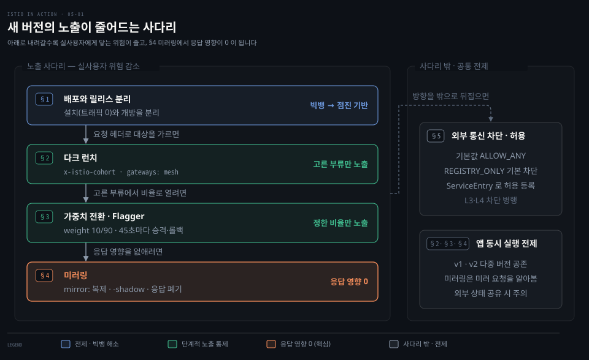
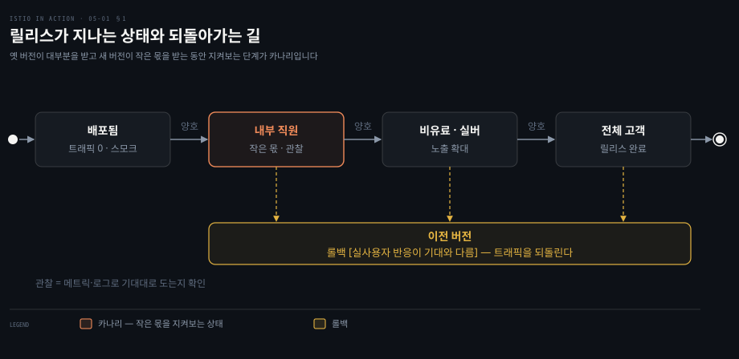
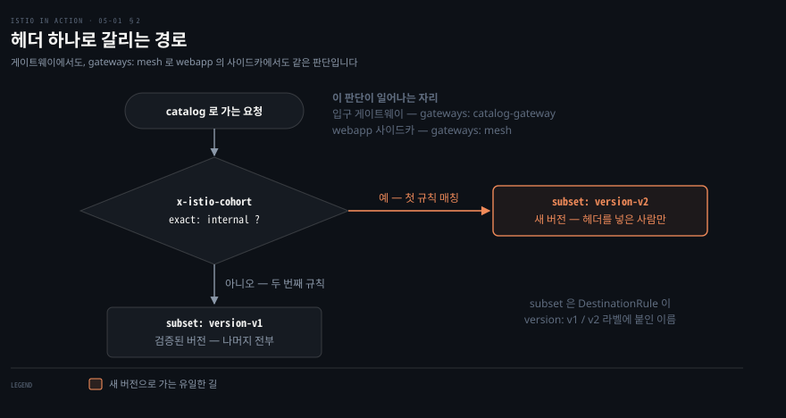
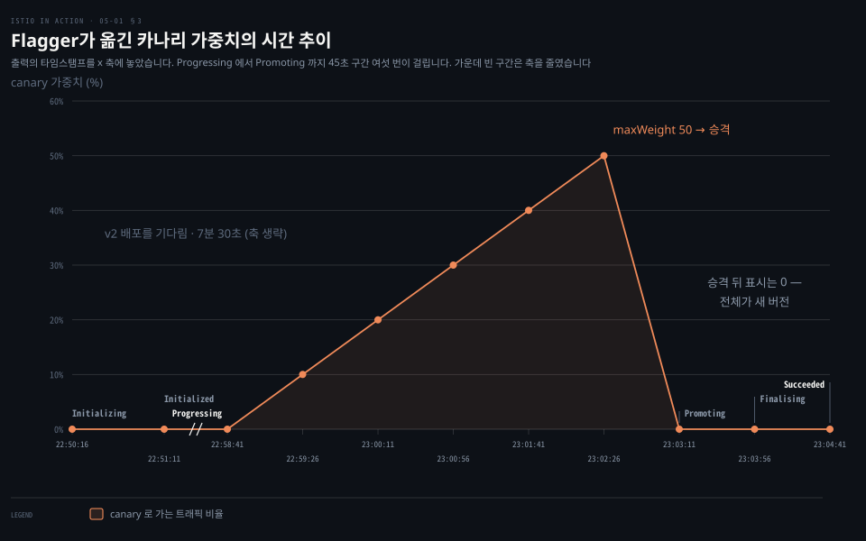
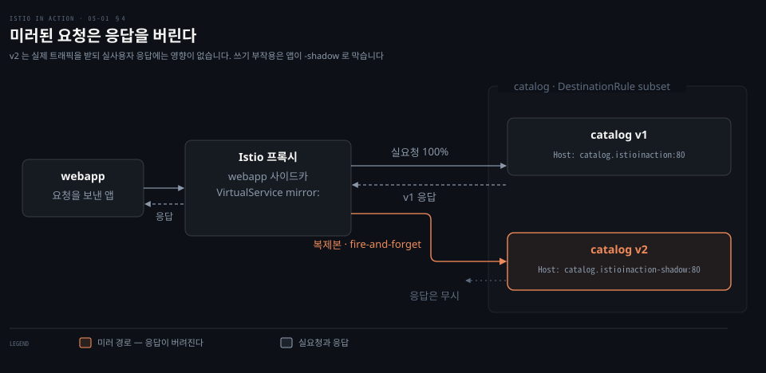
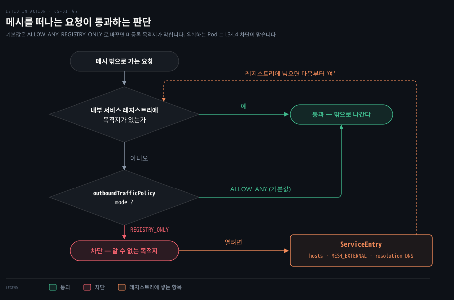

# 위험에 노출되는 트래픽을 줄여 가는 순서

---

> 새 코드를 프로덕션에 내보낼 때 요청 선별·비율 분할·복제 순서로 실사용자에게 닿는 위험을 줄입니다. 서비스가 밖으로 부르는 외부 통신은 기본 차단으로 바꾸고 허용할 대상만 등록합니다.


## 핵심 요약

> 릴리스는 전부 아니면 전무가 아니며, 각 기법은 새 코드가 해칠 수 있는 실사용자 트래픽의 몫을 한 단계씩 줄입니다. 배포와 릴리스를 가른 뒤 요청 내용·비율·복제 순으로 노출 범위를 좁힙니다.

배포는 새 코드를 프로덕션에 설치하되 트래픽은 보내지 않는 일입니다. 릴리스는 실사용자 트래픽을 그 코드로 보내는 일입니다. 블루/그린 배포는 새 버전을 옛 버전 옆에 함께 띄워 두고 릴리스 때 트래픽을 한 번에 넘기므로 "빅뱅" 전환이 남습니다. 배포와 릴리스를 가르면 릴리스를 점진적으로 열 수 있습니다.

요청 헤더로 대상을 고르는 **다크 런치(dark launch)**는 누가 새 버전을 볼지 정합니다. 가중치 라우팅은 트래픽을 비율로 나눠 얼마나 볼지 정합니다. 미러링은 실제 트래픽을 복제해 새 버전에 보내고 그 응답은 버립니다. 그래서 실사용자 응답에 영향이 없습니다.

세 기법 모두 애플리케이션이 여러 버전으로 동시에 돌 수 있어야 합니다. 미러링에서는 앱이 요청이 미러된 것인지 알아보고, 실제 요청과 미러된 요청을 모두 처리해야 합니다.

마지막으로 서비스 메시 밖으로 나가는 트래픽은 기본값인 허용을 차단으로 뒤집습니다. 서비스 메시는 Istio 가 서비스 사이의 통신을 프록시로 다루는 범위입니다. 허용할 외부 대상은 `ServiceEntry` 리소스로 Istio 의 서비스 목록(레지스트리)에 올려 엽니다.


## 학습 목표

> 이 편을 읽고 나면 아래 다섯 가지를 설명하고 상황에 맞게 고를 수 있습니다.

1. 블루/그린 배포가 여전히 빅뱅인 이유와, 배포와 릴리스를 가르면 무엇이 달라지는지 설명할 수 있습니다.
2. `DestinationRule` 의 subset 과 `VirtualService` 의 헤더 매칭으로 다크 런치를 콜 그래프 깊은 곳에도 적용할 수 있습니다.
3. 가중치 라우팅의 비율 계산 규칙과, Flagger 가 어떤 메트릭과 임계로 카나리를 진행·롤백하는지 설명할 수 있습니다.
4. 미러링이 앞의 두 기법과 무엇이 다른지, 미러된 요청을 애플리케이션이 어떻게 알아보는지 말할 수 있습니다.
5. `outboundTrafficPolicy` 를 `REGISTRY_ONLY` 로 바꾸는 이유와 한계, `ServiceEntry` 의 역할을 설명할 수 있습니다.

아래 그림은 새 버전이 실사용자에게 닿는 몫을 줄이는 네 단계 사다리(§1~§4)를 보입니다. 사다리 밖의 §5 는 메시를 떠나는 트래픽을 기본 차단으로 바꾸는 설정과 그 한계를 다룹니다. 아래로 내려갈수록 노출이 좁아져 §4 에서 실사용자 응답에 주는 영향이 0 이 됩니다.




## 새 버전이 사용자에게 닿기까지

> 새 코드가 실사용자에게 닿는 위험은 배포 분리에서 출발해 선별·분할·복제 단계를 거치며 줄고, 아웃바운드 제어는 그 흐름 밖에서 경계를 닫습니다.

새 코드를 한꺼번에 실사용자에게 열면 버그 하나가 전체 장애로 번집니다. 서비스 메시에서는 위험을 줄이는 네 단계 사다리로 노출 범위를 좁혀 갑니다.

사이드카 모드의 Istio 는 서비스마다 옆에 Envoy 프록시를 붙여 서비스 사이의 통신을 가로챕니다.[^istio-arch] 이 프록시가 **사이드카**이고, 사이드카 전체가 **데이터 플레인**입니다. 프록시에 설정을 내려 주는 `istiod` 는 **컨트롤 플레인**입니다.

| 단계 | 줄어든 위험과 남는 노출 | 주체 | 받치는 개념 | 절 |
|---|---|---|---|---|
| 1 전제 | 일괄 전환을 없애고 배포 시 노출 0 | 플랫폼·운영자 | 배포와 릴리스 분리 | [§1](#1-빅뱅-전환과-배포릴리스-분리) |
| 2 대상 선별 | 고른 부류만 `v2`, 대다수는 `v1` 유지 | `VirtualService`·사이드카 | `subset` 과 헤더 매칭 | [§2](#2-요청-내용으로-고르는-다크-런치) |
| 3 비율 분할·자동화 | 정한 비율만 `v2`, 이탈 시 자동 롤백 | `VirtualService`·Flagger | 가중치 분배와 메트릭 임계 | [§3](#3-가중치로-나누는-전환과-flagger) |
| 4 응답 영향 제거 | 실트래픽 복제, 응답은 버려 사용자 응답 영향 0 | 사이드카 프록시 | fire-and-forget 과 `-shadow` | [§4](#4-응답을-버리는-복제--미러링) |
| 흐름 밖 | 등록하지 않은 외부 목적지로 나가는 통신 차단 | 사이드카·`istiod` | `REGISTRY_ONLY` 와 `ServiceEntry` | [§5](#5-외부-통신-차단과-serviceentry) |

§1~§4 는 새 버전 노출 사다리를 차례로 밟습니다. §2~§4 는 다중 버전 동시 실행이라는 앱 설계 전제를 공유합니다. §5 는 사다리 밖에서 메시를 떠나는 통신을 닫고 여는 설정을 맡습니다.

### 릴리스 기법 비교

| 기법 | 노출 대상 | 실사용자 응답 영향 | 앱 전제 조건 |
|---|---|---|---|
| 블루/그린 | 전체 사용자 (전환 시 일괄) | 전체에 동시 노출 | 두 버전 동시 배포 |
| 다크 런치 (§2) | 헤더로 고른 특정 부류 | 고른 부류에만 영향 | 다중 버전 동시 실행 |
| 가중치 전환 (§3) | 전체 중 지정 비율 | 비율만큼 영향 | 다중 버전 동시 실행 |
| 미러링 (§4) | 복제 요청 수신 (`v1` 응답 반환) | 응답 영향 0 | 다중 버전 · 미러 요청 인지 |


## 이 문서가 다루지 않는 것

> `VirtualService`·`DestinationRule` 전체 필드 레퍼런스와 설치 절차, 다른 장 주제는 공식 문서와 앞뒤 노트로 넘깁니다.

- `VirtualService`·`DestinationRule` 레퍼런스 → [VirtualService](https://istio.io/latest/docs/reference/config/networking/virtual-service/) · [DestinationRule](https://istio.io/latest/docs/reference/config/networking/destination-rule/)
- 다크 런치 첫 실습 절차 → [배포와 릴리스를 가르는 첫 실습](02-01.배포와%20릴리스를%20가르는%20첫%20실습.md) (이 편은 같은 실습을 메시 안으로 옮깁니다)
- Flagger 의 Helm 설치 절차와 Prometheus 애드온 설치 → [Flagger 설치 문서](https://docs.flagger.app/install/flagger-install-on-kubernetes)
- 타임아웃·재시도·서킷 브레이커 → [실패를 견디는 일을 프록시로 옮겼을 때](06-01.실패를%20견디는%20일을%20프록시로%20옮겼을%20때.md)


## 1. 빅뱅 전환과 배포·릴리스 분리

> 새 버전을 올릴 때 기존 버전을 바로 교체하거나 트래픽을 통째로 넘기면 버그가 전체 사용자에게 동시에 닿습니다. 배포와 릴리스를 가르면 노출 범위를 단계적으로 넓히다 이상 시 바로 되돌릴 수 있습니다.

흐름 위치: 1 전제 · 받치는 개념 — 배포와 릴리스 분리



롤링 업그레이드는 옛 버전을 새 버전으로 바로 교체합니다. 새 버전이 클러스터에 들어오는 즉시 프로덕션 트래픽을 받습니다. 그래서 사용자는 새 코드와 버그를 동시에 만납니다.

블루/그린 배포는 `v2`(그린)를 `v1`(블루) 옆에 함께 띄워 두고 릴리스 시점에 트래픽을 넘깁니다. 문제가 나면 `v1` 으로 되돌려 장애 시간을 줄일 수 있습니다. 그러나 트래픽을 넘기는 순간에는 여전히 모든 코드 변경이 한꺼번에 나가는 **빅뱅**입니다.

이 문제를 풀려면 **배포(deployment)**와 **릴리스(release)**를 서로 다른 사건으로 갈라야 합니다.

- **배포**: 새 코드를 프로덕션 자원에 설치하되 트래픽은 보내지 않습니다. 사용자 요청을 받지 않으므로 스모크 테스트를 돌리고 메트릭·로그로 기대대로 도는지 확인합니다.
- **릴리스**: 실사용자 트래픽을 새 배포로 보내는 일입니다. 전부 아니면 전무가 아니라 사업 결정입니다.

위 상태 전이도는 배포 뒤 릴리스가 넓어지는 흐름을 보입니다. 배포된 상태에서 내부 직원에게만 열고 관찰 결과가 좋으면 비유료·실버 등급 고객으로 넓힙니다. 결국 전체 고객에 닿습니다.

어느 상태에서든 실사용자 반응이 기대와 다르면 트래픽을 이전 버전으로 되돌려 롤백합니다.

옛 버전이 대부분을 받고 새 버전이 작은 몫을 받는 동안 지켜보는 단계가 **카나리(canary)**이며, 그림에서는 강조된 `내부 직원` 상태입니다. 그 작은 몫을 헤더로 고르면 §2 의 다크 런치가 되고 비율로 나누면 §3 의 가중치 전환이 됩니다.

사이드카가 모든 요청을 거치므로 Istio 는 요청 하나 단위로 트래픽을 통제할 수 있습니다. 배포와 릴리스를 가른 이 토대 위에 §2~§4 가 다크 런치·가중치 전환·미러링을 차례로 쌓습니다. 같은 분리를 직접 해 보는 실습은 [배포와 릴리스를 가르는 첫 실습](02-01.배포와%20릴리스를%20가르는%20첫%20실습.md)에 있습니다.


## 2. 요청 내용으로 고르는 다크 런치

> 다크 런치는 요청 헤더를 보고 특정 부류만 새 버전에 보내 대다수 사용자를 보호하는 기법입니다. `DestinationRule` 로 버전을 `subset` 으로 묶고 `VirtualService` 로 헤더를 매칭합니다.

흐름 위치: 2 대상 선별 · 받치는 개념 — `subset` 과 헤더 매칭



새 버전을 모든 요청에 바로 열면 문제가 전체 사용자로 번지므로 헤더로 대상을 가릅니다. `VirtualService` 는 규칙을 위에서부터 판단해 첫 규칙에 매칭되면 `v2` 로 보냅니다. 매칭되지 않으면 두 번째 규칙인 `v1` 으로 보냅니다. 강조된 가지가 새 버전으로 가는 유일한 길이며 헤더를 넣을 수 있는 사람만 그 길을 탑니다.

### subset 선언과 헤더 매칭

트래픽을 버전별로 나누려면 먼저 Istio 에 어느 워크로드가 `v1` 이고 어느 것이 `v2` 인지 알려 줘야 합니다. 두 버전의 Kubernetes `Deployment` 라벨은 `app: catalog` 에 `version: v1` 과 `version: v2` 로 나뉩니다. `Deployment` 는 Pod 를 띄우고 버전별로 관리하는 Kubernetes 리소스입니다. **DestinationRule** 이 그 라벨을 **subset** 이름으로 묶습니다.

```yaml
# ch5/catalog-dest-rule.yaml — 라벨을 subset 이름으로 (apiVersion 은 Istio 1.32 문서의 예제를 따른 v1)
apiVersion: networking.istio.io/v1
kind: DestinationRule
metadata:
  name: catalog
spec:
  host: catalog
  subsets:
  - name: version-v1
    labels:
      version: v1
  - name: version-v2
    labels:
      version: v2
```

**VirtualService** 는 라우팅 규칙을 담는 리소스이며 위 `subset` 으로 목적지를 고릅니다. 먼저 전량을 `version-v1` 로 묶어 다크 런치 이전의 평상시 상태를 만듭니다. 그다음 `x-istio-cohort: internal` 헤더가 정확히 일치(`exact`)하는 요청만 `version-v2` 로 보내는 규칙을 앞에 둡니다. 규칙은 위에서부터 판단하므로 일치하지 않는 요청은 뒤의 `version-v1` 규칙으로 갑니다.

```yaml
# ch5/catalog-vs-v2-request.yaml — 헤더가 internal 이면 v2, 나머지는 v1 (http 규칙만 발췌)
http:
- match:
  - headers:
      x-istio-cohort:
        exact: "internal"
  route:
  - destination:
      host: catalog
      subset: version-v2
- route:
  - destination:
      host: catalog
      subset: version-v1
```

헤더 이름 자체는 팀이 정합니다. 애플리케이션이 주입한 헤더일 수도, `User-Agent` 같은 알려진 헤더나 쿠키 값일 수도 있습니다. 어떤 헤더를 붙일지 별도의 결정 엔진이 정하게 할 수도 있습니다. 이러한 Istio 의 라우팅 능력은 Envoy 에서 옵니다.

### 콜 그래프 내부의 사이드카 적용

같은 규칙을 클러스터 입구인 [게이트웨이](04-01.문을%20여는%20일과%20길을%20내는%20일을%20가른다.md)뿐 아니라 서비스끼리 부르는 호출 관계, 곧 **콜 그래프** 깊은 곳에도 둘 수 있습니다. 입구 게이트웨이가 `webapp` 을 부르고 `webapp` 이 `catalog` 를 부르는 구조를 예로 듭니다. 이때 `catalog` 용 `VirtualService` 를 따로 만듭니다.

게이트웨이용 설정은 `gateways:` 에 게이트웨이 이름(예: `catalog-gateway`)을 씁니다. 사이드카에 적용하려면 이 필드의 값을 `mesh` 로 둡니다. `mesh` 는 메시의 모든 사이드카에 적용된다는 뜻의 예약어입니다.[^istio-vs] 이 필드를 생략해도 기본값으로 `mesh` 가 적용됩니다(2026-11-24 Istio 1.32 문서 확인).[^istio-vs]

```yaml
# ch5/catalog-vs-v2-request-mesh.yaml — 같은 규칙을 메시 안 사이드카에 적용
apiVersion: networking.istio.io/v1
kind: VirtualService
metadata:
  name: catalog
spec:
  hosts:
  - catalog
  gateways:
  - mesh
  http:
  - match:
    - headers:
        x-istio-cohort:
          exact: "internal"
    route:
    - destination:
        host: catalog
        subset: version-v2
  - route:
    - destination:
        host: catalog
        subset: version-v1
```

`webapp` 의 사이드카가 이 규칙을 받아 헤더가 있으면 `catalog` `v2` 로 보냅니다.


## 3. 가중치로 나누는 전환과 Flagger

> 가중치 라우팅은 헤더 대신 비율로 트래픽을 나눠 새 버전이 전체 트래픽에 미치는 영향 상한을 통제합니다. 수백 개 릴리스를 수동 전환할 때 생기는 실수를 막으려면 메트릭으로 승격·롤백을 자동화하는 Flagger 를 둡니다.

흐름 위치: 3 비율 분할·자동화 · 받치는 개념 — 가중치 분배와 메트릭 임계

특정 부류에만 여는 다크 런치만으로는 모든 사용자에게 점진적으로 트래픽을 열 수 없습니다. 전체 사용자를 대상으로 영향 비율을 통제하려면 가중치 기반 라우팅이 필요합니다.

### 수동 가중치 전환과 동시 실행 전제

내부 직원에게 다크 런치한 `v2` 를 모두에게 천천히 열고 싶을 때 비율로 트래픽을 나눕니다. 전체 트래픽의 10% 를 `v2` 로 보내고 90% 를 `v1` 에 남기면 `v2` 의 부정적 영향 범위를 통제할 수 있습니다. 롤백은 가중치를 되돌리는 일이라 필요하면 0% 까지 내립니다.

```yaml
# ch5/catalog-vs-v2-10-90-mesh.yaml — 같은 host 에 가중치 둘
http:
- route:
  - destination:
      host: catalog
      subset: version-v1
    weight: 90
  - destination:
      host: catalog
      subset: version-v2
    weight: 10
```

`v2` 응답에는 `imageUrl` 필드가 있고 `v1` 응답에는 없습니다. 100번 호출해 `imageUrl` 이 있는 응답을 세면 10 에 가까운 값이 나옵니다. `50/50` 으로 바꾸면 50 에 가깝습니다.

각 목적지는 전체 가중치 합에서 자기 몫(`weight / 전체 weight 합`)만큼 요청을 받습니다.[^istio-vs] 목적지가 하나뿐이면 전량을 받습니다. 목적지가 둘 이상일 때 `weight` 가 0 이면 트래픽을 받지 않습니다. 합을 100 에 맞추면 `weight` 가 곧 퍼센트라 읽기 쉽습니다. 또한 `v1`·`v2` 밖의 버전이 더 있으면 그 버전도 `DestinationRule` 의 `subset` 으로 선언돼 있어야 합니다.

비율을 천천히 여는 동안 새 버전과 옛 버전 모두 안정성·성능·정확성을 관찰해야 합니다. 이 방식을 쓰려면 서비스가 여러 버전이 동시에 도는 것을 견디도록 만들어져 있어야 합니다. 상태가 많을수록, 외부 상태에 기대는 서비스일수록 동시 실행이 어렵습니다. 기법은 Istio 가 주지만 그 전제는 애플리케이션 설계의 몫입니다.

### Flagger 기반 카나리 자동화

CLI 로 설정 파일을 여러 벌 만들어 손으로 바꾸면 릴리스가 수백 개 동시에 돌 때 설정 실수가 잇따릅니다. **Flagger** 는 Stefan Prodan 이 만든 카나리 자동화 도구이며 저장소는 `fluxcd/flagger` 입니다. `Canary` 리소스에 진행 방식과 롤백 기준을 선언하면 필요한 설정을 대신 만듭니다. 메트릭으로 건강을 판단하므로 메트릭 수집 서버인 Prometheus 가 데이터 플레인에서 메트릭을 긁어 가고 있어야 합니다.

```yaml
# ch5/flagger/catalog-release.yaml — 진행 규칙만 발췌
analysis:
  interval: 45s        # 45초마다 판단
  threshold: 5         # 다섯 구간 실패에 닿으면 중단·롤백
  maxWeight: 50        # 50% 에 닿으면 100% 로 전환
  stepWeight: 10       # 한 걸음에 10%
  metrics:
  - name: request-success-rate
    thresholdRange:
      min: 99          # 1분 창에서 성공률 99% 미만이면 이탈
    interval: 1m
  - name: request-duration
    thresholdRange:
      max: 500         # P99 500ms 초과면 이탈
    interval: 30s
```

`Canary` 리소스는 대상 `Deployment`, 자동 생성할 `Service` 와 `VirtualService`, 진행 조건을 담습니다. 이 리소스를 적용하면 Flagger 가 `Deployment`·`Service`·`VirtualService` 를 만듭니다. 이 `VirtualService` 는 `catalog-primary` 100 · `catalog-canary` 0 으로 시작합니다. Flagger 는 원본 `catalog` `Deployment` 를 지켜봅니다. 이것이 `v2` 로 바뀌면 카나리 `Deployment` 와 `Service`(`catalog-canary`)를 만들고 가중치를 조정합니다.

`kubectl` 은 Kubernetes 명령줄 도구이고 `get canary -w` 는 `Canary` 의 상태와 가중치를 바뀔 때마다 한 줄씩 보입니다. 아래 도식은 그 출력을 시간축에 놓은 그림입니다.



`Initializing` 을 거쳐 `Initialized` 가 되면 Flagger 는 대상 `Deployment` 가 바뀌기를 기다립니다. 이 출력에서는 약 7분 30초 뒤 `v2` 를 배포하면서 `Progressing` 이 시작됩니다. `Progressing` 에서는 45초마다 10% 씩 올라 50% 에 닿습니다. 그다음 `Promoting`·`Finalising`·`Succeeded` 로 넘어가며 표시 가중치는 0 으로 돌아옵니다. `canary` 가 `primary` 로 승격돼 전체 트래픽이 새 버전으로 갔다는 뜻입니다.

Flagger 의 `Canary` 명세에서 `request-success-rate` 는 5xx 가 아닌 응답 비율의 최솟값을 검사합니다.[^flagger] `request-duration` 은 P99(99번째 백분위) 지연 시간의 최댓값을 밀리초로 검사합니다.[^flagger] 실패 검사가 `threshold` 에 닿으면 트래픽을 `primary` 로 되돌립니다. 동시에 `canary` 를 0 으로 줄여 실패로 표시합니다.[^flagger] Flagger 는 다크 런치 테스트와 미러링도 자동화할 수 있습니다.


## 4. 응답을 버리는 복제 — 미러링

> 미러링은 실트래픽을 복제해 새 배포에 보내되 고객 요청 경로 밖에서 처리하고 응답을 버립니다. 실사용자에게 응답 영향을 주지 않고 실제 트래픽으로 새 코드를 검증할 수 있습니다.

흐름 위치: 4 응답 영향 제거 · 받치는 개념 — fire-and-forget 과 `-shadow`



다크 런치와 가중치 전환은 위험을 줄이지만 둘 다 실사용자 트래픽을 씁니다. 영향 범위를 통제할 뿐 영향이 0 은 아닙니다. 미러링은 프로덕션 트래픽을 복제해 새 배포로 보내되 고객 요청 경로 밖에서 처리하므로 실사용자 응답에는 영향을 주지 않습니다.

`webapp` 의 사이드카는 실요청을 `v1` 으로 보내고 그 응답을 돌려줍니다. 동시에 복제본을 `v2` 로 보내고 `v2` 의 응답은 성공이든 실패든 무시합니다. 복제본을 보낸 뒤 응답을 기다리지 않는 이 방식을 fire-and-forget 이라 부릅니다. 강조된 선이 그 복제본입니다.

```yaml
# ch5/catalog-vs-v2-mirror.yaml — 실트래픽은 v1, 복제본은 v2
http:
- route:
  - destination:
      host: catalog
      subset: version-v1
    weight: 100
  mirror:
    host: catalog
    subset: version-v2
```

`VirtualService` 의 `mirror:` 절은 기본적으로 일치하는 트래픽 100% 를 복제합니다. 일부만 복제하려면 `mirrorPercentage` 에 비율(최대 100)을 지정합니다.[^istio-vs] 여러 목적지로 동시에 복제할 때는 `mirrors` 배열을 씁니다. 어느 쪽이든 프록시는 미러 대상의 응답을 기다리지 않으며 Istio 문서는 이를 best effort 라고 부릅니다.[^istio-vs]

요청 하나를 보내면 `v1` 과 `v2` 컨테이너 로그 모두에 줄이 생깁니다. `v1` 쪽이 실요청이자 클라이언트가 받는 응답입니다. `v1` 로그의 호스트는 `catalog.istioinaction:80` 이고 `istioinaction` 은 예제 네임스페이스입니다. `v2` 로그에는 `catalog.istioinaction-shadow:80` 처럼 **`-shadow` 접미사**가 붙습니다.

Envoy `RequestMirrorPolicy` 는 미러 요청의 `Host` 헤더에 `-shadow` 를 붙입니다. HTTP/2 에서는 `:authority` 헤더가 대상입니다.[^envoy-mirror] 예를 들어 `cluster1` 은 `cluster1-shadow` 가 됩니다. 접미사는 끌 수 있습니다. `disable_shadow_host_suffix_append` 를 `true` 로 두면 됩니다.[^envoy-mirror] 이 필드는 Envoy `latest` 문서(1.41.0-dev)에 있습니다. 이 이름은 Envoy 의 필드이며 `VirtualService` 레퍼런스에는 없습니다.

이 접미사를 받은 서비스는 요청을 미러로 인식할 수 있습니다. 응답이 버려질 것이므로 트랜잭션을 롤백하거나 자원을 많이 쓰는 외부 호출을 건너뛸 수 있습니다.

미러링에서도 다중 버전 전제가 다시 나옵니다. 앱은 요청이 미러된 것인지 알고 있어야 합니다. 그리고 실제 요청을 처리하는 실모드와 미러된 요청을 처리하는 미러 모드를 모두 지원하거나 여러 버전으로 동시에 돌 수 있어야 합니다. 둘 다 필요할 수도 있습니다.


## 5. 외부 통신 차단과 ServiceEntry

> `outboundTrafficPolicy` 를 `REGISTRY_ONLY` 로 바꾸면 등록하지 않은 외부 목적지로 나가는 요청을 사이드카가 버립니다. 필요한 외부 대상은 `ServiceEntry` 로 등록해 엽니다.

흐름 위치: 흐름 밖 — 메시를 떠나는 아웃바운드 트래픽 제어



기본 설정인 `ALLOW_ANY` 에서는 사이드카가 등록되지 않은 외부 목적지로도 요청을 내보냅니다. 침해된 서비스가 외부 서버로 무단 연결해도 이 설정으로는 막지 못합니다. 나가는 요청은 사이드카에서 아래 판단을 차례로 만납니다.

목적지가 Istio 의 내부 서비스 레지스트리에 있으면 나갑니다. 없으면 `outboundTrafficPolicy` 가 가릅니다. `ALLOW_ANY` 면 그래도 나가지만 이 트래픽은 관측성이 떨어지는 등 기능이 제한됩니다.[^istio-mesh] 관측성은 메트릭·로그·추적으로 트래픽을 들여다볼 수 있는 정도입니다. `REGISTRY_ONLY` 면 알 수 없는 아웃바운드 트래픽은 버려집니다(2026-11-24 Istio 1.32 문서 확인).[^istio-mesh] 막힌 목적지를 열려면 `ServiceEntry` 로 레지스트리에 항목을 넣습니다.

### 아웃바운드 기본 차단과 한계

Istio 의 `meshConfig.outboundTrafficPolicy.mode` 기본값은 `ALLOW_ANY` 입니다.[^istio-mesh] 애플리케이션이 메시가 관리하지 않는 외부 사이트나 서비스를 부르면 그대로 내보냅니다. 모든 트래픽이 사이드카를 거치므로 이 기본값을 `REGISTRY_ONLY` 로 뒤집어 알 수 없는 외부 통신을 막을 수 있습니다.

저자는 이 차단을 **심층 방어(defense in depth)**의 기본 자세로 둡니다. 메시 안의 서비스가 취약점으로 침해당했을 때 공격자가 자기 서버에 연결해 회사의 민감 데이터와 지식재산을 빼돌리지 못하게 하려는 것입니다. 저자는 한계도 함께 짚습니다. 침해된 Pod 는 프록시를 우회할 수 있어 Istio 차단만으로는 충분하지 않습니다. 그래서 IP·포트 수준(L3·L4)의 차단을 겹쳐야 한다고 권합니다. Kubernetes `NetworkPolicy` 가 이 수준을 다룹니다.[^k8s-netpol]

Istio 문서도 `REGISTRY_ONLY` 를 아웃바운드 방화벽으로 취급하지 않습니다. 이 모드는 등록하지 않은 `ServiceEntry` 를 실패로 드러내 찾게 해 주는 것이 주된 용도입니다.[^istio-mesh] 악의적인 애플리케이션은 사이드카를 우회해 외부 서비스에 접근할 수 있습니다. 더 안전한 외부 통신 통제에는 egress gateway 가 필요합니다.[^istio-egress]

```bash
istioctl install --set profile=demo --set meshConfig.outboundTrafficPolicy.mode=REGISTRY_ONLY
```

빠른 시험 환경에서는 `istioctl install` 로 바꿀 수 있습니다. 실제 배포에서는 보통 `IstioOperator` 나 `istio` ConfigMap 을 고칩니다. `IstioOperator` 는 설치 설정을 선언하는 리소스입니다. `istio` ConfigMap 은 `istio-system` 네임스페이스에 있는 메시 설정입니다.[^istio-egress]

### 내부 레지스트리와 ServiceEntry 등록

Istio 는 메시 안에서 접근할 수 있는 모든 서비스의 **내부 서비스 레지스트리**를 만듭니다. 서비스 디스커버리 레지스트리는 서비스가 상대의 주소를 찾을 때 보는 목록이고, 이 레지스트리가 그 정본입니다. Istio 는 컨트롤 플레인이 놓인 플랫폼에 맞춰 이 레지스트리를 채웁니다. Kubernetes 위에서는 Kubernetes `Service` 객체를 API 로 읽어 목록을 만듭니다. `istiod` 는 플랫폼별 레지스트리 구현을 Envoy 에게 감춥니다([Envoy가 맡는 일과 Istio가 보태는 일](03-01.Envoy가%20맡는%20일과%20Istio가%20보태는%20일.md)).

외부 서비스는 이 레지스트리에 없으므로 `ServiceEntry` 로 알려 줘야 합니다.

```yaml
# ch5/forum-serviceentry.yaml — 외부 호스트를 레지스트리에 넣는다 (apiVersion 은 Istio 1.32 문서의 예제를 따른 v1)
apiVersion: networking.istio.io/v1
kind: ServiceEntry
metadata:
  name: jsonplaceholder
spec:
  hosts:
  - jsonplaceholder.typicode.com
  ports:
  - number: 80
    name: http
    protocol: HTTP
  resolution: DNS
  location: MESH_EXTERNAL
```

`location: MESH_EXTERNAL` 은 이 서비스가 메시 밖에 있다는 표시입니다. `resolution: DNS` 는 사이드카가 호스트 이름을 DNS 조회로 풀어 연결한다는 뜻입니다.[^istio-se] `resolution` 을 `NONE` 으로 두면 `Host` 헤더만 속인 요청이 다른 IP 로 나갈 수 있습니다. 그래서 Istio 문서는 `DNS` 를 씁니다.[^istio-egress]

외부 포럼 API `jsonplaceholder.typicode.com` 을 부르는 `forum` 서비스를 먼저 띄웁니다. `REGISTRY_ONLY` 상태에서 `webapp.istioinaction.io` 호스트의 `/api/users` 를 부르면 오류가 납니다. 응답은 `error calling Forum service` 입니다. `ServiceEntry` 를 적용해 레지스트리에 항목을 넣으면 메시 안 클라이언트가 그 호스트를 호출할 수 있고 사용자 목록이 돌아옵니다. 외부 서비스에도 이 레지스트리 항목 위에 정교한 라우팅을 걸 수 있습니다.


## 결정 치트시트

> 상황별로 어떤 Istio·Flagger 설정을 고를지 정리한 판단 기준입니다.

| 상황 | 판단 | 근거 |
|---|---|---|
| 새 버전을 올렸는데 응답이 `v1`·`v2` 로 섞임 | `DestinationRule` `subset` + `VirtualService` 로 전량 `v1` 고정 | 다크 런치 이전의 평상시 상태 |
| 특정 부류만 새 버전을 보게 하고 싶음 | 헤더 `exact` 매칭 → `v2` `subset` | 요청 내용으로 경로를 정함 |
| 게이트웨이가 아니라 서비스 사이에서 가르고 싶음 | `VirtualService` `gateways: [mesh]` | 메시의 모든 사이드카에 적용 |
| 모두에게 천천히 열고 싶음 | 가중치 `10/90` → `50/50` → `100` | 영향받는 트래픽 비율을 통제 |
| 릴리스 수백 개를 손으로 못 돌림 | Flagger `Canary` | 메트릭 임계로 진행·롤백을 자동화 |
| 실사용자에게 영향 없이 새 코드를 시험 | `mirror:` | 복제본의 응답은 무시됨 |
| 미러된 요청이 부작용을 내면 안 됨 | 앱이 `-shadow` Host 를 보고 트랜잭션 롤백·무거운 호출 회피 | 미러 트래픽은 Host 에 표식이 붙음 |
| 서비스가 상태를 많이 가짐 | 세 기법 모두 적용 전 다중 버전 동시 실행 가능성부터 확인 | 상태가 많을수록 어려움 |
| 침해된 서비스의 외부 통신을 막고 싶음 | `REGISTRY_ONLY` + L3·L4 차단 병행 | Istio 차단만으로는 불충분, Pod 가 프록시를 우회 가능 |
| 메시 밖 서비스를 불러야 함 | `ServiceEntry` (`MESH_EXTERNAL`, `resolution: DNS`) | 레지스트리에 항목이 있어야 나감 |


## 적용 관점

> 카나리나 미러링을 켜기 전에 애플리케이션이 다중 버전 공존과 미러 분기를 감당하는지 먼저 확인합니다.

카나리·미러링을 켜는 PR 앞에서는 다음 세 가지를 확인해야 합니다. 하나라도 "아니오"면 Istio 설정보다 앱 코드 수정이 먼저입니다.

- 이 서비스는 `v1` 과 `v2` 가 같은 DB 를 동시에 써도 되는가?
- `-shadow` Host 를 받으면 쓰기와 외부 호출을 건너뛰는가?
- 새 버전과 옛 버전의 메트릭을 나란히 보는 대시보드가 있는가?

Spring 앱을 운영하는 관점에서 미러링은 가장 매력적이면서 가장 조심할 기법입니다. 프록시는 응답을 버리지만 앱은 요청을 끝까지 처리하기 때문입니다. 예를 들어 `-shadow` 접미사를 보고 트랜잭션을 롤백하거나 결제·메일 같은 외부 호출을 피해야 합니다. 그 분기가 앱에 있어야 미러링의 영향이 0 이 되며 없으면 쓰기 요청을 두 번 실행하는 장치가 됩니다.


## 면접에서 받을 만한 질문

> 답을 먼저 떠올린 뒤 아래 정답 절을 펼칩니다.

1. 이 장을 한 줄로 정의하면 무엇입니까?
2. 버전 라우팅에서 `DestinationRule` 과 `VirtualService` 는 각각 무엇을 맡습니까? `gateways: [mesh]` 는 무엇을 뜻합니까?
3. 가중치 기반 카나리에서 지켜야 하는 제약은 무엇이고, Flagger 는 그 가중치를 어떤 기준으로 올리고 내립니까?
4. 미러링이 실사용자에게 영향을 주지 않는 이유는 무엇이며, 그럼에도 애플리케이션이 준비해야 하는 것은 무엇입니까?
5. 블루/그린이 있는데 왜 카나리가 필요합니까?
6. 미러링이면 새 코드를 아무 위험 없이 시험할 수 있습니까?
7. `REGISTRY_ONLY` 로 막으면 침해된 서비스의 외부 통신이 차단됩니까?


## 정답 (자답 후 펼치기)

> 위 면접 질문 7개에 먼저 자답한 뒤 읽습니다. 질문 번호와 1:1 로 대응하며, 자답 없이 읽으면 학습 효과가 사라집니다.

### 정답 1 — 한 줄 정의

"다크 런치는 헤더로 고른 사용자만 새 버전에 보냅니다. 트래픽 전환은 가중치로 비율을 나눕니다. 미러링은 실트래픽을 복제해 새 버전에 보내되 응답을 버립니다. 셋 다 새 코드가 해칠 수 있는 실사용자 트래픽의 몫을 줄이는 기법입니다."

### 정답 2 — subset 과 mesh 라우팅

`DestinationRule` 이 라벨을 `subset` 으로 이름 붙이고 `VirtualService` 가 그 `subset` 으로 경로를 정합니다. `gateways: [mesh]` 면 게이트웨이가 아니라 메시의 모든 사이드카에 적용됩니다.

### 정답 3 — 가중치 제약과 Flagger 기준

각 목적지는 `weight / 전체 weight 합` 비율로 트래픽을 받습니다. 보통 합을 100 에 맞추며 모든 버전이 `DestinationRule` 의 `subset` 으로 선언돼 있어야 합니다. Flagger 는 성공률과 P99 지연 임계로 45초마다 10% 씩 올리며 실패 검사가 임계 횟수(`threshold`)에 닿으면 롤백합니다.

### 정답 4 — 미러링 안전성과 앱의 전제

미러링은 복제본의 응답을 프록시가 무시하므로 실사용자에게 영향이 없습니다. 그러나 앱은 `-shadow` Host 를 보고 부작용을 피해야 합니다. 세 기법 모두 앱이 여러 버전으로 동시에 돌 수 있어야 하고, 미러링은 앱이 미러된 요청을 알아보고 실제 요청과 함께 처리해야 합니다.

### 정답 5 — 블루/그린 대 카나리

블루/그린은 되돌리기는 쉽지만 넘기는 순간 모든 변경이 한꺼번에 나가는 빅뱅입니다. 배포와 릴리스를 가르면 릴리스를 내부 직원 → 일부 고객 → 전체로 점진적으로 열 수 있고, 어느 단계에서든 트래픽만 되돌리면 롤백입니다.

### 정답 6 — 미러링의 쓰기 부작용과 방어

사용자 응답에는 영향이 없습니다. 그러나 미러된 요청도 새 버전이 끝까지 처리하므로, 쓰기나 외부 호출이 있으면 부작용이 납니다. 프록시가 `Host` 에 `-shadow` 를 붙여 주니 앱이 그것을 보고 트랜잭션을 롤백하거나 무거운 호출을 피해야 합니다.

### 정답 7 — REGISTRY_ONLY 의 한계

프록시를 거치는 통신은 막히지만 침해된 Pod 는 프록시를 우회할 수 있어 충분하지 않습니다. Istio 문서도 `REGISTRY_ONLY` 를 방화벽으로 취급하지 않습니다. 따라서 L3·L4 차단을 겹쳐야 하며, 필요한 외부 서비스는 `ServiceEntry` 로 레지스트리에 넣어 엽니다.


## 핵심 개념 체크리스트

- [ ] 블루/그린이 여전히 빅뱅인 이유를 말할 수 있는가?
- [ ] 배포와 릴리스를 각각 정의하고 릴리스가 사업 결정인 이유를 말할 수 있는가?
- [ ] `DestinationRule` 의 `subset` 이 무엇을 이름 붙이는지 설명할 수 있는가?
- [ ] `gateways: [mesh]` 의 뜻을 말할 수 있는가?
- [ ] 가중치 라우팅의 비율 계산 규칙과 `subset` 선언 제약을 말할 수 있는가?
- [ ] Flagger `Canary` 의 `interval`·`threshold`·`maxWeight`·`stepWeight` 가 각각 무엇을 정하는지 아는가?
- [ ] 미러링이 앞의 두 기법과 다른 점을 한 문장으로 말할 수 있는가?
- [ ] `-shadow` 접미사를 받은 앱이 무엇을 해야 하는지 말할 수 있는가?
- [ ] `REGISTRY_ONLY` 만으로 충분하지 않은 이유를 말할 수 있는가?
- [ ] Istio 내부 레지스트리가 Kubernetes 에서 무엇으로 채워지는지 아는가?


## 관련 문서

- [문을 여는 일과 길을 내는 일을 가른다](04-01.문을%20여는%20일과%20길을%20내는%20일을%20가른다.md) — 게이트웨이에서 연 `VirtualService` 를 이 편이 메시 안으로 옮깁니다
- [배포와 릴리스를 가르는 첫 실습](02-01.배포와%20릴리스를%20가르는%20첫%20실습.md) — 같은 분리를 그쪽은 실습으로, 이 편은 세 기법으로 폅니다
- [Envoy가 맡는 일과 Istio가 보태는 일](03-01.Envoy가%20맡는%20일과%20Istio가%20보태는%20일.md) — Envoy 가 하는 일과 `istiod` 가 레지스트리를 감추는 일을 가릅니다. 미러링의 `-shadow` 접미사도 Envoy 기능입니다
- [Istio VirtualService 레퍼런스](https://istio.io/latest/docs/reference/config/networking/virtual-service/) — 라우팅 필드의 SSOT


## 참고 자료

- 원본: 《Istio in Action》 5장 "Traffic control: Fine-grained traffic routing" (Christian E. Posta·Rinor Maloku, Manning)
- [책 예제 소스 코드](https://github.com/istioinaction/book-source-code) — `ch5/` 의 VirtualService·DestinationRule·Flagger 파일
- [Flagger](https://flagger.app) — 카나리 자동화 프로젝트


[^istio-vs]: Istio 1.32 — VirtualService 레퍼런스 (2026-11-24 확인). `mirror` "Mirror HTTP traffic to a another destination in addition to forwarding the requests to the intended destination", `mirrorPercentage` "If this field is absent, all the traffic (100%) will be mirrored", `weight` "A destination will receive weight/(sum of all weights) requests", `gateways` "The reserved word mesh is used to imply all the sidecars in the mesh". <https://istio.io/latest/docs/reference/config/networking/virtual-service/>
[^envoy-mirror]: Envoy `latest` 문서(1.41.0-dev) — `RouteAction.RequestMirrorPolicy` (2026-11-24 확인). "The current implementation is 'fire and forget'", "During shadowing, the host/authority header is altered such that -shadow is appended … For example, cluster1 becomes cluster1-shadow." <https://www.envoyproxy.io/docs/envoy/latest/api-v3/config/route/v3/route_components.proto>
[^istio-mesh]: Istio 1.32 — MeshConfig `OutboundTrafficPolicy.Mode` (2026-11-24 확인). `REGISTRY_ONLY` "unknown outbound traffic will be dropped. Traffic destinations must be explicitly declared into the service registry through ServiceEntry configurations", `ALLOW_ANY` "any traffic to unknown destinations will be allowed … reduced observability", 기본값 `ALLOW_ANY`. `REGISTRY_ONLY` 설명 뒤의 주의: "Istio does not offer an outbound traffic security policy. This option does not act as one, or as any form of an outbound firewall. Instead, this option exists primarily to offer users a way to detect missing ServiceEntry configurations by explicitly failing." <https://istio.io/latest/docs/reference/config/istio.mesh.v1alpha1/>
[^istio-arch]: Istio 1.32 — Architecture (2026-11-24 확인). "The data plane is composed of a set of intelligent proxies (Envoy) deployed as sidecars", "The control plane manages and configures the proxies to route traffic." <https://istio.io/latest/docs/ops/deployment/architecture/>
[^istio-egress]: Istio 1.32 — Accessing External Services (2026-11-24 확인). "A malicious application can bypass the Istio sidecar proxy and access any external service without Istio control. To implement egress traffic control in a more secure way, you must direct egress traffic through an egress gateway", "Setting the resolution to NONE opens a possibility for attack". 메시 설정은 `kubectl get configmap istio -n istio-system -o yaml` 로 보고, `IstioOperator` 로 설치했다면 `meshConfig.outboundTrafficPolicy.mode` 를 그 설정에 넣으라고 안내함. <https://istio.io/latest/docs/tasks/traffic-management/egress/egress-control/>
[^istio-se]: Istio 1.32 — ServiceEntry 레퍼런스 (2026-11-24 확인). `MESH_EXTERNAL` "Signifies that the service is external to the mesh", `DNS` "Attempt to resolve the IP address by querying the ambient DNS, during request processing". <https://istio.io/latest/docs/reference/config/networking/service-entry/>
[^k8s-netpol]: Kubernetes — Network Policies (2026-11-24 확인). "If you want to control traffic flow at the IP address or port level (OSI layer 3 or 4), NetworkPolicies allow you to specify rules for traffic flow within your cluster, and also between Pods and the outside world." <https://kubernetes.io/docs/concepts/services-networking/network-policies/>
[^flagger]: Flagger — Istio Canary Deployments 튜토리얼 (2026-11-24 확인). "threshold: max number of failed metric checks before rollback", "request-success-rate: minimum req success rate (non 5xx responses) percentage", "request-duration: maximum req duration P99 milliseconds", "When the number of failed checks reaches the canary analysis threshold, the traffic is routed back to the primary, the canary is scaled to zero and the rollout is marked as failed." <https://docs.flagger.app/tutorials/istio-progressive-delivery>
