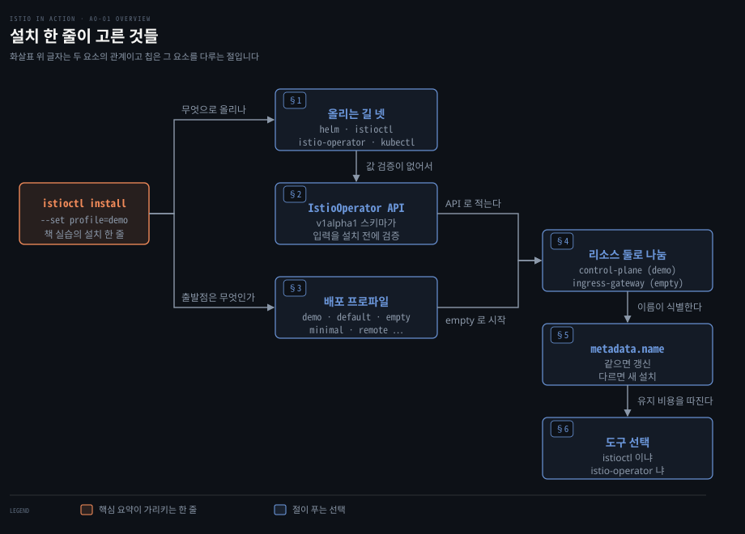
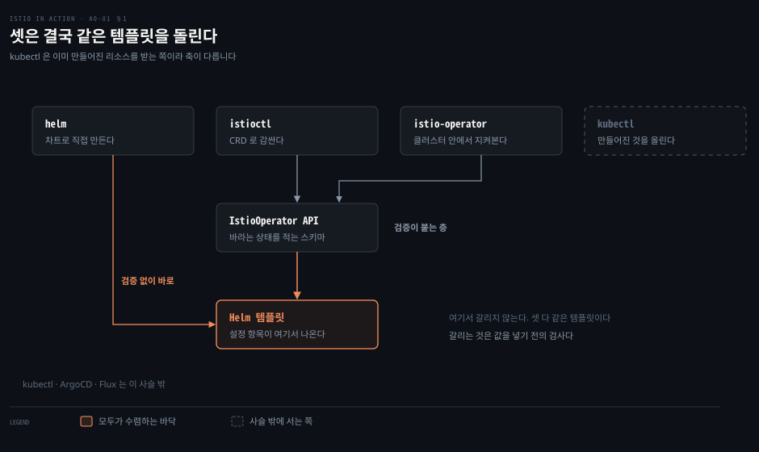
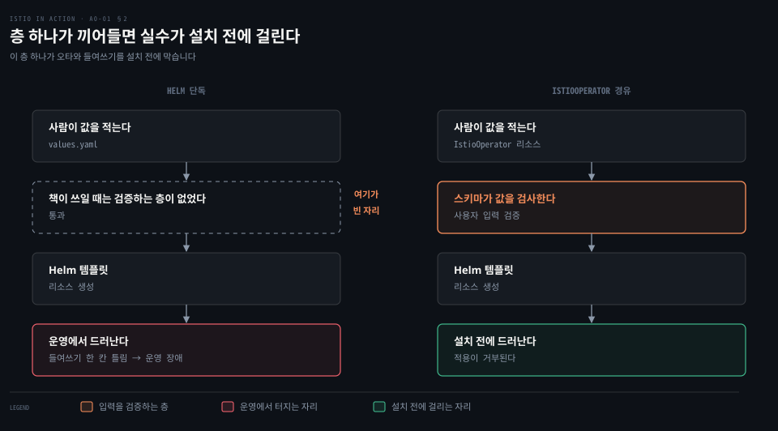
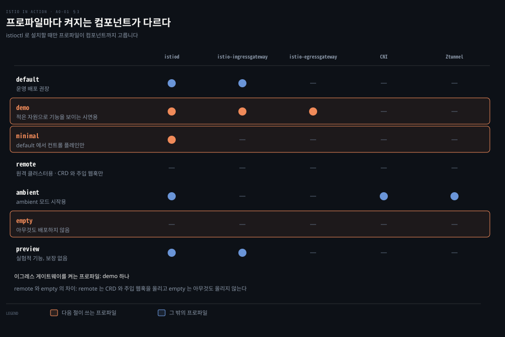
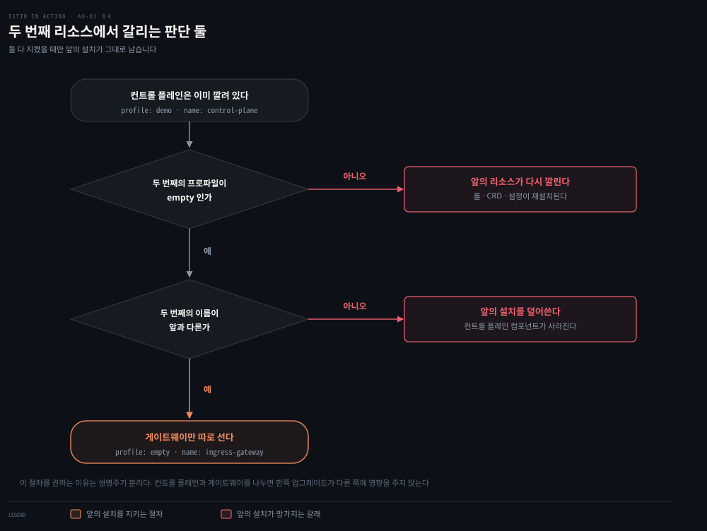
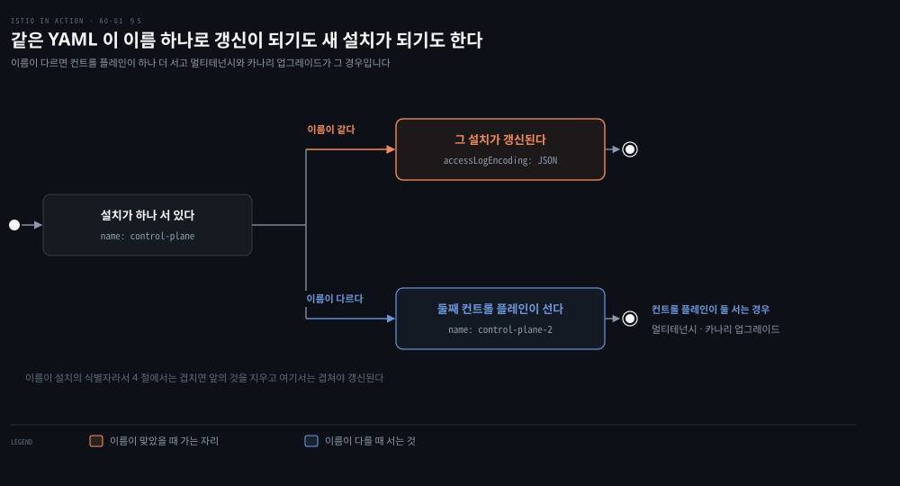
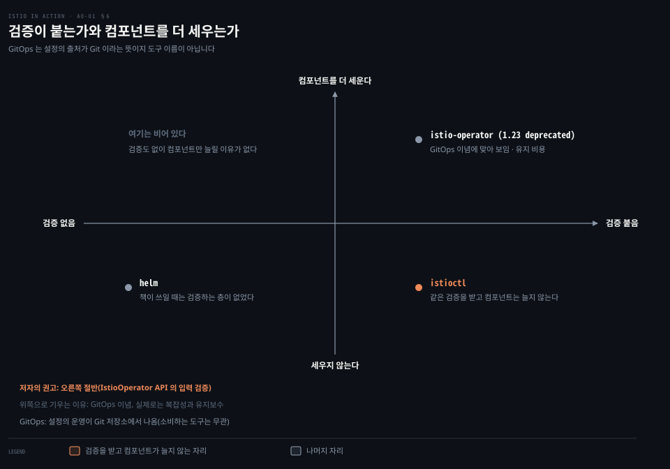

# 부록 — 설치를 고르는 API 와 프로파일 여덟

---

> `istioctl install --set profile=demo` 한 줄은 설치 도구와 프로파일을 이미 골라 둔 명령입니다. 이 부록은 그 선택을 하나씩 풀고, 무엇을 고르느냐가 업그레이드 방식까지 어떻게 정하는지 따라갑니다.


## 핵심 요약

> 설치 한 줄은 올리는 길과 입력 검증 API 와 출발점 프로파일을 이미 골라 둔 것이고, 그 선택이 나중에 구성을 나누고 갱신하는 방법까지 정합니다. 쉬운 것은 리소스를 올리는 일이고 어려운 것은 어떤 리소스를 올릴지 정하는 일입니다.

클라우드 환경과 네트워크 구성과 보안 요구가 다르면 설정이 금세 복잡해집니다. Istio 는 그 어려움을 두 겹으로 덜어 냅니다.

아래층은 `IstioOperator` API 입니다. 설정할 수 있는 값을 스키마로 못 박아 오타와 들여쓰기 실수를 설치 전에 잡습니다. 위층은 프로파일입니다. 자주 쓰는 조합을 미리 묶어 둡니다.

이 부록의 실습 하나는 두 겹을 써서 컨트롤 플레인과 게이트웨이의 생명주기를 떼어 놓는 일입니다. 컨트롤 플레인은 프록시를 설정하고 제어하는 쪽(`istiod`)이고, 데이터 플레인은 실제 트래픽을 나르는 Envoy 프록시 곧 사이드카와 게이트웨이입니다. 게이트웨이는 메시로 들어오는 트래픽(인그레스)과 나가는 트래픽(이그레스)의 출입구 프록시입니다.[^arch] 저자는 이 분리를 권장 사례라고 적습니다.


## 학습 목표

이 문서를 읽고 나면 다음을 할 수 있습니다.

- Istio 리소스를 클러스터에 올리는 네 가지 길을 구분할 수 있습니다. 각각이 `IstioOperator` API 와 어떤 관계인지도 말할 수 있습니다.
- Helm 단독 설치가 왜 물러났는지를 사용자 입력 검증이라는 축으로 설명할 수 있습니다.
- 프로파일을 용도별로 가르고 `empty` 프로파일이 왜 따로 있는지 말할 수 있습니다.
- 컨트롤 플레인과 게이트웨이를 별도 `IstioOperator` 리소스로 나누는 절차를 적을 수 있습니다. 두 번째 리소스에서 프로파일과 이름을 그렇게 고르는 이유도 설명할 수 있습니다.
- `istio-operator` 와 `istioctl` 중 무엇을 고를지 입력 검증과 유지 비용을 기준으로 판단할 수 있습니다.

아래 그림은 설치 한 줄에서 갈래가 둘로 갈라졌다 모이는 모양입니다. 위 갈래는 무엇으로 올리는지를 고릅니다. 거기서 Helm 값에 검증이 없어 `IstioOperator` API 가 생긴 이유로 이어집니다. 아래 갈래는 출발점인 프로파일을 고릅니다.

두 갈래는 컨트롤 플레인과 게이트웨이를 리소스 둘로 나누는 자리에서 만납니다. 그 뒤로 이름이 하는 일과 도구 선택이 이어집니다.

코랄색 칸은 핵심 요약이 가리키는 설치 한 줄입니다. 파란 칸은 각 절이 푸는 선택이고 칩은 그 선택을 다루는 절 번호입니다.




## 설치 한 줄이 고른 것들

> 설치 한 줄을 풀고 구성을 나눠 갱신하기까지 여섯 단계가 이어지고, 절마다 한 단계를 맡습니다.

설치 한 줄을 그대로 복사해 쓰다가 운영 구성을 바꿔야 할 때, 그 한 줄이 무엇을 골랐는지 모르면 어디를 고쳐야 할지 알 수 없습니다. 아래 표가 한 줄 속의 선택을 단계로 나눕니다.

| 단계 | 맡는 주체 | 받치는 개념 | 맡는 절 |
|---|---|---|---|
| 올리는 길 고르기 | 설치 담당자 | Helm 템플릿 | 1 |
| 입력 검증받기 | `IstioOperator` 스키마 | `IstioOperator` API 의 바라는 상태 | 2 |
| 출발점 고르기 | 프로파일 | 프로파일(기본값 묶음) | 3 |
| 구성 나누기 | 설치 담당자가 만든 리소스 둘 | `empty` 프로파일과 `metadata.name` | 4 |
| 갱신하기 | `IstioOperator` 리소스의 이름 | `metadata.name` 은 설치의 식별자 | 5 |
| 도구 정하기 | 설치 담당자 | GitOps 의 좁은 정의와 유지 비용 | 6 |

1~3절은 설치 한 줄이 이미 고른 것을 풉니다. 4~5절은 그 선택으로 구성을 만들고 바꾸는 방법입니다. 6절은 도구를 정하는 기준입니다.

표의 두 낱말을 미리 풉니다. 바라는 상태는 설치가 갖춰야 할 모습을 적은 선언입니다. GitOps 는 서비스와 설정의 운영을 Git 저장소에서 끌어오는 방식입니다.


## 이 문서가 다루지 않는 것

> 설치 절차 자체와 Helm 문법, 그리고 여러 클러스터에 걸친 설치는 각각 다른 자리가 맡습니다.

설치 자체의 절차와 확인 명령은 [2장 §1](./02-01.배포와%20릴리스를%20가르는%20첫%20실습.md)이 다룹니다. `istioctl x precheck` 와 `istioctl verify-install` 이 거기 있습니다.

Helm 의 템플릿 문법과 차트 구조는 이 문서의 범위 밖입니다. Istio 설치가 Helm 템플릿 위에 서 있다는 사실만 여기서 적습니다. 문법은 Helm 공식 문서로 넘깁니다.

여러 클러스터에 걸친 설치와 `remote` 프로파일이 쓰이는 배치 모델은 [12장](./12-01.경계를%20지우는%20전제%20셋과%20남는%20한%20자리.md)이 다룹니다. 이 부록은 프로파일 목록에서 그 이름을 짚는 데서 멈춥니다.

게이트웨이 업그레이드 절차는 [공식 문서](https://istio.io/latest/docs/setup/additional-setup/gateway/)에서 다룹니다.


## 1. 리소스를 클러스터에 올리는 길 넷

> 같은 Istio 를 올리는 도구가 넷이면 어느 것을 골라도 같은 결과가 나오는지 물어야 합니다. 도구는 갈려도 셋은 같은 Helm 템플릿을 돌립니다.

흐름 위치: 1 올리는 길 고르기 · 받치는 개념 — Helm 템플릿



Istio 설치는 쿠버네티스 리소스를 클러스터에 적용하는 일입니다. 그 일을 하는 도구는 넷입니다.

`helm` 은 쿠버네티스 리소스를 차트라는 템플릿 꾸러미로 묶어 두고 값만 넣어 만드는 패키지 관리자의 CLI 입니다. `istioctl` 은 `IstioOperator` CRD 를 써서 더 단순하고 안전한 API 를 내놓습니다. CRD 는 쿠버네티스 API 에 리소스 종류를 더하는 확장입니다. 다만 `istioctl` 은 속으로 Helm 을 써서 리소스를 만듭니다.

`istio-operator` 는 클러스터 안에서 도는 오퍼레이터로, 같은 `IstioOperator` API 로 설치를 관리합니다. 오퍼레이터는 특정 소프트웨어의 운영 지식을 담아 그 설치와 갱신을 대신하는 컨트롤러입니다. `kubectl` 은 이미 만들어진 쿠버네티스 리소스를 받아 클러스터에 적용합니다. ArgoCD 나 Flux 처럼 Git 에 둔 리소스를 클러스터에 적용하는 배포 도구도 같은 자리에 섭니다.

이 넷은 대등한 선택지가 아닙니다. Istio 설치의 모든 커스터마이징은 Helm 템플릿에서 나옵니다. 그래서 `istioctl` 도 `istio-operator` 도 마지막에는 같은 템플릿을 돌립니다. 갈리는 것은 그 템플릿에 값을 넣기 전에 무엇이 값을 검사하느냐입니다.


## 2. Helm 값 검증과 IstioOperator

> 처음에는 Helm 이 주 도구였지만 설정 항목이 늘면서 검증 없는 입력이 문제가 됐습니다. `IstioOperator` API 는 그 입력에 스키마를 씌웁니다.

흐름 위치: 2 입력 검증받기 · 받치는 개념 — `IstioOperator` API 의 바라는 상태



Helm 값 파일에서 들여쓰기가 한 칸만 틀려도 설치 단계에서 걸러지지 않아 장애가 운영에서야 드러날 수 있습니다.

책이 쓰일 때 Helm 에는 사용자 입력을 검증하는 층이 없어서, 설정 항목이 늘수록 오류가 늘었습니다. 최악의 경우 들여쓰기 실수 하나가 운영 장애를 부르는 것은 시간 문제였다고 저자는 적습니다.

설정이 안 먹으면 소스 코드를 파고들어 설정할 수 있는 항목을 거꾸로 짐작해야 했습니다. 그러고 나서야 원인이 오타나 들여쓰기였음을 알게 되는 식이었습니다.

`IstioOperator` API 는 쿠버네티스 CRD 로, 설치의 **바라는 상태**를 적는 자리입니다. 사용자는 바라는 상태만 적습니다. 현재 설치(없을 수도 있습니다)에서 그 상태로 가는 절차는 `istioctl` 이나 `istio-operator` 가 계산합니다.

이 API 의 이득은 둘입니다. 하나는 사용자 입력 검증이고 저자는 이것을 큰 이득으로 꼽습니다. 다른 하나는 발견 가능성입니다. 잘 정의된 API 가 있으면 문서를 보고 설정할 수 있는 값을 찾을 수 있습니다.

앞의 것은 틀린 설정을 막고 뒤의 것은 맞는 설정을 찾게 합니다. 둘은 같은 스키마에서 나온 다른 얼굴입니다.

`istioctl` 은 `IstioOperator` API 전체를 받습니다(Istio 1.32 기준). 개별 설정은 `--set` 옵션으로 넘깁니다. 여러 설정은 `istioctl install -f <파일>` 의 YAML 로 넘깁니다. 운영에는 `-f` 를 권장합니다.[^istioctl]


## 3. 출발점이 되는 배포 프로파일

> API 가 생겨도 처음부터 다 적으려면 설정이 여전히 많습니다. 프로파일은 그 출발점을 미리 묶어 둔 것입니다.

흐름 위치: 3 출발점 고르기 · 받치는 개념 — 프로파일(기본값 묶음)



프로파일은 `IstioOperator` 의 기본값 묶음입니다. 같은 이름의 프로파일을 `istioctl` 과 Helm 이 모두 씁니다. 다만 컴포넌트까지 골라 주는 쪽은 `istioctl` 뿐입니다. Helm 은 컴포넌트마다 `helm install` 을 따로 하면서 같은 프로파일 값을 매번 넘깁니다.[^profiles]

배포 프로파일 목록은 Istio 버전에 따라 달라졌습니다. 이 문서 제목의 여덟은 책의 목록에 있던 수입니다. Istio 1.32 문서의 배포 프로파일은 일곱입니다.[^profiles]

| 프로파일 | 용도 |
|---|---|
| `default` | `IstioOperator` API 의 기본값대로 컴포넌트를 켬. 운영 배포에 권장 |
| `demo` | 적은 자원으로 기능을 보이는 시연용. 추적과 접근 로그 수준이 높아 성능 시험에는 맞지 않음 |
| `minimal` | `default` 와 같되 컨트롤 플레인 컴포넌트만 설치 |
| `remote` | 원격 클러스터용. 컨트롤 플레인이 있는 primary 클러스터나 외부 컨트롤 플레인이 이 클러스터를 관리함 |
| `ambient` | ambient 모드를 시작하기 위한 것. CNI 와 ztunnel 을 켬 |
| `empty` | 아무것도 배포하지 않음. 커스텀 설정의 출발점 |
| `preview` | 실험적 기능을 켬. 안정성과 성능은 보장되지 않음 |

책의 목록에 있던 `external` 은 현행 목록에 없습니다. `openshift` 는 `gke`·`eks` 와 같은 플랫폼 프로파일로 분류됩니다.[^profiles]

ambient 모드는 사이드카 없이 노드마다 ztunnel 프록시를 두는 데이터 플레인 방식입니다. CNI 는 파드의 트래픽을 프록시로 돌리는 네트워크 플러그인입니다. 자세한 내용은 [Ambient 모드·ztunnel·waypoint](../../docs/istio/Ambient%20모드·ztunnel·waypoint.md) 노트가 다룹니다.

### `demo` 와 `default`

저자는 책의 실습 전체가 `demo` 구성으로 돌아갔다고 짚습니다. `demo` 는 로컬에서 자원을 적게 쓰도록 값을 끝까지 낮춘 시연용입니다. `default` 는 오토스케일링이 켜지고 istiod·게이트웨이·프록시에 자원이 더 주어지는 운영 출발점이라고 적습니다.

현행 문서도 `demo` 는 추적과 접근 로그 수준이 높아 성능 시험에는 맞지 않다고 적습니다.[^profiles]

`istioctl manifest generate --set profile=default` 의 출력에는 istiod 와 인그레스 게이트웨이의 HorizontalPodAutoscaler 가 있습니다. `profile=demo` 의 출력에는 없습니다(istioctl 1.32.0 으로 확인).

### `empty` 와 `remote`

두 프로파일 모두 istiod 같은 컴포넌트를 고르지 않습니다. 다만 `empty` 는 아무 리소스도 내지 않는 출발점입니다. `remote` 는 CRD 와 사이드카 주입 웹훅 같은 원격 클러스터용 리소스를 냅니다(`manifest generate` 출력으로 확인, istiod 는 없음).

나머지 프로파일은 무언가를 올린 상태에서 출발하는데 `empty` 만 아무것도 올리지 않습니다. 다음 절이 그 쓰임을 보여 줍니다.

### 프로파일이 올리는 것 보기

프로파일이 실제로 무엇을 올리는지는 렌더 결과로 볼 수 있습니다. `istioctl manifest generate --set profile=demo` 는 클러스터에 적용하지 않고 리소스를 출력합니다. 그 출력에는 `istiod`·`istio-ingressgateway`·`istio-egressgateway` 세 Deployment 가 들어 있습니다.

책은 `istioctl profile list` 와 `istioctl profile dump demo` 로 목록과 정의를 보였습니다. 이 두 명령은 istioctl 1.32.0 의 명령 목록에 없습니다.


## 4. 컨트롤 플레인과 게이트웨이를 떼는 이유

> 컨트롤 플레인과 게이트웨이의 생명주기를 나누면 설치가 단순해지고 컨트롤 플레인을 업그레이드해도 데이터 플레인에 영향이 가지 않습니다. 저자는 이것을 권장 사례라고 적습니다.

흐름 위치: 4 구성 나누기 · 받치는 개념 — `empty` 프로파일과 `metadata.name`



`demo` 처럼 게이트웨이를 함께 올리는 프로파일은 게이트웨이를 컨트롤 플레인에 묶습니다. 리소스가 하나면 게이트웨이만 바꾸려 해도 컨트롤 플레인 정의를 건드리게 됩니다. 둘로 나뉘면 각자 따로 움직일 수 있습니다. 운영에서는 둘을 떼어 독립적으로 운영하는 것이 강하게 권장됩니다.[^gateway]

떼려면 `IstioOperator` 커스텀 리소스가 둘 필요합니다. 첫째가 컨트롤 플레인 컴포넌트를 맡고, 둘째가 데이터 플레인의 게이트웨이를 맡습니다.

첫째는 `demo` 를 출발점으로 삼고 게이트웨이 둘을 끕니다. 책 예제 저장소에서는 이 파일이 `appendices/demo-profile-without-gateways.yaml` 입니다.

```yaml
apiVersion: install.istio.io/v1alpha1
kind: IstioOperator
metadata:
  name: control-plane
spec:
  profile: demo
  components:
    egressGateways:
    - name: istio-egressgateway
      enabled: false
    ingressGateways:
    - name: istio-ingressgateway
      enabled: false
```

```bash
istioctl install -f appendices/demo-profile-without-gateways.yaml
```

컨트롤 플레인만 올리는 길로는 `minimal` 프로파일도 있습니다. `istioctl install --set profile=minimal` 은 게이트웨이 없이 `istiod` 만 올립니다.[^gateway]

둘째에서 판단이 하나 생깁니다. 어떤 프로파일을 출발점으로 삼을 것인가입니다. `demo` 를 다시 쓰면 앞서 적용한 리소스가 전부 다시 깔립니다. 롤과 롤 바인딩(쿠버네티스 권한 리소스), 커스텀 리소스 정의, 설정까지 재설치되어 앞의 설치를 방해합니다.

그래서 `empty` 를 씁니다. 전부 꺼진 데서 시작해 인그레스 게이트웨이 하나만 골라 켭니다. Istio 1.32 문서의 예제도 `empty` 를 두고 CRD 와 컨트롤 플레인을 설치하지 않는다고 주석을 답니다.[^gateway] 게이트웨이는 컨트롤 플레인과 다른 네임스페이스에 둡니다. 사이드카 주입과 같은 방식으로 Envoy 설정을 채우는 `injectionTemplate: gateway` 도 켭니다.

```yaml
apiVersion: install.istio.io/v1alpha1
kind: IstioOperator
metadata:
  name: ingress-gateway
spec:
  profile: empty
  components:
    ingressGateways:
    - name: istio-ingressgateway
      namespace: istio-ingress
      enabled: true
      label:
        istio: ingressgateway
      k8s:
        resources:
          requests:
            cpu: 100m
            memory: 160Mi
  values:
    gateways:
      istio-ingressgateway:
        injectionTemplate: gateway
```

```bash
kubectl create namespace istio-ingress
istioctl install -f appendices/ingress-gateway.yaml
```

`metadata.name` 은 앞의 것과 달라야 합니다. 같으면 앞의 설치를 덮어써서 컨트롤 플레인 컴포넌트를 걷어내 버립니다. 이름이 식별자 노릇을 하는 것입니다.

### 게이트웨이를 배포하는 방법 셋

Istio 1.32 문서는 게이트웨이를 사이드카 주입과 같은 방식의 자동 주입으로 배포하기를 권합니다. 사이드카 주입은 파드가 만들어질 때 Istio 가 Envoy 프록시 설정을 파드에 채워 넣는 일이고, 게이트웨이 파드는 `gateway` 주입 템플릿을 씁니다. 위 YAML 이 그 방법 중 하나입니다. 같은 문서는 Helm 과 쿠버네티스 YAML 로 배포하는 방법도 같은 결과를 낸다고 안내합니다.[^gateway] Helm 은 `helm install istio-ingressgateway istio/gateway -n istio-ingress` 한 줄입니다.


## 5. istio-operator 와 이름의 역할

> 오퍼레이터는 클러스터 안에서 `IstioOperator` 리소스의 이벤트를 지켜보다가 설치를 그 정의에 맞춥니다. 이때 리소스 이름이 무엇을 갱신할지를 정합니다.

흐름 위치: 5 갱신하기 · 받치는 개념 — `metadata.name` 은 설치의 식별자



같은 YAML 을 다시 올렸는데 갱신이 되기도 새 설치가 되기도 한다면, 이름이 무엇을 정하는지부터 알아야 합니다.

이 절의 오퍼레이터는 Istio 1.23 에서 deprecated 로 표시됐습니다. 프로젝트는 Helm 과 `istioctl` 로 옮기라고 안내합니다. 오퍼레이터를 쓰는 설치가 1.24 이상으로 올리려면 다른 방식으로 옮겨야 합니다.[^operator]

쿠버네티스 오퍼레이터는 특정 소프트웨어에 대한 운영 지식을 담은 컨트롤러이고, 그 소프트웨어의 관리를 커스텀 리소스로 노출합니다. `istio-operator` 는 클러스터 안의 Istio 설치를 관리합니다.

동작은 단순합니다. 오퍼레이터는 클러스터 안에서 도므로 쿠버네티스 RBAC(역할 기반 접근 제어)으로 API 서버(클러스터의 제어 창구)에 인증합니다. 그리고 `IstioOperator` 리소스의 이벤트를 지켜봅니다. 새 리소스가 생기면 그 정의대로 Istio 를 설치합니다. 기존 리소스가 갱신되면 설치를 새 정의에 맞춥니다.

책은 `istioctl operator init` 한 줄로 오퍼레이터를 설치한 뒤 앞 절과 같은 YAML 을 `kubectl apply` 로 올립니다. 도구가 바뀌었을 뿐 정의는 그대로입니다. 이 설치 명령은 istioctl 1.32.0 에 없습니다(`operator` 명령이 명령 목록에 없음).

갱신할 때 이름이 다시 중요해집니다. 컨트롤 플레인의 액세스 로그를 JSON 으로 바꾸려면 `meshConfig.accessLogEncoding: JSON` 을 더한 정의를 올립니다. 이때 `metadata.name` 이 갱신하려는 설치의 이름과 맞아야 합니다.

맞지 않으면 오퍼레이터는 컨트롤 플레인을 하나 더 세우려는 의도로 받아들입니다. 멀티테넌시(한 클러스터를 여러 팀이 나눠 씀)와 카나리 업그레이드(새 버전을 일부에만 먼저 적용)가 그렇게 쓰이는 경우입니다.

같은 이름이 4절에서는 "겹치면 앞의 것을 지운다"였고 여기서는 "겹쳐야 갱신된다"입니다. 모순이 아니라 같은 규칙의 양면입니다. 이름이 설치의 식별자이므로, 겹치면 같은 설치를 다시 정의하는 것이고 다르면 새 설치를 만드는 것입니다. 4절에서 `istioctl` 로 올릴 때도 같은 이름이 앞의 설치를 덮어썼으니, 이 규칙은 도구가 아니라 `IstioOperator` 리소스에 붙습니다.


## 6. 도구 선택 기준과 GitOps 의 정의

> 넷 중 무엇을 쓸 것인가. 저자는 `istioctl` 과 `istio-operator` 둘을 권하면서, 오퍼레이터는 복잡성과 유지보수를 더하고 GitOps 는 `istioctl` 로도 지킬 수 있다고 짚습니다.

흐름 위치: 6 도구 정하기 · 받치는 개념 — GitOps 의 좁은 정의와 유지 비용



팀이 GitOps 를 한다는 이유로 `istio-operator` 를 고르려 한다면 그 이유가 맞는지부터 따져야 합니다.

저자의 권고는 `istio-operator` 아니면 `istioctl` 입니다. 둘 다 `IstioOperator` API 를 쓰므로 사용자 입력 검증이라는 안전장치가 한 겹 더 붙기 때문입니다.

저자는 기업들이 `istio-operator` 쪽으로 기우는 것을 자주 본다고 적습니다. 그 이유로 드는 것은 **GitOps 접근이고 그쪽 이념에 더 맞아서**입니다.

그러나 실제로는 오퍼레이터가 복잡성을 더하고 유지보수를 요구합니다. `istioctl` 을 쓰면서도 GitOps 를 지킬 수 있다는 것입니다.

근거는 GitOps 의 정의를 좁게 잡는 데 있습니다. 저자의 실용적 정의로 GitOps 는 서비스와 그 설정의 운영이 Git 저장소에서 나온다는 뜻일 뿐입니다. 그 설정을 무엇이 소비하는지는 상관없습니다. `istioctl` 이든 Ansible(서버 설정 자동화 도구)이든 다른 무엇이든 됩니다.

오퍼레이터가 컴포넌트를 하나 더 늘린다는 걱정에는 저자도 "솔직히 그 말이 맞습니다"라고 인정합니다. 유지해야 하고 버그가 숨을 자리가 하나 더 생기는 것은 사실입니다. 오퍼레이터의 약속은 그 단점을 이득이 넘어선다는 것입니다. 따라서 이 선택에서 따질 것은 어느 도구가 옳은가가 아니라 감당할 복잡성입니다.

Istio 1.23 이후 이 선택지는 한 칸 줄었습니다. 오퍼레이터가 deprecated 이므로 프로젝트가 지지하는 길은 `istioctl` 과 Helm 입니다.[^operator] Helm 은 `istioctl` 과 같은 이름의 프로파일을 씁니다.[^profiles] Helm 의 값 검증은 차트마다 다릅니다. 1.32 브랜치에서 `gateway` 차트에는 `values.schema.json` 이 있습니다. `base` 와 `istiod` 차트에는 없습니다.[^helmschema]


## 결정 치트시트

| 상황 | 고를 것 | 이유 |
|---|---|---|
| 처음 깔아 보고 익힐 때 | `istioctl` + `demo` | 자원을 적게 쓰고 게이트웨이가 함께 선다 |
| 운영에 처음 세울 때 | `istioctl` + `default` | 오토스케일링이 켜지고 자원이 더 주어진다 |
| 커스텀을 밑바닥부터 짤 때 | `empty` | 다른 프로파일을 출발점으로 쓰지 않겠다는 선언 |
| 이미 깐 위에 컴포넌트만 더할 때 | `empty` + 다른 `metadata.name` | `demo` 를 다시 쓰면 앞의 리소스를 재설치해 방해한다 |
| 기존 설치를 고칠 때 | 같은 `metadata.name` | 이름이 다르면 컨트롤 플레인이 하나 더 선다 |
| 설정을 Git 에 두고 굴리고 싶을 때 | `istioctl` 이든 Helm 이든 가능 | GitOps 는 설정의 출처가 Git 이라는 뜻이지 도구 이름이 아니다 |
| 인그레스 게이트웨이가 필요 없을 때 | `minimal` | `default` 에서 컨트롤 플레인 컴포넌트만 남긴 것 |


## 적용 관점

> 컴포넌트를 나중에 더할 때 지켜야 하는 규칙 하나와, Spring 의 프로파일에 견줄 때 어디까지 통하는지를 적습니다.

컴포넌트를 나중에 더할 때는 `empty` 프로파일과 새 이름을 함께 씁니다. 둘 중 하나만 지키면 앞의 설치가 망가지는 이유는 4절에 있습니다.

Spring 에 견주면 프로파일과 오버라이드의 관계가 `application.yml` 의 프로파일과 닮았습니다. `spring.profiles.active=demo` 가 기본값 묶음을 고르고 개별 프로퍼티가 그 위에 얹히듯 Istio 프로파일도 그렇습니다.

다만 이 비유는 값의 병합에서만 통합니다. `IstioOperator` 의 이름은 값이 아니라 **설치 인스턴스의 식별자**입니다. 그래서 겹칠 때 값이 병합되지 않고 설치 전체가 하나로 취급됩니다. 이 차이가 4절과 5절의 결과를 갈랐습니다.


## 면접에서 받을 만한 질문
> 답을 먼저 떠올린 뒤 아래 정답 절을 펼칩니다.

1. Istio 를 설치하는 도구가 넷인데, 그중 셋이 결국 같은 것 위에 서 있습니다. 무엇 위에 서 있고, 그렇다면 셋을 가르는 것은 무엇입니까?
2. Helm 단독 설치가 물러난 이유를 저자는 어떤 축으로 설명합니까? 최악의 경우로 무엇을 듭니까?
3. `empty` 프로파일은 왜 따로 있습니까? 나머지와 무엇이 다릅니까?
4. 컨트롤 플레인을 깐 뒤 인그레스 게이트웨이를 따로 더할 때, 프로파일과 이름을 각각 어떻게 골라야 하고 잘못 고르면 무슨 일이 납니까?
5. 저자는 `istio-operator` 가 GitOps 에 더 맞는다는 통념을 어떻게 반박합니까?


## 정답 (자답 후 펼치기)

> 위 §면접에서 받을 만한 질문 의 5 개에 *먼저 자답한 뒤* 읽으십시오. 자답 없이 먼저 읽으면 학습 효과가 0 입니다. 질문 번호와 1:1 로 대응합니다.

### 정답 1 — 무엇 위에 서 있는가

Helm 템플릿 위입니다. Istio 설치의 모든 커스터마이징은 Helm 템플릿에서 나옵니다. `istioctl` 은 속으로 Helm 을 써서 리소스를 만들고, `istio-operator` 도 같은 `IstioOperator` API 를 씁니다.

그렇다면 셋을 가르는 것은 템플릿에 값을 넣기 **전에** 무엇이 값을 검사하느냐입니다. `helm` 단독에는 그 층이 없고, `istioctl` 과 `istio-operator` 에는 `IstioOperator` API 의 스키마 검증이 있습니다. `kubectl` 은 이미 만들어진 리소스를 올리는 쪽이라 축이 다릅니다.

### 정답 2 — Helm 단독 설치가 물러난 이유

사용자 입력 검증이 없다는 축입니다. 설정 항목이 늘면서 오류가 너무 많이 났고, 설정이 안 먹으면 소스 코드를 파고들어 설정할 수 있는 항목을 거꾸로 짐작해야 했습니다.

최악의 경우로 저자가 드는 것은 **들여쓰기 실수 하나가 운영 장애를 부르는 것**이고, 그것이 시간 문제였다고 적습니다.

### 정답 3 — empty 프로파일이 따로 있는 이유

나머지는 무언가를 올린 상태에서 출발하지만 `empty` 는 아무것도 올리지 않고 출발합니다. 다른 프로파일을 출발점으로 삼지 않는 커스텀 설정을 위한 자리입니다.

실제 쓰임은 이미 설치가 있는 클러스터에 컴포넌트를 더할 때 드러납니다. 다른 프로파일을 쓰면 그 프로파일에 든 리소스가 전부 다시 깔려 앞의 설치를 방해하는데, `empty` 는 켜 둔 것이 없어 그런 일이 없습니다.

### 정답 4 — 프로파일과 이름을 고르는 법

프로파일은 `empty`, 이름은 앞의 설치와 **다르게** 골라야 합니다.

잘못 고르면 이렇습니다. `demo` 같은 프로파일을 다시 쓰면 롤과 롤 바인딩, 커스텀 리소스 정의, 설정이 전부 재설치되어 앞의 설치를 방해합니다. 이름을 같게 두면 앞의 설치를 덮어써서 컨트롤 플레인 컴포넌트를 걷어내 버립니다.

### 정답 5 — GitOps 통념에 대한 반박

GitOps 의 정의를 좁게 잡는 방식입니다. 저자의 실용적 정의로 GitOps 는 서비스와 그 설정의 운영이 Git 저장소에서 나온다는 뜻일 뿐이고, 그 설정을 무엇이 소비하는지는 상관없습니다. `istioctl` 이든 Ansible 이든 됩니다.

그래서 오퍼레이터를 고르는 근거가 "GitOps 라서"일 수는 없습니다. 저자는 오퍼레이터가 복잡성을 더하고 유지보수를 요구한다고 적습니다.


## 핵심 개념 체크리스트

- [ ] 설치 도구 넷(`helm` · `istioctl` · `istio-operator` · `kubectl`)과 셋이 공유하는 Helm 템플릿
- [ ] `IstioOperator` API 의 이득 둘 — 사용자 입력 검증, 문서로 설정 항목을 찾을 수 있음
- [ ] 배포 프로파일 일곱: `default` `demo` `minimal` `remote` `ambient` `empty` `preview`
- [ ] `istioctl manifest generate --set profile=<이름>` 으로 프로파일이 올리는 리소스 보기
- [ ] 컨트롤 플레인과 게이트웨이를 떼는 이유와 절차
- [ ] `metadata.name` 이 식별자로 하는 일 — 겹치면 갱신, 다르면 새 설치
- [ ] 오퍼레이터가 `IstioOperator` 를 지켜보며 설치를 맞추는 방식, `meshConfig.accessLogEncoding: JSON` 갱신 예
- [ ] 오퍼레이터의 지위 — Istio 1.23 에서 deprecated
- [ ] GitOps 의 실용적 정의와 그것이 도구 선택에 주는 함의


## 관련 문서

- [2장 — 배포와 릴리스를 가르는 첫 실습](./02-01.배포와%20릴리스를%20가르는%20첫%20실습.md) — 설치 절차와 확인 명령의 SSOT
- [12장 — 경계를 지우는 전제 셋과 남는 한 자리](./12-01.경계를%20지우는%20전제%20셋과%20남는%20한%20자리.md) — `remote` 프로파일이 쓰이는 배치 모델
- [부록 — 사이드카를 이루는 넷과 VM 이 받는 다섯 파일](./a0-02.부록%20—%20사이드카를%20이루는%20넷과%20VM%20이%20받는%20다섯%20파일.md) — 설치가 끝난 뒤 데이터 플레인이 생기는 경로
- [정독 인덱스](./README.md)


## 참고 자료

- 《Istio in Action》 부록 A "Customizing the Istio installation"
- [IstioOperator API 레퍼런스](https://istio.io/latest/docs/reference/config/istio.operator.v1alpha1/)
- [설치 프로파일 공식 문서](https://istio.io/latest/docs/setup/additional-setup/config-profiles/)
- [istioctl 로 설치하기](https://istio.io/latest/docs/setup/install/istioctl/)
- [Istio 1.23 발표 — 인클러스터 오퍼레이터 deprecated](https://istio.io/latest/news/releases/1.23.x/announcing-1.23/)
- [게이트웨이 설치와 업그레이드](https://istio.io/latest/docs/setup/additional-setup/gateway/)

[^profiles]: Istio 1.32 — Installation Configuration Profiles (2026-11-25 확인). 배포 프로파일 목록과 컴포넌트 표, 플랫폼 프로파일, istioctl 과 Helm 이 같은 프로파일을 쓰되 컴포넌트 선택은 istioctl 만 맡는다는 설명입니다. https://istio.io/latest/docs/setup/additional-setup/config-profiles/
[^istioctl]: Istio 1.32 — Install with Istioctl (2026-11-25 확인). istioctl 은 개별 옵션이나 YAML 파일로 IstioOperator API 전체를 지원하고, 운영에는 -f 를 강하게 권장합니다. https://istio.io/latest/docs/setup/install/istioctl/
[^gateway]: Istio 1.32 — Installing Gateways (2026-11-25 확인). 게이트웨이를 컨트롤 플레인에 묶으면 관리와 업그레이드가 복잡해지므로 운영에서는 분리를 강하게 권장하고, minimal 프로파일과 자동 주입, IstioOperator·Helm·쿠버네티스 YAML 세 방법을 안내합니다. 본문의 둘째 YAML 은 이 문서의 IstioOperator 예제 필드(namespace, injectionTemplate)에 맞춘 것이고, 책의 예제는 게이트웨이를 istio-system 에 두고 injectionTemplate 을 지정하지 않았습니다. https://istio.io/latest/docs/setup/additional-setup/gateway/
[^operator]: Istio 1.23 발표 "Deprecating the in-cluster Operator" (2026-11-25 확인). 1.23 에서 deprecated 로 표시했고, 1.24 이상으로 올리려면 다른 방식으로 옮겨야 하며 Helm 과 istioctl 을 권장합니다. https://istio.io/latest/news/releases/1.23.x/announcing-1.23/
[^arch]: Istio 1.32 — Architecture (2026-11-25 확인). 데이터 플레인은 프록시 집합이고 컨트롤 플레인이 그 프록시를 설정한다는 설명입니다. https://istio.io/latest/docs/ops/deployment/architecture/ 게이트웨이가 메시로 드나드는 트래픽을 다룬다는 설명은 Traffic Management 문서에 있습니다. https://istio.io/latest/docs/concepts/traffic-management/#gateways
[^helmschema]: istio/istio 저장소 release-1.32 브랜치의 manifests/charts 폴더 (2026-11-25 확인). gateway/values.schema.json 은 있고 base 와 istio-control/istio-discovery(istiod 차트) 에는 values.schema.json 이 없습니다. https://github.com/istio/istio/tree/release-1.32/manifests/charts
