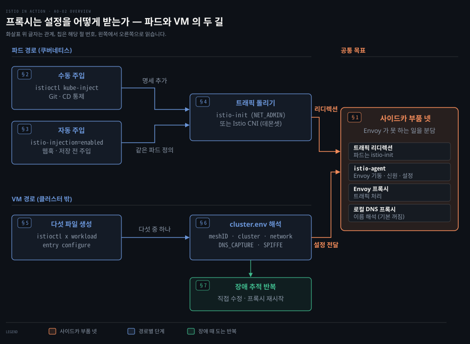
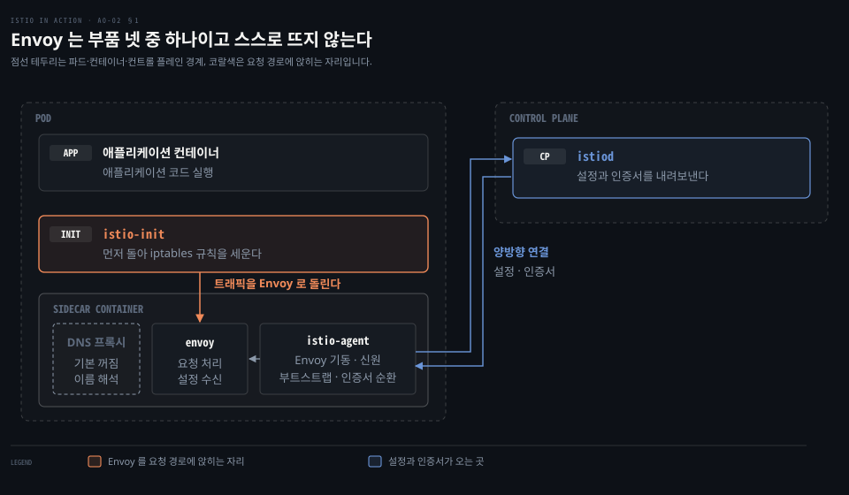
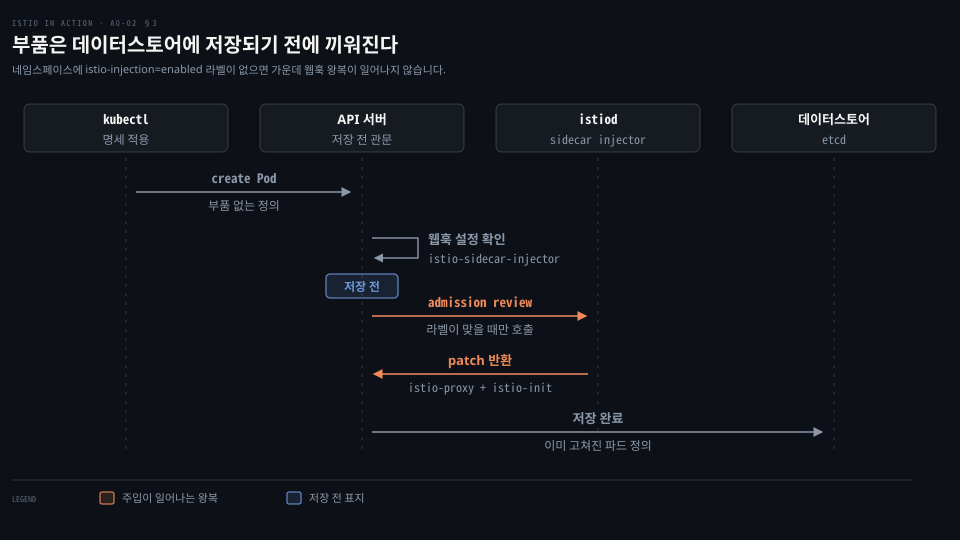
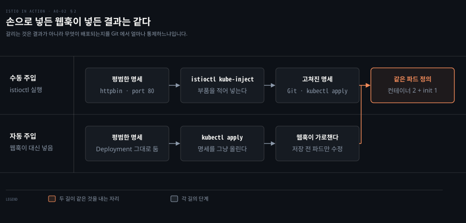
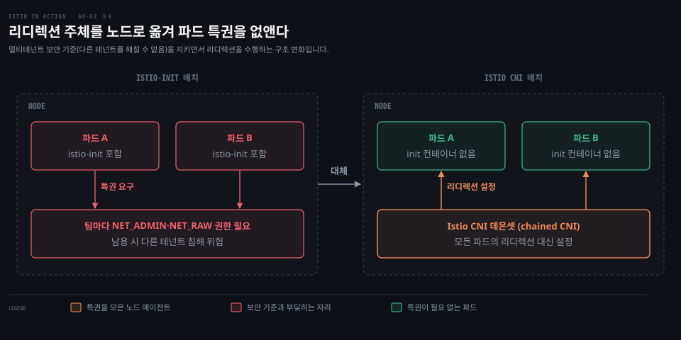
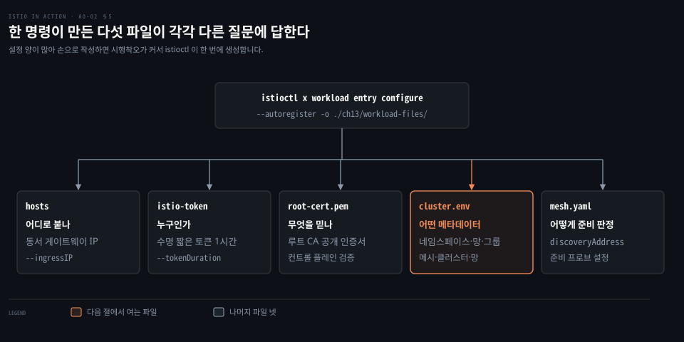
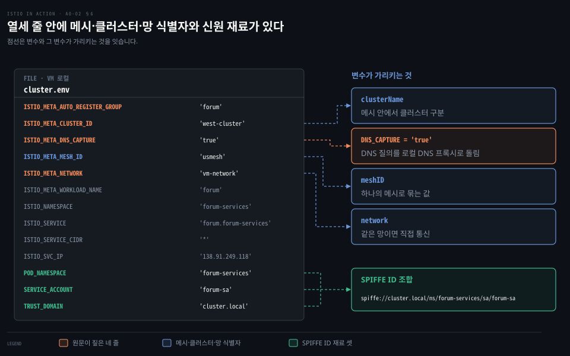
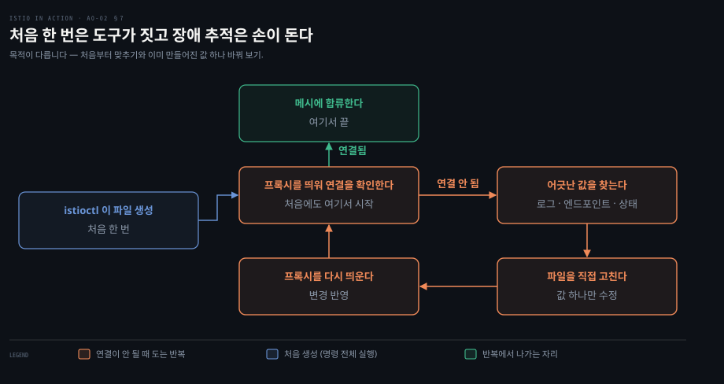

# 부록 — 사이드카를 이루는 넷과 VM 이 받는 다섯 파일

---

> 사이드카(애플리케이션 옆에 붙어 트래픽을 대신 처리하는 프록시)는 자기가 파드 안인지 VM 위인지 구분하지 않지만, 설정을 받는 경로는 환경마다 다릅니다. 이 문서는 파드의 경로와 VM 의 경로를 한 편에 묶어 따라갑니다.

## 핵심 요약

> Envoy 프록시(Istio 가 사이드카에서 쓰는 네트워크 프록시) 혼자서는 자기를 요청 경로에 앉히지도 못하고 신원과 인증서도 얻지 못합니다. 이 빈자리를 채우는 부품 넷에 설정을 내리는 일은 파드에서는 주입이, VM 에서는 파일 다섯이 맡습니다.

관행상 사이드카를 "서비스 프록시"나 "Envoy 프록시"라 줄여 부릅니다. 원문은 이 호칭을 부분으로 전체를 가리키는 제유(synecdoche)라 부르고, Envoy 혼자 하는 일이 아니라고 덧붙입니다.

그 일들을 나누어 맡는 부품이 데이터 플레인에 따로 있습니다. 데이터 플레인은 트래픽을 실제로 처리하는 프록시 계층입니다.

파드에서는 사람이 `istioctl` 로 명세를 고치거나 어드미션 웹훅이 자동으로 부품을 넣습니다. 어드미션 웹훅은 저장 전에 쿠버네티스 요청을 가로채 고치는 장치입니다. VM 에서는 `istioctl` 이 만든 파일 다섯이 그 자리를 대신하고, 문제를 쫓을 때는 파일을 직접 고칩니다. 여기서 메시는 사이드카들이 서비스 사이 통신을 맡아 이루는 서비스 메시를 줄여 부른 말입니다.


## 학습 목표

이 문서를 읽고 나면 다음을 할 수 있습니다.

1. 사이드카를 이루는 부품 넷을 이름과 역할로 구분하고, 그중 어느 것이 Envoy 를 요청 경로에 앉히는지 말할 수 있습니다.
2. 수동 주입과 자동 주입이 결과적으로 같은 변경을 낸다는 점과, 그럼에도 조직이 둘 중 하나를 고르는 이유를 설명할 수 있습니다.
3. 자동 주입이 쿠버네티스의 어떤 기능 위에 서 있고 어느 리소스가 그 연결을 만드는지 말할 수 있습니다.
4. `istio-init` 이 특권을 요구하는 이유와 Istio CNI 플러그인이 그 요구를 어떻게 없애는지 설명할 수 있습니다.
5. VM 에 생성되는 파일 다섯의 역할을 말하고, `cluster.env` 의 값에서 메시·클러스터·망을 짚을 수 있습니다.

아래 지도는 "프록시는 자기 설정을 어떻게 받는가"라는 질문에 파드와 VM 두 길이 같은 사이드카 부품 넷(`§1`)으로 모이는 모습을 보여 줍니다.




## 프록시가 설정을 받는 두 길

> 파드와 VM 은 출발 환경이 다르지만, 결국 같은 사이드카 부품 넷에 신원과 설정과 트래픽 경로를 넘깁니다.

파드에 사이드카가 안 붙거나 VM 이 메시에 들지 못할 때, 어디서 설정이 빠졌는지 모르면 원인을 찾을 수 없습니다. 아래 표는 이 문서 전체를 다섯 단계로 엮어 파드와 VM 에서 각 단계를 누가 맡는지 정리한 뼈대입니다.

| 단계 | 주체 | 받치는 개념 | 맡는 절 |
|---|---|---|---|
| 1 부품 구성 | 사이드카 안 `istio-agent`·Envoy·DNS 프록시와 리디렉션 계층 | 역할 분업과 기동 순서 | §1 |
| 2 파드 명세 주입 | 사람이 실행하는 `istioctl kube-inject` 또는 API 서버·`istiod` 웹훅 | `istioctl kube-inject` 와 `MutatingWebhookConfiguration` | §2, §3 |
| 3 파드 트래픽 돌리기 | `istio-init` 컨테이너 또는 노드별 `istio-cni` 데몬셋 | `iptables` 규칙과 최소 권한 | §4 |
| 4 VM 설정 파일 생성 | `istioctl x workload entry configure` | 파일 다섯과 `cluster.env` 식별자 | §5, §6 |
| 5 장애 추적 수정 | 운영자의 직접 파일 편집과 프록시 재시작 | 빠른 설정-재시작 반복 | §7 |

§1 은 환경과 무관하게 사이드카를 이루는 부품 넷의 역할 분업을 봅니다. §2~§4 는 쿠버네티스 파드에 그 부품을 넣고 트래픽을 돌리는 두 갈래와 보안 대안을 다룹니다. §5~§7 은 쿠버네티스 밖 VM 이 다섯 파일로 같은 상태를 맞추고 장애를 쫓는 과정을 따라갑니다.


## 이 문서가 다루지 않는 것

> 주입된 뒤의 트래픽 처리와 VM 등록 절차 자체는 다른 자리가 맡습니다.

사이드카가 설정을 받은 **뒤** 리스너·라우트·클러스터와 xDS(`istiod` 가 프록시에 설정을 내려보내는 API 묶음)로 무슨 일을 하는지는 [3장](./03-01.Envoy가%20맡는%20일과%20Istio가%20보태는%20일.md)이 다룹니다.

VM 을 메시에 등록하는 절차는 [13장](./13-01.자동으로%20되던%20일이%20목록이%20되어%20나타난다.md)이 맡습니다. `WorkloadGroup` 은 VM 워크로드의 묶음 정의이고 `WorkloadEntry` 는 등록된 VM 한 대입니다. 동서 게이트웨이는 클러스터 밖 VM 과 컨트롤 플레인을 잇는 게이트웨이입니다. 이 부록은 그 절차가 만들어 낸 파일의 내부만 봅니다.

`istio-agent` 가 돌리는 로컬 DNS 프록시의 동작과 `NDS`(프록시의 DNS 항목을 동기화하는 API)는 [13장 §5](./13-01.자동으로%20되던%20일이%20목록이%20되어%20나타난다.md#5-이름이-풀리지-않으면-트래픽은-나가지도-못한다)가 다룹니다. 여기서는 그것이 사이드카 부품 중 하나라는 사실만 짚습니다.

Istio CNI 노드 에이전트의 세부 설치와 운영 절차는 [Istio CNI 공식 문서](https://istio.io/latest/docs/setup/additional-setup/cni/)로 넘깁니다. 이 문서는 `istio-init` 을 대체하는 구조와 권한 변화까지만 봅니다.


## 1. 사이드카를 이루는 부품 넷

> Envoy 프록시 혼자서는 요청 경로에 앉지 못하고 신원 부트스트랩과 인증서 순환도 할 수 없습니다. 사이드카는 이 일을 나누어 맡는 부품 넷의 묶음입니다.

흐름 위치: 1 부품 구성 · 받치는 개념 — 역할 분업과 기동 순서



Envoy 프록시가 메시 기능의 대부분을 실행합니다. 하지만 혼자서는 무력한 일이 셋 있습니다. 자기를 요청 경로에 앉히는 일, 신원을 부트스트랩(초기 실행 시 신원과 설정을 갖추는 과정)하는 일, 인증서를 순환시키는 일입니다. 위 그림에서 파드 안의 `istio-init` 과 `istio-agent` 가 그 빈자리를 나누어 맡습니다.

사이드카를 이루는 데이터 플레인 부품은 넷입니다.

- **Istio 에이전트(`istio-agent`)**: 파일럿 에이전트라고도 불립니다. 사이드카 컨테이너 안에서 Envoy 프로세스를 띄우고 신원을 부트스트랩합니다. 이어 컨트롤 플레인(`istiod`, 데이터 플레인에 설정과 인증서를 내려보내는 관리 계층)과 양방향 연결을 유지하며 최신 설정과 인증서를 Envoy 에 적용합니다.
- **로컬 DNS 프록시**: 에이전트에 더해진 부품으로, VM 을 메시에 넣거나 멀티 클러스터를 묶을 때 클러스터 호스트명을 풉니다. 사이드카 모드에서는 기본값이 꺼짐이며 설치 시 켤 수 있습니다. 파드별 사이드카 없이 노드 단위로 동작하는 Ambient 모드에서는 Istio 1.25 부터 기본값으로 켜집니다.[^istio-dns]
- **Envoy 프록시**: 사이드카 컨테이너 안에서 프로세스로 뜹니다. 스스로 기동하지 않고 `istio-agent` 가 띄우고 설정을 넣어 줍니다.
- **`istio-init` 컨테이너(파드 기준)**: 파드 환경을 고쳐 애플리케이션의 인바운드·아웃바운드 트래픽을 서비스 프록시로 돌립니다. 다른 앱 컨테이너보다 먼저 도는 쿠버네티스 init 컨테이너 기능을 써서, 트래픽이 앱에 닿기 전에 `iptables`(리눅스 커널의 패킷 규칙 도구) 규칙을 세웁니다.[^k8s-init] VM 에는 init 컨테이너가 없습니다. VM 이 같은 일을 어떻게 하는지는 원문이 적지 않습니다.

앞의 역할 분업으로 보면, Envoy 를 요청 경로에 앉히는 일은 `istio-init` 이 담당합니다. 신원 부트스트랩과 인증서 순환은 `istio-agent` 가 담당합니다.


## 2. 주입은 YAML 을 고쳐 넣는 일

> 사이드카 주입은 쿠버네티스 애플리케이션 명세에 데이터 플레인 부품을 더하는 일입니다. YAML 을 손으로 편집하면 오류가 잦아 도구나 웹훅을 씁니다.

흐름 위치: 2 파드 명세 주입 · 받치는 개념 — `istioctl kube-inject`

평범한 쿠버네티스 `Deployment` 명세에는 애플리케이션 컨테이너 하나와 포트 하나만 들어 있습니다. 이 YAML 파일에 사이드카와 init 컨테이너 정의를 손으로 직접 적어 넣으려면 오타와 들여쓰기 실수가 잦습니다.

```yaml
apiVersion: apps/v1
kind: Deployment
metadata:
  name: httpbin
spec:
  selector:
    matchLabels:
      app: httpbin
  template:
    metadata:
      labels:
        app: httpbin
    spec:
      containers:
      - image: docker.io/kennethreitz/httpbin
        name: httpbin
        ports:
        - containerPort: 80
```

**수동 주입**은 이 명세를 `istioctl` 에 넘겨 데이터 플레인 부품을 대신 넣게 하는 방식입니다.

```bash
istioctl kube-inject -f deployment.yaml
```

이름은 수동이지만 사람이 하는 일은 명령을 한 번 치는 것뿐이고, 실제 YAML 편집은 `istioctl` 이 수행합니다. 기본값으로는 클러스터 안의 `istio-sidecar-injector` ConfigMap(주입 템플릿을 담은 설정)을 읽어 부품을 채워 넣습니다.[^sidecar-injection]

쓰는 방식은 목적에 따라 갈립니다. 프로토타이핑 중에는 출력을 `kubectl apply` 로 파이프해 바로 적용합니다. 실제 운영 클러스터에서는 서비스마다 정의를 갱신해 Git 저장소에 두고, 지속적 배포(CD) 파이프라인이 클러스터에 적용하게 합니다.


## 3. 자동 주입이 서는 자리

> 자동 주입은 쿠버네티스의 뮤테이팅 어드미션 웹훅 위에 섭니다. 파드 정의가 데이터스토어에 저장되기 전에 컨트롤 플레인이 부품을 끼워 넣습니다.

흐름 위치: 2 파드 명세 주입 · 받치는 개념 — `MutatingWebhookConfiguration`

사람이 매번 `istioctl kube-inject` 를 돌리지 않아도 `istiod` 가 부품을 넣을 수 있습니다. `kubectl` 이 올린 파드 정의가 API 서버를 거쳐 데이터스토어(etcd)에 저장되기 전에 가로채는 방식입니다. 아래 시퀀스는 네임스페이스 라벨 조건이 맞을 때만 웹훅 왕복이 일어나는 순서를 보여 줍니다.



**뮤테이팅 어드미션 웹훅**(mutating admission webhook)은 쿠버네티스 API 서버의 확장 장치입니다. 리소스를 저장하기 전에 외부 서비스로 요청을 보내 내용을 고치도록 허용합니다. 이 호출은 쿠버네티스가 정한 `AdmissionReview` 요청·응답 형식을 쓰고, 응답에 고칠 내용(patch)이 담겨 돌아옵니다.[^k8s-admission] 자동 주입이 파드 정의에 내는 변경은 `istioctl kube-inject` 와 같습니다. 다만 `Deployment` 정의 자체는 바뀌지 않고 파드가 생성되는 시점에 파드 수준에서 주입이 일어납니다.[^sidecar-injection]

자동 주입은 옵트인(opt-in) 기능이며 기본은 네임스페이스 단위로 켭니다. 네임스페이스에 `istio-injection=enabled` 라벨을 붙이는 것이 스위치입니다.

```bash
kubectl create namespace istioinaction
kubectl label namespace istioinaction istio-injection=enabled
kubectl config set-context $(kubectl config current-context) \
  --namespace=istioinaction
```

이후 그 네임스페이스에 생성되는 파드에는 데이터 플레인 부품이 들어갑니다. 생성된 파드 정의(`kubectl get pod <파드이름> -o yaml`)를 확인해 보면 `spec.containers` 에 애플리케이션과 `istio-proxy` 둘이 들어 있습니다. `spec.initContainers` 에는 `istio-init` 하나가 붙습니다. 원문 출력에서 프록시와 init 컨테이너는 같은 이미지(`docker.io/istio/proxyv2:1.13.0`)를 쓰고, 이미지 태그는 설치한 Istio 버전에 따라 달라집니다. 실행 인자만 `proxy sidecar` 와 `istio-iptables` 로 다릅니다.

네임스페이스 외에 파드 라벨(`sidecar.istio.io/inject`)로도 주입 여부를 정할 수 있습니다. 컨트롤 플레인 리비전 라벨(`istio.io/rev`)을 쓰면 대상을 버전별로 가를 수 있습니다.[^sidecar-injection] 어느 라벨도 없으면 기본 설정에서는 주입하지 않습니다.

API 서버가 파드 생성 이벤트를 컨트롤 플레인으로 보내도록 연결하는 리소스는 `MutatingWebhookConfiguration` 입니다. API 서버는 이 리소스를 보고 어떤 리소스와 작업이 맞을 때 외부 서비스로 요청을 보낼지 결정합니다.

```bash
kubectl get MutatingWebhookConfiguration
```

사이드카 주입을 맡는 설정 이름은 `istio-sidecar-injector` 이며, 원문 출력에서는 웹훅이 네 개 들어 있습니다.

### 수동 주입과 자동 주입 비교



결과가 같더라도 운영 방식에 따라 조직의 선택이 갈립니다. 저자는 손이 덜 가고 서비스 정의를 고치지 않아도 되는 자동 주입을 택하는 조직을 더 자주 본다고 적습니다. 다만 배포 내용을 Git 에서 완전히 통제하려고 수동 주입을 택하는 조직도 드물지 않다고 덧붙입니다.

| 기준 | 수동 주입 (`istioctl kube-inject`) | 자동 주입 (어드미션 웹훅) |
|---|---|---|
| 적용 시점 | 클러스터 적용 전 YAML 변환 | 파드 생성 시 etcd 저장 직전 |
| 배포 정의 변경 | Git 에 저장된 명세가 직접 바뀜 | `Deployment` 는 그대로 두고 파드만 바뀜 |
| 운영 편의 | 서비스마다 파이프라인·명령 단계가 필요함 | 네임스페이스 라벨 하나로 일괄 적용됨 |
| 변경 통제 | 배포될 컨테이너 스펙을 Git 에서 사전 검증함 | 클러스터 웹훅 설정과 템플릿을 믿고 맡김 |


## 4. istio-init 특권과 CNI 플러그인

> 트래픽을 돌리려면 `istio-init` 에 높은 권한이 필요합니다. 여러 팀이 나눠 쓰는 클러스터에서는 그 요구가 보안 기준과 부딪힙니다.

흐름 위치: 3 파드 트래픽 돌리기 · 받치는 개념 — `iptables` 규칙과 최소 권한



`istio-init` 컨테이너는 파드 내부의 `iptables` 규칙을 고쳐 트래픽을 Envoy 로 돌려야 합니다. 이를 위해 `NET_ADMIN` 과 `NET_RAW` 같은 높은 리눅스 커널 권한(capabilities)이 필요합니다.[^istio-cni]

여러 테넌트가 함께 쓰는 멀티테넌트 클러스터에서는 한 테넌트가 다른 테넌트를 해칠 수 없어야 한다는 보안 기준이 중요합니다. 여기서 딜레마가 생깁니다. 애플리케이션 팀에게 특권 컨테이너를 실행할 RBAC(쿠버네티스의 역할 기반 접근 제어) 권한을 주지 않으면 `istio-init` 이 든 워크로드를 띄울 수 없습니다. 반대로 권한을 주면 그 권한이 남용되어 다른 테넌트를 침해할 위험이 생깁니다.

**Istio CNI 노드 에이전트**(`istio-cni`)가 이 딜레마를 없앱니다. CNI(Container Network Interface)는 쿠버네티스가 파드의 네트워크 인터페이스를 구성할 때 부르는 플러그인 표준입니다.

Istio CNI 는 파드에 `istio-init` 을 넣는 대신 노드마다 데몬셋(노드마다 파드를 하나씩 띄우는 쿠버네티스 리소스)으로 도는 특권 파드 하나로 일을 옮깁니다.[^istio-cni] 이 에이전트는 노드에 설정된 모든 CNI 플러그인 뒤에 이어 실행되는(chained) 플러그인을 설치합니다. 새 파드가 뜰 때 그 플러그인이 트래픽 리디렉션 규칙을 세웁니다.

그 결과 워크로드 파드에는 `istio-init` 컨테이너 자체가 사라집니다. 애플리케이션 팀에 `NET_ADMIN`·`NET_RAW` 실행 권한을 줄 필요도 함께 없어집니다. Istio 1.32 기준으로 사이드카 모드에서는 이 CNI 노드 에이전트가 선택 사항입니다. 반면 파드별 사이드카 없이 노드 단위로 동작하는 Ambient 모드에서는 필수 구성요소입니다.[^istio-cni] [a0-01](./a0-01.부록%20—%20설치를%20고르는%20API%20와%20프로파일%20여덟.md) 에서 본 `openshift` 프로파일은 이 플러그인을 켠 채로 설치합니다.[^istio-openshift] 원문 부록 A 는 이를 Red Hat 의 쿠버네티스 배포판인 OpenShift 의 요구 사항이라고 적습니다.

Pod Security Standards의 `restricted` 프로필은 `NET_BIND_SERVICE` 외 커널 권한을 모두 막습니다.[^k8s-pss] 그래서 `NET_ADMIN`·`NET_RAW`가 필요한 `istio-init`을 쓰면 앱 파드가 정책을 어깁니다. Istio 1.32 기준으로 Istio CNI를 쓰면 앱 파드에 그 권한이 빠집니다.[^istio-cni-v132] 그 덕분에 앱 네임스페이스에 `restricted` 프로필을 적용할 수 있습니다. 다만 앱 파드의 `seccompProfile`은 정책에 맞게 따로 설정해야 합니다.[^istio-psa]


## 5. VM 이 받는 다섯 파일

> 쿠버네티스 밖 VM 은 어드미션 웹훅과 자동 토큰 마운트를 쓸 수 없습니다. `istioctl x workload entry configure` 가 그 빈자리를 메우는 파일 다섯을 만듭니다.

흐름 위치: 4 VM 설정 파일 생성 · 받치는 개념 — 파일 다섯

파드에서는 쿠버네티스가 서비스 어카운트 토큰을 파일로 마운트(파드 안에 파일로 넣어 줌)해 주지만 VM 에는 그런 장치가 없습니다. 그래서 VM 워크로드가 메시에 들려면 컨트롤 플레인 접속 주소, 신원 토큰, 루트 인증서, 메타데이터, 상태 점검(헬스 프로브) 설정을 사람이 옮겨 주어야 합니다. 설정 양이 많고 구조가 복잡해 손으로 짜면 시행착오가 크기 때문에 `istioctl` 이 다섯 파일을 한 번에 생성합니다.



VM 워크로드를 메시에 붙일 때 아래 명령으로 다섯 파일을 한 번에 생성합니다. 전체 등록 절차는 [13장](./13-01.자동으로%20되던%20일이%20목록이%20되어%20나타난다.md)이 다룹니다.

```bash
istioctl x workload entry configure \
  --name forum \
  --namespace forum-services \
  --clusterID "west-cluster" \
  --externalIP $VM_IP \
  --autoregister \
  -o ./ch13/workload-files/
```

`$VM_IP` 는 VM 의 IP 를 담은 셸 변수입니다. `--autoregister` 는 자동 등록을 켭니다. `-o` 는 파일을 쓸 폴더이고 `./ch13/workload-files/` 는 원문 예시 경로입니다.

현행 istioctl 참조 문서도 이 명령을 실험적(`x`) 하위 명령으로 분류합니다.[^istioctl-ref] 공식 VM 가이드는 이 명령이 만드는 다섯 파일(`cluster.env`·`istio-token`·`mesh.yaml`·`root-cert.pem`·`hosts`)을 설명합니다. `WorkloadGroup` YAML 을 `-f` 로 넘기는 방식도 안내합니다.[^istio-vm]

다섯 파일은 각각 다른 질문 하나에 답합니다.

- **`hosts` (어디로 붙나)**: `istiod.istio-system.svc` 호스트 항목이 들어 있고, 이 이름을 동서 게이트웨이 IP 로 풉니다. 게이트웨이는 기본으로 이름이 `istio-eastwestgateway` 인 것을 쓰며, `--ingressService` 로 이름을, `--ingressIP` 로 IP 를 직접 지정해 바꿉니다.
- **`istio-token` (누구인가)**: 워크로드가 `istiod` 에 자기를 밝힐 때 쓰는 수명 짧은 쿠버네티스 토큰입니다. 기본 수명은 1시간이며 `--tokenDuration` 으로 바꿉니다.
- **`root-cert.pem` (무엇을 믿나)**: 루트 인증 기관(CA)의 공개 인증서입니다. 워크로드가 컨트롤 플레인의 인증서를 검증하는 신뢰 근거가 됩니다.
- **`cluster.env` (어떤 메타데이터를 지고 있나)**: 네임스페이스, 서비스 어카운트(쿠버네티스 워크로드의 신원 단위), 망, 소속 워크로드 그룹 같은 환경변수가 들어 있습니다.
- **`mesh.yaml` (어디서 설정을 받고 어떻게 준비를 판정하나)**: 컨트롤 플레인 디스커버리 주소(`discoveryAddress`, `istiod` 에 접속하는 주소)를 담습니다. 사이드카가 앱의 수신 준비를 시험하는 프로브도 함께 설정합니다.


## 6. cluster.env 가 담는 것

> VM 은 파드 스펙이나 네임스페이스 라벨로 소속을 알릴 수 없습니다. `cluster.env` 열세 줄의 환경변수가 메시·클러스터·망 식별자와 신원 재료를 담습니다.

흐름 위치: 4 VM 설정 파일 생성 · 받치는 개념 — `cluster.env` 식별자

VM 위 프록시는 파드 라벨이나 네임스페이스 객체를 읽을 수 없습니다. 그래서 자기가 속한 경계와 이름 해석 방식을 환경변수 파일 하나로 내려받아야 합니다. 아래 그림은 열세 줄의 환경변수가 메시·클러스터·망 식별자와 어떻게 맞물리는지 보여 줍니다.



`cluster.env` 파일을 열면 환경변수 열세 줄이 들어 있습니다.

```bash
ISTIO_META_AUTO_REGISTER_GROUP='forum'
ISTIO_META_CLUSTER_ID='west-cluster'
ISTIO_META_DNS_CAPTURE='true'
ISTIO_META_MESH_ID='usmesh'
ISTIO_META_NETWORK='vm-network'
ISTIO_META_WORKLOAD_NAME='forum'
ISTIO_NAMESPACE='forum-services'
ISTIO_SERVICE='forum.forum-services'
ISTIO_SERVICE_CIDR='*'
ISTIO_SVC_IP='138.91.249.118'
POD_NAMESPACE='forum-services'
SERVICE_ACCOUNT='forum-sa'
TRUST_DOMAIN='cluster.local'
```

네 줄이 VM 워크로드의 핵심 동작을 결정합니다.

- `ISTIO_META_AUTO_REGISTER_GROUP='forum'` 은 워크로드를 `forum` 그룹에 자동 등록합니다.
- `ISTIO_META_CLUSTER_ID='west-cluster'` 는 워크로드가 `west-cluster` 에 자기를 인증하도록 정합니다.
- `ISTIO_META_DNS_CAPTURE='true'` 는 DNS 가로채기를 켜서 메시 안 서비스로 트래픽이 가도록 합니다.
- `ISTIO_META_NETWORK='vm-network'` 는 워크로드가 `vm-network` 망에 속함을 알립니다.

이 변수들은 [12장](./12-01.경계를%20지우는%20전제%20셋과%20남는%20한%20자리.md)이 세운 메시 경계 식별자 셋과 그대로 대응합니다. `ISTIO_META_MESH_ID` 는 같은 메시로 묶이는 범위인 `meshID` 와 짝입니다. `ISTIO_META_CLUSTER_ID` 는 멀티 클러스터 메시 안에서 클러스터를 가르는 `clusterName` 과 짝입니다. `ISTIO_META_NETWORK` 는 설치가 놓인 네트워크인 `network` 와 짝입니다. 12장이 "식별자 셋이 어디까지가 한 몸인지를 정한다"고 풀이한 세 값이 VM 쪽에서는 이 환경변수로 내려옵니다.

`ISTIO_META_DNS_CAPTURE` 가 참이면 사이드카가 DNS 질의를 가로채는 기능이 켜집니다. 그러면 `iptables` 규칙이 DNS 질의를 사이드카 안의 로컬 DNS 프록시로 돌려 클러스터 서비스 이름을 풀어 줍니다. 세부 동작은 [13장 §5](./13-01.자동으로%20되던%20일이%20목록이%20되어%20나타난다.md#5-이름이-풀리지-않으면-트래픽은-나가지도-못한다)가 다룹니다.

나머지 세 줄은 신원의 재료입니다. SPIFFE ID 는 워크로드의 신원을 나타내는 URI 로, 인증서에 담겨 신원을 증명합니다. [9장](./09-01.거의%20안전한%20기본값을%20닫아%20가는%20순서.md#1-ip가-신원이던-자리를-무엇이-대신하는가)이 보인 `spiffe://cluster.local/ns/istioinaction/sa/catalog` 처럼 `spiffe://<트러스트 도메인>/ns/<네임스페이스>/sa/<서비스 어카운트>` 꼴입니다.[^istio-authz]

이 꼴에 `TRUST_DOMAIN`·`POD_NAMESPACE`·`SERVICE_ACCOUNT` 값을 넣으면 이 VM 워크로드의 신원은 `spiffe://cluster.local/ns/forum-services/sa/forum-sa` 가 됩니다. `ISTIO_NAMESPACE` 도 같은 `forum-services` 라서 어느 쪽을 쓰든 결과가 같습니다.


## 7. 장애 추적 시 파일 직접 수정

> 저자는 초기 설정 생성에는 `istioctl` 자동화를 권하면서도 예외를 하나 둡니다. VM 워크로드가 메시에 붙지 않는 이유를 쫓을 때는 파일을 직접 고치는 편이 반복이 빠릅니다.

흐름 위치: 5 장애 추적 수정 · 받치는 개념 — 빠른 설정-재시작 반복



설정을 처음 만들 때는 항상 `istioctl` 을 쓰는 편이 낫습니다. 그러나 워크로드가 메시에 붙지 않는 원인을 추적할 때는 다릅니다. 이미 생성된 파일에서 값 하나만 고치고 서비스 프록시를 다시 띄워 변경을 반영하는 편이 반복이 빠릅니다.

두 권고는 모순되지 않습니다. 쓰는 목적이 다릅니다. 처음부터 다섯 파일을 맞추려면 구조가 복잡해 자동화가 유리합니다. 반면 이미 만들어진 파일에서 틀린 값 하나만 바꿔 보는 데는 `istioctl` 명령 전체를 다시 실행하는 비용이 큽니다.

[13장](./13-01.자동으로%20되던%20일이%20목록이%20되어%20나타난다.md)의 진단 순서와 합치면 고칠 자리가 분명해집니다. VM 으로 가는 요청이 실패하면 Envoy 액세스 로그의 `UH` 플래그(건강한 업스트림이 없다는 뜻)에서 시작해 프록시의 엔드포인트 목록으로 내려갑니다. 마지막으로 `WorkloadEntry` 의 `status.conditions`(등록된 VM 의 상태 조건)까지 내려와 값이 어긋난 것이 보이면, 고칠 대상이 바로 이 다섯 파일 중 하나입니다.


## 결정 치트시트

> 파드 주입과 VM 설정 관리에서 상황마다 어떤 방식을 고를지 기준을 모았습니다.

| 상황 | 고를 것 | 이유 |
|---|---|---|
| 프로토타이핑 중 | `istioctl kube-inject` + `kubectl apply` | 명령 하나로 바로 적용할 수 있음 |
| 운영 클러스터 · 배포를 통제하고 싶을 때 | 수동 주입 + Git | 무엇이 배포되는지를 완전히 통제할 수 있음 |
| 운영 클러스터 · 손을 덜고 싶을 때 | 자동 주입 (`istio-injection=enabled`) | 서비스 정의를 손으로 갱신하지 않아도 됨 |
| 여러 팀이 나눠 쓰는 큰 클러스터 | Istio CNI 노드 에이전트 | `istio-init` 과 `NET_ADMIN`·`NET_RAW` 요구가 함께 사라짐 |
| OpenShift | `openshift` 프로파일 | CNI 플러그인이 켜진 채로 설치됨 |
| VM 설정을 처음 만들 때 | `istioctl x workload entry configure` | 손으로 짜면 시행착오가 많이 듦 |
| VM 이 메시에 안 붙는 원인을 쫓을 때 | 파일을 직접 고치고 프록시 재시작 | 값 하나 바꿔 보는 반복이 빠름 |


## 적용 관점

> 이 부록에서 실무로 가져갈 규칙 하나와, Spring 쪽에서 견줄 만한 자리를 적습니다.

파드에 사이드카가 안 붙으면 네임스페이스 라벨부터 봅니다. 자동 주입은 옵트인이고 스위치는 `istio-injection=enabled` 하나입니다. 라벨이 없으면 웹훅이 그 파드를 아예 건드리지 않으므로, 애플리케이션 정의를 아무리 들여다봐도 원인이 안 보입니다.

Spring 관점에서 견줄 자리는 자동 주입의 시점입니다. 뮤테이팅 웹훅은 파드 정의가 데이터스토어에 저장되기 전에 그것을 고칩니다. 빈이 등록되기 전에 정의를 고치는 `BeanFactoryPostProcessor` 와 자리가 같습니다. 이미 만들어진 빈을 감싸는 `BeanPostProcessor` 쪽이 아닙니다. 그래서 주입 결과를 보려면 이미 뜬 파드가 아니라 새로 만들어지는 파드를 봐야 하고, 라벨을 나중에 붙였다면 기존 파드는 다시 만들어야 합니다.


## 면접에서 받을 만한 질문

> 답을 먼저 떠올린 뒤 아래 정답 절을 펼칩니다.

1. 사이드카를 그냥 "프록시"라고 부르는 것이 왜 정확하지 않습니까? Envoy 가 혼자 못 하는 일 셋을 말해 보십시오.
2. `istio-init` 은 어떤 쿠버네티스 기능 위에 서 있고, 왜 하필 그 기능이어야 합니까?
3. 수동 주입과 자동 주입이 내는 결과가 같다면 조직은 무엇을 보고 둘 중 하나를 고릅니까?
4. `istio-init` 이 요구하는 특권이 멀티테넌트 클러스터에서 왜 딜레마가 됩니까? CNI 플러그인은 그 딜레마를 어떻게 없앱니까?
5. VM 에 만들어지는 다섯 파일 중 `cluster.env` 하나만 열어도 메시·클러스터·망을 가르는 식별자 셋을 다 짚을 수 있습니다. 각각 어느 변수입니까?


## 정답 (자답 후 펼치기)

> 위 §면접에서 받을 만한 질문 의 5 개에 *먼저 자답한 뒤* 읽으십시오. 자답 없이 먼저 읽으면 학습 효과가 0 입니다. 질문 번호와 1:1 로 대응합니다.

### 정답 1 — "프록시"라는 호칭이 부정확한 이유

사이드카가 부품 넷으로 이뤄져 있고 Envoy 는 그중 하나이기 때문입니다. 나머지는 Istio 에이전트(파일럿 에이전트), 로컬 DNS 프록시, `istio-init` 컨테이너입니다.

Envoy 가 혼자 못 하는 예 셋은 자기를 요청 경로에 앉히는 일, 신원을 부트스트랩하는 일, 인증서를 순환시키는 일입니다. 앞의 하나는 `istio-init` 이 `iptables` 규칙으로 하고 뒤의 둘은 에이전트가 합니다.

### 정답 2 — istio-init 이 선 자리

쿠버네티스의 **init 컨테이너** 기능입니다.

그 기능이어야 하는 이유는 순서 때문입니다. init 컨테이너는 다른 어떤 컨테이너보다 먼저 돌므로, 트래픽이 애플리케이션에 닿기 전에 `iptables` 규칙을 세워 Envoy 를 요청 경로에 끼워 넣을 수 있습니다. 애플리케이션과 나란히 뜨는 컨테이너였다면 그 순서를 보장할 수 없습니다.

### 정답 3 — 수동과 자동을 가르는 기준

웹훅이 내는 변경은 `istioctl kube-inject` 를 쓸 때와 같습니다.

갈리는 것은 두 가지입니다. 자동 주입은 더 쉽고 모든 서비스 정의를 손으로 갱신하지 않아도 됩니다. 수동 주입은 무엇이 배포되는지를 완전히 통제할 수 있습니다. 저자는 자동 쪽을 자주 보지만 수동을 고르는 조직도 드물지 않다고 적습니다.

### 정답 4 — 특권 딜레마와 CNI 플러그인

딜레마인 이유는 어느 쪽으로 가도 기준이 깨져서입니다. `NET_ADMIN`·`NET_RAW` 같은 특권 컨테이너를 돌릴 권한을 안 주면 애플리케이션 팀이 `istio-init` 이 든 워크로드를 돌릴 수 없고, 주면 그 권한이 남용되어 다른 테넌트를 해칠 수 있습니다. 멀티테넌트 환경의 기준은 한 테넌트가 다른 테넌트를 해칠 수 없어야 한다는 것입니다.

Istio CNI 노드 에이전트는 `istio-init` 이 하던 일을 노드마다 데몬셋으로 도는 중앙화된 파드로 옮깁니다. 그 파드가 모든 파드의 리디렉션 규칙을 설정하므로 `istio-init` 자체가 필요 없어지고, 그것을 돌리는 데 필요하던 권한도 함께 사라집니다.

### 정답 5 — cluster.env 안의 식별자 셋

`ISTIO_META_MESH_ID='usmesh'` 가 메시, `ISTIO_META_CLUSTER_ID='west-cluster'` 가 클러스터, `ISTIO_META_NETWORK='vm-network'` 가 망입니다.

12장은 같은 `meshID` 를 가진 설치들이 하나의 메시를 이루고, 그 안에서 `clusterName` 이 클러스터를 가르며 `network` 가 어느 망에 있는지를 알린다고 풀이합니다. 그 셋이 VM 쪽에서는 이 세 환경변수로 내려옵니다.


## 핵심 개념 체크리스트

> 이 문서의 핵심 개념과 파일 구성을 스스로 점검합니다.

- [ ] 사이드카의 부품 넷 — Istio 에이전트 · 로컬 DNS 프록시 · Envoy 프록시 · `istio-init`
- [ ] 에이전트가 하는 일 — Envoy 기동 · 신원 부트스트랩 · 컨트롤 플레인과 양방향 연결 · 설정 적용
- [ ] `istio-init` 이 init 컨테이너여야 하는 이유 — 트래픽이 닿기 전 `iptables` 규칙 설정
- [ ] `istioctl kube-inject` 와 `istio-injection=enabled` 라벨
- [ ] `MutatingWebhookConfiguration` 과 `istio-sidecar-injector`
- [ ] 멀티테넌시 기준과 Istio CNI 노드 에이전트가 없애는 권한
- [ ] VM 파일 다섯의 역할 — `hosts`·`istio-token`·`root-cert.pem`·`cluster.env`·`mesh.yaml`
- [ ] `cluster.env` 안의 메시·클러스터·망과 `ISTIO_META_DNS_CAPTURE`
- [ ] `--ingressService` · `--ingressIP` · `--tokenDuration` 이 바꾸는 것


## 관련 문서

- [3장 — Envoy가 맡는 일과 Istio가 보태는 일](./03-01.Envoy가%20맡는%20일과%20Istio가%20보태는%20일.md) — 사이드카가 설정을 받은 뒤의 이야기
- [9장 — 거의 안전한 기본값을 닫아 가는 순서](./09-01.거의%20안전한%20기본값을%20닫아%20가는%20순서.md) — SPIFFE ID 와 `spiffe://<trust-domain>/ns/<namespace>/sa/<service-account>` 형식
- [12장 — 경계를 지우는 전제 셋과 남는 한 자리](./12-01.경계를%20지우는%20전제%20셋과%20남는%20한%20자리.md) — `meshID`·`clusterName`·`network` 식별자 셋
- [13장 — 자동으로 되던 일이 목록이 되어 나타난다](./13-01.자동으로%20되던%20일이%20목록이%20되어%20나타난다.md) — VM 등록 절차와 다섯 파일의 목적지
- [부록 — 설치를 고르는 API 와 프로파일 여덟](./a0-01.부록%20—%20설치를%20고르는%20API%20와%20프로파일%20여덟.md) — `openshift` 프로파일이 CNI 를 켜 두는 자리
- [정독 인덱스](./README.md)


## 참고 자료

[^sidecar-injection]: Istio 공식 문서, "Installing the Sidecar" (Istio 1.32 기준, 2026-11-25 확인). <https://istio.io/latest/docs/setup/additional-setup/sidecar-injection/>
[^istio-cni]: Istio 공식 문서, "Install the Istio CNI node agent" (Istio 1.32 기준, 2026-11-25 확인). <https://istio.io/latest/docs/setup/additional-setup/cni/>
[^istio-vm]: Istio 공식 문서, "Virtual Machine Installation" (Istio 1.32 기준, 2026-11-25 확인). <https://istio.io/latest/docs/setup/install/virtual-machine/>
[^istio-dns]: Istio 공식 문서, "DNS Proxying" (Istio 1.32 기준, 2026-11-25 확인). <https://istio.io/latest/docs/ops/configuration/traffic-management/dns-proxy/>
[^istio-authz]: Istio 공식 문서, "AuthorizationPolicy" (2026-11-25 확인). 이 문서의 `principals` 예시(`cluster.local/ns/default/sa/sleep`)가 같은 트러스트 도메인·네임스페이스·서비스 어카운트 꼴입니다. <https://istio.io/latest/docs/reference/config/security/authorization-policy/>
[^k8s-admission]: 쿠버네티스 공식 문서, "Dynamic Admission Control" (2026-11-25 확인). `AdmissionReview` 요청·응답과 `JSONPatch` 형식의 `patch` 필드를 설명합니다. <https://kubernetes.io/docs/reference/access-authn-authz/extensible-admission-controllers/>
[^istio-openshift]: Istio 저장소 `manifests/profiles/openshift.yaml` (release-1.32 분기, 2026-11-25 확인). `components.cni.enabled: true` 가 들어 있습니다. <https://github.com/istio/istio/blob/release-1.32/manifests/profiles/openshift.yaml>
[^istioctl-ref]: Istio 공식 문서, "istioctl" 명령 참조 (2026-11-25 확인). `istioctl experimental workload entry configure` 가 실험적 명령 목록에 있습니다. <https://istio.io/latest/docs/reference/commands/istioctl/>
[^k8s-init]: 쿠버네티스 공식 문서, "Init Containers". <https://kubernetes.io/docs/concepts/workloads/pods/init-containers/>
[^k8s-pss]: Kubernetes 공식 문서, "Pod Security Standards" (2026-11-27 확인). `restricted` 정책은 `capabilities.drop: ["ALL"]` 과 `NET_BIND_SERVICE` 외 추가 금지를 요구합니다. <https://kubernetes.io/docs/concepts/security/pod-security-standards/>
[^istio-cni-v132]: Istio 공식 문서, "Install the Istio CNI node agent" (Istio 1.32 기준, 2026-11-27 확인). Istio CNI가 파드별 `NET_ADMIN`·`NET_RAW` 요구를 없앤다고 설명합니다. <https://istio.io/v1.32/docs/setup/additional-setup/cni/>
[^istio-psa]: Istio 공식 문서, "Install Istio with Pod Security Admission" (Istio 1.32 기준, 2026-11-27 확인). CNI 데몬셋이 도는 `istio-system` 은 `privileged` 로 둡니다. "Namespaces in the mesh may also use the restricted policy. You will need to configure the seccompProfile for your applications according to the policy specifications." <https://istio.io/v1.32/docs/setup/additional-setup/pod-security-admission/>

- 《Istio in Action》 부록 B "Istio's sidecar and its injection options"
- 《Istio in Action》 부록 E "How the virtual machine is configured to join the mesh"
- [Istio CNI 플러그인 공식 문서](https://istio.io/latest/docs/setup/additional-setup/cni/)
- [쿠버네티스 init 컨테이너](https://kubernetes.io/docs/concepts/workloads/pods/init-containers/)
