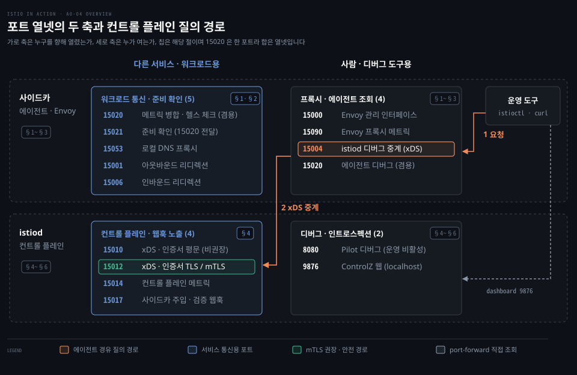
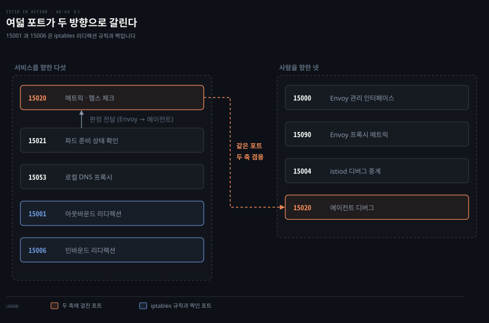
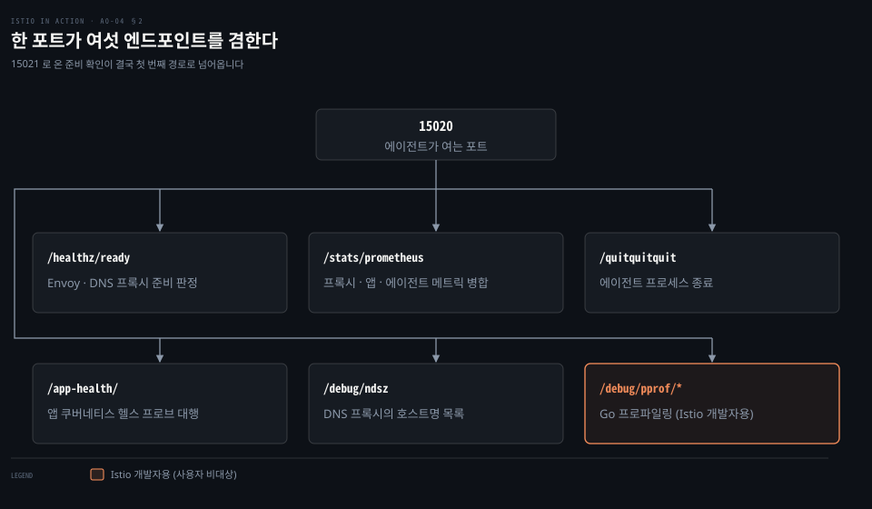
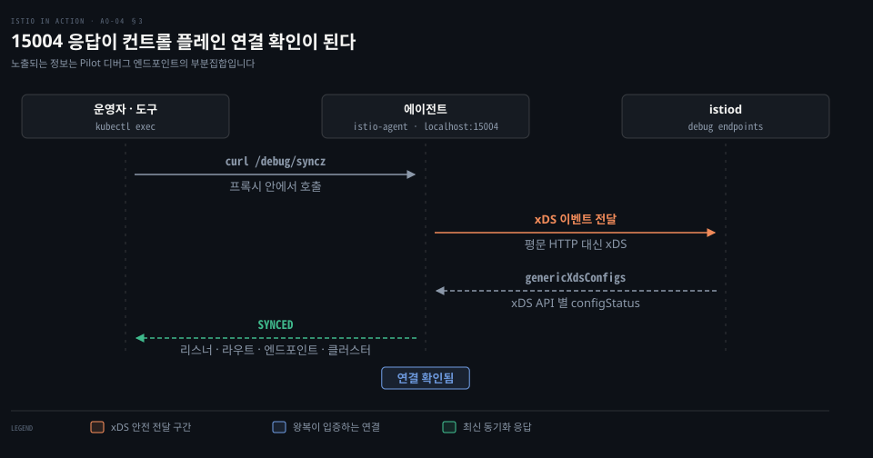
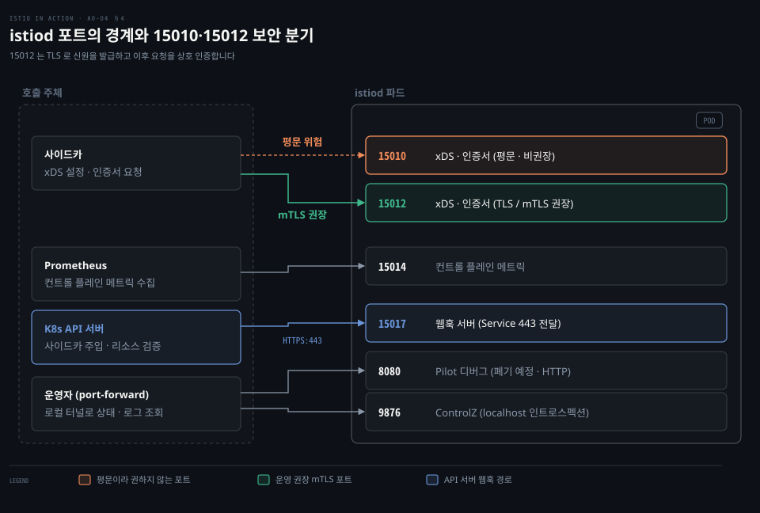
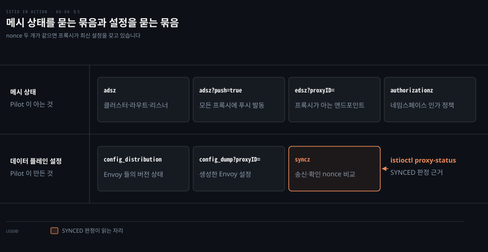
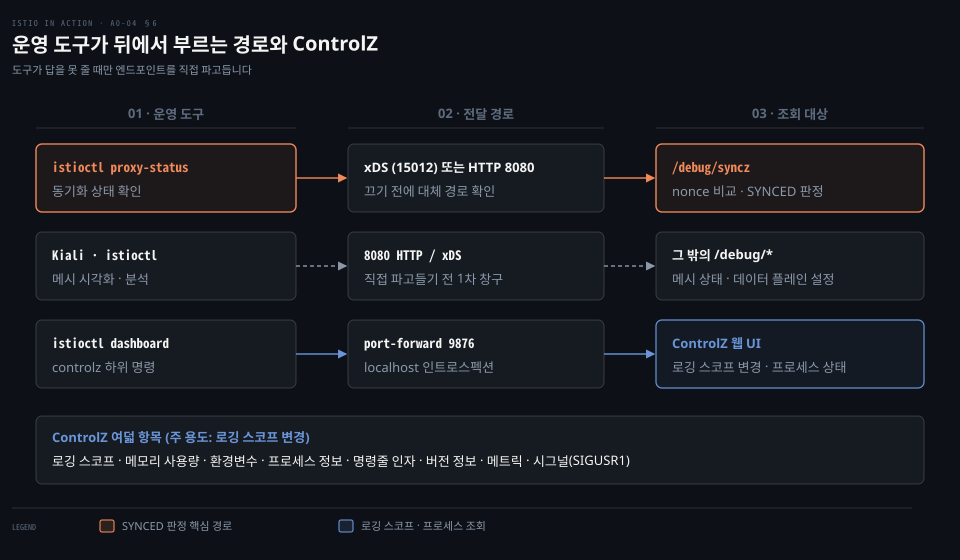

# 부록 — 포트 열넷과 디버그 엔드포인트 지도

---

> Istio 사이드카와 컨트롤 플레인(`istiod`, 책에서는 Pilot) 이 여는 포트 열넷은 다른 서비스를 향해 열린 것과 사람이나 도구가 들여다보려고 열린 것으로 갈립니다. 이 노트는 흩어진 포트 번호와 디버그 엔드포인트의 역할을 두 축의 지도로 묶습니다.


## 핵심 요약

> 서비스 간 통신은 워크로드를 향한 포트가 맡고, 장애 추적은 사람과 도구를 향해 열린 관리·디버그 포트와 엔드포인트로 들어갑니다. 운영 환경에서는 민감한 정보를 노출하는 HTTP 디버그 포트를 끄고 xDS 기반 안전 경로로 질의를 옮겨야 합니다.

프록시와 컨트롤 플레인의 포트 번호와 디버그 경로가 흩어져 있으면 장애 때 `15000` 과 `15020` 이 무엇인지 바로 떠올리기 어렵습니다. 이 노트는 그 번호를 한자리에 모읍니다.

먼저 이 노트가 쓰는 말을 풉니다. 메시는 서비스끼리의 통신을 사이드카 프록시가 대신 맡는 구조이고, 그 프록시들이 데이터 플레인입니다. 컨트롤 플레인은 프록시에 설정과 인증서를 내려보내는 쪽이며 `istiod`(책에서는 Pilot)가 맡습니다. xDS 는 `istiod` 가 Envoy 프록시에 리스너·라우트·클러스터·엔드포인트 설정을 내려보내는 API 묶음입니다.

사이드카는 애플리케이션 컨테이너 옆에 붙는 `istio-proxy` 컨테이너입니다. 그 안에서 Envoy 프록시와 `istio-agent` 가 함께 돕니다[^istio-pilot-agent]. `istio-agent` 는 공식 문서에서 `pilot-agent` 명령으로 나오는 프로세스이고 책은 Pilot agent 라고 부릅니다. 이 노트는 에이전트로 줄여 씁니다.

누가 여는가와 누구를 향해 열려 있는가로 나누면 구조가 드러납니다. 다른 서비스를 향해 열린 포트는 메시가 돌아가는 데 필수이고, 사람을 향해 열린 포트는 없어도 트래픽은 흐릅니다.

사람을 향한 포트는 프로세스 내부를 들여다보는 인트로스펙션과 디버그용이며, 그중 일부는 민감한 상태 정보를 담고 있어 저자가 운영에서 끄기를 권합니다.

사이드카 쪽이 여덟이고 `istiod` 쪽이 여섯이라 포트는 모두 열넷입니다. 열넷은 책 부록이 세는 범위입니다. 그 뒤 더해진 포트(`15002`·`15008`·`443`)와 폐기 예정이 된 `8080` 은 해당 절에서 따로 표시합니다. 구역별로 세면 열다섯 칸인데, `15020` 한 포트가 두 구역에 나오기 때문입니다.


## 학습 목표

이 문서를 읽고 나면 다음을 할 수 있습니다.

1. 사이드카가 여는 포트 여덟을 용도별로 가르고, 어느 것이 `iptables` 규칙과 짝인지 말할 수 있습니다.
2. `15020` 이 여러 기능을 겸하는 이유와, `15021` 과 준비 상태 판정을 어떻게 나누는지 설명할 수 있습니다.
3. `15020` 이 여는 엔드포인트 여섯을 들고, 그중 Istio 개발자용 프로파일링 경로를 가릴 수 있습니다.
4. Pilot 이 여는 포트 여섯을 가르고, `15010` 대신 `15012` 를 써야 하는 이유와 `8080` 의 현재 상태를 말할 수 있습니다.
5. Pilot 디버그 엔드포인트를 두 묶음으로 나누고, `istioctl` 과 ControlZ(`9876`) 가 각각 무엇을 대신 쓰는지 짚을 수 있습니다.

아래 지도는 **누가 여는가**와 **누구를 향해 열려 있는가** 두 축으로 포트 열넷을 가릅니다. 행은 사이드카와 `istiod` 이고 열은 다른 서비스용과 사람·도구용입니다. 그 위에는 도구에서 에이전트 `15004` 를 거쳐 `istiod` 로 닿는 질의 경로를 함께 실었습니다.



이 부록은 포트를 늘어놓는 장이라 한 흐름으로 꿰지 않고 구역 단위로 읽습니다. `§1`~`§3` 은 파드 안 사이드카의 포트와 엔드포인트를 다룹니다. `§4`~`§6` 은 `istiod` 의 포트와 디버그 엔드포인트, 그리고 운영자가 평소 쓰는 도구를 다룹니다. 도구는 `istioctl`(Istio 명령줄 도구)과 Kiali(메시 상태 시각화 웹 도구)입니다. ControlZ 는 `istiod` 프로세스의 내부 상태를 웹으로 보여 주는 인터페이스입니다.


## 이 문서가 다루지 않는 것

> 각 포트로 실제 장애를 분석하는 절차는 해당 본문 장이 맡고, 이 노트는 포트 번호와 엔드포인트의 대응만 세웁니다.

Envoy 관리 인터페이스(`15000`)로 설정을 읽고 로거 스코프를 바꾸는 실제 절차는 [10장](./10-01.프록시는%20다%20알고%20있고%20사람은%20못%20읽는다.md)이 정본입니다.

컨트롤 플레인 메트릭(`15014`)을 어떤 축으로 읽는지는 [11장](./11-01.컨트롤%20플레인의%20성능은%20낡은%20설정의%20수명이다.md)이 맡습니다. 여기서는 `15014` 가 그 메트릭을 연다는 사실까지만 다룹니다.

사이드카 주입 웹훅(`15017`)의 동작은 [부록 B](./a0-02.부록%20—%20사이드카를%20이루는%20넷과%20VM%20이%20받는%20다섯%20파일.md)가 다룹니다.

`pprof` 프로파일링 엔드포인트의 사용법은 [Go 프로파일링 문서](https://go.dev/doc/diagnostics#profiling)가 다룹니다. 이 경로는 Istio 개발자용이라 이 노트도 사용법을 다루지 않습니다.


## 1. 사이드카가 여는 포트 여덟

> 하나의 사이드카가 포트 여덟을 엽니다. 나열만 하면 파악하기 어렵지만 두 축으로 가르면 서비스용 다섯과 인트로스펙션용 넷으로 정리됩니다.



파드의 `istio-proxy` 컨테이너에서 `netstat` 을 실행하면 포트가 한꺼번에 쏟아져 트래픽용과 디버깅용을 한눈에 가르기 어렵습니다.

```bash
kubectl -n istioinaction exec -it deploy/webapp \
  -c istio-proxy -- netstat -tnl
```

실제 서비스 트래픽이나 헬스 체크가 붙는 포트와 사람이 상태를 들여다보는 포트를 섞어 두면 장애 시 어느 포트를 확인해야 할지 헷갈립니다. 그래서 포트가 누구를 향해 열려 있는지로 두 표에 나눕니다.

**다른 서비스를 향해 열린 것 다섯**입니다.

| 포트 | 무엇을 하나 |
|---|---|
| 15020 | `15090` 의 Envoy 메트릭·애플리케이션 메트릭·에이전트 자신의 메트릭 병합 노출, Envoy 와 DNS 프록시 헬스 체크, 에이전트 디버그 엔드포인트 |
| 15021 | 사이드카가 주입된 파드가 트래픽 수신 준비를 확인받는 자리 |
| 15053 | `istiod` 가 설정한 로컬 DNS 프록시(쿠버네티스 DNS 만으로 풀리지 않는 경우를 맡습니다) |
| 15001 | 애플리케이션의 아웃바운드 트래픽이 `iptables` 규칙으로 리디렉션되는 자리 |
| 15006 | 애플리케이션으로 오는 인바운드 트래픽이 리디렉션되는 자리 |

**사람이 들여다보려고 열린 것 넷**입니다.

| 포트 | 무엇을 하나 |
|---|---|
| 15000 | Envoy 프록시 관리 인터페이스 |
| 15090 | Envoy 프록시 메트릭(xDS·커넥션·HTTP·이상값 탐지·헬스 체크·서킷 브레이커 통계) |
| 15004 | 에이전트를 거쳐 여는 `istiod` 디버그 엔드포인트. `istiod` 와의 연결 문제를 볼 때 씁니다 |
| 15020 | 에이전트 디버그 엔드포인트 |

이상값 탐지는 오류를 자주 내는 대상을 풀에서 잠시 빼는 기능이고, 서킷 브레이커는 한도를 넘는 요청을 바로 거절하는 기능입니다.

`15020` 은 두 표에 모두 들어갑니다. 메트릭 수집과 헬스 체크 같은 서비스용 기능과 에이전트 디버그 엔드포인트를 한 포트에서 함께 열기 때문입니다.

에이전트가 직접 여는 포트는 `15020`·`15004`·`15053` 입니다. `15000`·`15001`·`15006`·`15021`·`15090` 은 Envoy 의 포트입니다[^istio-pilot-agent][^istio-app-req]. 그래서 여덟 포트를 통틀어 부를 때는 에이전트 포트가 아니라 사이드카 포트라고 합니다.

`15021` 과 `15020` 은 하나의 준비 확인을 나눠 갖습니다. 파드는 `15021` 에서 트래픽 수신 준비를 확인받습니다. Envoy 가 그 헬스 체크를 `15020` 의 에이전트로 넘기면 실제 판정은 `15020` 에서 일어납니다.

`15001` 과 `15006` 은 [부록 B](./a0-02.부록%20—%20사이드카를%20이루는%20넷과%20VM%20이%20받는%20다섯%20파일.md)의 `istio-init` 과 짝입니다. `istio-init` 은 파드가 뜨기 전에 도는 init 컨테이너입니다. 그 컨테이너가 세운 `iptables` 규칙(리눅스 커널이 패킷의 목적지를 바꾸는 규칙)이 트래픽을 이 두 포트로 돌립니다.

Istio 1.32 공식 문서의 사이드카 포트 목록에는 두 포트가 더 있습니다(2026-11-25 확인)[^istio-app-req]. 장애 감지 리슨 포트 `15002` 와 HBONE 터널 포트 `15008` 입니다. HBONE 은 구성 요소 사이를 잇는 보안 터널링 프로토콜이며 mTLS(양쪽이 서로의 인증서를 검증하는 상호 TLS)를 씁니다. 이 두 포트는 책 부록의 열넷에 들어 있지 않습니다. 같은 표는 `15000`·`15002`·`15004`·`15053` 이 파드 내부 전용 포트라는 점도 명시합니다. HBONE 터널의 구조는 [Ambient 모드와 ztunnel·waypoint](../../docs/istio/Ambient%20모드·ztunnel·waypoint.md)가 다룹니다.


## 2. 15020 이 여는 엔드포인트 여섯

> `15020` 은 준비 판정·메트릭 병합·프로세스 종료·앱 프로브 대행·DNS 목록·프로파일링을 한 포트 아래 경로별로 나눕니다.

한 포트에서 서비스용 기능과 디버깅 기능을 모두 열다 보니, `15020` 의 어느 경로를 두드려야 원하는 응답이 나오는지 헷갈리기 쉽습니다. 아래 그림은 `15020` 아래 갈라지는 여섯 엔드포인트를 한 장에 모은 것입니다.



`/healthz/ready` 는 Envoy 와 DNS 프록시에 일련의 프로브를 돌려 워크로드가 요청을 처리할 준비가 됐는지 확인합니다. 앞 절에서 본 `15021` 의 준비 확인이 결국 이 경로로 넘어옵니다.

`/stats/prometheus` 는 Envoy 프록시(`15090`)·애플리케이션·에이전트 자신의 메트릭을 합쳐 Prometheus 가 수집(스크랩)하도록 노출합니다.

`/quitquitquit` 은 에이전트 프로세스를 종료합니다.

`/app-health/` 는 애플리케이션의 쿠버네티스 헬스 프로브(준비·생존 확인 요청)를 대신 실행합니다. 앱이 프로브를 정의하면 `istiod` 의 뮤테이팅 웹훅이 그 정보를 뽑아 `ISTIO_KUBE_APP_PROBERS` 환경변수로 사이드카에 넣습니다. 뮤테이팅 웹훅은 API 서버가 파드를 만들 때 호출해 내용을 바꾸는 서버이며, 파드의 프로브 경로도 `15020` 의 `/app-health/` 로 바꿉니다[^istio-app-health]. 쿠버네티스가 보낸 프로브가 이 경로로 들어오면 에이전트가 해당 애플리케이션으로 돌립니다.

`/debug/ndsz` 는 `istiod` 가 Name Discovery Service(NDS)로 DNS 프록시에 설정한 호스트명 목록을 보여 줍니다. 로컬 DNS 프록시가 어떤 이름을 알고 있는지 확인할 때 씁니다.

`/debug/pprof/*` 는 Go 프로파일링 엔드포인트이고, 책은 Istio 개발자에게 쓸모가 있을 뿐 사용자의 관심사는 아니라고 구분합니다.

엔드포인트 접근은 `kubectl exec` 로 파드 안에서 HTTP 요청을 던지는 것이 가장 쉽습니다.

```bash
kubectl exec deploy/webapp -c istio-proxy -- \
  curl localhost:15020/stats/prometheus
```

응답에는 `istio_agent` 로 시작하는 메트릭과 `envoy` 로 시작하는 메트릭이 함께 나옵니다. 에이전트 메트릭과 프록시 메트릭이 한 응답으로 합쳐졌다는 증거입니다.


## 3. 15004 — 에이전트 경유 질의 경로

> 에이전트는 `15004` 로 들어온 요청을 xDS 이벤트로 `istiod` 에 안전하게 넘깁니다. 그래서 질의 응답 자체가 컨트롤 플레인과의 연결 확인이 됩니다.

앞 절의 `15020` 이 에이전트 자신을 들여다보는 자리라면, `15004` 는 에이전트를 지나 `istiod` 를 들여다보는 자리입니다. 프록시 설정이 반영되지 않을 때는 `istiod` 가 문제인지, 프록시와 `istiod` 사이 연결이 끊긴 것인지부터 가려야 합니다. 아래 시퀀스는 파드 안 `15004` 질의가 에이전트를 거쳐 `istiod` 까지 왕복하는 흐름입니다.



에이전트는 기본 설정으로 `15004` 에서 `istiod` 디버그 엔드포인트 일부를 열어 줍니다. `15004` 로 들어온 요청은 xDS 이벤트로 `istiod` 에 안전하게 전달됩니다. `istiod` 는 이 질의를 TLS 로 인증된 xDS 연결에서만 받습니다(Istio 1.32.0 `DebugGen`)[^istio-debuggen].

대표 사례는 프록시 안에서 워크로드의 동기화 상태를 묻는 일입니다. 프록시 컨테이너 셸에서 `15004` 의 `/debug/syncz` 를 호출합니다.

```bash
curl -v localhost:15004/debug/syncz
```

응답에는 워크로드 ID 와 함께 `genericXdsConfigs` 가 오고, xDS API 별로 `configStatus` 가 붙습니다. 네 가지 API 가 모두 `SYNCED` 면 최신 상태로 동기화된 것입니다.

리스너는 수신 지점, 라우트 설정은 경로 규칙, 엔드포인트(`ClusterLoadAssignment`)는 실제 대상 주소 목록, 클러스터는 대상 서비스 묶음입니다.

`15004` 가 내놓는 정보는 Pilot 디버그 엔드포인트 전체의 부분집합입니다. 같은 엔드포인트는 `istioctl x internal-debug` 로도 조회할 수 있습니다. Istio 1.32 기준에서도 이 명령은 실험적(`experimental`) 단계로 분류됩니다(2026-11-25 확인)[^istio-cli].


## 4. Pilot 이 여는 포트 여섯

> `istiod` 도 같은 축으로 갈립니다. 워크로드를 향한 넷과 사람을 향한 둘이며, 같은 기능을 여는 `15010` 과 `15012` 는 보안 차이로 선택이 갈립니다.



사이드카와 마찬가지로 `istiod` 컨테이너에서 `netstat` 을 치면 여섯 포트가 함께 뜹니다. 평문 포트와 인증 포트가 섞여 있어 구분하지 못하면 트래픽 스니핑 위험에 노출될 수 있습니다.

```bash
kubectl -n istio-system exec -it deploy/istiod -- netstat -tnl
```

**서비스를 향한 넷**입니다.

| 포트 | 무엇을 하나 |
|---|---|
| 15010 | xDS API 와 인증서 발급을 **평문**으로 노출합니다. 트래픽이 스니핑될 수 있어 저자가 권하지 않습니다 |
| 15012 | 같은 것을 안전하게 노출합니다. 신원 발급에 TLS 를 쓰고 이후 요청은 상호 인증(mTLS)됩니다 |
| 15014 | 컨트롤 플레인 모니터링용 메트릭. Prometheus 가 수집하며 [11장](./11-01.컨트롤%20플레인의%20성능은%20낡은%20설정의%20수명이다.md)이 다룹니다 |
| 15017 | 쿠버네티스 API 서버가 부르는 웹훅 서버. 새 파드에 사이드카를 주입하고 `Gateway`·`VirtualService` 같은 Istio 리소스(트래픽 규칙을 적는 설정 객체)를 검증합니다 |

**디버깅과 인트로스펙션용 둘**입니다.

| 포트 | 무엇을 하나 |
|---|---|
| 8080 | Istio Pilot 디버그 엔드포인트(폐기 예정) |
| 9876 | `istiod` 프로세스의 인트로스펙션 정보. ControlZ 인터페이스 |

`15010` 과 `15012` 는 같은 xDS API 와 인증서 발급을 노출하지만 보안 수준이 다르므로 둘은 선택지가 아닙니다. 운영에서는 평문 `15010` 을 쓰지 않고 `15012` 만 쓰라는 것이 저자의 권고입니다.

`15017` 은 [부록 B](./a0-02.부록%20—%20사이드카를%20이루는%20넷과%20VM%20이%20받는%20다섯%20파일.md)의 `MutatingWebhookConfiguration`(사이드카 주입을 요청하도록 등록하는 설정)이 요청을 보내는 자리입니다.

Istio 1.32 공식 문서의 컨트롤 플레인 포트 표에는 쿠버네티스 웹훅 서비스 포트 `443` 도 실려 있습니다. 이 포트로 들어온 요청은 컨테이너의 `15017` 로 전달됩니다. 같은 표에서 `8080` 은 컨테이너 포트 전용이고 폐기 예정으로 표시되어 있습니다(2026-11-25 확인)[^istio-app-req]. `9876` 은 기본 리슨 주소가 `localhost` 인 인트로스펙션 포트입니다[^istio-pilot-discovery].


## 5. Pilot 디버그 엔드포인트 두 묶음

> `8080` 이 여는 엔드포인트는 메시 전체 상태를 묻는 묶음과 데이터 플레인 설정을 묻는 묶음으로 갈립니다. 운영에서는 HTTP 디버그 인터페이스를 끄고 xDS 경로를 쓰는 편이 안전합니다.

프록시 동기화가 어긋났을 때 어느 프록시가 무엇을 아는지 확인하려면 `istiod` 의 디버그 엔드포인트를 목적별로 골라야 합니다. 아래 그림은 `8080` 아래 엔드포인트를 메시 상태와 데이터 플레인 설정 두 레인으로 나눈 구조입니다.



`8080` 으로 접근하려면 `istiod` 인스턴스 하나를 로컬로 포트포워딩한 뒤 `http://localhost:8080/debug` 를 엽니다.

```bash
kubectl -n istio-system port-forward deploy/istiod 8080
```

이 디버그 엔드포인트들은 민감한 정보를 담고 있어 노출되면 악용될 수 있습니다. 저자는 설치 시 `ENABLE_DEBUG_ON_HTTP` 환경변수를 `false` 로 두어 운영에서 끄기를 권합니다. 끄면 HTTP 엔드포인트에 의존하는 도구 기능이 깨진다고도 덧붙입니다. Istio 1.32 에서도 이 변수의 기본값은 `true` 이고 운영에는 `false` 가 권장됩니다[^istio-pilot-discovery].

Pilot 이 아는 메시 상태를 묻는 엔드포인트입니다.

| 엔드포인트 | 무엇을 내놓나 |
|---|---|
| `/debug/adsz` | 클러스터·라우트·리스너 설정 |
| `/debug/adsz?push=true` | 이 Pilot 이 관리하는 모든 프록시에 설정 푸시 발동 |
| `/debug/edsz?proxyID=<pod>.<namespace>` | 그 프록시가 아는 엔드포인트 |
| `/debug/authorizationz` | 네임스페이스에 적용된 인가 정책 목록 |

푸시는 `istiod` 가 프록시의 요청 없이 새 설정을 먼저 내려보내는 동작입니다. `edsz` 와 `config_dump` 는 `?proxyID=` 쿼리로 프록시를 고릅니다. Istio 1.32.0 소스에서 이 쿼리를 읽는 함수가 `getDebugConnection` 입니다[^istio-debug-go].

Pilot 이 아는 데이터 플레인 설정을 묻는 엔드포인트입니다.

| 엔드포인트 | 무엇을 내놓나 |
|---|---|
| `/debug/config_distribution` | 이 Pilot 인스턴스에 붙은 모든 Envoy 의 버전 상태 |
| `/debug/config_dump?proxyID=<pod>.<namespace>` | 현재 알려진 상태에 따라 생성한 Envoy 설정 |
| `/debug/syncz` | 이 Pilot 이 관리하는 프록시 목록과 프록시별 마지막 보낸 nonce · 확인받은 nonce |

책이 든 `/debug/config_distribution` 은 Istio 1.32.0 `debug.go` 의 핸들러 등록에서 찾지 못했습니다[^istio-debug-go]. 모든 Envoy 의 동기화 상태는 `/debug/syncz` 가 보여 줍니다.

`nonce` 는 `istiod` 가 보내는 모든 xDS 응답에 붙는 식별자입니다. 프록시는 다음 요청에 마지막으로 받은 값을 되돌려 보냅니다[^envoy-xds]. 그래서 `/debug/syncz` 에서 보낸 마지막 nonce 와 확인받은 마지막 nonce 가 같으면 그 프록시가 최신 설정을 갖고 있다는 뜻입니다.

응답에는 `cluster_sent`·`cluster_acked` 처럼 xDS 종류별로 보낸 값과 확인받은 값이 한 쌍씩 나옵니다[^istio-debug-go]. `istioctl proxy-status` 가 `SYNCED` 를 판정하는 근거가 이 두 값이며, 상세는 [10장](./10-01.프록시는%20다%20알고%20있고%20사람은%20못%20읽는다.md)이 다룹니다.

네임스페이스 기반 인가는 `ENABLE_DEBUG_ENDPOINT_AUTH` 가 맡습니다[^istio-pilot-discovery]. 기본값은 `true` 입니다. 이 설정이 켜지면 시스템 네임스페이스(보통 `istio-system`) 밖의 워크로드는 `config_dump`·`ndsz`·`edsz` 만 조회할 수 있습니다. 그것도 같은 네임스페이스 프록시에 대해서만입니다[^istio-debuggen].

끄기 전에 확인할 것이 하나 있습니다. Istio 1.32.0 소스에서 `ENABLE_DEBUG_ON_HTTP` 가 `false` 이면 `AddDebugHandlers` 는 핸들러를 등록하지 않고 돌아옵니다. xDS 로 받는 디버그 질의도 같은 핸들러 목록에서 응답하므로, 끈 뒤에도 xDS 경로가 답하는지는 설치한 버전에서 먼저 시험해야 합니다. 이 문단은 소스를 읽은 결과이고 직접 실행해 확인하지는 못했습니다[^istio-debug-go][^istio-debuggen].


## 6. 도구가 대신 쓰는 자리와 ControlZ

> 운영자는 평소 디버그 엔드포인트를 직접 치지 않고 `istioctl` 이나 Kiali 를 통해 간접적으로 씁니다. 도구가 답을 못 줄 때 엔드포인트와 ControlZ(`9876`) 를 직접 엽니다.

디버그 엔드포인트 주소가 많아도 매번 URL 을 외워 칠 필요는 없습니다. 아래 그림은 운영 도구가 뒤에서 어느 엔드포인트와 ControlZ 인터페이스로 이어지는지 보여 줍니다.



### 도구가 부르는 엔드포인트

서비스 메시 운영자는 보통 Kiali 나 `istioctl` 같은 도구를 통해 디버그 엔드포인트를 간접적으로 씁니다. 예를 들어 `istioctl proxy-status` 는 프록시들의 동기화 여부를 확인할 때 `/debug/syncz` 를 씁니다.

도구가 주는 정보로 원인이 풀리지 않을 때만 디버그 엔드포인트를 직접 조회합니다. `istioctl proxy-status` 는 `--xds-port` 옵션도 지원합니다(Istio 1.32, 2026-11-25 확인)[^istio-cli]. 기본값 `15012` 를 통해 `istiod` 의 xDS 엔드포인트에서 동기화 상태를 직접 가져옵니다.

### ControlZ — 내부 상태와 로깅 스코프

ControlZ 는 `istiod` 에 딸려 오는 웹 기반 인트로스펙션 인터페이스입니다. `istiod` 프로세스의 현재 상태를 들여다보고 일부 설정을 바꿀 수 있습니다[^istio-controlz].

```bash
istioctl dashboard controlz deploy/istiod.istio-system
```

ControlZ 화면은 여덟 항목입니다.

| 화면 | 내용 |
|---|---|
| 로깅 스코프 | 스코프 단위로 나뉜 로깅 레벨을 스코프마다 따로 설정 |
| 메모리 사용량 | Go 런타임에서 모은 현재 메모리 소비량 |
| 환경변수 | 실행 중인 `istiod` 프로세스에 정의된 환경변수 |
| 프로세스 정보 | 이 프로세스에 대한 정보 |
| 명령줄 인자 | 프로세스를 띄울 때 쓴 명령줄 인자 |
| 버전 정보 | 바이너리와 Go 런타임의 버전 |
| 메트릭 | Pilot 이 노출하는 메트릭을 보는 또 다른 길 |
| 시그널 | 실행 중인 프로세스에 `SIGUSR1`(프로세스에 보내는 사용자 정의 유닉스 시그널) 전달 |

가장 흔한 쓰임은 `istiod` 를 디버깅할 때 로깅 스코프를 바꾸는 것입니다. Envoy 쪽 로거 스코프(스코프마다 로그 레벨을 따로 정하는 단위)를 바꾸는 일([10장](./10-01.프록시는%20다%20알고%20있고%20사람은%20못%20읽는다.md))의 컨트롤 플레인 대응입니다.


## 결정 치트시트

| 알고 싶은 것 | 어디를 보나 |
|---|---|
| 프록시가 최신 설정을 받았나 | `istioctl proxy-status`, 안 되면 8080 의 `/debug/syncz` |
| 프록시 안에서 그 판정만 보고 싶다 | 프록시의 15004 `/debug/syncz` |
| 프록시가 실제로 무슨 설정을 들고 있나 | 15000 ([10장](./10-01.프록시는%20다%20알고%20있고%20사람은%20못%20읽는다.md)이 정본) 또는 8080 의 `/debug/config_dump` |
| 메트릭이 왜 안 나오나 | 15020 의 `/stats/prometheus`, 프록시 쪽만 보려면 15090 |
| 파드가 왜 준비 안 됐다고 나오나 | 15021 → 실제 판정은 15020 의 `/healthz/ready` |
| DNS 프록시가 무슨 이름을 아나 | 15020 의 `/debug/ndsz` |
| 컨트롤 플레인이 느린가 | 15014 ([11장](./11-01.컨트롤%20플레인의%20성능은%20낡은%20설정의%20수명이다.md)이 정본) |
| istiod 로그를 더 보고 싶다 | 9876 의 ControlZ 에서 로깅 스코프 변경 |
| 워크로드가 컨트롤 플레인에 붙었나 | 15004 로 질의가 되면 연결이 살아 있습니다 |


## 적용 관점

> 디버그 엔드포인트는 운영에서 끄되, 끄면 어떤 도구가 영향을 받는지 먼저 세어야 합니다.

운영에서 HTTP 디버그 포트를 끄면 대체 경로를 먼저 정해야 합니다. 동기화 상태와 설정 덤프를 xDS 기반 `istioctl` 이나 `15004` 중 무엇으로 확인할지 끄기 전에 시험해 정해 두어야 장애 대응이 막히지 않습니다.

Spring 관점에서 견줄 자리는 Actuator 입니다. 관리 포트를 애플리케이션 포트와 분리하고 엔드포인트를 선택적으로 여닫는 구조가 같습니다. 서비스용 포트와 디버그용 포트를 가르는 것은 `management.server.port` 에 해당합니다. Spring 의 `management.endpoints.web.exposure.include` 도 디버그 경로를 여닫는 같은 자리의 스위치입니다.

다만 비유가 멈추는 지점이 있습니다. Actuator 는 애플리케이션 프로세스 안에서 돌아 앱이 죽으면 함께 멈춥니다. 반면 Istio 에서는 사이드카 프록시와 컨트롤 플레인이 애플리케이션과 별개 프로세스이므로, 앱이 응답하지 않아도 프록시 포트는 계속 살아 답합니다.


## 면접에서 받을 만한 질문

> 답을 먼저 떠올린 뒤 아래 정답 절을 펼칩니다.

1. 사이드카가 여는 포트를 두 축으로 가르면 무엇과 무엇입니까? 그 경계에 걸치는 포트가 하나 있는데 어느 것입니까?
2. 파드의 준비 상태는 15021 에서 확인받는데 실제 판정은 어디서 일어납니까? 왜 그렇게 나눠 두었을까요?
3. 15010 과 15012 는 무엇이 같고 무엇이 다릅니까? 운영에서는 어느 쪽을 써야 하고 이유는 무엇입니까?
4. 디버그 엔드포인트를 운영에서 끄라고 할 때 따라오는 부작용과 대비는 무엇입니까?
5. `/debug/syncz` 가 프록시의 최신 여부를 어떻게 판정합니까?


## 정답 (자답 후 펼치기)

> 앞 절 질문 다섯 개에 먼저 답을 떠올린 뒤 확인합니다. 질문 번호와 1:1 로 대응합니다.

### 정답 1 — 두 축과 걸치는 포트

**다른 서비스를 향해 열린 것**(15020·15021·15053·15001·15006)과 **사람이 들여다보려고 열린 것**(15000·15090·15004·15020)입니다.

걸치는 포트는 **15020** 입니다. 메트릭을 모아 노출하고 헬스 체크를 하는 서비스용 기능과, 에이전트 디버그 엔드포인트라는 인트로스펙션용 기능을 함께 가집니다.

### 정답 2 — 준비 판정이 일어나는 자리

**15020** 입니다. 사이드카가 주입된 파드는 `15021` 에서 준비 상태를 확인받도록 설정되는데, Envoy 가 그 헬스 체크를 `15020` 의 에이전트로 넘기고 실제 판정은 거기서 일어납니다.

판정 로직이 `15020` 에 놓인 이유는, `15020` 이 이미 Envoy 와 DNS 프록시의 헬스 체크를 맡는 자리라 준비 판정이 에이전트 쪽에 모여 있기 때문입니다.

### 정답 3 — 15010 과 15012

**같은 것을 노출합니다.** xDS API 와 인증서 발급입니다.

다른 것은 보안입니다. `15010` 은 평문이라 트래픽이 스니핑될 수 있고, `15012` 는 신원 발급에 TLS 를 쓰며 이후 요청은 상호 인증됩니다.

운영에서는 `15012` 를 씁니다. 저자는 `15010` 을 쓰지 말라고 권하며, 같은 것을 안전하게 주는 `15012` 가 있으므로 권고는 하나로 정리됩니다.

### 정답 4 — 끌 때 따라오는 부작용과 대비

**그 엔드포인트에 의존하는 도구들의 기능이 깨진다**는 것입니다.

`istioctl proxy-status` 가 `/debug/syncz` 를 쓰는 것이 그 예입니다. 따라서 운영에서 HTTP 디버그 포트를 끌 때는 `15004` 나 xDS 기반 조회(`istioctl proxy-status --xds-port`, `istioctl x internal-debug`) 같은 대체 경로가 끈 상태에서도 답하는지 먼저 확인해야 합니다.

### 정답 5 — syncz 의 판정 근거

**nonce 두 개**입니다. `/debug/syncz` 는 이 Pilot 이 관리하는 프록시들과 함께, 프록시에 보낸 마지막 nonce 와 프록시가 확인해 준 마지막 nonce 를 보입니다. 둘이 같으면 그 프록시가 최신 설정을 갖고 있다는 뜻입니다.


## 핵심 개념 체크리스트

- [ ] 사이드카 포트 여덟 — 서비스용 다섯(15020·15021·15053·15001·15006), 사람용 넷(15000·15090·15004·15020)
- [ ] 15021 과 15020 의 분업 — 확인받는 자리와 판정하는 자리
- [ ] 15001·15006 과 `istio-init` 의 `iptables` 규칙이 짝이라는 것
- [ ] 15020 의 엔드포인트 여섯과 그중 개발자용인 `/debug/pprof/*`
- [ ] 15004 로 던진 질의가 xDS 이벤트로 전달된다는 것
- [ ] Pilot 포트 여섯 — 서비스용 넷(15010·15012·15014·15017), 디버그용 둘(8080·9876)
- [ ] 15010 이 평문이고 15012 가 같은 것을 안전하게 준다는 것
- [ ] 디버그 엔드포인트 두 묶음 — 메시 상태 / 데이터 플레인 설정
- [ ] `ENABLE_DEBUG_ON_HTTP` 와 끄면 깨지는 것, 그리고 `ENABLE_DEBUG_ENDPOINT_AUTH`
- [ ] ControlZ 의 여덟 항목과 가장 흔한 쓰임(로깅 스코프 변경)


## 관련 문서

- [10장 — 프록시는 다 알고 있고 사람은 못 읽는다](./10-01.프록시는%20다%20알고%20있고%20사람은%20못%20읽는다.md) — 15000 과 로거 스코프의 정본
- [11장 — 컨트롤 플레인의 성능은 낡은 설정의 수명이다](./11-01.컨트롤%20플레인의%20성능은%20낡은%20설정의%20수명이다.md) — 15014 가 여는 메트릭의 정본
- [부록 B — 사이드카를 이루는 넷과 VM 이 받는 다섯 파일](./a0-02.부록%20—%20사이드카를%20이루는%20넷과%20VM%20이%20받는%20다섯%20파일.md) — 15001·15006 과 15017 의 반대쪽
- [Ambient 모드와 ztunnel·waypoint](../../docs/istio/Ambient%20모드·ztunnel·waypoint.md) — HBONE 터널링과 15008 포트 맥락
- [정독 인덱스](./README.md)


## 참고 자료

[^istio-app-req]: Istio 1.32 Official Docs — Application Requirements (Ports used by Istio), 2026-11-25 확인. <https://istio.io/latest/docs/ops/deployment/application-requirements/>
[^istio-pilot-discovery]: Istio 1.32 Official Docs — pilot-discovery (`--ctrlz_port`, `ENABLE_DEBUG_ON_HTTP`, `ENABLE_DEBUG_ENDPOINT_AUTH`), 2026-11-25 확인. <https://istio.io/latest/docs/reference/commands/pilot-discovery/>
[^istio-cli]: Istio 1.32 Official Docs — istioctl (`proxy-status`, `experimental internal-debug`, `dashboard controlz`), 2026-11-25 확인. <https://istio.io/latest/docs/reference/commands/istioctl/>
[^istio-controlz]: Istio 1.32 Official Docs — Istiod Introspection (ControlZ), 2026-11-25 확인. <https://istio.io/latest/docs/ops/diagnostic-tools/controlz/>
[^istio-pilot-agent]: Istio 1.32 Official Docs — pilot-agent (`ENVOY_STATUS_PORT` 15021, `ENVOY_PROMETHEUS_PORT` 15090, `DNS_PROXY_ADDR` 15053), 2026-11-25 확인. <https://istio.io/latest/docs/reference/commands/pilot-agent/>
[^istio-app-health]: Istio 1.32 Official Docs — Health Checking of Istio Services (프로브 경로가 `15020` 의 `/app-health/` 로 바뀌는 예), 2026-11-25 확인. <https://istio.io/latest/docs/ops/configuration/mesh/app-health-check/>
[^istio-debug-go]: Istio 1.32.0 소스 — `pilot/pkg/xds/debug.go` (`/debug/edsz`·`/debug/syncz` 핸들러 등록, `getDebugConnection` 의 `proxyID` 쿼리, `SyncStatus`, `AddDebugHandlers` 의 `EnableDebugOnHTTP` 검사), 2026-11-25 확인. <https://github.com/istio/istio/blob/1.32.0/pilot/pkg/xds/debug.go>
[^istio-debuggen]: Istio 1.32.0 소스 — `pilot/pkg/xds/debuggen.go` (`DebugGen` 의 TLS 인증 검사와 `activeNamespaceDebuggers`), 2026-11-25 확인. <https://github.com/istio/istio/blob/1.32.0/pilot/pkg/xds/debuggen.go>
[^envoy-xds]: Envoy Docs — xDS REST and gRPC protocol (nonce 와 `response_nonce`), 2026-11-25 확인. <https://www.envoyproxy.io/docs/envoy/latest/api-docs/xds_protocol>

- 《Istio in Action》 부록 D "Troubleshooting Istio components"
- [Go 프로파일링 문서](https://go.dev/doc/diagnostics#profiling)
