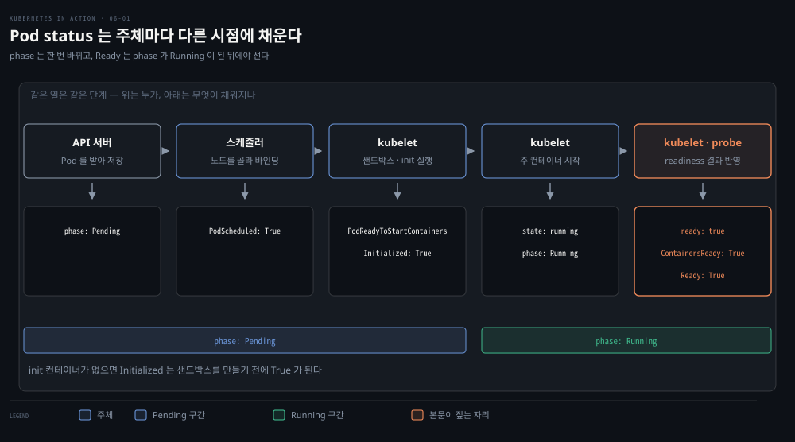
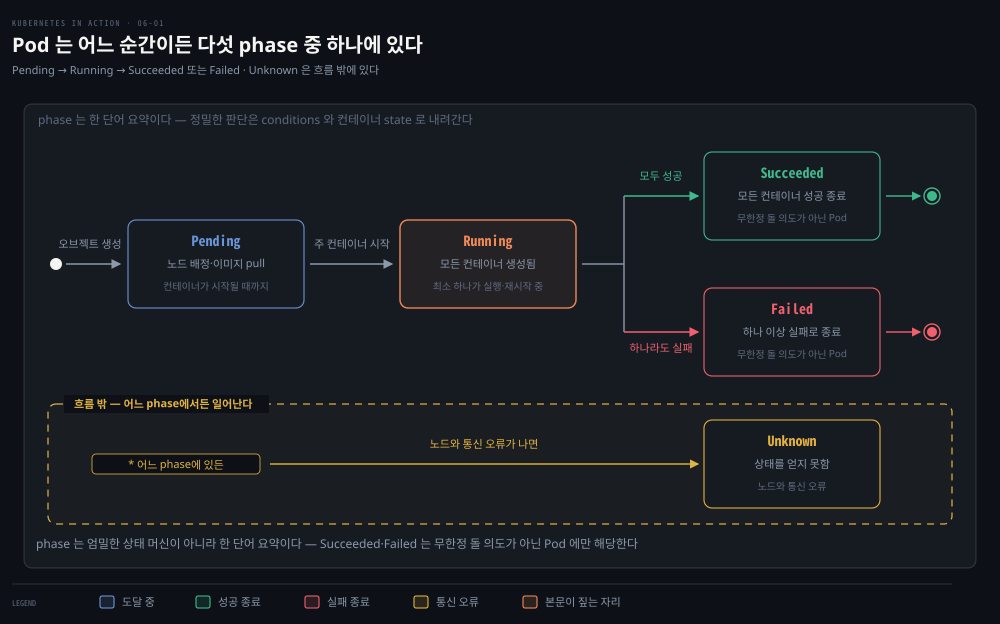
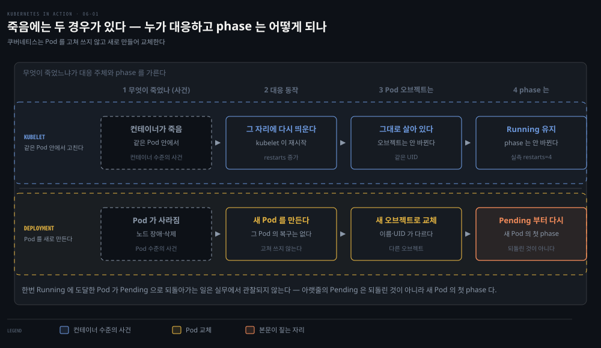
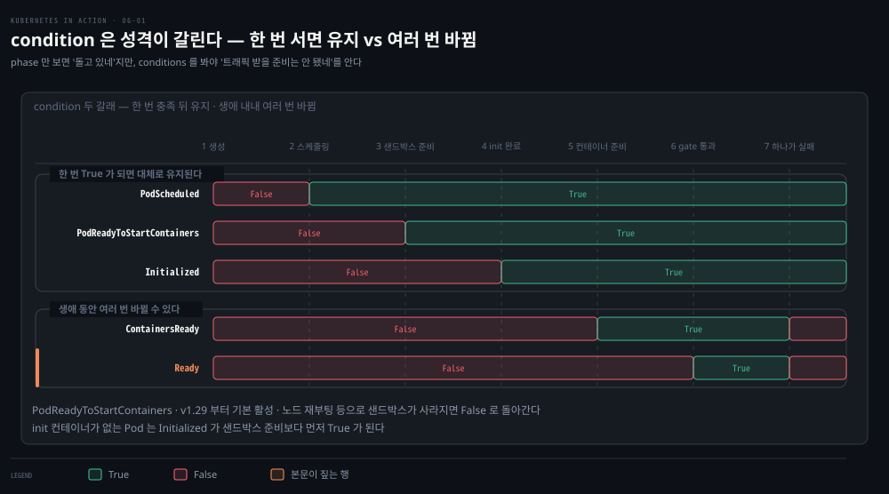
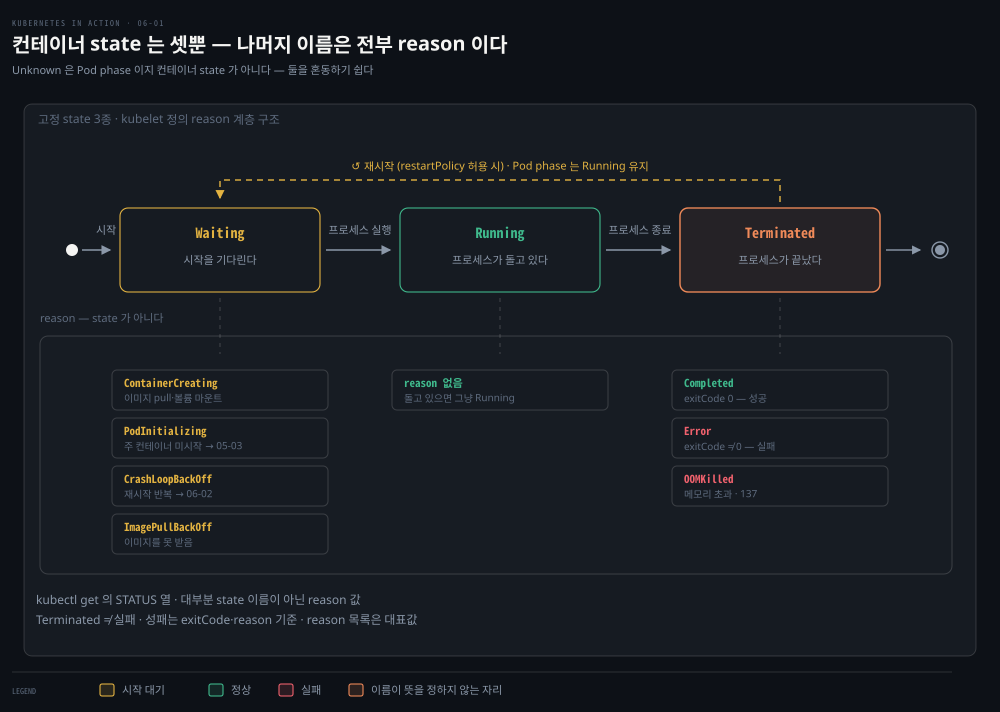
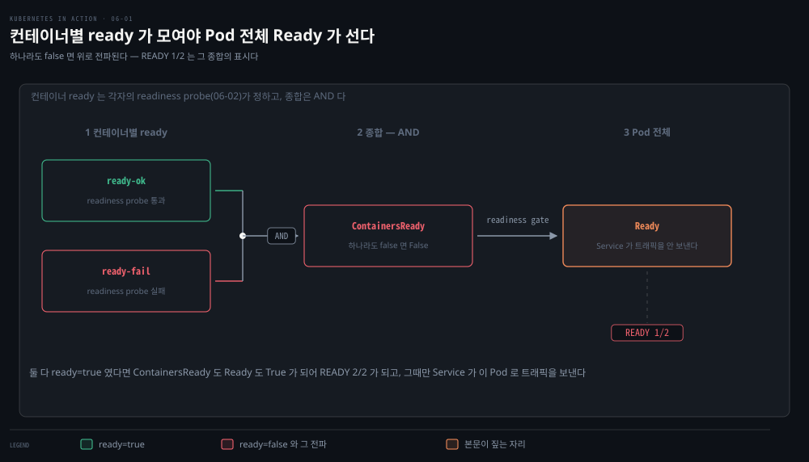
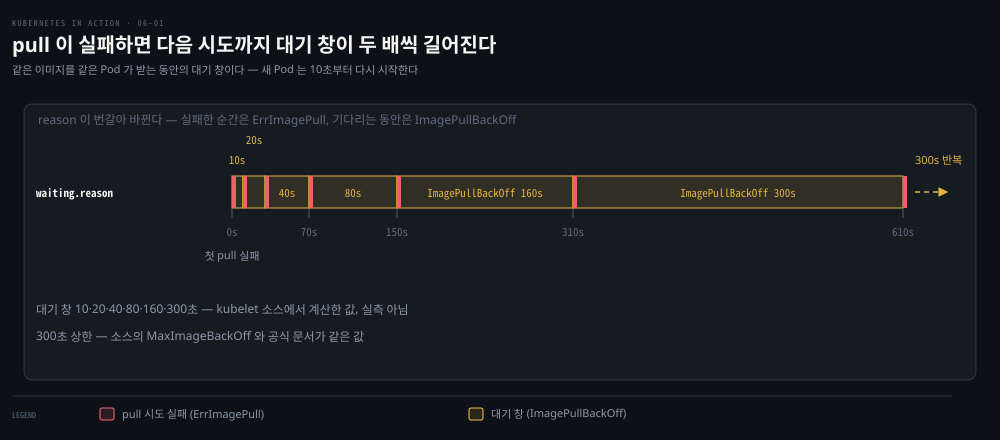

# Pod 상태 — phase·conditions·컨테이너 상태
---
> Pod 의 status 는 phase·conditions·컨테이너 상태 세 층에 나뉘어 담기고 층마다 다른 주체가 다른 시점에 채웁니다. 그래서 문제가 생기면 한 단어 요약인 phase 에서 시작해 conditions 와 컨테이너 상태로 내려가며 읽습니다.


## 학습 목표

1. 다섯 phase 가 각각 무엇을 뜻하는지, 컨테이너가 재시작돼도 phase 가 `Running` 에 머무는 이유를 설명할 수 있습니다.
2. conditions 를 읽고 phase 는 `Running` 인데 `Ready` 가 `False` 인 Pod 를 설명할 수 있습니다.
3. 컨테이너 state 세 가지와 `reason` 을 구분하고, `lastState`·`exitCode` 로 직전 종료 원인을 읽을 수 있습니다.
4. `kubectl get pods` 의 STATUS 열이 phase 와 다르게 보이는 규칙을 설명할 수 있습니다.
5. 이미지 pull 실패(`ErrImagePull`·`ImagePullBackOff`)를 Events 의 문구로 가를 수 있습니다.

실무에서 겪은 사례입니다. 표에는 증상만 적었고 원인은 오른쪽 절을 읽으면 풀립니다. 사내 폴더라 로컬 사본에서만 열립니다.

| 사례 | 겪은 증상 | 답하는 절 |
|---|---|---|
| [프로세스가 안 떴는데 파드는 Ready 였습니다](../../../_company/task/2026-05-21_ops_ready-but-port-closed/README.md) | 파드는 `Running` 이고 READY 도 정상이었는데 API 호출은 `Connection refused` 였다 | [4절 컨테이너별 ready 의 종합](#실제-확인--컨테이너별-ready-의-종합) |
| [RWO 볼륨이 RollingUpdate 를 막아 배포가 멈췄습니다](../../../_company/task/2026-08-31_storage_rwo-volume-rollout-deadlock/README.md) | 이미지 태그를 바꾸자 새 파드가 18분 동안 `ContainerCreating` 에 머물렀다 | [4절 state 와 reason](#state는-3개뿐--crashloopbackoffoomkilled는-state가-아니라-reason) |
| [두 차트가 같은 자리에 각자 기본값을 선언했습니다](../../../_company/task/2026-04-30_observability_two-default-claims/README.md) | 파드가 13일 동안 `2/3 CrashLoopBackOff` 였고 컨테이너 셋 중 하나만 계속 죽었다 | [5절 STATUS 열](#5-kubectl-status-열의-규칙) |

Pod 가 만들어져 Ready 가 되기까지 status 는 한 번에 채워지지 않습니다. API 서버가 `Pending` 으로 저장하면 스케줄러·kubelet·probe 가 차례로 condition 과 컨테이너 상태를 채웁니다.

주 컨테이너가 모두 시작되면 phase 가 `Running` 이 되고 `Ready` 는 그 뒤에 섭니다.




## Ready 까지 status 가 채워지는 길

> Pod 하나의 status 는 API 서버, 스케줄러, kubelet, probe 가 차례로 채우는 다섯 단계를 거치고 번호 절이 단계와 읽는 법을 나눠 맡습니다.

Pod 가 `Ready` 가 되지 않는 문제를 만나면 어느 단계에서 막혔는지부터 가려야 합니다. 단계마다 채우는 주체와 값이 달라 읽을 자리도 다릅니다.

| 단계 | 주체 | 하는 일과 채워지는 값 | 받치는 개념 | 맡는 절 |
|---|---|---|---|---|
| 1 | API 서버 | Pod 를 저장하고 `phase: Pending` 으로 시작 | status 의 세 층 | 1·2절 |
| 2 | 스케줄러 | 노드를 골라 바인딩, `PodScheduled: True` | conditions | 3절 |
| 3 | kubelet·런타임 | 샌드박스와 init 컨테이너 실행, `PodReadyToStartContainers`·`Initialized: True` | conditions, init 컨테이너 | 3절 |
| 4 | kubelet | 주 컨테이너 시작, 컨테이너 `state` 와 `phase: Running` | state·reason, 이미지 pull | 2·4·6절 |
| 5 | kubelet·probe | readiness 결과로 `ready`·`ContainersReady`·`Ready` | 컨테이너별 ready 의 종합 | 3·4절 |

5절은 채워진 status 를 `kubectl` 이 한 단어로 보여 주는 규칙입니다. 6절은 4단계가 이미지 pull 에서 막힌 경우를 다룹니다.


## 1. Pod status 의 세 층

> 생애주기를 읽는 축은 phase·conditions·컨테이너별 상태 세 가지이고 층마다 답하는 질문이 다릅니다.

흐름 위치: 1~5단계 전체 · 받치는 개념 — status 섹션의 세 층

Pod 가 이상하면 status 에서 무엇을 먼저 읽을지부터 정해야 합니다. status 에는 Pod 와 노드의 IP, 시작 시각, QoS 클래스도 담기지만 생애주기를 읽는 축은 다음 세 층입니다.

| 확인할 질문 | 볼 필드 |
|-------------|---------|
| Pod 가 생애주기의 어디에 있는가? | `status.phase` |
| 실행·준비 조건을 충족했는가? | `status.conditions` |
| 어느 컨테이너에서 문제가 났는가? | `status.containerStatuses` |


## 2. phase — 한 단어 요약

> phase 는 Pod 에 무슨 일이 일어나고 있는지를 한 단어로 요약하며 어느 시점이든 다섯 값 중 정확히 하나입니다.

흐름 위치: 1 → 4단계 Pending 에서 Running 으로 · 받치는 개념 — phase

phase 는 완전한 상태 머신이 아닙니다. 컨테이너·Pod 상태의 종합 요약도 아니고 문서에 적힌 값 외에는 아무것도 가정할 수 없습니다.[^lifecycle] 정밀한 판단은 conditions 와 컨테이너 state 에서 합니다.



| Phase | 의미 |
|-------|------|
| Pending | API 서버가 Pod 를 받았지만 컨테이너가 아직 실행 준비를 마치지 못했습니다. 스케줄링을 기다리는 시간과 이미지를 받는 시간이 모두 여기에 듭니다 |
| Running | Pod 가 노드에 바인딩됐고 모든 컨테이너가 생성됐으며, 최소 하나가 실행 중이거나 시작·재시작 중입니다 |
| Succeeded | 모든 컨테이너가 성공으로 종료됐고 다시 시작되지 않습니다 |
| Failed | 모든 컨테이너가 종료됐고 최소 하나가 실패로 끝났으며, 자동으로 다시 시작되지 않습니다 |
| Unknown | 어떤 이유로 Pod 의 상태를 얻지 못했습니다. 주로 Pod 가 있어야 할 노드와의 통신 오류입니다 |

kubelet 이 phase 를 정하는 함수 `getPhase` 는 앞의 네 값만 돌려줍니다.[^getphase] 노드가 사라지면 그 노드의 Pod phase 는 정책에 따라 `Failed` 로 바뀌기도 합니다.[^lifecycle] 화면에서 Unknown 이 실제로 보이는 자리는 5절의 STATUS 열입니다.

phase 는 다음 명령으로 확인합니다.

```bash
kubectl get po kiada -o yaml | grep phase        # phase: Running
kubectl get po kiada -o json | jq .status.phase  # jq로 필드만 추출
kubectl describe po kiada                        # Status: 행에 표시
```

`kubectl get pods` 의 STATUS 열은 phase 와 같지 않은 경우가 많습니다. 규칙은 5절에서 봅니다.

### 컨테이너 재시작과 phase

`Running` 에 도달한 Pod 의 컨테이너가 죽어 재시작돼도 phase 는 `Running` 에 머뭅니다. 컨테이너 재시작은 컨테이너 수준의 사건이고 Pod phase 를 바꾸지 않기 때문입니다.

`getPhase` 는 직전 종료 기록이 있는 `Waiting` 컨테이너를 재시작을 기다리는 컨테이너로 셉니다. 기본 경로에서는 `restartPolicy` 가 `Always` 이면 모두 멈춰 있어도 `Running` 을 돌려줍니다.[^getphase]



```bash
kubectl get pod -l app=kiada \
  -o jsonpath='{range .items[*]}{.metadata.name}  phase={.status.phase}  restarts={.status.containerStatuses[0].restartCount}{"\n"}{end}'
# kiada-...  phase=Running  restarts=4   ← 컨테이너가 4번 죽었다 살아나도 phase는 Running
```

Pod 자체가 사라지는 경우는 다릅니다. 노드 장애로 축출되거나 삭제된 Pod 는 고쳐 쓰지 않습니다.

Deployment 가 새 Pod 를 만들어 `Pending` 부터 다시 시작시킵니다(05-03 §5). 같은 UID 의 Pod 는 다른 노드로 다시 스케줄되지 않고 거의 같은 새 Pod 로 대체될 뿐입니다.[^lifecycle]

### 실제 확인 — init 중의 phase

`Running` 은 주 컨테이너(`containers`)가 모두 시작됐을 때 됩니다. 주 컨테이너 중 하나라도 시작 전 `Waiting` 이면 `getPhase` 는 `Pending` 을 돌려줍니다.[^getphase] init 컨테이너나 네이티브 사이드카(`initContainers`)가 `running` 이어도 같습니다. init 이 도는 동안 phase 를 찍어 보면 이 구분이 드러납니다.

```bash
for i in 1 2 3 4 5 6; do
  kubectl get pod lifecycle-demo -o jsonpath="t=${i} phase={.status.phase} \
    sidecar={.status.initContainerStatuses[?(@.name=='sidecar')].state} \
    main={.status.containerStatuses[?(@.name=='main')].state}{\"\n\"}"
  sleep 1
done
```

```bash
t=3  phase=Pending  sidecar=waiting/PodInitializing  main=waiting/PodInitializing
t=4  phase=Pending  sidecar=running                  main=waiting/PodInitializing  ← ★
t=6  phase=Pending  sidecar=running                  main=waiting/PodInitializing
```

t=4 에서 네이티브 사이드카는 `running` 인데 phase 는 `Pending` 입니다. 주 컨테이너 `main` 은 아직 `PodInitializing` 이고 개별 컨테이너가 `running` 이라고 phase 가 `Running` 이 되지는 않습니다. 반대로 메인이 이미 도는데도 Pending 에 머무는 경우는 [06-03](./06-03.lifecycle%20hook%EA%B3%BC%20Pod%20%EC%83%9D%EC%95%A0%EC%A3%BC%EA%B8%B0%20%EC%A0%84%EC%B2%B4.md)의 실험이 보여 줍니다.


## 3. conditions — 도달한 상태와 이유

> phase 가 한 단어 요약이라면 conditions 는 Pod 가 특정 상태에 도달했는지와 그 이유를 여러 축으로 알려 주며 Pod 는 항상 여러 condition 을 동시에 가집니다.

흐름 위치: 2 → 5단계 스케줄링에서 Ready 까지 · 받치는 개념 — conditions

phase 만으로는 Pod 상태를 자세히 알 수 없습니다. 4장에서 Node 오브젝트에 했던 것처럼 condition 목록을 보면 어디까지 도달했는지가 보입니다. 아래 도식이 condition 이 True 로 바뀌는 시점입니다.



| Condition | 의미 |
|-----------|------|
| PodScheduled | Pod 가 노드에 스케줄링됐습니다. 스케줄러가 바인딩을 요청하면 API 서버가 True 로 기록합니다[^binding] |
| PodReadyToStartContainers | Pod 샌드박스가 만들어지고 네트워크·볼륨·동적 자원 할당이 끝나 컨테이너를 시작할 수 있습니다. v1.29 부터 기본으로 켜져 있습니다[^lifecycle] |
| Initialized | init 컨테이너가 모두 성공적으로 끝났습니다 |
| ContainersReady | Pod 의 모든 컨테이너가 준비됐다고 보고합니다. Pod 전체가 준비되기 위한 필요조건이지만 충분조건은 아닙니다 |
| Ready | Pod 가 요청을 받을 수 있고 일치하는 모든 Service 의 로드밸런싱 풀에 들어가야 합니다. 컨테이너들과 Pod 의 readiness gate(11장)가 모두 준비를 보고한 상태입니다 |

`PodReadyToStartContainers` 가 True 가 되는 시점은 [04-01 의 Pod 생성 주체](../networking-and-kubernetes/04-01.Kubernetes%20%EB%84%A4%ED%8A%B8%EC%9B%8C%ED%82%B9%20%EB%AA%A8%EB%8D%B8%20%E2%80%94%20Pod%20IP%C2%B7%EB%A0%88%EC%9D%B4%EC%95%84%EC%9B%83%C2%B7Probe.md#pod-생성의-주체)가 다룹니다. 쿠버네티스는 새 관측 축이 필요할 때 기존 condition 을 바꾸지 않고 리스트에 condition 을 더합니다. 4장에서 본 open-closed 의 실례입니다.

condition 의 시간에 따른 전이는 성격이 갈립니다. `PodScheduled` 와 `Initialized` 는 충족되면 Pod 의 남은 생애 동안 유지됩니다. `Ready` 와 `ContainersReady` 는 생애 동안 여러 번 바뀝니다. `PodReadyToStartContainers` 는 노드 재부팅 등으로 샌드박스가 사라지면 `False` 로 돌아갑니다.[^lifecycle]

Node 의 condition(MemoryPressure·DiskPressure·PIDPressure·Ready)에서도 같은 패턴이 보입니다. 오브젝트 종류마다 자기 condition 집합을 갖고 전반적으로 문제가 없는지를 뜻하는 `Ready` 는 공통으로 둡니다.

conditions 는 다음처럼 조회합니다.

```bash
kubectl describe po kiada
```

```bash
Conditions:
  Type              Status
  Initialized       True
  Ready             True
  ContainersReady   True
  PodScheduled      True
```

`kubectl describe` 는 각 condition 의 True/False 만 보여 줍니다. False 인 이유는 API 에서 읽은 `status.conditions` 에 있습니다.

```bash
kubectl get po kiada -o json | jq .status.conditions
```

```bash
[
  {
    "lastProbeTime": null,
    "lastTransitionTime": "2020-02-02T11:42:59Z",
    "status": "True",
    "type": "Initialized"
  },
  ...
```

`status` 는 `True`·`False`·`Unknown` 중 하나입니다. `reason` 은 마지막 상태 변화의 기계 판독용 사유이고 `message` 는 사람이 읽는 설명입니다. `lastTransitionTime` 은 변화가 일어난 시각, `lastProbeTime` 은 마지막으로 점검한 시각입니다.[^lifecycle]

### 실제 확인 — Running 인데 Ready 는 False

컨테이너 하나만 readiness 에 실패해도 Pod 는 phase 가 `Running` 이면서 `Ready` 가 `False` 가 됩니다. 컨테이너 둘 중 하나는 readiness probe 를 통과시키고 하나는 일부러 실패시켜 `k8s-lab` 클러스터에 띄웠습니다.

```bash
kubectl get pod readiness-demo

kubectl get pod readiness-demo \
  -o jsonpath='{range .status.conditions[*]}{.type}{"\t"}{.status}{"\t"}{.reason}{"\n"}{end}'
```

```bash
NAME             READY   STATUS    RESTARTS   AGE
readiness-demo   1/2     Running   0          11s   ← phase는 Running인데 READY는 1/2

PodReadyToStartContainers  True
Initialized                True
Ready                      False  ContainersNotReady   ← Pod 전체는 아직 not-ready
ContainersReady            False  ContainersNotReady
PodScheduled               True
```

phase 만 보면 돌고 있는 Pod 이지만 conditions 를 보면 트래픽 받을 준비는 안 됐다는 것을 압니다. readiness probe 가 실패하면 EndpointSlice 컨트롤러가 이 Pod 의 IP 를 일치하는 Service 의 EndpointSlice 에서 빼므로 Service 는 요청을 보내지 않습니다.[^lifecycle]

`reason: ContainersNotReady` 는 `False` 인 이유까지 알려 줍니다. phase 한 단어로는 담을 수 없는 이 정보가 conditions 가 있는 이유입니다.


## 4. 컨테이너 상태와 reason

> Pod status 에는 컨테이너별 상태도 담기며 현재 state 뿐 아니라 직전 컨테이너가 어떻게 끝났는지(lastState)와 재시작 횟수까지 보여 줍니다.

흐름 위치: 4 → 5단계 컨테이너 시작에서 ready 까지 · 받치는 개념 — containerStatuses

`state` 는 컨테이너의 현재 상태를, `lastState` 는 종료된 직전 컨테이너의 상태를 보여 줍니다. 컨테이너 ID(`containerID`)와 `image`·`imageID`, 준비 여부(`ready`), 재시작 횟수(`restartCount`)도 담깁니다.

컨테이너 state 는 세 가지입니다. Pod phase 의 `Unknown` 같은 값은 컨테이너 state 에 없습니다.[^lifecycle]

| Container state | 의미 |
|-----------------|------|
| Waiting | 컨테이너가 시작을 기다리고 있습니다. `reason`·`message` 가 왜 이 상태인지 알려 줍니다 |
| Running | 컨테이너가 만들어졌고 프로세스가 그 안에서 돌고 있습니다. `startedAt` 이 시작 시각입니다 |
| Terminated | 컨테이너의 프로세스가 종료됐습니다. `startedAt`·`finishedAt` 이 시작·종료 시각이고 `exitCode` 가 메인 프로세스의 종료 코드입니다 |

### state는 3개뿐 — CrashLoopBackOff·OOMKilled는 state가 아니라 reason

`kubectl get pods` 의 STATUS 칸에서 보는 `CrashLoopBackOff`, `ImagePullBackOff`, `OOMKilled` 는 state 가 아닙니다. state 는 위 표의 세 가지로 고정돼 있습니다.

이 이름들은 `Waiting` 이나 `Terminated` 가 가진 `reason` 필드의 값입니다. STATUS 칸이 state 이름 대신 reason 을 보여 주기 때문에 별도 상태처럼 보일 뿐입니다.



| state | 대표 reason | 무슨 뜻인가 | 상세 |
|-------|------------|------------|------|
| Waiting | `ContainerCreating` | 이미지를 받거나 볼륨을 마운트하는 중. kubelet 이 상태를 채우기 전에 두는 기본값입니다[^waiting] | — |
| Waiting | `PodInitializing` | init 이 안 끝나 주 컨테이너가 시작 전. init 컨테이너가 있는 Pod 의 기본값입니다[^waiting] | [05-03](./05-03.%EB%A9%80%ED%8B%B0%20%EC%BB%A8%ED%85%8C%EC%9D%B4%EB%84%88%C2%B7init%C2%B7%EB%84%A4%EC%9D%B4%ED%8B%B0%EB%B8%8C%20%EC%82%AC%EC%9D%B4%EB%93%9C%EC%B9%B4%EC%99%80%20%EC%82%AD%EC%A0%9C.md) |
| Waiting | `CrashLoopBackOff` | 재시작을 반복해 지수 백오프로 대기 중 | [06-02 §3](./06-02.liveness%C2%B7startup%20probe%EB%A1%9C%20%EC%BB%A8%ED%85%8C%EC%9D%B4%EB%84%88%20%EA%B1%B4%EA%B0%95%20%EC%9C%A0%EC%A7%80.md) |
| Waiting | `ImagePullBackOff` | 이미지를 못 받아 재시도를 기다리는 중 | [6절](#6-이미지-pull-실패와-events) |
| Terminated | `Completed` | `exitCode: 0` 정상 종료 | — |
| Terminated | `Error` | `exitCode ≠ 0` 비정상 종료 | — |
| Terminated | `OOMKilled` | 메모리 한도 초과로 커널이 죽임(`137` = SIGKILL) | [Spring 관점](#spring-앱-운영-관점에서) |

이 표는 대표값이고 전량이 아닙니다. reason 문자열은 명세로 고정된 목록이 아니라 kubelet 과 런타임이 정하므로 버전·런타임에 따라 더 있습니다.

자주 만나는 것만 꼽으면 Waiting 에는 `ErrImagePull`, `CreateContainerConfigError`(없는 ConfigMap·Secret 참조), `RunContainerError`, `InvalidImageName` 이 있습니다. Terminated 에는 `ContainerCannotRun` 과 `DeadlineExceeded` 가 있습니다.

이름을 외우기보다 reason 과 함께 오는 `message` 를 읽는 편이 원인 파악이 빠릅니다. `message` 가 "configmap not found" 처럼 실제 사유를 담습니다.

`Terminated` 라는 이름이 실패를 뜻하지는 않습니다. 성공과 실패는 `exitCode` 를 중심으로 `reason`·`signal`·재시작 정책을 함께 봐야 판정됩니다. `Completed` 는 성공이고 `Error`·`OOMKilled` 는 실패입니다.

실무 사례: [학습 목표](#학습-목표) 아래 표의 두 번째 줄인 `ContainerCreating` 건이 이 문제입니다. 구 파드가 쥔 볼륨을 새 파드가 붙이지 못한 경우입니다.

컨테이너별 상태는 `kubectl describe` 로 봅니다. `kubectl get pods` 의 목록은 컨테이너 개수와 준비된 개수만 보여 줍니다.

```bash
kubectl describe po kiada
```

```bash
Containers:
  kiada:
    Container ID:   docker://c64944a684d57faacfced0be1af44686...
    Image:          luksa/kiada:0.1
    ...
    State:          Running                          # 현재 상태와 시작 시각
      Started:      Sun, 02 Feb 2020 12:43:03 +0100
    Ready:          True                             # 서비스 제공 준비 여부
    Restart Count:  0                                # 재시작 횟수
```

jq 로도 볼 수 있습니다: `kubectl get po kiada -o json | jq .status.containerStatuses`

init 컨테이너의 상태는 일반 컨테이너와 달리 `initContainerStatuses` 에 담깁니다. 5장에서 만든 kiada-init Pod 를 다시 만들어 보면 좋은 연습이 됩니다. `kubectl describe` 와 `kubectl get po kiada-init -o json | jq .status` 로 phase·conditions, 일반 컨테이너 둘과 init 컨테이너 둘의 상태를 확인합니다.

### 실제 확인 — 컨테이너별 ready 의 종합

컨테이너별 `ready` 를 모두 종합해야 Pod 전체 `Ready` 가 정해집니다. 앞의 `readiness-demo` 에서 컨테이너 상태를 보면 `READY 1/2` 가 어디서 오는지 드러납니다.

```bash
kubectl get pod readiness-demo \
  -o jsonpath='{range .status.containerStatuses[*]}{.name}: ready={.ready}{"\n"}{end}'
```

```bash
ready-ok:   ready=true    ← readiness probe 통과
ready-fail: ready=false   ← readiness probe 실패
```



`ready=false` 인 컨테이너가 하나라 준비된 컨테이너는 둘 중 하나이고 `READY 1/2` 입니다. 하나라도 `ready=false` 이면 `ContainersReady` 가 `False` 가 되어 Pod 전체 `Ready` 도 `False` 입니다. 각 컨테이너의 `ready` 를 정하는 readiness probe 는 06-02 에서 다룹니다.

readiness probe 를 두지 않으면 컨테이너는 `Running` 이 되는 즉시 `ready` 입니다. kubelet 이 "no readinessProbe -> always ready" 로 처리합니다.[^ready] 프로세스가 떠 있어도 포트를 열지 않은 앱이 Ready 로 보일 수 있다는 뜻입니다.

실무 사례: [학습 목표](#학습-목표) 아래 표의 첫 줄인 `Connection refused` 건이 이 문제입니다. probe 가 없어 기동 실패가 Ready 에 반영되지 않은 경우입니다.


## 5. kubectl STATUS 열의 규칙

> `kubectl get pods` 의 STATUS 열은 phase 로 시작하지만 init 진행과 컨테이너 reason 으로 덮어써 보여 주므로, 문제가 있는 Pod 에서는 phase 와 다릅니다.

흐름 위치: 4~5단계를 읽는 화면 · 받치는 개념 — kubectl 의 STATUS 계산

`kubectl get pods` 에서 STATUS 가 `CrashLoopBackOff` 인데 phase 를 찍어 보면 `Running` 이라 헷갈립니다. STATUS 는 사용자 직관을 위한 표시 필드이고 Pod phase 와 다른 값입니다.[^lifecycle] kubectl 의 `printPod` 는 다음 순서로 값을 고릅니다.[^printpod]

1. phase 로 시작합니다. Pod 의 `status.reason` 이 있으면 그 값으로 바꿉니다.
2. init 컨테이너가 끝나기 전이면 `Init:N/M` 입니다. 종료했으면 `Init:` 뒤에 reason(없으면 `Signal:N` 이나 `ExitCode:N`)을 붙이고, `Waiting` 이면 `Init:` 뒤에 그 reason 을 붙입니다.
3. init 이 끝났으면 컨테이너를 훑으며 `Waiting` 의 reason 으로 덮어씁니다. `Terminated` 이면 그 reason 이고, 없으면 `Signal:N` 이나 `ExitCode:N` 입니다.
4. 삭제 중이고 phase 가 아직 끝나지 않았으면 `Terminating` 입니다. Pod 의 reason 이 노드 도달 불가이면 `Unknown` 입니다.

그래서 같은 Pod 가 STATUS 열에서는 phase 와 다른 이름으로 보입니다.

| 보이는 STATUS | 실제 phase | 값이 오는 곳 |
|---------------|-----------|-------------|
| `Running` | Running | phase 그대로 |
| `CrashLoopBackOff` | Running | 컨테이너 `Waiting` 의 reason. 컨테이너가 하나이고 `restartPolicy` 가 `Always` 이면 재시작을 기다려도 phase 는 Running |
| `ImagePullBackOff` | Pending | 컨테이너 `Waiting` 의 reason. 실패한 순간에는 `ErrImagePull` |
| `ContainerCreating` | Pending | 컨테이너 `Waiting` 의 reason |
| `Init:0/1` | Pending | init 컨테이너 진행 중 |
| `Completed` | Succeeded | 컨테이너 `Terminated` 의 reason |
| `Terminating` | 삭제 시작 전 phase 그대로(`Succeeded`·`Failed` 는 제외) | 삭제 표시(`deletionTimestamp`)가 있을 때 |

READY 열은 `ready` 인 컨테이너 수를 전체 컨테이너 수로 나눈 값입니다. 네이티브 사이드카도 전체에 들어갑니다.[^printpod]

실무 사례: [학습 목표](#학습-목표) 아래 표의 세 번째 줄인 `2/3 CrashLoopBackOff` 건이 이 문제입니다. 컨테이너 셋 중 하나만 `exitCode: 1` 로 스스로 종료해 READY 가 2/3 이고 STATUS 에 reason 이 보인 경우입니다.


## 6. 이미지 pull 실패와 Events

> pull 이 실패하면 컨테이너는 `Waiting` 에서 `ErrImagePull` 과 `ImagePullBackOff` 를 오가고 원인은 Events 의 `Failed to pull image` 줄 끝에 적힙니다.

흐름 위치: 4단계 안의 이미지 받기 · 받치는 개념 — Waiting reason 과 백오프

pull 이 실패한 순간 reason 은 `ErrImagePull` 이고 다음 시도를 기다리는 대기 창 동안에는 `ImagePullBackOff` 로 바뀝니다. 대기 창은 처음 10초이고 실패할 때마다 두 배가 되어 300초에서 멈춥니다. 상한 300초(5분)는 공식 문서에 있고[^imgdoc] 10초와 두 배 증가는 kubelet 과 client-go 소스로 확인했습니다.[^backoff]



대기 창은 Pod UID 와 이미지 이름을 묶은 키로 셉니다.[^backoff] 같은 이미지라도 새 Pod 는 10초부터 다시 시작합니다. 실측(kind, v1.35)에서는 재시도가 또 실패하면 잠깐 `ErrImagePull` 로 돌아가 STATUS 칸에 두 이름이 번갈아 떴습니다. 같은 순서의 Events 는 [CKS 06-02 의 다이제스트 실습](../cks-study-guide/06-02.%EB%AF%BF%EC%9D%84%20%EC%88%98%20%EC%9E%88%EB%8A%94%20%EC%9D%B4%EB%AF%B8%EC%A7%80%EB%A7%8C%20%EB%93%A4%EC%9D%B4%EA%B8%B0%20%E2%80%94%20%EC%84%9C%EB%AA%85%C2%B7digest%C2%B7%EB%A0%88%EC%A7%80%EC%8A%A4%ED%8A%B8%EB%A6%AC%20%ED%97%88%EC%9A%A9%20%EB%AA%A9%EB%A1%9D%C2%B7Trivy.md#1-이미지가-바뀌지-않았음을-확인하기)에도 있습니다. 장애 때 원인을 짚는 일반 순서는 [모니터링 개요와 트러블슈팅 루틴의 주요 장애 패턴](../../docs/kubernetes/operations/%EB%AA%A8%EB%8B%88%ED%84%B0%EB%A7%81%20%EA%B0%9C%EC%9A%94%C2%B7%ED%8A%B8%EB%9F%AC%EB%B8%94%EC%8A%88%ED%8C%85%20%EB%A3%A8%ED%8B%B4.md#22-주요-장애-패턴)에 있습니다.

### 실제 확인 — 세 가지 실패를 문구로 가르기

두 reason 은 무엇이 잘못됐는지 말해 주지 않습니다. 원인은 `kubectl describe pod` 의 Events 중 `Failed to pull image` 줄에 적힙니다. 아래는 세 가지 실패를 일부러 낸 명령입니다.

```bash
kubectl run pull-notag --image=busybox:no-such-tag-0601 --restart=Never        # 있는 저장소, 없는 태그
kubectl run pull-norepo --image=no-such-image-0601:1.0 --restart=Never         # 없는 저장소
kubectl run pull-nohost --image=registry.invalid/demo/app:1.0 --restart=Never  # 닿지 않는 레지스트리
kubectl describe pod pull-notag
```

`pull-notag` 의 Events 끝부분입니다(2026-11-14, kind v1.35.0, containerd). 칸 사이 공백은 줄였습니다.

```bash
Warning  Failed   8s  kubelet  spec.containers{pull-notag}: Failed to pull image "busybox:no-such-tag-0601": rpc error: code = NotFound desc = failed to pull and unpack image "docker.io/library/busybox:no-such-tag-0601": failed to resolve reference "docker.io/library/busybox:no-such-tag-0601": docker.io/library/busybox:no-such-tag-0601: not found
Warning  Failed   8s  kubelet  spec.containers{pull-notag}: Error: ErrImagePull
Normal   BackOff  8s  kubelet  spec.containers{pull-notag}: Back-off pulling image "busybox:no-such-tag-0601"
Warning  Failed   8s  kubelet  spec.containers{pull-notag}: Error: ImagePullBackOff
```

세 Pod 의 `Failed to pull image` 줄 끝을 나란히 놓으면 이렇습니다.

| 일부러 낸 실패 | 줄 끝 문구 | 먼저 볼 자리 |
|---|---|---|
| 있는 저장소, 없는 태그 | `…/busybox:no-such-tag-0601: not found` | 태그 |
| 없는 저장소(Docker Hub) | `pull access denied, repository does not exist or may require authorization: server message: insufficient_scope: authorization failed` | 이미지 이름, 그다음 인증 |
| 닿지 않는 레지스트리 | `dial tcp: lookup registry.invalid on …: no such host` | 레지스트리 주소, 노드의 DNS·방화벽 |

둘째 줄이 함정입니다. 저장소가 없는데도 인증 실패처럼 보입니다. Docker Hub 는 저장소가 없을 때와 권한이 없을 때 같은 문구를 돌려줍니다. ghcr.io 에 없는 조직 이름을 넣었을 때도 `403 Forbidden` 이 돌아왔습니다. kind 에 로컬 이미지를 올릴 때 이 문구를 만나는 실례는 [03-02 의 imagePullPolicy 함정](./03-02.%EC%B2%AB%20%EC%95%A0%ED%94%8C%EB%A6%AC%EC%BC%80%EC%9D%B4%EC%85%98%20%EB%B0%B0%ED%8F%AC%EC%99%80%20%EC%8A%A4%EC%BC%80%EC%9D%BC%EB%A7%81.md)에 있습니다.

인증 계열 문구를 보면 이미지 이름부터 확인합니다. 이름이 맞으면 비공개 레지스트리 인증 Secret 을 Pod 에 연결하는 `imagePullSecrets` 를 봅니다. 쓰는 법은 [08-03 의 Secret 만들기](./08-03.Secret%EA%B3%BC%20Downward%20API.md)에 있습니다. 적은 Secret 이 없으면 Events 에 `FailedToRetrieveImagePullSecret` reason 이 뜹니다.[^pullsecret]


## Spring 앱 운영 관점에서

> Spring Boot 앱의 배포 실패를 진단할 때 phase → conditions → containerStatuses 순서로 내려가면, "왜 트래픽이 안 오는가"와 "왜 계속 재시작되는가"를 구분해 짚을 수 있습니다.

Spring Boot 앱 Pod 가 이상할 때 이 편의 세 층은 진단 순서 그대로 쓰입니다. 위에서 아래로 한 단계씩 내려갑니다.

1. **phase 를 본다.** `Pending` 이면 스케줄링·이미지 pull 단계 문제입니다(리소스 부족, 레지스트리 인증 실패 등). 컨테이너가 뜨지도 않았으니 로그를 뒤질 게 아니라 이벤트와 스케줄링을 봐야 합니다.
2. **`Running` 인데 트래픽이 안 오면 conditions 로 내려간다.** `ContainersReady` 가 `False` 라면 readiness probe 가 실패하고 있다는 뜻입니다. Spring Boot 에서는 Actuator 의 `/actuator/health/readiness` 가 `DOWN` 을 반환하는 경우가 대표적입니다. 커넥션 풀 초기화 지연이나 다운스트림 연결 실패 등이 원인입니다. `jq .status.conditions` 로 False 인 condition 의 `message` 를 읽는 것이 지름길입니다.
3. **계속 재시작된다면 `lastState` 로 직전 죽음을 본다.** Spring 앱이 `OutOfMemoryError` 나 OOMKilled 로 죽었다면 `lastState.terminated` 에 `exitCode` 와 `reason` 이 남습니다. 137 이면 KILL 시그널이고 reason 은 OOMKilled 입니다. 현재 컨테이너가 멀쩡해 보여도 직전 사인을 확인할 수 있습니다.
4. **`restartCount` 가 0 이 아니면 이전 컨테이너의 로그를 본다.** `kubectl logs -p` 로 죽기 직전 마지막 로그를 봅니다. `lastState` 의 종료 코드와 이 로그를 나란히 놓으면 "왜 죽었는지"가 대부분 드러납니다.

3·4단계에서 만나는 `exitCode` 는 다음 관례로 읽습니다.

> **`exitCode` 가 128 보다 크면 시그널로 죽었을 가능성이 높습니다.** 셸·런타임의 종료 코드 관례상 시그널로 종료되면 `exitCode = 128 + 시그널번호` 입니다. `137 = 128 + 9` 는 SIGKILL(강제 종료, 주로 OOMKilled)이고 `143 = 128 + 15` 는 SIGTERM(정상 종료 요청)입니다. 관례일 뿐이라 단정하지 말고 `reason`·`message`, 별도 signal 필드, 관련 이벤트를 함께 확인해 사인을 확정하는 편이 안전합니다.
>
> 05-03 에서 Envoy 가 ARM 에뮬레이션 실패로 죽을 때 본 `133 = 128 + 5` 도 SIGTRAP 이었습니다. 큰 `exitCode` 는 128 을 빼서 시그널 번호를 가늠하는 것이 사인 파악의 첫걸음이고 정상 완료는 `exitCode: 0` 입니다.

이 phase → conditions → lastState → 로그 순서가 06-02 에서 다룰 liveness probe 튜닝의 출발점이 됩니다.


## 학습 점검

> 본문의 핵심을 자가 점검하는 여섯 문항입니다.

1. phase·conditions·컨테이너 상태는 각각 어떤 질문에 답하고, Pod 가 Ready 가 되기까지 누가 채우나요?
2. 컨테이너가 네 번 재시작해도 phase 가 `Running` 에 머무는 이유는 무엇이고, Pod 자체가 사라지면 어떻게 되나요?
3. 네이티브 사이드카가 `running` 인데 phase 가 `Pending` 인 이유는 무엇인가요?
4. phase 는 `Running` 인데 `Ready` 가 `False` 인 Pod 에서 무엇이 달라지고, 어떤 필드로 이유를 읽나요?
5. `CrashLoopBackOff` 는 컨테이너 state 인가요, 그리고 STATUS 열은 phase 와 어떻게 다른가요?
6. `Failed to pull image` 줄 끝이 `not found` 일 때와 `no such host` 일 때 각각 어디를 먼저 보나요?


## 정답 (자답 후 펼치기)

> 위 질문 6개에 먼저 자답한 뒤 아래를 읽으세요.

### 정답 1 — 세 층과 채우는 주체

phase 는 Pod 가 생애의 어디에 있는지, conditions 는 어떤 조건에 도달했는지, 컨테이너 상태는 어느 컨테이너에서 문제가 났는지에 답합니다.

API 서버가 `Pending` 으로 저장하면 스케줄러가 바인딩해 `PodScheduled` 가 서고 kubelet 이 샌드박스와 init 을 거쳐 컨테이너를 시작합니다. probe 결과가 모이면 `Ready` 가 됩니다. 단계마다 주체와 값이 달라서 멈춘 단계에 맞는 층을 읽어야 합니다.

### 정답 2 — 재시작과 Pod 교체

컨테이너 재시작은 컨테이너 수준의 사건이라 Pod phase 를 바꾸지 않습니다. kubelet 의 `getPhase` 는 직전 종료 기록이 있는 `Waiting` 컨테이너를 재시작 대기로 세고 `restartPolicy` 가 `Always` 이면 `Running` 을 돌려주기 때문입니다. Pod 자체가 사라지면 고쳐 쓰지 않고 Deployment 가 새 Pod 를 만들어 `Pending` 부터 다시 시작합니다.

### 정답 3 — init·사이드카와 phase

`Running` 은 주 컨테이너가 모두 시작됐을 때 됩니다. `getPhase` 는 주 컨테이너 중 하나라도 시작 전 `Waiting` 이면 `Pending` 을 돌려주므로, `initContainers` 의 사이드카가 `running` 이어도 주 컨테이너가 `PodInitializing` 인 동안은 `Pending` 입니다.

### 정답 4 — Ready 가 False 인 Pod

컨테이너 하나라도 `ready=false` 이면 `ContainersReady` 가 `False` 가 되어 `Ready` 도 `False` 입니다. EndpointSlice 컨트롤러가 이 Pod 의 IP 를 Service 에서 빼서 요청이 오지 않습니다. 이유는 `status.conditions` 의 `reason`·`message` 에서 읽고 어느 컨테이너인지는 `containerStatuses` 의 `ready` 에서 읽습니다.

### 정답 5 — CrashLoopBackOff 와 STATUS

`CrashLoopBackOff` 는 state 가 아니라 `Waiting` state 의 `reason` 값입니다. state 는 `Waiting`·`Running`·`Terminated` 셋뿐입니다. STATUS 열은 phase 로 시작하지만 init 진행과 컨테이너 reason 으로 덮어써 보여 주므로, 재시작을 기다리는 Pod 는 phase 가 `Running` 이어도 STATUS 는 `CrashLoopBackOff` 입니다.

### 정답 6 — pull 실패 문구로 가르기

`not found` 는 저장소는 있는데 태그가 없다는 뜻이라 태그를 먼저 봅니다. `no such host` 는 레지스트리 주소를 DNS 로 풀지 못했다는 뜻이라 레지스트리 주소와 노드의 DNS·방화벽을 봅니다. 인증 계열 문구는 저장소가 없을 때도 나오므로 이미지 이름을 먼저 확인합니다.


## 관련 문서

> 이 편은 Pod status 의 세 층을 다룹니다. 다음 편(06-02)에서 이 상태를 건강하게 유지하는 자동 재시작과 probe 로 이어집니다.

- [06-02.liveness·startup probe로 컨테이너 건강 유지](./06-02.liveness%C2%B7startup%20probe%EB%A1%9C%20%EC%BB%A8%ED%85%8C%EC%9D%B4%EB%84%88%20%EA%B1%B4%EA%B0%95%20%EC%9C%A0%EC%A7%80.md) — 이 편에서 본 상태를 건강하게 유지하는 재시작·probe 메커니즘을 다루는 다음 편
- [05-03.멀티 컨테이너·init·네이티브 사이드카와 삭제](./05-03.%EB%A9%80%ED%8B%B0%20%EC%BB%A8%ED%85%8C%EC%9D%B4%EB%84%88%C2%B7init%C2%B7%EB%84%A4%EC%9D%B4%ED%8B%B0%EB%B8%8C%20%EC%82%AC%EC%9D%B4%EB%93%9C%EC%B9%B4%EC%99%80%20%EC%82%AD%EC%A0%9C.md) — 이 편에서 상태를 조회한 Pod(kiada-init 등)를 만든 이전 편
- [Kubernetes 공식 문서 — Pod Lifecycle](https://kubernetes.io/docs/concepts/workloads/pods/pod-lifecycle/) — phase·conditions·컨테이너 상태의 최신 공식 명세
- [Kubernetes 공식 문서 — Images: ImagePullBackOff](https://kubernetes.io/docs/concepts/containers/images/#imagepullbackoff) — 이미지 pull 실패와 늘어나는 재시도 간격(최대 300초)
- [Kubernetes 공식 문서 — Pull an Image from a Private Registry](https://kubernetes.io/docs/tasks/configure-pod-container/pull-image-private-registry/) — 비공개 레지스트리 인증 및 imagePullSecrets 설정

[^lifecycle]: Kubernetes website `release-1.36` — Pod Lifecycle (`content/en/docs/concepts/workloads/pods/pod-lifecycle.md`). "The phase is not intended to be a comprehensive rollup of observations of container or Pod state, nor is it intended to be a comprehensive state machine." "Other than what is documented here, nothing should be assumed about Pods that have a given `phase` value." "There are three possible container states: `Waiting`, `Running`, and `Terminated`." "A given Pod (as defined by a UID) is never "rescheduled" to a different node; instead, that Pod can be replaced by a new, near-identical Pod." `PodReadyToStartContainers`: "(beta feature; enabled by default)", feature-state v1.29 beta. "If a node dies or is disconnected from the rest of the cluster, Kubernetes applies a policy for setting the `phase` of all Pods on the lost node to Failed." <https://github.com/kubernetes/website/blob/release-1.36/content/en/docs/concepts/workloads/pods/pod-lifecycle.md> (2026-11-18 확인)

[^getphase]: kubernetes/kubernetes `v1.37.2` — `pkg/kubelet/kubelet_pods.go` 의 `getPhase`. 반환 값은 `v1.PodFailed`·`v1.PodPending`·`v1.PodRunning`·`v1.PodSucceeded` 이고 `PodUnknown` 은 없습니다. 주석: "One or more containers has not been started" → `PodPending`, "All containers have been started, and at least one container is running" → `PodRunning`, "All containers are in the process of restarting" (`RestartPolicyAlways`) → `PodRunning`. <https://github.com/kubernetes/kubernetes/blob/v1.37.2/pkg/kubelet/kubelet_pods.go> (2026-11-18 확인)

[^binding]: kubernetes/kubernetes `v1.37.2` — `pkg/registry/core/pod/storage/storage.go` 의 `setPodNodeAndMetadata`. 바인딩이 `pod.Spec.NodeName` 을 채운 뒤 `podutil.UpdatePodCondition(&pod.Status, &api.PodCondition{Type: api.PodScheduled, Status: api.ConditionTrue})` 를 호출합니다. 같은 저장소 `pkg/registry/core/pod/strategy.go` 의 `PrepareForCreate` 는 `pod.Status = api.PodStatus{Phase: api.PodPending}` 으로 시작합니다. <https://github.com/kubernetes/kubernetes/blob/v1.37.2/pkg/registry/core/pod/storage/storage.go> (2026-11-18 확인)

[^waiting]: kubernetes/kubernetes `v1.37.2` — `pkg/kubelet/kubelet_pods.go`. 컨테이너 상태의 기본값은 `defaultWaitingState := ... Reason: ContainerCreating` 이고, `hasInitContainers` 이면 `Reason: PodInitializing` 입니다. <https://github.com/kubernetes/kubernetes/blob/v1.37.2/pkg/kubelet/kubelet_pods.go> (2026-11-18 확인)

[^ready]: kubernetes/kubernetes `v1.37.2` — `pkg/kubelet/prober/prober_manager.go` 의 `UpdatePodStatus`. readiness worker 가 없으면 `ready = !exists // no readinessProbe -> always ready`. 이 분기는 컨테이너가 시작(`started`)돼 있을 때만 실행됩니다. <https://github.com/kubernetes/kubernetes/blob/v1.37.2/pkg/kubelet/prober/prober_manager.go> (2026-11-18 확인)

[^printpod]: kubernetes/kubernetes `v1.37.2` — `pkg/printers/internalversion/printers.go` 의 `printPod`. `reason := string(podPhase)` 로 시작해 `pod.Status.Reason` 이 있으면 바꾸고, init 컨테이너에서 `Init:%d/%d`·`"Init:" + reason`·`Init:ExitCode:%d`·`Init:Signal:%d` 를 만들며, 일반 컨테이너의 `Waiting.Reason`·`Terminated.Reason`(없으면 `Signal:%d`·`ExitCode:%d`)로 덮어쓰고, `DeletionTimestamp` 가 있으면 `Terminating`(노드 도달 불가 reason 이면 `Unknown`)으로 씁니다. READY 는 `fmt.Sprintf("%d/%d", readyContainers, totalContainers)` 이고 restartable init 컨테이너를 `totalContainers` 에 더합니다. <https://github.com/kubernetes/kubernetes/blob/v1.37.2/pkg/printers/internalversion/printers.go> (2026-11-18 확인)

[^imgdoc]: Kubernetes website `release-1.36` — Images, "ImagePullBackOff". "Kubernetes raises the delay between each attempt until it reaches a compiled-in limit, which is 300 seconds (5 minutes)." <https://github.com/kubernetes/website/blob/release-1.36/content/en/docs/concepts/containers/images.md> (2026-11-18 확인)

[^backoff]: kubernetes/kubernetes `v1.37.2` — `pkg/kubelet/kubelet.go`: `imageBackOffPeriod = time.Second * 10`, `MaxImageBackOff = 300 * time.Second`, `flowcontrol.NewBackOff(imageBackOffPeriod, MaxImageBackOff)`. `staging/src/k8s.io/client-go/util/flowcontrol/backoff.go` 의 `Next`: `delay := entry.backoff * 2 // exponential`, 최댓값은 `min(delay, p.maxDuration)`. `pkg/kubelet/images/image_manager.go`: `backOffKey := fmt.Sprintf("%s_%s", podUID, image)`. 대기 창 10·20·40·80·160·300초는 이 코드에서 계산한 값이고 실측하지 않았습니다. <https://github.com/kubernetes/kubernetes/blob/v1.37.2/pkg/kubelet/kubelet.go> (2026-11-18 확인)

[^pullsecret]: Kubernetes website `release-1.36` — Pull an Image from a Private Registry. "If you then see an event with the reason set to `FailedToRetrieveImagePullSecret`, Kubernetes can't find a Secret with name (`regcred`, in this example)." <https://github.com/kubernetes/website/blob/release-1.36/content/en/docs/tasks/configure-pod-container/pull-image-private-registry.md> (2026-11-18 확인)
