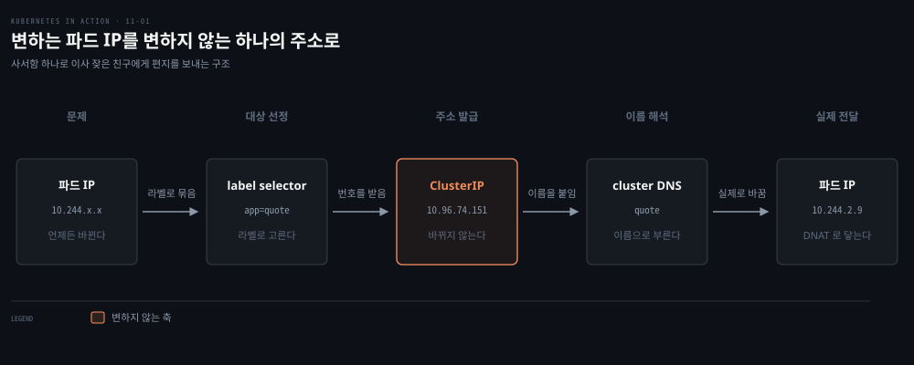
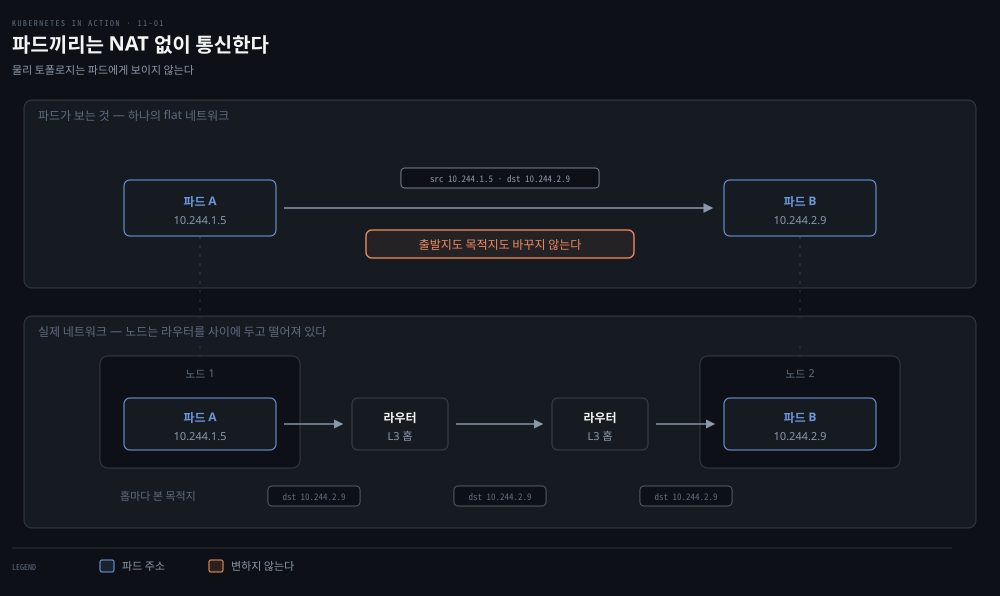
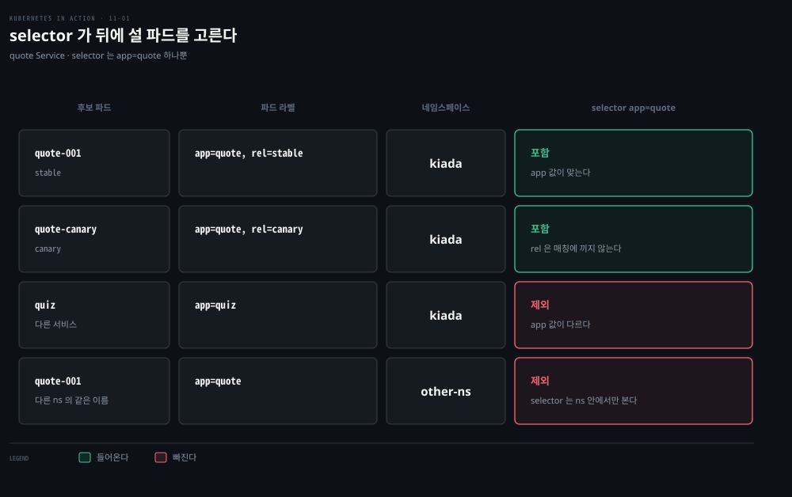
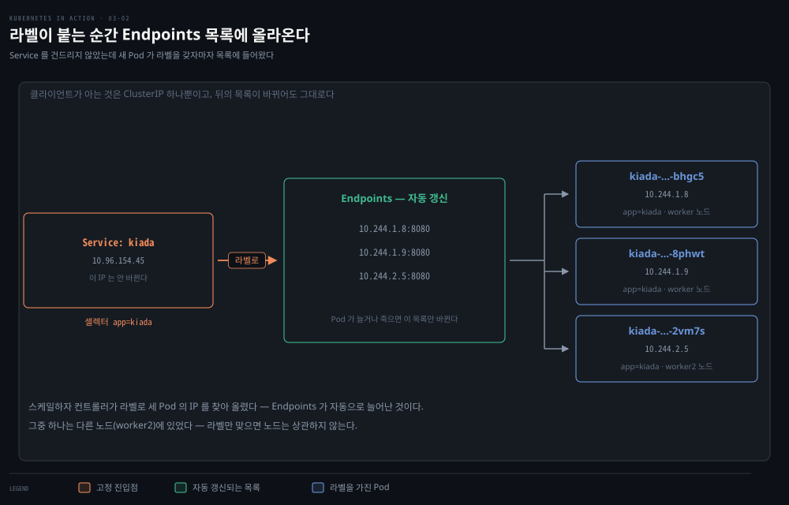
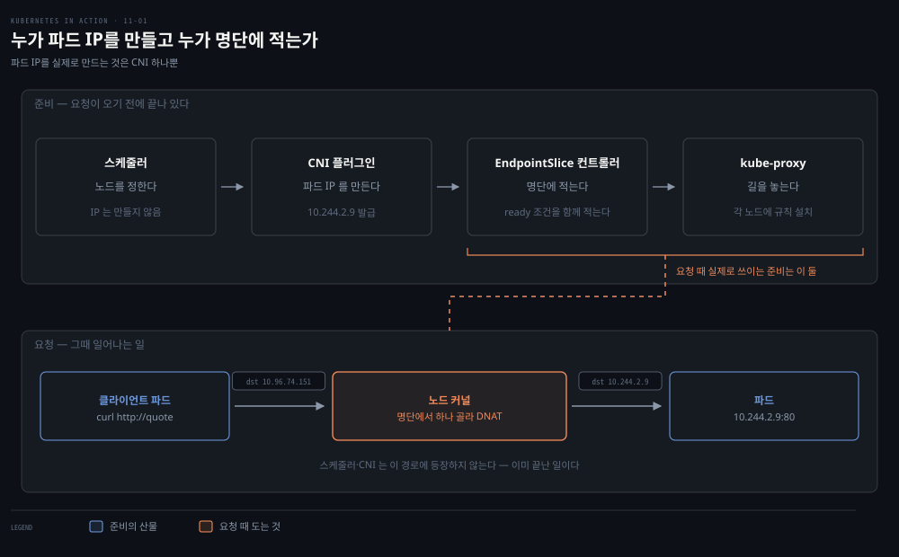
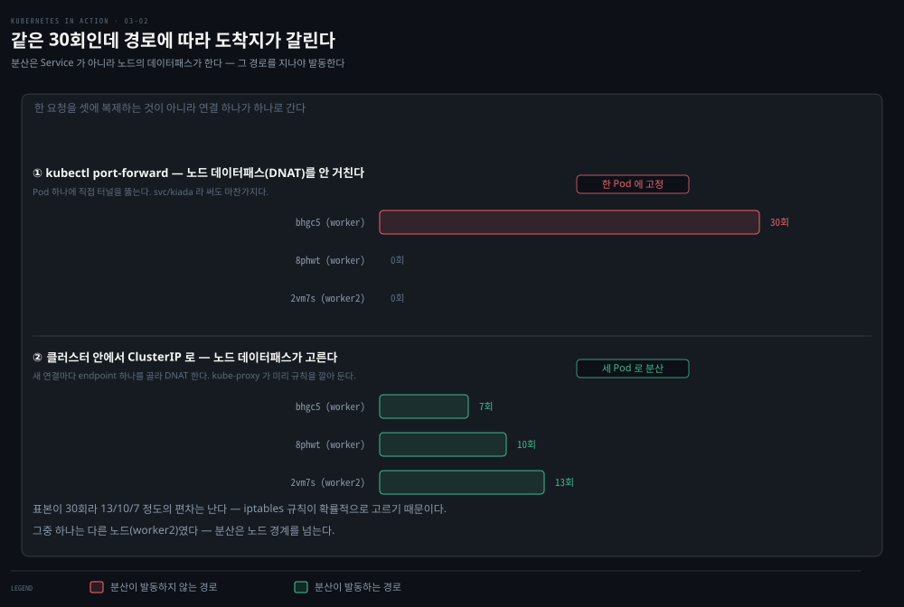
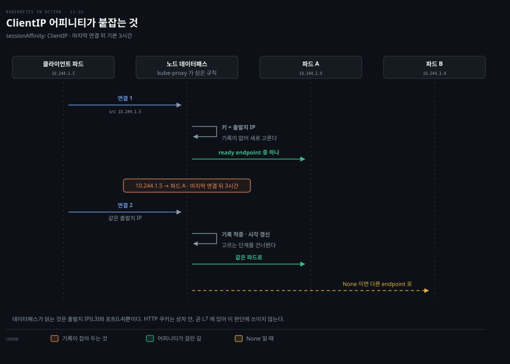
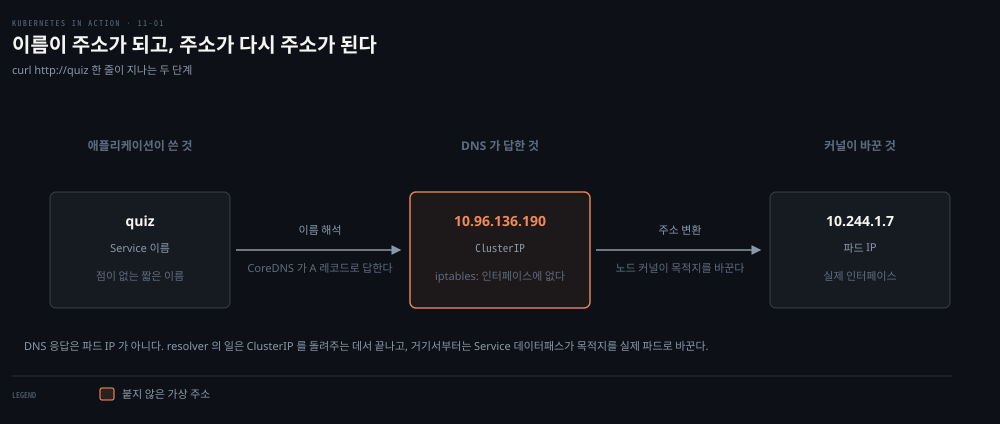
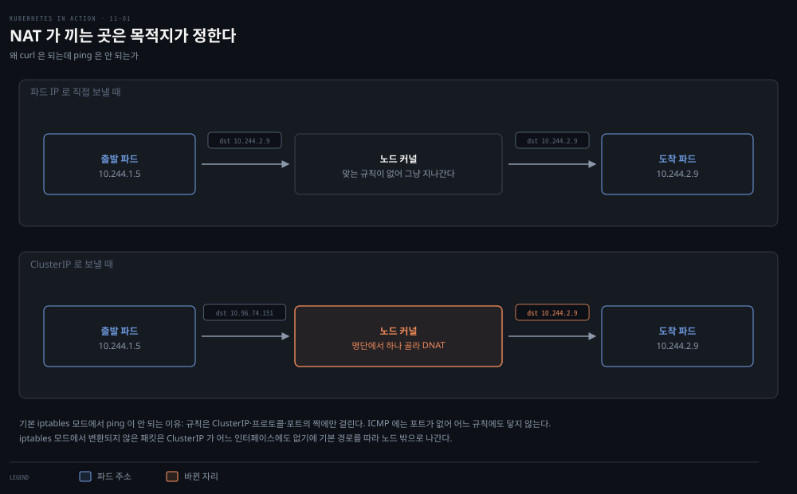

# Service 기초 — 파드 통신·ClusterIP·세션 어피니티
---

## 핵심 요약

> Service 는 수시로 바뀌는 파드 IP 앞에 변하지 않는 가상 IP(ClusterIP)와 이름을 세우고, label selector 가 고른 파드로 연결을 넘기는 오브젝트입니다.

파드끼리는 NAT(Network Address Translation) 없이 통신합니다. 그러나 파드 IP 는 수시로 바뀌므로 클라이언트는 Service 가 주는 ClusterIP 하나로 접근합니다. ClusterIP 는 특정 호스트가 직접 응답하지 않는 가상 주소라서 각 노드의 커널이 kube-proxy 가 심은 규칙으로 목적지를 실제 파드 IP 로 바꿔 줍니다. 클러스터 안에서는 CoreDNS 가 Service 이름을 ClusterIP 로 풀어 줍니다. 세션 어피니티는 Service 가 읽는 L3·L4 헤더 정보, 곧 클라이언트 IP 로만 겁니다.[^ver]




## 학습 목표

이 내용을 읽고 나면:

1. 파드끼리 NAT 없이 통신하는 flat 네트워크의 의미와, 파드 IP 를 직접 쓰면 안 되는 이유를 설명할 수 있습니다.
2. label selector 로 ClusterIP Service 를 만들고 `kubectl expose` 가 selector 를 정하는 방식의 함정을 말할 수 있습니다.
3. ClusterIP 가 어느 범위에서 어떻게 할당되는지와, 스케줄러·CNI·EndpointSlice 컨트롤러·kube-proxy 의 역할 분리를 설명할 수 있습니다.
4. 클러스터 안에서 Service 로 접근하고, `kubectl port-forward` 가 Service 를 우회하는 것을 분산 결과로 구분할 수 있습니다.
5. 세션 어피니티가 쿠키가 아니라 클라이언트 IP 기준인 이유를 L4 와 L7 의 차이로 설명할 수 있습니다.
6. Service 이름이 DNS 로 ClusterIP 가 되고 DNAT 로 파드 IP 가 되는 두 단계와, kube-proxy 의 현재 기본 모드를 설명할 수 있습니다.


## 본문 정리

### 파드 IP 를 직접 쓰면 안 되는 이유

파드 IP 는 파드가 지워지고 다시 만들어질 때마다 바뀌므로, 클라이언트는 파드 IP 대신 Service 가 세우는 하나의 주소로 접근합니다.

이사를 자주 다니는 친구에게 편지를 보낸다고 해 봅시다. 집 주소를 외워 두면 이사할 때마다 편지가 반송됩니다. 대신 평생 바뀌지 않는 사서함 번호 하나를 받아 두면 친구가 어디로 옮기든 편지는 도착합니다. 파드는 이사를 아주 자주 다니는 친구이고, Service 가 그 사서함입니다. 이 노트는 누가 사서함 뒤에 설지 정하는 방법, 사서함 번호를 받는 방법, 그 번호로 편지가 실제 파드까지 가는 길을 차례로 따라갑니다.

Kiada 애플리케이션은 세 서비스로 이뤄집니다. Kiada 서비스가 Quote 서비스에서 인용구를, Quiz 서비스에서 퀴즈 문제를 받아 응답에 합칩니다. 각 서비스가 여러 파드 replica 로 제공되면 replica 의 개수와 IP 가 수시로 바뀝니다. 클라이언트가 replica 하나하나의 IP 를 추적하는 대신 단일 주소로 묶어 접근하게 하는 오브젝트가 Service 입니다.

파드 IP 를 직접 쓰지 못하는 이유는 세 가지입니다.

1. 파드는 ephemeral 이라 노드 축출·노드 장애·스케일 축소 등으로 언제든 지워지고 대체됩니다.
2. 파드는 노드에 배정될 때 비로소 IP 를 받으므로 미리 알 수 없습니다.
3. 수평 확장에서는 replica 마다 IP 가 달라, 하나의 IP 나 DNS 이름 뒤에서 부하를 분산해 줄 무언가가 필요합니다.


### 파드끼리 NAT 없이 통신하는 flat 네트워크

클러스터의 모든 파드는 하나의 사설 flat 네트워크로 연결되어, 파드가 다른 파드에 보낸 패킷의 출발지 주소와 목적지 주소는 바뀌지 않습니다.



위 그림의 주소가 왜 그대로인지 보려면 용어 하나가 필요합니다. **NAT**(Network Address Translation)는 패킷이 지나갈 때 주소를 바꿔치기하는 것입니다. 바꾸는 자리에 따라 이름이 갈립니다.

- **SNAT** (Source NAT) — 출발지 주소를 바꿉니다
- **DNAT** (Destination NAT) — 목적지 주소를 바꿉니다

우편물에 비유하면 SNAT 는 보낸 사람 주소를, DNAT 는 받는 사람 주소를 중간에 고쳐 적는 일입니다. 파드끼리는 둘 다 일어나지 않습니다.

각 파드는 자기 IP 를 가진 네트워크 인터페이스를 갖습니다. 노드들이 여러 라우터를 사이에 두고 멀리 떨어져 있어도 파드는 NAT 가 필요 없는 자신들의 flat 네트워크 위에서 통신합니다. 이 파드 네트워크는 대개 노드를 잇는 실제 네트워크 위에 얹힌 소프트웨어 정의 네트워크입니다.

파드가 다른 파드로 패킷을 보낼 때 출발지 IP·포트와 목적지 IP·포트는 바뀌지 않습니다. 보내는 파드가 받는 파드의 IP 를 알면 그대로 패킷을 보낼 수 있고, 받는 파드는 보낸 쪽 IP 를 출발지로 봅니다. 네트워크 플러그인은 여러 종류지만 모두 이렇게 동작해야 합니다. 그래서 두 파드가 같은 노드에 있든 다른 지역의 노드에 있든 통신 방식은 같습니다. 애플리케이션 관점에서 노드 사이의 실제 토폴로지는 중요하지 않습니다.


### label selector 로 파드 고르기

Service 는 label selector 로 자기 뒤에 설 파드를 정하며, selector 에 맞는 라벨을 가진 파드가 그 Service 의 일원이 됩니다.

label selector 는 파드에 단 라벨(키=값)로 오브젝트를 고르는 조건입니다. 라벨과 selector 의 문법은 [label 과 label selector 로 오브젝트 조직하기](./07-02.label%EA%B3%BC%20label%20selector%EB%A1%9C%20%EC%98%A4%EB%B8%8C%EC%A0%9D%ED%8A%B8%20%EC%A1%B0%EC%A7%81%ED%95%98%EA%B8%B0.md)에서 다룹니다.



Service 는 여러 파드가 뒷받침할 수 있습니다. Service 에 연결하면 그 연결은 뒷받침 파드 중 하나로 넘어갑니다. 어느 파드가 이 Service 에 속하는지는 label selector 가 정합니다. 파드 오브젝트에 라벨을 달고 Service 오브젝트에 selector 를 지정하면 라벨이 selector 에 맞는 파드가 Service 에 포함됩니다.

- Quote 서비스의 selector 는 `app=quote` 입니다. 이 selector 는 stable 이든 canary 든 `app` 키에 `quote` 값을 가진 모든 quote 파드를 고릅니다.
- 파드에 붙은 다른 라벨은 매칭에 영향을 주지 않습니다. 위 그림에서 `app=quiz` 파드는 selector 에 맞지 않아 제외됩니다. 같은 라벨을 가졌어도 다른 네임스페이스의 파드는 selector 가 네임스페이스 안에서만 매칭하므로 포함되지 않습니다.


### ClusterIP Service 만들기

type 을 적지 않으면 ClusterIP Service 가 만들어집니다. 이 타입은 클러스터 안에서만 접근되므로 클러스터 내부 파드끼리 쓰는 Quiz·Quote 서비스에 알맞습니다.

쿠버네티스 Service 타입은 ClusterIP·NodePort·LoadBalancer·ExternalName 넷입니다. ClusterIP 는 클러스터 내부 전용이고 타입을 적지 않으면 기본으로 이 타입이 됩니다. Kiada 서비스는 외부에도 노출돼야 하므로 ClusterIP 만으로는 부족한데, 이 부분은 [11-02](./11-02.%EC%99%B8%EB%B6%80%20%EB%85%B8%EC%B6%9C%20%E2%80%94%20NodePort%C2%B7LoadBalancer%C2%B7%ED%8A%B8%EB%9E%98%ED%94%BD%20%EC%A0%95%EC%B1%85.md)에서 다룹니다.

quote Service 의 최소 매니페스트입니다.

```yaml
apiVersion: v1
kind: Service
metadata:
  name: quote
spec:
  type: ClusterIP        # 기본값 — 클러스터 안에서만 접근
  selector:
    app: quote           # 이 라벨을 가진 파드가 뒷받침
  ports:
  - name: http           # 포트가 하나여도 이름을 붙이는 게 좋습니다
    port: 80             # Service의 cluster IP에서 여는 포트
    targetPort: 80       # 파드에서 연결이 향하는 포트
    protocol: TCP
```

- 이 매니페스트는 `app=quote` 라벨을 가진 파드 중 하나를 골라 80번 포트로 연결을 넘기는 ClusterIP Service 를 정의합니다. 기본 iptables 모드에서는 그 하나를 무작위로 고릅니다.[^proxy]
- 포트가 여럿이면 각 포트에 이름을 반드시 붙여야 하고, 포트가 하나여도 붙이는 편이 낫습니다. `targetPort` 에는 포트 번호 대신 파드 정의의 포트 이름을 적을 수도 있는데, 그러면 뒷받침 파드마다 포트 번호가 달라도 Service 가 올바른 대상 포트를 씁니다.


### kubectl expose 와 selector 의 함정

`kubectl expose` 는 대상 리소스에서 selector 를 만들어 새 Service 에 넣으므로, 파드를 expose 하면 그 파드의 라벨 전부가 selector 가 됩니다.

매니페스트를 `kubectl apply` 하는 대신 `kubectl expose` 로도 Service 를 만들 수 있습니다.[^expose]

```bash
kubectl expose pod quiz --name quiz
# service/quiz exposed
```

- 이 명령은 quiz 파드의 라벨을 읽어 그 라벨 전부에 맞는 selector 를 가진 Service 를 만듭니다. [03-02](./03-02.%EC%B2%AB%20%EC%95%A0%ED%94%8C%EB%A6%AC%EC%BC%80%EC%9D%B4%EC%85%98%20%EB%B0%B0%ED%8F%AC%EC%99%80%20%EC%8A%A4%EC%BC%80%EC%9D%BC%EB%A7%81.md)에서 Deployment 를 expose 했을 때는 Deployment 의 selector 를 가져와 그 파드 전부를 노출했습니다.

Service 를 만들면 클러스터 안 워크로드가 파드에 닿을 수 있는 내부 IP, 곧 cluster IP 가 배정됩니다.

```bash
kubectl get svc -o wide

# NAME    TYPE        CLUSTER-IP      EXTERNAL-IP   PORT(S)    AGE   SELECTOR
# quiz    ClusterIP   10.96.136.190   <none>        8080/TCP   15s   app=quiz,rel=stable
# quote   ClusterIP   10.96.74.151    <none>        80/TCP     23s   app=quote
```

- `kubectl expose` 로 만든 quiz Service 의 selector 는 `app=quiz,rel=stable` 입니다. quiz 파드가 가진 라벨을 그대로 가져왔기 때문입니다.[^m1]
- 나중에 canary 를 배포하면 트래픽이 canary 에도 가야 하므로, selector 가 stable 에만 묶이는 것은 대개 바라는 바가 아닙니다.


### ClusterIP 는 어느 범위에서 어떻게 정해지나

ClusterIP 는 ServiceCIDR 오브젝트가 정한 범위에서 고르며, 할당된 IP 마다 IPAddress 오브젝트가 하나씩 생깁니다.

kube-apiserver 의 `--service-cluster-ip-range` 값으로 부트스트랩 때 `kubernetes` 라는 기본 ServiceCIDR 오브젝트가 만들어집니다. Service 에 IP 가 할당될 때마다 그 IP 를 가리키는 IPAddress 오브젝트도 생깁니다. 이 두 API 는 v1.33 부터 stable 입니다.[^cidr] 관리자가 ServiceCIDR 오브젝트를 더 만들면 그 범위에서도 ClusterIP 를 고릅니다.[^cidr] kind 클러스터에서 보면 다음과 같습니다.[^m1]

```bash
kubectl get servicecidrs
# NAME         CIDRS          AGE
# kubernetes   10.96.0.0/16   26m

kubectl get ipaddresses
# NAME            PARENTREF
# 10.96.0.1       services/default/kubernetes
# 10.96.0.10      services/kube-system/kube-dns
# 10.96.121.246   services/default/kiada
```

범위는 정적 대역과 동적 대역으로 나뉩니다. 아래쪽 정적 대역의 크기는 `min(max(16, cidrSize / 16), 256)` 개이고, 나머지 위쪽이 동적 대역입니다. /16 범위에서는 256 이므로 앞쪽 `10.96.0.1` 부터 `10.96.1.0` 까지가 정적 대역입니다. 동적 할당은 기본으로 위쪽 대역을 먼저 쓰고 다 쓰면 아래쪽을 씁니다. 그래서 `spec.clusterIP` 로 주소를 직접 지정하는 정적 할당과 부딪힐 위험이 줄어듭니다. 이미 할당된 IP 를 지정해 Service 를 만들면 오류가 납니다.

위 출력에서 kiada 가 받은 `10.96.121.246` 은 위쪽 대역의 주소이고, 클러스터 DNS Service 의 `10.96.0.10` 은 정적 대역의 주소입니다. 이 열 번째 주소를 DNS Service 에 주는 것은 설치 도구들의 느슨한 관례입니다.[^cidr]


### kind 로 보는 ClusterIP 고정과 명단 자동 등록

selector 에 맞는 파드는 EndpointSlice 컨트롤러가 명단에 올리므로, 파드가 바뀌어도 ClusterIP 는 그대로입니다.

[03-02. 첫 애플리케이션 배포와 스케일링](./03-02.%EC%B2%AB%20%EC%95%A0%ED%94%8C%EB%A6%AC%EC%BC%80%EC%9D%B4%EC%85%98%20%EB%B0%B0%ED%8F%AC%EC%99%80%20%EC%8A%A4%EC%BC%80%EC%9D%BC%EB%A7%81.md)에서 배포한 kiada Deployment 로 label selector 개념을 kind 에서 직접 확인한 기록입니다. `kubectl expose` 로 Service 를 만들면 고정된 ClusterIP 가 할당됩니다. 그리고 Endpoints 컨트롤러가 `app=kiada` 라벨을 가진 파드를 Service 의 **Endpoints** 에 등록합니다. 같은 명단을 EndpointSlice 컨트롤러는 EndpointSlice 에 따로 적습니다.[^ep]

```bash
kubectl expose deployment kiada --port=8080 --target-port=8080
kubectl get svc kiada
#   kiada   ClusterIP   10.96.154.45   <none>   8080/TCP   ← 이 IP는 안 바뀜

kubectl get endpoints kiada
#   kiada   10.244.1.8:8080            ← Service가 물고 있는 실제 Pod
```



핵심은 두 가지입니다.

- ClusterIP(`10.96.154.45`)는 Pod 가 죽고 새로 떠서 IP 가 바뀌어도 변하지 않습니다. 그래서 클라이언트는 이 IP 하나만 알면 됩니다.
- Service 의 대상 Pod 는 라벨 셀렉터로 자동으로 정해집니다.

Pod 를 3개로 스케일하면 Service 를 건드리지 않았는데도 새 Pod 두 개가 `app=kiada` 라벨을 갖자마자 Endpoints 에 추가됩니다.

- 목록이 세 개(`10.244.1.8`, `10.244.1.9`, `10.244.2.5`)로 늘어납니다. 이 중 `10.244.2.5` 는 다른 노드(worker2)의 Pod 였는데도 자동 등록됐습니다.
- "Pod 집합이 바뀌어도 진입점은 고정"이라는 Service 의 존재 이유가 여기서 실증됩니다.

Endpoints API 는 v1.33 부터 deprecated 입니다. v1.33 이상 API 서버는 `kubectl get endpoints` 응답에 경고를 실어 보냅니다. 표준 조회는 EndpointSlice 입니다.[^ep]

```bash
kubectl get endpointslices -l kubernetes.io/service-name=kiada
# NAME          ADDRESSTYPE   PORTS   ENDPOINTS
# kiada-d8q22   IPv4          8080    10.244.1.3,10.244.2.2,10.244.1.2
```

위 출력은 2026-11-07 실행이고, 앞의 `10.96.154.45` 출력은 2026-07-08 실행이라 IP 가 다릅니다.[^m1]


### 누가 IP 를 만들고 누가 명단에 적나

파드 IP 를 실제로 만드는 것은 CNI 플러그인 하나뿐이고, 나머지 컴포넌트는 그 IP 를 명단에 적거나 길을 놓는 일만 맡습니다.

"파드가 뜨면 IP 가 붙고 Endpoints 에 자동 등록된다"는 한 문장 뒤에는 서로 다른 네 컴포넌트가 각자 한 가지 일만 맡아 협업하는 구조가 있습니다. 이 넷을 섞으면 "누가 IP 를 만드나"에서 혼란이 옵니다.



| 컴포넌트 | 맡는 일 | IP와의 관계 |
|----------|---------|------------|
| 스케줄러 | 파드를 어느 노드에 놓을지만 결정 | IP에 관여하지 않음 |
| CNI 플러그인 (kindnet 등) | 파드가 그 노드에 뜰 때 실제 IP(`10.244.x.x`) 발급 | IP를 *만든다* |
| EndpointSlice 컨트롤러 (kube-controller-manager) | selector ↔ 파드 라벨을 감시해 파드 IP를 ready 조건과 함께 명단에 등록·삭제 | IP를 *가져다 적는다* |
| kube-proxy | 그 명단으로 각 노드의 ClusterIP→파드 전달 규칙 관리 | IP로 *길을 놓는다* |

- 한 줄로 외우면 스케줄러는 노드, CNI 는 IP 발급, EndpointSlice 컨트롤러는 명단, kube-proxy 는 길입니다.
- `10.96.74.151` 이 Service VIP(Virtual IP)입니다.
- 컨트롤러는 CNI 가 발급한 파드 IP 를 명단에 옮겨 적을 뿐이고, kube-proxy 는 그 명단으로 뒤에서 볼 DNAT 길을 놓습니다.

EndpointSlice 컨트롤러는 같은 네임스페이스 안에서 Service selector 와 Pod 라벨을 비교합니다. 그리고 해당 Service 가 사용할 endpoint 들을 EndpointSlice 에 추가·갱신·삭제합니다.

앞에서 쓴 `kubectl get endpoints` 의 Endpoints(코어 v1) 오브젝트는 deprecated 입니다. v1.33 이상 클러스터에서는 조회할 때마다 경고가 붙습니다. 표준은 `discovery.k8s.io/v1` 의 EndpointSlice 입니다.[^ep] 최신 명령은 `kubectl get endpointslices -l kubernetes.io/service-name=kiada` 입니다. 왜 바뀌었는지(대규모 Service 확장성)와 조각 상한 등 상세는 [11-03](./11-03.%EC%97%94%EB%93%9C%ED%8F%AC%EC%9D%B8%ED%8A%B8%C2%B7DNS%C2%B7%ED%86%A0%ED%8F%B4%EB%A1%9C%EC%A7%80%C2%B7readiness.md)의 「Endpoints 와 EndpointSlice」 절이 정본입니다.


### 만든 뒤 Service 고치기

selector 와 포트는 만든 뒤에도 바꿀 수 있습니다. selector 는 `kubectl set selector` 로, 포트는 `kubectl edit` 이나 매니페스트 재적용으로 고칩니다.

quiz Service 의 selector 에서 `rel: stable` 을 빼고 `app: quiz` 만 남겨 canary 파드까지 받게 하려면 이렇게 합니다.

```bash
kubectl set selector service quiz app=quiz
# service/quiz selector updated
```

- 이렇게 selector 를 바꾸는 방식은 여러 버전을 배포하고 클라이언트를 한 버전에서 다른 버전으로 돌릴 때 유용합니다.
- 포트를 바꾸려면 `kubectl edit svc quiz` 로 `port` 를 8080에서 80으로 고칩니다. quiz 파드가 실제로 듣는 포트는 8080이므로 `targetPort` 는 8080으로 둡니다.

Service 오브젝트 spec 의 기본 필드입니다.

| 필드 | 타입 | 설명 |
|------|------|------|
| `type` | string | ClusterIP·NodePort·LoadBalancer·ExternalName 중 하나. 기본 ClusterIP |
| `clusterIP` | string | 클러스터 내부 IP. 보통 비워 두고 쿠버네티스가 배정. `None`이면 headless ([11-03](./11-03.%EC%97%94%EB%93%9C%ED%8F%AC%EC%9D%B8%ED%8A%B8%C2%B7DNS%C2%B7%ED%86%A0%ED%8F%B4%EB%A1%9C%EC%A7%80%C2%B7readiness.md), StatefulSet 결합은 [16-01](./16-01.StatefulSet%20%EA%B8%B0%EC%B4%88%20%E2%80%94%20Pets%20vs%20Cattle%C2%B7ordinal%C2%B7headless%20Service.md)) |
| `selector` | map | 이 Service가 트래픽을 넘길 파드가 가져야 할 라벨. 안 적으면 엔드포인트를 직접 관리 ([11-03](./11-03.%EC%97%94%EB%93%9C%ED%8F%AC%EC%9D%B8%ED%8A%B8%C2%B7DNS%C2%B7%ED%86%A0%ED%8F%B4%EB%A1%9C%EC%A7%80%C2%B7readiness.md)) |
| `ports` | []Object | 노출 포트 목록. 각 항목에 name·protocol·appProtocol·port·nodePort·targetPort |


### IPv4/IPv6 듀얼스택

`spec.ipFamilyPolicy` 가 SingleStack(기본)이면 IP 하나를, PreferDualStack 이나 RequireDualStack 이면 IPv4 와 IPv6 둘을 배정합니다.

쿠버네티스는 IPv4 와 IPv6 를 함께 지원합니다. 클러스터에 듀얼스택이 켜져 있지 않으면 PreferDualStack 은 싱글스택으로 물러나고 RequireDualStack 은 Service 만들기가 실패합니다.[^dual]

- 만든 뒤 `spec.ipFamilies` 배열이 배정된 IP family(IPv4·IPv6)를 알려 줍니다.
- `spec.clusterIPs` 는 배정된 IP 전체를 `ipFamilies` 순서대로 담는 주 필드입니다. `spec.clusterIP` 는 `clusterIPs` 에서 계산한 값입니다. `clusterIP` 에는 `ipFamilies` 의 첫 family 와 같은 종류의 주소가 들어갑니다.
- 싱글스택 클러스터에서는 두 필드가 모두 주소 하나만 담습니다. kind 클러스터의 kiada Service 는 `ipFamilyPolicy: SingleStack`, `clusterIPs: ["10.96.121.246"]`, `clusterIP: 10.96.121.246` 이었습니다.[^m1]


### 클러스터 안에서 Service 접근

ClusterIP Service 는 클러스터 안에서만 접근됩니다. 그래서 내 노트북이 아니라 노드에 ssh 로 들어가거나, `kubectl exec` 로 기존 파드 안에서 curl 을 실행해 확인합니다.

quote-001 파드 안에서 셸을 열고 두 서비스에 접근해 봅니다.

```bash
kubectl exec -it quote-001 -c nginx -- sh

# / # curl http://10.96.136.190      # quiz의 cluster IP
# This is the quiz service running in pod quiz

# / # curl http://10.96.74.151       # quote의 cluster IP
# This is the quote service running in pod quote-canary
```

- 포트를 curl 에 안 적은 이유는 Service 포트를 80으로 뒀고, 80이 HTTP 기본 포트이기 때문입니다.
- quote 서비스에 여러 번 요청하면 요청을 처리하는 파드가 바뀌는 것을 볼 수 있습니다. 무작위로 고르므로 같은 파드가 연달아 나올 수도 있습니다. Service 가 부하 분산기로서 뒤의 파드들에 요청을 흩뿌립니다.

`kubectl port-forward svc/my-service` 는 Service 에 연결하는 것처럼 보이지만, 실제로는 Service 를 이용해 파드 하나를 찾아 그 파드에 직접 연결합니다. 곧 Service 를 우회합니다.[^pf]


### port-forward 와 Service 우회

`kubectl port-forward svc/…` 는 Service 의 selector 로 파드를 찾아 그중 하나에 터널을 열고, 그 파드에 고정됩니다.[^pf] 그래서 로드밸런싱이 일어나지 않습니다. 분산은 클러스터 안에서 ClusterIP 로 요청해야 보입니다.

위 설명을 kind 에서 실측한 근거입니다. [03-02](./03-02.%EC%B2%AB%20%EC%95%A0%ED%94%8C%EB%A6%AC%EC%BC%80%EC%9D%B4%EC%85%98%20%EB%B0%B0%ED%8F%AC%EC%99%80%20%EC%8A%A4%EC%BC%80%EC%9D%BC%EB%A7%81.md)의 kiada 를 3개로 스케일한 뒤 port-forward 한 주소로 30번 요청하자 응답이 전부 같은 Pod 하나에서만 왔습니다.

```bash
kubectl scale deployment kiada --replicas=3
kubectl port-forward svc/kiada 18080:8080 &

for i in $(seq 1 30); do curl -s localhost:18080/ | grep -oE 'kiada-[a-z0-9-]+'; done | sort | uniq -c
#   30 kiada-7bc9cd6878-bhgc5     ← 한 Pod만! 분산이 안 됨
```

이름은 `svc/kiada` 지만 port-forward 는 Service 의 selector 에 맞는 Pod 하나를 골라 그 Pod 에 직접 터널을 뚫습니다. 한번 연결되면 그 Pod 에 고정되어 ClusterIP 의 Service 데이터패스를 거치지 않습니다.

로드밸런싱을 제대로 보려면 클러스터 안에서 Service 이름(ClusterIP)으로 요청해야 합니다. 임시 curl Pod 를 클러스터 안에 띄워 확인했습니다.

```bash
kubectl run curl-test --image=curlimages/curl --rm -it --restart=Never -- \
  sh -c 'for i in $(seq 1 30); do curl -s http://kiada:8080/ | grep -oE "kiada-[a-z0-9-]+"; done | sort | uniq -c'

#   13 kiada-7bc9cd6878-2vm7s    (worker2)
#   10 kiada-7bc9cd6878-8phwt    (worker)
#    7 kiada-7bc9cd6878-bhgc5    (worker)
```

이번에는 30번 요청이 세 Pod 에 13/10/7 로 분산됐습니다. 그중 하나는 다른 노드 worker2 에 있었으니 Service 가 노드 경계를 넘어 분산한다는 증거입니다. 이 kind 환경의 kube-proxy 는 iptables 모드였고, 설치된 규칙이 endpoint 를 확률적으로 선택했습니다. 30회처럼 표본이 작으면 13/10/7 정도의 편차가 날 수 있습니다.[^ver] 2026-11-07 에 같은 조건으로 돌린 분산은 10/11/9 였습니다.[^m2]



| 접속 방식 | 실제 경로 | 로드밸런싱 |
|-----------|----------|-----------|
| `kubectl port-forward svc/...` | Pod 하나에 직접 터널 | ❌ 한 Pod 고정 (30번 모두 같은 Pod) |
| 클러스터 내부에서 ClusterIP·Service 이름 | 출발 노드 커널 데이터패스가 endpoint 하나를 선택해 DNAT | ✅ 여러 Pod (13/10/7) |

- 그래서 "Service 로 요청했는데 왜 한 Pod 만 응답하나"의 답은 대개 port-forward 로 접속했기 때문입니다.
- Service 의 로드밸런싱을 보려면 클러스터 안에서 ClusterIP 로 요청해야 합니다.


### 세션 어피니티와 클라이언트 IP

`spec.sessionAffinity` 의 기본값은 None 이고, ClientIP 로 바꾸면 같은 클라이언트 IP 에서 온 연결을 모두 같은 파드로 넘깁니다.



`sessionAffinity` 에 넣을 수 있는 값은 None 과 ClientIP 둘뿐이고, 다른 값은 API 서버가 거부합니다.[^aff] 기본 None 은 어느 파드로 갈지 보장하지 않습니다.

ClientIP 의 지속 시간은 `sessionAffinityConfig.clientIP.timeoutSeconds` 로 정하며 기본 3시간입니다. 기본 iptables 모드에서 이 시간은 마지막 새 연결부터 다시 잽니다.[^aff] kind 에서 `sessionAffinity` 를 ClientIP 로 바꾸면 이 필드에 `10800` 이 자동으로 채워졌습니다. 이때 한 클라이언트 파드가 보낸 30번 요청은 모두 같은 파드에서 응답했습니다.[^m2]

Service 의 어피니티에는 쿠키 기반 방식이 없습니다. Service 는 OSI 전송 계층(TCP·UDP·SCTP)에서 동작해 애플리케이션 계층(HTTP)의 쿠키를 이해하지 못하기 때문입니다.

여기서 말하는 "계층"은 택배 상자에 비유하면 잡힙니다.

- **L3·L4 헤더** — 상자 겉면입니다. 받는 주소(IP, L3)와 몇 번 창구로 갈지(포트, L4)가 적혀 있습니다.
- **애플리케이션 계층**(**L7**) — 상자 속입니다. 열어야 HTTP 헤더·쿠키·URL 경로가 보입니다.

Service 는 상자를 뜯지 않고 겉면만 보고 분류하는 우체국입니다. 쿠키는 상자 안에 있으니 볼 수가 없습니다.

그림의 흐름은 다음과 같습니다.

1. 첫 연결이 들어오면 노드 데이터패스는 패킷의 출발지 IP 를 ClientIP 어피니티 키로 사용합니다.
2. 아직 연결된 파드가 없으면 Service 의 ready endpoint 중 하나를 고르고 `출발지 IP → 파드` 관계를 어피니티 상태로 기록합니다.
3. 같은 출발지 IP 에서 새 연결이 들어오면 기록을 찾아 같은 파드로 보내고, 기록 시각을 그 연결 시각으로 새로 씁니다. 기본 iptables 모드에서 이 관계는 마지막 새 연결 뒤 `sessionAffinityConfig.clientIP.timeoutSeconds`(기본 10,800초, 3시간)가 지나면 풀립니다.
4. `sessionAffinity: None` 이면 이 ClientIP 기록을 사용하지 않으므로 새 연결이 다른 ready endpoint 로 갈 수 있습니다.

Service 가 판단에 사용하는 정보는 L3 의 출발지 IP 와 L4 의 프로토콜·포트입니다. HTTP 쿠키·경로·헤더는 L7 데이터라 Service 데이터패스가 읽지 않습니다. 그래서 쿠키 기반 어피니티가 필요하면 L7 을 이해하는 계층을 앞에 둬야 합니다.

| 구분 | Service (L4) | Ingress (L7) |
|------|-------------|--------------------|
| 보는 계층 | L3·L4 — IP·포트 | L7 — HTTP |
| 어피니티 기준 | 클라이언트 IP만 | 쿠키·경로·헤더 |
| 라우팅 판단 | 목적지 IP:포트 | URL 경로·호스트·쿠키 |

- ClientIP 어피니티에는 한계도 있습니다. 회사 NAT 뒤의 여러 사용자가 같은 출발 IP 로 보이면 그 사용자들의 연결이 전부 한 파드로 몰려 부하 분산이 깨집니다.
- 쿠키라면 사용자별로 구분되겠지만 L4 에서는 그 정보가 보이지 않습니다. 쿠키·경로 기반 라우팅은 [Ingress 노트](./12-01.Ingress%EB%A1%9C%20%EC%97%AC%EB%9F%AC%20%EC%84%9C%EB%B9%84%EC%8A%A4%EB%A5%BC%20%ED%95%9C%20IP%EC%97%90%20%EB%85%B8%EC%B6%9C%ED%95%98%EA%B8%B0.md)에서 다룹니다.


### 클러스터 DNS 로 Service 이름 풀기

클러스터는 대개 CoreDNS 를 DNS 서버로 사용하므로, 파드는 ClusterIP 대신 Service 이름으로 접근할 수 있습니다.

```bash
# / # curl http://quiz              # cluster IP 대신 Service 이름
# This is the quiz service running in pod quiz
```

CoreDNS 는 쿠버네티스 API 오브젝트가 아니라 애드온입니다. Service 나 Pod 처럼 `kubectl get` 으로 조회하는 리소스 종류가 아니라, `kube-system` 네임스페이스에서 Deployment 로 도는 평범한 파드 묶음입니다. 그 앞에는 하위 호환성을 위해 이름을 유지한 `kube-dns` 라는 ClusterIP Service 가 서 있습니다.[^cn] 파드의 `nameserver` 에 들어가는 `10.96.0.10` 이 바로 그 Service 의 ClusterIP 입니다.

```bash
kubectl get deploy,svc -n kube-system -l k8s-app=kube-dns
# NAME                      READY   UP-TO-DATE   AVAILABLE
# deployment.apps/coredns   2/2     2            2
#
# NAME               TYPE        CLUSTER-IP   PORT(S)
# service/kube-dns   ClusterIP   10.96.0.10   53/UDP,53/TCP,9153/TCP
```

그래서 DNS 질의도 지금까지 본 Service 트래픽과 똑같은 경로를 지납니다. 파드가 `10.96.0.10:53` 으로 질의를 보내면 노드 커널이 그 목적지를 실제 CoreDNS 파드 IP 로 DNAT 합니다. 클러스터의 이름 해석이 클러스터 자신의 Service 메커니즘 위에 올라가 있는 셈입니다.

CoreDNS 는 받은 이름을 두 갈래로 처리합니다. `cluster.local` 같은 클러스터 도메인이면 자기가 아는 Service·파드 레코드로 직접 답합니다. 그 밖의 이름, 이를테면 `api.github.com` 같은 외부 도메인이면 업스트림 DNS 서버로 넘깁니다. 이 위임을 설정하는 것이 CoreDNS 설정의 `forward . /etc/resolv.conf` 줄입니다.


### 파드의 resolv.conf 가 이름을 확장하는 방법

파드의 `/etc/resolv.conf` 는 kubelet 이 파드를 만들 때 채웁니다. 그 안의 `search` 줄이 짧은 Service 이름 뒤에 클러스터 도메인 접미사를 차례로 붙여 줍니다.

`/etc/resolv.conf` 는 컨테이너 이미지에 미리 들어 있는 클러스터 설정이 아닙니다. kubelet 이 파드를 만들 때 `dnsPolicy` 와 파드의 네임스페이스를 바탕으로 파드에 DNS 설정을 구성합니다.[^dns] `kiada` 네임스페이스의 일반 파드에서 확인하면 다음과 비슷합니다.

```bash
kubectl exec quote-001 -c nginx -- cat /etc/resolv.conf

# /etc/resolv.conf (내용)
search kiada.svc.cluster.local svc.cluster.local cluster.local
nameserver 10.96.0.10
options ndots:5
```

클러스터의 도메인·DNS 구성과 컨테이너 런타임에 따라 search 항목이나 options 가 더 붙을 수 있지만 세 줄의 기본 역할은 같습니다.[^m3]

- `search` 는 점이 적은 짧은 이름 뒤에 붙여 볼 접미사와 순서를 정합니다. 첫 항목에 파드의 네임스페이스인 `kiada` 가 들어가므로 같은 네임스페이스의 Service 를 이름만으로 찾을 수 있습니다.
- `nameserver` 는 DNS 질의를 보낼 서버 주소입니다. 여기의 `10.96.0.10` 은 CoreDNS 파드 IP 가 아니라 앞단 `kube-dns` Service 의 ClusterIP 입니다.
- `options ndots:5` 는 이름에 포함된 점이 5개보다 적으면 `search` 접미사를 붙인 후보를 먼저 조회하게 합니다. 조회가 모두 실패하면 접미사를 붙이지 않은 이름도 시도합니다.

애플리케이션이 `curl http://quiz` 를 실행하면 URL 파싱 뒤 운영체제 resolver 에 호스트명 `quiz` 를 넘깁니다. `quiz` 에는 점이 없으므로 resolver 는 먼저 `quiz.kiada.svc.cluster.local` 을 만들고 `nameserver 10.96.0.10` 의 53번 포트로 질의합니다. 이 이름이 존재하면 CoreDNS 가 quiz Service 의 ClusterIP 를 응답하고 탐색을 멈춥니다.

첫 후보가 없으면 resolver 는 `search` 순서에 따라 다음 후보를 차례로 시도합니다.

```pseudocode
quiz.kiada.svc.cluster.local
quiz.svc.cluster.local
quiz.cluster.local
quiz
```

파드는 같은 네임스페이스의 Service 를 이름만으로 resolve 합니다. 다른 네임스페이스의 Service 에 접근할 때는 `http://quiz.kiada/` 처럼 그 Service 의 네임스페이스를 붙입니다. 하나의 Service 는 다음 네 이름 중 어느 것으로도 resolve 됩니다.

- `<service>` — 같은 네임스페이스에서만
- `<service>.<namespace>`
- `<service>.<namespace>.svc`
- `<service>.<namespace>.svc.cluster.local` — FQDN

FQDN 을 다 안 적어도 되는 이유는 파드의 `/etc/resolv.conf` 에 있는 `search` 줄이 도메인 접미사를 차례로 붙여 매칭될 때까지 시도하기 때문입니다.

앞서 본 `forward . /etc/resolv.conf` 에서 한 가지를 짚어 둡니다. 이 줄이 가리키는 파일은 CoreDNS 컨테이너가 보는 것이고, 짧은 Service 이름을 확장하는 애플리케이션 파드의 것과 다른 파일입니다. 이름이 같아 헷갈리지만 역할이 갈립니다.

| 파일 | 누가 보나 | 정하는 것 |
|------|----------|----------|
| CoreDNS 컨테이너의 `/etc/resolv.conf` | CoreDNS | 외부로 나갈 때 물어볼 업스트림 |
| 애플리케이션 파드의 `/etc/resolv.conf` | 앱 파드 | 짧은 이름에 붙일 접미사 |

애플리케이션 파드의 이 DNS 설정을 어떻게 만들지는 파드 spec 의 `dnsPolicy` 가 정합니다. 값을 적지 않으면 `ClusterFirst` 가 쓰입니다. 이름이 비슷한 `Default` 는 기본값이 아니라, 노드의 이름 해석 설정을 그대로 물려받는 정책입니다.[^dns]

| `dnsPolicy` 값 | 파드가 받는 DNS 설정 |
|----------------|--------------------|
| `ClusterFirst` (기본값) | 클러스터 도메인과 맞지 않는 질의(`www.kubernetes.io` 등)는 DNS 서버가 업스트림 네임서버로 넘깁니다 |
| `Default` | 파드가 도는 노드의 이름 해석 설정을 물려받습니다 |
| `ClusterFirstWithHostNet` | `hostNetwork` 파드에 직접 적어야 하는 값입니다. 안 적으면 `ClusterFirst` 가 `Default` 처럼 동작합니다 |
| `None` | 쿠버네티스 환경의 DNS 설정을 무시하고 모든 설정을 `dnsConfig` 로 받습니다 |

`dnsConfig` 필드로는 `nameservers`(최대 3개)·`searches`(최대 32개)·`options` 를 더 얹을 수 있습니다. 얹은 값은 `dnsPolicy` 가 만든 기본 설정에 합쳐집니다. `dnsPolicy` 가 `None` 이면 `dnsConfig` 를 반드시 적어야 합니다.[^dns]

이 노트는 이름이 ClusterIP 가 되고 다시 파드 IP 로 바뀌는 흐름까지만 다룹니다. DNS 레코드 유형과 CoreDNS 의 Corefile·플러그인·업스트림 설정은 다음 정본이 자세히 다룹니다.

- [11-03 의 「DNS 레코드」 절](./11-03.%EC%97%94%EB%93%9C%ED%8F%AC%EC%9D%B8%ED%8A%B8%C2%B7DNS%C2%B7%ED%86%A0%ED%8F%B4%EB%A1%9C%EC%A7%80%C2%B7readiness.md) — Service·headless 의 레코드 유형
- [Kubernetes 레코드](../learning-coredns/06-01.%EB%AC%B4%EC%97%87%EC%9D%84%20%EC%84%A0%EC%96%B8%ED%96%88%EB%8A%90%EB%83%90%EA%B0%80%20%EB%A0%88%EC%BD%94%EB%93%9C%20%EB%AA%A8%EC%96%91%EC%9D%84%20%EC%A0%95%ED%95%9C%EB%8B%A4.md) — CoreDNS 동작


### 이름이 ClusterIP 가 되고 파드 IP 가 되는 두 단계

`quiz` 한 단어가 실제 파드까지 이어지는 과정에는 성격이 다른 두 변환이 있으며, DNS 응답은 파드 IP 가 아니라 ClusterIP 입니다.



1. 첫 번째는 **이름 해석**입니다. CoreDNS 는 `quiz` 가 클러스터 안의 일반 Service 임을 확인하고 A 레코드로 ClusterIP 를 돌려줍니다. 이 응답은 파드 IP 가 아닙니다.
2. 두 번째는 **주소 변환**입니다. 클라이언트가 ClusterIP 로 연결을 시작하면 출발 노드의 커널 데이터패스가 목적지를 실제 파드 IP 로 DNAT 합니다.

DNS 응답으로 `10.96.136.190` 을 받은 뒤에는 resolver 의 역할이 끝납니다. `curl` 이 `10.96.136.190:80` 으로 연결을 시작하면 그다음부터는 DNS 가 아니라 Service 데이터패스가 목적지를 실제 파드 IP 로 DNAT 합니다.


### 환경변수로 Service 발견

kubelet 은 컨테이너를 시작할 때 파드와 같은 네임스페이스에 이미 있는 각 Service 의 환경변수를 채우므로, 이 변수가 필요하면 Service 를 파드보다 먼저 만들어야 합니다.

DNS 가 없던 초창기에는 파드가 환경변수로 Service IP 를 찾았고, 이 변수는 지금도 남아 있습니다.

```bash
# QUIZ_SERVICE_HOST=10.96.136.190
# QUIZ_SERVICE_PORT=80
# QUIZ_PORT=tcp://10.96.136.190:80
# ... (포트마다 _TCP_ADDR·_TCP_PORT·_TCP_PROTO 등)
```

Service 이름의 하이픈은 밑줄로 바뀌고 모두 대문자가 됩니다.[^env] Service 보다 먼저 만든 파드에는 변수가 채워지지 않으므로 문서는 클라이언트 파드보다 Service 를 먼저 만들라고 안내합니다. kind 에서는 Service 를 만든 뒤 컨테이너가 재시작되자 변수가 채워졌고, 재시작하지 않은 파드에는 없었습니다.[^m3]

요즘은 DNS 로 정보를 얻으므로 이 변수는 덜 쓰이고, 오히려 문제를 일으킬 수 있습니다. 네임스페이스에 Service 가 천 개 안팎으로 많으면 모든 파드에 변수가 주입되어 파드 시작이 느려지거나 컨테이너가 시작하지 못한다는 보고가 있습니다. 이때 런타임 로그에는 `argument list too long` 이 찍힙니다.[^svclink] 막으려면 파드 spec 의 `enableServiceLinks` 를 false 로 둡니다. 이 필드의 기본값은 true 입니다.[^env] 단 `default` 네임스페이스의 `kubernetes` Service 변수는 이 필드와 관계없이 들어갑니다.[^env]


### ClusterIP 로 가는 길에서 NAT 가 끼는 곳

ClusterIP 는 특정 호스트가 직접 응답하지 않는 가상 IP 라서, 노드 커널 규칙이 목적지를 실제 파드 IP 로 바꾸는 DNAT 가 일어나야 비로소 파드에 닿습니다.

가상 IP 인데도 curl 은 되고 ping 은 안 되는 이유가 이 절의 핵심입니다. 답은 목적지가 파드 IP 냐 ClusterIP 냐에 따라 주소 변환(NAT)이 끼는지가 갈리기 때문입니다. 앞에서 잡아 둔 용어를 그대로 씁니다. SNAT 는 출발지 주소를, DNAT 는 목적지 주소를 바꿔치기하는 것입니다.

- 파드 IP 로 직접 보낼 때(`10.244.x.x`)는 flat 네트워크라 SNAT 도 DNAT 도 없습니다. 출발지·목적지 주소가 끝까지 그대로 유지됩니다.
- ClusterIP 로 보낼 때(`10.96.x.x`)는 다릅니다. ClusterIP 는 특정 호스트가 직접 응답하지 않는 가상 IP 라서 그대로는 닿을 곳이 없습니다. kube-proxy 가 각 노드에 미리 심어 둔 규칙이 목적지를 실제 파드 IP 로 바꾸는 DNAT 가 일어나야 파드에 닿습니다.



그림의 ClusterIP(`10.96.74.151`)는 어느 호스트도 직접 응답하지 않는 가상 주소입니다. 기본 iptables 모드의 kind 노드에서 kiada 의 ClusterIP(`10.96.121.246`)를 찾아보니 어느 인터페이스에도 붙어 있지 않았습니다.[^m3] kube-proxy 는 EndpointSlice 명단을 바탕으로 각 노드에 데이터패스 규칙을 미리 준비합니다. 실제 요청이 오면 출발 노드의 커널이 그 규칙으로 목적지를 실제 파드 IP(`10.244.2.9`)로 DNAT 합니다.

- ping 이 안 되는 이유: 기본 iptables 모드에서 DNAT 규칙은 ClusterIP·프로토콜·포트의 짝에만 걸립니다. ping 은 포트 없는 ICMP 라 어느 규칙에도 걸리지 않고, 패킷은 기본 경로를 따라 노드 밖으로 나갑니다.
- 응답이 돌아오는 이유: 커널은 변환한 연결을 추적해 응답 방향에서 주소를 복원합니다.

kind 의 iptables 모드 클러스터에서 확인한 모습입니다.[^m3]

```bash
# 클라이언트 파드에서 ClusterIP 로 ping
ping -c 3 10.96.121.246
# 3 packets transmitted, 0 packets received, 100% packet loss

# 같은 클러스터의 워커 노드에서 kiada 의 규칙 조회
iptables -t nat -S KUBE-SERVICES | grep kiada
# -A KUBE-SERVICES -d 10.96.121.246/32 -p tcp -m comment --comment "default/kiada cluster IP" -m tcp --dport 8080 -j KUBE-SVC-KGEAFSD7JF4PH3VB
```

규칙의 매칭 조건이 `-p tcp` 와 `--dport 8080` 까지 포함하고 있어 ICMP 는 걸리지 않습니다. 같은 클러스터의 파드 IP 로 보낸 ping 은 손실 없이 응답했습니다.[^m3]

netfilter 훅과 conntrack 의 양방향 장부, 실제 인터페이스 경로는 [N&K 02-02. 커널이 패킷을 판정하는 층](../networking-and-kubernetes/02-02.%EC%BB%A4%EB%84%90%EC%9D%B4%20%ED%8C%A8%ED%82%B7%EC%9D%84%20%ED%8C%90%EC%A0%95%ED%95%98%EB%8A%94%20%EC%B8%B5%20%E2%80%94%20Netfilter%C2%B7Conntrack%C2%B7%EB%9D%BC%EC%9A%B0%ED%8C%85.md)이 정본입니다. kube-proxy 모드별 규칙은 [N&K 04-02](../networking-and-kubernetes/04-02.CNI%EC%99%80%20kube-proxy%20%E2%80%94%20Pod%20%EB%84%A4%ED%8A%B8%EC%9B%8C%ED%81%AC%EC%9D%98%20%EB%B0%B0%EC%84%A0%EA%B3%B5%EA%B3%BC%20%EB%A1%9C%EB%93%9C%EB%B0%B8%EB%9F%B0%EC%84%9C.md)가 다룹니다.


### kube-proxy 모드와 기본값

kube-proxy 는 노드마다 Service 규칙을 만드는 방식(모드)을 하나 골라 쓰며, Kubernetes v1.37 에서 모드를 정하지 않았을 때의 기본값은 iptables 입니다.

리눅스 노드의 kube-proxy 모드는 iptables, ipvs, nftables 셋입니다. 문서는 앞으로 기본값이 nftables 로 바뀔 예정이라고 밝힙니다. ipvs 는 v1.35 에서 deprecated 되었고 v1.40 부터 기본으로 꺼지며 v1.43 에서 제거될 예정입니다.[^proxy] 이 노트의 NAT·DNAT 설명과 kind 실측은 기본 iptables 모드를 기준으로 합니다. 실측한 kind 클러스터의 kube-proxy 설정도 `mode: iptables` 였습니다.[^m3]


### 파드에서 Service 이름 쓰기

애플리케이션은 다른 서비스의 주소를 직접 설정으로 받아야 하며, 그 값에는 파드 IP 가 아니라 Service 이름을 씁니다.

Kiada 파드는 두 서비스의 URL 을 환경변수 `QUIZ_URL`·`QUOTE_URL` 로 기대합니다. 이는 쿠버네티스가 자동으로 넣는 변수가 아니라, 애플리케이션이 두 서비스를 어디서 찾을지 알도록 직접 설정하는 변수입니다.

```yaml
env:
- name: QUOTE_URL
  value: http://quote/quote      # Service 이름이 곧 호스트명
- name: QUIZ_URL
  value: http://quiz
```

호스트명이 앞서 만든 Service 이름과 같습니다. 이렇게 두면 Kiada 파드가 cluster DNS 로 두 서비스를 resolve 해 통신합니다.


## 연습 문제

> 아래 일곱 문제는 flat 네트워크와 selector, ClusterIP, 세션 어피니티, DNS 를 하나씩 묻습니다. 답을 적은 뒤에 정답 절을 펼칩니다.

1. 파드끼리 패킷을 주고받을 때 SNAT·DNAT 가 일어나지 않는다는 것이 애플리케이션에 어떤 의미입니까? 이를 flat 네트워크라 부르는 이유는 무엇입니까?
2. Service 가 어느 파드를 뒷받침으로 삼을지는 무엇이 정합니까? `kubectl expose pod` 로 만든 Service 의 selector 가 나중에 문제가 되는 상황을 예로 드세요.
3. 기본 iptables 모드에서 Service 의 cluster IP 를 ping 하면 왜 응답이 없습니까?
4. 세션 어피니티로 쿠키 기반을 못 쓰고 ClientIP 만 되는 이유는 무엇입니까? 기본 지속 시간은 얼마입니까?
5. Service 를 이름만으로 resolve 할 수 있는 이유는 무엇입니까? `search` 줄과 `ndots` 가 어떤 역할을 합니까?
6. `kubectl port-forward svc/kiada` 로 30번 요청했더니 응답이 모두 한 파드에서 왔습니다. 왜 그렇고, 분산을 확인하려면 어떻게 요청해야 합니까?
7. Service 의 ClusterIP 는 어느 범위에서 어떻게 정해집니까? Kubernetes v1.37 에서 kube-proxy 의 기본 모드는 무엇입니까?


## 정답 (자답 후 펼치기)

1. 파드가 다른 파드로 패킷을 보낼 때 출발지·목적지 IP 와 포트가 그대로 유지됩니다. 받는 파드는 보낸 파드의 진짜 IP 를 출발지로 보므로 애플리케이션이 상대를 그대로 식별하고 접근 로그에 실제 IP 를 남길 수 있습니다. flat 이라 부르는 이유는 노드가 지리적으로 흩어져 여러 라우터를 거치더라도 파드 관점에서는 하나의 스위치에 물린 LAN 처럼 NAT 없이 서로 닿기 때문입니다.
2. Service 오브젝트에 적은 label selector 가 뒷받침 파드를 정하며, selector 에 맞는 라벨을 가진 파드가 자동으로 포함됩니다. `kubectl expose pod quiz` 는 그 파드의 라벨을 전부 selector 로 가져오므로 `app=quiz,rel=stable` 둘 다가 됩니다. 나중에 canary 를 배포하면 그 라벨은 `rel: canary` 라 이 selector 에 맞지 않아 트래픽이 canary 로 가지 않습니다. `kubectl set selector` 로 `rel=stable` 을 빼고 `app=quiz` 만 남겨 대상을 넓혀야 합니다.
3. cluster IP 는 특정 호스트가 직접 응답하지 않는 가상 IP 입니다. 기본 iptables 모드에서는 ClusterIP·프로토콜·포트의 짝에 걸리는 규칙이 목적지를 파드 IP 로 바꿉니다. ICMP(ping)에는 포트가 없어 어느 규칙에도 걸리지 않으므로 목적지가 바뀌지 않아 응답이 없습니다. kind 에서는 100% 손실이 났습니다.
4. Service 는 OSI 전송 계층(TCP·UDP·SCTP)에서 동작합니다. HTTP 쿠키는 애플리케이션 계층 개념이라 Service 가 읽는 L3·L4 헤더에는 없습니다. 그래서 어피니티를 걸 수 있는 기준은 L3 헤더에서 바로 읽히는 클라이언트 IP 뿐이고, `sessionAffinity: ClientIP` 로 겁니다. 기본 지속 시간은 `timeoutSeconds` 의 기본값인 10800초, 곧 3시간이며, 기본 iptables 모드에서는 마지막 새 연결 뒤부터 다시 잽니다.
5. 파드의 `/etc/resolv.conf` 에 있는 `search` 줄(`kiada.svc.cluster.local svc.cluster.local cluster.local …`)이 짧은 이름 뒤에 도메인 접미사를 차례로 붙여 매칭될 때까지 시도합니다. `options ndots:5` 는 점이 5개 미만인 이름에 search 접미사를 붙인 후보를 먼저 조회하게 합니다. 그래서 `quiz` 만 적어도 `quiz.kiada.svc.cluster.local` 로 확장돼 resolve 됩니다.
6. port-forward 는 Service 의 selector 에 맞는 파드 하나를 골라 그 파드에 직접 터널을 열고, 연결이 그 파드에 고정되어 Service 데이터패스를 거치지 않습니다. 분산을 보려면 클러스터 안의 파드에서 Service 이름이나 ClusterIP 로 요청해야 합니다. 그러면 출발 노드의 커널이 endpoint 를 골라 DNAT 하며, kind 에서 30번 요청이 세 파드로 흩어졌습니다.
7. ClusterIP 는 kube-apiserver 의 `--service-cluster-ip-range` 로 만든 기본 ServiceCIDR(`kubernetes`) 범위에서 정해지고, 관리자가 ServiceCIDR 오브젝트를 더 만들면 그 범위에서도 고릅니다. 동적 할당은 위쪽 대역을 먼저 쓰고 다 쓰면 아래쪽을 쓰며, `spec.clusterIP` 로 직접 지정할 수도 있습니다. 할당된 IP 마다 IPAddress 오브젝트가 생기고 이 API 는 v1.33 부터 stable 입니다. kube-proxy 의 기본 모드는 v1.37 에서 iptables 이고, 앞으로 nftables 로 바뀔 예정입니다.


## 참고 자료

- 《Kubernetes in Action, Second Edition》(Marko Lukša, Manning, 2025) 11장 — [Manning](https://www.manning.com/books/kubernetes-in-action-second-edition), [예제 코드](https://github.com/luksa/kubernetes-in-action-2nd-edition/tree/master/Chapter11)
- [Service](https://kubernetes.io/docs/concepts/services-networking/service/)
- [Virtual IPs and Service Proxies](https://kubernetes.io/docs/reference/networking/virtual-ips/)
- [Service ClusterIP allocation](https://kubernetes.io/docs/concepts/services-networking/cluster-ip-allocation/)
- [IPv4/IPv6 dual-stack](https://kubernetes.io/docs/concepts/services-networking/dual-stack/)
- [EndpointSlices](https://kubernetes.io/docs/concepts/services-networking/endpoint-slices/)
- [DNS for Services and Pods](https://kubernetes.io/docs/concepts/services-networking/dns-pod-service/)
- [kubectl expose](https://kubernetes.io/docs/reference/kubectl/generated/kubectl_expose/)
- [kubectl port-forward](https://kubernetes.io/docs/reference/kubectl/generated/kubectl_port-forward/)
- [Pod API 레퍼런스](https://kubernetes.io/docs/reference/kubernetes-api/workload-resources/pod-v1/)
- [kubernetes/kubernetes 이슈 92615](https://github.com/kubernetes/kubernetes/issues/92615)
- [kubernetes/kubernetes v1.37.2 소스](https://github.com/kubernetes/kubernetes/tree/v1.37.2)
- 관련 노트
  - [03-02. 첫 애플리케이션 배포와 스케일링](./03-02.%EC%B2%AB%20%EC%95%A0%ED%94%8C%EB%A6%AC%EC%BC%80%EC%9D%B4%EC%85%98%20%EB%B0%B0%ED%8F%AC%EC%99%80%20%EC%8A%A4%EC%BC%80%EC%9D%BC%EB%A7%81.md)
  - [11-02. 외부 노출](./11-02.%EC%99%B8%EB%B6%80%20%EB%85%B8%EC%B6%9C%20%E2%80%94%20NodePort%C2%B7LoadBalancer%C2%B7%ED%8A%B8%EB%9E%98%ED%94%BD%20%EC%A0%95%EC%B1%85.md)
  - [11-03. 엔드포인트·DNS·토폴로지·readiness](./11-03.%EC%97%94%EB%93%9C%ED%8F%AC%EC%9D%B8%ED%8A%B8%C2%B7DNS%C2%B7%ED%86%A0%ED%8F%B4%EB%A1%9C%EC%A7%80%C2%B7readiness.md)
  - [10-03. PV 관리](./10-03.PV%20%EA%B4%80%EB%A6%AC%20%E2%80%94%20%EB%A6%AC%EC%82%AC%EC%9D%B4%EC%A6%88%C2%B7%EC%8A%A4%EB%83%85%EC%83%B7%C2%B7ephemeral.md)
  - [Service 5유형](../networking-and-kubernetes/05-02.Service%205%EC%9C%A0%ED%98%95%20%E2%80%94%20ClusterIP%EC%97%90%EC%84%9C%20LoadBalancer%EA%B9%8C%EC%A7%80.md)
  - [Kubernetes 레코드](../learning-coredns/06-01.%EB%AC%B4%EC%97%87%EC%9D%84%20%EC%84%A0%EC%96%B8%ED%96%88%EB%8A%90%EB%83%90%EA%B0%80%20%EB%A0%88%EC%BD%94%EB%93%9C%20%EB%AA%A8%EC%96%91%EC%9D%84%20%EC%A0%95%ED%95%9C%EB%8B%A4.md)
  - [N&K 02-02. 커널이 패킷을 판정하는 층](../networking-and-kubernetes/02-02.%EC%BB%A4%EB%84%90%EC%9D%B4%20%ED%8C%A8%ED%82%B7%EC%9D%84%20%ED%8C%90%EC%A0%95%ED%95%98%EB%8A%94%20%EC%B8%B5%20%E2%80%94%20Netfilter%C2%B7Conntrack%C2%B7%EB%9D%BC%EC%9A%B0%ED%8C%85.md)
  - [N&K 04-02](../networking-and-kubernetes/04-02.CNI%EC%99%80%20kube-proxy%20%E2%80%94%20Pod%20%EB%84%A4%ED%8A%B8%EC%9B%8C%ED%81%AC%EC%9D%98%20%EB%B0%B0%EC%84%A0%EA%B3%B5%EA%B3%BC%20%EB%A1%9C%EB%93%9C%EB%B0%B8%EB%9F%B0%EC%84%9C.md)
  - [이 책의 인덱스](./README.md)

[^ver]: 공식 문서는 kubernetes.io 현재판(Kubernetes v1.37)에서 읽었고, 안정판 번호는 `https://dl.k8s.io/release/stable.txt` 가 돌려준 v1.37.2 입니다. 실측은 같은 날 kind v0.33.0 이 만든 Kubernetes v1.37.0 클러스터(`kindest/node:v1.37.0`, 노드 3개, kube-proxy iptables 모드)에서 돌렸습니다. 본문에 따로 표시하지 않은 kind 출력(`10.96.154.45`, 13/10/7 등)은 2026-07-08 에 kind 로 실행한 기록입니다. (2026-11-07 조회)
[^proxy]: 가상 IP 문서는 "If you do not choose a mode explicitly (via the --proxy-mode command-line option, or the mode field in a config file) when starting kube-proxy, then it will use the recommended default version. In Kubernetes 1.37, this is iptables, but a future version of Kubernetes will change the default to nftables."라고 적고, iptables 모드에 대해 "For each endpoint, it installs iptables rules which, by default, select a backend Pod at random."라고 설명합니다. ipvs 에 대해서는 "Deprecated since Kubernetes v1.35"와 "Support for ipvs mode will be disabled by default from Kubernetes v1.40"과 "ipvs mode will be fully removed in Kubernetes v1.43."을 적습니다. <https://kubernetes.io/docs/reference/networking/virtual-ips/> (2026-11-07 조회)
[^expose]: `kubectl expose` 문서는 "Looks up a deployment, service, replica set, replication controller or pod by name and uses the selector for that resource as the selector for a new service on the specified port."라고 설명하고, `--selector` 옵션에는 "If empty (the default) infer the selector from the resource being exposed."라고 적습니다. <https://kubernetes.io/docs/reference/kubectl/generated/kubectl_expose/> (2026-11-07 조회)
[^cidr]: 가상 IP 문서는 "Stable since Kubernetes v1.33"과 "This is a stable feature in Kubernetes, and has been since version v1.33. It was first available in the v1.27 release."를 적고, "During bootstrap, a default ServiceCIDR object named kubernetes is created from the value of the --service-cluster-ip-range command line argument to kube-apiserver"라고 설명합니다. 할당 문서는 "The ClusterIP range is divided, based on the formula min(max(16, cidrSize / 16), 256), described as never less than 16 or more than 256 with a graduated step between them."과 "Dynamic IP assignment uses the upper band by default, once this has been exhausted it will use the lower range."를 적고, /16 범위의 예로 "Static band start: 10.96.0.1"과 "Static band ends: 10.96.1.0"을 보입니다. 이미 할당된 IP 에 대해서는 "Trying to create a Service with a specific ClusterIP that has already been allocated will return an error."이고, DNS Service 주소는 "As a soft convention, some Kubernetes installers assign the 10th IP address from the Service IP range to the DNS service."입니다. ServiceCIDR 를 더 만드는 일에 대해서는 "Kubernetes also allow users to dynamically define the available IP ranges for Services using ServiceCIDR objects."와 "Users can create or delete new ServiceCIDR objects to manage the available IP ranges for Services"를 적습니다. 정적 대역의 크기는 소스에서 `rangeOffset` 이라는 이름으로 "subdivides the assigned IP range to prefer dynamic allocation from the upper range"라고 설명됩니다. <https://github.com/kubernetes/kubernetes/blob/v1.37.2/pkg/registry/core/service/ipallocator/ipallocator.go#L57> · <https://kubernetes.io/docs/reference/networking/virtual-ips/> · <https://kubernetes.io/docs/concepts/services-networking/cluster-ip-allocation/> (2026-11-07 조회)
[^dual]: 이중 스택 문서는 SingleStack 을 기본으로 두고, PreferDualStack 에 대해 "If dual-stack is not enabled or supported, it falls back to single-stack behavior.", RequireDualStack 에 대해 "If dual-stack is not enabled or supported, the Service API object creation fails."라고 적습니다. 필드 관계는 "The field .spec.clusterIPs is the primary field, and contains both assigned IP addresses; .spec.clusterIP is a secondary field with its value calculated from .spec.clusterIPs."이고, RequireDualStack 항목 아래에는 "Selects the .spec.clusterIP from the list of .spec.clusterIPs based on the address family of the first element in the .spec.ipFamilies array."라고 적혀 있습니다. <https://kubernetes.io/docs/concepts/services-networking/dual-stack/> (2026-11-07 조회)
[^ep]: EndpointSlice 문서는 "The EndpointSlice API is a replacement for the older Endpoints API."를 적고, Endpoints 를 EndpointSlice 로 옮겨 적는 기능에 대해 "this feature, like the rest of the Endpoints API, is deprecated."라고 덧붙입니다. 같은 절의 기능 상태 표지는 "Deprecated since Kubernetes v1.33"입니다. kubectl v1.37.2 가 v1.37.0 클러스터에서 `kubectl get endpoints kiada` 를 실행하면 "Warning: v1 Endpoints is deprecated in v1.33+; use discovery.k8s.io/v1 EndpointSlice"를 먼저 출력합니다. 이 경고 문구를 만드는 코드는 kube-apiserver 의 deprecation 패키지에 있고 `"%s %s is deprecated in v%d.%d+"` 형식입니다. v1.37.2 의 kube-controller-manager 에는 Endpoints 를 쓰는 `endpoints-controller` 와 EndpointSlice 를 쓰는 `endpointslice-controller` 가 따로 있습니다. <https://kubernetes.io/docs/concepts/services-networking/endpoint-slices/> · <https://github.com/kubernetes/kubernetes/blob/v1.37.2/staging/src/k8s.io/apiserver/pkg/endpoints/deprecation/deprecation.go#L117> · <https://github.com/kubernetes/kubernetes/blob/v1.37.2/cmd/kube-controller-manager/names/controller_names.go#L45-L46> (2026-11-07 조회)
[^pf]: `kubectl port-forward` 문서의 예는 "Listen on port 8443 locally, forwarding to the targetPort of the service's port named "https" in a pod selected by the service"이고, 설명은 "If there are multiple pods matching the criteria, a pod will be selected automatically. The forwarding session ends when the selected pod terminates, and a rerun of the command is needed to resume forwarding."입니다. v1.37.2 의 kubectl 소스에서 Service 를 대상으로 한 port-forward 는 `spec.selector` 로 파드를 조회해 정렬한 뒤 첫 파드를 고르고, selector 가 없는 Service 는 "Service is defined without a selector" 오류로 거절합니다. <https://kubernetes.io/docs/reference/kubectl/generated/kubectl_port-forward/> · <https://github.com/kubernetes/kubernetes/blob/v1.37.2/staging/src/k8s.io/kubectl/pkg/polymorphichelpers/attachablepodforobject.go#L47-L52> · <https://github.com/kubernetes/kubernetes/blob/v1.37.2/staging/src/k8s.io/kubectl/pkg/polymorphichelpers/helpers.go#L201> (2026-11-07 조회)
[^aff]: 가상 IP 문서는 "If you want to make sure that connections from a particular client are passed to the same Pod each time, you can select the session affinity based on the client's IP addresses by setting .spec.sessionAffinity to ClientIP for a Service (the default is None)."와 "You can also set the maximum session sticky time by setting .spec.sessionAffinityConfig.clientIP.timeoutSeconds appropriately for a Service. (the default value is 10800, which works out to be 3 hours)."를 적습니다. v1.37.2 의 검증 코드는 `sessionAffinity` 로 `ClientIP` 와 `None` 두 값만 허용하고 그 밖의 값은 `NotSupported` 오류로 거부합니다. 기본 iptables 모드에서 endpoint 체인의 규칙은 새 연결마다 `-m recent --set` 으로 기록 시각을 쓰고, Service 체인은 `--rcheck --seconds <timeoutSeconds>` 로 마지막 기록 뒤 그 시간이 지났는지만 봅니다. <https://kubernetes.io/docs/reference/networking/virtual-ips/> · <https://github.com/kubernetes/kubernetes/blob/v1.37.2/pkg/apis/core/validation/validation.go#L6986> · <https://github.com/kubernetes/kubernetes/blob/v1.37.2/pkg/apis/core/validation/validation.go#L7064-L7065> · <https://github.com/kubernetes/kubernetes/blob/v1.37.2/pkg/proxy/iptables/proxier.go#L1236-L1238> · <https://github.com/kubernetes/kubernetes/blob/v1.37.2/pkg/proxy/iptables/proxier.go#L1445-L1446> (2026-11-07 조회)
[^dns]: DNS 문서는 "kubelet configures Pods' DNS so that running containers can look up Services by name rather than IP."와 "By default, a client Pod's DNS search list includes the Pod's own namespace and the cluster's default domain."를 적고, 확장 예로 `nameserver 10.32.0.10`, `search <namespace>.svc.cluster.local svc.cluster.local cluster.local`, `options ndots:5` 세 줄을 보입니다. `dnsPolicy` 에 대해서는 ""Default" is not the default DNS policy. If dnsPolicy is not explicitly specified, then "ClusterFirst" is used."와 ""ClusterFirstWithHostNet": For Pods running with hostNetwork, you should explicitly set its DNS policy to "ClusterFirstWithHostNet". Otherwise, Pods running with hostNetwork and "ClusterFirst" will fallback to the behavior of the "Default" policy."를 적습니다. "Default" 는 "The Pod inherits the name resolution configuration from the node that the Pods run on.", "None" 은 "It allows a Pod to ignore DNS settings from the Kubernetes environment. All DNS settings are supposed to be provided using the dnsConfig field in the Pod Spec."라고 설명합니다. `dnsConfig` 에 대해서는 "when a Pod's dnsPolicy is set to "None", the dnsConfig field has to be specified.", "There can be at most 3 IP addresses specified.", "Kubernetes allows up to 32 search domains."를 적습니다. <https://kubernetes.io/docs/concepts/services-networking/dns-pod-service/> (2026-11-07 조회)
[^cn]: DNS 사용자 지정 문서는 "The CoreDNS Service is named kube-dns in the metadata.name field."와 "The intent is to ensure greater interoperability with workloads that relied on the legacy kube-dns Service name to resolve addresses internal to the cluster."를 적고, 예시 설정에 `forward . /etc/resolv.conf` 줄을 보입니다. <https://kubernetes.io/docs/tasks/administer-cluster/dns-custom-nameservers/> (2026-11-07 조회)
[^env]: Service 문서는 "When a Pod is run on a Node, the kubelet adds a set of environment variables for each active Service. It adds {SVCNAME}_SERVICE_HOST and {SVCNAME}_SERVICE_PORT variables, where the Service name is upper-cased and dashes are converted to underscores."와 "you must create the Service before the client Pods come into existence. Otherwise, those client Pods won't have their environment variables populated."를 적습니다. Pod API 레퍼런스는 `enableServiceLinks` 를 "Optional: Defaults to true."로 적습니다. v1.37.2 kubelet 의 `getServiceEnvVarMap` 은 `default` 네임스페이스의 `kubernetes` Service 를 "even if enableServiceLinks is false" 라는 주석과 함께 항상 넣고, 그 밖의 Service 는 파드와 같은 네임스페이스이면서 `enableServiceLinks` 가 true 일 때만 넣습니다. <https://github.com/kubernetes/kubernetes/blob/v1.37.2/pkg/kubelet/kubelet_pods.go#L732-L739> · <https://kubernetes.io/docs/concepts/services-networking/service/> · <https://kubernetes.io/docs/reference/kubernetes-api/workload-resources/pod-v1/> (2026-11-07 조회)
[^svclink]: 이슈 92615 는 "1000+ services in the same namespace will degrade pod start time & eventually prevent pods from starting"이라는 제목이고, 본문은 원인을 "The culprit is the large list of env vars on pods coming from service links (which are on by default)"라고 적습니다. 댓글에는 Service 약 1050개에서 컨테이너가 시작하지 못했다는 재현과 `enableServiceLinks: false` 로 해결했다는 보고가 있습니다. 2021-06-25 댓글에는 containerd 로그 "standard_init_linux.go:228: exec user process caused: argument list too long" 이 있습니다. <https://github.com/kubernetes/kubernetes/issues/92615> · <https://github.com/kubernetes/kubernetes/issues/92615#issuecomment-868122502> (2026-11-07 조회)
[^m1]: kind v0.33.0 의 Kubernetes v1.37.0 클러스터에서 2026-11-07 에 돌린 결과입니다. 라벨 `app=quiz,rel=stable` 파드에 `kubectl expose pod quiz` 를 실행하면 SELECTOR 가 `app=quiz,rel=stable` 이었고 `kubectl set selector service quiz app=quiz` 뒤에는 `app=quiz` 였습니다. 기본 ServiceCIDR 는 `kubernetes`(`10.96.0.0/16`)였고 kiada Service 는 `10.96.121.246` 을 받았으며 EndpointSlice `kiada-d8q22` 에 파드 IP 세 개가 올랐습니다. `kubectl get svc kiada -o jsonpath` 로 읽은 값은 `SingleStack`, `["10.96.121.246"]`, `10.96.121.246` 입니다.
[^m2]: 같은 kind 클러스터(Kubernetes v1.37.0, iptables 모드, 2026-11-07)에서 kiada 를 3개로 스케일하고 같은 실험을 돌렸습니다. `kubectl port-forward svc/kiada` 로 보낸 30번 요청은 모두 한 파드에서, 클러스터 안 파드에서 `http://kiada:8080/` 로 보낸 30번 요청은 10/11/9 로 세 파드에 흩어졌습니다. `sessionAffinity: ClientIP` 로 바꾸자 `sessionAffinityConfig` 가 `{"clientIP":{"timeoutSeconds":10800}}` 로 채워졌고 같은 클라이언트 파드의 30번 요청이 모두 한 파드에서 응답했습니다.
[^m3]: 같은 kind 클러스터(Kubernetes v1.37.0, 2026-11-07)에서 `default` 네임스페이스의 파드는 `/etc/resolv.conf` 가 `search default.svc.cluster.local svc.cluster.local cluster.local`, `nameserver 10.96.0.10`, `options ndots:5` 였습니다. Service 를 만든 뒤에 만든 파드의 환경에는 `KIADA_SERVICE_HOST=10.96.121.246`, `KIADA_SERVICE_PORT=8080`, `KIADA_PORT=tcp://10.96.121.246:8080` 등이 있었습니다. Service 보다 먼저 만든 파드에는 `KIADA_` 변수가 없었고 그 파드의 컨테이너를 재시작하자 채워졌습니다. 클라이언트 파드에서 ClusterIP 로 보낸 ping 3개는 모두 손실됐고 파드 IP 로 보낸 ping 2개는 모두 응답했습니다. 워커 노드의 nat 테이블에는 `-A KUBE-SERVICES -d 10.96.121.246/32 -p tcp -m comment --comment "default/kiada cluster IP" -m tcp --dport 8080 -j KUBE-SVC-KGEAFSD7JF4PH3VB` 규칙이 있었고, 노드의 `ip addr` 에는 `10.96.121.246` 이 없었고 `ip route get 10.96.121.246` 은 기본 게이트웨이를 거치는 경로를 보였으며 `kube-proxy` ConfigMap 은 `mode: iptables` 였습니다.
