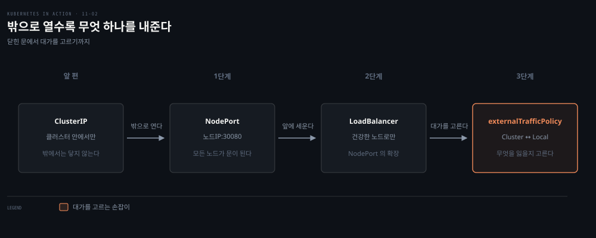
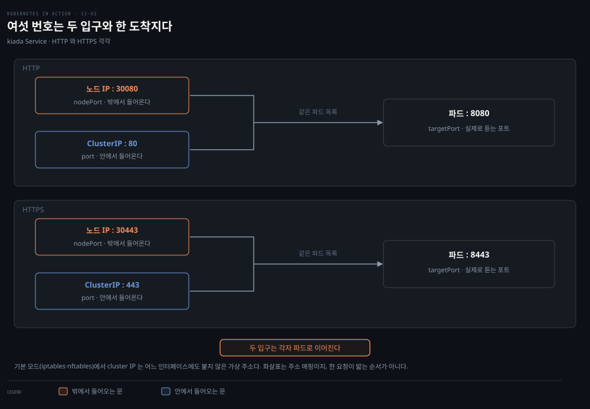
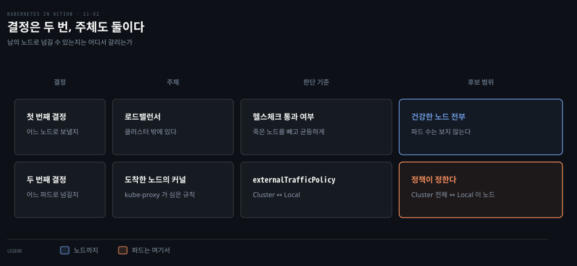
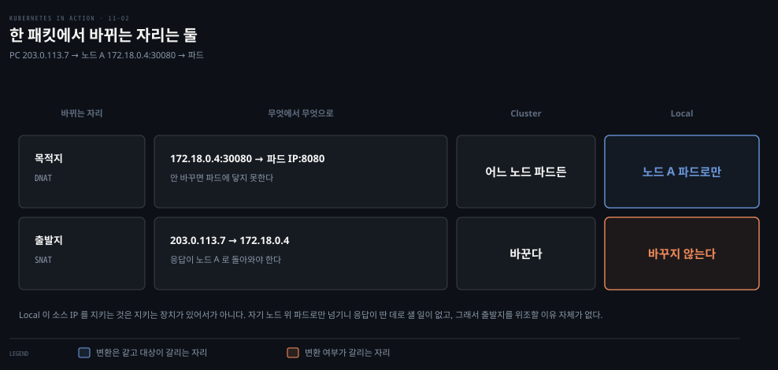
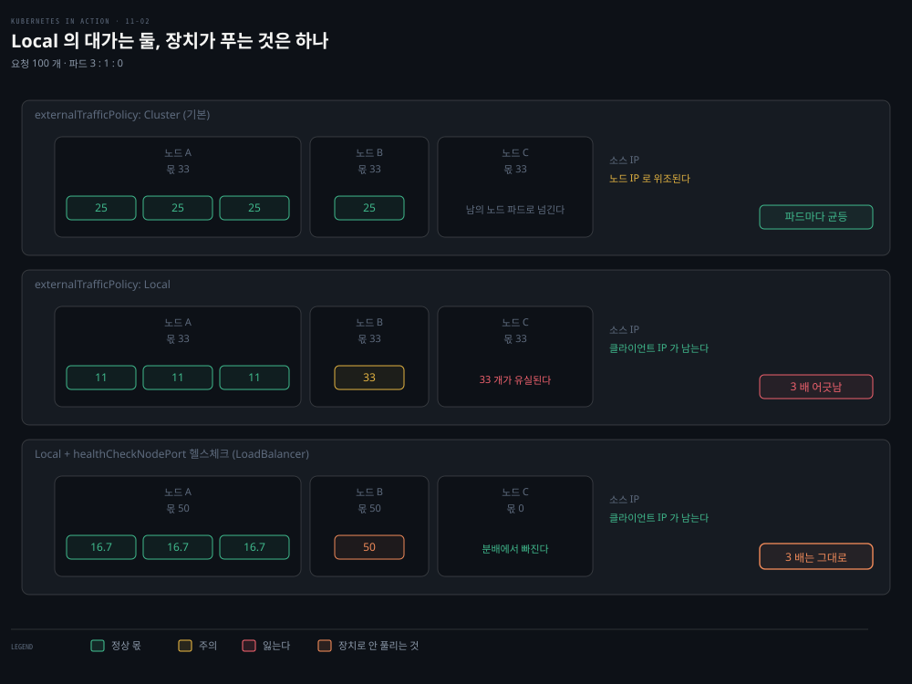

# 외부 노출 — NodePort·LoadBalancer·트래픽 정책
---

## 핵심 요약

> ClusterIP 는 클러스터 안에서만 닿으므로, 밖에서 접근하려면 모든 노드에 포트를 여는 NodePort 나 그 앞에 실제 로드밸런서를 세우는 LoadBalancer 를 씁니다. 밖으로 열수록 소스 IP 와 균등 분산 가운데 하나를 내주게 됩니다.

NodePort 는 모든 노드의 같은 포트가 입구가 됩니다. LoadBalancer 는 NodePort 를 확장한 타입입니다. 앞에 세운 로드밸런서가 건강한 노드의 node port 로 연결을 넘깁니다.

외부 요청이 다른 노드의 파드로 넘어가면 홉이 하나 늘고 출발지 주소가 노드 IP 로 바뀝니다. `externalTrafficPolicy` 를 `Local` 로 두면 이 둘이 사라지는 대신 두 가지 대가가 따릅니다. 파드 없는 노드로 간 요청이 버려지고, 파드당 부하가 어긋납니다. LoadBalancer 에서는 앞의 문제를 헬스체크 포트가 막아 줍니다. 뒤의 문제는 노드별 파드 수를 맞춰야만 줄어듭니다.[^ver]




## 학습 목표

이 내용을 읽고 나면:

1. 외부 노출의 네 방식(`externalIPs`·NodePort·LoadBalancer·Ingress)의 차이와 현재 지위를 설명할 수 있습니다.
2. NodePort 의 여섯 포트 번호가 어떻게 짝지어지는지, 그리고 `nodePort` 의 기본 대역과 배정 규칙이 무엇인지 말할 수 있습니다.
3. LoadBalancer 가 NodePort 의 확장이라는 뜻과 `loadBalancerClass`·`allocateLoadBalancerNodePorts`·`loadBalancerSourceRanges` 같은 필드의 쓰임을 설명할 수 있습니다.
4. 외부 요청이 파드에 닿기까지의 결정 두 번과, 한 패킷에서 바뀌는 주소 필드 둘(DNAT·SNAT)을 설명할 수 있습니다.
5. `externalTrafficPolicy` 의 `Cluster` 와 `Local` 의 트레이드오프를 `healthCheckNodePort` 의 한계까지 포함해 근거와 함께 고를 수 있습니다.


## 본문 정리

### 클러스터 밖으로 여는 네 가지 방식

ClusterIP 는 내부 전용이라 외부 클라이언트가 Kiada 서비스에 닿지 못하므로, 계층이 다른 네 가지 방식 가운데 하나로 밖에 문을 냅니다.

지금까지 만든 Service 는 건물 안에서만 통하는 내선 전화와 같습니다. 같은 건물 사람끼리는 번호만 누르면 되지만, 바깥 사람은 그 번호로 걸 수 없으니 바깥 번호를 하나 내줘야 합니다. 그런데 밖으로 열면 대가가 따라옵니다. 바깥에서 온 요청이 어느 문으로 들어오느냐에 따라 "누가 걸었는지"(원래 클라이언트 IP)가 지워지거나, 일부 서버에만 일이 몰립니다. 이 편의 절반은 그 대가를 줄이는 이야기입니다.

[11-01](./11-01.Service%20%EA%B8%B0%EC%B4%88%20%E2%80%94%20%ED%8C%8C%EB%93%9C%20%ED%86%B5%EC%8B%A0%C2%B7ClusterIP%C2%B7%EC%84%B8%EC%85%98%20%EC%96%B4%ED%94%BC%EB%8B%88%ED%8B%B0.md)의 ClusterIP 는 클러스터 안에서만 접근됩니다. 포트 포워딩은 개발용일 뿐이므로, 파드 묶음을 제대로 외부에 열려면 다음 넷 중 하나를 씁니다.

- `externalIPs` 에 노드로 향하는 추가 IP 를 지정 — v1.36 부터 deprecated 이고, 공식 문서는 외부 로드밸런서 컨트롤러나 Gateway API 구현으로 옮기라고 안내합니다[^ext]
- 타입을 `NodePort` 로 — 모든 노드의 특정 포트로 접근
- 타입을 `LoadBalancer` 로 — 쿠버네티스가 로드밸런서를 프로비저닝
- Ingress 오브젝트로 노출 — 하나의 IP 로 여러 Service 를 노출([12-01](./12-01.Ingress%EB%A1%9C%20%EC%97%AC%EB%9F%AC%20%EC%84%9C%EB%B9%84%EC%8A%A4%EB%A5%BC%20%ED%95%9C%20IP%EC%97%90%20%EB%85%B8%EC%B6%9C%ED%95%98%EA%B8%B0.md)에서 다룹니다)

이 편은 NodePort 와 LoadBalancer, 그리고 둘 다에 적용되는 트래픽 정책을 다룹니다.

### NodePort Service

NodePort 는 모든 노드에 같은 포트를 열어, 어느 노드로 접속해도 그 노드가 뒷받침 파드로 연결을 넘깁니다. ClusterIP 의 확장이라 cluster IP 도 그대로 갖습니다.



NodePort Service 를 만들면 selector 에 맞는 파드가 모든 노드의 특정 포트(node port)로 접근됩니다. 이 포트가 노드에 열려 있어 node port 라 부릅니다. 어느 노드로 접속하든, 파드가 도는 노드와 무관하게 모든 노드가 연결을 뒷받침 파드로 넘깁니다.

Kiada 파드를 두 포트로 노출하는 NodePort Service 입니다.

```yaml
apiVersion: v1
kind: Service
metadata:
  name: kiada
spec:
  type: NodePort           # 타입을 NodePort로
  selector:
    app: kiada
  ports:
  - name: http
    port: 80               # cluster IP에서 여는 포트
    nodePort: 30080        # 각 노드에서 여는 포트
    targetPort: 8080       # 파드가 듣는 포트
  - name: https
    port: 443
    nodePort: 30443
    targetPort: 8443
```

`nodePort` 를 비우면 컨트롤 플레인이 `--service-node-port-range` 범위(기본 30000-32767)에서 번호를 배정해 NodePort Service 사이 포트 충돌을 막습니다.

이 범위는 정적 대역 30000-30085 와 동적 대역 30086-32767 로 나뉩니다. 자동 배정은 동적 대역에서 먼저 고르고, 다 차면 정적 대역을 씁니다.

번호를 직접 정할 때 정적 대역을 쓰면 자동 배정과 부딪힐 위험이 낮아집니다. 위 예의 30080 은 정적 대역이고 30443 은 동적 대역입니다.[^range]

여섯 번호가 헷갈리기 쉽습니다. HTTP 의 세 번호는 노드 30080, cluster IP 80, 파드 8080 입니다. HTTPS 의 세 번호는 노드 30443, cluster IP 443, 파드 8443 입니다.

노드 포트와 cluster IP 포트는 각각 파드 포트에 닿는 매핑이고, 한 요청이 세 주소를 차례로 밟는다는 뜻이 아닙니다. cluster IP 와 node port 는 같은 파드 목록을 가리키는 **두 개의 입구**입니다.

- 클러스터 내부 클라이언트는 `cluster IP:80` 으로 들어오고 외부 클라이언트는 `노드IP:30080` 으로 들어오는데, 어느 입구로 들어와도 도착지는 같은 파드의 8080 입니다. 외부에서 들어온 요청이 cluster IP 를 정류장처럼 거쳐 가는 것이 아닙니다.
- 기본 모드(iptables·nftables)에서 cluster IP 는 어느 인터페이스에도 붙지 않은 가상 주소입니다.[^ipvs] 어느 모드든 node port 로 들어온 패킷은 cluster IP 를 목적지로 다시 거치지 않고 곧바로 파드 주소로 바뀌므로, 두 입구는 각자 독립적으로 파드 주소로 이어집니다. 이 이어짐이 실제로 어떻게 일어나는지는 트래픽 정책 절에서 다룹니다.

### NodePort 접근

NodePort 로 접근하려면 node port 번호와 노드 IP 를 알아야 하고, 아무 노드의 IP 로 접속해도 그 노드가 뒷받침 파드로 연결을 넘깁니다.

노드 IP 는 `kubectl get nodes -o wide` 의 INTERNAL-IP·EXTERNAL-IP 에서 봅니다. 클라우드 노드는 대개 external IP 가 있고, 베어메탈은 internal IP 만 있을 수 있습니다.

```bash
kubectl get svc
# NAME    TYPE        CLUSTER-IP      EXTERNAL-IP   PORT(S)                      AGE
# kiada   NodePort    10.96.226.212   <none>        80:30080/TCP,443:30443/TCP   1m
```

kiada Service 는 cluster IP 의 80·443 외에 노드 포트 30080·30443 도 엽니다. `172.18.0.4:30080` 처럼 아무 노드 IP:node port 로 접근하면 그 노드가 뒷받침 파드로 연결을 넘깁니다. 요청을 받은 노드와 파드가 도는 노드가 다르면, 받은 노드가 파드가 있는 노드로 연결을 포워딩합니다.

node port 를 받는 노드 주소는 kube-proxy 모드마다 기본값이 다릅니다. `iptables` 모드는 노드의 모든 로컬 IP 에서 받습니다. `nftables` 모드는 노드의 primary IP 에서만 받습니다. 둘 다 `--nodeport-addresses` 로 바꿀 수 있습니다.

노드 앞의 방화벽이 node port 를 막고 있으면 접근되지 않으므로, 클라우드에서는 그 플랫폼의 방화벽 규칙으로 node port 대역(기본 30000-32767)을 먼저 엽니다. 노드 안 방화벽은 kube-proxy 모드에 따라 다릅니다. `iptables` 모드는 iptables 기반 방화벽에 막히지 않도록 node port 마다 허용 규칙을 넣습니다. `nftables` 모드는 그 규칙을 넣지 않으므로, 노드에 방화벽이 있으면 node port 대역 전체의 인바운드를 직접 허용해야 합니다.[^fw]

kiada 응답의 Client IP 를 보면 요청을 보낸 컴퓨터의 IP 가 아니라 접속한 노드의 IP 로 찍힙니다. 이 소스 IP 은닉은 트래픽 정책 절에서 다룹니다.

### LoadBalancer Service

LoadBalancer 는 NodePort 의 확장으로, 실제 로드밸런서를 프로비저닝해 노드 앞에 세웁니다. 클라이언트는 로드밸런서 IP 로 접속하고, 로드밸런서가 건강한 노드의 node port 로만 넘깁니다.

모든 Service 가 부하 분산기 역할을 하지만, LoadBalancer 타입은 *실제* 로드밸런서를 만듭니다. 로드밸런서가 노드 앞에 서서 클라이언트 연결을 받아, 노드 중 하나의 node port 로 넘깁니다. LoadBalancer 는 NodePort 의 확장이라 node port 로도 접근됩니다. 클라이언트를 특정 노드의 node port 가 아니라 로드밸런서로 향하게 하면, 로드밸런서가 건강한 노드로만 트래픽을 넘기므로 죽은 노드에 연결을 시도하지 않고 노드 간 고른 분산도 얻습니다.

```yaml
apiVersion: v1
kind: Service
metadata:
  name: kiada
spec:
  type: LoadBalancer       # 이 한 줄만 NodePort와 다릅니다
  selector:
    app: kiada
  ports:
  - name: http
    port: 80
    nodePort: 30080
    targetPort: 8080
  - name: https
    port: 443
    nodePort: 30443
    targetPort: 8443
```

NodePort 매니페스트와 `type` 한 줄만 다릅니다. `nodePort` 는 무작위 배정을 막으려고 적었을 뿐, 번호가 상관없으면 생략해도 됩니다. 기존 kiada Service 에 이 매니페스트를 apply 하면 cluster IP 가 유지된 채 타입만 바뀝니다.

로드밸런서는 비동기로 만들어져 몇 분 걸릴 수 있습니다. 그동안 EXTERNAL-IP 에는 `<pending>` 이 뜹니다. 만들어지면 Service 의 `.status.loadBalancer` 에 그 정보가 올라옵니다. 그 IP 로 80·443 포트에 접근합니다.

모든 클러스터가 이 타입을 지원하지는 않습니다. 클라우드는 대개 지원하고 베어메탈은 MetalLB 같은 애드온을 깔아야 합니다.

지원하지 않으면 Service 는 만들어지지만 node port 로만 접근됩니다.

### LoadBalancer 튜닝 필드

LoadBalancer 의 세부 동작은 spec 필드 몇 개로 조절하며, 필드마다 로드밸런서 구현이 지원하는 만큼만 효과가 있습니다.

| 필드 | 타입 | 설명 |
|------|------|------|
| `loadBalancerClass` | string | 기본 구현 대신 쓸 로드밸런서 구현의 분류 이름. 지정하면 기본 구현은 그 Service 를 무시하고 한 번 정하면 바꿀 수 없음. v1.24 GA |
| `loadBalancerIP` | string | 원하는 로드밸런서 IP 요청. 구현마다 뜻이 달라 이식성이 없고 듀얼 스택도 못 다뤄 v1.24 부터 deprecated, 구현별 annotation 으로 대체 |
| `loadBalancerSourceRanges` | []string | 로드밸런서를 통한 접근을 허용할 클라이언트 IP 제한. 플랫폼이 지원할 때만 적용되고 아니면 무시됨 |
| `allocateLoadBalancerNodePorts` | boolean | node port 자동 배정 여부(기본 `true`). 노드 없이 파드로 직접 넘기는 구현에서 `false`. 이미 배정된 포트는 자동 회수되지 않아 `nodePort` 항목을 직접 지워야 함. v1.24 GA |

`loadBalancerClass` 값은 `internal-vip` 나 `example.com/internal-vip` 처럼 접두사를 선택적으로 붙인 레이블 형식이고, 접두사 없는 이름은 사용자용으로 예약돼 있습니다.[^lbf]

로드밸런서 컨트롤러는 `status.loadBalancer.ingress[].ipMode` 도 채울 수 있습니다. 값은 `VIP`(기본)와 `Proxy` 입니다. `VIP` 는 패킷이 로드밸런서의 IP·포트를 목적지로 노드에 전달된다는 뜻입니다.

`Proxy` 는 목적지가 둘로 갈립니다. 노드로 보낸 뒤 파드로 DNAT 하는 경우에는 노드 IP 와 node port 이고, 파드로 직접 보내는 경우에는 파드 IP 와 포트입니다.

Service 구현은 이 값을 보고 트래픽 경로를 조정합니다. 이 필드는 `status.loadBalancer.ingress[].ip` 가 있을 때만 쓸 수 있고, v1.32 에서 GA 가 됐습니다.[^ipmode]

### externalTrafficPolicy 의 역할

외부 연결이 다른 노드의 파드로 넘어가면 홉이 하나 늘고 소스 IP 가 노드 IP 로 가려집니다. `externalTrafficPolicy` 를 `Local` 로 두면 노드가 자기 위 파드로만 넘겨 이 둘을 없앱니다.

외부 클라이언트가 node port 나 로드밸런서로 접속하면 연결이 접속한 노드가 아닌 다른 노드의 파드로 넘어갈 수 있습니다. 이때 대가가 둘입니다.

- 홉이 하나 더 들어 지연이 늘어납니다.
- 파드가 진짜 클라이언트 IP 를 보지 못합니다. 웹 서버가 접근 로그에 실제 클라이언트를 남기지 못합니다.

이것이 기본값의 동작이며, 바꾸는 손잡이가 `externalTrafficPolicy` 입니다. 어디에 선언하는지부터 봅니다.

`externalTrafficPolicy` 는 Service 의 `spec` 필드입니다. 값은 `Cluster`(기본)와 `Local` 둘이고, 로드밸런서나 노드에 따로 설정하는 것이 아닙니다.

```yaml
spec:
  type: LoadBalancer
  externalTrafficPolicy: Local    # Service spec 필드
```

- 선언하는 곳과 집행하는 곳이 다릅니다. 당신이 Service 에 `Local` 을 적으면 kube-proxy 가 그 값을 읽어 각 노드의 커널에 "이 노드 위 파드만 후보로 삼는" 규칙을 심습니다.
- 그래서 필드는 Service 에 있지만 실제로 트래픽을 가르는 것은 노드 커널이고, 이 분리를 알아 두면 다음 두 절의 서술이 어긋나 보이지 않습니다.

### 두 번의 결정과 두 주체

외부 요청이 파드에 닿기까지 결정이 두 번 내려집니다. 첫 번째는 로드밸런서가 맡고, 두 번째는 도착한 노드의 커널이 맡습니다. 이 둘을 섞으면 "NodePort 는 다른 노드로 못 넘기는데 LoadBalancer 는 넘기나?" 같은 혼동이 생깁니다.



1. 첫 번째 결정은 로드밸런서가 어느 노드로 보낼지 고르는 것입니다. 헬스체크로 죽은 노드를 빼고 남은 노드에 균등하게 나눕니다. 이때 노드 안에 파드가 몇 개 있는지는 따지지 않고 노드 단위로만 나눕니다.
   - `Cluster` 정책이면 kube-proxy 의 `${NODE_IP}:10256/healthz` 가 헬스체크 대상이고, kube-proxy 가 정상이며 노드가 삭제 중이 아니면 200 을 응답합니다.
   - `Local` 정책이면 뒤에서 볼 `healthCheckNodePort` 가 대상이고, kube-proxy 가 정상이며 그 노드에 로컬 엔드포인트가 있어야 200 을 응답합니다.[^hc]
2. 두 번째 결정은 도착한 노드의 커널이 어느 파드로 넘길지 고르는 것이고, 후보 범위를 정하는 것이 `externalTrafficPolicy` 입니다. `Cluster` 면 클러스터 전체 파드가 후보라 남의 노드 파드로도 넘기고, `Local` 이면 자기 노드 위 파드만 후보입니다.

그러니 다른 노드로 넘길 수 있는지는 정책이 정하고, Service 타입이 정하지 않습니다. `Cluster` 이면 NodePort 도 남의 노드 파드로 넘기고(앞의 NodePort 접근에서 본 그대로), `Local` 이면 LoadBalancer 도 넘기지 못합니다. 로드밸런서가 있고 없고는 첫 번째 결정에만 관여합니다.

### 한 패킷에서 바뀌는 필드 둘

노드가 외부 연결을 파드로 넘길 때 바뀔 수 있는 주소가 두 군데 있습니다. 방향이 달라 이름도 다릅니다. 목적지를 바꾸는 것이 DNAT(목적지 주소 변환)이고, 출발지를 바꾸는 것이 SNAT(출발지 주소 변환)입니다. 두 용어는 [11-01](./11-01.Service%20%EA%B8%B0%EC%B4%88%20%E2%80%94%20%ED%8C%8C%EB%93%9C%20%ED%86%B5%EC%8B%A0%C2%B7ClusterIP%C2%B7%EC%84%B8%EC%85%98%20%EC%96%B4%ED%94%BC%EB%8B%88%ED%8B%B0.md)에서 정의했습니다.



집에 있는 PC(`203.0.113.7`)가 노드 A(`172.18.0.4`)의 30080 으로 접속했다고 합니다. 노드 A 의 커널은 정책에 따라 주소를 다르게 바꿉니다. 파드는 노드 A 에 하나(`10.244.1.5`), 노드 B 에 하나(`10.244.2.9`) 있다고 합니다.

- `Cluster` 는 파드가 어느 노드에 있어도 넘깁니다. 노드 B 의 파드를 고르면 목적지가 `172.18.0.4:30080` → `10.244.2.9:8080` 으로 바뀝니다. 출발지도 `203.0.113.7` → `172.18.0.4` 로 바뀝니다. 응답 패킷이 반드시 노드 A 로 되돌아와야 클라이언트에 전달되므로, 노드 A 가 출발지를 자기 주소로 위조합니다.
- `Local` 은 노드 A 위 파드로만 넘깁니다. 목적지가 `172.18.0.4:30080` → `10.244.1.5:8080` 으로 바뀌고, 출발지 `203.0.113.7` 은 그대로입니다. 노드 A 에 파드가 없으면 노드 B 에 파드가 있어도 넘기지 않고 버립니다.

두 정책 모두 목적지는 파드 주소로 바꿉니다. 안 바꾸면 패킷이 파드에 닿지 못하니까요. 갈리는 것은 그 파드가 어느 노드에 있느냐와 출발지를 바꾸느냐입니다.

목적지가 cluster IP 를 거치지 않는다는 점을 눈여겨봅니다. cluster IP 와 node port 는 같은 파드 목록을 가리키는 두 입구이고, node port 로 들어온 패킷은 곧바로 파드 주소로 바뀝니다.

`Local` 이 소스 IP 를 보존하는 이유가 여기서 드러납니다. 자기 노드 위 파드로만 넘기니 응답이 딴 노드로 샐 일이 없습니다. 그래서 출발지를 위조할 이유가 없어 SNAT 을 생략합니다. "소스 IP 은닉이 사라진다"는 결과가 아니라 애초에 그 변환을 하지 않는 것입니다.

대가로 파드는 진짜 클라이언트 IP 를 보고, 웹 서버가 접근 로그에 실제 클라이언트를 남길 수 있습니다.

### Local 의 대가와 장치

`Local` 은 홉과 SNAT 을 없애는 대신 문제 둘을 얻고, 둘은 성격이 달라 하나는 장치로 막히고 하나는 막히지 않습니다.

노드 A 에 파드 3개, 노드 B 에 1개, 노드 C 에 0개인 클러스터에 요청 100개가 들어오는 경우로 봅니다.



| 설정 | 파드당 요청 수 | 파드 없는 노드로 간 요청 | 소스 IP |
|------|---------------|------------------------|---------|
| `Cluster` | 25 · 25 · 25 · 25 (균등) | 남의 노드 파드로 넘김 | 노드 IP로 위조 |
| `Local` | 11 · 11 · 11 · 33 (3배 어긋남) | 33개 유실 | 클라이언트 IP 보존 |
| `Local` + 로드밸런서가 `healthCheckNodePort` 로 헬스체크 | 16.7 · 16.7 · 16.7 · 50 (3배 어긋남) | 노드가 분배에서 제외됨 | 클라이언트 IP 보존 |

1. 첫 번째 문제는 파드 없는 노드로 간 요청이 죽는 것입니다.
   - 노드 C 에는 넘길 파드가 없고, `Local` 이라 남의 노드로 넘기지도 못합니다. 그래서 kube-proxy 는 그 연결을 전달하지 않고 클라이언트는 타임아웃을 만납니다. 이것은 `healthCheckNodePort` 가 풉니다.
   - `healthCheckNodePort` 는 type 이 LoadBalancer 이고 `externalTrafficPolicy` 가 `Local` 인 Service 에만 쓰입니다. 직접 정하지 않으면 컨트롤러가 node port 대역에서 하나 배정하고, 그 노드에 로컬 엔드포인트가 있으면 200, 없으면 503 을 응답합니다. 로드밸런서가 이 포트로 헬스체크를 돌려 503 인 노드를 분배 대상에서 뺍니다.[^hc]
   - type 이 NodePort 인 Service 에는 이 포트가 없어서, 클라이언트가 파드가 있는 노드를 직접 골라 접속해야 합니다.
2. 두 번째 문제는 파드당 부하가 어긋나는 것입니다.
   - 로드밸런서는 노드 단위로 균등하게 나누는데 노드마다 파드 수가 다르니, 파드가 적은 노드의 파드가 더 많이 받습니다.
   - 노드 B 의 단일 파드는 노드 A 의 파드보다 3배를 처리합니다. 이쪽은 `healthCheckNodePort` 로 풀리지 않습니다.
   - 노드 C 가 빠지면 A·B 가 50개씩 받아 숫자는 커지지만 3배 비율은 그대로입니다. 줄이려면 노드별 파드 수를 고르게 맞춰야 하고, DaemonSet 이나 `topologySpreadConstraints` 가 그 수단입니다.

`Local` 은 롤링 업데이트 중에도 연결을 지킵니다. 노드의 파드가 N개에서 0개로 줄어드는 동안에도 로드밸런서는 헬스체크 사이사이 그 노드로 요청을 보낼 수 있습니다. 이때 그 노드의 로컬 엔드포인트가 모두 종료 중이면, kube-proxy 는 종료 중인 파드로 넘겨 연결을 마저 처리하게 합니다. 종료 중이 아닌 엔드포인트가 하나라도 있으면 그쪽을 우선합니다(v1.28 GA).[^term]

어느 정책을 쓸지는 감수할 트레이드오프에 달렸습니다 — 균등 분산을 택하면 소스 IP 를 잃고, 소스 IP 를 지키면 분산이 노드별 파드 수에 휘둘립니다.


## 연습 문제

> 아래 일곱 문제는 외부 노출 방식, NodePort 매핑, LoadBalancer 필드, 트래픽 정책을 하나씩 묻습니다. 답을 적은 뒤에 정답 절을 펼칩니다.

1. NodePort Service 의 여섯 포트 번호(port·nodePort·targetPort × HTTP·HTTPS)가 각각 어디에서 어디로 매핑되는지 설명하세요. `nodePort` 를 비웠을 때 번호는 어떻게 정해지나요?
2. LoadBalancer 타입이 NodePort 의 "확장"이라는 말은 무슨 뜻인가요? LoadBalancer 를 지원하지 않는 클러스터에서 이 타입을 만들면 어떻게 되나요?
3. 외부 클라이언트가 노드 A 의 node port 로 접속했고 파드가 노드 A 와 노드 B 에 하나씩 있습니다. `Cluster` 정책이 노드 B 의 파드를 고르면 패킷의 목적지 IP 와 출발지 IP 는 각각 무엇에서 무엇으로 바뀌나요? `Local` 정책에서는 어느 변환이 일어나지 않고, 목적지는 어느 노드의 파드로 바뀌나요?
4. "다른 노드의 파드로 넘길 수 있는지"를 결정하는 것은 Service 타입(NodePort 냐 LoadBalancer 냐)인가요, `externalTrafficPolicy` 인가요? 그렇게 판단한 근거를 대세요.
5. 노드 A 에 파드 3개, 노드 B 에 1개, 노드 C 에 0개가 있고, 헬스체크 없이 세 노드에 고르게 나누는 로드밸런서로 요청 100개가 들어옵니다. `Local` 정책에서 각 파드는 몇 개를 받고, 노드 C 로 간 요청은 어떻게 되나요?
6. 5번의 로드밸런서가 `healthCheckNodePort` 로 헬스체크를 하면 숫자가 어떻게 달라지나요? 이 장치가 풀지 못하는 문제는 무엇이고, 그것은 무엇으로 풀어야 하나요?
7. 동료가 새 Service 에 `externalIPs` 와 `loadBalancerIP` 로 외부 IP 를 붙이겠다고 합니다. 두 필드의 현재 지위와 대안은 무엇인가요? 로드밸런서로 들어올 클라이언트 IP 를 제한하려면 어떤 필드를 쓰나요?


## 정답 (자답 후 펼치기)

1. HTTP 와 HTTPS 모두 `nodePort`, `port`, `targetPort` 세 번호를 쓰는데, 이 순서로 밟는 것이 아니라 두 입구가 같은 파드 포트에 닿는 매핑입니다. HTTP 는 노드 30080 과 cluster IP 80 이 모두 파드 8080 에, HTTPS 는 노드 30443 과 cluster IP 443 이 모두 파드 8443 에 닿습니다. 외부 클라이언트는 노드 IP:30080 으로, 클러스터 내부 클라이언트는 cluster IP:80 으로 접속합니다. 둘 다 최종적으로 파드 8080 에 닿습니다. `nodePort` 를 비우면 컨트롤 플레인이 `--service-node-port-range`(기본 30000-32767)에서 자동 배정하며, 동적 대역(30086-32767)에서 먼저 고르고 다 차면 정적 대역(30000-30085)을 씁니다.
2. LoadBalancer 는 내부적으로 NodePort 처럼 node port 를 엽니다. 그 앞에 실제 로드밸런서를 프로비저닝합니다. 로드밸런서가 건강한 노드의 node port 로 트래픽을 넘기므로 죽은 노드를 피하고 고른 분산을 얻습니다. 지원하지 않는 클러스터(애드온 없는 베어메탈)에서 만들면 Service 는 생성되지만 EXTERNAL-IP 가 `<pending>` 에 머뭅니다. 이때는 node port 로만 접근됩니다.
3. `Cluster` 에서 노드 A(`172.18.0.4`)로 들어온 패킷이 노드 B 의 파드(`10.244.2.9`)로 가면, 노드 A 의 커널이 두 필드를 바꿉니다. 목적지는 `172.18.0.4:30080` 에서 `10.244.2.9:8080` 으로 바뀝니다(DNAT). 출발지는 클라이언트 IP 에서 `172.18.0.4` 로 바뀝니다(SNAT). 응답이 반드시 노드 A 로 되돌아와야 하므로 출발지를 자기 주소로 위조하기 때문입니다. `Local` 은 노드 A 위 파드로만 넘깁니다. 그래서 목적지는 노드 A 위 파드의 `10.244.1.5:8080` 으로 바뀌고, 응답 경로가 어긋날 일이 없어 SNAT 은 일어나지 않습니다. 노드 B 의 파드로 가는 DNAT 은 `Local` 에서 생기지 않습니다. 노드 A 에 파드가 없으면 연결을 넘기지 않고 버립니다. 두 정책 모두 목적지가 cluster IP 를 거치지 않고 곧바로 파드 주소로 바뀐다는 점도 기억합니다.
4. `externalTrafficPolicy` 가 정합니다. 결정이 두 번 내려지고 둘의 주체가 다르기 때문입니다. 로드밸런서는 어느 노드로 보낼지만 고릅니다(헬스체크로 죽은 노드 제외와 균등 분배). 어느 파드로 넘길지는 도착한 노드의 커널이 고르고, 그 후보 범위를 정하는 것이 정책입니다. 그래서 `Cluster` 이면 NodePort Service 도 남의 노드 파드로 넘기고, `Local` 이면 LoadBalancer Service 도 넘기지 못합니다. 로드밸런서의 존재는 첫 번째 결정에만 관여하므로 타입은 답이 아닙니다.
5. 이 로드밸런서는 헬스체크 없이 노드 셋 모두에 균등하게 나누므로 A·B·C 가 각 33개를 받고, `Local` 이라 각 노드는 자기 위 파드로만 넘깁니다. 노드 A 의 33개를 파드 3개가 나눠 각 11개, 노드 B 의 33개를 파드 1개가 전부 받아 33개입니다. 노드 C 의 33개는 넘길 파드가 없고 남의 노드로도 못 넘기니 버려져 클라이언트는 타임아웃을 만납니다. 파드당 부하가 11 대 33 으로 3배 어긋나, 로드밸런서는 노드 단위로 공평했지만 파드 단위로는 불공평해졌습니다.
6. 노드 C 가 헬스체크에 503 을 응답해 분배 대상에서 빠지고, A·B 가 50개씩 받습니다. 노드 A 의 파드 3개는 각 16.7개, 노드 B 의 파드 1개는 50개입니다. 유실은 사라졌지만 16.7 대 50 으로 여전히 3배라서, 이 장치는 파드 없는 노드로 간 요청이 죽는 문제만 풀고 불균등은 풀지 못합니다. 불균등의 뿌리는 로드밸런서가 노드 단위로 나누는데 노드마다 파드 수가 다르다는 데 있으므로, 노드별 파드 수를 고르게 맞춰야 줄어듭니다. DaemonSet 이나 `topologySpreadConstraints` 가 그 수단입니다. 이 장치는 type 이 LoadBalancer 인 Service 에서만 쓰입니다.
7. 두 필드 모두 새로 쓰지 않는 쪽이 맞습니다. `externalIPs` 는 v1.36 부터 deprecated 이고 외부 로드밸런서 컨트롤러나 Gateway API 구현으로 옮기라는 안내가 있습니다. `loadBalancerIP` 는 구현마다 뜻이 달라 이식성이 없고 듀얼 스택을 못 다뤄 v1.24 부터 deprecated 이므로, 쓰는 로드밸런서가 제공하는 annotation 으로 IP 를 지정합니다. 접근할 클라이언트 IP 를 제한하는 필드는 `loadBalancerSourceRanges` 이고, 플랫폼이 지원할 때만 적용되며 지원하지 않으면 무시됩니다.


## 참고 자료

- 《Kubernetes in Action, Second Edition》(Marko Lukša, Manning, 2025) 11장 — [Manning](https://www.manning.com/books/kubernetes-in-action-second-edition), [예제 코드](https://github.com/luksa/kubernetes-in-action-2nd-edition/tree/master/Chapter11)
- [Service 개념 문서](https://kubernetes.io/docs/concepts/services-networking/service/)
- [Virtual IPs and Service Proxies — 트래픽 정책](https://kubernetes.io/docs/reference/networking/virtual-ips/)
- [외부 로드밸런서 만들기 — 소스 IP 보존](https://kubernetes.io/docs/tasks/access-application-cluster/create-external-load-balancer/)
- [Service API 레퍼런스](https://kubernetes.io/docs/reference/kubernetes-api/service-resources/service-v1/)
- [ServiceSpec 필드 설명(v1.37.2 소스)](https://github.com/kubernetes/kubernetes/blob/v1.37.2/staging/src/k8s.io/api/core/v1/types.go)
- [제거된 feature gate 목록](https://kubernetes.io/docs/reference/command-line-tools-reference/feature-gates-removed/)
- [MetalLB](https://metallb.universe.tf/)
- 관련 노트: [11-01 Service 기초](./11-01.Service%20%EA%B8%B0%EC%B4%88%20%E2%80%94%20%ED%8C%8C%EB%93%9C%20%ED%86%B5%EC%8B%A0%C2%B7ClusterIP%C2%B7%EC%84%B8%EC%85%98%20%EC%96%B4%ED%94%BC%EB%8B%88%ED%8B%B0.md), [11-03 엔드포인트·DNS·readiness](./11-03.%EC%97%94%EB%93%9C%ED%8F%AC%EC%9D%B8%ED%8A%B8%C2%B7DNS%C2%B7%ED%86%A0%ED%8F%B4%EB%A1%9C%EC%A7%80%C2%B7readiness.md), [12-01 Ingress](./12-01.Ingress%EB%A1%9C%20%EC%97%AC%EB%9F%AC%20%EC%84%9C%EB%B9%84%EC%8A%A4%EB%A5%BC%20%ED%95%9C%20IP%EC%97%90%20%EB%85%B8%EC%B6%9C%ED%95%98%EA%B8%B0.md), [Service 5유형](../networking-and-kubernetes/05-02.Service%205%EC%9C%A0%ED%98%95%20%E2%80%94%20ClusterIP%EC%97%90%EC%84%9C%20LoadBalancer%EA%B9%8C%EC%A7%80.md) — 소스 IP 가 어느 경로에서 살아남는지 커널 훅 단위로 다룹니다, [이 책의 인덱스](./README.md)

[^ver]: 이 노트는 현재 안정판 Kubernetes v1.37.2(`https://dl.k8s.io/release/stable.txt`, 2026-11-06 조회)의 공식 문서와 v1.37.2 태그의 `types.go` 로 사실을 확인했습니다.
[^ext]: Service 개념 문서의 External IPs 절은 상태를 `deprecated`(v1.36)로 표시하고 "All users should begin migrating away from `externalIPs`. Consider using an external load balancer controller or a Gateway API implementation instead."라고 적습니다. <https://kubernetes.io/docs/concepts/services-networking/service/#external-ips> (2026-11-06 조회)
[^range]: Service 개념 문서는 NodePort 번호를 "allocates a port from a range specified by `--service-node-port-range` flag (default: 30000-32767)"로 설명하고, 기본 범위에서 "Static band: 30000-30085", "Dynamic band: 30086-32767"이며 "Dynamic port assignment uses the upper band by default, and it may use the lower band once the upper band has been exhausted"라고 적습니다. <https://kubernetes.io/docs/concepts/services-networking/service/#type-nodeport> (2026-11-06 조회)
[^ipvs]: Virtual IPs 문서는 IPVS 프록시 모드를 "Deprecated since Kubernetes v1.35"로 표시하고 v1.40 부터 기본 비활성이라고 적습니다. v1.37.2 의 `pkg/proxy/ipvs/proxier.go` 는 `kube-ipvs0` 더미 인터페이스(`defaultDummyDevice`)를 만들어 Service 주소를 거기에 붙입니다. <https://kubernetes.io/docs/reference/networking/virtual-ips/#proxy-mode-ipvs> (2026-11-07 조회), <https://github.com/kubernetes/kubernetes/blob/v1.37.2/pkg/proxy/ipvs/proxier.go> (v1.37.2 태그)
[^fw]: Virtual IPs 문서는 `iptables` 모드에서 NodePort Service 가 "reachable on all local IP addresses"이고 `nftables` 모드는 기본 `--nodeport-addresses primary` 라고 적습니다. 또 `iptables` 모드는 NodePort 마다 인바운드 허용 규칙을 넣지만 `nftables` 모드는 넣지 않으므로 "allowing inbound traffic on the entire NodePort range"로 방화벽을 설정해야 한다고 안내합니다. <https://kubernetes.io/docs/reference/networking/virtual-ips/#migrating-from-iptables-mode-to-nftables> (2026-11-06 조회)
[^lbf]: Service 개념 문서는 `loadBalancerClass` 와 `allocateLoadBalancerNodePorts` 를 모두 `stable`(v1.24)로 표시합니다. `loadBalancerIP` 는 "was deprecated in Kubernetes v1.24"이고 "under-specified and its meaning varies across implementations. It also cannot support dual-stack networking"이라는 이유가 붙습니다. `loadBalancerSourceRanges` 는 `types.go` 가 "If specified and supported by the platform, this will restrict traffic through the cloud-provider load-balancer will be restricted to the specified client IPs. This field will be ignored if the cloud-provider does not support the feature."라고 설명합니다. <https://kubernetes.io/docs/concepts/services-networking/service/#loadbalancer> (2026-11-06 조회), <https://github.com/kubernetes/kubernetes/blob/v1.37.2/staging/src/k8s.io/api/core/v1/types.go> (v1.37.2 태그)
[^ipmode]: Service 개념 문서의 "Load balancer IP address mode" 절은 값이 "VIP"와 "Proxy" 둘이고 기본은 "VIP"이며 `.status.loadBalancer.ingress[].ip` 가 함께 지정될 때만 쓸 수 있다고 적습니다. `LoadBalancerIPMode` feature gate 는 제거된 gate 표에서 beta(1.30), stable(1.32~1.34)로 나옵니다. <https://kubernetes.io/docs/concepts/services-networking/service/#load-balancer-ip-mode> (2026-11-06 조회), <https://kubernetes.io/docs/reference/command-line-tools-reference/feature-gates-removed/> (2026-11-06 조회)
[^hc]: Virtual IPs 문서는 `Cluster` 정책에서 "load balancer health checks are configured to target the service proxy's readiness port and path. In the case of kube-proxy this evaluates to: `${NODE_IP}:10256/healthz`"이고, `Local` 이면 kube-proxy 가 "healthy/ready"이고 "has a local endpoint on the node in question"일 때 200 을 돌려준다고 적습니다. `types.go` 는 `healthCheckNodePort` 가 "only applies when type is set to LoadBalancer and externalTrafficPolicy is set to Local"이고 지정하지 않으면 자동 배정되며 "This field cannot be updated once set"이라고 설명합니다. 소스 IP 문서는 지정하지 않으면 서비스 컨트롤러가 클러스터의 NodePort 범위에서 포트를 배정한다고 적습니다. <https://kubernetes.io/docs/reference/networking/virtual-ips/#external-traffic-policy> (2026-11-06 조회), <https://kubernetes.io/docs/tasks/access-application-cluster/create-external-load-balancer/#preserving-the-client-source-ip> (2026-11-06 조회)
[^term]: Virtual IPs 문서의 "Traffic to terminating endpoints" 절은 `stable`(v1.28)이고, `ProxyTerminatingEndpoints` 가 켜진 kube-proxy 는 트래픽 정책이 `Local` 일 때 로컬 엔드포인트가 있고 "all of them are terminating"이면 종료 중인 엔드포인트로 넘기며 그렇지 않으면 "always prefer forwarding traffic to endpoints that are not terminating"이라고 적습니다. <https://kubernetes.io/docs/reference/networking/virtual-ips/#traffic-to-terminating-endpoints> (2026-11-06 조회)
