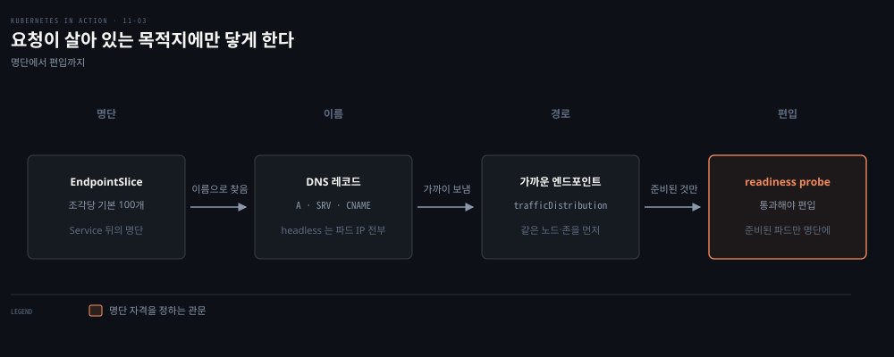
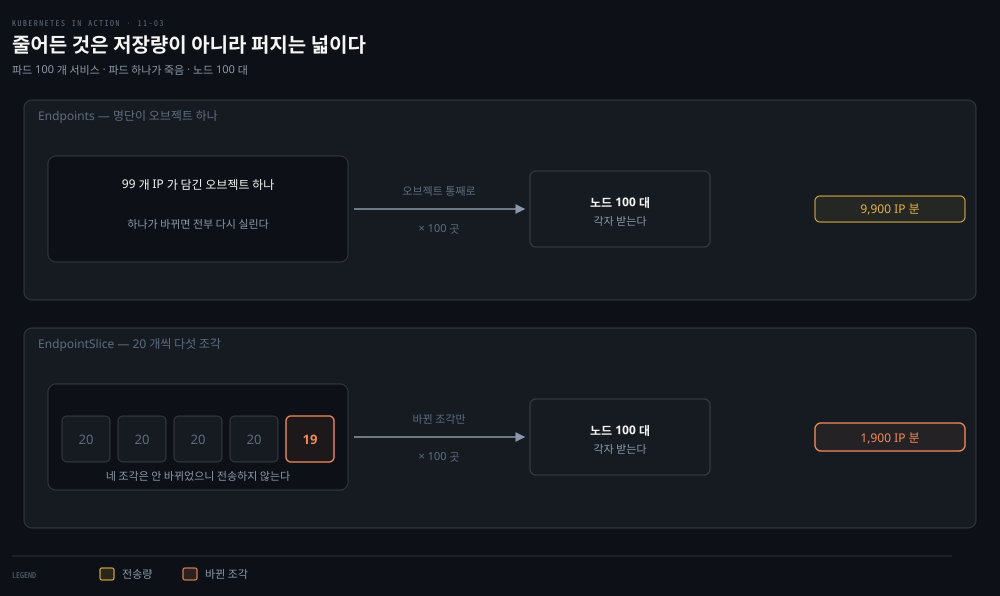
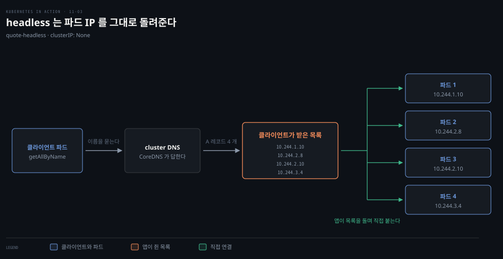
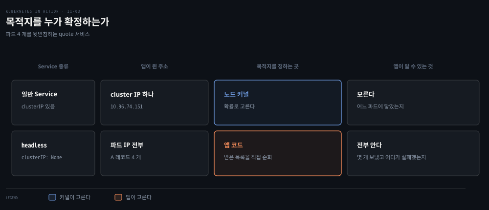
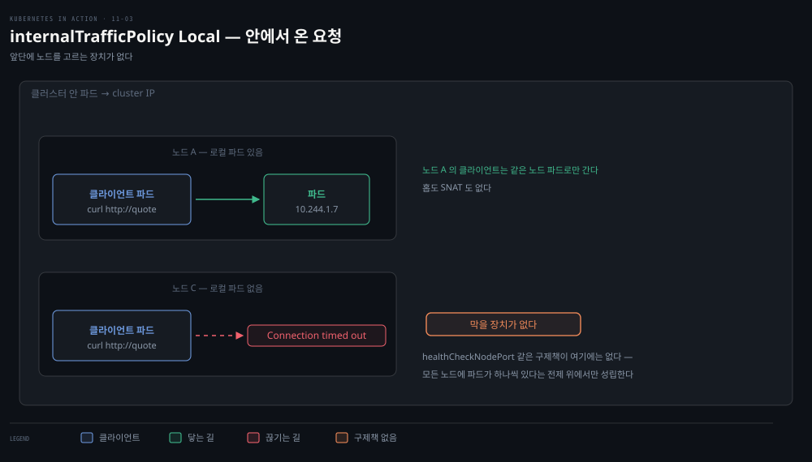
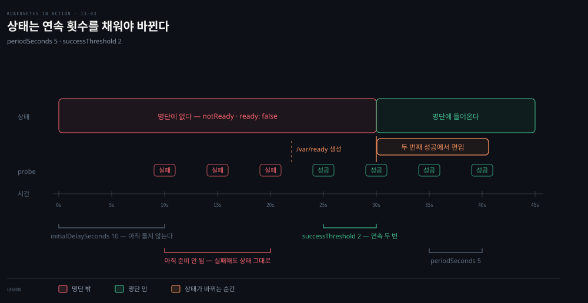
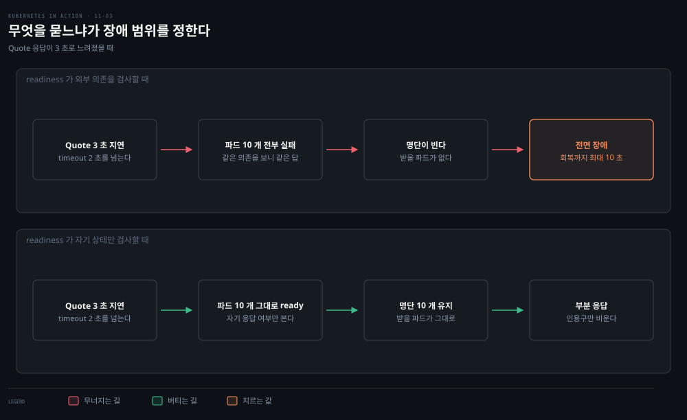

# 엔드포인트·DNS·토폴로지·readiness
---

## 핵심 요약

> Service와 파드는 EndpointSlice 오브젝트로 이어지고, 이 오브젝트는 파드가 아닌 대상, 예컨대 클러스터 밖 IP도 가리킬 수 있습니다. DNS(Domain Name System)는 Service를 A·SRV·CNAME 레코드로 노출하며, headless Service는 cluster IP 대신 파드 IP를 그대로 돌려줍니다.



트래픽은 `internalTrafficPolicy`와 `trafficDistribution`으로 같은 노드나 같은 존의 엔드포인트 쪽으로 기울일 수 있습니다. 파드는 readiness probe를 통과해야 비로소 트래픽을 받는 엔드포인트가 됩니다.


## 학습 목표

이 내용을 읽고 나면:

1. Endpoints와 EndpointSlice가 갈라진 이유와 조각당 엔드포인트 수 기본값·상한을 설명할 수 있습니다.
2. selector 없는 Service에 EndpointSlice를 직접 만들어 외부 대상을 연결할 수 있습니다.
3. 일반·headless·ExternalName Service가 DNS에서 어떤 레코드로 풀리는지 구분할 수 있습니다.
4. `internalTrafficPolicy: Local`과 `trafficDistribution`이 트래픽을 어떻게 가까운 엔드포인트로 보내는지, 어떤 대가가 따르는지 말할 수 있습니다.
5. readiness probe가 외부 의존을 검사하면 안 되는 이유를 근거와 함께 말할 수 있습니다.


## 본문 정리

### Service 뒤의 엔드포인트 명단

Service는 간판일 뿐입니다. 요청이 실제로 가는 곳은 별도 오브젝트에 적힌 명단입니다. 식당의 대기 명단에 비유하면 이 편 전체가 한 줄로 잡힙니다. 간판 뒤에는 지금 손님을 받을 수 있는 자리들의 명단이 따로 있습니다. 이 편이 던지는 질문은 넷입니다.

- 그 명단은 어디에 적혀 있고, 왜 통째로 두지 않고 여러 장으로 나눠 적는가
- 손님이 간판 이름만 알고 찾아오는 일이 어떻게 가능한가
- 이왕이면 가까운 자리로 안내하려면 어떻게 하는가
- 아직 준비가 안 끝난 자리를 명단에서 빼두는 방법은 무엇인가

넷 다 결국 한 가지를 위한 장치입니다. 요청이 살아 있는 목적지에만 닿게 하는 것입니다. 명단이 틀리면 요청은 죽은 파드로 가고, 사용자는 에러를 봅니다.

앞의 두 편에서 Service를 만들고 안팎으로 노출하는 법을 배웠습니다.

- [11-01. Service 기초](./11-01.Service%20%EA%B8%B0%EC%B4%88%20%E2%80%94%20%ED%8C%8C%EB%93%9C%20%ED%86%B5%EC%8B%A0%C2%B7ClusterIP%C2%B7%EC%84%B8%EC%85%98%20%EC%96%B4%ED%94%BC%EB%8B%88%ED%8B%B0.md) — label selector와 ClusterIP
- [11-02. 외부 노출](./11-02.%EC%99%B8%EB%B6%80%20%EB%85%B8%EC%B6%9C%20%E2%80%94%20NodePort%C2%B7LoadBalancer%C2%B7%ED%8A%B8%EB%9E%98%ED%94%BD%20%EC%A0%95%EC%B1%85.md) — NodePort·LoadBalancer와 트래픽 정책

### Service 밖에 저장되는 파드 목록

Service는 대개 label selector에 맞는 파드 묶음이 뒷받침합니다. 그래도 spec·status 어디에도 파드 목록은 없습니다. `kubectl describe svc`로 엔드포인트 IP가 보이더라도 그 값이 Service 오브젝트 안에 저장된 것은 아닙니다. 목록은 EndpointSlice 오브젝트에 담깁니다. 컨트롤 플레인(control plane)이 selector에 맞는 파드가 나타나거나 사라질 때마다 이 목록을 자동으로 고칩니다.[^eps-slice]

옛 API인 Endpoints도 아직 만들어집니다. v1.37의 `kubectl get endpoints`는 출력 맨 위에 deprecated 경고를 붙입니다.[^endpoints-deprecated]

```bash
kubectl get endpoints        # 약어 ep, 종류는 Endpoints(복수형)
# Warning: v1 Endpoints is deprecated in v1.33+; use discovery.k8s.io/v1 EndpointSlice
# NAME    ENDPOINTS                                              AGE
# kiada   10.244.1.7:8443,10.244.1.8:8443,10.244.1.9:8443 + 5   25m
# quiz    10.244.1.11:8080                                       66m
# quote   10.244.1.10:80,10.244.2.10:80,10.244.2.8:80 + 1        66m
```

경고 줄은 kind v0.33.0의 Kubernetes v1.37.0에서 직접 확인한 문구이고, 아래 표 형태의 출력은 예시입니다. 이 오브젝트들은 사용자가 만들지 않습니다. Service를 만들면 컨트롤 플레인이 대신 만들고 관리합니다.

### EndpointSlice의 도입 배경

Service에 엔드포인트가 아주 많으면 Endpoints 오브젝트가 문제가 됩니다. 변경마다 컨트롤 플레인이 오브젝트 전체를 모든 노드로 보내야 하기 때문입니다. 큰 클러스터에서는 이것이 성능을 떨어뜨립니다. 그래서 EndpointSlice가 도입됐고, Endpoints API는 v1.33부터 deprecated입니다.[^endpoints-deprecated] 공식 문서는 클라이언트가 Endpoints 대신 EndpointSlice API를 쓰라고 권합니다.[^over-capacity]

여기서 급소는 "오브젝트 전체를"입니다. watch는 바뀐 부분만 골라 보내지 않고 오브젝트를 통째로 보냅니다. 그래서 오브젝트 크기가 곧 전송 단위입니다. 파드 하나가 죽고 사는 사소한 사건도 담긴 IP 전부를 다시 실어 나릅니다. EndpointSlice 문서도 조각 하나가 바뀔 때마다 그 내용이 클러스터의 모든 노드로 전송되므로 변경이 비싸다고 설명합니다.[^eps-slice]



숫자로 보면 규모가 잡힙니다. 파드 100개짜리 Service에서 파드 하나가 죽고 노드가 100대라고 해 봅니다. 설명을 쉽게 하려고 조각 크기는 20으로 가정했습니다.

```pseudocode
Endpoints:     99개 IP 담긴 오브젝트 × 수신자 100곳 = 9,900 IP분
EndpointSlice: 20개씩 5조각 → 바뀐 조각(19개) × 100곳 = 1,900 IP분
               나머지 4조각은 안 바뀌었으니 전송 안 함
```

주의할 것은 이 이득이 저장량에서 오지 않는다는 점입니다. 쪼갠 뒤에도 IP 총합은 똑같이 99개이고, 최종 상태는 어느 쪽이나 같습니다. 달라진 것은 변경 하나가 건드리는 범위입니다. 오브젝트 전체에서 조각 하나로 좁혀졌습니다. "쪼개도 결국 100개인데 무슨 의미가 있나" 싶은 지점이 정확히 여기입니다. 보아야 할 것은 쌓여 있는 양이 아니라 사건 하나가 퍼지는 넓이입니다.

그래서 조각당 기본 100개라는 값도 저장 한도가 아니라 전송량 상한을 정하는 손잡이로 읽어야 합니다. 컨트롤 플레인은 조각 하나에 기본으로 엔드포인트를 100개까지 넣습니다. kube-controller-manager의 `--max-endpoints-per-slice` 플래그로 이 값을 최대 1000까지 올릴 수 있습니다.[^eps-slice]

조각을 작게 잡으면 변경 한 번의 비용이 줄지만 조각 수가 늘어 관리 부담이 커집니다. API 정의가 허용하는 한도는 조각당 엔드포인트 1000개와 포트 100개입니다.[^eps-api]

조각을 채우는 방식에도 규칙이 있습니다. 컨트롤 플레인은 조각을 가능한 한 채우지만 다시 균등하게 나누지는 않습니다. 완벽하게 채우기보다 조각 업데이트 횟수를 줄이는 쪽을 우선합니다. 그래서 빈자리가 남은 조각이 있어도 새 조각을 만들 때가 있습니다.[^eps-slice] 같은 엔드포인트가 두 조각에 동시에 보일 수도 있으므로, EndpointSlice를 직접 읽는 클라이언트는 모든 조각을 모아 중복을 걸러야 합니다.[^eps-slice]

옛 Endpoints는 한 오브젝트의 엔드포인트가 1000개를 넘으면 ready 주소를 먼저 남기는 방식으로 최대 1000개만 남기고, `endpoints.kubernetes.io/over-capacity: truncated` 주석을 붙입니다. EndpointSlice는 조각을 늘려 가므로 이 한도의 영향을 받지 않습니다.[^over-capacity]

Endpoints가 여러 subset을 담는 반면 EndpointSlice는 하나만 담습니다. 조각은 IP 종류·프로토콜·포트 번호·Service 이름의 조합마다 따로 생깁니다.[^eps-slice] 그래서 두 파드 그룹이 다른 포트로 노출되면 서로 다른 EndpointSlice에 들어가고, IPv4와 IPv6를 함께 쓰는 Service는 조각이 둘 이상입니다.

```bash
kubectl get endpointslices -l kubernetes.io/service-name=kiada
```

관찰할 것은 같은 Service 이름을 가리키는 행의 개수입니다. 출력이 다음처럼 두 행이면 EndpointSlice 오브젝트도 두 개입니다.

```pseudocode
NAME        ADDRESSTYPE  PORTS      ENDPOINTS                          AGE
kiada-m24zq IPv4         8080,8443  10.244.1.7,10.244.1.8,... + 1 more 88m
kiada-p8d2x IPv4         8080,8443  10.244.2.3                         88m
```

Endpoints와 달리 EndpointSlice 이름에는 Service 이름 뒤에 무작위 접미사가 붙어, 한 Service에 여러 조각이 존재할 수 있습니다.

### 실측 — 101번째 엔드포인트에서 나뉘는가

Kubernetes v1.35.0의 기본 설정을 쓰는 kind 클러스터에서 파드 101개를 Service 하나로 묶었습니다. 각 Slice의 이름과 엔드포인트 수는 다음 명령으로 확인했습니다.

```bash
kubectl get endpointslices.discovery.k8s.io \
  -n endpointslice-check \
  -l kubernetes.io/service-name=auto-slice \
  -o json |
jq -r '.items[] | [.metadata.name, (.endpoints | length)] | @tsv'
```

실제 결과는 100개와 1개로 갈렸습니다.

```pseudocode
auto-slice-s265p    1
auto-slice-tz4xx  100
```

따라서 기본 조각 크기 100에서는 100개까지 Slice 하나에 들어갑니다. 101번째부터 새 Slice가 필요합니다. 이 결과는 API가 허용하는 절대 상한과 구분해야 합니다.

같은 클러스터의 `kubectl explain endpointslice.endpoints`는 Slice 하나의 API 상한을 1000개로 표시했습니다. 기본 분할 크기는 컨트롤러의 변경 전파 단위입니다. 1000개는 한 오브젝트가 가질 수 있는 최대치입니다. 같은 절차를 Kubernetes v1.37.0(kind v0.33.0, kube-proxy iptables 모드)에서 2026-11-07에 다시 돌려도 100개와 1개로 갈렸고, `kubectl explain`의 상한도 1000개 그대로였습니다.

실제 EndpointSlice YAML은 기존 Endpoints의 `subsets[].addresses[].ip` 구조와 다릅니다. 파드 하나가 `endpoints[]` 항목 하나가 됩니다. IP는 `addresses[]`에 들어갑니다.

```yaml
apiVersion: discovery.k8s.io/v1
kind: EndpointSlice
addressType: IPv4
metadata:
  labels:
    kubernetes.io/service-name: web
    endpointslice.kubernetes.io/managed-by: endpointslice-controller.k8s.io
endpoints:
- addresses:
  - 10.244.1.8
  conditions:
    ready: true
    serving: true
    terminating: false
  nodeName: k8s-lab-worker
  targetRef:
    kind: Pod
    name: web-5d4f7c4d94-m2pmt
    namespace: default
ports:
- port: 8080
  protocol: TCP
```

`managed-by` 레이블은 이 조각을 누가 관리하는지 밝히는 표지입니다. 컨트롤 플레인의 EndpointSlice 컨트롤러는 자기가 만드는 모든 조각에 `endpointslice-controller.k8s.io`를 달고, 다른 주체가 조각을 관리하면 겹치지 않는 자기 값을 달아야 합니다.[^eps-managed] `conditions` 세 값의 뜻은 readiness 절에서 다룹니다.

### EndpointSlice 수동 관리

selector 없이 Service를 만들면 컨트롤 플레인이 EndpointSlice를 만들지 않으므로 직접 만들어야 합니다. 대개 외부 서비스를 클러스터 안에서 다른 이름으로 접근하게 할 때 이렇게 합니다. 그러면 그 서비스를 cluster DNS와 환경변수로 찾을 수 있습니다.[^selectorless]

외부 대상을 가리키는 방법은 셋인데, 실무에서 손이 가는 순서는 표의 위에서 아래가 아닙니다.

| 방식 | 언제 쓰나 |
|---|---|
| ExternalName (CNAME) | 외부 대상이 도메인으로 잡힐 때 — 손이 가장 덜 갑니다 |
| selector 없는 Service + 직접 만든 EndpointSlice | 외부 대상이 IP만 있을 때(사내 DB VIP), IP 여러 개로 분산해야 할 때 |
| 앱 설정에 직접 (`spring.datasource.url`) | 대개 이걸로 끝납니다 |

그러니 수동 EndpointSlice를 꺼내는 판단 기준을 따로 세워 둘 필요가 있습니다. "나중에 이 대상을 클러스터 안으로 옮길 계획이 있다" 또는 "주소를 앱 설정이 아니라 인프라 레이어에서 갈아치우고 싶다" — 둘 중 하나에 해당할 때입니다. 마이그레이션의 중간 단계에 놓는 도구로 보면 자리가 맞습니다.

약점도 분명합니다. 아무도 헬스체크를 안 해 줍니다. 적어 둔 IP가 죽어도 쿠버네티스는 그 사실을 모르고 계속 그리로 보냅니다. selector가 있으면 readiness probe가 그 일을 대신하는데, 수동으로 적은 주소에는 그 안전망이 없습니다.

용어도 한 번 정리해 둡니다. "cluster IP에 외부 주소를 넣는" 게 아닙니다. cluster IP는 그대로 있고 외부 주소는 EndpointSlice에 적힙니다. 파드가 붙는 곳은 여전히 cluster IP입니다. 커널이 그 주소를 외부 IP로 DNAT(목적지 주소 변환)할 뿐입니다. 경로 구조는 [11-01](./11-01.Service%20%EA%B8%B0%EC%B4%88%20%E2%80%94%20%ED%8C%8C%EB%93%9C%20%ED%86%B5%EC%8B%A0%C2%B7ClusterIP%C2%B7%EC%84%B8%EC%85%98%20%EC%96%B4%ED%94%BC%EB%8B%88%ED%8B%B0.md)에서 본 것과 같습니다. 목적지가 파드 IP 대신 외부 IP라는 점만 다릅니다.

```yaml
# Service (selector 없음)
apiVersion: v1
kind: Service
metadata:
  name: external-service
spec:
  ports:
  - name: http
    port: 80
---
# EndpointSlice (service-name 레이블로 Service와 연결)
apiVersion: discovery.k8s.io/v1
kind: EndpointSlice
metadata:
  name: external-service-1        # 관례: Service 이름을 접두사로
  labels:
    kubernetes.io/service-name: external-service
    endpointslice.kubernetes.io/managed-by: cluster-admins   # 컨트롤러와 겹치지 않는 값
addressType: IPv4
ports:
- name: http                      # Service의 포트 이름과 같아야 함
  protocol: TCP
  port: 88
endpoints:
- addresses:
  - "1.1.1.1"                     # 외부 목적지 IP
- addresses:
  - "2.2.2.2"
```

- EndpointSlice는 이름을 마음대로 지을 수 있고, `kubernetes.io/service-name` 레이블의 값으로 Service와 이어집니다.[^selectorless] IP는 엔드포인트 항목마다 하나씩 적습니다. 한 항목에 주소를 여럿 넣어도 kube-proxy는 첫 주소만 보기 때문입니다.[^eps-api] 엔드포인트 IP는 loopback·link-local이거나 다른 Service의 cluster IP이면 안 됩니다.[^selectorless]
- 나중에 이 외부 서비스를 클러스터 안 파드로 옮기려면 Service에 selector를 더하면 됩니다. Service를 지우지 않고 고치므로 cluster IP가 그대로입니다. 클라이언트는 서비스가 옮겨진 줄도 모릅니다. 다만 selector를 더해도 직접 만든 EndpointSlice는 저절로 지워지지 않으므로, 옮긴 뒤에는 직접 지워야 합니다. kube-proxy는 같은 `kubernetes.io/service-name` 레이블을 단 조각을 모두 합쳐 쓰므로, 직접 만든 조각이 외부 IP를 가리키는 채로 남아 있으면 요청 일부가 그리로 갑니다.[^eps-merge] 반대로 selector를 빼면 EndpointSlice 컨트롤러가 그 Service를 더는 맡지 않으므로, 조각 관리가 다시 사용자 몫이 됩니다.[^eps-merge]

kind(Kubernetes v1.37.0, 2026-11-07)에서 이 순서를 그대로 해 보았습니다. 직접 만든 EndpointSlice(`managed-by: cluster-admins`)는 컨트롤 플레인이 그대로 받아들였고, Service를 거친 요청이 파드까지 닿았습니다. 그 Service에 selector를 더하자 몇 초 뒤 컨트롤러가 `endpointslice-controller.k8s.io` 값의 자기 조각을 따로 만들었습니다. 직접 만든 조각은 그대로 남아 같은 파드 IP가 두 조각에 함께 들어 있었습니다.

옛 방식인 selector 없는 Service와 직접 만든 Endpoints 오브젝트도 동작합니다. 컨트롤 플레인이 그 Endpoints를 `endpointslicemirroring-controller.k8s.io` 값의 EndpointSlice로 복제해 주기 때문입니다. 같은 kind 클러스터에서 이 복제 조각이 만들어지고 Service로 요청이 닿는 것을 확인했습니다. 다만 이 복제 기능은 v1.33부터 deprecated이고, 공식 문서는 selector 없는 Service의 엔드포인트를 EndpointSlice로 직접 만들라고 안내합니다.[^mirroring]

### DNS 레코드 — A·SRV·CNAME

DNS 레코드는 "이름을 물으면 무엇을 돌려줄지"를 정한 한 줄입니다. 종류마다 돌려주는 것이 다릅니다.

| 레코드 | 물으면 돌아오는 것 | 이 편에서 |
|--------|------------------|----------|
| A (IPv6면 AAAA) | IP 주소 | 일반 Service는 cluster IP 하나, headless는 파드 IP 전부 |
| SRV(Service record) | 포트 번호까지 함께 | 포트를 미리 모르는 클라이언트가 찾아 쓸 때 |
| CNAME(canonical name) | 다른 이름(별칭) | ExternalName이 외부 도메인을 가리킬 때 |

일반 Service는 cluster IP로 resolve되는 A 레코드를 하나 받고, 이름이 있는(named) 포트마다 SRV 레코드를 하나씩 받습니다. SRV 레코드는 `_port-name._port-protocol.service.namespace.svc.cluster.local` 형식입니다.[^dns-records] 이 형식 덕분에 스마트 클라이언트가 Service가 어떤 포트를 제공하는지 찾을 수 있습니다. 이름 없는 포트에는 SRV 레코드가 생기지 않습니다.

SIP·XMPP 같은 일부 프로토콜이 SRV에 의존하지만 대부분은 쓸 일이 없습니다. DNS 이름 규칙과 CoreDNS 동작은 [Kubernetes 레코드](../learning-coredns/06-01.%EB%AC%B4%EC%97%87%EC%9D%84%20%EC%84%A0%EC%96%B8%ED%96%88%EB%8A%90%EB%83%90%EA%B0%80%20%EB%A0%88%EC%BD%94%EB%93%9C%20%EB%AA%A8%EC%96%91%EC%9D%84%20%EC%A0%95%ED%95%9C%EB%8B%A4.md)가 자세히 다룹니다.

### headless Service의 파드 IP 응답

Service IP로 연결하면 뒤의 파드 하나로 넘어가고 부하가 자동 분산됩니다. 그런데 클라이언트가 목적지를 직접 골라야 한다면 어떻게 할까요? 직접 로드밸런싱하거나, 특정 파드를 지목하거나, 모든 파드에 붙어야 하는 경우입니다. `clusterIP`를 `None`으로 두면 headless Service가 됩니다. 그러면 cluster DNS가 cluster IP 하나가 아니라 파드마다 A 레코드를 돌려줍니다.



```yaml
apiVersion: v1
kind: Service
metadata:
  name: quote-headless
spec:
  clusterIP: None          # 이 한 줄이 headless로 만듭니다
  selector:
    app: quote
  ports:
  - name: http
    port: 80
    targetPort: 80
```

- 차이를 클라이언트 쪽에서 보면 더 분명해집니다. 일반 Service에서 앱이 손에 쥔 주소는 cluster IP 하나뿐이고, 그 뒤 넷 중 어디로 갈지는 커널이 확률로 고릅니다. 앱은 그 선택에 관여하지도, 결과를 통보받지도 못합니다. 어느 파드에 닿았는지 모르니 "넷 다 보냈다"를 확인할 방법이 없습니다.
- headless에서는 파드 IP 네 개를 앱이 그대로 받으므로, 코드에서 직접 돌면서 몇 개에 보냈는지 세고 어느 파드가 실패했는지도 알 수 있습니다.



여기서 짚어 둘 것은 순회가 쿠버네티스 기능이 아니라 앱 코드가 하는 일이라는 점입니다. headless Service는 선택된 파드 IP 전체의 집합으로 resolve됩니다. 클라이언트는 그 집합을 그대로 쓰거나 표준 라운드로빈으로 골라 쓰게 됩니다.[^dns-records] 목록을 어떻게 쓸지는 전적으로 앱이 정합니다.

StatefulSet도 이 분산을 대신하지 않습니다. StatefulSet과 governing headless Service는 `mysql-0.mysql` 같은 안정적인 개별 DNS와 스토리지를 제공할 뿐입니다. 어느 멤버가 primary인지, 어느 파티션을 어느 멤버로 보낼지는 MongoDB·Kafka·Cassandra 드라이버나 애플리케이션이 결정합니다.

일반 Service와 headless Service 모두 EndpointSlice에 뒷받침 파드 목록을 저장합니다. EndpointSlice 자체는 트래픽이 거쳐 가는 프록시가 아닙니다.

kind(Kubernetes v1.37.0, 2026-11-07)에서 파드 둘을 가진 headless Service를 조회하면 A 레코드가 파드 IP 두 개로 풀렸습니다. 일반 Service의 A 레코드는 cluster IP 하나였습니다. 포트 이름이 `http`인 두 Service에 SRV를 질의한 결과는 다음과 같았습니다. 질의한 Service는 네임스페이스 `ep11`의 별도 매니페스트이며 포트 8080을 썼습니다.

```pseudocode
# headless: 파드마다 답 하나. 대상은 그 파드의 DNS 이름이고, hostname이 없어 파드 IP를 대시로 바꾼 값(10-244-2-54)이 쓰였습니다
_http._tcp.quote-headless.ep11.svc.cluster.local  service = 0 50 8080 10-244-2-54.quote-headless.ep11.svc.cluster.local
_http._tcp.quote-headless.ep11.svc.cluster.local  service = 0 50 8080 10-244-1-55.quote-headless.ep11.svc.cluster.local

# 일반 Service: 포트 번호와 Service 이름 하나
_http._tcp.quote.ep11.svc.cluster.local           service = 0 100 8080 quote.ep11.svc.cluster.local
```

이 목록을 코드에서 직접 순회하는 모양은 이렇습니다.

```java
InetAddress[] pods = InetAddress.getAllByName("quote-headless.default.svc.cluster.local");
var failed = new ArrayList<String>();

for (InetAddress pod : pods) {   // 순회는 앱이 합니다
    String ip = pod.getHostAddress();
    try {
        restClient.post()
                .uri("http://" + ip + ":80/cache/invalidate")
                .retrieve()
                .toBodilessEntity();
    } catch (RestClientException e) {
        failed.add(ip);          // 어느 파드가 실패했는지 남습니다
    }
}
// pods.length와 failed로 "몇 개에 보냈고 어디가 실패했는지"를 셀 수 있습니다
```

같은 이름에 A 레코드가 여럿이면 `InetAddress.getByName`은 그중 하나만 집으므로 전체를 얻으려면 `getAllByName`을 씁니다. 이 호출에는 실무에서 걸리는 것이 둘 있습니다. 하나는 DNS 캐싱입니다. JVM이 조회 결과를 캐시하므로 롤링 업데이트로 파드가 갈리면 죽은 IP를 들고 있을 수 있어, 호출마다 `getAllByName`을 다시 부르고 `networkaddress.cache.ttl`을 짧게 잡습니다(0은 피합니다). 다른 하나는 커넥션 풀입니다. baseUrl을 박아 두는 평소 패턴이 여기서는 맞지 않고, 호스트가 매번 달라지므로 풀도 IP별로 따로 잡힙니다.

그래서 headless를 고르는 기준은 부하 분산이 아니라 목적지를 앱이 알아야 하는가입니다. 캐시 무효화를 모든 파드에 뿌려야 하거나, StatefulSet에서 `mysql-0`을 primary로 지목해야 하거나, Kafka·Cassandra처럼 멤버 목록을 직접 관리해야 하는 경우가 그렇습니다. 부하만 나누면 되는 상황이라면 일반 Service가 낫습니다. 커널이 대신 골라 주므로 앱이 아무것도 안 해도 됩니다.

DNS lookup을 직접 하지 않는 클라이언트는 일반 Service처럼 써도 됩니다. DNS 서버가 응답마다 IP 목록의 순서를 돌리므로(rotate) FQDN(전체 도메인 이름)만 URL에 써도 요청이 파드마다 흩어집니다. 차이는 붙는 대상입니다. headless에서는 파드 IP에 직접 붙고, 일반 Service에서는 cluster IP에 붙어 그 연결이 파드로 포워딩됩니다.

selector 없는 Service도 `clusterIP: None`으로 headless가 될 수 있습니다. 이때 컨트롤 플레인은 EndpointSlice를 만들지 않지만, 직접 만든 EndpointSlice 가운데 ready인 엔드포인트는 DNS로 나갑니다.[^selectorless]

### headless의 두 용도 — 지목과 고착

앞 절까지가 "무엇을 할 수 있는가"였다면, 실무에서 headless를 실제로 켜는 이유는 크게 둘로 모입니다. 둘은 요구가 다릅니다. 하나는 특정 파드를 지목해야 해서 쓰고, 다른 하나는 연결이 한 파드에 고착돼서 씁니다.

| 갈래 | 대표 사례 | headless가 필요한 이유 | 명단을 받는 쪽 |
|------|----------|---------------------|--------------|
| 멤버를 지목해야 함 | Kafka · Cassandra · MongoDB · StatefulSet DB | 요청마다 가야 할 노드가 정해져 있음. 아무 파드나 되는 게 아님 | 그 미들웨어의 클라이언트 드라이버 |
| 연결이 고착됨 | gRPC · HTTP/2 장수 연결 | L4 분배는 연결 단위라 스트림 다중화 앞에서 무력 | 클라이언트 측 로드밸런서 |

### Kafka — 파티션 리더가 정해져 있어서

Kafka 클라이언트는 아무 브로커에나 쓰면 되는 구조가 아닙니다. 파티션마다 리더 브로커가 정해져 있고, produce·fetch 요청은 그 파티션의 리더에게 직접 가야 합니다. 클라이언트는 먼저 메타데이터를 받아 "어느 파티션의 리더가 어느 브로커인가"를 알아낸 뒤, 브로커별로 커넥션을 따로 엽니다.

그래서 브로커 앞에 일반 ClusterIP를 세우면 곤란해집니다. 커널이 확률로 브로커를 고르므로 리더가 아닌 브로커에 요청이 닿고, 클라이언트는 리더를 지목할 방법을 잃습니다.

Strimzi가 이 문제를 푸는 방식이 정확히 headless입니다. 내부 리스너는 headless Service와 브로커 파드에 부여된 DNS 이름을 씁니다.[^strimzi-internal] 브로커마다 이런 이름이 섭니다.

```bash
# 브로커 kafka-0 의 파드별 DNS (Strimzi 규약)
my-cluster-kafka-0.my-cluster-kafka-brokers.myproject.svc.cluster.local
```

여기서 놓치기 쉬운 것이 Service가 두 개라는 점입니다. 역할이 갈립니다.

| Service | 타입 | 역할 |
|---------|------|------|
| `<cluster>-kafka-bootstrap` | 일반 ClusterIP | 최초 접속용 bootstrap. 아무 브로커에나 닿으면 됨 |
| `<cluster>-kafka-brokers` | headless | 브로커 파드 IP를 DNS로 직접 풀어 줌[^strimzi-brokers] |

클라이언트는 bootstrap으로 들어와 메타데이터를 받고, 그 뒤로는 headless가 알려 준 브로커별 이름으로 직접 붙습니다. "처음 한 번은 아무나, 그 뒤로는 지목"이라는 이 패턴이 클러스터드 미들웨어에서 반복됩니다.

### gRPC·HTTP/2 — 연결이 한 파드에 고착돼서

이쪽은 이유가 전혀 다릅니다. 지목이 필요해서가 아니라, 분배가 안 돼서 씁니다.

HTTP/2는 커넥션 하나를 오래 열어 두고 그 위로 요청을 다중화합니다. 그런데 Service의 로드밸런싱은 연결을 맺는 순간 한 번 일어납니다. 그래서 커넥션이 한 번 서고 나면 그 뒤 요청은 전부 같은 파드로 갑니다.

다중화 자체는 [『Computer Networking』 02-02 편](../../../02_os/book/cntd_computer-networking-top-down/02-02.%EC%9B%B9%EC%9D%80%20%EC%96%B4%EB%96%BB%EA%B2%8C%20%EC%A3%BC%EA%B3%A0%EB%B0%9B%EB%8A%94%EA%B0%80.md)이 정본입니다. 다만 그쪽이 다루는 문제는 이것과 다릅니다. 거기서 다중화는 HOL(Head-of-Line) 블로킹을 푸는 쪽입니다. 클라이언트와 서버 한 쌍 사이에서 큰 객체가 작은 객체를 막던 것을 프레임으로 쪼개 섞어 해결합니다. 여기서는 같은 다중화가 문제를 만드는 쪽입니다. 뒤에 파드가 여럿 있고 앞에 분배기가 있는 무대에서만 생기는 현상이라, 프로토콜만 보는 그 책에는 나오지 않습니다. 무대가 바뀌면 같은 메커니즘의 부호가 뒤집히는 셈입니다.

> "Once the connection is established, there's no more balancing to be done. All requests will get pinned to a single destination pod."[^grpc-lb]

HTTP/1.1에서 이 문제가 안 보이는 이유도 같은 글이 짚습니다. HTTP/1.1은 커넥션이 자연스럽게 순환하는 특성이 있어서, 새 커넥션이 설 때마다 재분배가 일어납니다. HTTP/2는 그 순환이 없습니다.

레플리카를 10개로 늘려도 트래픽이 한 파드에 몰리는 사고가 여기서 나옵니다. 파드를 늘리는 것으로는 안 풀립니다. 분배 지점이 연결 수립 한 번뿐이기 때문입니다.

해법은 둘입니다. headless로 파드 명단을 받아 클라이언트가 요청 단위로 분배하거나, L7 프록시(서비스 메시)를 두어 대신 분배하게 하는 것입니다.

여기서 함정이 하나 있습니다. headless로 바꾸는 것만으로는 안 끝납니다. gRPC(원격 프로시저 호출 프레임워크)의 기본 로드밸런싱 정책은 `pick_first`인데, 이름 그대로 주소 목록에서 닿는 첫 번째로 붙고 그 뒤 모든 RPC를 거기로 보냅니다.[^grpc-pickfirst] 명단을 받아 놓고도 한 파드만 쓰는 셈입니다. 요청 단위로 돌리려면 `round_robin`을 명시적으로 켜야 합니다.

```java
ManagedChannel channel = ManagedChannelBuilder
        .forTarget("dns:///quote-headless.default.svc.cluster.local:9090")
        .defaultLoadBalancingPolicy("round_robin")   // 기본값 pick_first 로는 한 파드에 고착됩니다
        .usePlaintext()
        .build();
```

`dns:///` 스킴은 gRPC의 기본 name resolver입니다. headless가 A 레코드를 여럿 돌려주면 resolver가 그 전부를 주소 목록으로 넘기고, `round_robin`이 주소마다 subchannel을 만들어 요청을 돌립니다.

두 갈래를 한 줄로 갈라 두면 이렇습니다. Kafka는 목적지가 정해져 있어서 명단이 필요하고, gRPC는 목적지가 고착돼서 명단이 필요합니다. 앞은 정확성 문제이고 뒤는 분배 문제입니다.

### ExternalName — CNAME 별칭

기존 서비스(내부든 외부든)의 별칭을 만들려면 타입을 `ExternalName`으로 두고 `externalName`에 resolve될 외부 이름을 적습니다.

```yaml
apiVersion: v1
kind: Service
metadata:
  name: time-api
spec:
  type: ExternalName            # CNAME 레코드를 만듭니다
  externalName: api.example.com
```

- EndpointSlice가 필요 없습니다. 파드는 `time-api.<namespace>.svc.cluster.local`(같은 네임스페이스면 `time-api`)로 외부 서비스에 접근합니다.
- ExternalName은 프록시나 포워딩이 아니라 DNS 수준(CNAME)에서 이름을 바꿔 줍니다. 그래서 클라이언트는 cluster IP를 거치지 않고 외부 서비스에 직접 붙습니다. headless처럼 cluster IP가 없어, `kubectl get svc`의 CLUSTER-IP가 `<none>`으로 뜹니다.[^externalname]

kind(Kubernetes v1.37.0, 2026-11-07)에서 만든 ExternalName Service는 다음처럼 보였습니다. EXTERNAL-IP 칸에 외부 이름이 들어가고, 이 Service용 EndpointSlice는 만들어지지 않았습니다.

```pseudocode
NAME             TYPE           CLUSTER-IP     EXTERNAL-IP   PORT(S)    AGE
ext-name         ExternalName   <none>         example.com   <none>     54s
quote-headless   ClusterIP      None           <none>        8080/TCP   57s
```

ExternalName에는 쓰기 전에 알아 둘 함정이 둘 있습니다. 첫째는 호스트 이름 불일치입니다. 클러스터 안 클라이언트가 쓰는 호스트 이름과 ExternalName이 가리키는 이름이 서로 다르므로 HTTP와 HTTPS 같은 프로토콜에서 문제가 생길 수 있습니다. HTTP 요청의 `Host:` 헤더를 원본 서버가 모를 수 있습니다. TLS(전송 계층 보안) 서버는 클라이언트가 접속한 이름과 맞는 인증서를 내놓지 못할 수 있습니다.[^externalname]

둘째는 IP 주소 형태의 값입니다. IPv4 주소처럼 생긴 값을 `externalName`에 적어도 IP가 아니라 숫자로 이루어진 DNS 이름으로 취급되어 DNS 서버가 resolve하지 않습니다. 특정 IP로 직접 연결하려면 공식 문서는 headless Service를 쓰라고 안내합니다.[^externalname]

ExternalName이 파드의 `/etc/resolv.conf`에 서비스 이름을 추가하는 것은 아닙니다. v1.35.0 kind 클러스터에서 확인한 `resolv.conf`에는 namespace 검색 도메인과 CoreDNS Service IP만 있었습니다. v1.37.0에서도 같았고, 검색 도메인 맨 앞의 네임스페이스 이름만 달랐습니다.

```pseudocode
search endpointslice-check.svc.cluster.local svc.cluster.local cluster.local
nameserver 10.96.0.10
options ndots:5
```

CoreDNS는 API 서버를 watch해 얻은 Service 정보를 메모리에 유지하다가 질의가 오면 CNAME으로 응답합니다. 원본은 etcd의 Service 오브젝트입니다. CoreDNS에 별도 영구 레코드를 복사해 저장하는 구조는 아닙니다.

실제 질의에서는 다음처럼 확인됐으며 ExternalName용 EndpointSlice는 생성되지 않았습니다. v1.37.0에서도 같은 형태의 CNAME 응답을 받았습니다.

```pseudocode
ext-check.endpointslice-check.svc.cluster.local canonical name = example.com
```

### internalTrafficPolicy Local — 같은 노드 안에서만

파드가 노드에 묶인 서비스(예: 노드마다 도는 시스템 파드)를 제공하면, 클라이언트 파드가 같은 노드의 엔드포인트에만 붙어야 합니다. `internalTrafficPolicy: Local`로 두면 kube-proxy가 클러스터 안 트래픽을 그 노드에 있는 엔드포인트로만 보냅니다.[^itp] 노드-로컬 엔드포인트가 없는 노드의 파드에서는 다른 노드에 엔드포인트가 있어도 엔드포인트가 0개인 Service처럼 동작합니다.[^itp]

```yaml
spec:
  internalTrafficPolicy: Local    # 같은 노드의 파드로만 넘김
  selector:
    app: quote
```

실제로 어떻게 실패하는지는 kind(Kubernetes v1.37.0, kube-proxy iptables 모드, 2026-11-07)에서 확인했습니다. 같은 노드에 엔드포인트가 있는 클라이언트는 연결에 성공했고, 엔드포인트가 없는 노드의 클라이언트는 응답이 없어 시간 초과로 끝났습니다.

```pseudocode
# 엔드포인트가 없는 노드의 클라이언트
nc: qlocal.ep11.svc.cluster.local (10.96.211.209:8080): Connection timed out
# 같은 노드에 엔드포인트가 있는 클라이언트
qlocal.ep11.svc.cluster.local (10.96.211.209:8080) open
```

kube-proxy가 이 경우 패킷을 거절하지 않고 버리기(drop) 때문입니다. API 레퍼런스도 로컬 엔드포인트가 없으면 트래픽을 버린다(dropping the traffic)고 적습니다.[^itp] 반면 엔드포인트가 아예 없는 Service에는 kube-proxy가 REJECT 규칙을 걸므로 클라이언트는 즉시 `Connection refused`를 받습니다.[^proxier-reject] 둘은 겉보기에는 같은 실패지만 클라이언트가 보는 증상이 다릅니다.

externalTrafficPolicy는 [11-02](./11-02.%EC%99%B8%EB%B6%80%20%EB%85%B8%EC%B6%9C%20%E2%80%94%20NodePort%C2%B7LoadBalancer%C2%B7%ED%8A%B8%EB%9E%98%ED%94%BD%20%EC%A0%95%EC%B1%85.md)의 「externalTrafficPolicy 의 역할」과 「Local 의 대가와 장치」 절에서 다뤘습니다. 외부 트래픽에서 노드 간 홉을 없애고 원본 IP를 보존하는 장치입니다. internalTrafficPolicy는 방식은 비슷하지만 목적이 다릅니다. 내부 트래픽을 같은 노드로 묶습니다. 이름이 닮아 같은 물건처럼 보이지만, 치르는 대가가 비대칭입니다.

internalTrafficPolicy의 요청은 클라이언트 Pod가 있는 노드에서 시작해 ClusterIP를 목적지로 삼습니다. `Local`이면 그 노드의 Service 규칙이 같은 노드의 Endpoint만 선택합니다. 로컬 Endpoint가 없을 때는 다른 노드의 파드로 넘기지 않고 패킷이 버려져 연결이 시간 초과로 끝납니다.



| | `externalTrafficPolicy: Local` | `internalTrafficPolicy: Local` |
|---|---|---|
| 대상 | 클러스터 밖 → nodePort·LB | 클러스터 안 파드 → cluster IP |
| 앞단에 노드 고르는 장치 | 로드밸런서가 있습니다 | 없습니다 |
| 요청 유실 | 생기지만 healthCheckNodePort로 막습니다 | 생기고, 막을 장치가 없습니다 |
| 파드당 부하 불균등 | 생기고, 못 막습니다 | 생기지 않습니다 |
| 주 용도 | 소스 IP 보존 | 노드-로컬 데몬 호출 |

왜 internal에는 불균등이 없는가가 이 표의 핵심입니다. 11-02에서 본 불균등의 뿌리는 "로드밸런서가 노드 단위로 균등하게 나누는데 노드마다 파드 수가 다르다"는 어긋남이었습니다. 그런데 내부 트래픽에는 앞단에서 노드를 골라 주는 장치가 아예 없습니다. 요청을 보낸 파드가 어느 노드에 있는지는 선택된 결과가 아니라 그냥 주어진 사실입니다. 노드 균등 분배라는 전제가 없으니, 그 전제와 어긋날 자리도 생기지 않습니다.

그러니 internal 쪽이 더 나은 정책이라는 뜻은 아닙니다. 풀어야 할 문제가 애초에 없는 대신 구제 장치도 없습니다. 파드 없는 노드의 클라이언트는 그대로 연결 실패입니다. 이 정책이 모든 노드에 파드가 하나씩 있다는 전제 위에서만 성립하는, 사실상 DaemonSet 전용 장치인 이유입니다.

### internalTrafficPolicy를 켜는 자리

대표 사례는 Fluent Bit이나 OpenTelemetry Collector를 DaemonSet으로 깔고, 각 노드의 앱이 자기 노드 수집기로 로그와 트레이스를 보내는 구성입니다. 이때 이 정책을 안 걸면 손해가 셋 생깁니다.

- 네트워크 낭비: 로그는 양이 많고, 존을 넘는 전송에는 요금이 붙습니다
- 노드 귀속 메타데이터 오염: 수집기는 "내 노드의 로그"라는 전제로 노드 이름을 붙이는데, 남의 노드 로그가 흘러들어 오면 그 라벨이 틀려집니다
- 지연: 같은 노드에서 끝날 일이 노드를 건너갑니다

Downward API로 `http://$(NODE_IP):4318`을 조합해도 같은 결과를 낼 수 있지만, 그러면 앱이 인프라 구조를 알아야 합니다. internalTrafficPolicy는 그 지식을 Service 쪽으로 밀어 넣어, 앱은 Service 이름 하나만 알면 되게 만듭니다.

반대로 Deployment에 걸면 사고입니다. replica 3개짜리 앱에 이 정책을 걸면 파드가 없는 노드의 클라이언트는 전부 시간 초과로 실패합니다.

### trafficDistribution — 존·노드 선호

노드가 여러 존에 흩어져 있을 때, 로컬 존에 파드가 있으면 같은 존 안에서 연결이 이뤄지길 바랍니다. 엄격한 규칙이 아니라 선호를 적는 수단이 Service의 `spec.trafficDistribution` 필드입니다. 현재 값은 둘이고 세 번째 값은 옛 별칭입니다.[^td]

| 값 | 뜻 |
|---|---|
| `PreferSameZone` | 클라이언트와 같은 존의 엔드포인트를 우선합니다. 그 존에 엔드포인트가 없으면 클러스터 전체로 보냅니다 |
| `PreferSameNode` | 같은 노드의 엔드포인트를 우선합니다. 없으면 같은 존으로, 거기도 없으면 클러스터 전체로 넓힙니다 |
| `PreferClose` | `PreferSameZone`의 옛 별칭이며 deprecated입니다 |

```yaml
spec:
  trafficDistribution: PreferSameZone   # 같은 존에 엔드포인트가 있으면 그쪽으로
```

필드가 비어 있으면 클러스터의 모든 엔드포인트로 고르게 보냅니다.[^td] 이 필드는 v1.33에서 stable이 됐습니다. `PreferSameZone`·`PreferSameNode`를 포함한 확장은 v1.35에서 stable이 됐습니다.[^td-gates]

메커니즘은 EndpointSlice의 `hints`입니다. 컨트롤러가 어느 조각을 어느 존이나 노드가 써야 하는지 hints로 표시하면 kube-proxy가 그것을 읽어 라우팅을 정합니다.[^td]

`internalTrafficPolicy: Local`처럼 엄격한 트래픽 정책을 같이 걸면 정책이 이깁니다. 정책이 `Local`인 쪽의 트래픽에서는 `trafficDistribution`이 무시됩니다. 정책이 `Cluster`(기본값)이거나 비어 있을 때만 이 필드가 영향을 줍니다.[^td]

### topology-aware hints — 존 우선

존 우선 라우팅의 오래된 수단이 `service.kubernetes.io/topology-mode` 어노테이션입니다. 이 값을 `Auto`로 두면 엔드포인트가 충분할 때 EndpointSlice 컨트롤러가 각 엔드포인트에 hints를 답니다.[^tar]

```yaml
endpoints:
- addresses:
  - 10.244.2.2
  hints:
    forZones:
    - name: zoneA        # 이 엔드포인트는 zoneA에서 소비
  zone: zoneA            # 이 엔드포인트가 있는 존
```

hints는 EndpointSlice 컨트롤러가 존별 allocatable CPU 코어 수에 비례해 계산합니다. 코어가 많은 존이 엔드포인트를 더 많이 배정받습니다.[^tar] kube-proxy는 hints를 읽어 자기 존이 지정된 엔드포인트만 쓰므로 트래픽이 대개 존 안에 머뭅니다. 이 어노테이션은 켜고 끄는 것 외에 조정할 수단이 없습니다. 선호를 직접 말하고 싶다면 앞 절의 `trafficDistribution`을 씁니다.

두 수단을 함께 걸면 어노테이션이 이깁니다. `topology-mode: Auto`가 설정돼 있으면 `trafficDistribution`보다 우선합니다. 공식 문서는 이 어노테이션이 앞으로 `trafficDistribution` 필드로 대체되며 deprecated될 수 있다고 적습니다.[^td]

둘의 성격은 다릅니다. `Auto`는 CPU 비율로 비례 배분하며 보호 장치를 두는 대신 예측하기 어렵습니다. `PreferSameZone`은 같은 존에 엔드포인트가 있으면 그 존의 트래픽을 전부 받게 하는 단순한 규칙이라 예측하기 쉽습니다. 대신 엔드포인트가 한 존에서 과부하되지 않게 하는 책임이 사용자에게 있습니다.[^td] `PreferSameNode`를 쓰면 hints의 `forNodes`가 같은 역할을 합니다.[^eps-api]

### 힌트 계산과 다섯 가지 보호 장치

Auto 휴리스틱이 정상 동작하려면 존마다 엔드포인트가 최소 3개 이상이어야 합니다. 예를 들어 3개 존 클러스터라면 전체 엔드포인트가 최소 9개 이상이어야 균형 배분이 성립합니다. 엔드포인트 수가 이보다 적으면 컨트롤러가 비율 배분에 실패해 기본 클러스터 전체 라우팅으로 폴백할 확률이 약 50%에 이릅니다.[^tar] 이때 알고리즘이 따지는 예상 과부하는 실시간 피드백을 뜻하지 않습니다. 각 존 노드의 allocatable CPU 용량과 엔드포인트 개수로 계산한 정적 배분 모델입니다. 보호 장치를 통과해 힌트가 붙어도 안심할 수는 없습니다. 실제 트래픽이 한 존에 쏠리면 그 존의 엔드포인트만 과부하될 수 있습니다.

불균형하거나 불완전한 힌트로 연결이 끊기는 사태를 막기 위해 컨트롤 플레인과 kube-proxy는 다섯 가지 보호 장치를 둡니다. 조건이 깨지면 힌트를 포기하고 전체 엔드포인트를 쓰는 클러스터 기본 라우팅으로 되돌아갑니다.[^tar]

- 엔드포인트 부족: 엔드포인트 수가 존 수보다 적으면 컨트롤러가 힌트를 생성하지 않습니다.
- 과부하 임계치 초과: 존별 예상 과부하를 허용치 아래로 맞출 수 없으면 불균형한 힌트를 만들지 않습니다.
- 노드 정보 누락: 노드 중 하나라도 존 라벨이나 allocatable CPU 정보가 없으면 힌트를 계산하지 않습니다.
- 힌트 누락 엔드포인트 발견: 엔드포인트 중 하나라도 존 힌트가 비어 있으면 kube-proxy가 전환 상태로 판단해 전체 엔드포인트를 씁니다.
- 현재 존 힌트 부재: 현재 노드가 속한 존을 향한 힌트가 하나도 없으면 kube-proxy가 모든 존 엔드포인트를 후보로 삼습니다.

`internalTrafficPolicy`가 `Local`인 Service에는 힌트가 쓰이지 않습니다. 같은 클러스터의 다른 Service에는 둘을 따로 쓸 수 있지만 한 Service에 함께 쓰지는 못합니다.[^tar]

기본 휴리스틱이 존 용량을 계산할 때 제외하는 사각지대도 있습니다. Ready 상태가 아닌 노드는 계산에서 빠지므로 대규모 노드 장애 중에는 존별 비율이 왜곡될 수 있습니다. 또한 control-plane 라벨 노드도 워크로드 실행 여부와 무관하게 용량 계산에서 제외됩니다. 파드의 toleration이나 실제 배치 가능 노드 집합도 반영하지 않아, 특정 전용 노드에 뜨는 파드는 존 용량 추정이 빗나갈 수 있습니다.[^tar]

오토스케일링과의 상호작용도 주의해야 합니다. 트래픽이 특정 존에 집중되어도 HPA(Horizontal Pod Autoscaler)는 전체 파드의 평균 CPU 사용률을 보므로 증설 신호를 놓치기 쉽습니다. 설령 HPA가 새 파드를 띄워도 스케줄러가 자원이 넉넉한 다른 존에 배치하면 과부하가 해소되지 않습니다.[^tar]

### readiness probe — 엔드포인트 편입 스위치

파드는 라벨이 맞아도 곧바로 트래픽을 받으면 안 됩니다. 애플리케이션이 아직 준비되지 않았을 수 있기 때문입니다. readiness probe가 실패하는 동안 파드는 트래픽을 받는 엔드포인트에서 빠지고, 통과하면 다시 들어옵니다.



애플리케이션은 설정·데이터를 읽거나 웜업하느라 시간이 필요할 수 있습니다. 이때 파드로 요청을 보내면 실패하므로, 준비될 때까지 요청을 넘기지 않는 편이 낫습니다. liveness probe는 실패한 컨테이너를 재시작합니다. readiness probe는 다릅니다. 컨테이너를 재시작하지 않고 자기가 속한 Service의 엔드포인트에서만 뺍니다.

공식 문서는 readiness probe가 실패하면 EndpointSlice 컨트롤러가 그 파드의 IP를 파드와 맞는 모든 Service의 EndpointSlice에서 뺀다고 설명합니다.[^probe-lifecycle] 실제 EndpointSlice에는 그 파드의 항목이 남고 `ready` 조건만 false로 바뀝니다.[^eps-ready-src]

kube-proxy와 DNS는 대체로 ready가 아닌 항목을 쓰지 않으므로, 결과적으로 명단에서 빠진 것과 같습니다. 예외는 뒤의 종료 중인 파드 절에서 다룹니다. 옛 Endpoints는 이런 주소를 `notReadyAddresses`에 따로 담았습니다.[^eps-ready-src]

두 probe의 갈림길은 실패했을 때 무슨 일이 벌어지는가입니다. 이름이 아니라 결과로 외우는 편이 헷갈리지 않습니다.

```pseudocode
liveness  실패 → 컨테이너 재시작   (프로세스를 죽여 다시 띄웁니다)
readiness 실패 → 엔드포인트에서 제거 (프로세스는 그대로, 트래픽만 끊습니다)
```

앞에서 본 명단과 이어 놓으면 자리가 잡힙니다. readiness는 그 명단에 파드를 넣고 빼는 스위치입니다. selector가 "누가 후보인가"를 정하고, readiness가 "후보 중 지금 요청을 받을 수 있는 게 누구인가"를 정합니다.

EndpointSlice에서는 이 상태가 `conditions`의 세 값으로 표현됩니다. `serving`은 지금 응답을 처리하는 중이라 Service 트래픽의 대상이 돼도 된다는 뜻입니다. 파드가 뒷받침하는 엔드포인트에서는 파드의 `Ready` 조건과 같습니다. `terminating`은 파드가 삭제돼 deletion timestamp를 받았다는 뜻입니다. `ready`는 사실상 "`serving`이면서 `terminating`이 아님"을 줄인 값입니다.[^eps-conditions]

### probe 타입과 타이밍 필드

readiness probe는 liveness와 마찬가지로 네 가지 타입을 지원합니다.[^probe-types]

- `exec` — 프로세스를 실행합니다
- `httpGet` — GET 요청을 보냅니다
- `tcpSocket` — TCP 연결을 엽니다
- `grpc` — gRPC 헬스 체크 프로토콜로 확인합니다

타이밍 필드도 liveness와 같습니다. `initialDelaySeconds`·`periodSeconds`·`failureThreshold`·`timeoutSeconds`를 씁니다. 여기에 더해 `successThreshold`를 지원합니다. 준비로 보려면 몇 번 연속 성공해야 하는지를 정하는 값입니다. 반대로 `failureThreshold`는 이미 편입된 파드가 몇 번 연속 실패해야 명단에서 빠지는지를 정합니다. 파드는 준비 안 됨 상태로 시작하므로, 편입되기 전의 실패는 상태를 바꾸지 않습니다.

```yaml
readinessProbe:
  exec:
    command: [ls, /var/ready]      # 파일이 있으면 성공(exit 0)
  initialDelaySeconds: 10
  periodSeconds: 5
  failureThreshold: 3
  successThreshold: 2              # 두 번 연속 성공해야 준비
  timeoutSeconds: 2
```

`successThreshold: 2`라 `/var/ready`를 만든 뒤에도 준비까지 약 10초(5초 × 2회) 걸립니다. probe가 실패하는 동안 파드는 트래픽을 받지 않고, EndpointSlice에서는 `serving`과 `ready` 조건이 false를 가리킵니다.[^eps-conditions]

Service에 `publishNotReadyAddresses`를 true로 두면 컨트롤러가 준비되지 않은 파드의 엔드포인트도 모두 ready로 취급합니다. 이 필드의 주된 용도는 StatefulSet의 headless Service가 파드들의 SRV 레코드를 퍼뜨려 서로를 찾는(peer discovery) 것입니다.[^pnra] 이 값이 false이면 DNS도 ready인 파드에만 레코드를 발행합니다.[^dns-records]

파드를 Service에서 수동으로 빼려면 readiness probe를 조작하지 말고, 파드를 지우거나 라벨을 바꿉니다. `enabled=true` 같은 라벨을 파드에 달고 Service selector에 `enabled=true`를 더한 뒤, 라벨을 떼면 파드가 빠집니다.

### readiness probe 설계 원칙

readiness probe를 정의하지 않으면 파드가 생성되자마자 엔드포인트가 되어, 애플리케이션이 준비되기 전 연결이 실패합니다. 그래서 항상 정의하는 게 좋습니다. HTTP 서버라면 `GET /`에 응답하는지 확인하는 최소 probe만 있어도 없는 것보다 낫습니다. 상태 코드가 200 이상 400 미만이면 성공이고, 그 외거나 연결 실패면 실패입니다.[^probe-http]

더 나은 probe는 애플리케이션이 실제로 제공할 준비가 됐는지 봅니다. Quote 파드는 인용구를 `/quote`로 제공하므로 `/`가 아니라 `/quote`를 검사해, 인용구 파일이 아직 없으면 준비되지 않은 것으로 봅니다. 나아가 `/healthz/ready`·`/readyz` 같은 전용 엔드포인트를 두는 방식이 흔합니다. 요청이 오면 내부 점검(예: Quiz 파드가 MongoDB에 연결되는지)을 돌리고 그 결과로 200 또는 500을 돌려줍니다.

```go
func (s *HTTPServer) handleReadiness(res http.ResponseWriter, req *http.Request) {
    conn, err := s.db.Connect()      // 같은 파드 안 MongoDB 연결 시도
    if err != nil {
        res.WriteHeader(http.StatusInternalServerError)   // 500 → 준비 안 됨
        return
    }
    defer conn.Close()
    res.WriteHeader(http.StatusOK)                         // 200 → 준비됨
}
```

### 외부 의존을 검사하면 안 되는 이유

Quiz 파드의 MongoDB는 같은 파드 안 의존이지만, Kiada 파드의 Quote·Quiz 서비스는 외부 의존입니다. readiness probe가 외부 의존을 검사한다고 해 봅니다. 앞의 예시와 같은 타이밍(`periodSeconds: 5`·`timeoutSeconds: 2`·`failureThreshold: 3`·`successThreshold: 2`)으로, Quote를 호출해 보는 `/healthz/ready`를 probe한다고 가정합니다.

Quote 응답이 3초로 느려지면 `timeoutSeconds`(2초)를 넘겨 probe가 실패합니다. 이 실패가 `failureThreshold`번(3회) 연속되면 파드가 엔드포인트에서 빠집니다. probe가 5초마다 시작하므로 세 번째 실패는 지연이 시작된 뒤 대략 12~17초 사이에 확정됩니다. 이것이 모든 Kiada 파드에 동시에 일어나면 요청을 처리할 파드가 하나도 남지 않습니다. Quote가 회복돼도 파드가 다시 편입되기까지 `periodSeconds × successThreshold`만큼, 이 설정에서는 최대 10초가 더 걸립니다.

"모든 파드에 동시에 일어나면"이라는 조건절이 실은 조건이 아닙니다. 파드 열 개가 같은 Quote를 보고 있으니, 그 Quote가 느려지면 열 개가 같은 시각에 같은 답을 냅니다. 동시 실패는 운 나쁜 예외가 아니라 공유 의존이 부르는 필연입니다.



```pseudocode
Quote 응답이 3초로 느려짐              ← timeoutSeconds 2초를 넘습니다
  → probe 실패가 failureThreshold 3회 연속   (period 5초: 지연 시작 뒤 약 12~17초)
  → Kiada 파드 10개 전부 readiness 실패   ← 공유 의존이라 전원이 같은 답을 냅니다
  → 10개 전부 엔드포인트에서 제거
  → 명단이 비어 Kiada Service 요청 전부 실패 → 전면 장애
  → Quote가 즉시 회복돼도 periodSeconds 5 × successThreshold 2 → 최대 10초 더 걸림
```

여기서 실제로 벌어진 일은 의존 서비스의 장애를 자기 장애로 승격시킨 것입니다. Kiada는 Quote 없이도 "인용구를 못 가져왔습니다"라는 부분 응답을 돌려줄 수 있었는데, 스스로 명단에서 빠져 그 기회마저 없앴습니다. 남의 서비스가 느려진 일이 내 전면 장애가 되고, 그 서비스가 회복된 뒤에도 최대 10초는 장애가 이어지는 셈입니다.

기준은 한 줄로 세워 둘 수 있습니다. readiness는 "이 파드가 요청을 받을 수 있는가"만 묻고, "좋은 응답을 만들 수 있는가"는 묻지 않습니다. 뒤엣것은 모니터링·알림이 볼 몫입니다. readiness probe는 외부 의존을 검사하지 않되, 같은 파드 안 의존은 검사해도 됩니다. 너무 똑똑한 probe는 푸는 문제보다 만드는 문제가 많습니다. Kiada는 `/healthz/ready`가 200 OK만 돌려줘, Quote·Quiz에 연결하지 않고 자기 응답 여부만 확인합니다.

Spring Boot라면 이 사고가 설정 한 줄에서 갈립니다. Actuator의 `/actuator/health/readiness`가 정확히 이 전용 엔드포인트이고, `readinessProbe.httpGet.path`를 여기로 두면 됩니다. 이 readiness 그룹에 무엇을 넣느냐가 그대로 위 시나리오를 부릅니다.

```yaml
# 위험: db·redis가 외부면 위 시나리오가 그대로 재현됩니다
management.endpoint.health.group.readiness.include: readinessState, db, redis

# 안전: 앱 자신의 상태만 봅니다
management.endpoint.health.group.readiness.include: readinessState
```

외부 의존은 liveness가 아니라 별도 모니터링으로 봅니다. liveness·startup probe는 [06-02](./06-02.liveness%C2%B7startup%20probe%EB%A1%9C%20%EC%BB%A8%ED%85%8C%EC%9D%B4%EB%84%88%20%EA%B1%B4%EA%B0%95%20%EC%9C%A0%EC%A7%80.md)에서 다뤘습니다.

### probe와 명단의 독립성

여기서 자연스럽게 나오는 물음이 있습니다. 명단에서 빠진 파드는 probe를 더 이상 못 받는 걸까요? probe는 Service를 거치지 않습니다. `httpGet`·`tcpSocket`·`grpc` probe는 kubelet이 파드 IP로 직접 보내고, `exec` probe는 컨테이너 안에서 명령을 실행합니다. 어느 쪽이든 명단과 무관합니다.[^probe-ip]

```pseudocode
[일반 트래픽] 클라이언트 → cluster IP → (명단 조회) → 커널 DNAT → 파드
                                        ↑ 여기서 빠지면 트래픽이 안 옵니다
[probe]      kubelet(같은 노드) ──직접──→ 파드IP:8080/healthz   ← httpGet 기준, 명단과 무관
```

readiness probe는 컨테이너의 전체 수명 동안 계속 실행됩니다.[^probe-lifecycle] 그래서 명단에서 빠져도 probe는 그대로 돕니다. 그래야 회복을 감지해 다시 넣어줄 수 있습니다. 명단에서 빠질 때 probe도 함께 멈춘다면, 한 번 빠진 파드는 영원히 돌아오지 못합니다. 이건 부수 효과가 아니라 설계상 반드시 그래야 하는 부분입니다.

셋의 역할을 갈라 두면 헷갈릴 일이 없습니다.

| 장치 | 하는 일 |
|---|---|
| selector | 후보를 지정합니다 (라벨로) |
| readiness | 후보를 명단에 넣고 뺍니다 |
| liveness | 컨테이너를 재시작합니다 |

readiness와 liveness는 서로 독립적으로 돕니다. liveness probe는 readiness probe가 성공하기를 기다리지 않습니다. 기다려야 한다면 `initialDelaySeconds`를 쓰거나 startup probe를 씁니다.[^probe-lifecycle] 다만 영향은 한 방향으로 흐릅니다. liveness가 컨테이너를 재시작하면 readiness는 준비 안 됨 상태로 돌아가고, `initialDelaySeconds`도 새 컨테이너의 시작 시각부터 다시 셉니다.[^probe-restart]

### 종료 중인 파드와 terminating 조건

종료 중인 파드는 새 요청을 받는 Service의 대상이 되면 안 됩니다. 파드를 지우면 파드에 deletion timestamp가 붙습니다. 그 순간 EndpointSlice의 `terminating` 조건이 true가 되고 `ready`는 false가 됩니다.[^eps-conditions]

같은 시점에 kubelet은 종료 절차를 시작합니다. 컨트롤 플레인은 그 파드를 selector가 있는 Service의 EndpointSlice에서 뺄지 판단합니다.[^pod-termination] 그래서 readiness probe에서 종료를 따로 다룰 필요는 없습니다.

다만 종료 중인 엔드포인트를 kube-proxy가 일률적으로 무시하는 것은 아닙니다. 서비스 프록시는 보통 `terminating` 엔드포인트를 건너뜁니다. 그러나 쓸 수 있는 엔드포인트가 모두 `terminating`이면 `serving`이면서 `terminating`인 엔드포인트로 트래픽을 보낼 수 있습니다. 롤링 업데이트 중 요청이 사라지는 일을 막기 위해서입니다.[^eps-conditions]

이 동작은 v1.28에서 stable이 된 `ProxyTerminatingEndpoints`이고 지금은 기능 게이트가 제거돼 항상 켜져 있습니다.[^term-gates] 특히 `externalTrafficPolicy: Local`을 쓰는 NodePort나 LoadBalancer에서 효과가 큽니다. 파드가 0개로 줄어드는 노드에 외부 로드밸런서가 헬스 체크 사이에 요청을 보내도 종료 중인 파드가 연결을 마무리할 수 있기 때문입니다.[^proxy-terminating]


## 연습 문제

> 여덟 문제는 엔드포인트 명단, DNS 레코드, 가까운 엔드포인트 라우팅, readiness 순서로 이어집니다. 먼저 스스로 답해 본 뒤 정답과 맞춰 봅니다.

1. EndpointSlice가 Endpoints를 대체한 이유는 무엇입니까? Endpoints API의 현재 지위와 EndpointSlice 조각당 엔드포인트 수의 기본값·최대값은 얼마입니까?
2. selector 없는 Service는 어떻게 만들고, 엔드포인트는 어떤 오브젝트로 적습니까? 나중에 파드로 옮기려면 어떻게 합니까?
3. headless Service를 DNS로 resolve하면 A 레코드와 SRV 레코드로 각각 무엇이 돌아옵니까? 일반 Service와 무엇이 다릅니까?
4. ExternalName Service와 headless Service는 cluster IP가 없다는 공통점이 있습니다. 클라이언트가 목적지에 닿는 경로는 어떻게 다릅니까?
5. Kafka와 gRPC는 둘 다 headless Service를 쓰지만 이유가 다릅니다. 각각 무엇 때문입니까?
6. `internalTrafficPolicy: Local`을 건 Service에서 로컬 엔드포인트가 없는 노드의 클라이언트는 무엇을 겪습니까? replica 3개짜리 Deployment에 걸면 왜 위험합니까?
7. `PreferSameZone` 분배와 `internalTrafficPolicy: Local`이 한 Service에 함께 걸리면 무엇이 이깁니까? `PreferSameZone`만 걸렸고 같은 존에 엔드포인트가 없다면 트래픽은 어디로 갑니까?
8. readiness probe에서 외부 의존(다른 서비스)을 검사하면 안 되는 이유는 무엇입니까? 그럼 무엇을 검사해야 합니까?


## 정답 (자답 후 펼치기)

1. Endpoints는 한 오브젝트에 모든 엔드포인트를 담아, 변경마다 컨트롤 플레인이 오브젝트 전체를 모든 노드로 보내야 했습니다. 엔드포인트가 많은 큰 클러스터에서 이 전송이 성능을 갉아먹어, 엔드포인트를 여러 조각으로 나누는 EndpointSlice가 도입됐습니다. Endpoints API는 v1.33부터 deprecated입니다. EndpointSlice는 조각당 엔드포인트를 기본 100개까지 넣습니다. `--max-endpoints-per-slice`로 최대 1000까지 올릴 수 있습니다. API 정의상 한 조각의 포트는 최대 100개입니다.
2. selector를 비우면 컨트롤 플레인이 EndpointSlice를 만들지 않습니다. 그래서 `kubernetes.io/service-name` 레이블로 Service와 이어지는 EndpointSlice를 직접 만들고, 거기에 목적지 IP·포트를 적습니다. `managed-by` 레이블에는 컨트롤러와 겹치지 않는 값을 두고, IP는 엔드포인트 항목마다 하나씩 적습니다. 외부 서비스를 클러스터 안에서 다른 이름·cluster IP로 접근하게 할 때 씁니다. 나중에 파드로 옮기려면 Service에 selector를 더합니다. cluster IP는 그대로라 클라이언트는 변화를 모르고, 직접 만든 EndpointSlice는 저절로 지워지지 않으므로 직접 지웁니다. 지우기 전에는 요청 일부가 옛 외부 IP로 갈 수 있습니다.
3. headless Service(`clusterIP: None`)를 resolve하면 A 레코드로는 selector에 맞는 파드마다 IP가 돌아옵니다. 이름 있는 포트의 SRV 레코드로는 파드마다 답 하나가 포트 번호와 그 파드의 DNS 이름(hostname이 없으면 파드 IP를 대시로 바꾼 이름)과 함께 돌아옵니다. 일반 Service는 A 레코드로 cluster IP 하나를, SRV 레코드로는 포트 번호와 Service 이름 하나를 돌려주고 그 IP로 붙은 연결이 파드로 포워딩됩니다. headless는 파드 IP 전부를 돌려줘 클라이언트가 파드에 직접 붙습니다. DNS lookup을 하지 않는 클라이언트는 DNS의 IP rotate 덕에 일반 Service처럼 요청이 파드마다 흩어집니다.
4. 둘 다 cluster IP가 없지만 구현 계층이 다릅니다. headless는 A 레코드로 파드 IP를 돌려줘, 클라이언트가 클러스터 안 파드에 직접 붙습니다. ExternalName은 CNAME 레코드로 외부 도메인의 별칭을 만들어, 클라이언트가 클러스터를 거치지 않고 외부 서비스에 직접 붙습니다. headless는 안쪽 파드로, ExternalName은 바깥 서비스로 향한다는 점이 다릅니다. ExternalName은 HTTP `Host` 헤더와 TLS 인증서가 외부 이름과 맞지 않을 수 있다는 함정도 있습니다.
5. Kafka는 목적지가 정해져 있어서입니다. 파티션마다 리더 브로커가 있고 produce·fetch는 그 리더에게 직접 가야 합니다. 일반 ClusterIP를 세우면 커널이 확률로 브로커를 골라 리더 지목이 불가능해집니다. Strimzi가 `<cluster>-kafka-brokers` headless로 브로커별 DNS를 세우는 이유입니다. 최초 접속은 bootstrap Service로 하고 그 뒤 브로커별 이름으로 직접 붙습니다. gRPC는 목적지가 고착돼서입니다. HTTP/2는 커넥션 하나에 요청을 다중화합니다. 그런데 Service의 분배는 연결을 세울 때 한 번뿐입니다. 그래서 커넥션이 서고 나면 모든 요청이 같은 파드로 갑니다. 레플리카를 늘려도 안 풀립니다. headless로 명단을 받아 클라이언트가 요청 단위로 나눠야 합니다. 이때 gRPC 기본 정책 `pick_first`는 첫 주소에만 붙으므로 `round_robin`을 명시합니다. 앞은 정확성 문제이고 뒤는 분배 문제입니다.
6. 로컬 엔드포인트가 없는 노드에서는 kube-proxy가 패킷을 버리므로 클라이언트는 `Connection refused`가 아니라 시간 초과(`Connection timed out`)를 겪습니다. 엔드포인트가 아예 없는 Service는 reject 규칙이라 즉시 `Connection refused`를 받는다는 점이 다릅니다. replica 3개짜리 Deployment에 걸면 파드가 없는 노드의 클라이언트가 전부 시간 초과로 실패하기 때문에 위험합니다. 그래서 모든 노드에 파드가 하나씩 있는 DaemonSet 앞에서만 안전합니다.
7. `internalTrafficPolicy: Local`이 이깁니다. 정책이 `Local`인 쪽의 트래픽에서는 `trafficDistribution`이 무시되므로, 같은 노드의 엔드포인트만 쓰이고 로컬 엔드포인트가 없으면 패킷이 버려져 시간 초과가 됩니다. `PreferSameZone`만 걸렸다면 사정이 다릅니다. 이 값은 선호일 뿐이라, 같은 존에 엔드포인트가 없으면 트래픽이 클러스터 전체로 갑니다.
8. readiness probe에서 외부 서비스를 검사하면 의존의 응답이 `timeoutSeconds`를 넘겨 느려질 때 probe가 실패하고, `failureThreshold`번 연속되면 파드가 엔드포인트에서 빠집니다. 외부 의존은 모든 파드가 함께 보는 공유 의존이므로 파드 전원이 같은 시각에 같은 답을 내고, 요청을 처리할 파드가 하나도 남지 않습니다. 의존이 회복돼도 `periodSeconds × successThreshold`만큼 더 기다려야 다시 편입됩니다(앞 예시 설정에서는 최대 10초). 그래서 readiness probe는 "이 애플리케이션 자체가 요청을 받을 수 있는가"(같은 파드 안 의존 포함)만 검사하고, 외부 의존은 모니터링으로 봅니다.


## 참고 자료

- 《Kubernetes in Action, Second Edition》, Marko Lukša, Manning, 2025 — [Manning](https://www.manning.com/books/kubernetes-in-action-second-edition), [예제 코드](https://github.com/luksa/kubernetes-in-action-2nd-edition/tree/master/Chapter11)
- 공식 문서, 엔드포인트와 DNS: [EndpointSlices](https://kubernetes.io/docs/concepts/services-networking/endpoint-slices/), [Service](https://kubernetes.io/docs/concepts/services-networking/service/), [DNS for Services and Pods](https://kubernetes.io/docs/concepts/services-networking/dns-pod-service/)
- 공식 문서, 트래픽 라우팅: [Service Internal Traffic Policy](https://kubernetes.io/docs/concepts/services-networking/service-traffic-policy/), [Virtual IPs and Service Proxies](https://kubernetes.io/docs/reference/networking/virtual-ips/), [Topology Aware Routing](https://kubernetes.io/docs/concepts/services-networking/topology-aware-routing/)
- 공식 문서, 파드 상태와 probe: [Pod Lifecycle](https://kubernetes.io/docs/concepts/workloads/pods/pod-lifecycle/), [Configure Liveness, Readiness and Startup Probes](https://kubernetes.io/docs/tasks/configure-pod-container/configure-liveness-readiness-startup-probes/)
- API 레퍼런스: [EndpointSlice](https://kubernetes.io/docs/reference/kubernetes-api/service-resources/endpoint-slice-v1/), [Endpoints](https://kubernetes.io/docs/reference/kubernetes-api/service-resources/endpoints-v1/), [Service](https://kubernetes.io/docs/reference/kubernetes-api/service-resources/service-v1/), [Feature Gates](https://kubernetes.io/docs/reference/command-line-tools-reference/feature-gates/)
- [11-01. Service 기초 — 파드 통신·ClusterIP·세션 어피니티](./11-01.Service%20%EA%B8%B0%EC%B4%88%20%E2%80%94%20%ED%8C%8C%EB%93%9C%20%ED%86%B5%EC%8B%A0%C2%B7ClusterIP%C2%B7%EC%84%B8%EC%85%98%20%EC%96%B4%ED%94%BC%EB%8B%88%ED%8B%B0.md) — Service 기초·ClusterIP
- [11-02. 외부 노출 — NodePort·LoadBalancer·트래픽 정책](./11-02.%EC%99%B8%EB%B6%80%20%EB%85%B8%EC%B6%9C%20%E2%80%94%20NodePort%C2%B7LoadBalancer%C2%B7%ED%8A%B8%EB%9E%98%ED%94%BD%20%EC%A0%95%EC%B1%85.md) — 외부 노출·externalTrafficPolicy
- [06-02. liveness·startup probe로 컨테이너 건강 유지](./06-02.liveness%C2%B7startup%20probe%EB%A1%9C%20%EC%BB%A8%ED%85%8C%EC%9D%B4%EB%84%88%20%EA%B1%B4%EA%B0%95%20%EC%9C%A0%EC%A7%80.md) — readiness의 짝(liveness/startup)
- [Endpoints와 EndpointSlice](../networking-and-kubernetes/05-01.StatefulSet%C2%B7Endpoints%C2%B7EndpointSlices%20%E2%80%94%20%EC%84%9C%EB%B9%84%EC%8A%A4%EC%9D%98%20%EC%9E%AC%EB%A3%8C.md) — EndpointSlice
- [Kubernetes 레코드](../learning-coredns/06-01.%EB%AC%B4%EC%97%87%EC%9D%84%20%EC%84%A0%EC%96%B8%ED%96%88%EB%8A%90%EB%83%90%EA%B0%80%20%EB%A0%88%EC%BD%94%EB%93%9C%20%EB%AA%A8%EC%96%91%EC%9D%84%20%EC%A0%95%ED%95%9C%EB%8B%A4.md) — DNS 레코드·resolve
- [『Computer Networking』 02-02. 웹은 어떻게 주고받는가](../../../02_os/book/cntd_computer-networking-top-down/02-02.%EC%9B%B9%EC%9D%80%20%EC%96%B4%EB%96%BB%EA%B2%8C%20%EC%A3%BC%EA%B3%A0%EB%B0%9B%EB%8A%94%EA%B0%80.md) — HTTP/2 다중화·HOL 블로킹(연결 쏠림의 프로토콜 쪽 배경)

[^eps-slice]: Kubernetes 공식 문서, [EndpointSlices](https://kubernetes.io/docs/concepts/services-networking/endpoint-slices/) — "By default, the control plane creates and manages EndpointSlices to have no more than 100 endpoints each. You can configure this with the `--max-endpoints-per-slice` kube-controller-manager flag, up to a maximum of 1000." 같은 문서에 "every change to an EndpointSlice becomes relatively expensive since it will be transmitted to every Node in the cluster" 와 "The control plane tries to fill EndpointSlices as full as possible, but does not actively rebalance them" 도 있습니다. 조각은 "unique combinations of IP family, protocol, port number, and Service name" 마다 만들어집니다. (2026-11-07 조회)

[^endpoints-deprecated]: Kubernetes API 레퍼런스, [Endpoints v1](https://kubernetes.io/docs/reference/kubernetes-api/service-resources/endpoints-v1/) — "Deprecated: This API is deprecated in v1.33+. Use discoveryv1.EndpointSlice." kubectl v1.37.2는 `kubectl get endpoints` 때 "Warning: v1 Endpoints is deprecated in v1.33+; use discovery.k8s.io/v1 EndpointSlice" 를 출력했습니다(kind v0.33.0, Kubernetes v1.37.0, 2026-11-07 실측). (2026-11-07 조회)

[^over-capacity]: Kubernetes 공식 문서, [Service — Over-capacity endpoints](https://kubernetes.io/docs/concepts/services-networking/service/) — "When there are over 1000 backing endpoints for a Service, Kubernetes truncates the data in the Endpoints object" 이고 주석 `endpoints.kubernetes.io/over-capacity: truncated` 를 붙입니다. "it is recommended that all clients use the EndpointSlice API rather than Endpoints." 같은 문서는 "Kubernetes selects at most 1000 possible backend endpoints to store into the Endpoints object" 라고 적습니다. 컨트롤러 소스의 `truncateEndpoints` 주석은 subset마다 엔드포인트 비율대로 나누고 "will prioritize Ready Endpoints over NotReady Endpoints" 라고 밝힙니다([endpoints_controller.go L696–697, v1.37.2](https://github.com/kubernetes/kubernetes/blob/v1.37.2/pkg/controller/endpoint/endpoints_controller.go#L696-L697)). (2026-11-08 조회)

[^eps-api]: Kubernetes API 레퍼런스, [EndpointSlice v1](https://kubernetes.io/docs/reference/kubernetes-api/service-resources/endpoint-slice-v1/) — "Each slice may include a maximum of 1000 endpoints." "Each slice may include a maximum of 100 ports." 엔드포인트의 `addresses` 는 "No semantics are defined for additional addresses beyond the first, and kube-proxy does not look at them." 이며 `hints.forNodes` 는 "the node(s) this endpoint should be consumed by when using topology aware routing" 입니다. kind의 `kubectl explain endpointslice.endpoints` 도 같은 상한 1000을 표시했습니다(v1.37.0, 2026-11-07). (2026-11-07 조회)

[^eps-managed]: Kubernetes 공식 문서, [EndpointSlices — Management](https://kubernetes.io/docs/concepts/services-networking/endpoint-slices/) — "The endpoint slice controller sets `endpointslice-controller.k8s.io` as the value for this label on all EndpointSlices it manages. Other entities managing EndpointSlices should also set a unique value for this label." (2026-11-07 조회)

[^selectorless]: Kubernetes 공식 문서, [Service — Services without selectors](https://kubernetes.io/docs/concepts/services-networking/service/) — "Because this Service has no selector, the corresponding EndpointSlice objects are not created automatically. You can map the Service to the network address and port where it's running, by adding an EndpointSlice object manually." EndpointSlice는 "You link an EndpointSlice to a Service by setting the `kubernetes.io/service-name` label" 로 이어지고, 엔드포인트 IP는 loopback·link-local·다른 Service의 cluster IP이면 안 됩니다. headless 쪽은 같은 문서의 Headless Services 절을 봅니다. (2026-11-07 조회)

[^mirroring]: Kubernetes 공식 문서, [EndpointSlices — EndpointSlice mirroring](https://kubernetes.io/docs/concepts/services-networking/endpoint-slices/) — "Deprecated since Kubernetes v1.33" 이고 "Users who manually specify endpoints for selectorless Services should do so by creating EndpointSlice resources directly, rather than by creating Endpoints resources and allowing them to be mirrored." 복제 조각의 `managed-by` 값은 kind에서 `endpointslicemirroring-controller.k8s.io` 로 확인했습니다(v1.37.0, 2026-11-07). (2026-11-07 조회)

[^dns-records]: Kubernetes 공식 문서, [DNS for Services and Pods](https://kubernetes.io/docs/concepts/services-networking/dns-pod-service/) — "SRV Records are created for named ports that are part of normal or headless services." headless Service는 "resolves to the set of IPs of all of the Pods selected by the Service. Clients are expected to consume the set or else use standard round-robin selection from the set." 파드 레코드는 "the Pod needs to be ready in order to have a record unless `publishNotReadyAddresses=True` is set on the Service." (2026-11-07 조회)

[^externalname]: Kubernetes 공식 문서, [Service — ExternalName](https://kubernetes.io/docs/concepts/services-networking/service/) — "redirection happens at the DNS level rather than via proxying or forwarding." 주의로 "HTTP requests will have a `Host:` header that the origin server does not recognize; TLS servers will not be able to provide a certificate matching the hostname that the client connected to." IPv4 문자열은 "treats that string as a DNS name comprised of digits, not as an IP address" 이고 "consider using headless Services" 로 안내합니다. (2026-11-07 조회)

[^itp]: Kubernetes 공식 문서, [Service Internal Traffic Policy](https://kubernetes.io/docs/concepts/services-networking/service-traffic-policy/) — "For pods on nodes with no endpoints for a given Service, the Service behaves as if it has zero endpoints (for Pods on this node) even if the service does have endpoints on other nodes." Service API 레퍼런스는 "the proxy will assume that pods only want to talk to endpoints of the service on the same node as the pod, dropping the traffic if there are no local endpoints." 라고 적습니다. 시간 초과와 `Connection refused` 구분은 kind(v1.37.0, kube-proxy iptables 모드, 2026-11-07)에서 `nc`로 측정했습니다. (2026-11-07 조회)

[^td]: Kubernetes 공식 문서, [Virtual IPs and Service Proxies — Traffic distribution control](https://kubernetes.io/docs/reference/networking/virtual-ips/) — `PreferSameZone`: "If a client's zone does not have any available endpoints, traffic will be routed cluster-wide for that client." `PreferSameNode`: "the service proxy will fall back to 'same zone' behavior, or cluster-wide if there are no same-zone endpoints either." `PreferClose`: "an older alias for `PreferSameZone`". "If the `service.kubernetes.io/topology-mode` annotation is set to `Auto`, it will take precedence over `trafficDistribution`. The annotation may be deprecated in the future in favor of the `trafficDistribution` field." 정책이 `Local`이면 "it takes precedence over `trafficDistribution`". (2026-11-07 조회)

[^td-gates]: Kubernetes 공식 문서, [Feature Gates](https://kubernetes.io/docs/reference/command-line-tools-reference/feature-gates/) 표 — `ServiceTrafficDistribution` Stable 1.33, `PreferSameTrafficDistribution` Stable 1.35. (2026-11-07 조회)

[^tar]: Kubernetes 공식 문서, [Topology Aware Routing](https://kubernetes.io/docs/concepts/services-networking/topology-aware-routing/) — "You can enable Topology Aware Routing for a Service by setting the `service.kubernetes.io/topology-mode` annotation to `Auto`." "If there are fewer than 3 endpoints per zone, there is a high (≈50%) probability that the EndpointSlice controller will not be able to allocate endpoints evenly and instead will fall back to the default cluster-wide routing approach." 안전장치 다섯 가지와 제약(Ready 아닌 노드·control-plane 노드 제외, toleration 미반영, 자동 확장과의 상호작용, "Topology Aware Hints are not used when `internalTrafficPolicy` is set to `Local`")도 같은 문서에 있습니다. (2026-11-07 조회)

[^eps-conditions]: Kubernetes 공식 문서, [EndpointSlices — Conditions](https://kubernetes.io/docs/concepts/services-networking/endpoint-slices/) — `serving`은 Stable v1.26이며 "For endpoints backed by a Pod, this maps to the Pod's `Ready` condition." `terminating`도 Stable v1.26이며 "this condition is set when the Pod is first deleted (that is, when it receives a deletion timestamp...)". "Service proxies will normally ignore endpoints that are `terminating`, but they may route traffic to endpoints that are both `serving` and `terminating` if all available endpoints are `terminating`." `ready`는 "essentially a shortcut for checking '`serving` and not `terminating`'" 입니다. (2026-11-07 조회)

[^probe-lifecycle]: Kubernetes 공식 문서, [Pod Lifecycle — Readiness probe](https://kubernetes.io/docs/concepts/workloads/pods/pod-lifecycle/) — "If the readiness probe returns a failed state, the EndpointSlice controller removes the Pod's IP address from the EndpointSlices of all Services that match the Pod." "Readiness probes run on the container during its whole lifecycle." "Liveness probes do not wait for readiness probes to succeed." (2026-11-07 조회)

[^probe-types]: Kubernetes 공식 문서, [Configure Liveness, Readiness and Startup Probes](https://kubernetes.io/docs/tasks/configure-pod-container/configure-liveness-readiness-startup-probes/) — 이 문서는 `exec`·`httpGet`·`tcpSocket`·`grpc` 네 형태의 probe 예제를 보입니다. (2026-11-07 조회)

[^probe-http]: 같은 문서 — "Any code greater than or equal to 200 and less than 400 indicates success." (2026-11-07 조회)

[^probe-ip]: 같은 문서의 gRPC probe 주의 사항 — "The probes run against the pod IP address or its hostname." 같은 문서의 exec 예제는 "the kubelet executes the command cat /tmp/healthy in the target container" 라고 적습니다. Kubernetes API 레퍼런스, [Pod v1](https://kubernetes.io/docs/reference/kubernetes-api/workload-resources/pod-v1/)의 `httpGet.host`·`tcpSocket.host` 는 "Host name to connect to, defaults to the pod IP." 입니다. (2026-11-08 조회)

[^probe-restart]: kubelet 소스 [pkg/kubelet/prober/worker.go (v1.37.2)](https://github.com/kubernetes/kubernetes/blob/v1.37.2/pkg/kubelet/prober/worker.go) — readiness 워커의 초기값은 `results.Failure`이고([L116](https://github.com/kubernetes/kubernetes/blob/v1.37.2/pkg/kubelet/prober/worker.go#L116)), 컨테이너 ID가 바뀌면 결과를 이 초기값으로 되돌립니다([L250–283](https://github.com/kubernetes/kubernetes/blob/v1.37.2/pkg/kubelet/prober/worker.go#L250-L283)). `initialDelaySeconds`는 `c.State.Running.StartedAt` 이후 경과 시간과 비교합니다([L330–331](https://github.com/kubernetes/kubernetes/blob/v1.37.2/pkg/kubelet/prober/worker.go#L330-L331)). (2026-11-08 조회)

[^eps-merge]: kube-proxy 소스 [pkg/proxy/endpointslicecache.go L311–315 (v1.37.2)](https://github.com/kubernetes/kubernetes/blob/v1.37.2/pkg/proxy/endpointslicecache.go#L311-L315) — 조각의 캐시 키는 `kubernetes.io/service-name` 레이블에서 Service 이름을 읽어 정하고, 이 파일은 `managed-by` 레이블을 쓰지 않습니다. EndpointSlice 컨트롤러 소스 [endpointslice_controller.go L398–401 (v1.37.2)](https://github.com/kubernetes/kubernetes/blob/v1.37.2/pkg/controller/endpointslice/endpointslice_controller.go#L398-L401)는 selector가 없으면 "services without a selector receive no endpoint slices from this controller; these services will receive endpoint slices that are created out-of-band via the REST API." 라는 주석과 함께 그대로 반환합니다. (2026-11-08 조회)

[^proxier-reject]: kube-proxy 소스(iptables 모드) [pkg/proxy/iptables/proxier.go L888–915 (v1.37.2)](https://github.com/kubernetes/kubernetes/blob/v1.37.2/pkg/proxy/iptables/proxier.go#L888-L915) — 엔드포인트가 전혀 없으면 filter 테이블에 `REJECT`(주석 `"%s has no endpoints"`)를 만들고, internalTrafficPolicy가 `Local`인데 로컬 엔드포인트가 없으면 `DROP`(주석 `"%s has no local endpoints"`)을 만듭니다. (2026-11-08 조회)

[^eps-ready-src]: EndpointSlice 소스(v1.37.2) — [util/controller_utils.go L177–197](https://github.com/kubernetes/kubernetes/blob/v1.37.2/staging/src/k8s.io/endpointslice/util/controller_utils.go#L177-L197)의 `ShouldPodBeInEndpoints`는 종료된(terminal) 파드, IP 없는 파드, (옵션에 따라) 종료 중인 파드만 거르고 준비 여부로는 거르지 않습니다. [utils.go L39–43](https://github.com/kubernetes/kubernetes/blob/v1.37.2/staging/src/k8s.io/endpointslice/utils.go#L39-L43)은 `serving := IsPodReady(pod)`, `ready := service.Spec.PublishNotReadyAddresses || (serving && !terminating)` 로 조건을 채웁니다. Kubernetes API 레퍼런스, [Endpoints v1](https://kubernetes.io/docs/reference/kubernetes-api/service-resources/endpoints-v1/)의 `notReadyAddresses` 는 "IP addresses which offer the related ports but are not currently marked as ready" 입니다. (2026-11-08 조회)

[^pnra]: Kubernetes API 레퍼런스, [Service v1](https://kubernetes.io/docs/reference/kubernetes-api/service-resources/service-v1/) — "The primary use case for setting this field is for a StatefulSet's Headless Service to propagate SRV DNS records for its Pods for the purpose of peer discovery." (2026-11-07 조회)

[^pod-termination]: Kubernetes 공식 문서, [Pod Lifecycle — Pod Termination Flow](https://kubernetes.io/docs/concepts/workloads/pods/pod-lifecycle/) — "the control plane evaluates whether to remove that shutting-down Pod from EndpointSlice objects, where those objects represent a Service with a configured selector." (2026-11-07 조회)

[^term-gates]: Kubernetes 공식 문서, [Feature Gates (Removed)](https://kubernetes.io/docs/reference/command-line-tools-reference/feature-gates-removed/) 표 — `ProxyTerminatingEndpoints` Stable 1.28, 마지막 적용 버전 1.29. `EndpointSliceTerminatingCondition` Stable 1.26, 마지막 적용 버전 1.27. (2026-11-07 조회)

[^proxy-terminating]: Kubernetes 공식 문서, [Virtual IPs and Service Proxies](https://kubernetes.io/docs/reference/networking/virtual-ips/) — "Routing traffic to terminating endpoints ensures that Nodes that are scaling down Pods can gracefully receive and drain traffic to those terminating Pods." (2026-11-07 조회)

[^strimzi-internal]: Strimzi 공식 문서, [Deploying and Managing Strimzi](https://strimzi.io/docs/operators/latest/deploying) — "The `internal` listener type use a headless service and the DNS names given to the broker pods." (2026-09-09 조회, 2026-11-07 재확인)

[^strimzi-brokers]: Strimzi 공식 문서, 같은 글의 Cluster Operator 생성 리소스 목록 — "`<kafka_cluster_name>-kafka-brokers` Service needed to have DNS resolve the Kafka broker pods IP addresses directly." 파드별 이름은 `<cluster-name>-kafka-0.<cluster-name>-kafka-brokers.<namespace>.svc.cluster.local` 형태입니다. (2026-09-09 조회, 2026-11-07 재확인)

[^grpc-lb]: Kubernetes 블로그, [gRPC Load Balancing on Kubernetes without Tears](https://kubernetes.io/blog/2018/11/07/grpc-load-balancing-on-kubernetes-without-tears/) — "Once the connection is established, there's no more balancing to be done. All requests will get pinned to a single destination pod." (2026-09-09 조회, 2026-11-07 재확인)

[^grpc-pickfirst]: gRPC 공식 문서, [Load Balancing in gRPC](https://github.com/grpc/grpc/blob/master/doc/load-balancing.md) — `pick_first` 는 "the default LB policy if the service config does not specify any LB policy" 이고 "all RPCs sent on the channel will be sent to that address" 로 동작합니다. `round_robin` 은 "selected via the service config" 입니다. (2026-09-09 조회, 2026-11-07 재확인)
