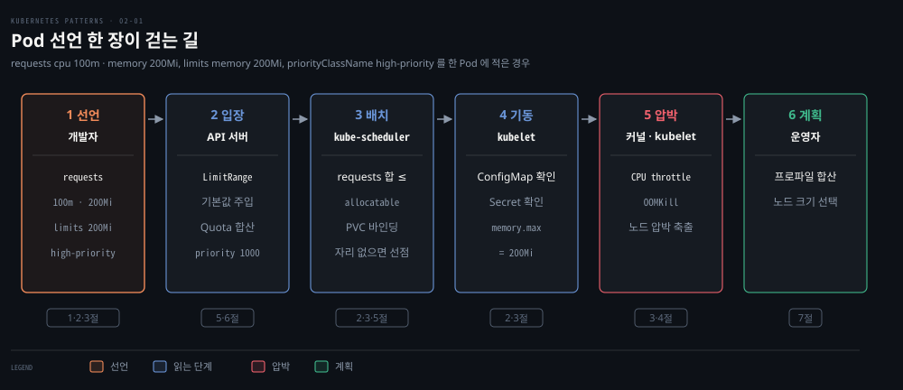
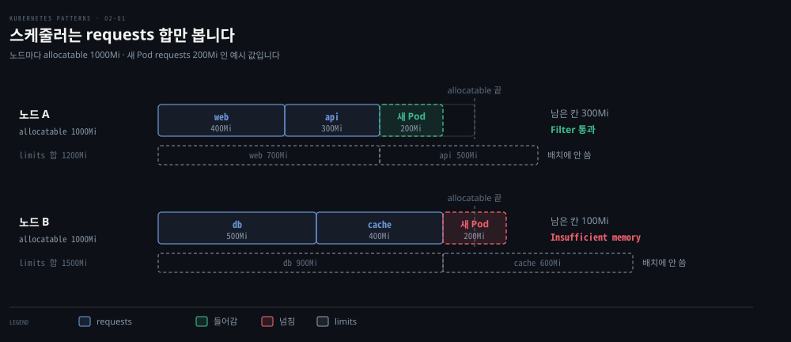
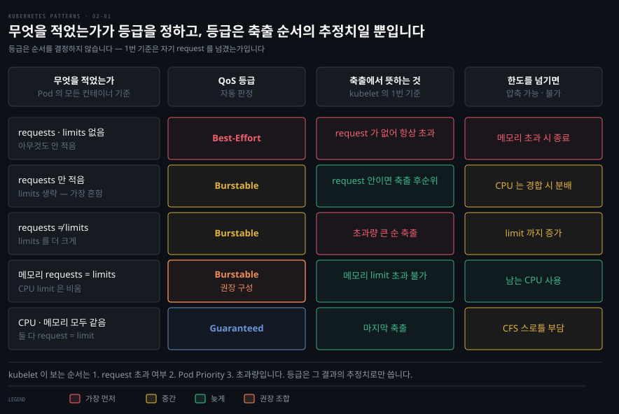
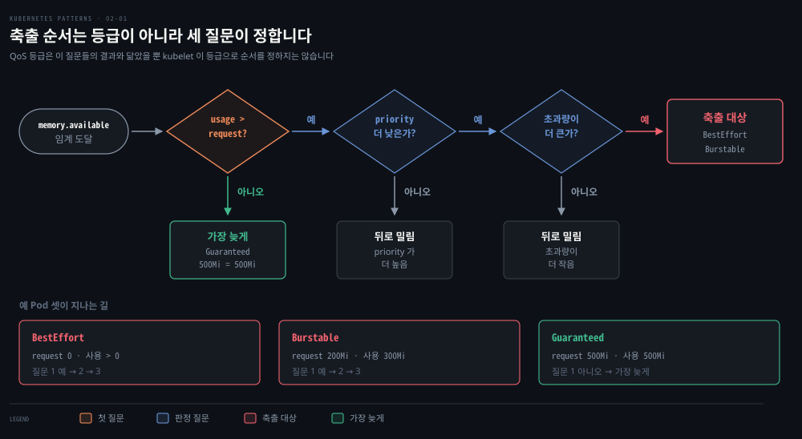
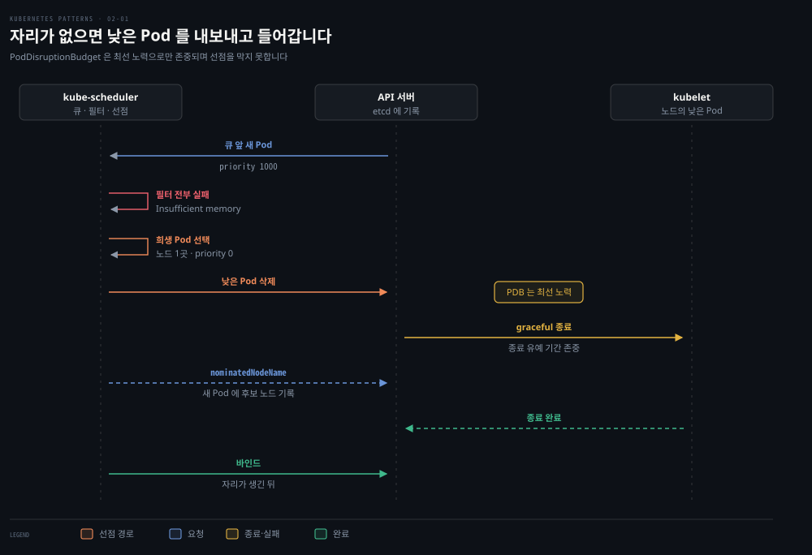

# Predictable Demands — 자원 요구를 선언해 스케줄러에 알리기

---

> 컨테이너가 무엇에 기대고 얼마를 쓰는지 선언해야 스케줄러가 맞는 노드를 고르고, 압박이 올 때 누구를 먼저 죽일지 정할 수 있습니다. 선언은 Pod spec 한 장이지만 그 값이 입장·배치·기동·압박·용량 계획 다섯 단계를 지납니다.


## 학습 목표

> 이 구간을 읽고 나면 아래 다섯 가지를 스스로 해낼 수 있습니다.

1. 볼륨·hostPort·ConfigMap·Secret 의 네 런타임 의존성이 스케줄링과 기동 중 무엇을 막는지 구분할 수 있습니다.
2. requests 와 limits 가 배치·cgroup 설정·압박 시 동작(스로틀과 OOMKill)에 미치는 영향을 설명할 수 있습니다.
3. QoS 세 등급 판정 조건을 제시하고, 실제 축출 순서가 등급이 아니라 request 초과 여부와 Priority 로 정해짐을 밝힐 수 있습니다.
4. Pod Priority 와 preemption 동작을 이해하고, ResourceQuota 로 높은 우선순위 남용을 방지하는 설정을 작성할 수 있습니다.
5. ResourceQuota 와 LimitRange 로 네임스페이스 경계를 세우고, 프로파일 합산과 실측 기반 용량 계획을 세울 수 있습니다.

실무에서 겪은 사례입니다. 표에는 증상만 적었고, 원인은 오른쪽 절을 읽으면 풀립니다. 사내 폴더라 로컬 사본에서만 열립니다.

| 사례 | 겪은 증상 | 답하는 절 |
|---|---|---|
| [리밋을 올리기만 해도, 낮추기만 해도 죽습니다](../../../_company/task/2026-08-19_k8s_resource-limit-tuning/README.md) | 부하 테스트 중 노드 하나가 통째로 멈췄고, 설정을 바꾸자 이번에는 컨테이너가 반복해서 죽었다 | §3 requests 는 배치를, limits 는 실행을 정한다 · §7 용량 계획 |


## Pod 선언 한 장이 걷는 길

> Pod spec 에 적힌 선언은 API 서버의 검증과 스케줄러의 배치, kubelet 의 cgroup 설정을 거쳐 노드 압박 시 생사 순서와 전체 용량 계획까지 이어집니다.

아래는 Pod 선언 한 장이 거치는 여섯 단계와 각 단계의 주체, 읽히는 선언 값, 받치는 핵심 개념을 이은 지도입니다.



| 단계 | 누가 | 선언의 어느 값을 보나 | 받치는 개념 | 절 |
|---|---|---|---|---|
| 1 선언 | 개발자 | volumes·ports.hostPort·envFrom, requests/limits, priorityClassName | 런타임 의존성·자원 프로파일 | §1·§2·§3 |
| 2 입장 | API 서버 admission | LimitRange 기본값 주입·min/max 검증, ResourceQuota 합산, Priority admission 이 priority 값 채움 | admission controller | §5·§6 |
| 3 배치 | kube-scheduler | 큐 정렬(priority), 필터(requests 합 ≤ allocatable, PVC 바인딩, hostPort 충돌), 자리 없으면 선점 | 필터·선점 | §2·§3·§5 |
| 4 기동 | kubelet | ConfigMap·Secret 존재, limits → cgroup | cgroup | §2·§3 |
| 5 압박 | 커널·kubelet | CPU throttle, 메모리 limit 초과 OOMKill, 노드 압박 축출(usage>request → priority → 초과량) | oom_score_adj·QoS | §3·§4 |
| 6 계획 | 운영자 | 환경별 requests·limits·인스턴스 수 합 | 용량 계획 | §7 |

§1 은 선언이 없을 때 발생하는 문제를 다루고 §2 는 배치와 기동을 막는 런타임 의존성을 살핍니다. §3 은 requests 와 limits 가 cgroup 으로 전달되는 원리를 설명합니다.

§4 는 실측 사용량과 oom_score_adj 가 생사를 가르는 메커니즘을 풀고 §5 는 우선순위와 선점을 다룹니다. §6 은 Quota 와 LimitRange 를 다루며 §7 은 용량 산정 방법을 정리합니다.


## 이 문서가 다루지 않는 것

> 책의 2장이 다루는 범위를 넘어서는 연관 주제와 관련 문서의 경계를 밝힙니다.

- HPA 와 VPA 의 자동 확장 알고리즘과 상세 설정 → [Elastic Scale](./29-01.Elastic%20Scale%20%E2%80%94%20%EB%B6%80%ED%95%98%EC%97%90%20%EB%A7%9E%EC%B6%B0%20%EC%84%B8%20%EC%B0%A8%EC%9B%90%EC%9C%BC%EB%A1%9C%20%EC%9E%90%EB%8F%99%20%ED%99%95%EC%9E%A5.md)이 다룹니다.
- 노드 압박 축출의 세부 신호, 소프트·하드 축출 임계치, system-reserved 계산 공식 → [노드 압박 축출과 디스크 관리](../../docs/kubernetes/02-01.%EB%85%B8%EB%93%9C%20%EC%95%95%EB%B0%95%20%EC%B6%95%EC%B6%9C%EA%B3%BC%20%EB%94%94%EC%8A%A4%ED%81%AC%20%EA%B4%80%EB%A6%AC%20%E2%80%94%20DiskPressure%EB%8A%94%20%EB%AC%B4%EC%97%87%EC%9D%84%20%EB%B3%B4%EA%B3%A0%20%EC%BC%9C%EC%A7%80%EB%8A%94%EA%B0%80.md)가 다룹니다.
- ConfigMap 과 Secret 의 상세 생성 문법, 불변(immutable) 설정, 마운트 방식 → [Configuration Resource](./20-01.Configuration%20Resource%20%E2%80%94%20ConfigMap%EA%B3%BC%20Secret%EC%9C%BC%EB%A1%9C%20%EC%84%A4%EC%A0%95%20%EB%B6%84%EB%A6%AC.md)이 다룹니다.
- 스케줄러의 세부 필터링 플러그인과 점수 계산 가중치 → [Automated Placement](./06-01.Automated%20Placement%20%E2%80%94%20%EC%8A%A4%EC%BC%80%EC%A4%84%EB%9F%AC%EA%B0%80%20Pod%EB%A5%BC%20%EB%85%B8%EB%93%9C%EC%97%90%20%EB%B0%B0%EC%B9%98%ED%95%98%EB%8A%94%20%EB%B2%95.md)이 다룹니다.


## 1. 선언 없는 컨테이너가 겪는 일

> 선언이 없으면 스케줄러는 컨테이너를 속이 안 보이는 상자로 다루어 아무 노드에나 올리고, 압박이 오면 가장 먼저 죽입니다.

흐름 위치: 1 선언 · 받치는 개념 — 예측 가능한 요구

자원 요구를 적지 않은 채 Pod 를 배포하면 스케줄러는 이 컨테이너가 CPU 나 메모리를 얼마나 쓰는지 모릅니다. 스케줄러에게 선언 없는 컨테이너는 내부가 보이지 않는 불투명한 상자입니다. 지능적 배치는 각 워크로드가 쓸 자원 수요를 플랫폼이 미리 알고 있을 때만 가능합니다.

컨테이너의 런타임 요구를 사전에 선언해야 하는 이유는 두 가지입니다. 첫째, 모든 런타임 의존성과 컴퓨트 자원 수요가 명시되어 있어야 쿠버네티스가 하드웨어를 가장 효율적으로 쓰는 위치를 찾을 수 있습니다. 서로 다른 우선순위를 가진 프로세스들이 자원을 공유할 때 안정적 공존의 유일한 길은 각 프로세스의 필요량을 미리 등록하는 것입니다. 둘째, 선언된 자원 프로파일은 클러스터 용량 계획의 토대입니다. 서비스별 소비량과 복제본 수를 알아야 전체 워크로드를 감당할 호스트 크기를 산정할 수 있습니다.

자원 소비의 크기는 언어 종류보다 비즈니스 로직과 데이터 처리 방식에 의해 결정됩니다. 컴파일 언어가 JIT 런타임이나 인터프리터 언어보다 대체로 가볍습니다. 다만 같은 부류의 언어끼리는 요구량이 비슷해 결국 도메인과 구현 방식이 차이를 만듭니다. 따라서 언어 특성에 기대어 자원을 짐작하지 말고 실제 부하 환경에서 측정한 수치를 선언해야 합니다.

선언이 없는 Pod 가 배포되면 스케줄러는 자원 요구량을 0 으로 보고 노드 여유와 무관하게 아무 노드에나 배치합니다. 이 Pod 는 만들어지는 순간 BestEffort 등급을 받습니다. 이후 노드에 메모리 부족이 닥치면 노드 안정성을 지키려는 kubelet 이 이 Pod 들을 가장 먼저 쫓아내거나, 그보다 먼저 리눅스 커널이 강제 종료합니다.


## 2. 런타임 의존성이 놓일 곳을 줄인다

> 볼륨과 hostPort 는 Pod 가 놓일 노드 후보를 줄이고, ConfigMap 과 Secret 은 배치를 통과한 뒤 기동을 막습니다.

흐름 위치: 1 선언 → 3 배치 · 4 기동 · 받치는 개념 — 볼륨 바인딩·포트 점유

애플리케이션 컨테이너는 실행 중에 다양한 외부 구성요소와 연결됩니다. 영구 저장소, 호스트 네트워크 포트, 설정 파일, 보안 인증서가 대표적입니다. 이러한 의존성을 선언하는 순간 Pod 가 정상 동작하기 위해 만족해야 하는 환경적 제약이 발생합니다.

### 볼륨과 hostPort 는 배치를 막는다

컨테이너 내부 파일시스템은 일시적이라 컨테이너가 다시 켜지면 내부 데이터가 사라집니다. Pod 수명 동안 데이터를 유지하려면 `emptyDir` 같은 임시 볼륨을 쓸 수 있습니다. 다만 Pod 가 지워진 뒤에도 데이터를 보존하려면 PersistentVolume(PV) 같은 영구 저장소가 뒷받침되어야 합니다.

```yaml
apiVersion: v1
kind: Pod
metadata:
  name: random-generator
spec:
  containers:
  - image: k8spatterns/random-generator:1.0
    name: random-generator
    volumeMounts:
    - mountPath: "/logs"
      name: log-volume
  volumes:
  - name: log-volume
    persistentVolumeClaim:
      claimName: random-generator-log
```

위 매니페스트에서 Pod 는 `random-generator-log` 라는 PersistentVolumeClaim(PVC)에 의존합니다. 스케줄러는 필터링 단계에서 해당 PVC 가 바인딩된 물리 볼륨에 접근할 수 있는 노드만 후보로 남깁니다. 특정 가용 영역에 묶인 볼륨이라면 해당 영역 밖의 노드는 배치 후보에서 제외됩니다. 클러스터의 어느 노드도 해당 볼륨을 제공하지 못하면 Pod 는 스케줄되지 못하고 `Pending` 상태로 머뭅니다.

`hostPort` 선언도 배치를 제약합니다. 컨테이너 내부 포트를 호스트 노드의 특정 포트에 묶으면 노드 네트워크 네임스페이스에서 그 포트 번호가 점유됩니다. 스케줄러는 동일한 `hostIP`, 프로토콜, 포트 조합을 쓰는 Pod 를 한 노드에 둘 이상 배치하지 않습니다. 이 제약으로 인해 해당 워크로드는 클러스터 노드 총개수를 초과하여 스케일 아웃할 수 없습니다.

### ConfigMap·Secret 은 기동을 막는다

설정 파일과 접속 정보는 ConfigMap 과 Secret 으로 분리해 주입하는 것이 쿠버네티스의 표준 설계입니다. 컨테이너는 환경변수나 마운트 파일 형태로 이 설정을 읽어 들입니다.

```yaml
apiVersion: v1
kind: Pod
metadata:
  name: random-generator
spec:
  containers:
  - image: k8spatterns/random-generator:1.0
    name: random-generator
    env:
    - name: PATTERN
      valueFrom:
        configMapKeyRef:
          name: random-generator-config
          key: pattern
```

ConfigMap 과 Secret 은 볼륨이나 포트와 동작 시점이 다릅니다. 스케줄러는 배치를 결정할 때 ConfigMap 이나 Secret 오브젝트가 실제로 존재하는지 검사하지 않습니다. 따라서 참조 대상이 없어도 Pod 는 노드에 정상 할당됩니다.

문제는 노드에 올라간 뒤 생깁니다. 위 예처럼 환경변수로 참조한 ConfigMap 이나 키가 없다고 해 봅시다. kubelet 은 컨테이너 설정을 만들지 못하고 `CreateContainerConfigError` 로 멈춥니다[^configmap-missing]. 볼륨으로 마운트한 ConfigMap 이 없으면 `FailedMount` 이벤트를 남기며 `ContainerCreating` 에 머뭅니다. 참조에 `optional: true` 를 달면 대상이 없어도 기동합니다. 그 환경변수는 값이 비고, 볼륨은 마운트 경로만 빈 채로 생깁니다. 설정 의존성은 배치를 막는 것이 아니라 배치가 끝난 뒤 컨테이너 기동을 차단합니다.

| 의존성 유형 | 제약 발생 시점 | 영향 |
|---|---|---|
| PersistentVolumeClaim | 3단계 스케줄러 배치 | 지원 노드가 없으면 Pod 가 `Pending` 상태로 멈춥니다 |
| hostPort | 3단계 스케줄러 배치 | 동일 포트를 점유한 노드를 피하며 노드 수 이하로 확장이 제한됩니다 |
| ConfigMap · Secret | 4단계 kubelet 기동 | 배치는 통과하지만 노드에서 `CreateContainerConfigError`(환경변수) 나 `ContainerCreating`(볼륨) 에 멈춥니다 |

런타임 의존성을 가진 앱을 설계할 때는 이 의존성이 스케줄링 후보를 줄이는지, 아니면 배치가 끝난 뒤 기동 실패를 부르는지 명확히 구분해야 합니다.


## 3. requests 는 배치를, limits 는 실행을 정한다

> 스케줄러는 requests 합만 노드 할당 가능량과 견주고, limits 는 컨테이너가 노드에 뜬 뒤 리눅스 cgroup 이 강제합니다.

흐름 위치: 3 배치 → 5 압박 · 받치는 개념 — 압축 가능 자원·cgroup

쿠버네티스 자원 관리의 핵심은 `requests` 와 `limits` 라는 두 숫자입니다. 개발자는 각 컨테이너가 동작하는 데 필요한 최소 보장량과 쓸 수 있는 최대 상한을 명시합니다.

### 압축 가능한 자원과 불가능한 자원

컴퓨트 자원은 기근이 발생했을 때 시스템이 대응하는 방식에 따라 두 가지로 나뉩니다.

- **압축 가능(compressible)** 자원: CPU 와 네트워크 대역폭이 이에 속합니다. 워크로드가 할당량을 초과하면 운영체제가 처리 시간을 쪼개어 스로틀을 겁니다. 애플리케이션 응답 속도가 느려질 뿐 프로세스가 죽지는 않습니다.
- **압축 불가(incompressible)** 자원: 물리 메모리가 대표적입니다. 애플리케이션에 이미 할당한 메모리를 돌려 달라고 요청할 방법이 없습니다. 사용량이 물리 한계에 도달하면 프로세스를 강제 종료하여 메모리를 회수합니다.

이 차이는 장애 증상을 가릅니다. CPU 가 부족하면 서비스 레이턴시가 늘어나는 성능 저하를 겪습니다. 반면 메모리가 부족하면 컨테이너가 즉시 강제 종료되어 서비스가 중단됩니다.

### 스케줄러는 requests 합만 본다

Pod 의 자원 선언에서 `requests` 는 최소 보장량이고 `limits` 는 최대 상한입니다. 스케줄러가 노드를 선택할 때 계산하는 기준은 오직 `requests` 합입니다. `limits` 는 배치 계산에 전혀 쓰이지 않습니다.

스케줄러가 노드를 고를 때 `requests` 합만 할당 가능량에 맞추고 `limits` 는 배제하는 구조를 아래 그림에서 확인합니다. 막대의 수치는 설명을 위한 예시 값입니다.



위 그림에서 노드의 할당 가능 메모리 공간에 기존 컨테이너들의 requests 가 누적되어 쌓입니다. 새 Pod 의 requests 200MiB 가 남은 칸에 들어갈 수 있는 노드에만 배치가 성립합니다. 점선으로 표시된 limits 합은 노드 용량을 넘어서더라도 배치 단계에서는 검사 대상이 아닙니다.

스케줄러는 후보 노드를 평가할 때 아래 공식을 만족하는 노드만 필터링을 통과시킵니다.

```bash
# 스케줄러의 노드 적합 판정 공식
Node Allocatable >= sum(requests) + new_pod_requests
```

```yaml
resources:
  requests:
    cpu: 100m
    memory: 200Mi
  limits:
    memory: 200Mi
```

위 설정에서 스케줄러는 CPU 0.1 코어와 메모리 200MiB 의 여유가 있는 노드만 탐색합니다. 새 Pod 의 `limits` 에 메모리가 200MiB 로 잡혀 있든 2GiB 로 잡혀 있든 스케줄러의 배치 결정에는 영향을 주지 않습니다.

### 한도를 넘으면 throttle 과 OOMKill

노드에 배치가 완료된 뒤 컨테이너가 실행되면 리눅스 커널의 cgroup 메커니즘이 자원 제약을 직접 집행합니다.

컨테이너가 CPU limits 를 초과하면 리눅스 CFS 할당기가 100ms 시간 주기마다 쿼터를 다 쓴 프로세스 스레드를 일시 정지시킵니다. 이것이 CPU 스로틀링입니다.

반면 메모리는 다릅니다. 컨테이너 내부 프로세스들이 쓰는 메모리 합계가 선언된 memory limit 을 넘어서면 커널 OOM killer 가 해당 cgroup 프로세스를 강제 종료합니다. 쿠버네티스는 이를 감지하여 Pod 상태에 `OOMKilled` 플래그를 남기고 `restartPolicy` 에 따라 컨테이너를 제자리에서 재시작합니다. 비정상 종료가 반복되면 `CrashLoopBackOff` 상태가 됩니다.

리눅스 커널의 cgroup v2 환경에서 쿠버네티스 자원 설정은 다음과 같이 대응 파일로 변환됩니다[^cgroup-v2].

- `resources.limits.memory` → `memory.max`: 바이트 단위 한도가 기록되며, 미지정 시 `max` 로 설정됩니다.
- `resources.limits.cpu` → `cpu.max`: `<quota> <period>` 형식으로 기록되며 100m 은 `10000 100000` 으로 매핑됩니다.
- `resources.requests.cpu` → `cpu.weight`: 1 에서 10000 사이의 가중치 정수로 변환되어 경합 시 CPU 비율을 나눕니다.

쿠버네티스는 v1.35 에서 `InPlacePodVerticalScaling` 기능을 정식 GA 로 지원합니다[^inplace-resize]. 이제는 실행 중인 Pod 를 다시 만들지 않고 컨테이너의 CPU·메모리 requests 와 limits 를 바꿀 수 있습니다. 바꿀 때 컨테이너를 재시작할지는 자원마다 `resizePolicy` 로 정합니다.

### 자원 이름 넷

쿠버네티스의 `resources` 블록에서 선언할 수 있는 자원 식별자는 네 가지입니다.

| 자원 이름 | 분류 | 초과 시 동작 | 주요 특징 |
|---|---|---|---|
| `cpu` | 압축 가능 | CFS 스로틀 | 1 코어는 1000m 단위로 쪼개어 선언합니다 |
| `memory` | 압축 불가 | 즉시 OOMKilled | 바이트 단위(Mi, Gi 등)로 선언하며 힙과 스택을 모두 포함합니다 |
| `ephemeral-storage` | 압축 불가 | 노드에서 축출 | 로컬 디스크의 쓰기 레이어와 기본 emptyDir 저장 공간입니다 |
| `hugepages-<size>` | 압축 불가 | 한도 너머 할당 불가 | 2MiB 나 1GiB 단위의 거대 페이지이며(예: `hugepages-1Gi: 2Gi` 는 1GiB 페이지 두 개) 오버커밋이 불가능합니다 |

`emptyDir` 볼륨을 쓸 때는 설정 옵션에 유의해야 합니다. `emptyDir.medium` 을 `Memory` 로 두면 tmpfs 메모리 파일시스템이 구성되어 볼륨에 쓰인 데이터가 컨테이너 memory limit 에 즉시 합산됩니다. 설정을 비워 두면 노드 디스크의 `ephemeral-storage` 를 소모합니다. 캐시 파일을 tmpfs 에 무심코 대량 기록하다가 memory limit 에 걸려 컨테이너가 `OOMKilled` 되는 장애가 흔히 발생합니다.

거대 페이지를 뜻하는 `hugepages-<size>` 는 노드가 미리 확보해 둔 연속 물리 메모리입니다. 오버커밋이 불가능하므로 request 와 limit 값이 같아야 합니다. limit 만 적으면 request 가 같은 값으로 채워집니다. 거대 페이지를 요청하는 Pod 는 CPU 나 메모리도 함께 요청해야 합니다[^hugepages].

### 세부 — JVM 힙과 limits

자바 가상 머신(JVM) 기반 Spring Boot 앱을 컨테이너화할 때 힙 설정을 쿠버네티스 자원과 일대일로 대입하는 실수가 자주 발생합니다.

리눅스 커널 관점에서 컨테이너 메모리는 힙에만 한정되지 않습니다. 메타스페이스, 스레드별 스택, 네이티브 I/O 버퍼, JIT 코드 캐시를 모두 합산한 물리 메모리 소비량을 잽니다.

만약 컨테이너 memory limit 을 2GiB 로 잡고 `-Xmx2g` 옵션을 주면 힙 밖 영역이 얹어지면서 2GiB 한도를 돌파합니다. 결과는 커널 OOM killer 에 의한 강제 종료입니다.

이를 방지하는 실무 규칙은 두 가지입니다.

- JVM 힙 크기를 컨테이너 memory limit 의 약 75% 수준으로 제한하여 힙 외 완충 지대를 남깁니다. 고정 `-Xmx` 대신 `-XX:MaxRAMPercentage=75` 플래그를 사용하여 cgroup 한도를 동적으로 감지하도록 구성합니다. 옵션을 생략하면 JVM 기본값인 25% 가 적용되므로 수치를 명시해야 합니다.
- 메모리는 `requests = limits` 로 설정하여 노드 내에서 공간을 예약하고 CPU 는 limits 를 비워 둡니다. GC 스파이크나 기동 시점의 일시적 부하를 노드의 유휴 코어로 흡수할 수 있습니다.


## 4. QoS 는 압박 때 순서의 추정치다

> QoS 등급은 requests 와 limits 의 조합으로 자동 결정되지만, kubelet 은 등급 이름이 아니라 request 초과 여부와 Priority 로 축출 순서를 정합니다.

흐름 위치: 5 압박 · 받치는 개념 — oom_score_adj

쿠버네티스는 Pod 내부 컨테이너들의 requests 와 limits 조합을 분석하여 세 QoS 등급 중 하나를 자동으로 부여합니다.

### 세 등급의 정의

QoS 등급은 개발자가 지정하는 문자열이 아니며 매니페스트에 적힌 숫자들의 관계로 계산됩니다. 선언 조합에 따라 세 등급이 어떻게 나뉘고 각 등급이 압박 때 어떻게 다뤄지는지 아래 행렬에서 먼저 봅니다.



위 도식은 자원 선언 행과 판정 열의 조합을 보여줍니다. requests 만 적고 limits 를 비운 일반적 형태가 Burstable 에 속한다는 사실과 각 등급의 기근 시 처리 방식을 행렬로 나타냅니다. 주황 칸은 뒤에서 볼 권장 조합(메모리 requests = limits, CPU limit 비움)이며 이 역시 Burstable 입니다. 판정 조건을 정확히 적으면 다음과 같습니다.

- **BestEffort**: Pod 내 어느 컨테이너에도 CPU·메모리의 `requests` 와 `limits` 가 전혀 정의되지 않은 경우입니다. `ephemeral-storage` 같은 다른 자원만 요청한 Pod 도 BestEffort 입니다.
- **Guaranteed**: Pod 내 모든 컨테이너가 CPU 와 메모리 둘 다 `limits` 를 명시했고, 각 자원의 `requests` 값이 `limits` 값과 일치해야 합니다. 값은 0 보다 커야 합니다.
- **Burstable**: 위의 두 등급에 속하지 않는 모든 경우입니다. 최소 한 컨테이너에 CPU 나 메모리의 request 또는 limit 이 하나라도 적혀 있으면 Burstable 이 됩니다.

실무에서 흔히 쓰이는 "메모리는 `requests = limits`, CPU 는 `requests` 만 설정"한 Pod 는 Guaranteed 가 아니라 Burstable 등급을 받습니다. CPU limit 이 없기 때문입니다.

`PodLevelResources` 는 쿠버네티스 v1.34 에서 베타로 기본 활성화됩니다. 이 환경에서는 컨테이너 개별 지정 대신 Pod 루트의 `spec.resources` 에 CPU 와 메모리를 선언할 수 있습니다[^pod-level-resources]. Pod 레벨 CPU 와 메모리 각각의 requests 와 limits 가 일치하면 컨테이너 선언과 무관하게 Pod 전체가 Guaranteed 등급을 얻습니다.

### 축출 순서는 등급이 아니다

많은 엔지니어가 "노드 압박이 오면 BestEffort → Burstable → Guaranteed 순서로 축출된다"고 단순하게 기억합니다. 그러나 공식 문서는 이 통념을 부정합니다.

> "The kubelet does not use the pod's QoS class to determine the eviction order."[^node-pressure-eviction]

kubelet 이 노드 메모리나 디스크 압박을 감지하여 노드 압박 축출을 단행할 때 실제로 평가하는 기준은 세 단계입니다. 판정 흐름을 아래 그림으로 먼저 따라갑니다.



1. 해당 Pod 의 실제 자원 사용량이 `requests` 보장량을 초과했는가.
2. Pod Priority 가 상대적으로 낮은가.
3. `requests` 대비 초과하여 사용한 자원의 절대량이 얼마나 큰가.

따라서 실제 축출 1순위는 자신의 request 를 초과하여 사용 중인 BestEffort 와 Burstable Pod 들입니다. 이들 사이에서는 Priority 가 낮고 초과량이 큰 Pod 가 먼저 쫓겨납니다. 반면 자신이 선언한 request 범위 내에서 도는 Burstable Pod 는 초과 Pod 보다 뒤로 밀려 안전하게 보호됩니다.

위 판정 흐름이 보여주듯 평가의 첫 관문은 등급 이름이 아니라 약속한 몫을 지켰는가입니다. requests 범위를 지킨 Burstable Pod 는 Guaranteed Pod 와 함께 2단계 보호 구간으로 분류됩니다.

### oom_score_adj 와 커널 희생자 선정

kubelet 이 축출을 수행하기 전에 노드 물리 메모리가 급격히 고갈되면 커널 OOM killer 가 즉시 동작합니다. 커널은 프로세스 메모리 사용량과 `/proc/<pid>/oom_score_adj` 점수를 합산하여 점수가 가장 높은 프로세스를 종료합니다.

쿠버네티스는 컨테이너 기동 시점에 QoS 등급과 requests 비중에 따라 `oom_score_adj` 값을 미리 주입해 둡니다.

| 대상 프로세스 | `oom_score_adj` 점수 | 설명 |
|---|---|---|
| BestEffort 컨테이너 | `1000` | 보호가 전혀 없으며 커널 메모리 고갈 시 1순위 희생자가 됩니다 |
| Burstable 컨테이너 | `2 ~ 999` | 노드 메모리 중 컨테이너 memory request 비율이 클수록 낮은 점수를 받습니다[^oom-adj] |
| Guaranteed 컨테이너 | `-997` | 점수가 낮아 사용자 워크로드 중 가장 늦게 희생됩니다 |
| 노드 에이전트 `kubelet` 프로세스 | `-999` | kubelet `--oom-score-adj` 기본값이며 Guaranteed 앱보다 더 강하게 보호됩니다[^kubelet-oom] |
| PID 1(init)·커널 스레드 | 점수와 무관 | 커널이 희생자 후보에서 아예 뺍니다[^oom-unkillable] |

`system-node-critical` 우선순위를 단 Pod 의 컨테이너도 등급과 상관없이 `-997` 을 받습니다.

Burstable 등급의 점수 공식은 `min(max(2, 1000 - (1000 × memoryRequestBytes) / machineMemoryCapacityBytes), 999)` 입니다. 노드 메모리 대비 큰 request 를 선언할수록 2 에 가까운 점수를 받아 보호 수준이 높아집니다.

실제 노드에서 세 등급의 Pod 를 띄우고 `crictl inspect` 로 컨테이너 PID 를 얻습니다. 그 PID 의 `/proc/<pid>/oom_score_adj` 를 읽으면 BestEffort 는 1000, Guaranteed 는 -997, 같은 노드의 kubelet 은 -999 로 나옵니다. request 100m·128Mi, limit 200m·256Mi 로 선언한 Burstable 컨테이너는 967 을 받았습니다. 그 request 가 노드 총메모리에서 차지하는 비율로 계산한 값입니다.

### 권장 조합

안정적인 클러스터 운영을 위한 권장 규칙은 명확합니다.

- **메모리**: `requests = limits` 로 동일하게 고정합니다.
- **CPU**: `requests` 만 설정하고 `limits` 는 명시하지 않습니다.

이 설정을 따르면 Pod 의 QoS 등급은 Guaranteed 가 아닌 **Burstable** 이 됩니다. 그럼에도 이 조합이 권장되는 이유는 실질적인 동작 이점 때문입니다.

메모리의 request 와 limit 을 일치시키면 컨테이너가 예약 몫을 넘겨 메모리를 쓸 수 없습니다. 한도를 넘기는 순간 자기 cgroup 한도에 걸려 컨테이너 단위로 OOMKill 되므로, 다른 Pod 몫의 노드 메모리를 잠식하지 않습니다. 결과적으로 노드 압박 축출 판정의 1순위에 걸리지 않습니다.

반대로 CPU 는 압축 가능 자원이므로 limits 를 비워 두어도 노드가 죽지 않습니다. 만약 CPU limits 를 걸어 두면 리눅스 CFS 스케줄러가 100ms 마다 쿼터를 계산하므로, 노드에 코어가 남아돌아도 버스트 트래픽을 처리하던 스레드가 강제로 스로틀링되어 서비스 지연이 급증합니다. limits 를 비워 두어야 최소 할당량을 보장받으면서 유휴 CPU 자원을 온전히 쓸 수 있습니다.

### OOMKill 과 노드 압박 축출의 차이

두 메커니즘의 차이를 명확히 구분해야 장애 상황에서 올바른 진단이 가능합니다.

| 비교 항목 | 컨테이너 한도 초과 OOMKill | 노드 레벨 커널 OOMKill | 노드 압박 축출 (Eviction) |
|---|---|---|---|
| 집행 주체 | 리눅스 커널 OOM killer | 리눅스 커널 OOM killer | 노드 에이전트 kubelet |
| 발생 원인 | 컨테이너 사용량이 memory limit 초과 | 노드 전체 메모리가 급격히 완전 고갈 | 노드 메모리가 eviction 임계치 이하로 하락 |
| 희생자 선정 | 한도를 넘긴 해당 cgroup 프로세스 | 점수가 가장 높은 프로세스 (`oom_score_adj`) | request 초과 여부 → Priority → 초과량 |
| 최종 결과 | 컨테이너만 재시작 (`OOMKilled`) | 특정 프로세스 강제 종료 | Pod 가 `Failed` 로 노드에서 축출 |
| 노드 이동 여부 | 제자리에서 재시작 (노드 유지) | 프로세스만 종료되거나 재시작 | 컨트롤러가 다른 노드에 새 Pod 생성 |


## 5. Priority 는 대기 순서와 선점을 바꾼다

> PriorityClass 는 스케줄러 큐의 대기 순서를 정하고 자리가 없으면 낮은 우선순위 Pod 를 선점(preemption)해 쫓아내며, QoS 와는 직교하는 별개 축입니다.

흐름 위치: 2 입장 → 3 배치 · 받치는 개념 — preemption

자원 요구량이 스케줄러의 노드 필터링과 kubelet 의 생사 결정을 좌우한다면, 워크로드의 비즈니스적 중요도를 나타내는 축은 **Pod Priority** 입니다.

### PriorityClass 와 admission

우선순위는 클러스터 범위 오브젝트인 `PriorityClass` 로 정의합니다.

```yaml
apiVersion: scheduling.k8s.io/v1
kind: PriorityClass
metadata:
  name: high-priority
value: 1000
globalDefault: false
description: "미션 크리티컬 워크로드를 위한 높은 우선순위 클래스입니다"
---
apiVersion: v1
kind: Pod
metadata:
  name: random-generator
spec:
  containers:
  - image: k8spatterns/random-generator:1.0
    name: random-generator
  priorityClassName: high-priority
```

`PriorityClass` 의 `value` 필드는 32비트 정수값을 가집니다. 일반 사용자가 생성할 수 있는 값의 상한은 10억(`1,000,000,000`)으로 제한됩니다. 10억을 초과하는 수치는 시스템 필수 컴포넌트를 위해 예약되어 있습니다[^priority-classes].

- `system-cluster-critical`: 20억 값을 가지며 CoreDNS 같은 클러스터 전역 필수 애드온에 부여됩니다.
- `system-node-critical`: 20억 1천 값을 가지며 `kube-proxy`, CNI 플러그인 등 노드 필수 데몬에 쓰입니다.

`globalDefault: true` 속성은 `priorityClassName` 을 지정하지 않은 모든 Pod 에 적용될 기본 우선순위를 지정합니다. 클러스터 내에서 단 하나의 PriorityClass 만 이 설정을 켤 수 있습니다. Pod 가 생성되면 API 서버의 Priority admission controller 가 지정된 클래스를 찾아 Pod spec 의 `priority` 정수 필드를 자동으로 채웁니다.

스케줄러는 대기 큐에 쌓인 Pod 들을 꺼낼 때 우선순위 숫자가 높은 순서대로 정렬하여 처리합니다.

### 자리가 없으면 선점한다

클러스터에 자원이 부족하여 우선순위가 높은 Pod 가 들어갈 자리가 없으면 스케줄러의 선점 로직이 동작합니다. 높은 우선순위 Pod 가 낮은 우선순위 Pod 를 내보내고 들어가는 과정을 아래 시퀀스 도식에서 먼저 봅니다.



위 시퀀스는 스케줄러가 노드 필터링 실패 후 희생 Pod 를 고르고 종료를 요청한 뒤 최종 배치를 마치는 흐름입니다.

스케줄러는 특정 노드에서 실행 중인 낮은 우선순위 Pod 들을 골라 퇴거시킴으로써 자리를 확보합니다. 희생자로 지목된 Pod 들은 정상적인 graceful termination 절차를 밟습니다. 선점 대상 노드는 새 Pod 의 `status.nominatedNodeName` 필드에 기록됩니다[^nominated-node].

희생 Pod 들이 종료되어 자원이 반환되면 새 Pod 가 바인딩됩니다. 다만 기다리는 사이 다른 노드에 자리가 나면 그 노드로 갈 수 있어서, 반드시 지명된 노드에 놓이지는 않습니다.

선점 기능을 쓸 때는 중대한 위험을 고려해야 합니다. 스케줄러는 선점 대상을 고를 때 PDB(PodDisruptionBudget)를 최선의 노력으로 존중하지만 대안이 없으면 위반을 감수하고 낮은 우선순위 Pod 를 쫓아냅니다. 따라서 카프카나 etcd 처럼 정족수 유지가 필수인 분산 브로커가 낮은 우선순위로 돌면 상위 Pod 의 선점에 의해 쿼럼이 깨질 수 있습니다.

### preemptionPolicy: Never

대기 큐의 맨 앞에 서서 빠르게 배치되기를 원하지만 실행 중인 다른 동료 워크로드를 쫓아내고 싶지는 않은 경우가 있습니다. 대규모 데이터 배치 작업이나 머신러닝 학습 파이프라인이 이에 해당합니다.

이때는 `PriorityClass` 에 `preemptionPolicy: Never` 옵션을 지정합니다. 이 설정이 적용된 Pod 는 스케줄러 큐에서 높은 우선순위를 인정받아 먼저 배치 시도를 받습니다. 다만 빈자리가 없는 노드에서 기존 Pod 를 선점하지 않고 여유 자원이 생길 때까지 대기합니다.

### 남용은 Quota 로 막는다

우선순위 숫자는 개발자가 자유롭게 수정할 수 있는 매니페스트 필드입니다. 거버넌스가 없다면 모든 팀이 자신의 Pod 에 최고 우선순위인 10억을 부여하는 우선순위 인플레이션이 발생합니다. 모든 Pod 의 우선순위가 높아지면 스케줄러의 예측 가능성이 무너집니다. 배치와 축출을 이끄는 숫자가 사용자 손에 있으므로, 한 번의 변경이 많은 Pod 에 퍼져 플랫폼이 예측 가능한 SLA 를 지키지 못하게 됩니다.

쿠버네티스는 이를 방지하기 위해 ResourceQuota 에 `scopeSelector` 기능을 제공합니다[^quota-priorityclass].

```yaml
apiVersion: v1
kind: ResourceQuota
metadata:
  name: high-priority-quota
  namespace: production
spec:
  hard:
    pods: "5"
    requests.cpu: "10"
    requests.memory: "20Gi"
  scopeSelector:
    matchExpressions:
    - scopeName: PriorityClass
      operator: In
      values: ["high-priority"]
```

위 Quota 는 `production` 네임스페이스 안에서 `high-priority` 클래스를 달고 생성되는 Pod 총개수를 5 개, CPU 요청량을 10 코어, 메모리 요청량을 20GiB 로 엄격하게 통제합니다. 허가되지 않은 대량의 고우선순위 배포를 사전에 차단할 수 있습니다.

QoS 와 Pod Priority 는 서로 거의 얽히지 않는 별개의 축입니다. QoS 는 kubelet 이 `oom_score_adj` 를 정할 때 쓰고, 노드 압박 때 축출 순서를 어림하는 추정치입니다. 스케줄러는 선점 대상을 고를 때 QoS 등급을 보지 않습니다. 반대로 Pod Priority 는 스케줄러가 대기 순서와 선점을 결정하는 기준입니다. kubelet 의 축출 판정에서는 requests 초과 여부를 먼저 본 뒤 그다음 정렬 기준으로 씁니다.


## 6. Quota·LimitRange 가 네임스페이스를 지킨다

> ResourceQuota 는 네임스페이스의 총 자원 소비를 묶고, LimitRange 는 개별 컨테이너의 기본값과 비율을 admission 단계에서 강제합니다.

흐름 위치: 2 입장 · 받치는 개념 — admission controller

여러 개발 팀이 단일 쿠버네티스 클러스터를 공유하는 멀티테넌트 환경에서는 개별 워크로드의 자원 남용이 다른 팀의 서비스에 피해를 주지 않도록 네임스페이스 수준의 울타리를 쳐야 합니다.

### ResourceQuota 는 합계를 막는다

`ResourceQuota` 는 특정 네임스페이스에 배포된 모든 워크로드의 자원 소비 총합에 제동을 거는 어드미션 제어 도구입니다.

```yaml
apiVersion: v1
kind: ResourceQuota
metadata:
  name: compute-quota
  namespace: team-a
spec:
  hard:
    pods: "4"
    requests.cpu: "2"
    requests.memory: "4Gi"
    limits.cpu: "4"
    limits.memory: "5Gi"
    persistentvolumeclaims: "2"
```

ResourceQuota 가 설정된 네임스페이스에서는 CPU 와 메모리 requests·limits 합계를 제한합니다. PVC 총개수와 스토리지 용량, Pod 나 Service 같은 오브젝트 총개수도 함께 묶을 수 있습니다.

만약 네임스페이스에 CPU 나 메모리 Quota 가 걸려 있다면, 해당 네임스페이스에 생성되는 모든 Pod 는 매니페스트에 관련 자원 필드를 명시해야 합니다. 값을 명시하지 않은 Pod 는 어드미션 단계에서 생성이 즉시 거부됩니다.

### LimitRange 는 기본값과 범위를 정한다

개발자가 자원 선언을 누락했거나 터무니없이 큰 자원을 요청하는 것을 막으려면 `LimitRange` 를 함께 배포해야 합니다.

```yaml
apiVersion: v1
kind: LimitRange
metadata:
  name: container-limits
  namespace: team-a
spec:
  limits:
  - type: Container
    min:
      memory: 250Mi
      cpu: 250m
    max:
      memory: 2Gi
      cpu: 2
    default:
      memory: 500Mi
      cpu: 500m
    defaultRequest:
      memory: 250Mi
      cpu: 250m
    maxLimitRequestRatio:
      memory: 2
      cpu: 4
```

LimitRange 는 컨테이너가 생성될 때 다음과 같은 규칙을 강제합니다.

- `min` / `max`: 컨테이너가 요청할 수 있는 requests 와 limits 의 최소·최대 허용 범위입니다. 이 범위를 벗어난 Pod 는 API 서버가 등록을 거부합니다.
- `default`: 매니페스트에 limits 를 적지 않은 컨테이너에 자동으로 주입되는 기본 상한선입니다.
- `defaultRequest`: 매니페스트에 requests 를 적지 않은 컨테이너에 자동으로 주입되는 기본 보장량입니다.
- `maxLimitRequestRatio`: request 대비 limit 의 최대 배율을 제한하여 노드의 과도한 오버커밋을 차단합니다. 메모리 배율이 2 라면 request 가 250MiB 일 때 limit 은 최대 500MiB 까지만 허용됩니다.
- `type`: `Container`(컨테이너 하나), `Pod`(Pod 안 컨테이너 합), `PersistentVolumeClaim`(PVC 하나의 요청 용량) 가운데 무엇에 범위를 걸지 정합니다.

비율을 묶는 이유는 스케줄러가 requests 만 보고 배치하기 때문입니다. requests 와 limits 의 간격이 크면 노드가 그만큼 오버커밋되고, 여러 컨테이너가 동시에 request 이상을 쓰는 순간 성능이 함께 떨어집니다.

ResourceQuota 와 LimitRange 를 한 쌍으로 묶어 네임스페이스에 구성하면 LimitRange 가 자원 값을 빼먹고 배포된 Pod 에도 안전한 기본값을 채워 줍니다. 그래서 Quota 어드미션 거부 없이 안전하게 수용됩니다.

### 기본값이 범위에 걸리는 경우

LimitRange 설정 매니페스트를 작성할 때 자주 마주치는 유효성 검증 오류가 있습니다. API 서버 내부 소스코드 검증 규칙상 `min` 수치는 반드시 `defaultRequest` 수치보다 작거나 같아야 합니다[^limitrange-validation].

예를 들어 `min.cpu` 를 500m 으로 두고 `defaultRequest.cpu` 를 250m 으로 지정하면 생성이 거부됩니다. API 서버가 `min value 500m is greater than default request value 250m` 에러를 반환합니다. 기본값으로 주입될 요청량이 최소 허용 규격보다 작아서 논리적 모순이 발생하기 때문입니다. 따라서 `min` 수치는 항상 `defaultRequest` 이하로 설정해야 합니다.

### PID 수 제한

컴퓨트 자원 외에 노드를 위협하는 또 다른 공유 자원은 프로세스 식별자(PID)입니다.

컨테이너 내부에서 스레드 누수가 발생하거나 fork bomb 같은 악의적 코드가 실행되면 노드의 사용 가능한 PID 공간이 빠르게 소진됩니다. 노드의 PID 가 바닥나면 kubelet 이나 ssh 데몬조차 새 프로세스를 띄우지 못해 노드 전체가 불능 상태에 빠집니다.

이를 막기 위해 클러스터 관리자는 kubelet 설정 파일의 `podPidsLimit`(명령행 `--pod-max-pids`)로 Pod 하나의 프로세스 수를 제한합니다. `--system-reserved`·`--kube-reserved` 에 `pid=<개수>` 를 주어 시스템 데몬 몫의 PID 도 미리 떼어 둡니다[^pid-limiting]. 둘 다 노드 단위 kubelet 설정이라 앱 개발자가 매니페스트로 정하는 값은 아닙니다.


## 7. 프로파일을 모으면 용량 계획이 된다

> 환경마다 서비스별 requests·limits 와 인스턴스 수를 곱해 더하면 클러스터에 필요한 총 노드 사양이 도출됩니다.

흐름 위치: 6 계획 · 받치는 개념 — 용량 계획

컨테이너마다 자원 프로파일이 선언되어 있으면 운영팀은 이를 모아 클러스터에 필요한 하드웨어 크기를 계산할 수 있습니다. 다만 환경마다 프로파일과 인스턴스 수가 달라 계산이 단순하지 않습니다.

비프로덕션 클러스터는 하드웨어를 알뜰하게 쓰려고 BestEffort·Burstable 컨테이너를 주로 둡니다. 기근 때 컨테이너가 죽어도 서비스에 큰 지장이 없습니다. 프로덕션 클러스터는 안정성을 위해 Guaranteed 와 일부 Burstable 을 주로 둡니다. 여기서 컨테이너가 죽으면 용량을 늘려야 한다는 신호로 읽습니다.

### 서비스 넷의 합

클러스터 용량 계획은 서비스별 requests 와 limits 에 각 서비스의 목표 복제본 수를 곱하여 합산하는 것에서 출발합니다.

| Pod 서비스 | CPU request | Memory request | Memory limit | 복제본 수 | 합산 CPU req | 합산 Mem req | 합산 Mem limit |
|---|---|---|---|---|---|---|---|
| 서비스 A | 500m | 500Mi | 500Mi | 4 | 2000m | 2000Mi | 2000Mi |
| 서비스 B | 250m | 250Mi | 1000Mi | 2 | 500m | 500Mi | 2000Mi |
| 서비스 C | 500m | 1000Mi | 2000Mi | 2 | 1000m | 2000Mi | 4000Mi |
| 서비스 D | 500m | 500Mi | 500Mi | 1 | 500m | 500Mi | 500Mi |
| **총합계** | — | — | — | **9** | **4000m** | **5000Mi** | **8500Mi** |

위 계산으로 이 워크로드에 최소 4 코어 CPU 와 약 5GiB 메모리 예약이 필요하다는 것을 알 수 있습니다. 여기에 데몬셋, 인그레스, 모니터링 에이전트 같은 인프라 컨테이너와 빌드 잡, 오토스케일링 여유를 더해 최종 노드 수량과 사양을 결정합니다.

실제 노드 인스턴스를 고를 때는 하드웨어 사양과 실제 가용량의 차이를 계산에 넣어야 합니다. 4GiB 메모리를 갖춘 VM 인스턴스에서 `/proc/meminfo` 를 보면 커널 부팅 영역이 제외되어 `MemTotal` 은 약 3.74GiB 만 표시됩니다. 여기에 `kube-reserved` 와 `system-reserved` 몫을 추가 차감해야 노드의 실제 `Allocatable` 이 나옵니다.

### 값은 재서 정한다

자원 요구를 선언하지 않은 컨테이너는 스케줄러에게 속이 보이지 않는 상자입니다. 짐작으로 적은 수치는 노드 자원 낭비나 예기치 못한 OOMKill 장애를 부릅니다.

초기 개발 단계에서는 추측에 기대지 말고 부하 테스트를 직접 수행하여 서비스의 실제 자원 소비 패턴을 측정해야 합니다. 프로덕션 배포 전 스트레스 테스트를 거치며 트래픽 증가 시 CPU 스로틀링 발생 여부와 힙 메모리의 안정적인 상한선을 확인해야 합니다.

운영 단계에서는 워크로드의 실제 사용 이력을 수집하여 requests 와 limits 를 동적으로 보정해 주는 Vertical Pod Autoscaler(VPA)를 활용할 수 있습니다. VPA 세부 동작 방식과 수평 확장기(HPA)와의 조합은 [Elastic Scale](./29-01.Elastic%20Scale%20%E2%80%94%20%EB%B6%80%ED%95%98%EC%97%90%20%EB%A7%9E%EC%B6%B0%20%EC%84%B8%20%EC%B0%A8%EC%9B%90%EC%9C%BC%EB%A1%9C%20%EC%9E%90%EB%8F%99%20%ED%99%95%EC%9E%A5.md)에서 다룹니다.


## 결정 치트시트

> 서비스 성격과 운영 환경에 따라 적합한 자원 선언 조합을 선택하는 기준입니다.

| 상황 및 워크로드 성격 | 권장 설정 조합 | 얻는 실질적 이점 | 주의점 및 트레이드오프 |
|---|---|---|---|
| 일반적인 웹 API 및 마이크로서비스 (Spring Boot 등) | 메모리 requests = limits, CPU 는 requests 만 지정 | CFS 스로틀링을 피하고 유휴 CPU 를 온전히 활용하며, 메모리 누수 시 신속하게 컨테이너 레벨 OOMKill 로 수습 | QoS 등급은 Burstable 이 되며, 한 컨테이너의 CPU 과소비로 이웃 노드가 일시적 지연을 겪을 수 있습니다 |
| 지연 시간에 민감한 데이터베이스 워크로드 | CPU 및 메모리 requests = limits (Guaranteed 등급) | Guaranteed 등급을 얻어 커널 oom_score_adj(-997) 보호를 받고, static CPU 관리 정책에서 정수 CPU 를 요청하면 전용 코어도 받을 수 있음 | 유휴 CPU 를 다른 파드에 양보할 수 없어 하드웨어 비용이 증가합니다 |
| 야간 배치 잡 및 머신러닝 학습 파이프라인 | PriorityClass(preemptionPolicy: Never) + Burstable | 스케줄 큐에서 우선순위를 인정받되 실행 중인 프로덕션 서비스를 쫓아내지 않고 대기 | 노드에 여유 자원이 생길 때까지 기동이 지연될 수 있습니다 |
| 멀티테넌트 공유 개발 클러스터 | ResourceQuota + LimitRange 조합 | 자원 명시를 빼먹은 컨테이너에 안전한 기본값을 강제하고 특정 팀의 자원 독점을 방어 | LimitRange 비율 제한으로 인해 극단적인 버스트 허용이 제한됩니다 |
| 메모리 집약적 인메모리 캐시 (Redis 등) | 메모리 requests = limits, swap 비활성화 | 스왑 발생으로 인한 메모리 접근 속도 저하를 방지하고 메모리 부족 시 즉각 감지 | 메모리 한도 도달 시 데이터 유실 방지를 위해 maxmemory 정책을 연동해야 합니다 |


## 실무 적용 포인트

> 실제 클러스터에 배포하고 운영할 때 점검해야 할 핵심 실무 사항입니다.

- **모든 컨테이너에 requests 선언을 필수로 강제합니다.** CPU·메모리의 requests 와 limits 를 모두 비운 Pod 는 BestEffort 등급이 되어 노드 압박 발생 시 가장 먼저 강제 종료됩니다. 네임스페이스마다 LimitRange 를 배포하여 기본값이 자동으로 주입되도록 구성합니다.
- **Spring Boot 앱의 컨테이너 메모리 계산에 완충 지대를 둡니다.** memory limit 과 JVM `-Xmx` 수치를 같게 맞추지 말고 `-XX:MaxRAMPercentage=75` 옵션을 적용합니다. 그러면 메타스페이스, 스레드 스택, 네이티브 버퍼가 상주할 최소 25% 의 여유 공간이 남습니다.
- **지연 민감 서비스의 CPU limits 설정을 재검토합니다.** CPU limits 가 걸려 있으면 노드에 남는 코어가 많아도 CFS 시간창 쿼터 소진으로 인해 API 응답 지연이 급증합니다. requests 를 충분히 잡고 limits 를 비워 두는 방안을 검토합니다.
- **런타임 의존성 장애는 실패 단계로 원인을 분리합니다.** Pod 가 `Pending` 상태에서 멈춰 있다면 PVC 바인딩 불가나 hostPort 충돌 같은 3단계 스케줄러 배치 문제입니다. 노드에 할당된 뒤 `CreateContainerConfigError` 가 찍힌다면 ConfigMap 이나 Secret 누락 같은 4단계 kubelet 기동 문제입니다.
- **스케일 아웃이 필요한 워크로드에 hostPort 사용을 지양합니다.** hostPort 는 노드당 1 Pod 제약을 유발하므로 인그레스나 Service 오브젝트를 통한 라우팅으로 전환합니다.
- **정족수 기반 클러스터 앱에 Pod Priority 를 적용할 때는 신중해야 합니다.** 스케줄러의 선점은 PDB 를 절대적으로 보장하지 않으므로, 중요한 브로커 앱이 선점으로 인해 쿼럼을 상실하지 않도록 PDB 와 우선순위를 조율합니다. 실제 운영 환경의 장애 전개 과정은 [아무도 안 죽었는데 다 죽은 클러스터](../../../troubleshooting/kubernetes/2026-09-09_%EC%95%84%EB%AC%B4%EB%8F%84%20%EC%95%88%20%EC%A3%BD%EC%97%88%EB%8A%94%EB%8D%B0%20%EB%8B%A4%20%EC%A3%BD%EC%9D%80%20%ED%81%B4%EB%9F%AC%EC%8A%A4%ED%84%B0.md) 사례에서 확인할 수 있습니다.


## 면접 질문

> 개념 이해와 실무 트러블슈팅 역량을 검증하는 질문입니다.

1. 컨테이너의 런타임 요구와 자원 수요를 사전에 선언해야 하는 두 가지 근본적인 이유는 무엇인가요?
2. 볼륨·hostPort 의존성과 ConfigMap·Secret 의존성은 장애가 발생하는 시점과 실패 양상이 어떻게 다른가요?
3. 압축 가능 자원과 압축 불가 자원의 차이는 무엇이며, 한도를 초과했을 때 시스템 동작이 어떻게 갈리나요?
4. 스케줄러가 Pod 를 노드에 배치할 때 requests 와 limits 중 어느 값을 기준으로 계산하나요?
5. JVM 기반 애플리케이션에서 컨테이너 memory limit 을 `-Xmx` 와 동일하게 설정하면 왜 위험한가요?
6. QoS 세 등급(BestEffort, Burstable, Guaranteed)의 판정 조건은 무엇이며, limits 를 생략한 Pod 는 어느 등급이 되나요?
7. 노드 메모리 압박 시 kubelet 이 축출(eviction) 대상을 결정하는 세 가지 실제 기준은 무엇인가요?
8. 리눅스 커널 OOM killer 가 프로세스를 선택할 때 사용하는 `oom_score_adj` 는 QoS 등급별로 어떻게 부여되나요?
9. 업계에서 메모리는 `requests = limits` 로 일치시키고 CPU 는 limits 를 비워 두길 권장하는 이유는 무엇인가요?
10. QoS 와 Pod Priority 는 어떤 관점에서 완전히 직교하는 별개의 개념인가요?
11. ResourceQuota 와 LimitRange 는 네임스페이스 보호에서 각각 어떤 역할을 담당하며 왜 함께 써야 하나요?


## 핵심 개념 체크리스트

> 학습을 마친 뒤 스스로 개념을 확인하는 점검표입니다.

- [ ] 런타임 의존성 네 가지(볼륨·hostPort·ConfigMap·Secret)가 각각 스케줄링 배치와 기동 중 무엇을 차단하는지 구분할 수 있습니다.
- [ ] 압축 가능 자원(CPU)의 초과 결과(스로틀링)와 압축 불가 자원(메모리)의 초과 결과(OOMKill)를 설명할 수 있습니다.
- [ ] 스케줄러가 노드를 탐색할 때 오직 requests 합만 검사하고 limits 는 보지 않는다는 점을 압니다.
- [ ] cgroup v2 에서 memory limit, CPU limit, CPU request 가 매핑되는 제어 파일(`memory.max`, `cpu.max`, `cpu.weight`)을 제시할 수 있습니다.
- [ ] BestEffort, Burstable, Guaranteed 의 판정 조건을 정확히 진술할 수 있습니다.
- [ ] kubelet 의 노드 압박 축출 순서가 QoS 등급 이름이 아니라 requests 초과 여부와 Priority 로 결정됨을 설명할 수 있습니다.
- [ ] 커널의 `oom_score_adj` 부여 규칙(BestEffort 1000, Burstable 2~999, Guaranteed -997)을 기억합니다.
- [ ] Spring Boot 앱에서 `-XX:MaxRAMPercentage` 로 힙 완충 공간을 확보해야 하는 이유를 설명할 수 있습니다.
- [ ] Pod Priority 가 스케줄러의 대기 순서와 선점을 바꾸며, QoS 와는 직교하는 독립 축임을 압니다.
- [ ] ResourceQuota(네임스페이스 총량)와 LimitRange(컨테이너별 기본값 및 비율)의 역할 차이를 압니다.


## 정답 (자답 후 펼치기)

> 위 질문 11개에 먼저 자답한 뒤 아래를 읽으세요.

### 정답 1 — 선언이 필요한 두 가지 이유

하드웨어의 효율적인 활용과 클러스터 용량 계획 수립이 목적입니다. 첫째, 각 컨테이너의 의존성과 수요가 사전에 등록되어 있어야 스케줄러가 여러 워크로드를 노드에 충돌 없이 안정적으로 공존시킬 수 있습니다. 둘째, 서비스별 요구량을 합산해야 인프라 운영자가 전체 클러스터에 필요한 물리 노드 규모와 사양을 비용 효율적으로 산정할 수 있기 때문입니다.

### 정답 2 — 런타임 의존성별 실패 양상의 차이

제약이 발생하는 라이프사이클 단계가 다릅니다. 볼륨(PVC)이나 hostPort 의존성은 3단계 스케줄러 배치 단계에서 검사되므로, 조건을 충족하는 노드가 없으면 Pod 가 `Pending` 상태로 멈추며 스케줄링 자체가 차단됩니다. 반면 ConfigMap 이나 Secret 의존성은 스케줄러가 검사하지 않으므로 배치는 통과하지만, 4단계 노드 기동 시점에 kubelet 이 설정을 찾지 못해 `CreateContainerConfigError` 로 실행이 중단됩니다.

### 정답 3 — 압축 가능 여부에 따른 초과 동작

초과 시 자원을 강제로 회수할 수 있는지의 차이입니다. CPU 는 압축 가능 자원이어서 한도를 넘어서면 CFS 스케줄러에 의해 실행 시간이 쪼개져 스로틀링(속도 저하)될 뿐 프로세스가 죽지 않습니다. 반면 메모리는 압축 불가 자원이어서 이미 할당된 메모리를 강제로 뺏을 수 없으므로, 한도를 초과하면 리눅스 커널 OOM killer 에 의해 프로세스가 강제 종료됩니다.

### 정답 4 — 스케줄러의 노드 선정 계산식

오직 `requests` 합만 검사하며 `limits` 는 배제합니다. 스케줄러는 후보 노드의 할당 가능 자원(Allocatable)에서 이미 배치된 기존 Pod 들의 requests 합을 뺀 여유 공간이 새 Pod 의 requests 합보다 크거나 같은 노드만 배치 후보로 선택합니다. limits 는 노드에 배치된 뒤 리눅스 cgroup 이 집행하는 실행 상한선일 뿐 배치 계산에는 쓰이지 않습니다.

### 정답 5 — JVM 힙과 memory limit

컨테이너 memory limit 은 힙 메모리뿐 아니라 프로세스 전체 물리 메모리에 적용되기 때문입니다. JVM 은 힙 외에도 메타스페이스, 스레드별 스택, 네이티브 I/O 버퍼, JIT 코드 캐시를 추가로 소비합니다. `-Xmx` 를 컨테이너 limit 과 동일하게 잡으면 힙 외 영역이 조금만 늘어나도 즉시 cgroup 한도를 초과하여 커널 OOM killer 에 의해 컨테이너가 강제 종료됩니다.

### 정답 6 — QoS 세 등급의 판정 조건

requests 와 limits 의 선언 조합으로 자동 계산됩니다. 어느 컨테이너에도 CPU·메모리 선언이 없으면 BestEffort 가 됩니다. 모든 컨테이너가 CPU 와 메모리 둘 다 limits 를 적고 requests 와 값을 같게 일치시키면 Guaranteed 가 됩니다. 그 외에 최소 하나의 컨테이너에 request 나 limit 이 하나라도 적혀 있으면 Burstable 이 됩니다. 따라서 `requests` 만 적고 `limits` 를 생략한 일반적인 Pod 도 Burstable 등급을 받습니다.

### 정답 7 — kubelet 의 실제 축출 판정 기준

QoS 등급 이름이 아니라 실제 사용량과 우선순위로 결정합니다. 공식 문서에 따르면 kubelet 은 첫째, Pod 의 실제 자원 사용량이 선언된 `requests` 보장량을 초과했는지 여부를 가장 먼저 봅니다. 둘째, Pod Priority 가 낮은지 확인합니다. 셋째, requests 대비 초과 사용량이 얼마나 큰지를 비교합니다. 따라서 자신의 requests 범위 내에서 도는 Burstable Pod 는 requests 를 초과한 Pod 보다 뒤로 밀려 보호받습니다.

### 정답 8 — 커널 oom_score_adj 조정값

노드 메모리 고갈 시 커널이 희생양을 고르는 우선순위를 정합니다. BestEffort 컨테이너는 가장 높은 점수인 1000 점을 받아 1순위로 희생됩니다. Guaranteed 컨테이너는 -997 점을 받아 보호되고 kubelet 은 -999 점으로 더 강하게 보호됩니다. Burstable 컨테이너는 2 에서 999 사이의 점수를 받습니다. 노드 메모리 대비 request 비중이 클수록 점수가 낮아져 보호 수준이 올라갑니다.

### 정답 9 — 메모리 일치와 CPU limit 제거

메모리는 노드 보호를 위함이고 CPU 는 불필요한 지연을 방지하기 위함입니다. 메모리를 `requests = limits` 로 두면 컨테이너가 자신의 예약량을 넘겨 노드 메모리를 침범하기 전에 자체 OOMKill 로 정리되므로 노드 압박 축출의 1순위(requests 초과)를 방어할 수 있습니다. 반면 CPU 에 limits 를 걸면 남는 코어가 있어도 CFS 쿼터에 걸려 버스트 트래픽 시 스로틀링이 발생하므로, limits 를 열어 두어 유휴 CPU 를 온전히 쓰게 하는 것이 유리합니다.

### 정답 10 — QoS 와 Priority 직교성

작동하는 주체와 제어하는 생명주기 단계가 거의 겹치지 않습니다. QoS 는 노드 에이전트인 kubelet 이 `oom_score_adj` 를 정할 때 쓰는 분류입니다. 노드 압박 때 축출 순서를 어림하는 추정치입니다. 반면 Pod Priority 는 중앙 스케줄러가 대기 큐에서 누구를 먼저 배치하고 자리가 없을 때 누구를 선점해 쫓아낼지 결정하는 기준입니다. 스케줄러는 선점 대상을 고를 때 QoS 등급을 전혀 보지 않습니다.

### 정답 11 — Quota 와 LimitRange 역할

네임스페이스 전체 총합과 개별 컨테이너 단위의 제약을 상호 보완하기 때문입니다. ResourceQuota 는 네임스페이스의 총 자원 소비 상한을 묶지만 개별 컨테이너의 크기를 통제하지 못합니다. 자원 선언이 누락된 Pod 배치를 차단합니다. LimitRange 는 개별 컨테이너의 최소·최대 허용 범위와 기본값을 주입해 줍니다. 둘을 함께 써야 자원을 명시하지 않은 Pod 에도 안전한 기본값이 채워져 Quota 를 통과하고 클러스터 전체가 보호됩니다.


## 관련 문서

- 개념 노트: [노드 압박 축출과 디스크 관리](../../docs/kubernetes/02-01.%EB%85%B8%EB%93%9C%20%EC%95%95%EB%B0%95%20%EC%B6%95%EC%B6%9C%EA%B3%BC%20%EB%94%94%EC%8A%A4%ED%81%AC%20%EA%B4%80%EB%A6%AC%20%E2%80%94%20DiskPressure%EB%8A%94%20%EB%AC%B4%EC%97%87%EC%9D%84%20%EB%B3%B4%EA%B3%A0%20%EC%BC%9C%EC%A7%80%EB%8A%94%EA%B0%80.md) — kubelet 이 노드 자원 부족 시 축출 대상을 판정하는 상세 메커니즘
- 정독 인덱스: [Kubernetes Patterns 정독 인덱스](./README.md) — 분산 시스템 디자인 패턴 목차
- 앞 편: [분산 프리미티브](./01-01.%EB%B6%84%EC%82%B0%20%ED%94%84%EB%A6%AC%EB%AF%B8%ED%8B%B0%EB%B8%8C%20%E2%80%94%20OOP%C2%B7Java%20%EA%B0%9C%EB%85%90%EC%9D%84%20Kubernetes%EB%A1%9C.md) — 컨테이너와 Pod 를 분산 객체 모델로 바라보는 관점
- 다음 편: [Declarative Deployment](./03-01.Declarative%20Deployment%20%E2%80%94%20%EC%97%85%EA%B7%B8%EB%A0%88%EC%9D%B4%EB%93%9C%C2%B7%EB%A1%A4%EB%B0%B1%EC%9D%84%20%EC%84%A0%EC%96%B8%EC%9C%BC%EB%A1%9C.md) — 롤링 업데이트와 롤백 전략의 선언적 관리
- 스케줄러 심화: [Automated Placement](./06-01.Automated%20Placement%20%E2%80%94%20%EC%8A%A4%EC%BC%80%EC%A4%84%EB%9F%AC%EA%B0%80%20Pod%EB%A5%BC%20%EB%85%B8%EB%93%9C%EC%97%90%20%EB%B0%B0%EC%B9%98%ED%95%98%EB%8A%94%20%EB%B2%95.md) — 스케줄러 필터와 점수 산정 알고리즘
- 자동 확장: [Elastic Scale](./29-01.Elastic%20Scale%20%E2%80%94%20%EB%B6%80%ED%95%98%EC%97%90%20%EB%A7%9E%EC%B6%B0%20%EC%84%B8%20%EC%B0%A8%EC%9B%90%EC%9C%BC%EB%A1%9C%20%EC%9E%90%EB%8F%99%20%ED%99%95%EC%9E%A5.md) — VPA 와 HPA 의 자원 자동 조정
- 설정 분리: [Configuration Resource](./20-01.Configuration%20Resource%20%E2%80%94%20ConfigMap%EA%B3%BC%20Secret%EC%9C%BC%EB%A1%9C%20%EC%84%A4%EC%A0%95%20%EB%B6%84%EB%A6%AC.md) — ConfigMap 과 Secret 의 상세 설정법
- 커널 격리: [네임스페이스와 cgroup으로 보는 컨테이너 격리](../kubernetes-in-action/02-03.%EB%84%A4%EC%9E%84%EC%8A%A4%ED%8E%98%EC%9D%B4%EC%8A%A4%EC%99%80%20cgroup%EC%9C%BC%EB%A1%9C%20%EB%B3%B4%EB%8A%94%20%EC%BB%A8%ED%85%8C%EC%9D%B4%EB%84%88%20%EA%B2%A9%EB%A6%AC.md) — cgroup 파일 시스템과 프로세스 제어
- 커널 OOM: [메모리 할당 (5) — demand paging과 OOM killer](../../../02_os/book/linux-kernel-programming/09-03.%EB%A9%94%EB%AA%A8%EB%A6%AC%20%ED%95%A0%EB%8B%B9%20(5)%20%E2%80%94%20demand%20paging%EA%B3%BC%20OOM%20killer.md) — 리눅스 메모리 고갈 시 프로세스 종료 메커니즘
- OS 커널 제어: [cgroup v2](../../../02_os/docs/kernel/01-01.cgroup%20v2.md) — cgroup v2 통합 계층 구조와 제어기 사양
- 트러블슈팅 사례: [아무도 안 죽었는데 다 죽은 클러스터](../../../troubleshooting/kubernetes/2026-09-09_%EC%95%84%EB%AC%B4%EB%8F%84%20%EC%95%88%20%EC%A3%BD%EC%97%88%EB%8A%94%EB%8D%B0%20%EB%8B%A4%20%EC%A3%BD%EC%9D%80%20%ED%81%B4%EB%9F%AC%EC%8A%A4%ED%84%B0.md) — 자원 고갈과 선점 연쇄 장애 분석


## 참고 자료

- 원서: 《Kubernetes Patterns, Second Edition》(Bilgin Ibryam·Roland Huß, O'Reilly, 2023) Ch2. Predictable Demands
- [Resource Management for Pods and Containers (Kubernetes 공식)](https://kubernetes.io/docs/concepts/configuration/manage-resources-containers/)
- [Pod Quality of Service Classes (Kubernetes 공식)](https://kubernetes.io/docs/concepts/workloads/pods/pod-qos/)
- [Node-pressure Eviction (Kubernetes 공식)](https://kubernetes.io/docs/concepts/scheduling-eviction/node-pressure-eviction/)
- [Pod Priority and Preemption (Kubernetes 공식)](https://kubernetes.io/docs/concepts/scheduling-eviction/pod-priority-preemption/)
- [Limit Ranges (Kubernetes 공식)](https://kubernetes.io/docs/concepts/policy/limit-range/)
- [Resource Management for Pods and Containers - In-place resize (Kubernetes 공식)](https://kubernetes.io/docs/concepts/configuration/manage-resources-containers/#pod-resize-inplace)
- [Resource Quotas (Kubernetes 공식)](https://kubernetes.io/docs/concepts/policy/resource-quotas/)
- [Process ID Limits And Reservations (Kubernetes 공식)](https://kubernetes.io/docs/concepts/policy/pid-limiting/)
- [Manage HugePages (Kubernetes 공식)](https://kubernetes.io/docs/tasks/manage-hugepages/scheduling-hugepages/)
- [For the Love of God, Stop Using CPU Limits on Kubernetes (Robusta.dev)](https://home.robusta.dev/blog/stop-using-cpu-limits)
- 저자 예제 저장소: [k8spatterns/examples](https://github.com/k8spatterns/examples)

[^inplace-resize]: Kubernetes 공식 문서 「Resource Management for Pods and Containers」 의 "In-place resize" 절 "Stable since Kubernetes v1.35 … first available in the v1.27 release". 기능 게이트 표에서 `InPlacePodVerticalScaling` 은 Alpha 1.27–1.32, Beta 1.33–1.34, Stable 1.35 입니다(2026-11-17 확인). <https://kubernetes.io/docs/concepts/configuration/manage-resources-containers/#pod-resize-inplace>, <https://kubernetes.io/docs/reference/command-line-tools-reference/feature-gates/>

[^pod-level-resources]: Kubernetes 공식 문서 「Resource Management for Pods and Containers」 의 "Pod-level resource specification" 절 "Beta since Kubernetes v1.34; enabled by default". 기능 게이트 표에서 `PodLevelResources` 는 Alpha 1.32–1.33, Beta 1.34 입니다(2026-11-17 확인). <https://kubernetes.io/docs/concepts/configuration/manage-resources-containers/#pod-level-resource-specification>

[^node-pressure-eviction]: Kubernetes 공식 문서 「Node-pressure Eviction」 의 "Pod selection for kubelet eviction" 절. 기준은 "Whether the pod's resource usage exceeds requests / Pod Priority / The pod's resource usage relative to requests" 셋입니다(2026-11-17 확인). <https://kubernetes.io/docs/concepts/scheduling-eviction/node-pressure-eviction/#pod-selection-for-kubelet-eviction>

[^oom-adj]: Kubernetes 공식 문서 「Node-pressure Eviction」 의 "Node out of memory behavior" 절. Burstable 컨테이너의 `oom_score_adj` 공식은 `min(max(2, 1000 - (1000 × memoryRequestBytes) / machineMemoryCapacityBytes), 999)` 로 계산됩니다(2026-11-17 확인). <https://kubernetes.io/docs/concepts/scheduling-eviction/node-pressure-eviction/#node-out-of-memory-behavior>

[^priority-classes]: Kubernetes 공식 문서 「Pod Priority and Preemption」 의 "PriorityClass" 절. 사용자 정의 우선순위는 10억 이하로 제한되며, `system-cluster-critical`(20억)과 `system-node-critical`(20억 1천)은 시스템 예약 클래스입니다(2026-11-17 확인). <https://kubernetes.io/docs/concepts/scheduling-eviction/pod-priority-preemption/#priorityclass>

[^quota-priorityclass]: Kubernetes 공식 문서 「Resource Quotas」 의 "Resource Quota Per PriorityClass" 절. `scopeSelector` 의 `matchExpressions` 에 `scopeName: PriorityClass` 를 지정하여 특정 우선순위 클래스의 자원 총합을 제어합니다(2026-11-17 확인). <https://kubernetes.io/docs/concepts/policy/resource-quotas/#resource-quota-per-priorityclass>

[^limitrange-validation]: Kubernetes 소스코드 `pkg/apis/core/validation/validation.go` 의 `ValidateLimitRange`. `min` 수치가 `defaultRequest` 보다 크면 `"min value %s is greater than default request value %s"` 검증 오류를 반환합니다(master 브랜치, 2026-11-17 확인). <https://github.com/kubernetes/kubernetes/blob/master/pkg/apis/core/validation/validation.go>

[^configmap-missing]: Kubernetes 공식 문서 「Configure a Pod to Use a ConfigMap」 "If you reference a ConfigMap that doesn't exist and you don't mark the reference as optional, the Pod won't start." 상태 이름 `CreateContainerConfigError` 는 kubelet 소스 `pkg/kubelet/container/sync_result.go` 의 `ErrCreateContainerConfig`, 이벤트 이름 `FailedMount` 는 `pkg/kubelet/events/event.go` 의 `FailedMountVolume` 입니다(2026-11-17 확인). <https://kubernetes.io/docs/tasks/configure-pod-container/configure-pod-configmap/>

[^cgroup-v2]: 리눅스 커널 문서 「Control Group v2」. `memory.max` 기본값 "max", `cpu.max` 형식 "$MAX $PERIOD"(기본 "max 100000"), `cpu.weight` 범위 [1, 10000] 입니다. requests·limits 를 이 파일로 쓰는 일은 컨테이너 런타임이 맡습니다(2026-11-17 확인). <https://docs.kernel.org/admin-guide/cgroup-v2.html>

[^hugepages]: Kubernetes 공식 문서 「Manage HugePages」 "Huge page requests must equal the limits. This is the default if limits are specified, but requests are not.", "when requesting hugepage resources, either memory or CPU resources must be requested as well."(2026-11-17 확인). <https://kubernetes.io/docs/tasks/manage-hugepages/scheduling-hugepages/>

[^kubelet-oom]: Kubernetes 공식 문서 「kubelet」 명령행 참조 "--oom-score-adj int32 Default: -999"(2026-11-17 확인). <https://kubernetes.io/docs/reference/command-line-tools-reference/kubelet/>

[^oom-unkillable]: 리눅스 커널 소스 `mm/oom_kill.c` 의 `oom_unkillable_task()` 는 `is_global_init(p)` 이거나 `PF_KTHREAD` 인 태스크를 후보에서 뺍니다(master 브랜치, 2026-11-17 확인). <https://github.com/torvalds/linux/blob/master/mm/oom_kill.c>

[^nominated-node]: Kubernetes 공식 문서 「Pod Priority and Preemption」 의 "User exposed information" 절 "nominatedNodeName field of Pod P's status is set to the name of Node N … Pod P is not necessarily scheduled to the nominated Node."(2026-11-17 확인). <https://kubernetes.io/docs/concepts/scheduling-eviction/pod-priority-preemption/#user-exposed-information>

[^pid-limiting]: Kubernetes 공식 문서 「Process ID Limits And Reservations」 "specify the command line parameter --pod-max-pids to the kubelet, or set PodPidsLimit in the kubelet configuration file", "use the parameter pid=<number> in the --system-reserved and --kube-reserved command line options"(2026-11-17 확인). <https://kubernetes.io/docs/concepts/policy/pid-limiting/>
