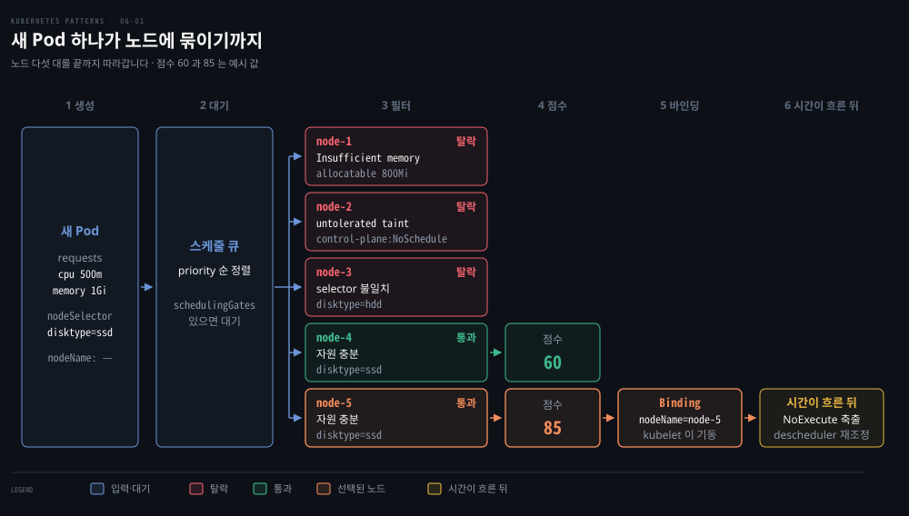
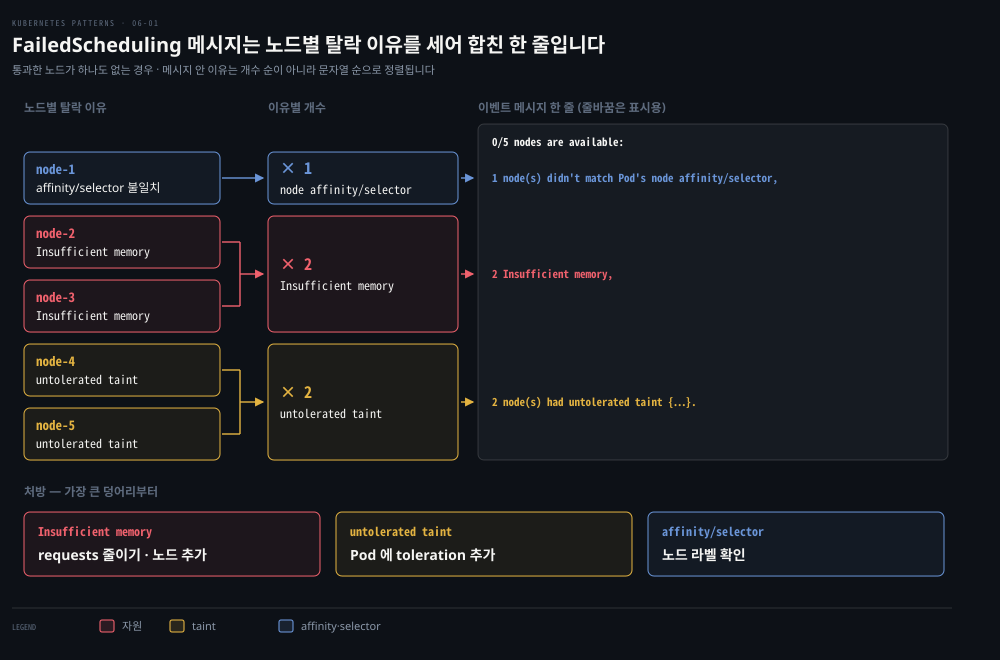
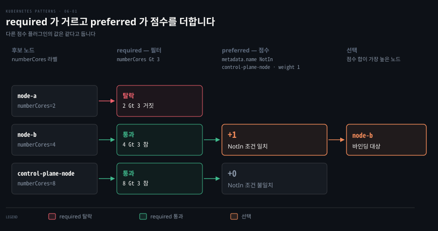
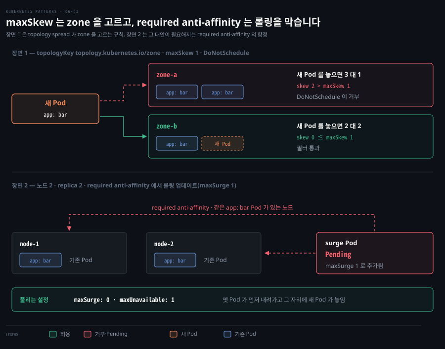
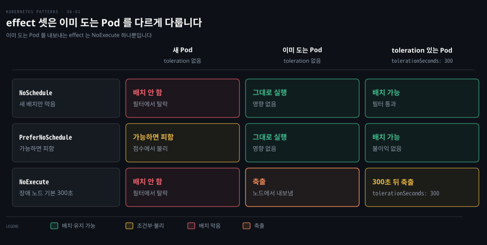
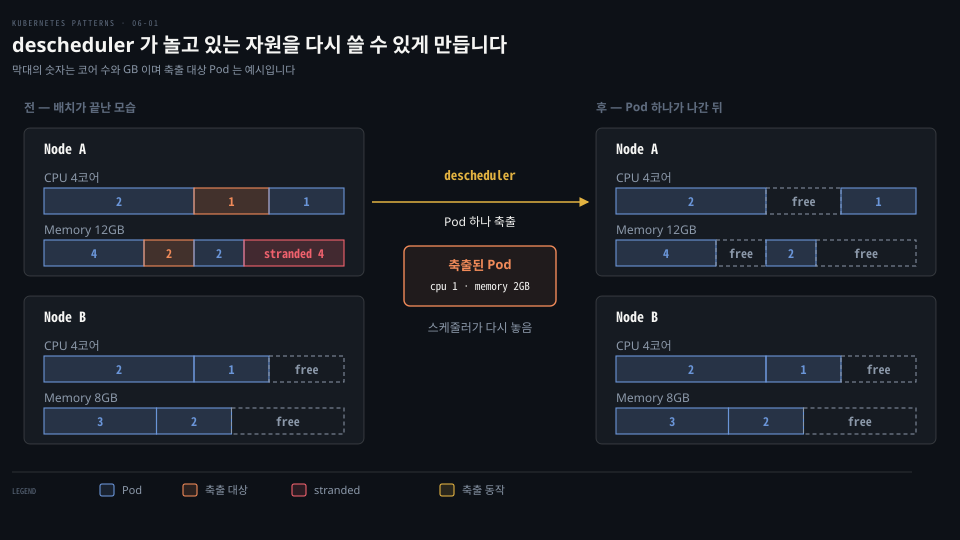

# Automated Placement — 스케줄러가 Pod를 노드에 배치하는 법

---

> 스케줄러는 새 Pod마다 가용 노드를 걸러 내고 점수를 매겨 최적의 노드 하나에 바인딩합니다. 사용자는 라벨·affinity·taint·spread로 배치에 개입할 수 있지만, 배치는 한 번뿐이라 시간이 흐르면 descheduler가 필요합니다.

## 학습 목표

> 이 편을 읽고 나면 스케줄러의 배치 메커니즘과 유도 정책을 이해하고 상황에 맞는 배치 수단을 선택할 수 있습니다.

1. 스케줄러의 필터·점수·바인딩 3단계와 FailedScheduling 이벤트 메시지를 읽는 순서를 설명할 수 있습니다.
2. 노드의 allocatable 계산 공식과 시스템 데몬 예약이 누락되었을 때 발생하는 위험을 설명할 수 있습니다.
3. `nodeName`·`nodeSelector`·node affinity·taint/toleration의 차이와 동작 강도를 비교할 수 있습니다.
4. Pod affinity의 `topologyKey`와 topology spread constraints가 롤링 배포 교착을 푸는 원리를 설명할 수 있습니다.
5. taint의 세 가지 effect와 descheduler가 필요한 이유 및 축출 제외 대상을 구분할 수 있습니다.

실무에서 겪은 사례입니다. 표에는 증상만 적었고, 원인은 오른쪽 절을 읽으면 풀립니다. 사내 폴더라 로컬 사본에서만 열립니다.

| 사례 | 겪은 증상 | 답하는 절 |
|---|---|---|
| [평상시 Running 은 가용성의 증거가 아닙니다](../../../_company/task/2026-07-10_k8s_single-node-pinning-breaks-availability/README.md) | 워커 노드를 하나씩 내려 보자 평소 Running 이던 Pod 하나는 Pending 에 머물렀고 다른 하나는 아예 뜨지 않았다 | §3 노드 라벨로 놓일 곳을 고른다 · §4 Pod 끼리 모으고 흩는다 |


## 새 Pod 하나가 노드에 묶이기까지

> 새 Pod가 API 서버에 등록된 뒤 큐 대기와 필터·점수 단계를 거쳐 노드에 바인딩되고, 시간이 흘러 재조정되기까지의 6단계 흐름입니다.

새 Pod 하나가 클러스터에 배포되어 특정 노드에서 기동하기까지는 스케줄러의 필터링과 점수 계산을 거칩니다. 아래는 `requests: {cpu: 500m, memory: 1Gi}`, `nodeSelector: {disktype: ssd}` 조건의 Pod가 다섯 대의 노드를 평가받아 배치되는 전체 과정입니다.



| 단계 | 누가 | 무엇을 보나 | 받치는 개념 | 절 |
|---|---|---|---|---|
| 1 생성 | 사용자·컨트롤러 → API 서버 | `spec.nodeName` 이 빈 Pod | 선언적 배치 | §1 |
| 2 대기 | kube-scheduler 큐 | priority 로 정렬, schedulingGates 가 있으면 대기 | 스케줄 큐 | §2 |
| 3 필터 | 필터 플러그인 | allocatable 대 requests, nodeSelector·required node affinity, taint, required Pod (anti-)affinity, spread DoNotSchedule | 필터·FailedScheduling | §2·§3·§4·§5 |
| 4 점수 | 점수 플러그인 | preferred affinity 가중치, spread ScheduleAnyway, 자원 균형 | 점수·가중치 | §2·§3·§4 |
| 5 바인딩 | 스케줄러 → API 서버 | Binding 으로 nodeName 기록, kubelet 이 기동 | 바인딩 | §2 |
| 6 시간이 흐른 뒤 | kubelet·descheduler | NoExecute taint 축출, 치우친 배치 재조정 | 한 번뿐인 배치 | §5·§6 |

1단계 생성에서 Pod는 `spec.nodeName`이 빈 상태로 API 서버에 등록됩니다. 2단계 대기에서는 우선순위 큐에 들어가며 `schedulingGates`가 남아 있으면 비워질 때까지 대기합니다[^scheduling-gates].

3단계 필터에서는 부적격 노드를 걸러 냅니다. 모든 노드가 탈락하면 `FailedScheduling` 이벤트가 발생합니다. 4단계 점수에서는 남은 노드에 점수를 매겨 5단계에서 최고점 노드에 바인딩합니다. 6단계는 배치가 끝난 뒤 시간이 흐르며 생긴 자원 불균형을 descheduler로 교정하는 단계입니다.


## 이 문서가 다루지 않는 것

> 스케줄러의 배치 알고리즘과 배치 유도 정책에 집중하기 위해 인접한 세부 영역은 해당 편으로 넘깁니다.

- 컨테이너 자원 요구(requests·limits), QoS, PriorityClass 및 선점은 [02-01.Predictable Demands](./02-01.Predictable%20Demands%20%E2%80%94%20%EC%9E%90%EC%9B%90%20%EC%9A%94%EA%B5%AC%EB%A5%BC%20%EC%84%A0%EC%96%B8%ED%95%B4%20%EC%8A%A4%EC%BC%80%EC%A4%84%EB%9F%AC%EC%97%90%20%EC%95%8C%EB%A6%AC%EA%B8%B0.md)에서 다룹니다.
- PDB와 노드 drain 절차는 [10-01.Singleton Service](./10-01.Singleton%20Service%20%E2%80%94%20%ED%95%9C%20%EB%B2%88%EC%97%90%20%ED%95%98%EB%82%98%EB%A7%8C%20%ED%99%9C%EC%84%B1%EC%9D%B4%EB%90%98%20%EA%B3%A0%EA%B0%80%EC%9A%A9.md)에서 다룹니다.
- HPA 기반 수평 자동 확장은 [29-01.Elastic Scale](./29-01.Elastic%20Scale%20%E2%80%94%20%EB%B6%80%ED%95%98%EC%97%90%20%EB%A7%9E%EC%B6%B0%20%EC%84%B8%20%EC%B0%A8%EC%9B%90%EC%9C%BC%EB%A1%9C%20%EC%9E%90%EB%8F%99%20%ED%99%95%EC%9E%A5.md)에서 다룹니다.
- DaemonSet 스케줄링 원리는 [09-01.Daemon Service](./09-01.Daemon%20Service%20%E2%80%94%20%EB%85%B8%EB%93%9C%EB%A7%88%EB%8B%A4%20%EB%8F%84%EB%8A%94%20%EC%9D%B8%ED%94%84%EB%9D%BC%20Pod.md)에서 다룹니다.


## 1. 사람이 노드를 고를 수 없는 이유

> Pod는 수천 개이고 노드 상태는 계속 바뀌어, 놓을 곳은 사람이 아니라 스케줄러가 정합니다.

흐름 위치: 1 생성 · 받치는 개념 — 선언적 배치

수십에서 수백 개의 프로세스로 구성된 마이크로서비스 환경에서 컨테이너를 적합한 노드에 수동으로 배치하는 일은 불가능합니다. 컨테이너 상호 의존성과 노드 하드웨어 의존성, 자원 수요는 시간에 따라 계속 변합니다. 클러스터의 가용 자원 역시 노드가 증설되거나 삭제되면서 달라집니다.

컨테이너 배치 위치는 분산 시스템의 가용성과 성능, 자원 활용률을 결정합니다. Kubernetes 스케줄러는 API 서버의 미배정 Pod를 감시하다가 최적의 노드를 찾아 배정합니다. 초기 배치는 물론이고 파드 스케일 아웃이나 장애 노드 복구 시에도 동일하게 작동합니다.

스케줄러가 선언적 배치를 수행하려면 두 가지 전제가 필요합니다.

1. **가용 용량을 가진 노드**: 클러스터 내에 새 Pod를 실행할 자원이 남아 있어야 합니다.
2. **선언된 자원 프로파일을 가진 컨테이너**: 컨테이너가 소비할 자원 요구량(`requests`)을 명시해야 공간을 계산할 수 있습니다.

배치 유도의 기본 원칙은 최소 개입입니다. 자원 기반 스케줄링으로 충분하다면 그대로 두고, 부족할 때만 노드 의존과 파드 의존을 점진적으로 더합니다.


## 2. 스케줄러는 거르고 점수를 매긴다

> 스케줄러는 노드가 내놓는 몫과 Pod가 요구하는 몫을 견줘 탈락 노드를 거르고, 남은 노드에 점수를 매겨 가장 높은 곳에 묶습니다.

흐름 위치: 2 대기 → 3 필터 → 4 점수 → 5 바인딩 · 받치는 개념 — scheduling framework

### 노드가 내놓는 몫 — allocatable

스케줄러가 Pod를 배치하려면 각 노드가 워크로드에 제공할 수 있는 실제 가용 용량을 알아야 합니다. 운영체제와 Kubernetes 자체를 구동하기 위한 시스템 데몬의 자원을 미리 떼어 두어야 하기 때문입니다. 노드에서 컨테이너 배치가 가능한 용량을 **할당 가능(Allocatable) 용량**이라고 부릅니다.

| 용량 구성 항목 | 설명 | 소비 주체 |
|---|---|---|
| **Node Capacity** | 노드의 전체 물리 하드웨어 용량 | CPU 코어 수, 물리 메모리 전체 |
| **Kube-Reserved** | Kubernetes 데몬을 위해 예약된 자원 | kubelet, 컨테이너 런타임 등 |
| **System-Reserved** | OS 시스템 서비스를 위해 예약된 자원 | sshd, systemd, udev 등 OS 필수 프로세스 |
| **Eviction Thresholds** | 시스템 OOM 방지를 위한 최소 여유 메모리 | 메모리 압박 시 축출을 시작하는 기준선 |

노드의 할당 가능 공식은 다음과 같습니다.

`Allocatable = Node Capacity - Kube-Reserved - System-Reserved - Eviction Thresholds`

시스템 데몬용 자원을 예약하지 않으면 노드 자원 기근이 발생합니다. 스케줄러가 노드의 물리 용량 끝까지 Pod를 배치하기 때문입니다. 메모리가 고갈되면 Linux 커널의 OOM killer가 동작하여 프로세스를 강제 종료합니다. 이는 노드 내 모든 Pod에 장애를 일으키거나 노드를 일시적인 오프라인 상태로 몰고 갑니다. 노드가 애초에 떼어 두는 자원 예약과 압박 축출의 상세 메커니즘은 [노드 압박 축출·디스크 관리](../../docs/kubernetes/02-01.노드%20압박%20축출과%20디스크%20관리%20—%20DiskPressure는%20무엇을%20보고%20켜지는가.md)의 8절을 참고합니다.

Kubernetes가 관리하지 않는 독립 컨테이너가 노드에서 실행되는 경우도 있습니다. 이런 컨테이너가 쓰는 자원은 노드 용량 계산에 반영되지 않습니다. 이를 보완하는 우회책은 아무 동작도 하지 않으면서 해당 컨테이너의 사용량만큼 자원 `requests`를 선언한 **placeholder Pod**를 띄우는 것입니다. 이 파드는 오직 자원을 선점하여 스케줄러가 실제 남은 용량을 올바르게 인지하도록 돕습니다.

### Pod 가 요구하는 몫

스케줄러가 노드를 평가할 때 컨테이너 명세 중 오직 `requests` 값만 참조합니다. `limits`는 컨테이너 런타임과 리눅스 cgroup 레벨에서 최대 사용량을 제한하는 기준일 뿐이며 스케줄링 시점의 배치 판단에는 관여하지 않습니다.

Pod에 포함된 모든 컨테이너의 CPU 및 메모리 `requests` 합산값이 노드의 남은 Allocatable 용량을 넘지 않아야 배치가 가능합니다. 자원 요구를 선언하지 않은 Pod는 필터 단계에서 자원을 전혀 쓰지 않는 것으로 계산됩니다. 그래서 노드의 실제 사용량이 커져도 그런 Pod는 계속 같은 노드에 놓일 수 있습니다. 컨테이너의 자원 프로파일 선언과 QoS 클래스 분류는 [02-01.Predictable Demands](./02-01.Predictable%20Demands%20%E2%80%94%20%EC%9E%90%EC%9B%90%20%EC%9A%94%EA%B5%AC%EB%A5%BC%20%EC%84%A0%EC%96%B8%ED%95%B4%20%EC%8A%A4%EC%BC%80%EC%A4%84%EB%9F%AC%EC%97%90%20%EC%95%8C%EB%A6%AC%EA%B8%B0.md)에서 자세히 다룹니다.

### 필터·점수·바인딩

스케줄러는 API 서버에서 노드가 지정되지 않은 Pod를 가져와 세 단계를 거칩니다.

1. **필터링**: Pod 요구 조건을 만족하지 못하는 부적격 노드를 모두 걸러 냅니다. 필터를 통과한 후보 노드를 **feasible node**라고 부릅니다.
2. **점수화**: feasible 노드를 대상으로 점수 플러그인을 실행합니다. 각 플러그인이 매긴 점수에 가중치를 곱해 합산한 뒤 가장 높은 점수를 얻은 노드를 최종 후보로 정합니다.
3. **바인딩**: 최종 선정된 노드 이름을 Pod의 `.spec.nodeName`에 기록하는 `Binding` 객체를 생성하여 API 서버에 전달합니다. 배정 정보를 확인한 해당 노드의 kubelet이 컨테이너를 기동합니다.

필터 단계에서 적격 노드를 찾지 못하면 이번 스케줄링은 실패합니다. 스케줄러는 곧바로 선점(preemption)을 시도합니다. 우선순위가 더 낮은 Pod를 내보내면 자리가 나는 노드를 찾는 일입니다. 파드는 `Pending` 상태로 남고 `FailedScheduling` 경고 이벤트가 기록됩니다. 선점이 자리를 만들었다면 다음 시도에서 그 노드에 놓입니다.

### FailedScheduling 메시지 읽기

스케줄링 실패 시 발생하는 `FailedScheduling` 이벤트는 장애 진단의 출발점입니다. 필터 단계에서 스케줄러는 각 노드를 평가하면서 탈락 이유를 노드별 상태 맵에 개별적으로 기록합니다. 그런 다음 탈락 이유를 그룹화하여 하나의 요약 문자열로 조립합니다[^fiterror-source].

아래는 다섯 대의 노드가 모두 스케줄링에 실패했을 때 나타나는 전형적인 이벤트 메시지입니다.



위 그림처럼 다섯 대의 노드가 모두 탈락하면 `describe pod` 명령의 Events에 다음과 같은 한 줄 메시지가 출력됩니다.

```bash
0/5 nodes are available: 1 node(s) didn't match Pod's node affinity/selector, 2 Insufficient memory, 2 node(s) had untolerated taint {node-role.kubernetes.io/control-plane: }.
```

이 메시지는 **노드 다섯 대가 각자의 이유로 하나씩 탈락했다**는 뜻입니다.

- `1 node(s) didn't match...`: 한 대의 노드는 라벨 셀렉터 조건이 맞지 않아 제외되었습니다.
- `2 Insufficient memory`: 두 대의 노드는 메모리 잔여 용량이 부족하여 떨어졌습니다.
- `2 node(s) had untolerated taint`: 나머지 두 대의 노드는 Pod가 견디지 못하는 taint가 걸려 있어 탈락했습니다.

이유들은 노드 수가 많은 순이 아니라 「개수 이유」 문자열의 사전 순으로 정렬되어 나옵니다. 그래서 가장 큰 덩어리가 맨 앞에 온다는 보장이 없습니다.

이유별 노드 수의 합은 전체 노드 수와 같거나 더 클 수 있습니다. `NodeResourcesFit` 플러그인은 한 노드에 대해 CPU와 메모리가 모두 부족한 경우 두 사유를 동시에 기록하기 때문입니다. 반대로 한 노드가 taint 와 selector 에 모두 걸려도 먼저 실패한 플러그인의 이유 하나만 남습니다. 노드마다 필터 플러그인을 차례로 돌리다가 첫 실패에서 멈추기 때문입니다[^fiterror-source].

메시지를 읽고 트러블슈팅하는 순서는 다음과 같습니다.

1. **전체 노드 수 확인**: 앞부분의 `0/N`에서 평가 대상이 된 전체 노드 수 `N`을 확인합니다.
2. **이유별 노드 수 파악**: 콜론 뒤에 나열된 사유별 노드 수를 확인합니다.
3. **가장 큰 덩어리부터 해결**: 가장 많은 노드가 탈락한 원인을 우선 조치합니다. 자원 부족이 주원인이면 Pod `requests`를 낮추거나 노드를 증설합니다. taint가 원인이면 Pod에 `tolerations`를 추가합니다. affinity가 원인이면 노드 라벨 설정을 재점검합니다.

메시지 끝에는 다음과 같은 꼬리 문구가 붙기도 합니다.

```bash
preemption: 0/5 nodes are available: 2 No preemption victims found for incoming pod, 3 Preemption is not helpful for scheduling.
```

필터 실패 뒤 시도한 선점의 결과를 같은 형식으로 센 것입니다. `Preemption is not helpful` 은 selector 불일치나 taint 처럼 다른 Pod를 내보내도 풀리지 않는 이유로 떨어진 노드입니다. `No preemption victims found` 는 내보낼 수 있는 더 낮은 우선순위 Pod가 없는 노드입니다[^preemption-source].

단일 노드 환경에서의 FailedScheduling 관측 사례는 [모니터링 개요·트러블슈팅 루틴](../../docs/kubernetes/03_operations/03-04.모니터링%20개요와%20트러블슈팅%20루틴.md)의 2절을 함께 참고합니다.

### 세부 — 스케줄러 프로파일과 플러그인

스케줄러의 기본 동작은 일반적인 워크로드에 충분하도록 최적화되어 있습니다. 필터와 점수 단계를 바꾸려면 **KubeSchedulerConfiguration**의 스케줄링 프로파일에서 플러그인을 켜고 끕니다. 옛 Scheduler Policy 설정은 v1.23 에서 제거되었습니다[^scheduler-config].

```yaml
apiVersion: kubescheduler.config.k8s.io/v1
kind: KubeSchedulerConfiguration
profiles:
  - schedulerName: default-scheduler
  - schedulerName: custom-topology-scheduler
    plugins:
      score:
        disabled:
        - name: PodTopologySpread
        enabled:
        - name: MyCustomPlugin
          weight: 2
```

클러스터 관리자는 서로 다른 플러그인 조합을 가진 여러 스케줄러 프로파일을 하나의 바이너리 안에서 실행할 수 있습니다. 프로파일마다 이름은 달라야 합니다. 플러그인과 프로파일은 관리자만 정의하고, 애플리케이션을 배포하는 사용자는 Pod 명세의 `.spec.schedulerName`에 이미 있는 프로파일 이름을 적어 고르기만 합니다.

만약 자체적인 배치 알고리즘이 필요하다면 스케줄러 확장 프로세스인 **scheduler extender**를 둘 수 있습니다. 기본 스케줄러가 필터나 점수 계산 단계의 마지막에 HTTP API로 외부 프로세스를 호출하여 노드 목록을 거르거나 가중치를 받습니다. 이는 하드웨어 구매 비용이나 네트워크 회선 비용처럼 클러스터 밖의 데이터를 배치에 반영할 때 유용합니다.


## 3. 노드 라벨로 놓일 곳을 고른다

> nodeSelector는 라벨이 같은 노드만 남기고, node affinity는 연산자와 hard·soft 규칙으로 더 세밀하게 고릅니다.

흐름 위치: 3 필터 · 4 점수 · 받치는 개념 — 노드 라벨

라벨과 셀렉터의 기초 문법은 [label과 label selector로 오브젝트 조직하기](../kubernetes-in-action/07-02.label과%20label%20selector로%20오브젝트%20조직하기.md)를 참고합니다.

### nodeSelector 와 nodeName

Pod를 특정 노드 그룹으로 안내하는 가장 단순한 방법은 `.spec.nodeSelector`입니다. key-value 쌍의 맵으로 표현되며 명시된 모든 라벨을 가진 노드만 필터 단계를 통과합니다.

```yaml
apiVersion: v1
kind: Pod
metadata:
  name: random-generator
spec:
  containers:
  - image: k8spatterns/random-generator:1.0
    name: random-generator
  nodeSelector:
    disktype: ssd
```

노드에 `disktype=ssd` 라벨이 없으면 해당 노드는 후보에서 제외됩니다. 운영자가 부여한 커스텀 라벨 외에도 개별 노드를 식별하는 `kubernetes.io/hostname`, OS를 나타내는 `kubernetes.io/os`, CPU 아키텍처를 가리키는 `kubernetes.io/arch` 등 기본 라벨을 활용할 수 있습니다. node selector의 실습 예제는 [DaemonSet 기초](../kubernetes-in-action/17-01.DaemonSet%20기초%20—%20노드마다%20하나·node%20selector·업데이트.md)에서 다룹니다.

한편 `.spec.nodeName`은 스케줄러의 평가를 완전히 생략하고 특정 노드를 직접 강제 지정하는 방식입니다.

`nodeName`을 수동으로 입력하면 스케줄러를 우회하여 해당 노드의 kubelet으로 파드가 직접 전달됩니다. 그러나 그 노드에 자원이 모자라면 파드는 `Pending` 상태로 머물지 않습니다. kubelet 승인 단계에서 거부되어 `OutOfcpu` 또는 `OutOfmemory` 사유와 함께 **Failed 상태로 끝납니다**. 지정한 노드가 아예 없으면 파드는 실행되지 않고, 경우에 따라 자동으로 삭제됩니다[^nodename-failed].

시스템 장애 시 다른 노드로 파드가 재스케줄되지도 않으므로 일반 애플리케이션 배포에서는 쓰지 않는 것이 원칙입니다. DaemonSet 컨트롤러 역시 초기에는 `nodeName`을 썼으나 v1.17부터 기본 스케줄러와 node affinity를 쓰도록 전환되었습니다([Daemon Service v1.17 변경점](./09-01.Daemon%20Service%20%E2%80%94%20%EB%85%B8%EB%93%9C%EB%A7%88%EB%8B%A4%20%EB%8F%84%EB%8A%94%20%EC%9D%B8%ED%94%84%EB%9D%BC%20Pod.md#v117--nodename에서-nodeaffinity로) 참조).

### node affinity 의 hard 와 soft

**node affinity**는 nodeSelector보다 훨씬 다양한 조건과 유연성을 제공하는 노드 선택 기법입니다. 집합 연산자와 대소 비교 연산자를 제공하며 규칙의 엄격함을 **hard(필수)**와 **soft(선호)**로 나누어 지정할 수 있습니다.



위 도식처럼 하드 조건을 통과한 노드들에 대해 소프트 조건의 가중치를 계산하여 최종 배치 노드를 결정합니다.

```yaml
apiVersion: v1
kind: Pod
metadata:
  name: heavy-worker
spec:
  containers:
  - image: k8spatterns/random-generator:1.0
    name: worker
  affinity:
    nodeAffinity:
      requiredDuringSchedulingIgnoredDuringExecution:
        nodeSelectorTerms:
        - matchExpressions:
          - key: numberCores
            operator: Gt
            values: [ "3" ]
      preferredDuringSchedulingIgnoredDuringExecution:
      - weight: 1
        preference:
          matchFields:
          - key: metadata.name
            operator: NotIn
            values: [ "control-plane-node" ]
```

하드 규칙은 `requiredDuringSchedulingIgnoredDuringExecution` 필드 아래 선언합니다. 이 조건을 만족하지 못하는 노드는 필터 단계에서 탈락합니다. 위 예제에서는 `numberCores` 라벨의 값이 3을 초과하는 노드만 통과합니다. 연산자는 `In`, `NotIn`, `Exists`, `DoesNotExist`, `Gt`, `Lt` 여섯 가지입니다.

소프트 규칙은 `preferredDuringSchedulingIgnoredDuringExecution` 필드 아래 선언합니다. 1부터 100 사이의 `weight`(가중치)를 지정합니다. 후보 노드가 선호 조건을 만족하면 해당 가중치가 스코어링 점수에 더해집니다. 조건을 만족하는 노드가 없더라도 파드 배치는 실패하지 않으며 차선책 노드에 정상 배치됩니다.

### 이름에 붙은 IgnoredDuringExecution

필드 이름에 포함된 `IgnoredDuringExecution`이라는 긴 접미사는 규칙의 유효 범위를 명확히 규정합니다.

- `DuringScheduling`: 파드가 처음 생성되어 노드에 배치되는 **스케줄링 시점**에 이 규칙을 평가합니다.
- `IgnoredDuringExecution`: 파드가 노드에 바인딩되어 **실행 중인 상태**에서는 노드의 라벨이 바뀌어 규칙을 위반하게 되더라도 파드를 축출하지 않고 그대로 둡니다.

Kubernetes 설계자들은 향후 런타임에 노드 라벨이 바뀌었을 때 파드를 자동으로 축출하는 `RequiredDuringExecution` 기능을 추가할 여지를 남겨 두기 위해 이 이름을 채택했습니다. 현재 버전에서는 실행 중 라벨 변경에 따른 자동 재배치가 일어나지 않습니다. 규칙을 어기게 된 실행 중 Pod를 옮기려면 6절의 descheduler(`RemovePodsViolatingNodeAffinity` 전략)를 돌려야 합니다.

실행 중인 파드는 축출되지 않지만 노드 라벨이 변경되어 **대기 중이던 파드**의 affinity 조건에 부합하게 되면 스케줄러는 그 노드로 파드를 배치합니다. 스케줄러는 항상 평가 시점의 클러스터 상태를 기준으로 판단하기 때문입니다.


## 4. Pod 끼리 모으고 흩는다

> Pod affinity는 특정 Pod가 있는 토폴로지 쪽으로 끌고, anti-affinity와 topology spread는 같은 앱을 영역에 고르게 흩습니다.

흐름 위치: 3 필터 · 4 점수 · 받치는 개념 — topologyKey

### Pod affinity 와 anti-affinity

node affinity가 노드 자체의 속성을 보고 판단한다면 **Pod affinity와 anti-affinity**는 노드에 이미 실행 중인 다른 Pod의 라벨을 기준으로 판단합니다. 마이크로서비스 간 지연 시간을 줄이기 위해 서로 밀접한 파드를 같은 영역에 모으거나 고가용성을 위해 동일 역할의 파드를 서로 다른 영역으로 분산할 때 사용합니다.

```yaml
apiVersion: v1
kind: Pod
metadata:
  name: secured-web
spec:
  containers:
  - image: k8spatterns/random-generator:1.0
    name: web
  affinity:
    podAffinity:
      requiredDuringSchedulingIgnoredDuringExecution:
      - labelSelector:
          matchLabels:
            confidential: high
        topologyKey: security-zone
    podAntiAffinity:
      preferredDuringSchedulingIgnoredDuringExecution:
      - weight: 100
        podAffinityTerm:
          labelSelector:
            matchLabels:
              confidential: none
          topologyKey: kubernetes.io/hostname
```

`podAffinity`는 지정한 라벨의 파드가 이미 실행 중인 토폴로지 도메인으로 새 파드를 끌어당깁니다. 위 예제는 `confidential=high` 라벨 파드가 있는 동일한 `security-zone` 노드 그룹에 파드를 배치하도록 강제합니다.

`podAntiAffinity`는 지정한 라벨의 파드가 있는 도메인을 피하도록 밀어냅니다. 위 설정에서는 `confidential=none` 라벨 파드가 실행 중인 개별 노드를 가급적 피하도록 100점의 기피 가중치를 부여합니다.

파드 라벨이 나중에 변경되면 이후 스케줄링되는 다른 파드의 affinity 평가 결과가 달라질 수 있습니다. 단, 대규모 클러스터에서는 Pod affinity와 anti-affinity 자체에 주의해야 합니다. 노드마다 이미 도는 Pod의 라벨을 대조해야 해서 처리량이 커지고, 스케줄링이 크게 느려질 수 있습니다. 공식 문서는 노드가 수백 대를 넘는 클러스터에서는 이 기능을 권하지 않습니다[^pod-affinity-scaling]. 고르게 흩는 것이 목적이라면 아래의 topology spread constraints가 대안입니다.

### topologyKey 가 영역을 정한다

Pod affinity와 anti-affinity에서 **`topologyKey`**는 도메인 경계를 정의합니다. 스케줄러는 노드에 부여된 라벨 중에서 `topologyKey`와 동일한 키를 찾고 라벨 값이 같은 노드들을 동일 도메인으로 묶습니다.

- `kubernetes.io/hostname`: 개별 물리 또는 가상 노드 단위의 도메인입니다. 안티 어피니티를 여기에 걸면 한 노드에 두 파드가 공존하지 못합니다.
- `topology.kubernetes.io/zone`: 클라우드 가용 영역(AZ) 단위의 도메인입니다. 데이터 센터 전체 장애에 대비한 분산에 사용됩니다.

토폴로지 키의 선택은 장애 격리 수준과 네트워크 비용 사이의 트레이드오프입니다. zone 단위로 파드를 분산하면 한 데이터 센터가 멈춰도 서비스가 유지되지만 파드 간 통신이 AZ 경계를 넘나들며 전송 비용과 지연 시간이 늘어납니다. 반면 hostname 단위로 모으면 지연 시간은 줄어들지만 노드 장애 시 파드가 함께 중단될 위험이 커집니다.

클라우드 환경에서는 kubelet이나 cloud-controller-manager가 클라우드 공급자 정보로 노드에 zone 라벨을 채웁니다. 온프레미스 베어메탈 환경에서는 운영자가 랙이나 스위치 단위의 라벨을 노드에 직접 정의해야 합니다.

### topology spread 는 치우침에 상한을 둔다

Pod affinity는 파드를 특정 영역에 몰아넣을 수 있고 required anti-affinity는 영역당 단 하나의 파드만 허용하여 지나치게 경직됩니다. **topology spread constraints**는 여러 장애 도메인 사이에 파드를 균등하게 분산하면서 허용 가능한 불균형 수치를 정교하게 제어합니다.



위 도식의 상단은 `maxSkew: 1` 설정에 따라 새 파드가 파드 수가 적은 zone-b로 정상 배치되는 과정입니다. 하단은 replica 2개 환경에서 required anti-affinity로 인해 롤링 배포가 멈추는 함정을 보여 줍니다.

노드 2대와 replica 2개 환경에서 SPOF를 피하려고 required anti-affinity를 걸었다고 가정해 봅시다. 이 상태에서 Deployment 롤링 업데이트를 시작하면 파드 생성이 중단됩니다. Deployment의 기본 롤링 업데이트 전략은 `maxSurge: 25%`(올림하여 1개)와 `maxUnavailable: 25%`(내림하여 0개)입니다. 따라서 기존 파드 2개를 유지한 채 세 번째 교체 파드를 먼저 띄우려고 시도합니다.

그러나 노드 2대에는 이미 파드가 하나씩 돌고 있어 required anti-affinity 규칙에 걸립니다. 세 번째 파드가 들어갈 노드가 전혀 없어 영원히 `Pending` 상태에 갇히게 됩니다[^rolling-update-surge].

노드를 하나 더 두거나 배포 전략을 `Recreate` 로 바꾸면 풀립니다. 다만 앞의 것은 비용을, 뒤의 것은 중단을 치릅니다. `maxSurge: 0`·`maxUnavailable: 1` 로 옛 파드를 먼저 내리면 롤링은 유지되지만, 교체하는 동안 replica 하나가 빕니다. 롤링 배포 메커니즘은 [03-01.Declarative Deployment](./03-01.Declarative%20Deployment%20%E2%80%94%20%EC%97%85%EA%B7%B8%EB%A0%88%EC%9D%B4%EB%93%9C%C2%B7%EB%A1%A4%EB%B0%B1%EC%9D%84%20%EC%84%A0%EC%96%B8%EC%9C%BC%EB%A1%9C.md#rolling-deployment--무중단-교체)를 참고합니다.

topology spread constraints는 일시적인 불균형(`maxSkew`)을 허용함으로써 이 롤링 배포 교착을 자연스럽게 해결합니다.

```yaml
apiVersion: v1
kind: Pod
metadata:
  name: robust-app
spec:
  topologySpreadConstraints:
  - maxSkew: 1
    topologyKey: topology.kubernetes.io/zone
    whenUnsatisfiable: DoNotSchedule
    labelSelector:
      matchLabels:
        app: bar
    minDomains: 3
    nodeAffinityPolicy: Honor
    nodeTaintsPolicy: Honor
    matchLabelKeys:
    - pod-template-hash
  containers:
  - image: k8spatterns/random-generator:1.0
    name: app
```

- `maxSkew`: 도메인 간 허용되는 파드 수의 최대 차이입니다. 1로 지정하면 어떤 존도 다른 존보다 파드가 2개 이상 많아질 수 없습니다.
- `whenUnsatisfiable`: 스큐 제약을 만족할 수 없을 때의 동작입니다. `DoNotSchedule`은 하드 제약으로 스케줄링을 중단하고 `ScheduleAnyway`는 불균형을 줄이는 노드에 가중치를 부여하는 소프트 제약입니다.
- `minDomains`: 적격 도메인의 최소 개수입니다. v1.30에서 GA되었고 `DoNotSchedule`과 함께만 쓸 수 있습니다[^min-domains]. 적격 도메인이 이 값보다 적으면 스케줄러는 전역 최솟값을 0으로 보고 스큐를 계산합니다. 3개 존 중 한 존의 노드가 모두 사라지면 남은 두 존은 `maxSkew`만큼 차면 더 받지 못하고, 새 파드는 `Pending`에 머뭅니다. 이로써 Cluster Autoscaler가 빈 존에 새 노드를 띄우도록 유도할 수 있습니다.
- `nodeAffinityPolicy` / `nodeTaintsPolicy`: 스큐를 셀 때 Pod의 nodeAffinity·nodeSelector와 노드 taint를 따질지 정합니다. `Honor`면 그 조건을 통과하는 노드만 세고, `Ignore`면 모든 노드를 셉니다. 비워 두면 `nodeAffinityPolicy`는 `Honor`, `nodeTaintsPolicy`는 `Ignore`로 동작합니다.
- `matchLabelKeys`: 나열한 라벨 키의 값을 새 Pod에서 읽어 `labelSelector`에 더합니다. Deployment가 붙이는 `pod-template-hash`를 적으면 같은 revision의 파드끼리만 스큐를 세므로, 롤링 업데이트 중 구버전 파드가 신버전 파드의 분산 계산을 흐리지 않습니다.

워크로드에 `topologySpreadConstraints`를 명시하지 않더라도 스케줄러에는 **클러스터 기본 분산 제약**이 내장되어 있습니다[^cluster-default-spread]. 이 기본값은 Pod에 제약이 하나도 없고 Service·ReplicaSet·StatefulSet·ReplicationController에 속할 때만 쓰입니다. 값은 hostname 레벨 `maxSkew: 3`과 zone 레벨 `maxSkew: 5`이고 모드는 `ScheduleAnyway`입니다. 같은 워크로드의 파드를 노드와 존에 느슨하게 흩는 효과입니다.

### anti-affinity 와 HPA 가 부딪힐 때

required anti-affinity로 "노드당 파드 1개"를 고정하면 HPA(Horizontal Pod Autoscaler) 수평 확장과 충돌합니다. 수평 자동 확장의 상세 원리는 [29-01.Elastic Scale](./29-01.Elastic%20Scale%20%E2%80%94%20%EB%B6%80%ED%95%98%EC%97%90%20%EB%A7%9E%EC%B6%B0%20%EC%84%B8%20%EC%B0%A8%EC%9B%90%EC%9C%BC%EB%A1%9C%20%EC%9E%90%EB%8F%99%20%ED%99%95%EC%9E%A5.md)에서 다룹니다.

트래픽 급증으로 HPA가 replica 수를 3개에서 6개로 늘렸다고 가정해 봅시다. 그러나 클러스터의 워커 노드가 3대뿐이라면 4번째 파드부터는 required anti-affinity 조건을 만족하지 못해 `Pending` 상태로 남습니다. 인프라의 노드 수가 애플리케이션 수평 확장의 상한선이 되어 버리는 병목이 발생합니다.

실무에서는 이 문제를 방지하기 위해 두 가지 방식을 씁니다.

1. required 대신 **preferred anti-affinity**를 사용하여 노드가 여유 있을 때는 분산하되 부족하면 한 노드에 여러 파드가 공존하도록 소프트 제약으로 둡니다.
2. **topology spread constraints**의 `maxSkew`와 `ScheduleAnyway`를 조합하여 유연한 탄력성을 확보합니다.


## 5. 노드가 taint 로 Pod 를 거른다

> affinity가 Pod 쪽에서 노드를 고른다면 taint는 노드 쪽에서 Pod를 밀어내고, toleration이 있는 Pod만 들입니다.

흐름 위치: 3 필터 → 6 시간이 흐른 뒤 · 받치는 개념 — taint effect

### taint 와 toleration 은 짝이다

affinity가 Pod가 원하는 노드를 적극적으로 선택하는 **opt-out** 방식이라면, taints와 tolerations는 반대입니다. 노드가 자신을 방어하며 원치 않는 파드를 밀어내고 특별한 허가증을 가진 파드만 받아들이는 **opt-in** 방식입니다.

노드에 taint가 설정되어 있으면 해당 taint를 견뎌내는 `tolerations`가 없는 파드는 그 노드에 스케줄될 수 없습니다.

```bash
kubectl taint nodes control-plane-node node-role.kubernetes.io/control-plane:NoSchedule
```

v1.25 이후 kubeadm 클러스터에서는 과거 사용되던 `master` 키가 제거되고 `node-role.kubernetes.io/control-plane:NoSchedule`이 표준 기본 taint로 설정됩니다[^control-plane-taint].

Pod가 이 노드에 배치되려면 명세에 짝이 되는 toleration을 선언해야 합니다.

```yaml
apiVersion: v1
kind: Pod
metadata:
  name: admin-pod
spec:
  containers:
  - image: k8spatterns/random-generator:1.0
    name: admin
  tolerations:
  - key: node-role.kubernetes.io/control-plane
    operator: Exists
    effect: NoSchedule
```

toleration의 `key`와 `effect`가 노드의 taint와 일치해야 합니다. `operator: Exists`를 지정하면 특정 값과 상관없이 해당 키의 taint를 견뎌냅니다. `operator: Equal`을 쓸 때는 지정된 `value`까지 일치해야 합니다. `effect`를 비워 두면 그 키의 모든 effect를 견딥니다.

### effect 셋

taint에는 파드를 거르는 강도와 축출 여부를 결정하는 세 가지 effect가 있습니다.



위 매트릭스는 세 가지 effect에 따른 신규 파드 배치와 기존 실행 파드의 동작 차이를 보여 줍니다.

| Effect | 동작 성격 | 새 Pod (toleration 없음) | 이미 실행 중인 Pod (toleration 없음) |
|---|---|---|---|
| **NoSchedule** | 하드 제약 | 배치를 엄격히 차단함 | 영향을 주지 않고 계속 실행됨 |
| **PreferNoSchedule** | 소프트 제약 | 가급적 배치를 피함 | 영향을 주지 않고 계속 실행됨 |
| **NoExecute** | 하드 및 축출 | 배치를 엄격히 차단함 | 즉시 노드에서 축출됨 |

`NoSchedule`과 `PreferNoSchedule`은 새 파드의 진입만 통제할 뿐 이미 실행 중인 파드에는 손대지 않습니다. 이미 실행 중인 파드를 실제로 노드 밖으로 축출하는 것은 **`NoExecute`뿐**입니다.

`NoExecute` taint를 견디는 toleration에는 **`tolerationSeconds`** 필드를 함께 설정할 수 있습니다. 이는 장애나 점검 상황에서 파드가 노드에 머물 수 있는 유예 시간을 초 단위로 지정합니다. 이 필드 없이 견디는 파드는 축출되지 않습니다.

```yaml
tolerations:
- key: node.kubernetes.io/not-ready
  operator: Exists
  effect: NoExecute
  tolerationSeconds: 300
```

노드에 장애가 발생하면 노드 컨트롤러가 노드에 `NoExecute` taint를 자동으로 붙입니다. `Ready` 조건이 `False`면 `node.kubernetes.io/not-ready`, `Unknown`이면 `node.kubernetes.io/unreachable`입니다. 파드에는 이 두 taint에 대한 `tolerationSeconds: 300` toleration이 기본으로 주입됩니다. 그래서 일시적인 네트워크 순단 시 파드가 즉시 삭제되지 않고 5분간 노드에 남습니다. 5분이 지나도 복구되지 않으면 파드는 축출되고, 컨트롤러가 관리하는 파드라면 다른 건강한 노드에서 재생성됩니다.

노드 분단 상황에서의 상태 판정은 [10-01.Singleton Service](./10-01.Singleton%20Service%20%E2%80%94%20%ED%95%9C%20%EB%B2%88%EC%97%90%20%ED%95%98%EB%82%98%EB%A7%8C%20%ED%99%9C%EC%84%B1%EC%9D%B4%EB%90%98%20%EA%B3%A0%EA%B0%80%EC%9A%A9.md)를, 장애 시 파드 재생성 루틴은 [ReplicaSet 컨트롤러 장애복구](../kubernetes-in-action/14-02.ReplicaSet%20컨트롤러%20—%20reconciliation·장애복구·삭제.md#노드-장애-시-파드-교체)를 참고합니다.

### 전용 노드 — GPU 노드 격리

GPU가 장착된 특수 노드를 특정 워크로드 전용으로 운영하려면 taint와 nodeAffinity를 함께 사용해야 합니다.

어느 한쪽만 쓰면 누수 문제가 발생합니다.

- **taint만 건 경우**: 노드에 taint를 걸면 일반 파드의 진입은 차단됩니다. 하지만 toleration을 가진 GPU 파드가 일반 CPU 워커 노드에 스케줄되는 것을 막지 못합니다.
- **nodeAffinity만 건 경우**: GPU 파드를 GPU 노드로 유도할 수는 있습니다. 그러나 GPU 노드에 유휴 자원이 남을 때 일반 파드가 들어오는 것을 막지 못합니다.

따라서 완전한 전용 격리를 달성하려면 두 도구를 짝으로 묶어야 합니다. 노드에는 `dedicated=ml-team:NoSchedule` 같은 taint와 같은 이름의 라벨을 걸어 일반 파드를 밀어냅니다. GPU 파드에는 toleration과 함께 그 라벨을 요구하는 nodeAffinity required 조건을 걸어 GPU 노드로 끌어당깁니다. 이로써 양방향 차단과 전용 배치가 완성됩니다.


## 6. 배치는 한 번뿐이다

> 스케줄러는 놓을 때만 판단하므로, 시간이 흐르며 생긴 치우침과 놀고 있는 자원은 descheduler가 Pod를 내보내 다시 놓게 해야 풀립니다.

흐름 위치: 6 시간이 흐른 뒤 · 받치는 개념 — 한 번뿐인 배치

### 놀고 있는 자원

스케줄러는 파드가 처음 생성되는 시점의 클러스터 스냅샷을 기준으로 노드를 결정합니다. 일단 노드에 파드가 바인딩되면 스케줄러의 임무는 끝나며, 이후 클러스터 상태가 바뀌어도 스스로 파드를 옮기지 않습니다.

시간이 흐르면서 파드들의 생성과 종료가 반복되면 특정 노드에 자원이 기형적으로 고립되는 **자원 고립(stranded resource)** 현상이 발생합니다.



위 그림처럼 어떤 노드에 메모리가 4GB 남아 있지만 CPU가 0코어로 고갈되었다면, 다른 파드들은 CPU 요구량을 만족하지 못해 이 노드에 들어오지 못합니다. 결과적으로 남아 있는 메모리 4GB는 아무도 쓰지 못하고 버려지는 자원이 됩니다. 컨테이너의 자원 요구가 너무 큰 단위로 잡혀 있거나 노드가 너무 작을 때 잘 생깁니다. 자원 요구를 더 잘게 나눈 컨테이너로 만들면 완화되고, 이미 생긴 고립은 아래의 descheduler로 풉니다. 실제 환경에서 발생하는 워크로드 편중과 유휴 자원 문제는 [넷은 한계인데 둘은 노는 백엔드 트러블슈팅](../../../troubleshooting/cloud/2026-09-15_넷은%20한계인데%20둘은%20노는%20백엔드.md)에서 다룬 바 있습니다.

### descheduler 가 다시 섞는다

이러한 배치 고착화와 자원 불균형을 해결하기 위해 개발된 오픈소스 도구가 **descheduler**입니다[^descheduler-readme]. descheduler는 클러스터를 주기적으로 감시하여 자원이 비효율적으로 배치된 파드를 찾아 노드에서 안전하게 **축출(Eviction)**합니다. 축출된 파드는 컨트롤러에 의해 다시 생성되며, 이때 기본 스케줄러가 현재 시점의 최적 노드로 재배치합니다.

descheduler는 일회성 Job, 주기적인 CronJob, 또는 리더 선출 기반의 Deployment 형태로 클러스터에 배포할 수 있습니다. 대표적인 재배치 전략은 다음과 같습니다.

- `LowNodeUtilization`: requests 기준 활용률이 낮은 노드가 있으면 활용률이 높은 노드에서 파드를 내보내, 다시 놓일 때 낮은 노드로 가기를 기대합니다.
- `RemoveDuplicates`: 같은 ReplicaSet·StatefulSet·Job에 속한 파드가 한 노드에 둘 이상 돌면 남는 파드를 축출해 흩어 놓습니다.
- `RemovePodsViolatingInterPodAntiAffinity`: 이미 함께 돌던 파드에 나중에 anti-affinity 규칙이 생겨 같은 노드에서 규칙을 어기게 된 파드를 축출합니다.
- `RemovePodsViolatingTopologySpreadConstraint`: 토폴로지 분산 스큐를 위반한 파드를 찾아 축출합니다.

안전한 운영을 위해 descheduler는 기본 설정에서 다음 파드들을 **축출하지 않습니다**.

1. **시스템 크리티컬 Pod**: `system-node-critical` 또는 `system-cluster-critical` 우선순위를 가진 파드입니다.
2. **독립 실행 Pod**: ReplicaSet·StatefulSet·Job 같은 컨트롤러의 관리를 받지 않아 축출 시 재생성되지 않는 파드입니다.
3. **DaemonSet이 관리하는 Pod**: 해당 노드에 반드시 유지되어야 하는 데몬셋 파드입니다.
4. **로컬 스토리지를 쓰는 Pod**: `emptyDir`이나 로컬 PV를 쓰는 파드입니다.
5. **PodDisruptionBudget 위반 Pod**: 축출 시 서비스 중단 예산을 초과하는 파드입니다.
6. **이미 종료 중인 Pod**: 삭제 절차를 밟고 있는 파드입니다.
7. **descheduler Pod 자신**: 스스로를 시스템 크리티컬로 표시하여 보호합니다.

이 가운데 시스템 크리티컬·DaemonSet·로컬 스토리지 보호는 Default Evictor의 `podProtections.defaultDisabled` 설정으로 풀 수 있습니다[^descheduler-readme].

`LowNodeUtilization`과 `RemovePodsViolatingInterPodAntiAffinity`는 축출할 파드를 우선순위가 낮은 것부터 고릅니다. 우선순위가 같으면 **BestEffort → Burstable → Guaranteed** 순서로 고릅니다.


## 7. 가장 약한 개입부터 고른다

> 수단마다 거르는 쪽·강도·대상이 달라, 자원 선언만으로 안 될 때 가장 약한 수단부터 더합니다.

흐름 위치: 3 필터 · 4 점수 전체 · 받치는 개념 — 최소 개입

### 수단 비교

Kubernetes가 제공하는 배치 제어 도구들은 저마다 거르는 주체와 제약의 강도, 대상이 다릅니다. 따라서 요구 사항에 맞는 가장 낮은 수준의 개입부터 단계적으로 적용해야 예측 불가능한 스케줄링 부작용을 막을 수 있습니다.

| 수단 | 거르는 주체 | 규칙 강도 | 제어 대상 | 실행 중 상태 변경 시 |
|---|---|---|---|---|
| **nodeName** | 사용자 (스케줄러 생략) | Hard (고정 배정) | 특정 노드 직접 지정 | 자원이 모자라면 Failed, 노드가 없으면 실행 안 됨 |
| **nodeSelector** | 스케줄러 (Filter) | Hard (일치 필수) | 노드 라벨 | 무시됨 (IgnoredDuringExecution) |
| **nodeAffinity** | 스케줄러 (Filter / Score) | Hard 및 Soft (가중치) | 노드 라벨 및 연산자 | 무시됨 (IgnoredDuringExecution) |
| **podAffinity** | 스케줄러 (Filter / Score) | Hard 및 Soft | 타 파드 라벨 (끌림) | 무시됨 (대기 파드 배치에는 반영) |
| **podAntiAffinity** | 스케줄러 (Filter / Score) | Hard 및 Soft | 타 파드 라벨 (밀어냄) | 무시됨 (대기 파드 배치에는 반영) |
| **topologySpread** | 스케줄러 (Filter / Score) | Hard 및 Soft | 토폴로지 도메인별 파드 수 | 무시됨 (descheduler로 교정) |
| **taints & tolerations**| 스케줄러 및 Kubelet | Hard / Soft / Evict | 노드 → 파드 수용 자격 | NoExecute 설정 시 실행 중에도 축출 |

위 도구들은 성격상 크게 두 축으로 나뉩니다. 첫째는 노드 중심인가 파드 중심인가의 축입니다. 둘째는 끌림인가 밀어냄인가의 축입니다. nodeAffinity와 podAffinity는 특정 위치로 모이게 하는 인력으로 작용합니다. taint와 anti-affinity 및 topology spread는 서로를 밀어내는 척력으로 작용합니다. taint는 기존 Pod를 고치지 않고 노드 쪽에서 통제한다는 장점도 있습니다. 새 라벨을 단 노드를 추가할 때 모든 Pod가 아니라 그 노드에 놓일 Pod에만 toleration을 더하면 됩니다.

여러 제약 조건을 함께 쓸 때 결합 방식의 차이를 알아야 합니다. 여러 개의 `topologySpreadConstraints`를 선언하면 각 제약 결과가 **독립적으로 계산되어 AND 조건으로 결합**됩니다. 모든 분산 조건을 동시에 만족해야만 파드가 배치되므로 제약끼리 충돌하지 않게 짜야 합니다. 반면 `nodeAffinity`나 `nodeSelector`와 topology spread를 조합하는 것은 분산 계산 대상이 되는 노드 풀 자체를 먼저 걸러 내는 방식으로 동작합니다.

### 스케줄러를 바꾸는 마지막 단계

선언적 정책들로 해결하기 어려운 특수한 요구 사항이 있다면 스케줄러 자체를 커스터마이징하는 단계로 내려갑니다.

1. **스케줄러 튜닝**: 기본 스케줄러의 프레임워크 플러그인을 활성화하거나 비활성화하여 동작 가중치를 조정합니다.
2. **Scheduler Extender**: 표준 스케줄러의 필터와 스코어링 끝단에 HTTP 웹훅 프로세스를 붙여 클러스터 외부 데이터(하드웨어 구매가, 회선 트래픽 비용 등)를 계산에 반영합니다.
3. **커스텀 스케줄러**: 특정 워크로드 전용의 독립 스케줄러 바이너리를 직접 구현하여 기본 스케줄러와 병행 구동합니다.

대부분의 상용 서비스에서는 스케줄러 커스터마이징까지 갈 필요가 없습니다. 컨테이너의 CPU 및 메모리 요구량을 정확히 선언하고 노드와 파드에 의미 있는 라벨을 부여하는 것만으로도 스케줄러는 최적의 결정을 내립니다. 개입은 최소화하고 꼭 필요한 곳에만 가장 약한 정책부터 점진적으로 더하는 것이 올바른 원칙입니다.


## 결정 치트시트

> 배치를 제어해야 하는 상황별 최적의 수단 선택 가이드입니다.

| 상황과 목적 | 권장 수단 | 대안 및 주의점 |
|---|---|---|
| SSD, 특정 인스턴스 타입 등 노드 특성 지정 | `nodeSelector` | 연산자나 가중치가 필요하면 `nodeAffinity`로 상향 |
| 코어 수 조건, 특정 노드 제외 등 복합 조건 | `nodeAffinity` (preferred / required) | 되도록 preferred를 써서 스케줄링 실패 방지 |
| 캐시와 앱 파드의 초저지연 로컬 통신 | `podAffinity` (`topologyKey: kubernetes.io/hostname`) | 노드 수백 대 이상 클러스터에서는 Pod affinity 자체를 피함 |
| 가용 영역(AZ) 단위 고가용성 분산 | `topologySpreadConstraints` (`topologyKey: zone`) | required anti-affinity 대신 써서 롤링 배포 교착 방지 |
| GPU 등 고가 전용 노드 워크로드 격리 | `taint` + `nodeAffinity` 짝 구성 | taint로 일반 파드 막고, affinity로 GPU 파드 유치 |
| 노드 장애 시 파드 축출 시간 유예 | `tolerations` (`NoExecute`, `tolerationSeconds: 300`) | 기본 300초가 설정되며 필요에 따라 조정 |
| 장기 실행으로 인한 노드 자원 편중 해소 | `descheduler` 주기적 운영 | Job이나 CronJob으로 배포하여 유휴 자원 재배치 |


## 실무 적용 포인트

> 실무에서 스케줄링 설정을 다룰 때 점검해야 할 핵심 원칙과 함정들입니다.

- **requests 선언이 스케줄링의 기준입니다**: 스케줄러는 배치 시 오직 `requests`만 봅니다. 이를 생략한 파드는 필터에서 노드 자원을 쓰지 않는 것으로 계산되어, 실제 사용량이 큰 노드에도 계속 놓일 수 있습니다.
- **HA 구성 시 required anti-affinity를 피합니다**: 노드 2대 환경에서 "노드당 파드 1개"를 required로 강제하면 롤링 배포의 surge 파드가 Pending에 빠집니다. `maxSkew` 기반의 topology spread나 preferred anti-affinity를 권장합니다.
- **전용 노드는 반드시 양방향으로 막습니다**: GPU 노드 격리 시 taint만 걸면 GPU 파드가 일반 노드로 샐 수 있습니다. affinity만 걸면 일반 파드가 GPU 노드로 들어올 수 있습니다. 두 설정을 항상 한 쌍으로 구성합니다.
- **FailedScheduling 메시지는 조각별로 분해해 읽습니다**: `0/N` 메시지의 숫자는 한 노드가 복합 결함을 가졌다는 뜻이 아니라 탈락 노드들의 사유별 합산입니다. 가장 큰 숫자를 가진 병목 원인부터 해결합니다.
- **클러스터 재배치는 descheduler에 위임합니다**: 스케줄러는 배치를 한 번만 수행합니다. 노드 증설이나 사후 불균형을 해결하려면 descheduler를 운영 파이프라인에 포함해야 합니다.
- **자격증 및 실기 시험 대비**: CKA 시험에서는 nodeSelector 설정, node affinity 문법 작성, control plane 노드의 taint 확인 및 해제 문제가 단골로 출제됩니다. 상세 전략은 [CKA 대비와 문제 풀이 전략](../../docs/cncf-certification/01-01.CKA%20대비와%20문제%20풀이%20전략.md)을 참고합니다.


## 면접 질문

> 스케줄러와 배치 유도 전략에 관해 실무 면접에서 자주 다뤄지는 핵심 질문들입니다.

1. Kubernetes 스케줄러의 세 단계와 feasible node의 개념을 설명해 보세요.
2. 노드의 Allocatable 용량 계산 공식과 시스템 예약을 생략했을 때 발생하는 위험을 설명해 보세요.
3. `spec.nodeName`을 직접 지정하는 것이 권장되지 않는 이유와 자원 부족 시 Pod 상태를 말해 보세요.
4. `nodeSelector`와 `nodeAffinity`의 차이점 및 선호 규칙의 점수 반영 방식을 설명해 보세요.
5. `IgnoredDuringExecution` 접미사의 의미와 사후 라벨 변경 시 대기 파드에 미치는 영향을 설명해 보세요.
6. `podAffinity`와 `podAntiAffinity`에서 `topologyKey`의 역할과 대규모 클러스터 주의점을 말해 보세요.
7. 노드 2대 환경에서 required anti-affinity 설정이 롤링 배포를 중단시키는 원인과 해법을 설명해 보세요.
8. `topologySpreadConstraints`의 `maxSkew`, `whenUnsatisfiable`, `minDomains` 필드 역할을 설명해 보세요.
9. node affinity가 opt-out이고 taint/toleration이 opt-in인 이유와 세 가지 effect 차이를 설명해 보세요.
10. GPU 전용 노드를 격리할 때 taint와 nodeAffinity를 왜 반드시 함께 써야 하는지 설명해 보세요.
11. FailedScheduling 메시지의 노드별 탈락 사유가 합산되는 원리와 올바른 분석 순서를 설명해 보세요.
12. descheduler가 필요한 근본적인 이유와 기본 설정에서 축출하지 않는 파드 5가지를 들어 보세요.


## 핵심 개념 체크리스트

> 각 항목을 스스로 설명할 수 있는지 확인해 보세요.

- [ ] 스케줄러의 필터(Filtering), 점수(Scoring), 바인딩(Binding) 단계를 순서대로 설명할 수 있는가?
- [ ] 노드의 Allocatable 공식과 Kube-Reserved, System-Reserved, Eviction Thresholds의 역할을 아는가?
- [ ] `nodeName` 지정 시 자원 고갈 상황에서 Pending이 아닌 Failed로 종료되는 이유를 아는가?
- [ ] node affinity의 6가지 연산자와 required vs preferred의 가중치 동작을 설명할 수 있는가?
- [ ] `IgnoredDuringExecution`의 의미와 사후 라벨 변경 시 대기 파드의 스케줄링 반영 여부를 아는가?
- [ ] `topologyKey`에 따른 장애 격리 범위와 네트워크 전송 비용 트레이드오프를 설명할 수 있는가?
- [ ] required anti-affinity와 Deployment의 maxSurge 기본값이 충돌하여 교착이 일어나는 원리를 아는가?
- [ ] topology spread constraints의 `maxSkew`와 `minDomains` 필드의 역할을 설명할 수 있는가?
- [ ] taint effect 세 가지 중 기존 파드를 실제로 축출하는 effect가 무엇인지 아는가?
- [ ] GPU 전용 노드 구성 시 taint와 nodeAffinity를 둘 다 걸어야 하는 양방향 차단 이유를 아는가?
- [ ] `FailedScheduling` 메시지에서 사유별 숫자 합이 노드 수보다 클 수 있는 원리와 읽는 순서를 아는가?
- [ ] descheduler가 왜 필요한지와 데몬셋, 로컬 스토리지, PDB 위반 파드가 축출에서 제외되는 이유를 아는가?


## 정답 (자답 후 펼치기)

> 위 면접 질문에 대한 해설과 정답입니다.

### 정답 1 — 스케줄러 3단계와 노드

스케줄러는 미배정 파드를 가져와 세 단계를 거칩니다. 필터링 단계에서 파드의 요구 조건을 만족하지 못하는 노드를 제거합니다. 살아남은 적격 노드를 **feasible node**라고 부릅니다. 점수화 단계에서 점수 플러그인을 적용하고 가중치를 합산해 최적 노드를 고릅니다. 바인딩 단계에서 최종 노드 정보를 API 서버에 기록하며 해당 노드의 kubelet이 컨테이너를 기동합니다.

### 정답 2 — Allocatable과 자원 예약

할당 가능 공식은 `Node Capacity - Kube-Reserved - System-Reserved - Eviction Thresholds`입니다. 시스템 데몬 자원을 미리 떼어 두지 않으면 스케줄러가 노드의 물리 용량 끝까지 파드를 배치합니다. OS 데몬과 파드가 자원을 두고 다투며 자원 기근이 생깁니다. Linux 커널 OOM killer가 동작하여 프로세스를 강제 종료하거나 노드가 일시 중단되는 장애가 발생합니다.

### 정답 3 — nodeName 수동 지정 위험

`nodeName`은 스케줄러를 건너뛰고 특정 노드에 파드를 직접 바인딩합니다. 만약 해당 노드에 자원이 부족하면 파드는 스케줄러 대기 큐에 머물지 않습니다. kubelet 승인 단계에서 거부되어 `OutOfcpu` 또는 `OutOfmemory` 사유로 Failed 종료됩니다. 지정한 노드가 없으면 파드는 실행되지 않습니다. 다른 노드로의 자동 장애 조치도 불가능하므로 일반 배포에서는 금기시됩니다.

### 정답 4 — nodeAffinity와 점수 반영

`nodeSelector`는 단순 key-value 일치만 지원하는 하드 제약입니다. 반면 `nodeAffinity`는 풍부한 연산자를 제공하며 필수 조건과 선호 조건을 분리할 수 있습니다. preferred 규칙은 1부터 100 사이의 가중치를 가집니다. 후보 노드가 선호 조건을 만족할 때마다 가중치가 스코어링 점수에 누적 합산되어 최고점 노드가 선택됩니다.

### 정답 5 — IgnoredDuringExecution

파드가 배치되는 시점에만 규칙을 평가하고 실행 중에 노드 라벨이 바뀌어도 파드를 강제 축출하지 않는다는 뜻입니다. 다만 노드 라벨이 사후에 변경되었을 때 큐에 대기 중이던 파드의 affinity 조건과 맞아떨어지면 스케줄러는 변경된 라벨을 즉시 인식하여 해당 노드에 대기 파드를 정상 배치합니다.

### 정답 6 — topologyKey와 분산 제약

`topologyKey`는 노드 라벨의 키를 기준으로 동일한 장애 도메인의 범위를 규정합니다. `podAffinity`는 같은 도메인으로 파드를 모으고 `podAntiAffinity`는 다른 도메인으로 흩습니다. Pod affinity와 anti-affinity는 노드마다 기존 파드 라벨을 대조해야 해서 처리량이 큽니다. 노드가 수백 대를 넘는 클러스터에서는 스케줄링이 크게 느려질 수 있어 공식 문서가 권하지 않습니다.

### 정답 7 — 롤링 배포 교착과 해법

Deployment 롤링 배포는 기본적으로 새 파드를 먼저 띄우는 `maxSurge: 25%`를 씁니다. 노드 2대에 파드 2개가 돌고 있을 때 교체용 세 번째 파드가 생성되는데, required anti-affinity로 인해 어느 노드에도 들어가지 못하고 `Pending`에 갇혀 배포가 중단됩니다. `maxSurge: 0, maxUnavailable: 1`로 설정하거나 허용 불균형을 지원하는 `topologySpreadConstraints`로 전환해야 합니다.

### 정답 8 — topologySpread 핵심 필드

`maxSkew`는 도메인 간 허용되는 파드 수의 최대 차이입니다. `whenUnsatisfiable`은 스큐를 만족할 수 없을 때 스케줄링을 중단할지(`DoNotSchedule`), 불균형을 감수하고 점수만 반영해 배치할지(`ScheduleAnyway`)를 결정합니다. `minDomains`는 적격 도메인의 최소 개수입니다. 적격 도메인이 그보다 적으면 전역 최솟값을 0으로 보고 스큐를 계산해, 남은 존이 더 받지 못하게 하고 Autoscaler의 노드 증설을 이끌어 냅니다.

### 정답 9 — taint effect 세 가지

affinity는 파드가 원하는 노드를 명시적으로 골라 나머지를 배제하므로 **opt-out**입니다. 반면 taint는 노드가 파드를 기본 차단하고 허가증을 가진 파드만 들이므로 **opt-in**입니다. `NoSchedule`과 `PreferNoSchedule`은 새 파드의 진입만 막고 기존 파드는 유지하지만, `NoExecute`는 toleration이 없는 기존 파드까지 노드 밖으로 즉시 축출합니다.

### 정답 10 — GPU 전용 노드 격리

taint만 걸면 일반 파드의 진입은 막을 수 있지만 GPU 파드가 일반 CPU 노드로 잘못 배치되는 것을 막지 못합니다. 반대로 nodeAffinity만 걸면 GPU 파드를 GPU 노드로 유도할 수는 있지만 GPU 노드에 자원이 남을 때 일반 파드가 들어오는 것을 막지 못합니다. 따라서 taint로 일반 파드를 차단하고 nodeAffinity로 GPU 파드를 끌어당겨야 온전한 전용 격리가 달성됩니다.

### 정답 11 — FailedScheduling 분석

이 메시지는 노드들이 개별 필터에서 탈락한 사유들을 모아 그룹화한 요약문입니다. 읽는 순서는 첫째, `0/N`에서 전체 평가 노드 수 `N`을 확인합니다. 둘째, 콜론 뒤에 나열된 각 사유별 노드 수를 확인합니다. 이때 한 노드가 CPU와 메모리 부족 등 다중 사유를 내면 사유별 합이 `N`보다 클 수 있습니다. 사유는 문자열 순으로 정렬되어 나오므로 숫자를 직접 비교합니다. 셋째, 가장 많은 노드가 탈락한 사유부터 조치합니다.

### 정답 12 — descheduler와 축출 제외

스케줄러는 배치 시점의 스냅샷으로 한 번만 결정하며 이후 클러스터가 바뀌어도 재배치하지 않으므로 자원 조각화와 불균형이 발생합니다. descheduler는 이를 재조정하기 위해 파드를 안전하게 축출합니다. 기본 설정에서 축출하지 않는 대표 5가지는 시스템 크리티컬 파드, 컨트롤러 미관리 독립 파드, DaemonSet 파드, 로컬 스토리지 사용 파드, PodDisruptionBudget 위반 파드입니다.


## 관련 문서

- [Kubernetes Patterns 정독 인덱스](./README.md) — 이 책의 MOC
- [02-01.Predictable Demands](./02-01.Predictable%20Demands%20%E2%80%94%20%EC%9E%90%EC%9B%90%20%EC%9A%94%EA%B5%AC%EB%A5%BC%20%EC%84%A0%EC%96%B8%ED%95%B4%20%EC%8A%A4%EC%BC%80%EC%A4%84%EB%9F%AC%EC%97%90%20%EC%95%8C%EB%A6%AC%EA%B8%B0.md) — 컨테이너 자원 요구(requests·limits)와 QoS 클래스 분류
- [03-01.Declarative Deployment](./03-01.Declarative%20Deployment%20%E2%80%94%20%EC%97%85%EA%B7%B8%EB%A0%88%EC%9D%B4%EB%93%9C%C2%B7%EB%A1%A4%EB%B0%B1%EC%9D%84%20%EC%84%A0%EC%96%B8%EC%9C%BC%EB%A1%9C.md) — Rolling Update의 maxSurge 메커니즘과 무중단 배포
- [05-01.Managed Lifecycle](./05-01.Managed%20Lifecycle%20%E2%80%94%20%ED%94%8C%EB%9E%AB%ED%8F%BC%EC%9D%98%20%EC%83%9D%EC%95%A0%EC%A3%BC%EA%B8%B0%20%EC%9D%B4%EB%B2%A4%ED%8A%B8%EC%97%90%20%EB%B0%98%EC%9D%91%ED%95%98%EA%B8%B0.md) — 플랫폼 생애주기 이벤트와 SIGTERM 핸들링
- [09-01.Daemon Service](./09-01.Daemon%20Service%20%E2%80%94%20%EB%85%B8%EB%93%9C%EB%A7%88%EB%8B%A4%20%EB%8F%84%EB%8A%94%20%EC%9D%B8%ED%94%84%EB%9D%BC%20Pod.md) — nodeName에서 nodeAffinity로 전환된 DaemonSet 스케줄링
- [10-01.Singleton Service](./10-01.Singleton%20Service%20%E2%80%94%20%ED%95%9C%20%EB%B2%88%EC%97%90%20%ED%95%98%EB%82%98%EB%A7%8C%20%ED%99%9C%EC%84%B1%EC%9D%B4%EB%90%98%20%EA%B3%A0%EA%B0%80%EC%9A%A9.md) — PodDisruptionBudget(PDB)과 노드 장애 격리
- [29-01.Elastic Scale](./29-01.Elastic%20Scale%20%E2%80%94%20%EB%B6%80%ED%95%98%EC%97%90%20%EB%A7%9E%EC%B6%B0%20%EC%84%B8%20%EC%B0%A8%EC%9B%90%EC%9C%BC%EB%A1%9C%20%EC%9E%90%EB%8F%99%20%ED%99%95%EC%9E%A5.md) — HPA 수평 확장과 anti-affinity 충돌 완화
- [노드 압박 축출·디스크 관리](../../docs/kubernetes/02-01.노드%20압박%20축출과%20디스크%20관리%20—%20DiskPressure는%20무엇을%20보고%20켜지는가.md) — Allocatable과 노드 시스템 예약 메모리
- [모니터링 개요·트러블슈팅 루틴](../../docs/kubernetes/03_operations/03-04.모니터링%20개요와%20트러블슈팅%20루틴.md) — FailedScheduling과 Pending 파드 진단
- [CKA 대비와 문제 풀이 전략](../../docs/cncf-certification/01-01.CKA%20대비와%20문제%20풀이%20전략.md) — 스케줄러 및 taint 실기 문제 풀이 전략
- [label과 label selector로 오브젝트 조직하기](../kubernetes-in-action/07-02.label과%20label%20selector로%20오브젝트%20조직하기.md) — 라벨 기본 문법
- [DaemonSet 기초](../kubernetes-in-action/17-01.DaemonSet%20기초%20—%20노드마다%20하나·node%20selector·업데이트.md) — nodeSelector 실습
- [ReplicaSet 컨트롤러](../kubernetes-in-action/14-02.ReplicaSet%20컨트롤러%20—%20reconciliation·장애복구·삭제.md) — 노드 장애 시 tolerationSeconds와 파드 교체


## 참고 자료

- 원서: 《Kubernetes Patterns, Second Edition》(Bilgin Ibryam·Roland Huß, O'Reilly) Ch6. Automated Placement
- [Assigning Pods to Nodes (Kubernetes 공식)](https://kubernetes.io/docs/concepts/scheduling-eviction/assign-pod-node/)
- [Taints and Tolerations (Kubernetes 공식)](https://kubernetes.io/docs/concepts/scheduling-eviction/taint-and-toleration/)
- [Pod Topology Spread Constraints (Kubernetes 공식)](https://kubernetes.io/docs/concepts/scheduling-eviction/topology-spread-constraints/)
- [Scheduler Configuration (Kubernetes 공식)](https://kubernetes.io/docs/reference/scheduling/config/)
- [Pod Scheduling Readiness (Kubernetes 공식)](https://kubernetes.io/docs/concepts/scheduling-eviction/pod-scheduling-readiness/)
- [Descheduler for Kubernetes (kubernetes-sigs 공식)](https://github.com/kubernetes-sigs/descheduler)
- 저자 예제 저장소: [k8spatterns/examples](https://github.com/k8spatterns/examples)

[^scheduling-gates]: Kubernetes 공식 문서 「Pod Scheduling Readiness」. `.spec.schedulingGates` 가 남아 있는 동안 Pod 는 스케줄 대상으로 여겨지지 않으며, 이 기능은 v1.30 에서 stable 이 되었습니다 (2026-11-17 확인). <https://kubernetes.io/docs/concepts/scheduling-eviction/pod-scheduling-readiness/>
[^fiterror-source]: kube-scheduler 소스 `pkg/scheduler/framework/types.go` 의 `FitError.Error()`. 노드별 상태의 이유(`status.Reasons()`)를 이유마다 세어 「개수 이유」 문자열을 만들고 `sort.Strings` 로 정렬해 쉼표로 잇습니다. 노드마다 필터 플러그인을 차례로 돌리다 첫 실패에서 멈추는 것은 `pkg/scheduler/framework/runtime/framework.go` 의 `RunFilterPlugins`, CPU·메모리 부족을 함께 내는 것은 `noderesources/fit.go` 입니다 (2026-11-17 확인, v1.30.0 태그, master 도 같은 정렬). <https://github.com/kubernetes/kubernetes/blob/v1.30.0/pkg/scheduler/framework/types.go#L372-L418>
[^nodename-failed]: Kubernetes 공식 문서 「Assigning Pods to Nodes」 nodeName 절. 지정한 노드가 없으면 Pod 는 실행되지 않고 경우에 따라 자동 삭제되며, 노드에 자원이 모자라면 Pod 는 실패하고 OutOfmemory·OutOfcpu 같은 이유가 남습니다 (2026-11-17 확인). <https://kubernetes.io/docs/concepts/scheduling-eviction/assign-pod-node/#nodename>
[^pod-affinity-scaling]: Kubernetes 공식 문서 「Assigning Pods to Nodes」 Inter-pod affinity and anti-affinity 절의 note. Inter-pod affinity·anti-affinity 는 처리량이 커서 큰 클러스터의 스케줄링을 크게 늦출 수 있으며, 노드가 수백 대를 넘는 클러스터에서는 권하지 않습니다 (2026-11-17 확인). <https://kubernetes.io/docs/concepts/scheduling-eviction/assign-pod-node/#inter-pod-affinity-and-anti-affinity>
[^rolling-update-surge]: Kubernetes 공식 문서 「Deployments」 Max Surge·Max Unavailable 절. 둘 다 기본값 25% 이며, maxSurge 는 올림, maxUnavailable 은 내림으로 개수를 셉니다 (2026-11-17 확인). <https://kubernetes.io/docs/concepts/workloads/controllers/deployment/#max-surge>
[^min-domains]: Kubernetes 공식 문서 「Pod Topology Spread Constraints」 Spread constraint definition 절과 기능 게이트 `MinDomainsInPodTopologySpread`(1.30 stable). minDomains 는 `whenUnsatisfiable: DoNotSchedule` 과 함께만 쓰며, 적격 도메인이 그보다 적으면 전역 최솟값을 0 으로 봅니다 (2026-11-17 확인). <https://kubernetes.io/docs/concepts/scheduling-eviction/topology-spread-constraints/#spread-constraint-definition>
[^cluster-default-spread]: Kubernetes 공식 문서 「Pod Topology Spread Constraints」 Cluster-level default constraints 절. 기본 제약은 Pod 에 제약이 없고 Service·ReplicaSet·StatefulSet·ReplicationController 에 속할 때만 적용되며, 따로 설정하지 않으면 hostname maxSkew 3, zone maxSkew 5 가 ScheduleAnyway 로 쓰입니다(v1.24 stable) (2026-11-17 확인). <https://kubernetes.io/docs/concepts/scheduling-eviction/topology-spread-constraints/#internal-default-constraints>
[^control-plane-taint]: Kubernetes 공식 문서 「Well-Known Labels, Annotations and Taints」 의 `node-role.kubernetes.io/control-plane` taint 항목, 그리고 CHANGELOG-1.25 「Kubeadm: stop applying the node-role.kubernetes.io/master:NoSchedule taint to control plane nodes for new clusters」(#110095) (2026-11-17 확인). <https://kubernetes.io/docs/reference/labels-annotations-taints/#node-role-kubernetes-io-control-plane-taint>
[^descheduler-readme]: kubernetes-sigs/descheduler README 의 Quick Start·Default Evictor·Pod Evictions 절. Job·CronJob·Deployment 로 실행하며, 보호 규칙은 `podProtections` 로 끄고 켭니다(옛 `evictLocalStoragePods` 는 deprecated). 우선순위·QoS 순 축출은 LowNodeUtilization 과 RemovePodsViolatingInterPodAntiAffinity 에 적힌 규칙입니다 (2026-11-17 확인, master, 최신 릴리스 v0.37). <https://github.com/kubernetes-sigs/descheduler#pod-evictions>
[^scheduler-config]: Kubernetes CHANGELOG-1.23 「The legacy scheduler policy config is removed in v1.23」(#105424), 현재 설정은 공식 문서 「Scheduler Configuration」 (2026-11-17 확인). <https://github.com/kubernetes/kubernetes/blob/master/CHANGELOG/CHANGELOG-1.23.md>
[^preemption-source]: kube-scheduler 소스 v1.30.0 `defaultpreemption/default_preemption.go` 는 선점 결과 메시지 앞에 `preemption: ` 을 붙이고, `preemption/preemption.go` 는 필터에서 UnschedulableAndUnresolvable(selector 불일치·taint 등)로 떨어진 노드에 「Preemption is not helpful for scheduling」, 내보낼 더 낮은 우선순위 Pod 가 없는 노드에 「No preemption victims found for incoming pod」 를 남깁니다 (2026-11-17 확인). <https://github.com/kubernetes/kubernetes/blob/v1.30.0/pkg/scheduler/framework/preemption/preemption.go>
