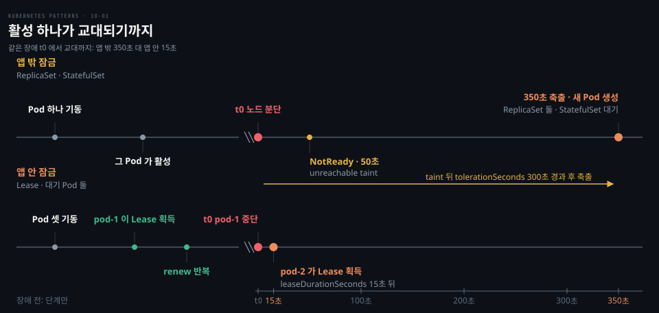
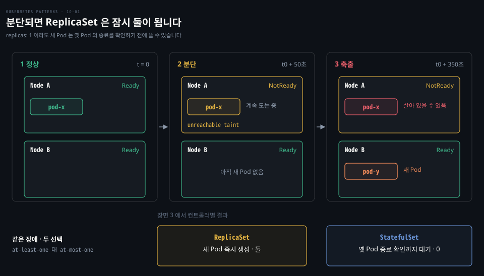
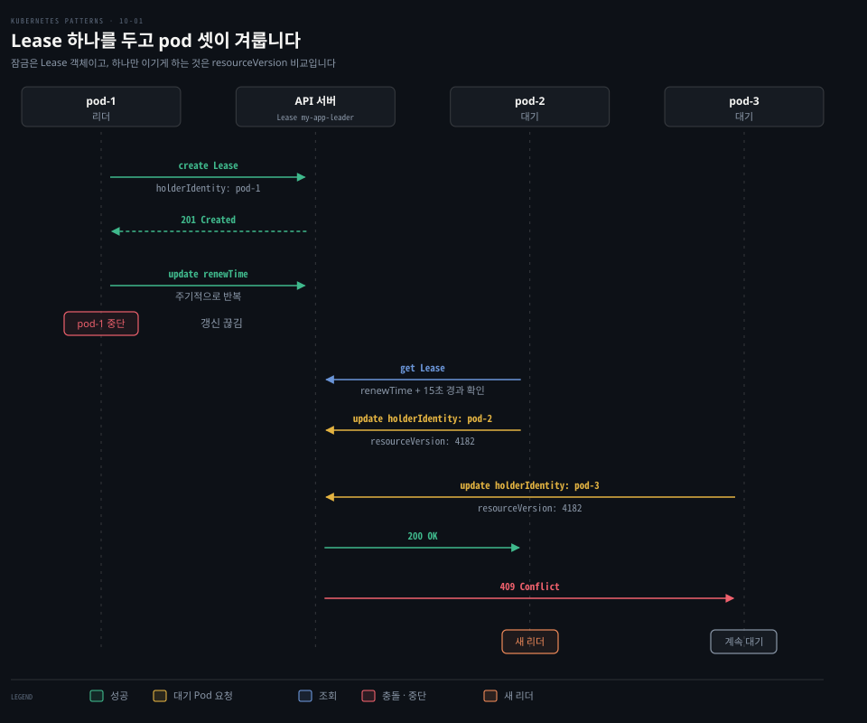
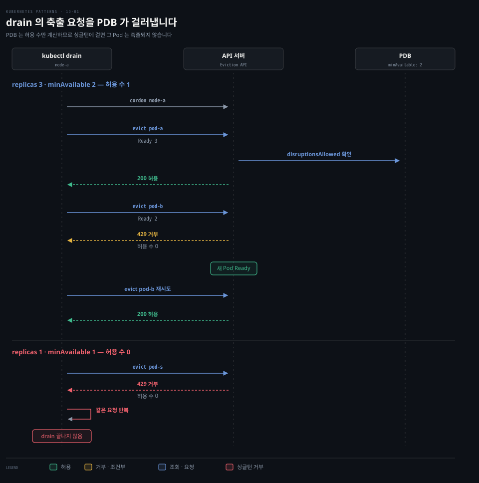
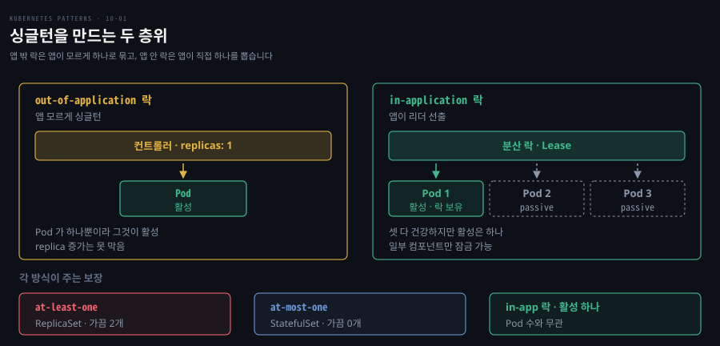

# Singleton Service — 한 번에 하나만 활성이되 고가용

---

> 여럿 띄우면 안 되는 일은 활성 인스턴스를 하나로 묶어야 합니다. 앱 밖에서는 컨트롤러와 StatefulSet 으로, 앱 안에서는 Lease 같은 분산 잠금으로 묶고, 계획된 중단은 PodDisruptionBudget 으로 견딥니다.

## 학습 목표

> 이 편을 읽고 나면 다음 다섯 가지를 설명하고 상황에 맞게 적용할 수 있습니다.

1. active-active 와 active-passive 의 차이를 구분하고 싱글턴이 필요한 세 상황을 제시할 수 있습니다.
2. ReplicaSet 의 at-least 와 StatefulSet 의 at-most-one 이 가용성과 일관성 중 무엇을 택한 결과인지 설명할 수 있습니다.
3. 노드 분단 시나리오에서 노드 컨트롤러와 toleration 동작에 의해 일시적으로 Pod 가 둘이 되는 경로를 설명할 수 있습니다.
4. in-application 잠금의 구현체가 사용하는 잠금 프리미티브와 동작 원리를 비교할 수 있습니다.
5. PodDisruptionBudget 의 축출 제어 원리와 설정 제약, 그리고 싱글턴 워크로드 보호 기법을 설명할 수 있습니다.


## 활성 하나가 교대되기까지

> 활성 인스턴스는 기동부터 장애 감지와 교대, 그리고 계획된 중단에 이르기까지 정해진 생애주기를 거치며 앱 바깥과 앱 안 잠금은 각 단계의 주체와 소요 시간이 다릅니다.

아래는 활성 인스턴스 하나가 서고 장애를 거쳐 교대되기까지의 전체 흐름입니다. 앱 바깥 잠금과 앱 안 잠금이 각 단계에서 어떻게 움직이는지 두 줄의 타임라인으로 비교합니다.



위 타임라인에서 보듯 두 방식은 생애주기의 각 단계마다 동작 주체와 받치는 기반 기술이 다릅니다. 앱 바깥 잠금은 플랫폼 컨트롤러에 의존해 복구 시간이 분 단위로 길어질 수 있습니다. 반면 앱 안 잠금은 분산 합의에 기반해 초 단위로 신속하게 교대합니다.

| 단계 | 앱 밖 잠금에서 누가 | 앱 안 잠금에서 누가 | 받치는 개념 | 절 |
|---|---|---|---|---|
| 1 기동 | ReplicaSet·StatefulSet 이 Pod 하나 생성 | Deployment 가 Pod 셋 생성 | replicas | §2, §3 |
| 2 활성 확보 | Pod 가 하나뿐이라 그것이 활성 | 각 Pod 가 Lease 획득 시도, 하나만 성공 | 낙관적 잠금 | §2, §3 |
| 3 요청 받기 | headless Service DNS 로 그 Pod 에 닿음 | 활성 Pod 만 일함(나머지 대기) | headless Service | §2, §3 |
| 4 장애 감지 | 노드 컨트롤러가 50초 뒤 NotReady → unreachable taint → 다시 300초 뒤 축출 | 갱신이 끊겨 renewTime 이 leaseDuration 을 넘김 | 하트비트·taint | §2, §3 |
| 5 교대 | ReplicaSet 은 새 Pod 생성(둘이 될 수 있음), StatefulSet 은 대기(0 이 될 수 있음) | 대기 Pod 가 Lease 를 넘겨받음 | at-least 와 at-most-one | §2, §3 |
| 6 계획된 중단 | drain 의 축출 요청을 PDB 가 허용·거부 | drain 의 축출 요청을 PDB 가 허용·거부 | PDB | §4 |

§1 은 이 흐름 밖에서 왜 싱글턴이 필요한지의 문제를 세웁니다. 이어지는 §2 와 §3 은 앱 밖과 앱 안에서 싱글턴을 만드는 메커니즘을 다룹니다. §4 는 유지보수 중단을 다루는 PDB 를 설명합니다. §5 는 요구사항에 따라 세 방식을 비교하고 선택하는 기준을 정리합니다.


## 이 문서가 다루지 않는 것

> 싱글턴 서비스의 범위를 벗어나는 컨트롤러·디스커버리·스케줄링의 일반론은 해당 전용 문서로 넘깁니다.

- StatefulSet 의 전반적인 동작과 볼륨 바인딩 메커니즘 → [Stateful Service](./12-01.Stateful%20Service%20%E2%80%94%20StatefulSet%EC%9C%BC%EB%A1%9C%20%EC%83%81%ED%83%9C%EB%A5%BC%20first-class%EB%A1%9C.md) 및 [StatefulSet 기초](../kubernetes-in-action/16-01.StatefulSet%20%EA%B8%B0%EC%B4%88%20%E2%80%94%20Pets%20vs%20Cattle%C2%B7ordinal%C2%B7headless%20Service.md)가 다룹니다.
- Service 디스커버리와 kube-proxy 의 트래픽 라우팅 전반 → [Service Discovery](./13-01.Service%20Discovery%20%E2%80%94%20%EA%B3%A0%EC%A0%95%20%EC%97%94%EB%93%9C%ED%8F%AC%EC%9D%B8%ED%8A%B8%EB%A1%9C%20%EB%8F%99%EC%A0%81%20Pod%EB%A5%BC%20%EC%B0%BE%EA%B8%B0.md)가 다룹니다.
- 스케줄러의 노드 필터링과 taint 및 toleration 동작 원리 → [Automated Placement](./06-01.Automated%20Placement%20%E2%80%94%20%EC%8A%A4%EC%BC%80%EC%A4%84%EB%9F%AC%EA%B0%80%20Pod%EB%A5%BC%20%EB%85%B8%EB%93%9C%EC%97%90%20%EB%B0%B0%EC%B9%98%ED%95%98%EB%8A%94%20%EB%B2%95.md)가 다룹니다.
- 주기적인 배치 작업 실행과 CronJob 컨트롤러 → [Periodic Job](./08-01.Periodic%20Job%20%E2%80%94%20CronJob%EC%9C%BC%EB%A1%9C%20%EC%8B%9C%EA%B0%84%20%EC%B6%95%EC%9D%84%20%EB%8D%94%ED%95%98%EB%8B%A4.md)가 다룹니다.


## 1. 여럿 띄우면 안 되는 일

> 주기 작업·외부 자원 폴링·순서 보장 소비처럼 여러 인스턴스가 동시에 하면 결과가 틀어지는 일은 활성 인스턴스를 하나로 묶어야 합니다.

흐름 위치: 흐름 밖 — 문제 제기

Kubernetes 가 제공하는 핵심 역량 중 하나는 애플리케이션의 쉽고 투명한 수평 확장입니다. `kubectl scale` 명령으로 명령형 확장을 하거나, ReplicaSet 같은 컨트롤러 정의로 선언적 확장을 수행할 수 있습니다. 동일한 서비스를 여러 인스턴스로 복제해 실행하면 처리량과 가용성이 함께 높아집니다. 한 인스턴스가 비정상이 되어도 요청 디스패처가 정상 인스턴스로 트래픽을 넘기기 때문입니다.

하지만 모든 작업이 수평 확장에 적합하지는 않습니다. 클러스터 안에서 오직 하나의 인스턴스만 실행되어야 하는 세 가지 전형적인 사례가 있습니다.

| 작업 유형 | 여러 인스턴스가 동시에 실행할 때 생기는 문제 | 해결에 필요한 조건 |
|---|---|---|
| 주기 작업 | 모든 인스턴스가 같은 간격마다 작업을 발동해 데이터 중복 생성과 외부 API 중복 호출이 발생합니다[^cronjob-link] | 지정된 시각에 클러스터 전체에서 단 하나의 인스턴스만 작업 발동 |
| 외부 자원 폴링 | 파일시스템 디렉터리나 데이터베이스 테이블을 여럿이 동시에 읽어 동일 자원을 중복 처리합니다 | 단일 인스턴스(또는 단일 스레드)가 자원을 독점적으로 폴링 |
| 순서 보장 소비 | 메시지 브로커의 큐에서 메시지를 동시에 가져가 도착 순서가 뒤바뀌고 비즈니스 상태가 어긋납니다 | 단일 스레드로 동작하는 단일 컨슈머 싱글턴 |

동일한 Pod 의 replica 를 여럿 실행하는 일반적인 구성은 모든 인스턴스가 활성으로 동작하는 active-active 토폴로지입니다. 반면 위 세 작업에는 오직 한 인스턴스만 활성이고 나머지는 대기 상태에 머무는 active-passive 토폴로지가 필요합니다. 이를 달성하는 방법은 크게 두 가지입니다.

- **앱 밖 잠금(Out-of-Application Locking)**: 애플리케이션 외부의 플랫폼 컨트롤러가 단일 인스턴스 생성을 보장합니다. 애플리케이션 코드는 자기가 싱글턴으로 도는지 알지 못합니다.
- **앱 안 잠금(In-Application Locking)**: 애플리케이션 인스턴스들이 분산 잠금을 사용해 직접 리더를 선출합니다. 여러 Pod 가 떠 있어도 잠금을 획득한 오직 하나만 활성이 됩니다.


## 2. 앱 밖에서 하나로 묶는다

> replicas 1 인 컨트롤러가 Pod 를 하나만 띄우면 앱은 모른 채 싱글턴이 되지만 ReplicaSet 은 "적어도 하나"를 보장할 뿐이라 노드 분단 때 둘이 될 수 있습니다.

흐름 위치: 1 기동 → 5 교대 · 받치는 개념 — at-least 와 at-most-one

### replicas: 1 이 주는 것과 주지 않는 것

외부 잠금 메커니즘은 애플리케이션 바깥의 관리 프로세스에 전적으로 기댑니다. 애플리케이션 구현 자체는 싱글턴 제약을 인지하지 못한 채 일반적인 서버로 실행됩니다. 이는 Spring Framework 같은 관리 런타임이 자바 클래스를 단일 인스턴스로 생성해 빈(Bean)으로 관리하는 방식과 유사합니다. 클래스 구현 자체에는 다중 인스턴스화를 방지하는 코드가 들어 있지 않습니다.

Kubernetes 에서 이를 구현하는 가장 직관적인 방법은 Pod 하나를 정의하고 띄우는 것입니다. 그러나 단일 Pod 실행만으로는 고가용성을 확보할 수 없습니다. 노드 장애나 프로세스 크래시가 발생했을 때 스스로 치유할 수 없기 때문입니다. 따라서 고가용 싱글턴을 만들려면 ReplicaSet 이나 Deployment 같은 컨트롤러로 Pod 를 뒷받침해야 합니다. 컨트롤러는 헬스 체크를 수행하고 장애 시 새 Pod 를 생성하여 고가용성을 제공합니다. 대기 인스턴스가 없으니 엄밀한 active-passive 는 아닙니다. 그래도 Kubernetes 가 Pod 하나를 늘 돌게 하므로 효과는 같습니다.

이 접근법에서 플랫폼이 보호하지 못하는 취약점이 있습니다. 바로 복제본 수의 증가입니다. PodDisruptionBudget 을 설정하면 관리 작업에 의한 축출은 통제할 수 있습니다. 하지만 운영자가 명령어로 replica 를 늘리는 행위는 플랫폼 수준에서 막을 수 없습니다.

### 분단되면 둘이 된다

ReplicaSet 을 `replicas: 1` 로 설정해도 항상 정확히 하나만 실행된다는 보장은 성립하지 않습니다. 분산 시스템 환경에서 네트워크 분단이나 노드 장애가 발생할 때 이 한계가 드러납니다. ReplicaSet 은 일관성보다 가용성을 우선하도록 설계되었습니다. 복제본 개수에 "최대 하나"가 아닌 "적어도 하나" 보장을 적용하기 때문입니다. 여기서 at-least 는 Pod 개수의 하한을 말하며 메시지 전달의 at-least-once 와는 다른 말입니다. 노드 분단이 아니어도 replica 수를 바꾸거나 Pod 를 다른 노드로 옮기는 동안 Pod 수가 잠시 원하는 수를 넘을 수 있습니다.

아래는 노드 분단이 일어났을 때 단일 인스턴스 보장이 깨지고 두 Pod 가 공존하게 되는 과정입니다.



위 과정은 컨트롤 플레인과 노드 사이의 시간 값에 따라 세 장면으로 전개됩니다.

1. **정상 동작**: Node A 에서 `pod-1` 이 정상적으로 실행 중입니다.
2. **분단 감지**: Node A 와 컨트롤 플레인 사이의 통신이 두절됩니다. 노드 컨트롤러는 `--node-monitor-grace-period`(기본 50초) 동안 하트비트가 없으면 Node A 를 `NotReady` 로 바꿉니다[^k8s-kcm-ref]. 동시에 `node.kubernetes.io/unreachable:NoExecute` taint 를 노드에 부여합니다[^k8s-taint-eviction].
3. **새 Pod 생성과 중복 실행**: Pod 에 자동으로 붙는 toleration 의 `tolerationSeconds`(300초)가 지나면 컨트롤 플레인이 Pod 를 축출합니다. 분단부터 따지면 50초에 300초를 더한 350초 무렵입니다. ReplicaSet 컨트롤러는 가용한 Node B 에 새 Pod 인스턴스를 즉시 띄웁니다.

이 시점에서 컨트롤 플레인은 Node A 의 `pod-1` 이 실제로 죽었는지 통신만 끊긴 것인지 구분할 수 없습니다. 분할된 Node A 의 프로세스가 여전히 동작하고 있다면 클러스터 전체에 활성 Pod 가 동시에 둘 존재하는 상황이 발생합니다. 노드 장애 시 파드 교체의 구체적인 컨트롤러 동작은 [ReplicaSet 컨트롤러 — 장애복구](../kubernetes-in-action/14-02.ReplicaSet%20%EC%BB%A8%ED%8A%B8%EB%A1%A4%EB%9F%AC%20%E2%80%94%20reconciliation%C2%B7%EC%9E%A5%EC%95%A0%EB%B3%B5%EA%B5%AC%C2%B7%EC%82%AD%EC%A0%9C.md#노드-장애-시-파드-교체)에서 다룹니다.

### StatefulSet 은 둘을 막고 0을 감수한다

노드 분단 상황에서 시스템은 가용성과 일관성 중 하나를 선택해야 합니다. 컨트롤 플레인의 이 딜레마는 분산 시스템의 CAP 정리와 맞닿아 있습니다.

죽었다고 가정하고 새 인스턴스를 즉시 띄우면 가용성은 지켜집니다. 하지만 둘이 공존할 위험이 있습니다. 반대로 이전 인스턴스의 완전한 종료가 확인될 때까지 대기하면 일관성은 지켜집니다. 그러나 그동안 서비스가 멈춥니다.

ReplicaSet 이 가용성을 택했다면 StatefulSet 은 일관성을 택한 컨트롤러입니다. StatefulSet 은 순서 번호와 고유 식별자를 부여합니다. "동일한 정체성을 가진 Pod 는 클러스터 전체에서 최대 하나"라는 원칙을 엄격히 강제합니다[^k8s-statefulset-atmost]. 상세 메커니즘은 [Stateful Service — At-Most-One 보장](./12-01.Stateful%20Service%20%E2%80%94%20StatefulSet%EC%9C%BC%EB%A1%9C%20%EC%83%81%ED%83%9C%EB%A5%BC%20first-class%EB%A1%9C.md#at-most-one-보장)에서 다룹니다.

StatefulSet 컨트롤러는 기존 Pod 의 삭제 확인 전에는 새 Pod 를 만들지 않습니다. 따라서 노드가 분단되어 상태를 알 수 없으면 기존 Pod 는 `Terminating` 이나 `Unknown` 상태에 멈춥니다. 시스템이 0개가 되는 다운타임을 감수해 데이터 오염을 방지합니다. 이 보장은 순서와는 별개 장치라서, `podManagementPolicy: Parallel` 로 순차 기동을 꺼도 유지됩니다.

멈춘 Pod 가 API 서버에서 지워지는 길은 셋입니다[^k8s-statefulset-atmost]. 노드 객체가 삭제되거나, 응답이 끊겼던 노드의 kubelet 이 돌아와 Pod 를 정리하거나, 사용자가 Pod 를 강제 삭제하는 경우입니다. 권장은 앞의 두 길입니다. 강제 삭제는 kubelet 의 종료 확인을 기다리지 않고 이름을 풀어 주므로 옛 Pod 가 아직 돌고 있으면 같은 정체성의 Pod 가 둘이 됩니다.

노드가 꺼졌는데 kubelet 이 종료를 알리지 못한 경우를 위해 Kubernetes 는 non-graceful node shutdown 처리를 정식 기능으로 제공합니다[^k8s-out-of-service]. 노드가 실제로 꺼졌거나 전원이 나갔음을 확인한 관리자가 `node.kubernetes.io/out-of-service` taint 를 수동으로 붙입니다. 그러면 맞는 toleration 이 없는 Pod 는 강제 삭제되고 볼륨 분리도 바로 진행되어, 다른 노드에서 새 Pod 가 뜹니다. Pod 가 옮겨 간 뒤 이 taint 는 관리자가 직접 지웁니다.

### headless Service 로 하나에 닿는다

싱글턴 서비스는 대개 데이터베이스나 메시지 브로커로 나가는 아웃바운드 연결을 맺지만 외부에서 싱글턴 인스턴스로 인바운드 요청을 전달해야 하는 경우도 있습니다.

일반적인 Service(`type: ClusterIP`)는 단일 가상 IP 를 할당하고 셀렉터에 매칭되는 백엔드 Pod 들 사이에서 부하를 분산합니다. 하지만 싱글턴 Pod 는 대상이 하나뿐이고 고유한 네트워크 정체성을 가집니다. 이때는 가상 IP 를 생성하지 않는 headless Service(`clusterIP: None`)를 구성하는 편이 효율적입니다.

headless Service 는 세 가지 특성을 가집니다.

- 가상 IP(ClusterIP)를 할당받지 않습니다.
- kube-proxy 가 이 서비스의 iptables 또는 IPVS 룰을 생성하지 않습니다.
- 플랫폼 수준의 프록시나 로드밸런싱을 거치지 않습니다.

headless Service 에 셀렉터가 지정되면 컨트롤 플레인은 API 서버에 `EndpointSlice` 리소스를 생성하고 백엔드 Pod 의 IP 주소를 추적합니다[^k8s-headless-svc]. CoreDNS 같은 클러스터 DNS 는 이 EndpointSlice 를 감시합니다. Service 도메인 조회 시 Pod 의 실제 IP 주소를 A 레코드로 직접 반환합니다. 자세한 서비스 디스커버리 흐름은 [Service Discovery — Headless Service](./13-01.Service%20Discovery%20%E2%80%94%20%EA%B3%A0%EC%A0%95%20%EC%97%94%EB%93%9C%ED%8F%AC%EC%9D%B8%ED%8A%B8%EB%A1%9C%20%EB%8F%99%EC%A0%81%20Pod%EB%A5%BC%20%EC%B0%BE%EA%B8%B0.md#headless-service)와 [StatefulSet·Endpoints·EndpointSlices](../networking-and-kubernetes/05-01.StatefulSet%C2%B7Endpoints%C2%B7EndpointSlices%20%E2%80%94%20%EC%84%9C%EB%B9%84%EC%8A%A4%EC%9D%98%20%EC%9E%AC%EB%A3%8C.md)에서 다룹니다.

| Service 도메인 형식 | DNS 가 반환하는 대상 |
|---|---|
| `<서비스명>.<네임스페이스>.svc.cluster.local` | 백킹 Pod 의 IP 주소 (A 레코드) |
| `<파드명>.<서비스명>.<네임스페이스>.svc.cluster.local` | 해당 고유 Pod 의 IP 주소 (StatefulSet 연계 시) |

예를 들어 `default` 네임스페이스에 `my-singleton` 이라는 headless Service 를 정의했다면, `my-singleton.default.svc.cluster.local` 주소로 Pod IP 에 직접 접근할 수 있습니다.

일반 Service 와 headless Service 의 차이는 다음과 같습니다.

| 구분 | 일반 ClusterIP Service | headless Service (`clusterIP: None`) |
|---|---|---|
| 가상 IP | 단일 가상 IP 할당 | 가상 IP 없음 |
| 프록시 주체 | kube-proxy (iptables / IPVS) | 프록시 없음 |
| DNS 응답 | 단일 Service 가상 IP 반환 | 백킹 Pod 의 실제 IP 주소 직접 반환 |
| 싱글턴 적합성 | 다중 Pod 부하 분산용 | StatefulSet 싱글턴의 직접 식별에 최적 |


## 3. 앱 안에서 리더를 뽑는다

> 여러 Pod 를 띄워 두고 분산 잠금을 먼저 잡은 하나만 일하게 하면 활성 교대 시간이 잠금 만료 시간 단위로 단축됩니다.

흐름 위치: 2 활성 확보 → 4 장애 감지 → 5 교대 · 받치는 개념 — 리더 선출

### 활성 하나와 대기 여럿

앱 안 잠금 방식은 분산 잠금을 사용해 애플리케이션 프로세스 수준에서 인스턴스 활성화를 직접 제어합니다. 동일한 애플리케이션 복제본을 여럿 실행하되, 기동 시 공통의 잠금 저장소에서 락을 획득하려 시도합니다. 잠금 획득에 성공한 단 하나의 인스턴스만 활성(Leader)이 되어 비즈니스 로직을 수행합니다. 나머지 인스턴스는 대기(Standby) 상태로 전환되어 주기적으로 잠금 획득을 재시도합니다.

Apache ActiveMQ 같은 메시지 브로커가 이 구조의 대표적인 예입니다. 공유 파일시스템이나 데이터베이스 락을 사용해 active-passive 고가용성 클러스터를 구성합니다. 먼저 시작된 브로커 인스턴스가 락을 잡고 클라이언트 연결을 수락하며 이후 기동된 브로커들은 락이 풀릴 때까지 대기합니다.

이 패턴은 객체지향 프로그래밍의 고전 싱글턴과 대비됩니다. 고전 싱글턴은 단일 프로세스 안의 정적 변수나 인스턴스화 제어를 통해 객체가 단 하나만 생성되도록 클래스 코드가 스스로 책임을 집니다. 분산 시스템에서의 앱 안 잠금 역시 플랫폼에 의존하지 않고 컨테이너 내부 코드가 직접 분산 합의 알고리즘이나 원자적 잠금 API 를 호출해 단일 활성을 보장합니다.

### ZooKeeper 와 etcd 로 잠그기

분산 환경에서 락을 구현하려면 높은 일관성과 원자성을 보장하는 저장소가 필요합니다. Apache ZooKeeper, HashiCorp Consul, Redis, etcd 가 대표적인 후보입니다.

Apache ZooKeeper 는 임시 노드(Ephemeral Node)를 통해 잠금을 구현합니다. 클라이언트가 세션을 생성하고 임시 znode 생성을 시도합니다. znode 생성을 성공한 첫 번째 인스턴스가 활성이 됩니다. 다른 인스턴스들은 해당 노드에 와치(Watch)를 걸고 대기합니다. 활성 인스턴스에 장애가 발생해 세션이 끊기면 임시 znode 가 자동으로 삭제되고 대기 중이던 인스턴스들이 통보를 받아 새로운 znode 생성을 경쟁합니다.

Kubernetes 환경에서는 분산 잠금만을 위해 별도의 ZooKeeper 클러스터를 운영하기보다 컨트롤 플레인이 이미 사용 중인 etcd 와 Kubernetes API 를 활용하는 편이 효율적입니다. etcd 는 Raft 합의 프로토콜을 기반으로 분산 일관성을 유지하며 원자적 비교-교환 연산을 제공하여 리더 선출의 핵심 재료가 됩니다. etcd 의 리더 동작과 헬스 상태 관리는 [etcd 헬스·유지보수 — 리더와 DB 크기](../../docs/kubernetes/03_operations/03-02.etcd%20%ED%97%AC%EC%8A%A4%EC%99%80%20%EC%9C%A0%EC%A7%80%EB%B3%B4%EC%88%98%20%E2%80%94%20%EC%83%81%ED%83%9C%20%ED%8C%90%EB%8F%85%EA%B3%BC%20compaction%C2%B7defrag%C2%B7quota.md#리더와-db-크기--endpoint-status)에서 다룹니다.

### Lease 객체가 잠금이 된다

Kubernetes 는 `coordination.k8s.io` API 그룹을 통해 `Lease` 리소스를 제공합니다[^k8s-leases]. Lease 는 시스템 전반에서 분산 락 및 하트비트 메커니즘으로 널리 사용됩니다.

Lease 리소스는 세 가지 핵심 필드를 바탕으로 동작합니다.

- `spec.holderIdentity`: 현재 잠금을 획득하고 있는 인스턴스의 식별자입니다.
- `spec.leaseDurationSeconds`: 임대 유효 기간(초)입니다.
- `spec.renewTime`: 현재 보유자가 잠금을 마지막으로 갱신한 마이크로초 단위 타임스탬프입니다.

클러스터 내부에서는 Lease 가 두 가지 주된 용도로 쓰입니다. 첫째는 노드 하트비트입니다. `kube-node-lease` 네임스페이스에 노드 이름과 일치하는 Lease 가 존재하며 kubelet 이 기본 10초마다 `renewTime` 을 갱신해 노드의 생존을 알립니다[^k8s-node-lease-doc]. 둘째는 컨트롤 플레인의 리더 선출입니다. `kube-system` 네임스페이스의 `kube-controller-manager` 와 `kube-scheduler` Lease 를 통해 다중 컨트롤 플레인 중 하나만 활성으로 컨트롤 루프를 실행합니다.

아래는 여러 Pod 가 Kubernetes Lease 를 활용해 리더를 선출하고 장애 시 교대하는 시퀀스입니다.



위 시퀀스에서 잠금 획득과 갱신은 낙관적 동시성 제어를 사용합니다. 각 Pod 는 API 서버에 Lease 업데이트를 요청할 때 기존의 `resourceVersion` 을 함께 전달합니다. 두 Pod 가 동시에 갱신을 시도하면 한 Pod 의 요청만 성공하고 다른 Pod 의 요청은 `409 Conflict` 오류를 반환받아 실패합니다.

리더 Pod 가 갱신에 실패하거나 종료되면 `renewTime` 에 `leaseDurationSeconds` 를 더한 만료 시각이 경과합니다. 대기 중이던 Pod 는 이를 감지하고 자신의 이름을 `holderIdentity` 로 설정한 업데이트를 시도해 새 리더가 됩니다. Go 기반 애플리케이션은 공식 클라이언트 라이브러리인 `k8s.io/client-go/tools/leaderelection` 을 사용하여 이 리더 선출 로직을 직접 구현할 수 있습니다[^client-go-leaderelection].

컨트롤 플레인의 `kube-controller-manager` 는 기본적으로 다음 플래그 값을 사용합니다[^k8s-kcm-ref].

- `--leader-elect-lease-duration=15s`: 대기 후보가 마지막 갱신을 본 뒤 리더 자리를 넘보기까지 기다리는 시간 15초. 리더가 멈춘 채 교체되기까지 걸리는 최대 시간이기도 합니다
- `--leader-elect-renew-deadline=10s`: 리더가 이 시간 안에 갱신하지 못하면 리더 자리를 내려놓는 기한 10초
- `--leader-elect-retry-period=2s`: 인스턴스들이 잠금 획득과 갱신을 재시도하는 간격 2초

Apache Camel 과 Spring Cloud Kubernetes 의 리더 선출도 lease 기간 기본값을 15초로 둡니다[^camel-cluster-service][^spring-cloud-k8s-leader]. 그래서 앱 안 잠금의 교대 시간은 대개 15초 안팎입니다.

컨트롤 플레인 구성요소끼리 리더를 고르는 방식을 정하는 Coordinated Leader Election 도 있습니다[^k8s-coordinated-election]. 클러스터 업그레이드 중 버전 차이 제약을 지키려고 가장 낮은 emulation version 을 가진 인스턴스를 리더로 고릅니다. 현재 beta 이고 기본으로 꺼져 있어, `CoordinatedLeaderElection` feature gate 를 켜야 동작합니다.

### Camel 과 Dapr

자체적인 리더 선출 로직을 직접 작성하지 않고 프레임워크나 런타임의 기능을 활용할 수도 있습니다.

Apache Camel 은 `camel-kubernetes` 컴포넌트의 Kubernetes cluster service 로 리더 선출을 제공합니다[^camel-cluster-service]. 라우트의 시작 엔드포인트를 `master:<namespace>:<endpoint>` 로 감싸면 선출된 활성 Pod 만 그 라우트를 실행합니다. 여기서 namespace 는 Kubernetes 네임스페이스가 아니라 잠금 그룹의 이름입니다. 잠금은 Kubernetes API 의 낙관적 잠금에 기대며 잠금을 담는 자원은 기본이 `Lease` 이고 `leaseResourceType` 을 `ConfigMap` 으로 바꿀 수 있습니다.

Dapr 는 분산 락 빌딩 블록을 제공합니다[^dapr-lock-doc]. 애플리케이션은 언어 독립적인 HTTP 나 gRPC API 로 잠금을 획득하고 해제합니다.

Dapr 분산 락 API 는 현재 Alpha 단계이며 잠금 저장소 컴포넌트로는 Redis 하나를 지원합니다. Dapr 락은 임대 기반 만료 시간을 지원합니다. 잠금을 잡을 때 `expiryInSeconds` 로 보유 시간을 정합니다. 앱 인스턴스가 락을 잡고 비정상 종료되어도 시간이 지나면 잠금이 자동 해제되어 데드락을 방지합니다. Akka 생태계 역시 Akka Coordination 모듈로 Lease 기반 분산 잠금을 제공합니다.

### 세부 — Spring 앱에서 컴포넌트만 잠그기

Spring 기반 마이크로서비스에서는 HTTP 트래픽을 처리하는 컨트롤러는 여러 인스턴스로 수평 확장하고 `@Scheduled` 배치 작업이나 카프카 파티션 순서 보장 컨슈머만 단일 활성으로 묶어야 하는 요구가 흔합니다.

Spring 생태계에서는 외부 잠금 백엔드를 연계하는 두 가지 라이브러리를 주로 활용합니다.

- **Spring Integration `LockRegistry`**: Redis, JDBC, ZooKeeper 등을 백엔드로 사용하여 임의의 임계 영역에 대한 분산 잠금을 지원합니다.
- **ShedLock**: 스케줄러 작업 전용 경량 분산 락 라이브러리로, 다중 노드 환경에서 `@Scheduled` 메서드가 한 번에 하나의 노드에서만 실행되도록 보장합니다.

Kubernetes 환경에서 Spring Boot 앱을 운영한다면 Spring Cloud Kubernetes 의 Leader Election 모듈을 활용할 수 있습니다[^spring-cloud-k8s-leader]. 이 모듈의 리더 선출은 구현이 둘이고, 잠금으로 쓰는 자원이 다릅니다.

- **기본 구현**: Spring Integration 의 리더 선출 API 를 `ConfigMap` 잠금으로 구현합니다. 잠금 이름은 `spring.cloud.kubernetes.leader.config-map-name` 으로 정합니다.
- **새 구현**: `spring.cloud.kubernetes.leader.election.enabled=true` 로 켭니다. 클러스터 버전에 따라 `Lease` 나 `ConfigMap` 을 잠금으로 씁니다. Lease 를 쓸 수 있어도 `spring.cloud.kubernetes.leader.election.use-config-map-as-lock=true` 로 ConfigMap 을 강제할 수 있습니다.

그래서 "Spring Cloud Kubernetes 는 Lease 를 쓴다"고 외우면 틀립니다.


## 4. 계획된 중단은 PDB 로 견딘다

> drain 같은 자발적 중단은 PDB 가 허용하는 만큼만 Pod 를 내보내고 장애 같은 비자발적 중단은 PDB 가 막지 못합니다.

흐름 위치: 6 계획된 중단 · 받치는 개념 — PDB

### 자발적 중단과 비자발적 중단

싱글턴 서비스가 런타임에 실행되는 최대 활성 인스턴스 수를 하나로 제한한다면, PodDisruptionBudget(PDB)은 유지보수로 동시에 내려가는 인스턴스 수를 제한하는 보완적 메커니즘입니다. 하나는 활성 수의 상한을, 다른 하나는 내려가는 수의 상한을 거니 방향이 반대입니다.

Kubernetes 에서 발생하는 Pod 중단은 성격에 따라 두 가지로 구분됩니다.

| 구분 | 발생 원인 및 사례 | PDB 적용 여부 |
|---|---|---|
| 자발적 중단 (Voluntary Disruption) | 노드 점검(`kubectl drain`), 커널 업그레이드, 클러스터 축소 등 관리자가 개입하는 계획된 작업 | 적용됨 (지연시키거나 차단) |
| 비자발적 중단 (Involuntary Disruption) | 하드웨어 결함, 커널 패닉, 네트워크 단절, 노드 자원 고갈에 의한 축출 | 적용 안 됨 (사전 차단 불가) |

노드 압박에 의한 노드 레벨 축출과 API 서버를 통한 Eviction API 호출의 메커니즘 차이는 [노드 압박 축출·디스크 관리 — 축출의 두 종류](../../docs/kubernetes/02-01.%EB%85%B8%EB%93%9C%20%EC%95%95%EB%B0%95%20%EC%B6%95%EC%B6%9C%EA%B3%BC%20%EB%94%94%EC%8A%A4%ED%81%AC%20%EA%B4%80%EB%A6%AC%20%E2%80%94%20DiskPressure%EB%8A%94%20%EB%AC%B4%EC%97%87%EC%9D%84%20%EB%B3%B4%EA%B3%A0%20%EC%BC%9C%EC%A7%80%EB%8A%94%EA%B0%80.md#1-축출은-두-종류이고-결정-주체가-다릅니다)에서 상세히 다룹니다.

### minAvailable 과 maxUnavailable

PDB 매니페스트는 `.spec.minAvailable` 또는 `.spec.maxUnavailable` 필드를 사용해 허용 범위를 선언합니다[^k8s-pdb-spec]. 아래 PDB 는 셀렉터에 맞는 Pod 가운데 둘은 늘 가용하게 합니다.

```yaml
apiVersion: policy/v1
kind: PodDisruptionBudget
metadata:
  name: random-generator-pdb
spec:
  selector:
    matchLabels:
      app: random-generator   # 가용 Pod 를 셀 때 쓰는 셀렉터
  minAvailable: 2             # 최소 둘은 늘 가용해야 합니다
```

`minAvailable` 에 `80%` 같은 백분율을 쓰면 맞는 Pod 의 20% 까지만 축출할 수 있습니다.

두 설정 필드에는 다음과 같은 규칙과 제약이 따릅니다.

- **상호 배타적 설정**: 하나의 PDB 에는 `minAvailable` 과 `maxUnavailable` 중 오직 하나만 지정할 수 있습니다.
- **값의 형식**: 절대 정수(예: `2`) 또는 전체 복제본 대비 백분율(예: `80%`)로 표현할 수 있습니다.
- **컨트롤러 종속성**: `maxUnavailable` 은 한 컨트롤러가 함께 관리하는 Pod 에만 쓸 수 있습니다. 기본 워크로드(Deployment, ReplicaSet, StatefulSet, ReplicationController)나 scale 하위 리소스를 구현한 커스텀 리소스가 그 예입니다. 컨트롤러가 없는 bare Pod 나 다른 자원이 관리하는 Pod 에는 `minAvailable` 만, 그것도 정수로만 쓸 수 있습니다. 전체 Pod 수를 알 수 없어 비율을 계산할 수 없기 때문입니다.
- **비정상 Pod 처리 정책**: `unhealthyPodEvictionPolicy` 필드는 Running 이지만 아직 Ready 가 아닌 Pod 의 축출 기준을 정합니다. 기본값인 `IfHealthyBudget` 은 앱이 이미 예산 아래로 내려가 있으면 그런 Pod 도 축출하지 않습니다. 그래서 CrashLoopBackOff 에 빠진 Pod 하나가 노드 점검을 막을 수 있습니다. `AlwaysAllow` 를 지정하면 예산과 관계없이 그런 Pod 를 축출해 이 정체를 풉니다.

PDB 는 정족수(quorum)를 지키려고 최소 replica 수가 늘 떠 있어야 하는 앱에 쓸모가 큽니다. 전체 인스턴스의 일정 비율 아래로 내려가면 안 되는 중요한 트래픽을 받는 앱에도 씁니다.

### drain 절차와 PDB 운영의 함정

`kubectl drain` 명령은 노드 유지보수를 안전하게 수행하기 위해 두 단계로 동작합니다. 먼저 대상 노드를 cordon 처리하여 새로운 Pod 가 스케줄링되지 않도록 잠급니다. 그런 다음 노드에 존재하는 각 Pod 에 대해 API 서버의 `/eviction` 서브리소스를 호출하여 정상 종료를 요청합니다.

아래는 `kubectl drain` 실행 시 PDB 예산 검사와 축출 승인 및 거부 과정입니다.



위 시퀀스에서 Eviction API 는 대상 Pod 가 속한 PDB 의 상태를 검사합니다. 축출 후 남은 정상 Pod 수가 `minAvailable` 조건을 만족하면 축출 요청을 승인합니다. 반면 조건을 만족하지 못하면 API 서버는 `429 Too Many Requests` 상태 코드를 반환하며 요청을 거부합니다. `kubectl drain` 클라이언트는 거부된 Pod 에 대해 일정 간격으로 재시도하며 대기합니다. 노드 유지보수와 drain 플래그의 상세 규칙은 [노드 추가·제거](../../docs/kubernetes/03_operations/03-05.%EB%85%B8%EB%93%9C%20%EC%B6%94%EA%B0%80%EC%99%80%20%EC%A0%9C%EA%B1%B0.md)에서 다룹니다.

운영 환경에서 PDB 와 drain 을 함께 다룰 때 빠지기 쉬운 세 가지 함정이 있습니다.

- **HPA 와 절대값 충돌**: HPA 가 적용된 워크로드에 `minAvailable` 을 절대 숫자로 지정하면 야간에 복제본이 줄었을 때 단 하나의 Pod 도 축출할 수 없어 drain 이 멈춥니다. 복제본 수가 변하는 워크로드는 백분율(`%`)로 지정합니다.
- **라벨 셀렉터 불일치**: 설정 후 `kubectl get pdb` 명령으로 대상이 올바르게 잡혔는지 확인해야 합니다. PDB 의 `.spec.selector` 가 워크로드 라벨과 어긋나면 보호 대상 Pod 가 0으로 인식되어 의도한 보호가 동작하지 않습니다.
- **강제 옵션의 남용**: 아래 두 플래그는 고가용성 보장을 깨뜨리므로 비상 복구 상황이 아니면 사용을 피해야 합니다. `kubectl drain --disable-eviction` 은 Eviction API 대신 일반 DELETE 로 Pod 를 지워 PDB 검사를 건너뜁니다[^k8s-kubectl-drain]. 함께 자주 붙는 `--force` 는 컨트롤러가 없는 Pod 까지 지우게 하는 별개 플래그입니다.

drain 이 멈추면 다른 노드에 복제본을 잠시 늘려 PDB 조건을 채우거나, 점검 동안 PDB 기준을 낮춰 풉니다. 점검 전에는 세 가지를 미리 봅니다.

- `kubectl get pdb` 의 `ALLOWED DISRUPTIONS` 값이 1 이상인지 확인합니다.
- 대상 워크로드의 다른 Pod 가 다른 노드에 충분히 퍼져 있는지 봅니다.
- 점검 시간대에 HPA 가 복제본을 줄여 PDB 가 잠길 가능성이 없는지 살핍니다.

여러 복제본을 가진 워크로드라면 `minAvailable: replicas - 1` 이나 그에 맞는 비율에서 시작합니다. 한 번에 Pod 하나씩만 내려가게 해 점검을 순서대로 진행시킵니다.

### 싱글턴에 PDB 를 걸면

복제본이 단 하나뿐인 싱글턴 서비스에 PDB 를 적용하면 독특한 운영 효과가 나타납니다.

예를 들어 단일 Pod 싱글턴에 `minAvailable: 1` 또는 `maxUnavailable: 0` 을 설정하면 허용 가능한 자발적 중단 수가 항상 0이 됩니다. 이 상태에서 관리자가 해당 노드에 `kubectl drain` 을 실행하면 Eviction API 가 영구히 429 오류를 반환하여 drain 작업이 완료되지 않고 대기 상태에 머무릅니다.

이 동작은 단순한 장애가 아니라 의도적인 안전장치로 활용될 수 있습니다. 고가용 복제본이 없는 중요한 싱글턴 워크로드를 운영할 때, 클러스터 관리자가 실수로 노드를 비워 다운타임이 발생하는 사고를 원천 차단하는 것입니다. 노드 점검이 멈추면 관리자는 서비스 소유 팀에 문의하여 점검 일정을 조율하거나 수동 페일오버를 수행한 뒤 drain 을 진행하게 됩니다.


## 5. 보장의 세기로 고른다

> 둘이 되면 안 되면 StatefulSet 이나 앱 안 잠금을, 잠깐 둘이어도 되면 replicas 1 을, 앱 일부만 하나여야 하면 앱 안 잠금을 고릅니다.

흐름 위치: 흐름 밖 — 방식 비교

### 세 방식 비교

싱글턴 서비스를 구현하는 세 가지 접근법은 보장의 세기와 운영 복잡성, 그리고 장애 시 동작 방식에서 명확한 트레이드오프를 가집니다.

아래는 애플리케이션 외부 잠금과 내부 잠금 구조의 핵심 차이입니다.



위 구조적 차이에 따른 세 방식의 비교는 다음과 같습니다.

| 방식 | 보장 수준 | 애플리케이션 수정 | 교대 시간 | 노드 분단 시 동작 | 적합한 워크로드 |
|---|---|---|---|---|---|
| **ReplicaSet (`replicas: 1`)** | At-least-one (최소 하나) | 필요 없음 (모든 앱에 적용 가능) | 느림 (분 단위: 감지 50초와 toleration 300초를 더한 350초 뒤 새 Pod 기동) | 분단된 노드의 Pod 종료 미확인 상태로 새 Pod 기동하여 일시적 2개 공존 | 일시적인 중복 실행이 비즈니스 데이터에 영향을 주지 않는 무상태 작업 |
| **StatefulSet (`replicas: 1`)** | At-most-one (최대 하나) | 최소 수준 (headless Service 연계 권장) | 느림 (수동 개입 또는 노드 복구 전까지 대기) | 기존 Pod 가 Terminating 상태로 멈추며 새 Pod 가 뜨지 않음 (일시적 0개 감수) | 동시 실행 시 데이터가 오염되는 단일 라이터 데이터베이스나 순서 보장 컨슈머 |
| **앱 안 잠금 (Lease / 분산 락)** | 엄격한 단일 활성 보장 | 코드 수정 필요 (리더 선출 라이브러리 연동) | 빠름 (Lease 만료 기간 경과 후 즉시 대기 Pod 승격) | 활성 Pod 의 임대 갱신 실패 시 대기 중인 다른 Pod 가 즉시 리더 획득 | 빠른 페일오버가 필수적이거나 애플리케이션의 특정 컴포넌트만 싱글턴이어야 하는 시스템 |

### 앱 일부만 싱글턴일 때

모놀리식 서비스나 복합 마이크로서비스에서는 애플리케이션의 일부 기능만 싱글턴이어야 하는 경우가 많습니다. 대규모 트래픽을 처리하는 HTTP API 엔드포인트와 내부 데이터베이스를 단일 스레드로 폴링하는 백그라운드 컴포넌트가 한 컨테이너에 공존하는 사례가 대표적입니다.

이때 애플리케이션 전체를 ReplicaSet 이나 StatefulSet 으로 묶어 `replicas: 1` 로 설정하면 수평 확장이 필요한 HTTP 엔드포인트까지 확장이 가로막히는 문제가 발생합니다. 이 상황을 해결하는 선택지는 두 가지입니다.

| 접근법 | 구체적 구현 방식 | 장점과 단점 |
|---|---|---|
| **배포 단위 분리** | 싱글턴이어야 하는 컴포넌트를 별도의 마이크로서비스(Pod)로 분리 배포 | 아키텍처 경계가 명확해지지만, 추가적인 배포 파이프라인과 네트워크 통신 오버헤드 및 운영 부담이 증가합니다 |
| **앱 안 잠금 적용** | 애플리케이션 전체는 다중 복제본으로 자유롭게 스케일하되, 특정 컴포넌트만 분산 락으로 제어 | 단일 배포 단위를 유지하면서 HTTP 는 확장하고 백그라운드 작업만 단일 활성으로 안전하게 제어할 수 있습니다 |


## 결정 치트시트

> 애플리케이션의 특성과 비즈니스 일관성 요구에 따라 싱글턴 구현 방식을 고르는 기준입니다.

- **일시적인 중복 실행이 허용되는가?**
  - 예: **ReplicaSet `replicas: 1`** 을 선택합니다. 가장 단순하며 애플리케이션 코드 수정이 전혀 필요 없습니다.
  - 아니오: 다음 질문으로 이동합니다.
- **동시에 둘이 실행되면 데이터가 오염되는 엄격한 싱글턴인가?**
  - 예 (코드 수정 불가): **StatefulSet `replicas: 1` + headless Service** 를 선택합니다. 노드 분단 시 0개가 되는 다운타임을 감수하며 일관성을 지킵니다.
  - 예 (코드 수정 가능 또는 빠른 복구 필수): **앱 안 잠금(Kubernetes Lease / Dapr Lock)** 을 선택합니다. 여러 복제본을 상시 띄워 두고 초 단위로 활성을 교대합니다.
- **애플리케이션의 특정 컴포넌트만 싱글턴이어야 하는가?**
  - 예: **앱 안 잠금**을 선택하여 HTTP 트래픽은 수평 확장하고 스케줄 작업이나 메시지 소비 컴포넌트만 분산 잠금으로 보호합니다.
- **유지보수 시 의도치 않은 서비스 중단을 막아야 하는가?**
  - 예: **PodDisruptionBudget** 을 함께 선언합니다. 싱글턴 Pod 에 `maxUnavailable: 0` 또는 `minAvailable: 1` 을 설정하여 관리자에게 사전 승인을 요구하도록 강제합니다.


## 실무 적용 포인트

> 싱글턴 서비스를 클러스터에 배포하고 운영할 때 반드시 챙겨야 할 실무 점검 항목입니다.

- **엄격한 싱글턴에 ReplicaSet 을 쓰지 않습니다.** ReplicaSet 은 at-least-one 보장이므로 노드 분단 시 잠깐 두 개가 공존할 수 있습니다. 단일 라이터 DB 나 순서 보장 컨슈머는 StatefulSet 이나 앱 안 분산 잠금을 씁니다. 복제하지 않는 단일 MySQL 구성 실습은 [Integrating Storage — MySQL 싱글턴 랩](../kubernetes-up-and-running/16-01.Integrating%20Storage%20%E2%80%94%20%EB%B3%B5%EC%A0%9C%ED%95%98%EC%A7%80%20%EC%95%8A%EB%8A%94%20%EC%84%A0%ED%83%9D%EC%A7%80%EC%99%80%20MySQL%20%EC%8B%B1%EA%B8%80%ED%84%B4%20%EB%9E%A9.md)에서 확인할 수 있습니다.
- **비엄격 싱글턴은 ReplicaSet 으로 단순성을 취합니다.** 일시적으로 둘이 실행되어도 비즈니스 영향이 없는 무상태 배치나 캐시 갱신은 `replicas: 1` 로 충분합니다.
- **앱 일부만 싱글턴이면 앱 안 잠금을 씁니다.** Spring Boot 환경에서는 Spring Integration `LockRegistry` 나 ShedLock 을 사용해 스케줄 메서드만 락으로 감싸고 HTTP 엔드포인트는 다중 인스턴스로 자유롭게 스케일합니다.
- **잠금 백엔드는 클러스터 자원을 재활용합니다.** 락만을 위해 별도의 ZooKeeper 클러스터를 띄우지 않고 Kubernetes 가 기본 제공하는 `coordination.k8s.io` Lease API 를 활용해 인프라 복잡성을 낮춥니다.
- **단일 인스턴스 워크로드는 PDB 로 보호합니다.** `maxUnavailable: 0` 을 걸어 `kubectl drain` 작업 시 자동 축출을 차단합니다. 운영자가 다운타임을 사전에 인지하고 조율하도록 안전장치를 만듭니다.
- **실수로 인한 복제본 스케일을 경계합니다.** 플랫폼은 replica 수 증가를 막지 못합니다. GitOps 파이프라인 검증이나 정책 엔진으로 `replicas: 1` 변경을 감시합니다. 앱 안 잠금은 replica 가 늘어도 활성은 하나라서 이 위험도 함께 줄입니다.


## 면접 질문

> 싱글턴 서비스와 리더 선출, 그리고 PDB 와 관련된 핵심 면접 질문입니다.

1. active-active 토폴로지와 active-passive 토폴로지의 차이는 무엇이며 싱글턴이 필요한 대표적인 세 상황은 무엇인가요?
2. ReplicaSet 의 `replicas: 1` 설정이 엄격한 싱글턴을 보장하지 못하는 분산 시스템적 이유는 무엇인가요?
3. 노드 분단이 일어났을 때 ReplicaSet 에 의해 일시적으로 두 Pod 가 공존하게 되는 과정을 시간 축으로 설명해 보세요.
4. StatefulSet 이 at-most-one 을 보장하는 메커니즘과, 노드 장애 시 감수해야 하는 대가는 무엇인가요?
5. headless Service 가 싱글턴 StatefulSet 에 적합한 이유와, 일반 Service 와의 DNS 응답 차이는 무엇인가요?
6. In-Application 잠금 방식은 객체지향의 고전 싱글턴과 구조적으로 어떻게 비교될 수 있나요?
7. Kubernetes Lease 리소스의 세 가지 핵심 필드는 무엇이며 클러스터 내부에서 어떤 용도로 활용되나요?
8. Apache Camel 과 Dapr 는 분산 잠금을 각각 어떤 메커니즘으로 구현하나요?
9. PodDisruptionBudget 이 다루는 자발적 중단과 다루지 못하는 비자발적 중단의 차이는 무엇인가요?
10. `minAvailable` 과 `maxUnavailable` 설정에 따르는 주요 제약 사항 두 가지는 무엇인가요?
11. 싱글턴 워크로드에 PDB 의 `maxUnavailable: 0` 을 설정하면 어떤 일이 일어나며, 실무에서 이를 어떻게 활용하나요?
12. 애플리케이션의 특정 컴포넌트만 싱글턴이어야 할 때 선택할 수 있는 두 가지 방안과 그 트레이드오프는 무엇인가요?


## 핵심 개념 체크리스트

> 이 편에서 다룬 핵심 원리와 운영 규칙을 점검하는 체크리스트입니다.

- [ ] active-active 와 active-passive 의 차이를 설명하고 싱글턴이 필요한 세 작업 유형을 제시할 수 있습니까?
- [ ] ReplicaSet 의 at-least 와 StatefulSet 의 at-most-one 이 가용성과 일관성 중 무엇을 우선한 것인지 알고 있습니까?
- [ ] 노드 분단 시 노드 컨트롤러의 grace period 와 toleration 동작에 의해 일시적으로 둘이 되는 경로를 설명할 수 있습니까?
- [ ] Non-Graceful Node Shutdown 시 `out-of-service` taint 가 볼륨 분리와 새 Pod 기동에 미치는 역할을 알고 있습니까?
- [ ] headless Service 가 ClusterIP 가상 IP 없이 EndpointSlice 를 통해 Pod IP 를 직접 반환하는 원리를 이해했습니까?
- [ ] In-Application 분산 잠금에서 Lease 리소스의 `holderIdentity` 와 `renewTime` 이 리더 교대에 동작하는 방식을 설명할 수 있습니까?
- [ ] Apache Camel 과 Dapr 가 제공하는 분산 락 추상화와 백엔드 지원 현황을 파악하고 있습니까?
- [ ] PDB 가 자발적 중단만 막고 비자발적 중단은 막지 못한다는 사실을 구분할 수 있습니까?
- [ ] PDB 설정에서 `minAvailable` 과 `maxUnavailable` 의 상호 배타성 및 컨트롤러 종속성을 이해하고 있습니까?
- [ ] 싱글턴 서비스에 `maxUnavailable: 0` 을 걸었을 때 drain 이 영구 대기하는 현상과 그 운영적 의미를 알고 있습니까?
- [ ] 애플리케이션 일부만 싱글턴일 때 배포 단위 분리와 앱 안 잠금의 트레이드오프를 설명할 수 있습니까?


## 정답 (자답 후 펼치기)

> 위 질문 12개에 먼저 자답한 뒤 아래를 읽으세요.

### 정답 1 — 토폴로지 구분과 싱글턴 요구

active-active 는 모든 인스턴스가 활성 상태로 동시에 트래픽을 처리하는 구조입니다. active-passive 는 오직 하나의 인스턴스만 활성으로 일하고 나머지는 대기하는 구조입니다. 동일한 Pod 를 여러 replica 로 띄우면 기본적으로 active-active 가 됩니다. 싱글턴이 필요한 상황은 셋입니다. 첫째, 주기적 스케줄 작업으로 인스턴스가 여럿이면 중복 실행이 발생합니다. 둘째, 파일시스템이나 DB 폴링 작업으로 단일 인스턴스가 자원을 독점 처리해야 합니다. 셋째, 메시지 브로커의 큐에서 순서를 보존하며 소비해야 하는 단일 컨슈머 작업입니다.

### 정답 2 — ReplicaSet 의 일관성 한계

ReplicaSet 은 일관성보다 가용성을 우선하도록 설계된 컨트롤러이기 때문입니다. 복제본 개수에 대해 "최대 하나"가 아니라 "적어도 하나" 의미를 강제합니다. 노드가 네트워크에서 분리되면 컨트롤 플레인은 해당 노드의 Pod 가 실제로 죽었는지 통신만 끊긴 것인지 구분하지 못합니다. 이때 가용성을 유지하기 위해 다른 노드에 새 Pod 를 띄우므로 일시적으로 둘이 공존할 수 있습니다.

### 정답 3 — 노드 분단 시 둘이 되는 경로

노드 분단이 발생하면 노드 컨트롤러는 50초(`--node-monitor-grace-period` 기본값) 동안 하트비트가 없음을 확인하고 노드를 `NotReady` 로 표시합니다. 동시에 `node.kubernetes.io/unreachable` taint 를 부여합니다. 이후 Pod 에 자동으로 붙은 toleration 의 300초가 지나면, 곧 분단 350초 무렵에 컨트롤 플레인이 해당 Pod 를 축출합니다. ReplicaSet 컨트롤러는 분단된 노드의 Pod 종료 여부를 확인하지 않은 채 가용한 다른 노드에 새 Pod 를 즉시 생성합니다. 분단된 노드의 프로세스가 살아 있다면 두 인스턴스가 동시에 실행됩니다.

### 정답 4 — StatefulSet at-most-one

StatefulSet 은 동일한 서수 인덱스와 정체성을 가진 Pod 가 클러스터 전체에서 최대 하나만 존재하도록 보장합니다. 그 대가로 노드 분단이나 하드웨어 장애 발생 시 기존 Pod 가 `Terminating` 상태에 멈추고 새 Pod 가 기동하지 않아 서비스가 0개가 되는 다운타임을 감수해야 합니다. 컨트롤러는 기존 Pod 가 완전히 종료되어 API 서버에서 삭제되었음을 확인하기 전에는 절대 동일한 이름의 새 Pod 를 띄우지 않기 때문입니다.

### 정답 5 — headless Service 와 DNS

StatefulSet 싱글턴은 단 하나의 Pod 만 존재하고 고유한 네트워크 정체성을 가집니다. 따라서 여러 Pod 간 부하 분산을 수행하는 일반 ClusterIP 가상 IP 가 불필요합니다. headless Service(`clusterIP: None`)를 구성하면 kube-proxy 프록시를 거치지 않습니다. CoreDNS 가 EndpointSlice 를 감시하여 Service 도메인 조회 시 백엔드 Pod 의 실제 IP 주소를 A 레코드로 직접 반환하므로 대상 Pod 에 직접 연결할 수 있습니다.

### 정답 6 — 앱 안 잠금과 고전 싱글턴 비교

객체지향 세계의 고전 싱글턴은 클래스 코드 내부에 정적 인스턴스를 두고 다중 인스턴스화를 방지하도록 프로세스 수준에서 스스로 책임을 집니다. In-Application 잠금 역시 플랫폼 컨트롤러에 의존하지 않습니다. 컨테이너화된 애플리케이션 코드가 분산 락을 직접 호출하여 시작된 Pod 수와 무관하게 오직 잠금을 획득한 하나만 활성화되도록 스스로 제어합니다.

### 정답 7 — Lease 핵심 필드와 클러스터 활용

Lease 의 핵심 필드는 현재 잠금 보유자를 나타내는 `spec.holderIdentity`, 유효 기간을 지정하는 `spec.leaseDurationSeconds`, 마지막 갱신 타임스탬프인 `spec.renewTime` 입니다. 클러스터 내부에서는 노드 하트비트와 컨트롤러 리더 선출에 쓰입니다. kubelet 은 `kube-node-lease` 네임스페이스에서 노드 생존을 알립니다. `kube-system` 네임스페이스에서는 컨트롤 플레인 컴포넌트의 리더 선출에 쓰입니다.

### 정답 8 — Camel 과 Dapr 의 잠금 방식

Apache Camel 은 Kubernetes cluster service 와 `master:` 엔드포인트로 리더 선출을 제공합니다. Kubernetes API 의 낙관적 잠금에 기댑니다. 잠금 자원은 기본이 `Lease` 이고 `ConfigMap` 으로 바꿀 수 있습니다. Dapr 은 언어 독립적인 Distributed Lock API 를 제공합니다. 저장소는 컴포넌트로 갈아 끼우는 구조이고 현재 지원 저장소는 Redis 입니다. 임대 기반 만료 시간을 지원하여 앱 비정상 종료 시 데드락을 방지합니다.

### 정답 9 — 자발적 중단과 비자발적 중단

자발적 중단은 노드 유지보수를 위한 `kubectl drain`, 커널 패치, 클러스터 스케일다운처럼 관리자가 의도하고 지연시킬 수 있는 계획된 작업이며 PDB 의 보호 대상입니다. 반면 비자발적 중단은 하드웨어 고장, 커널 패닉, 네트워크 단절, 메모리 고갈에 의한 노드 레벨 축출처럼 사전에 예측하거나 통제할 수 없는 장애 상황이며 PDB 가 개입할 수 없습니다.

### 정답 10 — PDB 설정 필드의 주요 제약

첫째, 하나의 PDB 매니페스트에는 `minAvailable` 과 `maxUnavailable` 중 오직 하나만 지정할 수 있습니다. 둘째, `maxUnavailable` 은 scale 하위 리소스를 지원하는 상위 컨트롤러가 관리하는 Pod 에만 적용 가능합니다. 컨트롤러가 없는 독립 Pod 에는 적용할 수 없고 그런 Pod 에는 `minAvailable` 을 정수로만 쓸 수 있습니다.

### 정답 11 — maxUnavailable: 0 활용

싱글턴 Pod 에 `maxUnavailable: 0` 또는 `minAvailable: 1` 을 설정하면 자발적 축출 허용치가 항상 0이 됩니다. 이 상태에서 관리자가 `kubectl drain` 을 실행하면 Eviction API 가 영구히 429 오류를 반환하여 drain 작업이 멈춥니다. 실무에서는 고가용 복제본이 없는 중요한 싱글턴 워크로드를 관리자의 실수에 의한 불시 축출로부터 보호하고 소유 팀과의 사전 조율을 강제하는 안전장치로 활용합니다.

### 정답 12 — 앱 일부만 싱글턴일 때의 대안

첫째 방안은 싱글턴이어야 하는 컴포넌트를 별도의 마이크로서비스로 분리 배포하는 것입니다. 아키텍처 경계는 명확해지지만 추가적인 배포 파이프라인과 네트워크 통신 오버헤드가 발생합니다. 둘째 방안은 전체 앱을 다중 인스턴스로 수평 확장하되 해당 컴포넌트만 In-Application 분산 락(Spring LockRegistry, ShedLock 등)으로 감싸는 것입니다. 단일 배포 단위를 유지하면서 HTTP 요청은 확장하고 배치 작업만 단일 활성으로 안전하게 제어할 수 있습니다.


## 관련 문서

> 싱글턴 서비스 패턴의 선행 개념 및 연관 컨트롤러를 다룬 형제 문서들입니다.

- [Periodic Job — CronJob으로 시간 축을 더하다](./08-01.Periodic%20Job%20%E2%80%94%20CronJob%EC%9C%BC%EB%A1%9C%20%EC%8B%9C%EA%B0%84%20%EC%B6%95%EC%9D%84%20%EB%8D%94%ED%95%98%EB%8B%A4.md) — 주기적 작업의 중복 실행 방지와 배치 라이프사이클을 다룹니다.
- [Daemon Service — 노드마다 도는 인프라 Pod](./09-01.Daemon%20Service%20%E2%80%94%20%EB%85%B8%EB%93%9C%EB%A7%88%EB%8B%A4%20%EB%8F%84%EB%8A%94%20%EC%9D%B8%ED%94%84%EB%9D%BC%20Pod.md) — 클러스터 전체에 하나만 띄우는 싱글턴과 대비되는 노드당 하나 배포 패턴입니다.
- [Stateful Service — StatefulSet으로 상태를 first-class로](./12-01.Stateful%20Service%20%E2%80%94%20StatefulSet%EC%9C%BC%EB%A1%9C%20%EC%83%81%ED%83%9C%EB%A5%BC%20first-class%EB%A1%9C.md) — 엄격한 at-most-one 단일 인스턴스 보장과 안정적 네트워크 식별자를 다룹니다.
- [Service Discovery — 고정 엔드포인트로 동적 Pod를 찾기](./13-01.Service%20Discovery%20%E2%80%94%20%EA%B3%A0%EC%A0%95%20%EC%97%94%EB%93%9C%ED%8F%AC%EC%9D%B8%ED%8A%B8%EB%A1%9C%20%EB%8F%99%EC%A0%81%20Pod%EB%A5%BC%20%EC%B0%BE%EA%B8%B0.md) — headless Service 와 EndpointSlice 기반의 직접 연결 메커니즘을 다룹니다.
- [StatefulSet 기초 — Pets vs Cattle·ordinal·headless Service](../kubernetes-in-action/16-01.StatefulSet%20%EA%B8%B0%EC%B4%88%20%E2%80%94%20Pets%20vs%20Cattle%C2%B7ordinal%C2%B7headless%20Service.md) — StatefulSet 컨트롤러의 순차 보장과 headless Service 의 동작 기초를 다룹니다.
- [Integrating Storage — 복제하지 않는 선택지와 MySQL 싱글턴 랩](../kubernetes-up-and-running/16-01.Integrating%20Storage%20%E2%80%94%20%EB%B3%B5%EC%A0%9C%ED%95%98%EC%A7%80%20%EC%95%8A%EB%8A%94%20%EC%84%A0%ED%83%9D%EC%A7%80%EC%99%80%20MySQL%20%EC%8B%B1%EA%B8%80%ED%84%B4%20%EB%9E%A9.md) — 복제를 포기하고 단일 인스턴스로 다운타임을 감수하는 스토리지 관점의 싱글턴 실습입니다.


## 참고 자료

- 도서: 《Kubernetes Patterns, Second Edition》(Bilgin Ibryam·Roland Huß, O'Reilly, 2023) Ch10. Singleton Service
- 인덱스: [Kubernetes Patterns 정독 인덱스](./README.md)
- 저자 예제 저장소: [k8spatterns/examples](https://github.com/k8spatterns/examples)

[^cronjob-link]: 주기적 작업의 중복 실행 문제와 해결책은 [Periodic Job — CronJob으로 시간 축을 더하다](./08-01.Periodic%20Job%20%E2%80%94%20CronJob%EC%9C%BC%EB%A1%9C%20%EC%8B%9C%EA%B0%84%20%EC%B6%95%EC%9D%84%20%EB%8D%94%ED%95%98%EB%8B%A4.md)를 참조하세요.
[^k8s-taint-eviction]: Kubernetes — Taint based Evictions, `not-ready`·`unreachable` 자동 toleration 의 `tolerationSeconds=300` (확인일: 2026-11-17) <https://kubernetes.io/docs/concepts/scheduling-eviction/taint-and-toleration/#taint-based-evictions>
[^k8s-statefulset-atmost]: Kubernetes — Force Delete StatefulSet Pods, at most one semantics 와 닿지 않는 노드의 Pod 를 지우는 세 길 (확인일: 2026-11-17) <https://kubernetes.io/docs/tasks/run-application/force-delete-stateful-set-pod/>
[^k8s-out-of-service]: Kubernetes — Node Shutdowns, Non-graceful node shutdown handling (1.28 부터 stable, 확인일: 2026-11-17) <https://kubernetes.io/docs/concepts/cluster-administration/node-shutdown/#non-graceful-node-shutdown>
[^k8s-kubectl-drain]: Kubernetes — kubectl drain 레퍼런스, `--disable-eviction`·`--force` (확인일: 2026-11-17) <https://kubernetes.io/docs/reference/kubectl/generated/kubectl_drain/>
[^k8s-headless-svc]: Kubernetes — Headless Services 및 EndpointSlice 기반 CoreDNS 해석 (확인일: 2026-11-17) <https://kubernetes.io/docs/concepts/services-networking/service/#headless-services>
[^k8s-leases]: Kubernetes — Leases 개념 및 API (확인일: 2026-11-17) <https://kubernetes.io/docs/concepts/architecture/leases/>
[^k8s-node-lease-doc]: Kubernetes — Node Status, Heartbeats: kubelet 은 Lease 를 기본 10초마다 갱신 (확인일: 2026-11-17) <https://kubernetes.io/docs/reference/node/node-status/#heartbeats> · Leases, Node heartbeats <https://kubernetes.io/docs/concepts/architecture/leases/#node-heart-beats>
[^client-go-leaderelection]: Kubernetes client-go — leaderelection 패키지 <https://pkg.go.dev/k8s.io/client-go/tools/leaderelection>
[^k8s-kcm-ref]: Kubernetes — kube-controller-manager 명령줄 플래그 레퍼런스, `--leader-elect-*` 와 `--node-monitor-grace-period` 기본 50s (확인일: 2026-11-17) <https://kubernetes.io/docs/reference/command-line-tools-reference/kube-controller-manager/>
[^k8s-coordinated-election]: Kubernetes — Coordinated Leader Election (v1.33 부터 beta, 기본 꺼짐, 확인일: 2026-11-17) <https://kubernetes.io/docs/concepts/cluster-administration/coordinated-leader-election/>
[^camel-cluster-service]: Apache Camel — Master 컴포넌트 `master:namespace:endpoint` <https://camel.apache.org/components/4.18.x/master-component.html> · camel-kubernetes `KubernetesClusterService.java` 의 `leaseResourceType` 기본 `Lease`, `leaseDurationMillis` 기본 15000 (main 브랜치, 확인일: 2026-11-17) <https://github.com/apache/camel/blob/main/components/camel-kubernetes/src/main/java/org/apache/camel/component/kubernetes/cluster/KubernetesClusterService.java>
[^dapr-lock-doc]: Dapr — Distributed lock overview (API 는 Alpha, 경로 `/v1.0-alpha1/lock/<storename>`, 확인일: 2026-11-17) <https://docs.dapr.io/developing-applications/building-blocks/distributed-lock/distributed-lock-api-overview/> · 지원 저장소 <https://docs.dapr.io/reference/components-reference/supported-locks/>
[^spring-cloud-k8s-leader]: Spring Cloud Kubernetes — Leader Election 레퍼런스, 두 구현과 `leaseDuration` 기본 15초 (확인일: 2026-11-17) <https://docs.spring.io/spring-cloud-kubernetes/reference/leader-election.html>
[^k8s-pdb-spec]: Kubernetes — Specifying a Disruption Budget for your Application, 필드 제약과 `unhealthyPodEvictionPolicy`(1.31 부터 stable) (확인일: 2026-11-17) <https://kubernetes.io/docs/tasks/run-application/configure-pdb/>
