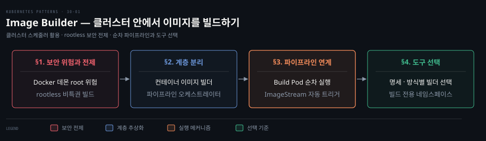
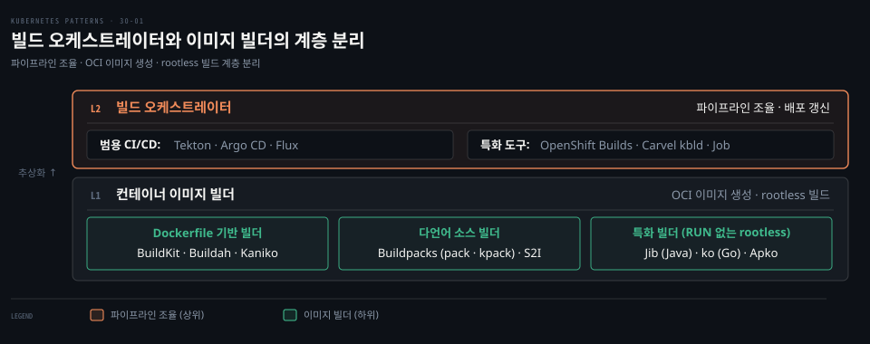
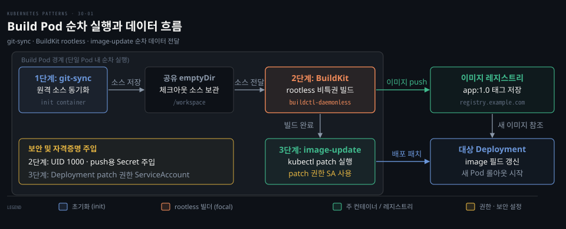
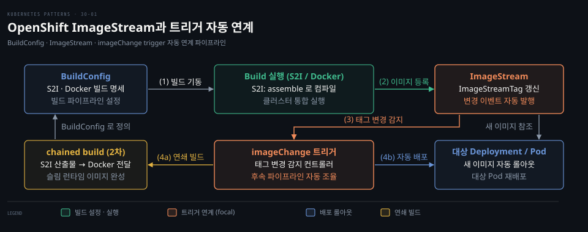

# 30장 · Image Builder — 클러스터 안에서 이미지를 빌드하기
---

> 이 책의 마지막 패턴입니다. 지금까지의 패턴이 클러스터에서 앱을 *운영*하는 이야기였다면, 이 장은 앱 이미지를 *빌드*하는 일마저 클러스터 안으로 가져옵니다.




## 핵심 요약

> Image Builder는 컨테이너 이미지를 클러스터 밖이 아니라 Kubernetes 클러스터 안에서 빌드하는 패턴입니다. 빌드와 실행을 한 클러스터에서 운영하면 인프라 유지비를 줄이고 Kubernetes 스케줄러를 빌드 자원 배치에 활용할 수 있습니다.

고전적 방식은 이미지를 클러스터 밖에서 빌드해 레지스트리에 push하고 Deployment 디스크립터에서 참조하는 것입니다. 하지만 클러스터 안에서 빌드하면 이점이 있습니다. 회사 정책이 허락한다면 빌드와 실행을 한 클러스터에서 하는 편이 유지비를 줄이고 용량 계획을 단순하게 합니다. 게다가 빌드는 본질적으로 자유로운 컴퓨팅 자원을 찾는 스케줄링 문제인데, Kubernetes의 정교한 스케줄러가 여기에 딱 맞습니다.

CD 관점에서는 이점이 더 분명해집니다. 빌드와 실행이 동일한 인프라를 공유하기 때문입니다. 모든 앱이 쓰는 베이스 이미지의 보안 취약점을 고쳤다고 해 봅시다. 클러스터는 이미지 빌드와 배포를 둘 다 알기 때문에 베이스 이미지가 바뀌면 의존하는 앱들을 자동으로 재배포할 수 있습니다. 이 장은 클러스터 내부 빌드를 지원하는 도구와 아키텍처를 살펴봅니다.


## 학습 목표

> 이 장을 읽고 나면 다음을 설명할 수 있어야 합니다.

1. 클러스터 안에서 이미지를 빌드하는 이점(스케줄러 활용, 빌드-배포 자동 연결)을 설명할 수 있습니다.
2. rootless 빌드가 왜 in-cluster 빌드의 핵심 전제인지 설명할 수 있습니다.
3. 컨테이너 이미지 빌더와 빌드 오케스트레이터의 계층 차이를 구분할 수 있습니다.
4. Build Pod가 init container로 어떻게 순차 빌드-배포를 구성하는지 설명할 수 있습니다.
5. OpenShift S2I와 chained build, ImageStream trigger의 관계를 설명할 수 있습니다.


## 1. 외부 빌드의 한계와 특권 빌드의 보안 위험

> 클러스터 외부 빌드는 빌드와 배포 인프라가 분리되어 자동 재배포가 어렵고 클러스터 내부에서 Docker 데몬을 그대로 쓰면 호스트 탈출 보안 위험이 발생합니다.

### 외부 빌드와 내부 빌드 — 빌드와 배포의 경계 지우기

책은 빌드와 배포 사이의 경계가 사라진다는 점을 in-cluster 빌드의 본질적 가치로 강조합니다. 클러스터 외부 빌드에서는 이미지 생성과 배포가 분리된 시스템의 작업입니다. 반면 클러스터 내부 빌드에서는 단일 오케스트레이터가 두 단계를 모두 인지하고 연결합니다.

대표적인 예가 OpenShift의 ImageStream trigger입니다. 빌드가 완료되어 이미지가 갱신되면 자동으로 재배포가 진행됩니다. 베이스 이미지의 보안 취약점을 패치할 때가 그렇습니다. 베이스 이미지를 갱신하면 이에 의존하는 애플리케이션 이미지의 재빌드와 롤아웃이 연쇄적으로 일어납니다.

다만 저자들은 2023년 기준 이 장의 도구 지형이 풍부하고 서로 겹쳐 있어, 통합과 새 도구 등장이 계속될 영역이라고 덧붙입니다.

### 핵심 전제 — rootless 빌드

클러스터 안에서 빌드하면 클러스터가 빌드 과정을 완전히 통제하므로, 잠재적 취약점을 막기 위해 더 높은 보안 기준이 필요합니다. 그 방법이 root 권한 없이 빌드하는 **rootless 빌드**입니다.

Docker는 클라이언트-서버 구조로, 백그라운드 데몬이 네트워크와 볼륨 관리를 위해 root 권한을 요구합니다. 이것이 보안 위험인 이유는 신뢰할 수 없는 프로세스가 컨테이너를 탈출해 호스트 전체를 장악할 수 있기 때문입니다. 이 우려는 컨테이너를 실행할 때뿐 아니라 빌드할 때도 적용됩니다. 빌드도 Docker 데몬이 임의 명령을 실행하는 컨테이너 안에서 일어납니다. 그래서 이 장의 도구들은 대부분 비특권 모드로 이미지를 빌드해 공격 표면을 줄입니다.


## 2. 이미지 빌더와 빌드 오케스트레이터의 계층 분리

> 이미지 빌드 도구는 이미지만 만드는 빌더 계층과, 파이프라인 조율과 배포 갱신을 맡는 오케스트레이터 계층으로 나뉩니다.



### 컨테이너 이미지 빌더

첫 계층은 이미지만 만드는 도구들로, 재배포는 신경 쓰지 않습니다. 이미지를 어떻게 명세하고 빌드하는지에 따라 셋으로 나뉩니다.

**Dockerfile 기반.** 익숙한 Dockerfile 포맷을 씁니다.

- BuildKit: Docker가 빌드 엔진을 분리한 프로젝트입니다. LLB(Low-Level Build) 포맷으로 복잡한 빌드 그래프를 표현하며 비특권 rootless 실행을 공식 지원합니다.
- Buildah/Podman: Docker 데몬 없이 OCI 호환 이미지를 만듭니다.
- Kaniko: 책이 소개한 빌드 컨테이너 도구입니다. 원 저장소 [GoogleContainerTools/kaniko](https://github.com/GoogleContainerTools/kaniko/blob/236ba5690eda9170d0157aa8137ebbeb09d38685/README.md)는 2025년 6월 3일 보관(archived)되었습니다. [chainguard-dev/kaniko](https://github.com/chainguard-dev/kaniko/blob/8c3f2f07afb8f362447ff43d439cf0b743687ef0/README.md) 포크가 보안 패치를 이어 갑니다(2026-11-14 확인). Pod 자체는 비특권이어도 컨테이너 안에서 UID 0(root)으로 실행되므로 OpenShift처럼 root 실행을 막는 클러스터에서는 쓸 수 없습니다.

**다언어 빌더.** 많은 개발자는 이미지가 만들어지는 과정보다 애플리케이션 패키징 자체에 집중합니다. 다언어 빌더는 이런 개발자를 위한 도구입니다.

Cloud Native Buildpacks(CNB)는 프로젝트 소스를 감지해 정해진 빌드 흐름을 자동으로 선택합니다. CNB의 생애주기는 세 단계로 나뉩니다.

- detect: 각 buildpack이 대상 프로젝트에 맞는지 판단합니다(Java는 `pom.xml` 확인).
- build: 선택된 buildpack이 최종 아티팩트를 생성합니다(Node.js는 `npm install`).
- export: 빌드 결과물을 최종 OCI 이미지로 묶어 레지스트리에 push합니다.

CNB는 `pack` CLI로 로컬에서 실행하거나 `kpack`처럼 Kubernetes Operator와 CRD로 클러스터 안에서 구동할 수 있습니다. OpenShift의 Source-to-Image(S2I)도 같은 계열입니다.

**특화 빌더.** 범위가 좁고 의견이 강한 도구들입니다. 모두 rootless 빌드를 하며 Dockerfile의 RUN 명령 없이 아티팩트로 레이어를 구성해 레지스트리에 직접 push합니다.

- Jib: 순수 Java 라이브러리로 Maven이나 Gradle 빌드 도구와 긴밀히 통합됩니다. 의존성과 정적 자원을 별도 레이어로 분리해 재빌드 시간을 줄입니다.
- ko: Go 소스로 이미지를 만듭니다. 원격 Git 저장소에서 바로 빌드하고 push 한 뒤 Pod 명세의 이미지 참조를 새 이미지로 갱신할 수 있습니다.
- Apko: Dockerfile 스크립트 대신 Alpine의 apk 패키지를 빌딩 블록으로 씁니다. 비슷한 이미지를 여러 개 만들 때 블록을 다시 쓰기 쉽습니다.

다루는 범위가 좁은 대신 자기 영역을 정확히 알기 때문에 강한 가정을 세웁니다. 그 가정 덕분에 빌드 시간과 이미지 크기를 줄입니다.

### Spring Boot — Buildpacks와 Jib

Spring/Java 생태계에서 가장 널리 쓰이는 in-cluster 빌더는 Cloud Native Buildpacks와 Jib입니다. Spring Boot 의 Maven·Gradle 플러그인은 Buildpacks 를 내장하고 Jib 은 Google 이 만든 별도 플러그인을 붙여 씁니다.

`mvn spring-boot:build-image` 명령은 CNB로 Dockerfile 없이 OCI 이미지를 만듭니다. [jib-maven-plugin](https://github.com/GoogleContainerTools/jib/blob/a600d359769be6fc93aa9f1063d74ee9f09b7184/jib-maven-plugin/README.md)을 붙이면 레이어를 나눈 이미지를 레지스트리에 직접 push합니다. 빌드 명령은 `mvn compile jib:build` 입니다(2026-11-14 확인). 두 도구 모두 Docker 데몬 없이 빌드하며 Dockerfile 작성을 요구하지 않습니다. 다만 23장 Process Containment 의 비root 실행은 따로 정합니다. Jib 의 `container.user` 는 기본값이 비어 있습니다.

두 도구는 지향점이 다릅니다. Buildpacks는 프로젝트 구성을 감지해 런타임과 JDK를 자동으로 선택합니다. 세부 설정 없이 빠른 패키징을 원하는 환경에 적합합니다. Jib은 Java 의존성과 클래스, 정적 자원을 개별 레이어로 분리하므로 소스 코드만 변경되었을 때 재빌드 속도가 빠릅니다. 의존성이 잘 바뀌지 않는 프로젝트라면 CI 빌드 시간이 그만큼 줄어듭니다.

### 빌드 오케스트레이터

빌드 오케스트레이터는 이미지 빌더를 호출하고 빌드 이후의 배포 작업까지 조율하는 상위 계층입니다.

- 범용 CI/CD: Tekton, Argo CD, Flux 가 빌드·테스트·릴리스·배포·보안 스캔을 아우릅니다. Tekton 은 1판의 Knative Build 가 Knative 에서 떨어져 나와 CRD 기반 CI 로 커진 프로젝트입니다.
- 특화 오케스트레이터: OpenShift Builds, kbld, 표준 Kubernetes Job(7장)이 있습니다. kbld 는 Carvel 도구 모음의 하나로, 이미지를 빌드한 뒤 YAML 의 image 필드를 새 이미지 좌표로 바꿉니다.


## 3. Build Pod와 엔터프라이즈 파이프라인

> Build Pod는 init container로 소스 동기화·비특권 빌드·배포 패치를 순차 실행하고 OpenShift는 BuildConfig와 ImageStream으로 자동 연계를 완성합니다.

### Build Pod — 최소 구성으로 본 빌드-배포

책은 in-cluster 빌드의 핵심 재료를 드러내기 위해 Pod 하나로 완전한 빌드-배포 사이클을 구성합니다. 순차 실행을 보장하려고 init container(15장)를 씁니다. 실행은 3단계로 진행됩니다.



**1단계: git-sync(init).** 원격 Git 저장소에서 소스를 체크아웃해 공유 `emptyDir` 볼륨에 저장합니다. 빌드가 클러스터 안에서 일어나므로 소스를 빌드 컨테이너로 전달하는 역할을 이 init container가 맡습니다.

**2단계: BuildKit rootless build(init).** 소스가 완전히 받아진 뒤에 시작되도록 두 번째 init container로 둡니다. 빌더는 moby/buildkit 의 공식 예제 [job.rootless.yaml](https://github.com/moby/buildkit/blob/3a91b50be17b36ecf3ce27ba730d025378f31071/examples/kubernetes/job.rootless.yaml)을 따릅니다(커밋 `3a91b50`, 2026-11-14 확인). 책이 쓴 Kaniko 는 원 저장소가 보관돼 지금 유지되는 rootless 빌더로 바꿨습니다.

[`buildctl-daemonless.sh`](https://github.com/moby/buildkit/blob/3a91b50be17b36ecf3ce27ba730d025378f31071/examples/buildctl-daemonless/buildctl-daemonless.sh)는 컨테이너 안에서 임시 `buildkitd` 를 띄우고 빌드 한 번을 마치면 함께 끝냅니다. 그래서 데몬 Pod 를 따로 두지 않습니다. 공식 예제가 비특권으로 돌리려고 두는 조건은 넷이고, 이유는 [BuildKit rootless 문서](https://github.com/moby/buildkit/blob/3a91b50be17b36ecf3ce27ba730d025378f31071/docs/rootless.md)에 있습니다.

- `runAsUser: 1000`, `runAsGroup: 1000`: 이미지의 기본 사용자와 같은 값을 명시합니다. 예제 주석은 다른 UID 를 쓰려면 이미지를 다시 빌드해야 한다고 적습니다.
- `BUILDKITD_FLAGS: --oci-worker-no-process-sandbox`: RUN 단계마다 새 PID 네임스페이스와 `/proc` 를 만들지 않게 합니다. Kubernetes 에는 Docker 의 `systempaths=unconfined` 에 해당하는 설정이 없어서입니다. 대가로 RUN 이 남긴 프로세스를 끝내지 못하고, RUN 안의 프로세스가 빌드 컨테이너의 다른 프로세스에 `kill` 을 보낼 수 있습니다. 문서는 이 플래그를 권하지 않으면서도 Kubernetes 예제에는 씁니다.
- `seccompProfile`·`appArmorProfile` 을 `Unconfined` 로 둡니다. seccomp 는 runc 의 `unshare` 와 스냅숏터의 `mount` 시스템 콜을 허용하려고, AppArmor 는 파일시스템 마운트를 허용하려고 끕니다. `appArmorProfile` 필드는 Kubernetes 1.30 부터 쓰며 AppArmor 가 없는 호스트에서는 필요 없습니다.
- `/home/user/.local/share/buildkit` 에 `emptyDir` 을 붙입니다. 이미지도 같은 경로를 VOLUME 으로 선언합니다. 다만 Google Container-Optimized OS 에서는 그 볼륨이 `nosuid,nodev` 로 마운트돼 rootless 빌드가 실패합니다.

빌드와 push 는 `buildctl-daemonless.sh build` 한 번으로 끝냅니다. 예제 인자에 push 출력 한 줄을 더하면 됩니다.

```bash
# job.rootless.yaml 의 args 에 --output 을 더한 형태 (이미지 이름은 문서용 값)
buildctl-daemonless.sh build \
  --frontend dockerfile.v0 \
  --local context=/workspace \
  --local dockerfile=/workspace \
  --output type=image,name=registry.example.com/team/app:1.0,push=true
```

push 자격증명은 `kubectl create secret docker-registry`로 생성한 Secret을 씁니다. 이를 `~/.docker/config.json` 경로에 마운트하고 `DOCKER_CONFIG` 환경 변수를 지정해 안전하게 주입합니다(20·25장).

kind v0.31.0(Kubernetes v1.35.0)에서 이 예제에 push 출력을 붙여 돌렸습니다. 레지스트리는 같은 클러스터에 `registry:2` 를 띄웠습니다. 이 레지스트리는 HTTP 로 받으므로 `--output` 에 `registry.insecure=true` 를 더했습니다. 네 조건을 다 두면 빌드 init container 가 0 으로 끝나고 레지스트리에 태그가 올라갔습니다. 조건을 하나씩 빼 본 결과는 다음과 같습니다.

| 뺀 조건 | 결과 |
|---|---|
| `--oci-worker-no-process-sandbox` | RUN 단계에서 실패 — `error mounting "proc" to rootfs at "/proc": … operation not permitted` |
| seccomp `Unconfined` 를 `RuntimeDefault` 로 | 빌드 시작 전 실패 — `[rootlesskit:parent] error: failed to start the child: fork/exec /proc/self/exe: operation not permitted` |
| `seccompProfile` 필드 자체 | 성공 — 아래 kubelet 기본값 때문 |
| `appArmorProfile` | 성공 — 이 노드 커널에 AppArmor 가 없어 판정 불가 |
| `runAsUser`·`runAsGroup` | 성공 — 이미지 기본 사용자가 이미 `1000:1000` |
| `buildkitd` `emptyDir` | 성공 — Container-Optimized OS 노드가 아님 |

seccomp 필드를 빼도 빌드가 된 것은 kubelet 기본값 때문입니다. `--seccomp-default` 가 꺼져 있으면 프로필을 지정하지 않은 Pod 는 `Unconfined` 로 돕니다([seccomp 튜토리얼](https://kubernetes.io/docs/tutorials/security/seccomp/)). 이 기본값을 켠 노드에서는 `RuntimeDefault` 행처럼 실패하므로 `Unconfined` 를 빼지 않습니다.

이 Pod 는 `privileged: true` 없이 UID 1000 으로 돌지만 Pod Security Standards 의 baseline 은 통과하지 못합니다. baseline 은 seccomp 를 `Unconfined` 로 명시하는 것과 AppArmor 기본 프로필을 끄는 것을 막기 때문입니다([Pod Security Standards](https://kubernetes.io/docs/concepts/security/pod-security-standards/)).

`pod-security.kubernetes.io/enforce=baseline` 레이블을 단 네임스페이스에 같은 Pod 를 만들어 봤습니다. `violates PodSecurity "baseline:latest"` 로 거부됐고, 거부 사유로 AppArmor 와 seccomp 두 필드를 들었습니다. 그래서 빌드 Pod 는 Pod Security 수준을 따로 정한 빌드 전용 네임스페이스에 둡니다.

**3단계: image-update.** 생성된 이미지로 기존 Deployment를 갱신하는 주 컨테이너입니다. `kubectl patch`로 Deployment의 이미지 필드를 바꾸면 새 롤아웃이 시작됩니다(3장 Declarative Deployment). Pod의 `build-pod` ServiceAccount에 Deployment patch 권한이 있어야 실행됩니다(26장 Access Control).

**메모리 한도와 OOM.** 빌드 컨테이너가 Pod 메모리 한도를 넘으면 종료 코드 137(reason `OOMKilled`)로 강제 종료됩니다. 137 계산(128 + 9 SIGKILL)과 `OOMKilled`가 reason이라는 설명은 [Pod 상태 — state는 3개뿐](../kubernetes-in-action/06-01.Pod%20%EC%83%81%ED%83%9C%20%E2%80%94%20phase%C2%B7conditions%C2%B7%EC%BB%A8%ED%85%8C%EC%9D%B4%EB%84%88%20%EC%83%81%ED%83%9C.md#state%EB%8A%94-3%EA%B0%9C%EB%BF%90--crashloopbackoffoomkilled%EB%8A%94-state%EA%B0%80-%EC%95%84%EB%8B%88%EB%9D%BC-reason)을 참고합니다.

init container 에서도 같은 값이 남는지 kind v0.31.0 에서 확인했습니다. 책의 Build Pod 처럼 `restartPolicy: Never` 인 Pod 에 메모리 한도 64Mi 짜리 init container 를 두고 메모리를 넘치게 했습니다. `initContainerStatuses` 에 exit code 137 과 reason `OOMKilled` 가 남았습니다. `kubectl get pod` 의 STATUS 는 `Init:OOMKilled`, phase 는 `Failed` 였습니다.

책이 예시로 든 Kaniko 의 파일시스템 스냅숏 동작은 [컨테이너 이미지 빌드 §2](../../../07_devops/02_Jenkins/03_agent/01-04.%EC%BB%A8%ED%85%8C%EC%9D%B4%EB%84%88%20%EC%9D%B4%EB%AF%B8%EC%A7%80%20%EB%B9%8C%EB%93%9C.md#2-kaniko%EB%A1%9C-%EC%95%88%EC%A0%84%ED%95%98%EA%B2%8C-%EB%B9%8C%EB%93%9C)에서, 레이어 캐시 플래그는 [같은 문서 §2.1](../../../07_devops/02_Jenkins/03_agent/01-04.%EC%BB%A8%ED%85%8C%EC%9D%B4%EB%84%88%20%EC%9D%B4%EB%AF%B8%EC%A7%80%20%EB%B9%8C%EB%93%9C.md#21-kaniko-%EB%A0%88%EC%9D%B4%EC%96%B4-%EC%BA%90%EC%8B%9C-%ED%94%8C%EB%9E%98%EA%B7%B8)에서 다룹니다.

### OpenShift Build — 클러스터 통합 빌드

Red Hat OpenShift는 Kubernetes에 통합 레지스트리와 SSO, native 이미지 빌드 기능을 결합한 엔터프라이즈 배포판입니다. OpenShift build 는 Kubernetes 가 관리하는 이미지를 직접 빌드한 첫 방법입니다. 빌드는 클러스터에 통합된 방식으로 돌아갑니다. 빌드 정보는 모두 `BuildConfig` 리소스에 정의합니다. OpenShift 빌드는 네 가지 전략을 지원합니다.

- Source-to-Image(S2I): 소스 코드와 전용 builder 이미지를 조합해 실행 아티팩트를 생성합니다.
- Docker build: 클러스터 내부에서 표준 Dockerfile을 기반으로 빌드합니다.
- Pipeline build: Tekton 파이프라인으로 복잡한 워크플로를 수행합니다.
- Custom build: 사용자가 직접 정의한 빌더 이미지를 실행합니다.

S2I builder 이미지는 표준 컨테이너 이미지이며 두 스크립트를 필수로 포함합니다. `assemble`은 소스 코드를 컴파일해 아티팩트를 배치하고 `run`은 컨테이너 엔트리포인트를 정의합니다. CNB와 비슷하지만 생애주기가 더 단순합니다.

S2I는 검증된 builder 이미지가 빌드를 통제하므로 Docker 빌드보다 안전합니다. 다만 생성된 이미지에 빌드 환경이 남아 크기와 공격 표면이 커집니다. chained build는 이 문제를 피하려고 S2I가 컴파일한 결과물을 두 번째 Docker 빌드 단계로 넘겨 슬림한 런타임 이미지를 완성합니다.

OpenShift는 BuildConfig와 ImageStream을 연결해 이미지 생성부터 재빌드·재배포까지 파이프라인을 자동으로 트리거합니다.



자동 연계의 핵심은 ImageStream과 trigger입니다. ImageStream은 하나 이상의 이미지를 참조하는 OpenShift 리소스로, 태그된 실제 이미지를 ImageStreamTag에 매핑합니다. 레지스트리에서 이미지가 갱신되면 이벤트를 발행합니다. 빌드와 배포 컨트롤러가 이 이벤트를 감지해 후속 작업을 시작합니다. `imageChange` trigger는 ImageStreamTag 변화에 반응해 후속 이미지를 재빌드하거나 대상 Pod를 재배포합니다. 저자들은 빌드와 배포를 이렇게 엮는 것을 CD 의 성배에 한 걸음 다가서는 일로 봅니다.


## 4. 이미지 빌더 비교와 선택

> 입력 명세, 빌드 방식, rootless 지원 특성에 따라 프로젝트에 적합한 빌더를 선택합니다.

| 구분 | Dockerfile 기반 (BuildKit / Buildah) | 다언어 빌더 (CNB / S2I) | 특화 빌더 (Jib / ko / Apko) |
|---|---|---|---|
| 입력 명세 | Dockerfile / Containerfile | 애플리케이션 소스 코드 | 언어 프로젝트 소스 / APK 명세 |
| 빌드 방식 | Dockerfile 명령 실행 (RUN 은 컨테이너 안에서) | 자동 감지(detect) 기반 빌드팩 패키징 | 빌드 도구 플러그인 / 패키지 조합 |
| RUN 명령 | 지원 (사용자 스크립트 실행) | 빌드팩 생애주기 내 실행 | 없음 (RUN 없이 아티팩트 직접 레이어화) |
| rootless 실행 | 가능 (BuildKit 은 seccomp·AppArmor `Unconfined` 필요) | 가능 | 가능 (RUN 이 없어 빌드 중 컨테이너를 띄우지 않음) |
| 주 용도 | 범용 컨테이너 이미지 빌드 | 다양한 언어의 표준 패키징 | Java, Go 등 특정 도메인 빌드 최적화 |


## 결정 치트시트

> 클러스터 환경과 애플리케이션 스택에 따라 최적의 rootless 빌더와 오케스트레이터를 선택합니다.

| 상황 | 권장 도구 | 선택 이유 |
|---|---|---|
| 범용 Dockerfile 기반의 비특권 Pod 빌드 | BuildKit rootless (`master-rootless`) | `buildctl-daemonless.sh` 가 Pod 안에서 임시 데몬을 띄워 빌드·push |
| Spring Boot / Java 애플리케이션 빌드 | Cloud Native Buildpacks 또는 Jib | Dockerfile 작성 없이 의존성 레이어 분리 및 빌드 속도 최적화 |
| Go 애플리케이션 빌드 | ko | Go 소스를 원격 Git 에서 바로 빌드하고 Pod 명세의 이미지 참조까지 갱신 |
| 멀티 단계 파이프라인 및 엔터프라이즈 CI/CD | Tekton 또는 OpenShift Builds | CRD 기반 파이프라인 조율, ImageStream trigger를 통한 베이스 이미지 변경 시 자동 재배포 |
| 컨테이너 안 root 실행을 금지하는 클러스터 | Jib·ko 같은 특화 빌더, BuildKit rootless | Kaniko 는 컨테이너 안 UID 0 실행 · BuildKit rootless 는 seccomp·AppArmor `Unconfined` 를 허용하는 네임스페이스 필요 |


## 실무 적용 포인트

> 클러스터 안에서 빌드할 때는 rootless 빌더와 최소 권한 ServiceAccount를 설정하고 빌드 파이프라인은 오케스트레이터로 표준화합니다.

### 한 가지 실행

빌드 Pod를 구성할 때 특권(privileged) 컨테이너와 호스트 Docker 소켓 마운트는 아예 쓰지 않습니다. BuildKit rootless나 Jib 같은 rootless 빌더에 레지스트리 push용 최소 권한 Secret을 함께 씁니다.

### 사용하는 상황

- 클러스터 내부에서 개발 워크로드나 CI 파이프라인을 구동해 이미지 빌드와 배포를 한 인프라에서 끝낼 때
- 멀티테넌트 Kubernetes 환경에서 보안 규정이 워커 노드의 root 권한이나 Docker 데몬 접근을 금지할 때
- 베이스 이미지를 보안 패치하면 그에 의존하는 애플리케이션이 자동으로 재빌드·롤아웃되도록 파이프라인을 만들 때

### 주의할 점

- 빌드 컨테이너가 메모리 limits를 초과하면 커널 OOM 킬러가 137(reason `OOMKilled`)로 강제 종료합니다. 대용량 빌드에는 넉넉한 메모리를 할당합니다.
- BuildKit rootless Pod 는 seccomp·AppArmor 를 `Unconfined` 로 두므로 baseline 을 강제하는 네임스페이스에서 거부됩니다. 빌드 전용 네임스페이스의 Pod Security 수준을 먼저 정합니다.
- rootlesskit 는 [user namespace](../container-security/09-01.%EC%BB%A8%ED%85%8C%EC%9D%B4%EB%84%88%20%EA%B2%A9%EB%A6%AC%20%EA%B9%A8%EB%9C%A8%EB%A6%AC%EA%B8%B0%20%E2%80%94%20%EC%84%A4%EC%A0%95%20%ED%95%98%EB%82%98%EB%A1%9C%20%EB%AC%B4%EB%84%88%EC%A7%80%EB%8A%94%20%EA%B2%BD%EA%B3%84.md#2-rootless-%EC%BB%A8%ED%85%8C%EC%9D%B4%EB%84%88)를 만들어 빌드합니다. 노드의 `user.max_user_namespaces` 가 0 이면 빌드가 시작되지 않는다고 [rootless 문서](https://github.com/moby/buildkit/blob/3a91b50be17b36ecf3ce27ba730d025378f31071/docs/rootless.md)가 적습니다.
- Pod 단위 Build Pod는 학습용 최소 구성입니다. 실무 환경에서는 재시도·승인·트리거를 지원하는 Tekton이나 OpenShift Builds 같은 오케스트레이터를 씁니다.


## 면접 질문

> 질문 절에는 질문만 둡니다. 답은 아래 정답 절에 모읍니다.

1. 컨테이너 이미지를 클러스터 안에서 빌드하면 어떤 이점이 있나요?
2. in-cluster 빌드에서 rootless가 왜 중요한가요?
3. OpenShift의 ImageStream과 trigger는 어떤 역할을 하나요?


## 핵심 개념 체크리스트

> in-cluster 이미지 빌드 아키텍처와 보안 설정을 점검합니다.

- [ ] 빌드가 비특권(rootless) 모드로 수행되는가?
- [ ] 사용 클러스터가 root 실행을 막는다면 BuildKit rootless 등 비특권 빌더를 골랐는가?
- [ ] 빌드 Pod가 메모리 한도(137 `OOMKilled`)에 걸리지 않도록 리소스 limits를 적절히 설정했는가?
- [ ] 레지스트리 push 자격증명이 Secret으로 안전하게 주입되는가?
- [ ] 빌드 Pod의 ServiceAccount에 최소 권한만 부여됐는가?
- [ ] Spring 앱이라면 Buildpacks/Jib 같은 rootless 빌더를 검토했는가?
- [ ] 빌드-배포 자동 연결(trigger)이 필요한 경우 오케스트레이터로 구성됐는가?


## 정답 (자답 후 펼치기)

> 위 면접 질문 3개에 먼저 자답한 뒤 아래를 읽으세요.

### 정답 1 — 클러스터 내부 빌드의 이점

빌드는 자유로운 컴퓨팅 자원을 찾는 스케줄링 문제이므로 Kubernetes 스케줄러를 효과적으로 활용할 수 있습니다. 빌드와 실행을 단일 클러스터에서 운영하면 인프라 유지비와 용량 계획이 단순해집니다. CD(지속적 배포) 관점에서는 빌드와 배포가 동일한 인프라를 공유합니다. 그래서 베이스 이미지의 보안 취약점을 수정하면 이에 의존하는 애플리케이션들의 자동 재빌드와 재배포 연쇄를 클러스터가 직접 조율할 수 있습니다.

### 정답 2 — rootless 빌드의 중요성

클러스터 안에서 빌드하면 클러스터가 빌드 과정을 완전히 통제하므로 더 높은 보안 기준이 필요합니다. 기존 Docker 데몬 방식은 데몬 자체가 root 권한을 요구합니다. 이 때문에 신뢰할 수 없는 빌드 프로세스가 컨테이너를 탈출해 호스트 전체를 장악할 보안 위험이 있습니다. 빌드 역시 컨테이너 안에서 임의 명령을 실행하는 과정이므로 동일한 위험에 노출됩니다. 공격 표면을 줄이려면 BuildKit rootless나 Jib처럼 비특권 모드로 동작하는 rootless 빌더를 사용해야 합니다.

### 정답 3 — ImageStream과 trigger 역할

ImageStream은 하나 이상의 컨테이너 이미지를 참조하는 OpenShift 추상화 리소스입니다. 외부 레지스트리나 내부 빌드에서 이미지가 갱신되면 변경 이벤트를 발행합니다. trigger(예: imageChange)는 이 이벤트에 반응해 후속 파이프라인을 실행합니다. 그 파이프라인이 다른 이미지를 연쇄 재빌드하거나 대상 Deployment/Pod를 자동으로 재배포합니다. 이 연결로 S2I 컴파일 이미지와 슬림한 런타임 이미지를 엮는 chained build 를 만들고, 베이스 이미지가 바뀌면 재배포까지 자동으로 이어집니다. 저자들은 이를 CD 의 성배에 한 걸음 다가서는 일로 봅니다.


## 참고 자료

- Bilgin Ibryam·Roland Huß, *Kubernetes Patterns, 2nd Edition*, 30장 Image Builder (O'Reilly, 2023)
- [moby/buildkit Kubernetes rootless 예제](https://github.com/moby/buildkit/blob/3a91b50be17b36ecf3ce27ba730d025378f31071/examples/kubernetes/job.rootless.yaml) · [BuildKit rootless 문서](https://github.com/moby/buildkit/blob/3a91b50be17b36ecf3ce27ba730d025378f31071/docs/rootless.md) · [buildctl-daemonless.sh](https://github.com/moby/buildkit/blob/3a91b50be17b36ecf3ce27ba730d025378f31071/examples/buildctl-daemonless/buildctl-daemonless.sh)
- [Kubernetes — Pod Security Standards](https://kubernetes.io/docs/concepts/security/pod-security-standards/) · [Kubernetes — seccomp 튜토리얼](https://kubernetes.io/docs/tutorials/security/seccomp/)
- [Kaniko 원 저장소(보관)](https://github.com/GoogleContainerTools/kaniko) · [Chainguard Kaniko 포크](https://github.com/chainguard-dev/kaniko)
- [Cloud Native Buildpacks](https://buildpacks.io/) · [Jib](https://github.com/GoogleContainerTools/jib)
- [Spring Boot — 컨테이너 이미지 빌드](https://docs.spring.io/spring-boot/reference/packaging/container-images/index.html)
- [Tekton](https://tekton.dev/) · [OpenShift Builds](https://docs.openshift.com/container-platform/latest/cicd/builds/understanding-image-builds.html)
- 정독 노트: [06장 Pod 상태](../kubernetes-in-action/06-01.Pod%20%EC%83%81%ED%83%9C%20%E2%80%94%20phase%C2%B7conditions%C2%B7%EC%BB%A8%ED%85%8C%EC%9D%B4%EB%84%88%20%EC%83%81%ED%83%9C.md) · [15장 Init Container](./15-01.Init%20Container%20%E2%80%94%20%EC%B4%88%EA%B8%B0%ED%99%94%EB%A5%BC%20%EC%95%B1%EA%B3%BC%20%EB%B6%84%EB%A6%AC%ED%95%B4%20%EB%B3%84%EB%8F%84%20%EC%83%9D%EC%95%A0%EC%A3%BC%EA%B8%B0%EB%A1%9C.md) · [20장 Configuration Resource](./20-01.Configuration%20Resource%20%E2%80%94%20ConfigMap%EA%B3%BC%20Secret%EC%9C%BC%EB%A1%9C%20%EC%84%A4%EC%A0%95%20%EB%B6%84%EB%A6%AC.md) · [26장 Access Control](./26-01.Access%20Control%20%E2%80%94%20RBAC%EC%9C%BC%EB%A1%9C%20%EB%88%84%EA%B0%80%20%EB%AC%B4%EC%97%87%EC%9D%84%20%ED%95%A0%20%EC%88%98%20%EC%9E%88%EB%8A%94%EC%A7%80.md)
