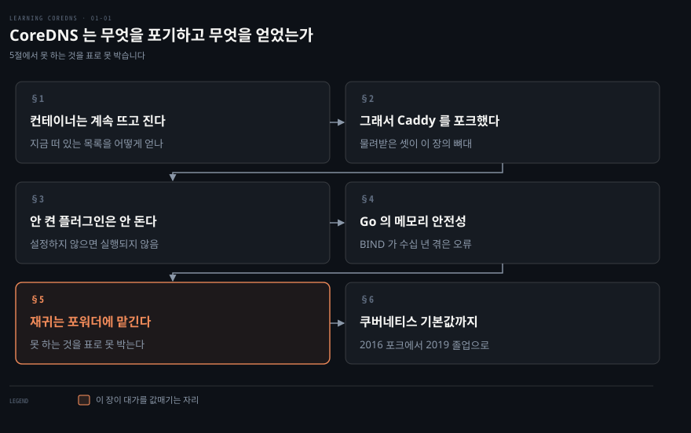
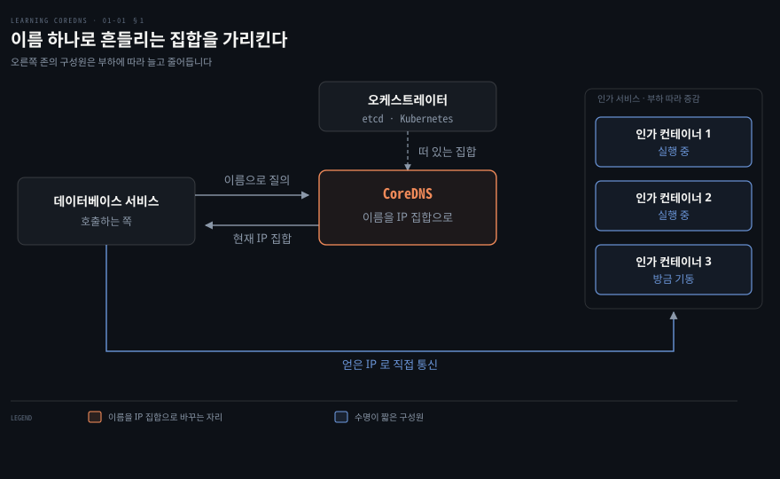
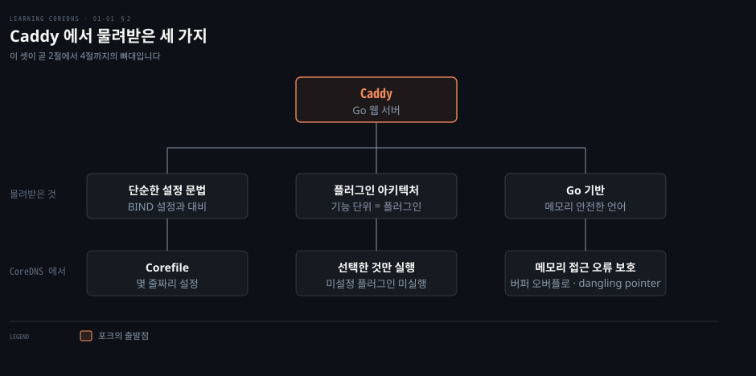
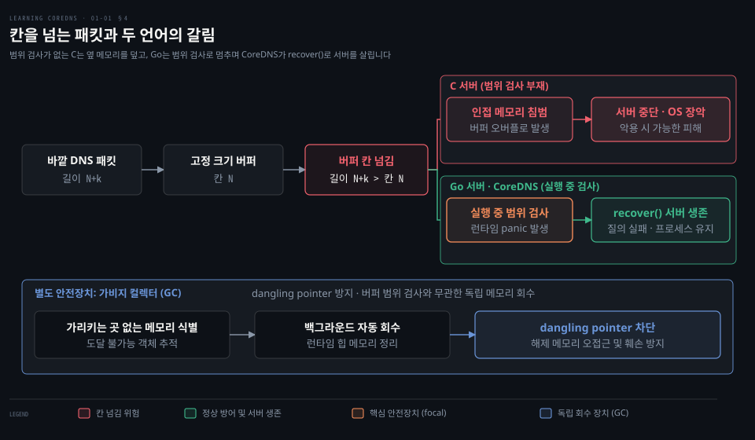
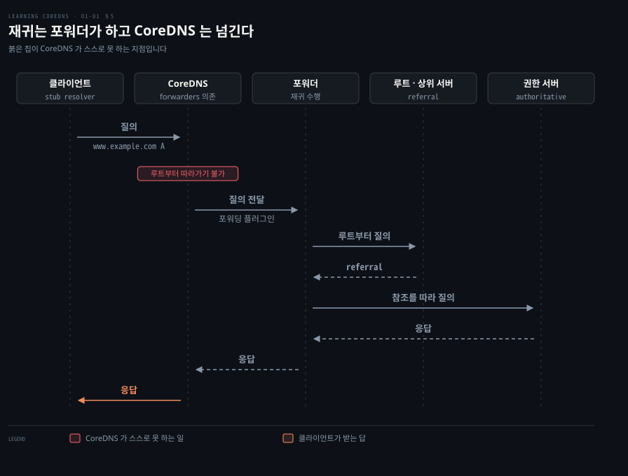
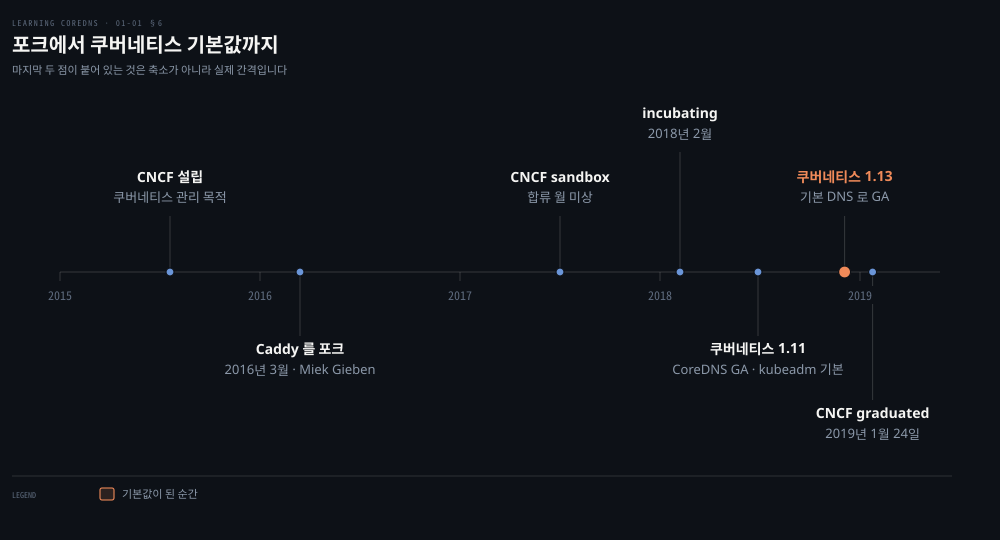

# CoreDNS는 무엇을 포기하고 무엇을 얻었는가

---

> CoreDNS는 전통 DNS 서버의 기능을 다 갖추는 대신 컨테이너 오케스트레이터와 말이 통하는 쪽을 골랐습니다. 이 노트는 원서 1장을 그 교환의 대차대조표로 읽습니다.

## 핵심 요약

> 이 노트가 1장에서 읽어 낸 하나의 생각은 CoreDNS가 DNS 서버를 더 잘 만든 결과가 아니라, 컨테이너 환경의 서비스 디스커버리를 풀려고 기능을 덜어낸 서버라는 것입니다.

컨테이너가 부하에 따라 뜨고 지는 환경에서는 호출자가 "지금 떠 있는 목록"을 미리 알 수 없습니다. BIND(Berkeley Internet Name Domain)는 가장 오래 쓰여 온 DNS 서버 구현입니다. 이 BIND와 견줄 때 CoreDNS가 내준 것은 완전 재귀입니다. 완전 재귀는 루트 서버부터 참조를 따라가며 답을 스스로 찾아내는 기능입니다.

CoreDNS는 분산 키-값 저장소인 etcd, 그리고 쿠버네티스 같은 오케스트레이터와 직접 통신하는 능력을 얻었습니다. 반면 기본 빌드에 완전 재귀는 없고, 동적 업데이트는 v1.15.0부터 실험적인 dynupdate 플러그인으로 지원합니다. 쿠버네티스 1.13이 CoreDNS를 기본 DNS로 삼았습니다.


## 학습 목표

이 내용을 읽고 나면:

1. CoreDNS가 풀려는 문제가 왜 전통 DNS 서버의 문제와 다른지 설명할 수 있습니다.
2. Caddy에서 물려받은 세 가지가 각각 CoreDNS의 어떤 성질이 되었는지 짝지어 말할 수 있습니다.
3. 플러그인을 설정하지 않는 것이 왜 속도와 보안 양쪽에 걸리는지 근거와 함께 말할 수 있습니다.
4. CoreDNS가 완전 재귀를 못 한다는 말의 뜻을 질의 경로로 그려 설명할 수 있습니다.
5. 5절 비교표의 여섯 항목을 근거로 CoreDNS와 BIND 중 무엇을 쓸지 판단할 수 있습니다.

아래 지도에서 색이 붙은 칸은 얻은 기능과 내준 기능을 비교하는 자리입니다.




## 이 문서가 다루지 않는 것

> 이미 정리된 노트가 있는 주제는 링크로 넘깁니다.

- DNS 프로토콜 기초와 재귀의 상세 → [위임이 그은 경계가 질의 경로를 정한다](./02-01.%EC%9C%84%EC%9E%84%EC%9D%B4%20%EA%B7%B8%EC%9D%80%20%EA%B2%BD%EA%B3%84%EA%B0%80%20%EC%A7%88%EC%9D%98%20%EA%B2%BD%EB%A1%9C%EB%A5%BC%20%EC%A0%95%ED%95%9C%EB%8B%A4.md), 그리고 [네트워크 로드맵 1단계 DNS resolver](../../../02_os/network-keywords.md)
- 쿠버네티스 안에서 CoreDNS를 배치하고 설정하는 법 → [Kubernetes 레코드](./06-01.%EB%AC%B4%EC%97%87%EC%9D%84%20%EC%84%A0%EC%96%B8%ED%96%88%EB%8A%90%EB%83%90%EA%B0%80%20%EB%A0%88%EC%BD%94%EB%93%9C%20%EB%AA%A8%EC%96%91%EC%9D%84%20%EC%A0%95%ED%95%9C%EB%8B%A4.md)
- Corefile 문법과 플러그인별 설정 → [Corefile은 라벨로 서버를 가른다](./03-01.Corefile%EC%9D%80%20%EB%9D%BC%EB%B2%A8%EB%A1%9C%20%EC%84%9C%EB%B2%84%EB%A5%BC%20%EA%B0%80%EB%A5%B8%EB%8B%A4.md)
- 클러스터 DNS를 패킷과 정책 관점에서 본 것 → [NetworkPolicy와 DNS](../networking-and-kubernetes/04-03.NetworkPolicy%EC%99%80%20DNS%20%E2%80%94%20%ED%81%B4%EB%9F%AC%EC%8A%A4%ED%84%B0%20%EC%95%88%EC%9D%98%20%EB%B0%A9%ED%99%94%EB%B2%BD%EA%B3%BC%20%EC%9D%B4%EB%A6%84.md)
- 질의를 보내는 쪽의 동작, 곧 `resolv.conf`·ndots·search domain → [명세 밖으로 나가면 이식성을 내준다](./06-04.%EB%AA%85%EC%84%B8%20%EB%B0%96%EC%9C%BC%EB%A1%9C%20%EB%82%98%EA%B0%80%EB%A9%B4%20%EC%9D%B4%EC%8B%9D%EC%84%B1%EC%9D%84%20%EB%82%B4%EC%A4%80%EB%8B%A4.md)


## 1. 컨테이너는 계속 뜨고 지는데 상대를 어떻게 찾는가

> 인가 서비스의 컨테이너가 부하에 따라 늘고 줄면 호출자는 지금 떠 있는 것들의 IP를 미리 알 수 없습니다. 이 물음의 답이 DNS입니다.



컨테이너는 아주 가볍고 효율적인 가상머신으로 생각하면 됩니다. 가상머신이 하이퍼바이저를 통해 하나의 하드웨어를 나눠 쓴다면, 컨테이너는 같은 OS 커널 아래에서 돌면서 가상머신에 준하는 격리를 제공합니다. 기동과 정지는 훨씬 빠릅니다.

컨테이너의 빠른 기동과 정지는 서비스 주소를 계속 바꿉니다. 마이크로서비스 구조에서는 애플리케이션을 작고 명확한 기능 단위로 나눕니다. 사용자 인증 서비스와 인가 서비스가 그 예입니다. 애플리케이션 전체에서는 수십에서 수백 개 서비스가 네트워크로 통신합니다.

마이크로서비스 하나는 컨테이너 하나 또는 여럿으로 제공되고, 상위 오케스트레이터는 수요에 맞춰 컨테이너를 늘리고 줄입니다. 데이터베이스 서비스 컨테이너가 검색 허용 여부를 물으려고 인가 서비스를 호출하려면 지금 실행 중인 인가 컨테이너가 어디 있는지 알아야 합니다. 이 상황이 서비스 디스커버리 문제입니다.

그 해법은 대개 DNS입니다. 컨테이너 사이의 네트워크 통신은 거의 언제나 IP 기반이고 개발자는 수십 년 동안 자원의 IP 주소를 찾는 데 DNS를 써 왔습니다. 그러니 특정 서비스를 제공하는 컨테이너를 찾는 데도 DNS를 쓰는 것이 자연스러운 선택입니다. 다만 DNS로 찾은 주소는 캐시에 남아 TTL이 지나야 출처에 다시 묻습니다[^rfc1034]. 변경을 알리는 NOTIFY도 주 서버가 보조 서버에 보내는 장치라서, 캐시에 바뀐 값을 밀어 주지는 않습니다[^rfc1996]. 자세한 동작은 [TTL 에 기대는 클라이언트](./05-01.%EC%83%81%ED%83%9C%EB%A5%BC%20%EB%B0%96%EC%97%90%20%EB%91%90%EC%96%B4%EC%95%BC%20%EC%9D%B4%EB%A6%84%EC%9D%B4%20%EC%B4%88%20%EB%8B%A8%EC%9C%84%EB%A1%9C%20%EB%B0%94%EB%80%90%EB%8B%A4.md#ttl-%EC%97%90-%EA%B8%B0%EB%8C%80%EB%8A%94-%ED%81%B4%EB%9D%BC%EC%9D%B4%EC%96%B8%ED%8A%B8)에서 다룹니다.

CoreDNS는 etcd나 쿠버네티스 같은 기반 시설과 직접 통신해 여러 컨테이너 오케스트레이션 시스템과 통합됩니다.


## 2. 그래서 Caddy를 포크했다

> Miek Gieben은 2016년에 CoreDNS 초판을 썼습니다. 출발점은 다른 DNS 서버가 아니라 Caddy라는 Go 기반 웹 서버였습니다.



Miek Gieben은 CoreDNS 이전에 DNS 서버 SkyDNS와 Go 언어의 DNS 함수 라이브러리인 Go DNS를 만들었습니다. SkyDNS도 서비스 디스커버리를 지원하려고 만들었습니다. 그는 Go 기반 웹 서버 Caddy의 아키텍처를 높이 사서 새 DNS 서버를 처음부터 짜는 대신 Caddy를 포크했습니다.

포크로 물려받은 것은 단순한 설정 문법, 플러그인 아키텍처, Go라는 토대입니다.

CoreDNS의 설정 파일은 Corefile이고 BIND 설정 파일과 견주면 문법이 단순합니다. 기본적인 서버의 Corefile은 대개 몇 줄이면 끝납니다.

플러그인 아키텍처는 "켠 것만 돈다"는 성질로, Go 기반은 일반적인 Go 코드의 "메모리 접근 오류가 없다"는 장점으로 이어집니다.


## 3. 안 켠 플러그인은 코드가 돌지 않는다

> CoreDNS는 DNS 기능을 플러그인으로 제공합니다. 필요 없는 플러그인은 설정하지 않고, 설정하지 않으면 그 코드는 실행되지 않습니다.

플러그인은 CoreDNS의 기능 한 칸이며, 캐시나 로그처럼 바깥과 상관없는 기능도 플러그인입니다. 플러그인의 예로는 다음 넷이 있습니다.

- **캐싱용**: 응답을 캐시합니다.
- **포워딩용**: 질의를 다른 서버로 넘깁니다.
- **주 서버 설정용**: 파일에서 존 데이터를 읽습니다.
- **보조 서버 설정용**: 보조 DNS 서버를 구성합니다.

설정하지 않은 플러그인의 코드가 실행되지 않는 덕에 CoreDNS는 더 빠르고 더 안전해집니다.

기본 빌드 플러그인은 v1.15.0 기준 62개 중 61개가 저장소 안에 있고 실행 파일에 모두 들어 있습니다. 하지만 Corefile에 적은 플러그인만 질의 체인에 놓입니다[^pluginchain]. 체인에 없는 코드는 질의마다 거치는 단계를 늘리지 않으니 속도가 붙습니다.

바깥에서 온 패킷이 닿을 수 있는 코드만 공격 대상이 됩니다. 예를 들어 Corefile에 `dynupdate`를 적지 않으면 그 플러그인에 버그가 있어도 바깥 질의 패킷이 닿지 못합니다. 기능을 켜는 만큼만 위험을 지는 구조입니다.

기능을 넓히려면 직접 플러그인을 만들 수 있고 그 방법은 [네 함수를 구현하면 체인의 한 칸이 된다](./09-02.%EB%84%A4%20%ED%95%A8%EC%88%98%EB%A5%BC%20%EA%B5%AC%ED%98%84%ED%95%98%EB%A9%B4%20%EC%B2%B4%EC%9D%B8%EC%9D%98%20%ED%95%9C%20%EC%B9%B8%EC%9D%B4%20%EB%90%9C%EB%8B%A4.md)가 다룹니다.


## 4. Go의 메모리 안전성이 DNS 서버에서 갖는 무게

> Go는 반납된 메모리를 다른 곳이 쓰는 문제(dangling pointer)는 GC로, 칸 밖을 읽고 쓰는 문제(버퍼 오버플로)는 실행 중 범위 검사로 막습니다. 인터넷의 누구나 질의를 보낼 수 있는 DNS 서버라서 이 성질이 특히 중요합니다.

DNS 서버는 인터넷에 있는 누구나 접근할 수 있는 서비스입니다. 악의를 가진 쪽이 버퍼 오버플로를 악용하면 DNS 서버를 죽이거나 더 나아가 그 밑의 운영체제를 장악할 수도 있습니다.

이것이 현실의 위협이라는 근거로 저자는 BIND를 듭니다. 수십 년의 역사 동안 BIND에서 나온 심각한 취약점 가운데 상당수가 메모리 접근 오류에서 비롯됐습니다. CoreDNS를 쓰면 그 부류의 위험이 크게 줄어든다는 것이 저자의 결론입니다. 다만 `unsafe` 나 C 코드와 맞닿는 부분까지 언어가 보호하는 것은 아닙니다.

언어가 제공하는 안전장치는 둘로 나뉩니다. 하나는 반납된 메모리를 다른 곳이 쓰는 dangling pointer를 막는 GC입니다[^gogc]. 다른 하나는 칸 밖을 읽고 쓰는 버퍼 오버플로를 막는 실행 중 범위 검사입니다. 범위를 벗어난 인덱스에 접근하면 런타임 panic이 일어납니다[^gospec].

칸 밖을 읽기만 하는 버퍼 과다 읽기[^cwe125]도 Heartbleed처럼 개인 키 같은 민감한 정보를 새게 하며[^heartbleed], Go의 범위 검사는 이런 읽기에도 panic을 일으킵니다[^gospec]. CoreDNS 서버는 플러그인에서 발생한 panic을 `recover()`로 받아 서버 전체가 비정상 종료되지 않도록 살립니다[^corednspanic].

C에는 이 두 안전장치가 모두 없어 사람이 메모리를 직접 지켜야 합니다.



여기서 줄어드는 위험은 메모리 접근 오류입니다. Go가 설정 실수나 논리 결함까지 막아 주지는 않습니다.


## 5. CoreDNS가 못 하는 것

> v1.15.0 기본 빌드 기준으로 CoreDNS는 완전 재귀를 지원하지 않습니다. 루트부터 참조를 따라 내려가는 일은 포워더라 불리는 다른 DNS 서버에 맡깁니다.



완전 재귀는 루트 DNS 서버에서 시작합니다. 돌아온 참조를 따라 다음 서버에 질의하고 권한 서버가 답할 때까지 반복합니다. 재귀와 포워더는 [위임이 그은 경계가 질의 경로를 정한다 §6](./02-01.%EC%9C%84%EC%9E%84%EC%9D%B4%20%EA%B7%B8%EC%9D%80%20%EA%B2%BD%EA%B3%84%EA%B0%80%20%EC%A7%88%EC%9D%98%20%EA%B2%BD%EB%A1%9C%EB%A5%BC%20%EC%A0%95%ED%95%9C%EB%8B%A4.md)에서 자세히 다룹니다.

CoreDNS가 자기 몫으로 남기는 것은 질의를 받고 넘기고 되돌려 주는 일입니다. 이 한계가 클러스터 안에서 잘 드러나지 않는 이유는 클러스터 이름을 CoreDNS가 직접 답하고 바깥 이름만 포워더로 나가기 때문입니다. 실제 배치에서 그 경계가 어디인지는 [기본 Corefile](./06-02.%EA%B8%B0%EB%B3%B8%20Corefile%EC%9D%98%20%EC%A4%84%EB%A7%88%EB%8B%A4%20%EC%9D%B4%EC%9C%A0%EA%B0%80%20%EC%9E%88%EB%8B%A4.md)가 다룹니다.

CoreDNS와 BIND의 기능 차이는 다음 표와 같습니다.

| 기능 | CoreDNS | BIND |
|------|---------|------|
| 완전 재귀 | 없음 | 있음 |
| 동적 업데이트 | 실험적 | 있음 |
| 쿠버네티스 연동 | 있음 | 없음 |
| Amazon Route 53 연동 | 있음 | 없음 |
| DNSSEC 지원 | 제한적 | 완전 |
| DNS over TLS(DoT) 지원 | 있음 | 있음 |

이 표를 어느 쪽이 앞서느냐로 갈라 읽으면 CoreDNS가 앞서는 줄은 쿠버네티스 연동과 Amazon Route 53 연동 둘뿐입니다. BIND가 앞서는 줄은 완전 재귀와 완전한 DNSSEC 지원입니다. 동적 업데이트(CoreDNS 쪽은 실험적)와 DoT는 두 서버 모두 지원합니다.

CoreDNS에서 레코드를 갱신하는 길은 둘로 갈립니다. 하나는 `dynupdate` 플러그인으로 DNS UPDATE 메시지를 직접 받는 길입니다. 다른 하나는 [5장의 etcd 플러그인](./05-01.%EC%83%81%ED%83%9C%EB%A5%BC%20%EB%B0%96%EC%97%90%20%EB%91%90%EC%96%B4%EC%95%BC%20%EC%9D%B4%EB%A6%84%EC%9D%B4%20%EC%B4%88%20%EB%8B%A8%EC%9C%84%EB%A1%9C%20%EB%B0%94%EB%80%90%EB%8B%A4.md)처럼 외부 저장소 API로 바꾸는 길입니다. `dynupdate`는 v1.15.0부터 인증된 UPDATE 메시지를 받습니다[^dynupdate]. 다만 실험적 기능이며 TSIG 인증과 명시적인 허용 규칙이 필요합니다.

DNSSEC과 DoT는 서로 다른 보안 문제를 풉니다. DNSSEC은 응답 레코드에 전자서명을 붙여 데이터 출처를 인증하고 위조를 막습니다. 이 확장은 패킷을 암호화하지는 않습니다[^rfc4033]. 반면 DoT는 클라이언트와 서버 사이 전송 구간을 TLS로 암호화해 도청과 변조를 막습니다. 하지만 DoT는 도청 위험을 다루려는 설계이고 DNS의 다른 보안 문제는 다루지 않으므로, 데이터 자체의 출처를 증명하지는 않습니다[^rfc7858].

BIND는 2022년의 9.18부터 DoT와 DoH를 지원합니다[^bind918]. CoreDNS에는 DoT 외에도 DoH를 지원하는 `https`와 DoH3를 지원하는 `https3`, DoQ(DNS over QUIC)를 지원하는 `quic` 플러그인이 있습니다[^plugins].

CoreDNS 공식 플러그인 목록에 루트부터 시작하는 재귀 해석기는 없습니다. `forward` 플러그인은 상류 리졸버로 DNS 메시지를 프록시한다고만 적혀 있습니다[^plugins]. 외부 `unbound` 플러그인을 넣어 다시 빌드하면 재귀가 되지만[^unbound], 위 표는 기본 빌드 기준입니다.

CoreDNS의 DNSSEC 지원이 제한적인 이유는 기본 빌드에 서명 쪽만 있고 검증 쪽이 없기 때문입니다. `dnssec` 플러그인은 서빙하는 데이터에 즉석 서명을 붙이고, `sign` 플러그인은 존 파일에 미리 서명합니다[^plugins]. 검증 기능은 외부 `unbound` 플러그인을 빌드에 추가해야 동작합니다[^unbound].


## 6. 쿠버네티스 기본값이 되기까지

> CoreDNS는 2017년 CNCF에 제출돼 2019년 1월에 졸업했고, 그 직전인 2018년 12월에 쿠버네티스 1.13이 CoreDNS를 기본 DNS 서버로 삼았습니다.



클러스터의 이름 해석을 CoreDNS에 맡길 근거는 CNCF와의 관계와 쿠버네티스 기본값 채택입니다. 둘 다 프로젝트의 성숙도와 채택 범위를 보여 주는 근거이며 성능 수치는 아닙니다.

쿠버네티스는 원래 구글에서 만들어졌고 2014년에 오픈소스 프로젝트로 전환됐습니다[^k8sopen]. 새로 공개된 쿠버네티스를 관리하려고 구글은 리눅스 재단과 손잡고 클라우드 네이티브 컴퓨팅 재단, 줄여서 CNCF를 세웠습니다. CNCF 프로젝트는 초기 단계의 sandbox, 채택이 늘어나는 incubating, 넓게 쓰일 만큼 성숙한 graduated 순으로 올라갑니다.

쿠버네티스가 CoreDNS로 바꾼 이유는 같은 언어(Go)가 아니라 kube-dns의 신뢰성·유연성·보안 문제였습니다. CoreDNS는 kube-dns가 컨테이너 셋으로 나눠 하던 일을 한 컨테이너에서 맡았습니다[^k8sga].

쿠버네티스 쪽 전환은 두 단계였습니다. 2018년 6월의 1.11에서 CoreDNS가 GA가 되어 클러스터 설치 도구인 kubeadm의 기본값이 됐습니다.[^k8s111] GA(General Availability)는 시험 단계를 마치고 정식 기능이 됐다는 뜻입니다.

2018년 12월 1.13에서 GA로 졸업한 것은 CoreDNS 자체가 아니라 기본 DNS라는 지위입니다.[^k8s113]

CNCF 날짜로는 생성이 2016년 3월, sandbox 합류가 2017년, incubating 승격이 2018년 2월, 졸업이 2019년 1월 24일입니다.[^cncf]


## 결정 치트시트

> 1장만으로도 가를 수 있는 판단을 모았습니다. 근거는 5절의 비교표와 본문입니다.

| 상황 | 선택 | 이유 |
|------|------|------|
| 쿠버네티스 클러스터 안에서 서비스 이름을 풀어야 한다 | CoreDNS | 오케스트레이터와 직접 연동되고 1.13부터 기본값 |
| 인터넷 이름을 스스로 끝까지 해석해야 한다 | CoreDNS 단독으로는 안 됨 | 완전 재귀 미지원, 포워더를 따로 둬야 함 |
| 동적 업데이트로 존 데이터를 갱신해야 한다 | 성숙도는 BIND 쪽, CoreDNS도 가능 | CoreDNS도 v1.15.0 dynupdate가 지원하지만 실험적이며 TSIG 인증 필수 |
| DNSSEC 검증까지 필요하다 | CoreDNS 단독으로는 부족 | 기본 빌드에는 서명 플러그인만 있고 검증기가 없음 |
| 설정을 짧게 유지하고 필요한 기능만 켜고 싶다 | CoreDNS | 안 켠 플러그인은 코드가 실행되지 않음 |
| 인터넷에 열리는 서버에서 메모리 접근 오류가 걱정된다 | 그 부류만 놓고 보면 CoreDNS | 언어가 그 부류를 막아 줌. 동적 업데이트·DNSSEC 요구가 있으면 위 행이 먼저 |


## 적용 관점

> 이 장에서 해 볼 일은 내가 쓰는 클러스터의 DNS를 눈으로 확인하는 것 하나입니다.

**한 가지 실행**: 다음에 클러스터를 열 때 `kube-system` 네임스페이스에서 DNS를 맡은 워크로드가 무엇인지 확인하고 그것이 읽는 Corefile을 열어 몇 줄인지 세어 봅니다. 2절의 "대개 몇 줄이면 끝난다"는 말을 직접 검증하는 일입니다.

```bash
kubectl -n kube-system get deploy
kubectl -n kube-system get configmap -o name
```

클러스터 안의 Spring 앱이 다른 서비스를 호출할 때 그 이름을 IP로 바꾸는 주체가 CoreDNS입니다. 반대편인 클라이언트 동작, 곧 `resolv.conf`와 ndots와 JVM DNS 캐시는 [네트워크 로드맵 1단계](../../../02_os/network-keywords.md)가 맡습니다.


## 면접에서 받을 만한 질문

> 자답한 뒤 아래 정답과 맞춰 봅니다.

1. CoreDNS를 한 줄로 정의해 보십시오.
2. CoreDNS는 왜 처음부터 새로 짜지 않고 웹 서버를 포크해 만들어졌습니까?
3. "플러그인을 설정하지 않으면 더 안전하다"는 말은 무슨 뜻입니까?
4. CoreDNS가 완전 재귀를 지원하지 않는다는 것은 실무에서 무엇을 뜻합니까?
5. 컨테이너 환경에서 서비스 디스커버리에 DNS를 쓰는 이유는 무엇입니까?
6. CoreDNS와 BIND 중 하나를 골라야 한다면 어떤 기준으로 가르겠습니까?


## 정답 (자답 후 펼치기)

### 정답 1 — 한 줄 정의

CoreDNS는 DNS 서버 소프트웨어입니다. 컨테이너 환경, 특히 쿠버네티스가 관리하는 환경에서 서비스 디스커버리 기능을 받치는 데 흔히 쓰입니다.

### 정답 2 — 포크의 이유

Miek Gieben이 Caddy라는 Go 기반 웹 서버의 아키텍처를 높이 샀기 때문입니다. 포크 덕분에 CoreDNS는 단순한 설정 문법과 플러그인 기반 아키텍처, Go라는 토대를 한꺼번에 물려받았습니다.

### 정답 3 — 설정하지 않은 플러그인

CoreDNS에서는 필요 없는 플러그인을 설정하지 않으면 그 코드가 실행되지 않아 더 빠르고 더 안전합니다. 실행되지 않는 코드는 질의 처리 단계를 늘리지 않고, 바깥 입력이 닿는 공격 표면도 되지 않습니다.

### 정답 4 — 완전 재귀 미지원

CoreDNS는 루트 DNS 서버부터 참조를 따라가 권한 서버에 닿는 일을 스스로 하지 못합니다. 그래서 그 일을 대신할 포워더를 따로 두어야 합니다. 쿠버네티스 안이라면 클러스터 이름은 CoreDNS가 직접 답하고 바깥 이름만 이 경로를 탑니다.

### 정답 5 — 왜 DNS인가

컨테이너 사이 통신이 거의 언제나 IP 기반이고 개발자가 수십 년 동안 자원의 IP를 찾는 데 DNS를 써 왔기 때문입니다.

### 정답 6 — 가르는 기준

무엇을 못 해도 되는지로 가릅니다. 완전 재귀와 DNSSEC 검증이 필요하면 BIND 쪽이고, 쿠버네티스나 Route 53 연동이 필요하면 CoreDNS입니다. 동적 업데이트는 CoreDNS도 v1.15.0부터 dynupdate 플러그인으로 지원하지만 실험적이며 TSIG 인증이 필수입니다. DoT는 BIND 9.18부터 양쪽 모두 지원하므로 가르는 기준이 되지 못합니다.


## 핵심 개념 체크리스트

- [ ] CoreDNS가 무엇이고 어떤 환경을 겨냥해 만들어졌는지 한 문장으로 말할 수 있는가?
- [ ] Caddy에서 물려받은 세 가지를 각각의 결과와 짝지어 댈 수 있는가?
- [ ] 플러그인을 켜지 않는 것이 왜 속도와 보안 양쪽에 걸리는지 설명할 수 있는가?
- [ ] 완전 재귀의 정의를 루트와 참조와 권한 서버라는 말로, 포워더가 끼는 질의 경로로 설명할 수 있는가?
- [ ] 5절 비교표의 여섯 항목을 각 서버가 앞서는 기능과 양쪽 모두 지원하는 기능으로 갈라 둘 중 하나를 고를 수 있는가?


## 관련 문서

- [Learning CoreDNS 정독 인덱스](./README.md) — 이 책의 장별 진행 상황
- [Kubernetes 레코드](./06-01.%EB%AC%B4%EC%97%87%EC%9D%84%20%EC%84%A0%EC%96%B8%ED%96%88%EB%8A%90%EB%83%90%EA%B0%80%20%EB%A0%88%EC%BD%94%EB%93%9C%20%EB%AA%A8%EC%96%91%EC%9D%84%20%EC%A0%95%ED%95%9C%EB%8B%A4.md) — 쿠버네티스 클러스터 DNS 레코드
- [NetworkPolicy와 DNS](../networking-and-kubernetes/04-03.NetworkPolicy%EC%99%80%20DNS%20%E2%80%94%20%ED%81%B4%EB%9F%AC%EC%8A%A4%ED%84%B0%20%EC%95%88%EC%9D%98%20%EB%B0%A9%ED%99%94%EB%B2%BD%EA%B3%BC%20%EC%9D%B4%EB%A6%84.md) — 같은 주제를 패킷과 정책 관점에서
- [질문과 답이 어긋나면 클라이언트가 버린다 §9](./07-01.%EC%A7%88%EB%AC%B8%EA%B3%BC%20%EB%8B%B5%EC%9D%B4%20%EC%96%B4%EA%B8%8B%EB%82%98%EB%A9%B4%20%ED%81%B4%EB%9D%BC%EC%9D%B4%EC%96%B8%ED%8A%B8%EA%B0%80%20%EB%B2%84%EB%A6%B0%EB%8B%A4.md) — 필터링 DNS 로 이름 해석을 막는 가정용 사례
- [OS 네트워크 딥다이브 로드맵](../../../02_os/network-keywords.md) — resolver 클라이언트 측 범위의 SSOT


## 참고 자료

- 원서: 《Learning CoreDNS: Configuring DNS for Cloud Native Environments》 1장 Introduction
- 서지: John Belamaric·Cricket Liu, O'Reilly, 2019년, ISBN 978-1492047964 (출간 월은 판매처마다 9월·11월로 갈려 연도까지만 적습니다)
- [CoreDNS 플러그인 목록](https://coredns.io/plugins/) — 현재 제공되는 플러그인의 1차 자료
- [Kubernetes 1.13 릴리스 발표](https://kubernetes.io/blog/2018/12/03/kubernetes-1-13-release-announcement/) — CoreDNS 기본값 승격
- [CNCF CoreDNS 졸업 발표](https://www.cncf.io/announcements/2019/01/24/coredns-graduation/) — 성숙도 단계별 날짜

[^plugins]: CoreDNS 공식 플러그인 목록 — `forward`는 상류 리졸버 프록시, `dnssec`은 즉석 서명, `sign`은 존 파일 서명("sign adds DNSSEC records to zone files", <https://coredns.io/plugins/sign/>), `https`·`https3`·`quic`은 암호화 전송 서버 옵션. <https://coredns.io/plugins/> (2026-09-02 조회, `sign` 은 2026-09-23 조회)

[^cncf]: CNCF, "CoreDNS Graduates" — "The project was created in March 2016 by Miek Gieben", "CoreDNS later joined the Cloud Native Sandbox in 2017", "became an Incubating project in February 2018". 본문 dateline 이 "January 24, 2018"로 적혀 있으나 URL 과 "first project of 2019 to graduate" 서술로 보아 2019년이 맞습니다. <https://www.cncf.io/announcements/2019/01/24/coredns-graduation/> (2026-09-02 조회)

[^unbound]: CoreDNS 외부 플러그인 `unbound` — "unbound - perform recursive queries using libunbound", "Maintained by CoreDNS", "Unbound uses DNSSEC by default when resolving". <https://coredns.io/explugins/unbound/> (2026-09-23 조회)

[^bind918]: BIND 9.18.0 릴리스 노트 — "Support for DNS over TLS (DoT) has been added to named", "TLS is used by both DNS over TLS (DoT) and DNS over HTTPS (DoH)." <https://bind9.readthedocs.io/en/v9.18.0/notes.html> (2026-09-23 조회)

[^k8s111]: Kubernetes 1.11 릴리스 발표 — "CoreDNS Promoted to General Availability", "CoreDNS is now available as a cluster DNS add-on option, and is the default when using kubeadm." <https://kubernetes.io/blog/2018/06/27/kubernetes-1.11-release-announcement/> (2026-09-23 조회)

[^k8sopen]: Kubernetes 공식문서 Overview — "Google open sourced the Kubernetes project in 2014." <https://kubernetes.io/docs/concepts/overview/> (2026-09-02 조회)

[^k8s113]: Kubernetes 1.13 릴리스 발표 — "Notable features graduating in this release include: simplified cluster management with kubeadm, Container Storage Interface (CSI), and CoreDNS as the default DNS." <https://kubernetes.io/blog/2018/12/03/kubernetes-1-13-release-announcement/> (2026-09-02 조회)

[^dynupdate]: CoreDNS dynupdate 플러그인 — "accepts authenticated RFC 2136 DNS UPDATE messages for an explicit, opt-in authoritative zone"(:5-6), "UPDATE requests must carry a TSIG that has been validated by the *tsig* plugin."(:20-21), "Every mutation must also match an explicit `allow` rule containing the key name, owner name, and RR type."(:21-23), "The plugin is experimental"(:38). <https://github.com/coredns/coredns/blob/v1.15.0/plugin/dynupdate/README.md>

[^rfc4033]: RFC 4033 — "The DNS security extensions provide origin authentication and integrity protection for DNS data ... These extensions do not provide confidentiality." <https://www.rfc-editor.org/rfc/rfc4033.txt>

[^rfc7858]: RFC 7858 — Abstract "Encryption provided by TLS eliminates opportunities for eavesdropping and on-path tampering with DNS queries in the network", §1 "By intention, DNSSEC does not protect request and response privacy.", §8 "Use of DNS over TLS is designed to address the privacy risks that arise out of the ability to eavesdrop on DNS messages. It does not address other security issues in DNS", "DNSSEC and DNS over TLS are independent and fully compatible protocols, each solving different problems." <https://www.rfc-editor.org/rfc/rfc7858.txt>

[^rfc1034]: RFC 1034 §3.6 — "The meaning of the TTL field is a time limit on how long an RR can be kept in a cache.", RFC 1035 §3.2.1 — "TTL a 32 bit signed integer that specifies the time interval that the resource record may be cached before the source of the information should again be consulted." <https://www.rfc-editor.org/rfc/rfc1034.txt>, <https://www.rfc-editor.org/rfc/rfc1035.txt>

[^pluginchain]: CoreDNS v1.15.0 `plugin.cfg`의 62개 항목 중 61개는 저장소 안 패키지이며 실행 파일에 함께 링크됩니다(`core/plugin/zplugin.go:5-69`). 하지만 질의 체인에는 Corefile 서버 블록에 디렉티브가 지정된 플러그인만 등록됩니다(`core/dnsserver/server.go:161-185`, CoreDNS가 포크한 `github.com/coredns/caddy` v1.1.4(`go.mod:19`)의 `caddy.go:626-663`). <https://github.com/coredns/coredns/blob/v1.15.0/core/dnsserver/server.go#L161-L185>, <https://github.com/coredns/caddy/blob/v1.1.4/caddy.go#L626-L663>

[^gospec]: Go 명세 Index expressions — "A primary expression of the form a[x] denotes the element of the array, pointer to array, slice, string or map a indexed by x.", "if x is out of range at run time, a run-time panic occurs." 규칙이 쓰기가 아니라 식 `a[x]` 자체에 걸리므로 읽기에도 적용됩니다. <https://go.dev/ref/spec#Index_expressions>

[^corednspanic]: CoreDNS dnsserver — `core/dnsserver/server.go:337-351`의 `defer func() { if rec := recover(); rec != nil { ... } }` 블록에서 플러그인의 panic을 잡고 SERVFAIL로 응답해 서버를 유지합니다. `debug` 플러그인을 켜면 이 블록은 건너뜁니다(`if !s.debug`, `:337`). <https://github.com/coredns/coredns/blob/v1.15.0/core/dnsserver/server.go#L337-L351>

[^rfc1996]: RFC 1996 — "This memo describes the NOTIFY opcode for DNS, by which a master server advises a set of slave servers that the master's data has been changed". <https://www.rfc-editor.org/rfc/rfc1996.txt>

[^gogc]: Go GC 가이드 — "Memory is allocated but never explicitly freed", "Any time after an object becomes unreachable ("dead"), it may be safely recycled by the GC." <https://go.dev/doc/gc-guide> (2026-11-01 조회)

[^k8sga]: Kubernetes 블로그 "CoreDNS GA for Kubernetes Cluster DNS"(2018-07-10) — "there have been some concerns around the reliability, flexibility and security of the implementation", "security vulnerabilities in dnsmasq have led to the need for a security-patch release of Kubernetes in the past", "All of these functions are done in a single container in CoreDNS". <https://kubernetes.io/blog/2018/07/10/coredns-ga-for-kubernetes-cluster-dns/> (2026-11-01 조회)

[^cwe125]: CWE-125 Out-of-bounds Read — "The product reads data past the end, or before the beginning, of the intended buffer.", Common Consequences "Read Memory … An attacker could get secret values such as cryptographic keys, PII, memory addresses, or other information that could be used in additional attacks." <https://cwe.mitre.org/data/definitions/125.html> (CWE 5.0, 2026-11-01 조회)

[^heartbleed]: NVD CVE-2014-0160 — "allows remote attackers to obtain sensitive information from process memory via crafted packets that trigger a buffer over-read, as demonstrated by reading private keys … aka the Heartbleed bug.", 약점 분류 CWE-125. <https://nvd.nist.gov/vuln/detail/CVE-2014-0160> · OpenSSL 보안 권고(2014-04-07) — "A missing bounds check in the handling of the TLS heartbeat extension can be used to reveal up to 64k of memory to a connected client or server." <https://www.openssl.org/news/secadv/20140407.txt> (2026-11-01 조회)
