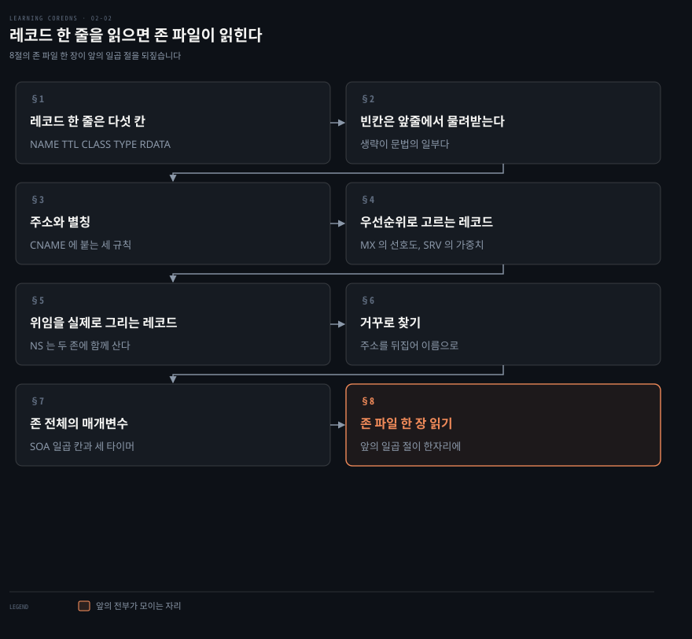
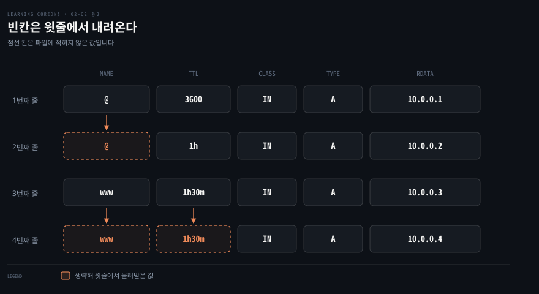
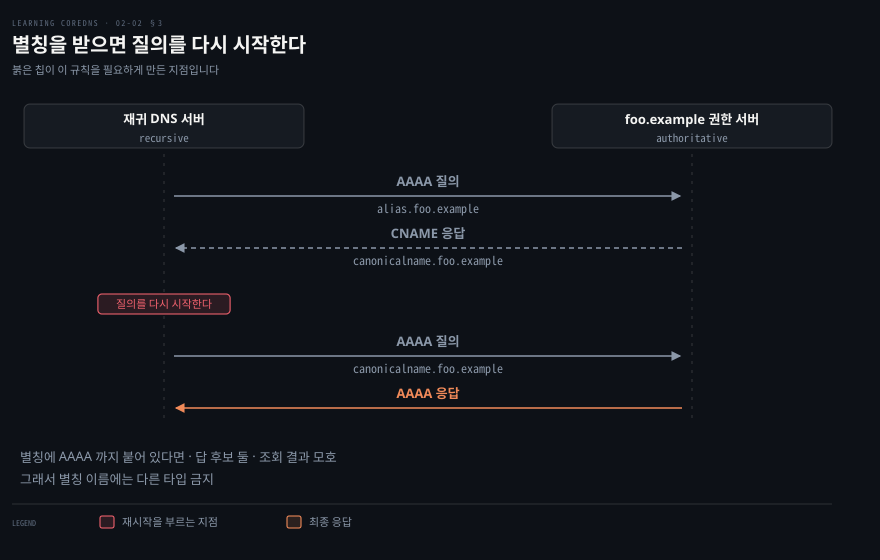
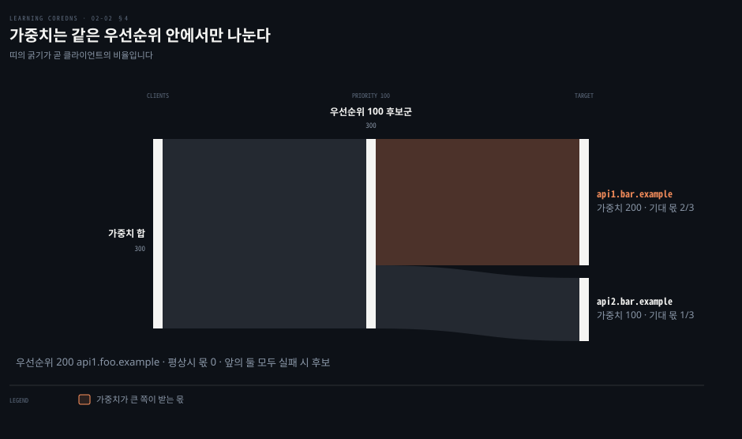
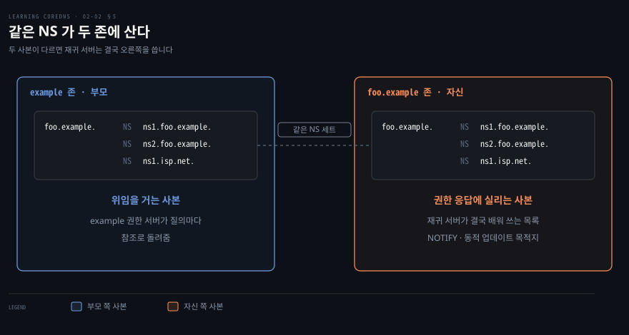
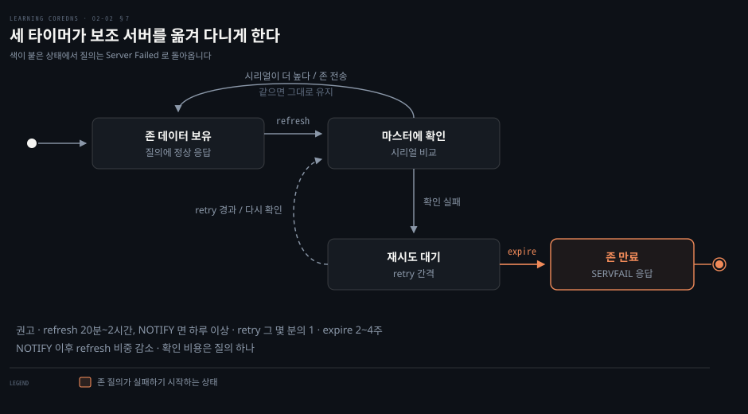

# 레코드 한 줄을 읽으면 존 파일이 읽힌다

---

> 리소스 레코드는 타입마다 다르게 생긴 것 같지만 한 줄의 골격은 모두 같습니다. 그 골격과 생략 규칙을 알면 처음 보는 존 파일도 읽힙니다.

## 핵심 요약

> 이 절 전체가 매달린 하나의 생각은 레코드 한 줄이 `[NAME] [TTL] [CLASS] TYPE RDATA` 라는 다섯 칸이고, 타입마다 달라지는 것은 마지막 칸 하나뿐이라는 것입니다.

모든 타입이 앞의 네 칸을 공유하며 그중 NAME·TTL·CLASS 는 생략해도 됩니다. NAME 과 TTL 은 조건에 따라 가장 최근에 지정된 값을 물려받습니다. CLASS 도 앞서 지정된 값을 물려받습니다. 다만 존 파일에는 대개 `IN` 을 적으므로 대부분 `IN` 으로 읽힙니다. 이 생략 규칙을 모르면 레코드가 어느 이름에 붙는지부터 헷갈립니다.

타입별로 달라지는 것은 마지막 칸인 RDATA 입니다. 주소나 다른 이름을 담기도 하고 우선순위를 함께 적기도 합니다. 각 타입을 살핀 뒤 존 파일 한 장에 이 규칙을 적용해 봅니다.


## 학습 목표

이 내용을 읽고 나면:

1. 마스터 파일 형식의 다섯 칸을 대고 어느 칸이 생략 가능한지 말할 수 있습니다.
2. NAME 과 TTL 이 생략됐을 때 무엇을 물려받는지 예제 줄을 보고 짚을 수 있습니다.
3. 별칭에 다른 타입을 붙이지 못하는 이유를 재귀 서버의 동작으로 설명할 수 있습니다.
4. MX 의 선호도와 SRV 의 우선순위·가중치가 각각 무엇을 고르는지 구분할 수 있습니다.
5. SOA 의 세 타이머가 보조 서버를 어떤 상태로 옮기는지 순서대로 말할 수 있습니다.

아래 지도는 공통 문법에서 타입별 RDATA 를 거쳐 완성된 존 파일로 이어집니다.




## 이 문서가 다루지 않는 것

> 2장 전반부인 이름공간·위임·권한·재귀·캐싱은 앞 편이 맡습니다.

- 도메인과 존의 차이, 위임, 권한, 재귀와 캐싱 → [위임이 그은 경계가 질의 경로를 정한다](./02-01.%EC%9C%84%EC%9E%84%EC%9D%B4%20%EA%B7%B8%EC%9D%80%20%EA%B2%BD%EA%B3%84%EA%B0%80%20%EC%A7%88%EC%9D%98%20%EA%B2%BD%EB%A1%9C%EB%A5%BC%20%EC%A0%95%ED%95%9C%EB%8B%A4.md)
- Corefile 에서 이 존 파일을 어떻게 읽어 들이는지 → [플러그인 일곱이면 서버 하나가 선다](./03-02.%ED%94%8C%EB%9F%AC%EA%B7%B8%EC%9D%B8%20%EC%9D%BC%EA%B3%B1%EC%9D%B4%EB%A9%B4%20%EC%84%9C%EB%B2%84%20%ED%95%98%EB%82%98%EA%B0%80%20%EC%84%A0%EB%8B%A4.md)
- 존 데이터를 파일이 아닌 곳(호스트 테이블·Git·데이터베이스)에서 관리하는 법 → [존 데이터를 어디에 둘지가 관리 방식을 정한다](./04-01.%EC%A1%B4%20%EB%8D%B0%EC%9D%B4%ED%84%B0%EB%A5%BC%20%EC%96%B4%EB%94%94%EC%97%90%20%EB%91%98%EC%A7%80%EA%B0%80%20%EA%B4%80%EB%A6%AC%20%EB%B0%A9%EC%8B%9D%EC%9D%84%20%EC%A0%95%ED%95%9C%EB%8B%A4.md)
- 쿠버네티스가 서비스를 어떤 레코드로 표현하는지 → [무엇을 선언했느냐가 레코드 모양을 정한다](./06-01.%EB%AC%B4%EC%97%87%EC%9D%84%20%EC%84%A0%EC%96%B8%ED%96%88%EB%8A%90%EB%83%90%EA%B0%80%20%EB%A0%88%EC%BD%94%EB%93%9C%20%EB%AA%A8%EC%96%91%EC%9D%84%20%EC%A0%95%ED%95%9C%EB%8B%A4.md)

여기서는 레코드 한 줄의 문법과 타입별 RDATA 를 읽습니다.


## 1. 레코드 한 줄은 다섯 칸이다

> 존 데이터 파일에 레코드가 적히는 형식을 마스터 파일 형식이라 부르고, 그 일반 형태는 다섯 칸입니다.

앞 편의 루트 힌트에서 본 `NS`·`A`·`AAAA` 레코드를 떠올리며 칸을 하나씩 짚어 봅니다.

주 서버가 존 데이터를 읽을 때도, 보조 서버가 백업 존 데이터 파일을 읽을 때도 이 형식을 씁니다.

```bash
[NAME] [TTL] [CLASS] TYPE RDATA
```

대괄호가 붙은 앞의 세 칸은 생략해도 되고 타입과 RDATA 만은 반드시 있어야 합니다.

`A` 나 `AAAA` 같은 타입 표기는 정확히는 **타입 니모닉**이라 부릅니다. 리소스 레코드 타입마다 고유한 니모닉이 있습니다. 회선 위에서는 니모닉이 숫자 타입 코드로 번역되지만 사람에게는 니모닉이 훨씬 외우기 쉽습니다.


## 2. 빈칸은 앞줄에서 물려받는다

> NAME 과 TTL 을 생략하면 가장 최근에 지정된 값을 물려받습니다(TTL 은 `$TTL` 지시어가 없을 때). 존 파일이 처음에 어지러워 보이는 이유가 대개 이 생략입니다.



존 파일에는 이름으로 시작하는 줄과 공백으로 시작하는 줄이 섞여 있습니다. 공백으로 시작하는 줄은 가장 최근에 지정한 이름을 물려받습니다.

NAME 칸에는 레코드가 붙는 도메인 이름을 적습니다. 점으로 끝나면 완전한 이름입니다. 점이 없으면 상대 이름이 되어 뒤에 현재 origin 이 붙습니다. origin 의 기본값은 파일이 기술하는 존의 도메인 이름입니다. 따라서 `foo.example` 의 존 파일에서는 이름마다 `foo.example` 을 반복해 적지 않아도 됩니다.

origin 자체를 가리키려면 NAME 칸에 `@` 를 씁니다. 뒤에 점을 붙이지 않습니다. 루트를 가리키는 점 하나 `.` 도 쓸 수는 있습니다. 다만 루트 존 데이터 파일이나 루트 힌트 파일을 편집할 때가 아니면 NAME 칸에 적을 일이 드뭅니다.

NAME 을 아예 생략한 줄은 반드시 공백으로 시작해야 하고 그 레코드는 **가장 최근에 지정된 도메인 이름**에 붙습니다. 생략한 줄은 가장 최근에 적힌 이름에 붙기 때문에, 그 사이에 다른 이름의 줄을 끼워 넣으면 아래 빈칸 줄이 새로 끼운 이름에 붙습니다.[^rfc1035owner] 앞 공백이 사라지면(편집기의 공백 정리 등) 그 줄의 첫 단어가 이름으로 읽힙니다. 예를 들어 `3600 IN A 10.0.0.4` 의 `3600` 이 이름이 됩니다.

```bash
@                3600    IN   A   10.0.0.1   ; foo.example 에 붙는다. @ 가 origin
foo.example.     3600    IN   A   10.0.0.2   ; 역시 foo.example 에 붙는다
www              3600    IN   A   10.0.0.3   ; www.foo.example 에 붙는다
                 3600    IN   A   10.0.0.4   ; 역시 www.foo.example 에 붙는다
```

존 파일의 주석 기호는 `;` 입니다(7절). `#` 로 주석을 달면 서버가 그 뒤를 레코드의 일부로 읽으려다 실패합니다.

TTL 칸에는 그 레코드의 time-to-live 값이 들어갑니다. 재귀 서버가 레코드를 얼마나 오래 캐시해도 되는지가 이 값으로 정해집니다. 회선 위에서는 32비트 정수 초입니다. 초로 적어도 되지만 배율 표기도 받아 줍니다. `s` 는 초, `m` 은 분, `h` 는 시간, `d` 는 일, `w` 는 주여서 `1d`·`30m`·`1h30m` 처럼 적습니다. 하루를 86400초로 바꿔 적을 필요가 없어집니다.

TTL 을 적지 않으면 파일에 `$TTL` 이 있을 때는 그 값을, 없을 때는 가장 최근에 지정된 TTL 을 씁니다.[^rfc2308ttl] 도식의 넷째 줄이 NAME 과 TTL 을 한꺼번에 물려받는 모습입니다.

```bash
@                3600    IN   A   10.0.0.1   ; TTL 3600초, 곧 한 시간
                 1h      IN   A   10.0.0.2   ; 같은 값
www              1h30m   IN   A   10.0.0.3   ; 한 시간 30분, 곧 90분
                         IN   A   10.0.0.4   ; 앞 레코드의 TTL 이므로 90분
```

CLASS 칸을 생략하면 앞서 지정한 클래스가 이어집니다. 존 파일에서는 거의 항상 `IN` 을 쓰므로 이어받는 값도 대개 `IN` 입니다. 다른 클래스로 ChaosNet 의 `CH` 와 Hesiod 의 `HS` 도 있지만 실제로 쓰이는 모습은 보기 어렵습니다. 그 클래스들이 맡으려던 기능이 자리를 잡지 못한 탓입니다.


## 3. 주소와 별칭

> `A` 와 `AAAA` 는 이름을 주소 하나에 대응시키고, `CNAME` 은 이름을 다른 이름에 대응시킵니다. 마지막 것에만 규칙이 셋 붙습니다.



주소 레코드와 달리 별칭에는 다른 타입을 붙이지 못합니다. 왜 그런지는 재귀 서버가 별칭을 받았을 때의 동작에서 드러납니다.

`A` 레코드는 붙은 도메인 이름을 IPv4 주소 하나에 대응시킵니다. RDATA 에는 IPv4 주소 하나를 옥텟마다 점으로 나눠 적습니다. 한 이름을 여러 주소에 대응시키려면 `A` 레코드를 여러 개 붙이면 됩니다.

```bash
www.foo.example.      300   IN   A   10.0.0.1

www   1h   IN   A   10.0.0.1
      1h   IN   A   10.0.1.1
```

`AAAA` 도 방식은 같고 담는 것만 IPv6 주소입니다. RDATA 는 콜론으로 구분한 표준 16진 표기로 적습니다.

```bash
www   30m    IN   AAAA   2001:db8:42:1::1
      30m    IN   AAAA   2001:db8:42:2::1
```

`CNAME` 은 한 도메인 이름에서 다른 도메인 이름으로 별칭을 만듭니다. 레코드는 **별칭인 쪽**에 붙고 RDATA 는 별칭이 가리키는 정규 이름입니다. `CNAME` 이라는 이름도 이 정규 이름에서 따왔습니다.

```bash
alias.foo.example.       1d   IN   CNAME    canonicalname.foo.example.
```

여기에 규칙이 셋 붙습니다.

1. **별칭인 도메인 이름에는 다른 타입의 레코드를 붙일 수 없습니다.** 이유는 DNS 서버가 `CNAME` 을 처리하는 방식에 있습니다. 재귀 서버가 `alias.foo.example` 의 `AAAA` 를 찾으면 권한 서버에서 위 `CNAME` 을 받습니다. 그러면 재귀 서버는 질의를 다시 시작해 이번에는 `canonicalname.foo.example` 의 `AAAA` 를 찾습니다. 별칭에 `AAAA` 를 직접 붙여도 된다면 `alias.foo.example` 의 `AAAA` 조회 결과가 모호해집니다.
2. **존의 도메인 이름은 `CNAME` 을 가질 수 없습니다.** 앞 규칙의 따름정리입니다. 존의 이름은 정의상 `SOA` 레코드를 가져야 하기 때문입니다. 존 꼭대기(apex)는 그 존의 `SOA` 와 `NS` 를 가진 이름입니다.[^rfc9499apex] 보통 `www` 가 없는 이름(`example.com`)이 꼭대기이지만, 그 이름이 존으로 따로 나뉘어 있을 때만 그렇습니다. 그래서 존의 꼭대기(`example.com`)는 CDN 이 알려 주는 이름을 `CNAME` 으로 가리킬 수 없습니다. 꼭대기에는 `SOA` 와 `NS` 가 이미 있고, 한 이름은 `CNAME` 하나만 갖거나 `CNAME` 이 아닌 레코드만 가져야 하기 때문입니다.[^rfc2181cname] 표준이 이 빈자리를 메우는 길은 `HTTPS` 레코드의 별칭 모드(AliasMode)입니다.[^rfc9460]
3. **별칭이 또 다른 별칭을 가리킬 수는 있습니다.** 다만 루프를 만들지 않도록 조심해야 하고 사슬을 너무 길게 만들어도 안 됩니다. 재귀 서버는 따라갈 `CNAME` 개수를 보통 제한합니다.

별칭에 다른 타입을 못 붙인다는 규칙에는 DNSSEC 예외가 있습니다. DNSSEC 은 레코드에 전자서명을 붙여 응답이 위조되지 않았는지 검증하게 하는 DNS 확장입니다. 서명된 존에서는 `CNAME` 이 있는 이름에 `"appropriate RRSIG and NSEC RRsets are REQUIRED"` 입니다.[^rfc4035]

RRset 은 이름·클래스·타입이 같은 레코드의 묶음이고, `RRSIG` 는 그 묶음에 붙는 서명, `NSEC` 은 그 이름에 있는 타입을 나열해 나머지가 없음을 증명하는 부재 증명 레코드입니다. 이 둘이 필수인 까닭은 붙이지 않으면 `CNAME` 응답 자체를 검증할 수 없기 때문입니다. 사람이 적는 타입은 이 경우에도 붙이지 못합니다.


## 4. 우선순위로 고르는 레코드

> `MX` 는 선호도 하나로 순서를 정하고, `SRV` 는 우선순위로 후보군을 고른 뒤 가중치로 그 안을 나눕니다.



메일 서버의 시도 순서나 여러 서비스 서버의 선택 비율은 이름만으로 정해지지 않습니다. 그래서 MX 와 SRV 는 RDATA 에 숫자를 넣고 그 숫자로 선택 순서와 비율을 정합니다.

### MX — 선호도 하나로 순서

`MX` 는 메일을 받을 서버 목록을 선호도 숫자가 낮은 쪽부터 시도하게 합니다. 한 이름에 `MX` 가 하나라도 있으면 `MX` 를 거치지 않고 그 이름의 `A`·`AAAA` 로 메일을 배달하지는 않습니다. `MX` 가 하나도 없을 때만 주소가 선호도 0 인 `MX` 하나처럼 쓰입니다.[^rfc5321]

`MX` 레코드는 특정 도메인 이름 앞으로 온 메일을 어디로 보낼지 정합니다. 메일 전송 에이전트(MTA, 메일을 받아 다음 서버로 넘기는 프로그램)가 `user@domain.name` 앞으로 온 메시지를 받으면 행선지를 정해야 합니다. `domain.name` 의 `A` 나 `AAAA` 를 볼 수도 있지만 인터넷의 전송 에이전트는 `MX` 를 먼저 찾습니다.

`MX` 는 메일 익스체인저의 도메인 이름과 그에 딸린 선호도 값을 지정합니다. 선호도는 부호 없는 16비트(0~65535)이고 낮은 값이 우선입니다.[^rfc1035mx] 표기할 때는 선호도를 메일 익스체인저보다 앞에 씁니다.

```bash
foo.example.     3d   IN   MX     10 mail.isp.net.
```

메일 서버를 주소가 아닌 이름으로 지정하면 호스팅 서비스가 주소를 바꿔도 존 파일의 MX 를 고칠 필요가 없습니다. 위 예제가 외부 이메일 호스팅 서비스를 쓰는 조직의 경우입니다.

메일을 받지 않는 도메인은 `0 .` 인 `MX` 하나만 두어 선언하고, 이때 다른 `MX` 와 함께 둘 수 없습니다.[^rfc7505]

선호도는 한 이름이 `MX` 를 여럿 가질 때만 의미가 있습니다. 전송 에이전트는 찾은 `MX` 들을 선호도가 낮은 쪽부터 정렬해 가장 낮은 값의 익스체인저에 먼저 배달을 시도합니다. 더 높은 값은 낮은 값을 전부 시도한 뒤에야 차례가 옵니다. 백업 메일 서버는 이 순서를 이용해 둡니다.

```bash
@   3d   IN   MX   0 mail.foo.example.
    3d   IN   MX   10 mail.isp.net.
```

### SRV — 우선순위로 후보, 가중치로 비율, 포트

`SRV` 는 클라이언트가 우선순위 숫자가 가장 낮은 대상부터 붙게 합니다. 같은 우선순위 안에서는 가중치에 비례한 확률로 고르게 하며, 서비스가 도는 포트도 함께 알려 줍니다.[^rfc2782sel]

`SRV` 는 `MX` 가 이메일에 해 준 일을 거의 모든 서비스로 넓힙니다. 도메인 이름과 그 서비스를 실제로 제공하는 서버 사이에 한 겹을 두는 셈입니다.

특이하게도 `SRV` 는 붙는 도메인 이름의 형식이 정해져 있습니다.

```bash
_service._protocol.domainname
```

첫 레이블은 밑줄 뒤에 서비스의 상징적 이름을 붙인 것입니다. 두 번째 레이블은 밑줄 뒤에 프로토콜의 상징적 이름을 붙인 것이고 사용자 데이터그램 프로토콜인 UDP 나 전송 제어 프로토콜인 TCP 가 옵니다. 뒤의 도메인 이름은 아무 이름이나 됩니다. 클라이언트는 셋을 이어 붙여 새 도메인 이름을 만들고 그 이름의 `SRV` 를 조회합니다. 밑줄은 기존 도메인 이름과 부딪힐 가능성을 줄이려고 일부러 고른 기호입니다.

`SRV` 의 RDATA 는 네 칸입니다.

- **Priority**: 부호 없는 16비트. `MX` 의 선호도처럼 동작합니다. 클라이언트는 값이 가장 낮은 대상부터 붙어 보고 더 높은 값은 낮은 값 전부를 시도한 뒤에만 시도합니다.
- **Weight**: 부호 없는 16비트. 우선순위가 같은 대상이 둘 이상이면 가중치에 비례해 나눠 붙습니다. 같은 우선순위 대상들의 가중치를 모두 더한 뒤 각자 자기 몫만큼 받습니다.
- **Port**: 부호 없는 16비트. 서비스가 도는 포트입니다. 이미 TCP 80에 웹 서버가 있으면 API 서버를 다른 포트에 올린 뒤 `SRV` 로 안내하면 됩니다.
- **Target**: 그 서비스를 제공하는 서버의 도메인 이름입니다. 이 이름은 `A` 나 `AAAA` 를 하나 이상 가져야 합니다.

우선순위가 다르면 낮은 쪽이 먼저고, 같으면 가중치 비율로 나눕니다. 가중치가 같으면 절반씩 나눠 갖습니다. 아래 예제는 우선순위가 섞인 경우입니다.

```bash
api.bar.example.   60   IN   SRV    100    200   80     api1.bar.example.
                   60   IN   SRV    100    100   8080   api2.bar.example.
                   60   IN   SRV    200    100   8080   api1.foo.example.
```

앞의 둘은 우선순위가 같은 100이고 가중치가 200과 100이라 2 대 1 로 나눕니다. 마지막 줄은 우선순위가 200이라 평상시 몫이 없고 앞의 둘이 모두 붙지 않을 때에야 후보가 됩니다.

`SRV` 의 가중치는 확률로 작동합니다. RFC 2782 는 `"Larger weights SHOULD be given a proportionately higher probability of being selected"` 라고 적으므로 2 대 1 은 기대값일 뿐입니다. 가중치 0 은 서버를 고를 일이 없을 때 쓰라고 권하고, Target 이 `.` 이면 그 서비스가 이 도메인에 없다는 뜻입니다.[^rfc2782]

웹(HTTP)은 `SRV` 가 널리 채택되지 않았고 `HTTPS`·`SVCB` 레코드(RFC 9460, 2023)가 그 자리를 맡습니다.[^rfc9460] `SVCB` 는 균등한 무작위 분산만 지원하고 `SRV` 의 가중치에 해당하는 것은 없습니다.


## 5. 위임을 실제로 그리는 레코드

> `NS` 는 존의 네임 서버를 지정합니다. 대부분의 타입과 달리 같은 `NS` 세트가 두 존에 함께 삽니다.



위임이 존 파일에 어떻게 적히는지는 부모 존의 `NS` 레코드에서 보입니다. 이 레코드가 자식 존의 권한 서버를 가리킵니다.

`NS` 의 RDATA 에는 DNS 서버의 도메인 이름이 들어갑니다. 그 레코드가 붙은 존에 권한을 가진 서버입니다. 아래 한 줄은 `foo.example` 에 권한을 가진 서버가 `ns1.foo.example` 에서 돈다고 말합니다.

```bash
foo.example.       1d   IN   NS   ns1.foo.example.
```

`NS` 는 보통 자식 존과 그 부모 존에 함께 나타납니다. 위 레코드도 `foo.example` 존과 `example` 존에 모두 있습니다. 같은 서버 이름을 담아도 두 존에서 맡는 일은 다릅니다.

도식의 왼쪽이 부모 존 사본, 오른쪽이 자신의 존 사본입니다.

| 어느 존에 | 하는 일 |
|-----------|--------|
| 부모인 `example` 존 | `foo.example` 서브존을 그 서버들에 **위임**합니다. `example` 존 권한 서버는 `foo.example` 안의 이름을 질의받을 때마다 이 `NS` 들을 돌려주며, 그것이 곧 참조입니다 |
| 자신인 `foo.example` 존 | 권한 서버가 응답에 자기 `NS` 목록을 실어 보내므로, 두 존의 `NS` 세트가 다르면 재귀 서버가 결국 권한 존 쪽을 배워 씁니다. 주 서버가 NOTIFY 를 어디로 보낼지 정하는 데도 쓰이고, 동적 업데이트를 보내려는 클라이언트에게 목적지를 알려 주기도 합니다 |

NOTIFY 는 주 서버가 존 데이터 변경을 보조 서버에 알리는 메시지입니다. 보조 서버는 이를 받으면 다음 refresh 를 기다리지 않고 바로 확인합니다. 동적 업데이트는 존 파일을 직접 고치지 않고 DNS 메시지로 레코드를 더하거나 지우는 방식입니다.

부모 존의 `NS` 세트에는 보통 레코드가 여럿 들어 있습니다.

```bash
foo.example.       1d   IN   NS   ns1.foo.example.
                   1d   IN   NS   ns2.foo.example.
                   1d   IN   NS   ns1.isp.net.
```


## 6. 거꾸로 찾기

> 주소를 이름으로 되돌리려면 주소를 뒤집어 특수 이름공간에 붙인 도메인 이름을 만들고, 그 이름의 `PTR` 을 조회합니다.

이름으로 주소를 찾을 때는 `A` 나 `AAAA` 를 조회합니다. 로그에 남은 주소를 호스트 이름으로 바꿔 보거나 접속한 클라이언트가 누구인지 느슨하게 확인할 때처럼 주소에서 이름을 찾아야 할 때는 다른 경로가 필요합니다.

DNS 는 역방향 조회를 위한 이름공간을 따로 둡니다. IPv4 는 `in-addr.arpa`, IPv6 는 `ip6.arpa` 를 씁니다.

`in-addr.arpa` 아래 레이블은 IPv4 주소의 네 옥텟을 **역순으로** 놓은 것입니다. 그래서 `10.0.0.1` 을 되돌리려면 `1.0.0.10.in-addr.arpa` 의 `PTR` 을 조회합니다. `PTR` 은 형식이 아주 단순해서 RDATA 에 도메인 이름 하나만 담습니다.

```bash
1.0.0.10.in-addr.arpa.    1d   IN    PTR    host.foo.example.
```

옥텟을 역순으로 놓은 덕분에 주소 대역을 도메인 단위로 위임할 수 있습니다. `32.128.in-addr.arpa` 는 IPv4 네트워크 `128.32/16` 에 대응합니다. 이 대역은 UC 버클리 소유이므로 `in-addr.arpa` 운영자가 `32.128.in-addr.arpa` 를 버클리 담당자에게 통째로 위임할 수 있는 식입니다.

IPv6 도 주소를 뒤집지만 이름이 훨씬 깁니다. IPv6 주소의 16진수 32자리를 역순으로 놓고 자리마다 점을 찍은 뒤 `.ip6.arpa` 를 붙입니다. `2001:db8:42:1::1` 은 `2001:0db8:0042:0001:0000:0000:0000:0001` 로 펼쳐 아래 이름에 대응시킵니다.

```bash
1.0.0.0.0.0.0.0.0.0.0.0.0.0.0.0.1.0.0.0.2.4.0.0.8.b.d.0.1.0.0.2.ip6.arpa.
 1d   IN     PTR   host-v6.foo.example.
```

위 이름은 최하위 자리 `1` 로 시작하고 최상위 세 그룹인 `2001:0db8:0042` 를 뒤집은 `2.4.0.0.8.b.d.0.1.0.0.2` 로 끝납니다. 마지막 레이블 `2` 가 주소 전체에서 가장 앞자리입니다. IPv4 와 마찬가지로 이 순서 덕분에 주소 대역을 도메인 단위로 위임할 수 있습니다.


## 7. 존 전체의 매개변수

> `SOA` 는 존 하나에 하나뿐이며 존의 도메인 이름에 붙습니다. RDATA 일곱 칸 가운데 다섯이 존 전송과 부정 캐싱을 좌우합니다.



보조 서버가 언제 존을 다시 받고 언제 답하기를 멈추는지는 `SOA` 의 일곱 칸에 달렸습니다. 각 칸의 이름만으로는 용도가 드러나지 않아 주석을 달아 관리하는 편이 좋습니다.

```bash
foo.example.     1d   IN   SOA   ns1.foo.example.       root.foo.example.   (
     2019050600     ; Serial number
     1h             ; Refresh interval
     15m            ; Retry interval
     7d             ; Expiration interval
     30m )          ; Default and negative-caching TTL
```

첫 줄 끝의 `(` 와 마지막 줄의 `)` 는 그 사이의 줄바꿈을 무시하라고 서버에 알립니다. 이 문법은 어떤 타입에도 합법이지만 괄호를 쓰지 않은 `SOA` 를 보기는 드뭅니다. 주석은 `;` 로 시작해 줄 끝까지 이어지며 존 파일 어디에든 둘 수 있습니다.

일곱 칸은 용도에 따라 세 묶음으로 나뉩니다.

### 사람이 읽는 두 칸 — MNAME 과 RNAME

MNAME 은 주 서버의 이름을, RNAME 은 책임자의 메일함을 적는 칸입니다. 위임은 이 칸이 아니라 `NS` 가 맡고, 소프트웨어는 두 칸을 대개 쓰지 않습니다(예외 둘은 아래). 관례상 MNAME 은 그 존의 주 DNS 서버 도메인 이름을 적습니다. RNAME 은 관례상 존 책임자의 이메일 주소인데 형식이 조금 특이해서 `@` 가 점으로 바뀝니다. `cricket@foo.example` 은 `cricket.foo.example.` 이 됩니다.

이 둘은 대개 사람이 읽고 소프트웨어는 무시합니다. 다른 관리자가 이 존에 문제를 겪으면 RNAME 을 찾아 메일을 보내는 식입니다. 예외는 둘입니다. 일부 소프트웨어는 MNAME 으로 동적 업데이트를 어디로 보낼지 정합니다. 또 보조 서버는 보통 MNAME 에 적힌 주 서버에는 NOTIFY 를 보내지 않습니다. NOTIFY 를 보내는 쪽은 대개 주 서버입니다. 보조 서버가 보낸다면 다른 보조 서버에 존을 이어 줄 때입니다. 표준도 알림 대상 기본값을 `NS` 에 적힌 서버 가운데 MNAME 을 뺀 나머지로 정합니다.[^rfc1996]

### 존 전송을 좌우하는 네 칸 — 시리얼과 세 타이머

보조 서버는 refresh 마다 시리얼을 비교해 더 높을 때만 존을 받아 옵니다. 확인이 실패하면 retry 간격으로 다시 확인하고, expire 기간 내내 실패하면 존을 만료시킵니다. 존 전송과 주 서버·보조 서버·마스터 서버의 관계는 [앞 편 §4](./02-01.%EC%9C%84%EC%9E%84%EC%9D%B4%20%EA%B7%B8%EC%9D%80%20%EA%B2%BD%EA%B3%84%EA%B0%80%20%EC%A7%88%EC%9D%98%20%EA%B2%BD%EB%A1%9C%EB%A5%BC%20%EC%A0%95%ED%95%9C%EB%8B%A4.md)에서 다뤘습니다. 여기서는 그 전송을 언제 하느냐만 봅니다. 시리얼 번호는 어떤 권한 서버가 들고 있는 존의 버전이고 나머지 셋이 타이머입니다.

보조 서버는 refresh 간격마다 마스터 쪽 시리얼이 더 높은지 마스터에게 확인합니다. 더 높으면 존 전송으로 최신 사본을 요청합니다. 확인이 어떤 이유로든 실패하면 그때부터는 retry 간격으로 계속 확인합니다. retry 는 보통 refresh 보다 짧습니다. 확인이 expire 기간 내내 실패하면 보조 서버는 자기 존 데이터가 낡았다고 보고 존을 만료시킵니다. 만료된 뒤에는 그 존의 질의에 Server Failed 응답 코드로 답합니다.

refresh 는 보조 서버가 낡은 데이터를 들고 있어도 되는 시간으로 정합니다. 보통 20분~2시간으로 두고 회선이 느리거나 필요할 때만 연결되면 2~12시간으로 둡니다. 짧게 둘 수 있는 것은 보조 서버가 시리얼을 확인하는 비용이 질의 하나로 낮기 때문입니다. NOTIFY 가 생긴 뒤 refresh 의 비중은 다소 줄었습니다. NOTIFY 를 쓰면 refresh 를 하루 이상으로 길게 둘 수도 있습니다.[^rfc1912serial]

retry 는 보통 refresh 의 몇 분의 1, expire 는 2~4주로 둡니다.[^rfc1912serial] expire 는 마스터와 통신이 끊긴 사실을 알아채고 조치할 시간을 주도록 길게 잡습니다.

주 서버에서 존 파일을 고치고 시리얼을 올리지 않으면 보조 서버는 변경을 알아채지 못합니다. 보조 서버는 내용을 비교하지 않고 시리얼 숫자만 비교하기 때문입니다[^rfc1034serial]. 이때 확인 자체는 매번 성공하므로 retry 도 expire 도 시작되지 않고, 주 서버와 보조 서버가 서로 다른 답을 계속 줍니다.

시리얼은 큰 숫자가 되기만 하면 되고(비교는 순서 공간 산술), 날짜 뒤에 두 자리 순번을 붙인 `YYYYMMDDnn` 형식이 오래된 권장 관례입니다.[^rfc1912serial] CoreDNS 의 `file` 플러그인도 시리얼이 바뀌어야 존을 다시 읽습니다(기본 확인 간격 1분). 파일 수정 시각으로 판단하게 하려면 `reload_by_mtime` 을 줍니다.[^corednsfile]

### 부정 응답을 좌우하는 한 칸 — 부정 캐싱 TTL

마지막 칸은 부정 캐싱 TTL 입니다. 이 존의 권한 서버가 보낸 부정 응답을 다른 서버가 얼마나 오래 캐시해도 되는지를 이 값이 알려 줍니다. 부정 응답에는 두 가지가 있습니다. 그런 도메인 이름이 없다는 응답, 그리고 이름은 있지만 요청한 타입의 레코드가 없다는 응답입니다. 권한 서버는 부정 응답에 존의 `SOA` 를 실어 보내 재귀 서버가 캐시 기간을 알 수 있게 합니다.

부정 캐싱은 존재하지 않는 이름이나 레코드를 묻는 질의가 권한 서버에 쏟아지는 것을 막아 줍니다. 다만 너무 높게 잡으면 존에 갓 추가한 도메인 이름의 해석을 방해할 수 있습니다.

부정 응답을 캐시해도 되는 시간은 응답에 실린 `SOA` 의 `MINIMUM` 칸과 그 `SOA` 자신의 TTL 중 작은 값입니다[^rfc2308neg]. `MINIMUM` 칸에 붙던 "기본 TTL" 이라는 뜻은 RFC 2308 이 `$TTL` 지시어를 들이면서 옛 의미가 됐습니다.[^rfc2308ttl]


## 8. 존 파일 한 장 읽기

> 이 존 파일은 `SOA` 로 시작하고, NAME 이나 TTL 을 생략한 줄은 가장 최근에 적힌 값을 물려받습니다. 가상의 `foo.example` 존으로 보여 주는 완성본입니다.

앞의 일곱 절이 한 파일에 모이면 이렇게 생겼습니다. 레코드가 여러 줄 이어지면 각 줄이 어느 이름에 붙는지 놓치기 쉬우니 NAME 과 TTL 의 상속을 따라가며 읽어 봅니다.

```bash
@   1d    IN   SOA    ns1.foo.example.    root.foo.example.      (
    2019050800 ; Serial number
    1h             ; Refresh interval
    15m            ; Retry interval
    7d             ; Expiration interval
    10m )          ; Negative-caching TTL

          IN   NS ns1.foo.example.
          IN   NS ns2.foo.example.
          IN   MX 0   mail.foo.example.
          IN   MX 10 mta.isp.net.
          IN   A 192.168.1.1
          IN   AAAA 2001:db8:42:1::1

www    5m IN   CNAME @

ns1       IN   A      192.168.1.53
          IN   AAAA   2001:db8:42:1::53
ns2       IN   A      192.168.2.53
          IN   AAAA   2001:db8:42:2::53

mail      IN   A      192.168.1.25
          IN   AAAA   2001:db8:42:1::25
_http._tcp.www      IN   SRV   0 0 80 foo.example.
_https._tcp.www     IN   SRV   0 0 443 foo.example.
```

> **노트의 읽기**: 이 파일에는 `$TTL` 이 없습니다. 그래서 2절의 상속 규칙이 그대로 걸립니다. `www` 줄의 `5m` 이 마지막으로 적힌 TTL 이라서 그 아래 `ns1`·`ns2`·`mail` 과 두 `SRV` 는 `SOA` 의 `1d` 가 아니라 `5m` 을 물려받습니다.[^rfc1035] 실무에서 존 파일 맨 앞에 `$TTL` 을 두는 이유가 이 사고를 막는 데 있습니다.

파일은 `SOA` 로 시작하고 `SOA` 는 `@`, 곧 이 파일의 origin 에 붙습니다. origin 의 기본값은 `foo.example` 입니다. 그 아래 공백으로 시작하는 줄들도 2절의 상속 규칙에 따라 같은 이름에 붙습니다.

두 `NS` 는 `foo.example` 의 권한 서버로 `ns1`·`ns2` 를 지정하고, 주로 NOTIFY 목적지를 정하는 데 쓰입니다. 동적 업데이트 목적지를 찾는 소프트웨어가 쓰기도 합니다. 실제로 위임을 하는 짝은 `example` 존에 따로 있어야 합니다.

두 `MX` 는 `mail.foo.example` 과 `mta.isp.net` 을 메일 익스체인저로 지정합니다. 선호도가 0과 10이므로 `mta.isp.net` 이 백업일 가능성이 큽니다.

`foo.example` 에 직접 붙은 `A` 와 `AAAA` 는 웹 서버의 주소입니다. 이렇게 두면 사용자가 `http://www.foo.example/` 대신 `http://foo.example/` 만 쳐도 됩니다.

`CNAME` 은 `www.foo.example` 을 `foo.example` 의 별칭으로 만듭니다. 이제 둘 중 무엇을 쳐도 같은 웹 서버로 가고 주소가 바뀌어도 관리자는 한 곳만 고치면 됩니다. 별칭은 HTTP 에만 걸리지 않으므로 `someuser@www.foo.example` 로 메일을 보낼 수도 있습니다.

이어지는 여섯 줄은 `ns1`·`ns2`·`mail` 의 IPv4·IPv6 주소입니다. 조직이 IPv4 와 IPv6 를 함께 쓰는 듀얼 스택 네트워크를 운영한다는 뜻입니다.

마지막 두 `SRV` 는 `SRV` 를 이해하는 웹 클라이언트를 `foo.example` 로 안내합니다. HTTP 를 위해 표준이 새로 정한 레코드는 `HTTPS`(RFC 9460)이고 HTTP 에서 `SRV` 는 널리 채택되지 않았습니다.[^rfc9460] Target 에 별칭인 `www.foo.example` 대신 `foo.example` 을 적은 데는 까닭이 있습니다. `www.foo.example` 같은 별칭은 `SRV` 와 `MX` 의 대상에 적을 수 없기 때문입니다.


## 결정 치트시트

> 존 파일을 쓰거나 읽을 때 바로 쓰는 판단을 모았습니다. 근거는 모두 본문입니다.

| 상황 | 판단 | 이유 |
|------|------|------|
| 존의 이름 자체를 다른 이름의 별칭으로 만들고 싶다 | 할 수 없다 | 존의 이름은 정의상 `SOA` 를 가져야 하므로 `CNAME` 을 가질 수 없다 |
| 별칭에 `MX` 나 `TXT` 를 붙이고 싶다 | 붙이지 않는다 | 별칭에 다른 타입이 붙으면 조회 결과가 모호해진다 |
| 백업 메일 서버를 두고 싶다 | `MX` 를 하나 더 두고 선호도를 크게 준다 | 낮은 값 전부를 시도한 뒤에만 높은 값을 시도한다 |
| 같은 서비스 서버 둘에 트래픽을 2 대 1 로 주고 싶다 | 우선순위를 같게, 가중치를 200과 100으로 | 가중치는 같은 우선순위 안에서 합 대비 몫으로 나뉜다 |
| 웹 서버가 이미 80을 쓰는데 API 를 같은 이름으로 노출하고 싶다 | `SRV` 에 다른 포트를 적는다 | Port 칸이 서비스가 도는 포트를 지정한다 |
| refresh 값을 정한다 | 보통 20분~2시간, 회선이 느리면 2~12시간, NOTIFY 를 쓰면 하루 이상도 | 보조 서버가 낡은 데이터를 들고 있어도 되는 시간이 기준이다 |
| 보조 서버가 마스터와 끊겨도 한동안 버티게 하고 싶다 | expire 를 길게, 2~4주 | 만료되면 그 존 질의가 전부 Server Failed 가 된다 |
| 없는 이름을 묻는 질의가 쏟아진다 | 부정 캐싱 TTL 을 올린다 | 다만 갓 추가한 이름의 해석이 늦어지는 대가가 있다 |
| `SRV` 나 `MX` 의 대상에 별칭을 적고 싶다 | 적지 않는다 | 8절 마지막 예제에서 본 금지 사항이다 |


## 적용 관점

> 이 절은 문법이라 손으로 확인하는 것이 가장 빠릅니다.

**한 가지 실행**: 다음에 이름 해석을 확인할 때 `dig` 로 타입을 하나 지정해 보고 돌아온 응답의 ANSWER 섹션을 이 노트의 다섯 칸으로 읽어 봅니다. 응답도 마스터 파일 형식으로 출력되므로 NAME·TTL·CLASS·TYPE·RDATA 가 그대로 보입니다.

```bash
dig +noall +answer www.example.com A
dig +noall +answer example.com SOA
```

쿠버네티스 위의 Spring 애플리케이션 쪽에서 보면 이 절의 타입 가운데 `SRV` 가 특히 눈에 들어옵니다. 가상 IP 하나를 두지 않고 파드 주소를 직접 돌려주는 헤드리스 서비스는 `_<포트 이름>._<프로토콜>.<서비스>.<네임스페이스>.svc.<존>` 형식을 씁니다. 이름을 붙이지 않은 포트에는 `SRV` 가 생기지 않습니다.[^k8sspec] 쿠버네티스가 이 형식을 어떻게 채우는지는 [무엇을 선언했느냐가 레코드 모양을 정한다](./06-01.%EB%AC%B4%EC%97%87%EC%9D%84%20%EC%84%A0%EC%96%B8%ED%96%88%EB%8A%90%EB%83%90%EA%B0%80%20%EB%A0%88%EC%BD%94%EB%93%9C%20%EB%AA%A8%EC%96%91%EC%9D%84%20%EC%A0%95%ED%95%9C%EB%8B%A4.md)가 다룹니다.


## 면접에서 받을 만한 질문

> 자답한 뒤 아래 정답과 맞춰 봅니다.

1. 마스터 파일 형식의 다섯 칸을 순서대로 대 보십시오.
2. 존 파일에서 공백으로 시작하는 줄은 무슨 뜻입니까?
3. 별칭인 도메인 이름에 다른 타입 레코드를 붙이면 왜 안 됩니까?
4. `MX` 의 선호도와 `SRV` 의 우선순위·가중치는 무엇이 다릅니까?
5. 같은 `NS` 레코드가 두 존에 있는 이유는 무엇입니까?
6. `SOA` 의 expire 가 지나면 보조 서버는 어떻게 동작합니까?


## 정답 (자답 후 펼치기)

### 정답 1 — 다섯 칸

`[NAME] [TTL] [CLASS] TYPE RDATA` 입니다. 앞의 셋은 생략할 수 있고 타입과 RDATA 만 반드시 있어야 합니다.

### 정답 2 — 공백으로 시작하는 줄

NAME 을 생략했다는 뜻입니다. 그 레코드는 가장 최근에 지정된 도메인 이름에 붙습니다. TTL 도 생략됐다면 `$TTL` 이 있을 때는 그 값을, 없을 때는 가장 최근에 지정된 TTL 을 씁니다.

### 정답 3 — 별칭에 다른 타입을 못 붙이는 이유

재귀 서버가 별칭의 어떤 타입을 조회하면 `CNAME` 을 받고 정규 이름으로 질의를 다시 시작하기 때문입니다. 별칭에 그 타입이 직접 붙어 있으면 어느 쪽을 답으로 삼아야 할지 모호해집니다.

### 정답 4 — 선호도와 우선순위·가중치

`MX` 의 선호도는 순서만 정합니다. 낮은 값부터 시도하고 실패해야 다음으로 넘어갑니다. `SRV` 는 우선순위로 같은 방식의 순서를 정한 뒤, 우선순위가 같은 대상들 사이에서 가중치 비율로 클라이언트를 나눕니다.

### 정답 5 — `NS` 가 두 존에 있는 이유

부모 존의 `NS` 는 자식 존을 위임하고 참조를 만드는 데 쓰입니다. 자식 존 자신의 `NS` 는 권한 응답에 실려 재귀 서버가 최종적으로 배워 쓰는 목록이 되고 NOTIFY 목적지와 동적 업데이트 목적지를 정하는 데도 쓰입니다.

### 정답 6 — expire 이후

보조 서버는 자기 존 데이터가 낡았다고 보고 존을 만료시킵니다. 그 뒤로는 그 존에 대한 질의에 Server Failed 응답 코드로 답합니다.


## 핵심 개념 체크리스트

- [ ] 마스터 파일 형식의 다섯 칸과 생략 가능한 셋을 말할 수 있는가?
- [ ] `@` 와 점 하나와 상대 이름이 각각 무엇을 가리키는지 구분할 수 있는가?
- [ ] `CNAME` 에 붙는 세 규칙과 그 이유를 댈 수 있는가?
- [ ] `SRV` 의 RDATA 네 칸을 대고 각각이 무엇을 정하는지 말할 수 있는가?
- [ ] 같은 `NS` 세트가 두 존에서 하는 일의 차이를 말할 수 있는가?
- [ ] IPv4 와 IPv6 의 역방향 이름을 각각 만들어 볼 수 있는가?
- [ ] `SOA` 일곱 칸을 성격 셋으로 가르고 세 타이머가 보조 서버를 어떤 상태로 옮기는지 순서대로 말할 수 있는가?


## 관련 문서

- [Learning CoreDNS 정독 인덱스](./README.md) — 이 책의 장별 진행 상황
- [위임이 그은 경계가 질의 경로를 정한다](./02-01.%EC%9C%84%EC%9E%84%EC%9D%B4%20%EA%B7%B8%EC%9D%80%20%EA%B2%BD%EA%B3%84%EA%B0%80%20%EC%A7%88%EC%9D%98%20%EA%B2%BD%EB%A1%9C%EB%A5%BC%20%EC%A0%95%ED%95%9C%EB%8B%A4.md) — 이 편의 앞 절반
- [Kubernetes 레코드](./06-01.%EB%AC%B4%EC%97%87%EC%9D%84%20%EC%84%A0%EC%96%B8%ED%96%88%EB%8A%90%EB%83%90%EA%B0%80%20%EB%A0%88%EC%BD%94%EB%93%9C%20%EB%AA%A8%EC%96%91%EC%9D%84%20%EC%A0%95%ED%95%9C%EB%8B%A4.md) — 쿠버네티스가 이 레코드들을 어떻게 채우는지


## 참고 자료

- 원서: 《Learning CoreDNS: Configuring DNS for Cloud Native Environments》 2장 A DNS Refresher 후반부
- 서지: John Belamaric·Cricket Liu, O'Reilly, 2019년, ISBN 978-1492047964
- 저자가 더 깊은 DNS 이론으로 가리키는 책은 《DNS and BIND》입니다

[^rfc2308ttl]: RFC 2308 §4 — "All resource records appearing after the directive, and which do not explicitly include a TTL value, have their TTL set to the TTL given in the $TTL directive.", "it should provide a mechanism, not being the value of the MINIMUM field of the SOA record, from which the missing TTL values are obtained." <https://www.rfc-editor.org/rfc/rfc2308#section-4>

[^rfc2308neg]: RFC 2308 §5 — "The TTL of this record is set from the minimum of the MINIMUM field of the SOA record and the TTL of the SOA itself, and indicates how long a resolver may cache the negative answer." <https://www.rfc-editor.org/rfc/rfc2308#section-5>

[^rfc1035]: RFC 1035 §5.1 — "Omitted class and TTL values are default to the last explicitly stated values." <https://www.rfc-editor.org/rfc/rfc1035#section-5.1>

[^rfc1996]: RFC 1996 §2 — "Notify Set set of servers to be notified of changes to some zone. Default is all servers named in the NS RRset, except for any server also named in the SOA MNAME." <https://www.rfc-editor.org/rfc/rfc1996#section-2>

[^rfc4035]: RFC 4035 §2.5 — "If a CNAME RRset is present at a name in a signed zone, appropriate RRSIG and NSEC RRsets are REQUIRED at that name." <https://www.rfc-editor.org/rfc/rfc4035#section-2.5>

[^rfc5321]: RFC 5321 §5.1 — "If an empty list of MXs is returned, the address is treated as if it was associated with an implicit MX RR, with a preference of 0, pointing to that host.", "If one or more MX RRs are found for a given name, SMTP systems MUST NOT utilize any address RRs associated with that name unless they are located using the MX RRs" <https://www.rfc-editor.org/rfc/rfc5321#section-5.1>

[^rfc2782]: RFC 2782 — "Larger weights SHOULD be given a proportionately higher probability of being selected.", "Domain administrators SHOULD use Weight 0 when there isn't any server selection to do", "A Target of \".\" means that the service is decidedly not available at this domain." <https://www.rfc-editor.org/rfc/rfc2782>

[^rfc1035owner]: RFC 1035 §5.1 — "If an entry for an RR begins with a blank, then the RR is assumed to be owned by the last stated owner. If an RR entry begins with a <domain-name>, then the owner name is reset." <https://www.rfc-editor.org/rfc/rfc1035#section-5.1>

[^rfc1035mx]: RFC 1035 §3.3.9 — "PREFERENCE A 16 bit integer which specifies the preference given to this RR among others at the same owner. Lower values are preferred." <https://www.rfc-editor.org/rfc/rfc1035#section-3.3.9>

[^rfc7505]: RFC 7505 §3 — "…a single MX RR … with an RDATA section consisting of preference number 0 and a zero-length label, written in master files as \".\", as the exchange domain" , "A domain that advertises a null MX MUST NOT advertise any other MX RR." <https://www.rfc-editor.org/rfc/rfc7505#section-3>

[^rfc2782sel]: RFC 2782 — "A client MUST attempt to contact the target host with the lowest-numbered priority it can reach; target hosts with the same priority SHOULD be tried in an order defined by the weight field.", "Larger weights SHOULD be given a proportionately higher probability of being selected.", "The port on this target host of this service." <https://www.rfc-editor.org/rfc/rfc2782>

[^rfc9460]: RFC 9460 Abstract — "This document specifies the \"SVCB\" (\"Service Binding\") and \"HTTPS\" DNS resource record (RR) types to facilitate the lookup of information needed to make connections to network services, such as for HTTP origins." §1.1 — "Enabling SRV-like benefits (e.g., apex aliasing, as mentioned above) for HTTP, where SRV [SRV] has not been widely adopted." §2.4.2 — "The primary purpose of AliasMode is to allow aliasing at the zone apex, where CNAME is not allowed" 부록 C.1 — "SVCB only supports balanced randomized load balancing" <https://www.rfc-editor.org/rfc/rfc9460>

[^k8sspec]: Kubernetes DNS-Based Service Discovery 명세 1.1.0 §2.4.2(헤드리스 서비스) — "For each combination of _ready_ endpoint with _hostname_ of `<hostname>`, and port in the Service with name `<port>` and number `<port-number>` using protocol `<proto>`, an `SRV` record of the following form must exist." , "Unnamed ports do not have an `SRV` record." <https://github.com/kubernetes/dns/blob/4f2becc8aeb54116398e6a33e34af756db5b9fe7/docs/specification.md#L189>

[^rfc1034serial]: RFC 1034 §4.3.5 — "To detect changes, secondaries just check the SERIAL field of the SOA for the zone. In addition to whatever other changes are made, the SERIAL field in the SOA of the zone is always advanced whenever any change is made to the zone." <https://www.rfc-editor.org/rfc/rfc1034#section-4.3.5>

[^rfc1912serial]: RFC 1912 §2.2 (Informational) — "The recommended syntax is YYYYMMDDnn (YYYY=year, MM=month, DD=day, nn=revision number.", "You can keep it short (20 mins to 2 hours) if you aren't worried about a small increase in bandwidth used, or longer (2-12 hours) if your Internet connection is slow or is started on demand.", "allowing you to set this TTL to a long value (one day, or more).", "It's typically some fraction of the refresh interval.", "2-4 weeks are suggested values." <https://www.rfc-editor.org/rfc/rfc1912#section-2.2> · RFC 1035 §3.3.13 — "This value wraps and should be compared using sequence space arithmetic." <https://www.rfc-editor.org/rfc/rfc1035#section-3.3.13>

[^corednsfile]: CoreDNS v1.15.0 `plugin/file/README.md` — "`reload` interval to perform a reload of the zone if the SOA version changes. Default is one minute." , "`reload_by_mtime` if set, decision to reload the zone will be based on the zone file modification time, instead of change in the SOA serial." <https://github.com/coredns/coredns/blob/v1.15.0/plugin/file/README.md#L41>

[^rfc2181cname]: RFC 2181 §10.1 — "for any label in the DNS (any domain name) exactly one of the following is true: + one CNAME record exists, optionally accompanied by SIG, NXT, and KEY RRs, + one or more records exist, none being CNAME records," <https://www.rfc-editor.org/rfc/rfc2181#section-10.1>

[^rfc9499apex]: RFC 9499 §7 — "Apex: The point in the tree at an owner of an SOA and corresponding authoritative NS RRset. This is also called the \"zone apex\"." <https://www.rfc-editor.org/rfc/rfc9499#section-7>
