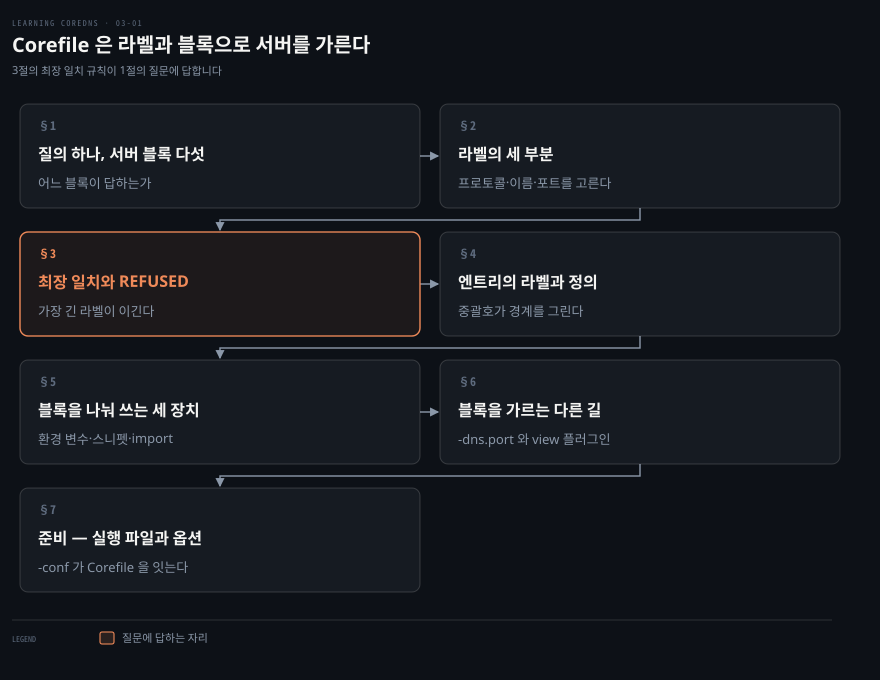
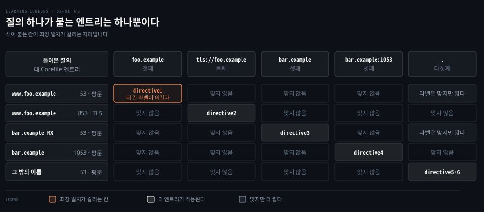
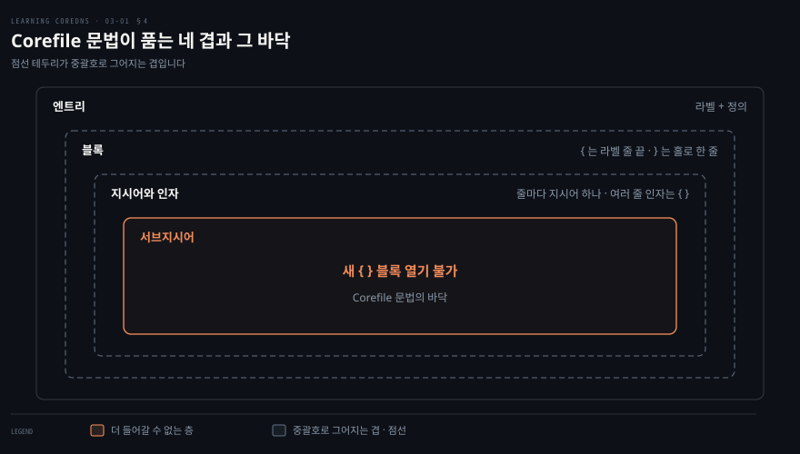

# Corefile은 라벨로 서버를 가른다

---

> CoreDNS 설정은 중괄호 몇 겹이 전부입니다. 그 겹의 맨 바깥에 붙는 라벨이 프로토콜과 포트와 도메인을 한꺼번에 골라, 들어온 질의가 어느 서버로 갈지 정합니다.

## 핵심 요약

> 서버 블록의 라벨 하나가 CoreDNS 안의 서버 하나를 정의하고, 질의는 그중 가장 긴 라벨에 붙습니다.

Corefile 에 엔트리가 여럿이면 질의 하나를 받을 서버 블록은 라벨이 고릅니다. 프로토콜과 포트와 도메인 이름이 모두 라벨과 맞아야 합니다. 이름이 여러 라벨에 맞으면 가장 구체적인 라벨이 이깁니다. 맞는 블록이 하나도 없으면 CoreDNS 는 `REFUSED` 로 답합니다.

라벨 뒤의 문법은 라벨과 중괄호와 지시어뿐입니다. 문법이 품는 관계는 네 겹에서 끝납니다.


## 학습 목표

이 내용을 읽고 나면:

1. 서버 블록 라벨이 프로토콜·도메인·포트 셋을 어떻게 함께 지정하는지 쓸 수 있습니다.
2. 질의 하나가 여러 라벨에 맞을 때 어느 엔트리가 이기는지, 어디에도 붙지 않는 경우까지 판정할 수 있습니다.
3. `dig` 출력으로 `REFUSED` 응답과 응답 없는 연결 실패를 가를 수 있습니다.
4. Corefile 의 엔트리·블록·지시어·서브지시어를 중첩 순서대로 짚고, 반복을 줄이는 세 장치를 고를 수 있습니다.
5. 라벨의 포트·`-dns.port`·`view` 플러그인 가운데 블록을 가를 길을 고를 수 있습니다.
6. 실행 파일을 받아 버전을 찍고, `-conf` 로 읽을 Corefile 을 넘기며, 로그 목적지 옵션이 없는 이유를 말할 수 있습니다.

아래는 이 문서를 읽는 순서로 이은 지도입니다. 1절이 질문을 세우고 2~3절이 라벨과 판정 규칙으로 답합니다. 4~5절은 블록을 쓰는 문법, 6절은 블록을 가르는 다른 길, 7절은 실행 준비입니다.




## 이 문서가 다루지 않는 것

> 플러그인 하나하나의 문법과 완성된 서버 설정 예시는 다음 편이 맡습니다.

- `root`·`file`·`secondary`·`forward`·`cache`·`errors`·`log` 플러그인의 문법 → 다음 편 `03-02`
- 캐싱 전용·주 서버·보조 서버의 완성된 Corefile → 다음 편 `03-02`
- 존 데이터를 파일 아닌 곳에서 관리하는 법 → 4장
- 존 파일 자체의 문법 → [레코드 한 줄을 읽으면 존 파일이 읽힌다](./02-02.%EB%A0%88%EC%BD%94%EB%93%9C%20%ED%95%9C%20%EC%A4%84%EC%9D%84%20%EC%9D%BD%EC%9C%BC%EB%A9%B4%20%EC%A1%B4%20%ED%8C%8C%EC%9D%BC%EC%9D%B4%20%EC%9D%BD%ED%9E%8C%EB%8B%A4.md)

남는 것은 설정 파일의 골격과 질의가 그 골격에 붙는 규칙입니다.


## 1. 질의 하나, 서버 블록 다섯

> 엔트리가 다섯인 Corefile 에 질의가 들어올 때 어느 서버 블록이 답하는지, 맞는 블록이 없으면 무엇이 오는지가 이 노트의 질문입니다.

CoreDNS 프로세스는 하나지만 그 안에는 서버가 여럿 뜰 수 있습니다. Corefile 의 서버 블록 하나가 그 서버 하나입니다. 아래 Corefile 에는 서버 블록이 다섯입니다.

```bash
# 첫째 엔트리
foo.example {
    # directive1
}

# 둘째 엔트리
tls://foo.example {
    # directive2
}

# 셋째 엔트리
bar.example {
    # directive3
}

# 넷째 엔트리
bar.example:1053 {
    # directive4
}

# 다섯째 엔트리
. {
    # directive5
    # directive6
}
```

여기에 질의 여섯이 들어옵니다.

| 질의 | 들어온 길 |
|------|----------|
| `www.foo.example` | 평문, 포트 53 |
| `www.foo.example` | TLS(DoT), 포트 853 |
| `bar.example` `MX` | 평문, 포트 53 |
| `bar.example` `MX` | 평문, 포트 1053 |
| 그 밖의 이름 | 평문, 포트 53 |
| `x.bar.example` | TLS(DoT), 포트 853 |

블록을 고르는 규칙을 모르면 블록을 여럿 써 놓고도 왜 엉뚱한 쪽이 답하는지 짚지 못합니다. 마지막 질의가 어느 블록에도 붙지 않아 `REFUSED` 를 받는 이유도 같은 규칙에서 나옵니다.


## 2. 라벨의 세 부분 — 프로토콜·이름·포트

> 서버 블록의 라벨은 질의가 들어온 프로토콜과 포트, 질의에 담긴 도메인 이름을 한꺼번에 지정합니다.

서버 블록은 특정 도메인 이름에 대한 질의가 특정 포트와 특정 프로토콜로 들어왔을 때 어떻게 처리할지를 정합니다. 가장 단순한 형태에서 라벨은 그냥 도메인 이름입니다.

```bash
foo.example {
    # 지시어가 여기 들어간다
}
```

이 블록은 `foo.example` 로 끝나는 모든 도메인 이름 질의에 적용됩니다. 모든 질의에 적용하려면 루트 `.` 를 라벨로 씁니다.

| 라벨 부분 | 고르는 것 | 표기 |
|-----------|----------|------|
| 접두사 | 프로토콜(기본은 평문 DNS) | `tls://`, `grpc://`, `https://`, `quic://`, `https3://` |
| 도메인 이름 | 적용할 이름(루트 `.` 면 전부) | `foo.example`, `.` |
| 콜론 뒤 포트 | 들어온 포트(기본 UDP·TCP 53) | `.:1053` |

| 접두사 | 전송 |
|--------|------|
| (없음) | 평문 DNS |
| `tls://` | DoT, TLS 연결 안에 실은 DNS |
| `grpc://` | gRPC(구글이 만든 원격 프로시저 호출 프레임워크) 위의 DNS |
| `https://` | DoH, HTTPS 위의 DNS |
| `quic://` | DoQ, QUIC 위의 DNS |
| `https3://` | DoH3, HTTP/3 위의 DoH |

접두사 목록은 v1.15.0 소스 기준입니다.[^transports] 여러 도메인에 같은 지시어를 걸고 싶으면 라벨을 나열합니다.

```bash
foo.example bar.example {
    # 지시어가 여기 들어간다
}

.:1053 {
    # 비표준 포트로 듣는다
}

tls://foo.example {
    # DoT 로 듣는다
}

grpc://bar.example {
    # gRPC 위의 DNS 로 듣는다
}
```


## 3. 최장 일치와 REFUSED

> 프로토콜과 포트와 도메인 이름이 모두 맞는 서버 블록 가운데 가장 긴 라벨이 질의를 받습니다. 맞는 블록이 없으면 CoreDNS 는 `REFUSED` 로 답합니다.



어떤 서버 블록이 질의에 적용되려면 셋이 라벨과 맞아야 합니다. 질의가 들어온 프로토콜과 포트, 그리고 질의에 담긴 도메인 이름입니다. 도메인 이름이 여러 라벨에 맞는 경우에는 가장 긴, 곧 가장 구체적인 일치가 이깁니다.

1절의 질의에 넣어 보면 이렇습니다. 포트 53으로 들어온 `www.foo.example` 질의는 첫째에 맞아 `directive1` 이 적용됩니다. 같은 이름이라도 DoT 기본 포트인 853으로 TLS 를 타고 들어오면 둘째에 맞습니다. `bar.example` 의 `MX` 질의는 포트 53이면 셋째, 포트 1053이면 넷째입니다. 포트 53에 평문으로 들어온 나머지 이름들은 다섯째에 걸립니다.

도식에서 색이 붙은 칸이 이 절의 요점입니다. `www.foo.example` 는 `foo.example` 에도 맞고 `.` 에도 맞습니다. 둘 다 라벨로서 유효하지만 더 긴 쪽이 이깁니다. `.` 은 모든 이름에 맞지만 기본 포트인 53으로만 듣습니다. 그래서 1053으로 들어온 질의는 이름이 맞아도 다섯째에 걸리지 않습니다.

세 조건을 모두 채우는 서버 블록이 하나도 없으면 질의는 어느 엔트리에도 붙지 않습니다. 이때 CoreDNS 는 거부(`REFUSED`)로 답합니다. TLS 로 들어온 `x.bar.example` 이 그렇습니다. TLS 로 듣는 라벨은 `tls://foo.example` 하나뿐인데 `x.bar.example` 은 그 도메인에 들지 않습니다. 이름이 맞는 `bar.example` 과 `.` 은 평문으로만 듣습니다.

`REFUSED` 는 CoreDNS 가 질의를 받아 돌려준 DNS 응답 안의 응답 코드입니다. 그래서 `dig` 출력의 머리 줄에 `status: REFUSED` 로 찍힙니다. 어떤 블록도 듣지 않는 포트는 CoreDNS 가 열지 않으므로 그 포트로 보낸 질의에는 DNS 응답이 오지 않습니다. 포트가 닫혔거나 방화벽이 막으면 `connection refused` 나 시간 초과로 끝납니다.[^digclosed] 둘이 언제 갈리는지는 [DROP과 REJECT](../networking-and-kubernetes/02-06.%EC%BB%A4%EB%84%90%20%EB%84%A4%ED%8A%B8%EC%9B%8C%ED%82%B9%20%EC%8B%A4%EC%8A%B5%202%20%E2%80%94%20%EB%A7%89%EA%B3%A0%2C%20%EC%A7%84%EB%8B%A8%ED%95%98%EA%B3%A0%2C%20%EB%82%98%EB%88%84%EA%B8%B0.md#1-drop%EA%B3%BC-reject--%EA%B0%99%EC%9D%80-%EC%95%88-%EB%90%9C%EB%8B%A4%EA%B0%80-%EA%B0%88%EB%A6%AC%EB%8A%94-%EA%B3%B3) 에서 다룹니다.


## 4. 엔트리의 라벨과 정의

> Corefile 은 엔트리 하나 이상으로 이뤄지고, 엔트리는 라벨과 정의로 나뉩니다. 중괄호가 그 경계를 그립니다.



앞 절의 판정은 라벨만 봤습니다. 라벨 뒤 중괄호 안을 읽을 줄 알아야 남의 Corefile 에서 블록 경계를 짚고 블록을 직접 쓸 수 있습니다. Corefile 의 문법은 Caddy 웹 서버의 설정 파일인 Caddyfile 을 따릅니다. CoreDNS 가 설정을 파싱할 때 Caddy 코드를 쓰기 때문입니다.

도식의 네 겹은 문법이 품는 관계이지 중괄호의 깊이가 아닙니다. 중괄호가 실제로 그리는 깊이는 서버 블록과 여러 줄 인자 둘입니다. 5절의 스니펫처럼 재사용 스니펫이 서버 블록을 감싸면 셋이 됩니다.

```bash
# 여기부터가 "엔트리"다
label {
    definition
}
```

엔트리가 하나뿐인 Corefile 이 아니라면 정의는 중괄호로 감싸야 합니다. CoreDNS 에게 각 엔트리의 경계를 알려 주기 위해서입니다. 여는 중괄호는 라벨로 시작하는 줄의 끝에 와야 하고 닫는 중괄호는 한 줄에 홀로 있어야 합니다. 중괄호 안의 텍스트를 블록이라 부릅니다.

관례상 정의는 탭으로 들여쓰지만 강제는 아닙니다. 주석은 `#` 로 시작해 줄 끝까지 갑니다.

엔트리는 라벨을 여럿 가질 수 있고 그때는 공백으로 나눕니다. 라벨 목록이 길어 여러 줄에 걸치면 마지막 줄을 뺀 각 줄의 끝 라벨이 쉼표로 끝나야 합니다.

```bash
label1, label2,
label3, label4,
label5 {
    definition
}
```

정의는 지시어와 선택적 인자로 이뤄집니다. 정의의 각 줄은 지시어로 시작하고 그 뒤에 인자가 0개 이상 붙습니다. 인자 목록이 여러 줄에 걸치면 그 줄들을 중괄호로 감쌉니다. 여는 중괄호는 지시어 첫 줄 끝에 두고 닫는 중괄호는 마지막 줄에 홀로 둡니다.

```bash
label {
    directive1 arg1 arg2
    directive2 {
        arg3
        arg4
    }
}
```

여러 줄 인자 자리에는 서브지시어가 올 수 있습니다.

```bash
label {
    directive1 arg1 arg2
    directive2 {
        subdirective arg3 arg4
        arg5
    }
}
```

서브지시어는 줄을 시작해야 하고 자기 인자도 가질 수 있습니다. 그리고 여기가 바닥입니다. 서브지시어는 새 중괄호 블록을 시작할 수 없습니다.


## 5. 블록을 나눠 쓰는 세 장치

> 같은 설정을 여러 번 쓰지 않게 해 주는 장치가 셋 있습니다. 환경 변수 치환, 재사용 스니펫, 그리고 파일을 끌어오는 `import` 입니다.

블록이 늘면 같은 덩어리를 반복해서 적게 됩니다. 그러면 한 곳만 고치고 다른 곳을 놓치는 사고가 납니다.

Corefile 은 환경 변수 참조를 담을 수 있습니다. 참조는 값으로 펼쳐져 라벨이나 지시어나 인자가 되고 그것들의 일부가 되기도 합니다. 환경 변수 이름은 `{$` 와 `}` 로 감쌉니다.

```bash
label_{$ENV_VAR_1} {
    directive {$ENV_VAR_2}
}
```

`$` 를 빠뜨려 `{ENV_VAR_1}` 로 쓰면 치환되지 않습니다. CoreDNS 가 쓰는 Caddy 파서가 환경 변수로 바꾸는 꼴은 `{$ENV_VAR}` 와 윈도우식 `` 둘뿐입니다.[^caddyenv]

설정의 한 구간을 Corefile 안에서 여러 번 재사용하려면 재사용 스니펫으로 정의합니다. 이름을 괄호 안에 적고 스니펫 자체를 중괄호로 감쌉니다.

```bash
(snippet1) {
    label1 {
        directive1 arg1
        directive2 arg2 arg3
    }
}
```

넣을 때는 `import` 지시어에 괄호를 뗀 이름을 붙입니다. 같은 `import` 로 파일도 끌어올 수 있으며 인자로는 경로 이름이나 Glob 패턴을 받습니다. Glob 패턴은 `conf.d/*.conf` 처럼 `*` 같은 와일드카드로 여러 파일 이름을 한꺼번에 가리키는 표기입니다.

```bash
import snippet1
import common.conf
import config/*.conf
```


## 6. 블록을 가르는 다른 길

> 포트는 라벨 대신 명령줄의 `-dns.port` 로도 바꿀 수 있습니다. 같은 라벨의 블록을 클라이언트에 따라 가르려면 `view` 플러그인을 씁니다.

라벨로만 포트를 바꾸면 블록마다 `:포트` 를 고쳐 적어야 합니다. 같은 존·같은 포트인데 묻는 쪽에 따라 다르게 답하는 일은 라벨만으로는 할 수 없습니다.

| 가르고 싶은 것 | 길 | 미치는 범위 |
|----------------|----|------------|
| 포트 | 라벨에 `:1053` | 그 블록만 |
| 포트 | 명령줄 `-dns.port 1053` | 포트를 적지 않은 라벨 전부 |
| 프로토콜 | 라벨 접두사 `tls://` 등 | 그 블록만 |
| 클라이언트 주소·질의 유형 | 서버 블록 안의 `view` 식 | 같은 라벨의 블록끼리 |

`view` 플러그인은 v1.10.0 에 들어왔습니다. 서버 블록에 식을 달면 그 식이 참인 질의만 그 블록으로 갑니다. 식에는 클라이언트 주소(`client_ip()`)나 질의 유형(`type()`)을 씁니다. 식이 맞는 첫 블록이나 `view` 가 없는 블록이 질의를 받습니다.[^viewplug] 질의를 보낸 쪽의 주소 같은 조건에 따라 서로 다른 설정 묶음으로 답하게 하는 BIND 의 뷰(view)와 같은 쓰임입니다.


## 7. 준비 — 실행 파일과 명령줄 옵션

> CoreDNS 는 단일 실행 파일이라 받아서 풀면 끝입니다. 명령줄 옵션은 프로세스를 띄우는 쪽에 적고 그중 `-conf` 가 어느 Corefile 을 읽을지 잇습니다.

CoreDNS 는 프로세서 종류별로 빌드가 나뉘어 있어 맞는 빌드를 고르지 못하면 실행조차 되지 않습니다. GitHub 릴리스에서 OS·아키텍처에 맞는 압축을 받고 같은 이름에 `.sha256` 이 붙은 체크섬 파일도 받습니다.[^relassets] `darwin` 은 macOS 입니다. `amd64` 는 벤더가 아니라 x86-64 아키텍처 이름이라 인텔 CPU 도 같은 빌드를 씁니다.

체크섬은 파일 내용으로 계산한 짧은 지문입니다. 직접 계산한 SHA-256 값이 체크섬 파일의 값과 같을 때만 풉니다.

```bash
cat coredns_1.15.0_darwin_arm64.tgz.sha256
shasum -a 256 coredns_1.15.0_darwin_arm64.tgz   # 리눅스는 sha256sum


# 두 출력의 SHA-256 값이 같은지 확인한 뒤 진행
tar -zxvf coredns_1.15.0_darwin_arm64.tgz
./coredns -version
```

`-version` 은 두 줄을 찍습니다. 첫 줄은 `CoreDNS-<버전>`, 둘째 줄은 `<OS>/<아키텍처>, <Go 버전>, <커밋>` 입니다.[^version]

```bash
CoreDNS-1.15.0
darwin/arm64, go1.27.3, a6fde3f
```

| 옵션 | 하는 일 |
|------|--------|
| `-conf` | 읽을 Corefile 경로. 기본값은 작업 디렉터리의 `Corefile` |
| `-dns.port` | 포트를 적지 않은 라벨이 들을 포트. 기본값 53. `-p` 는 같은 값의 한 글자 별칭 |
| `-help` | 사용법 표시. Go `flag` 패키지가 자동으로 붙인다 |
| `-log-format` | 로그 출력 형식. `text`(기본) 또는 `json` |
| `-pidfile` | 프로세스 ID 를 쓸 파일 경로. 기본값 없음 |
| `-plugins` | 실행 파일에 컴파일된 플러그인 목록 표시. 직접 빌드하지 않았다면 CoreDNS 저장소에 함께 들어 있는 in-tree 플러그인 전부 |
| `-quiet` | 초기화 출력 억제 |
| `-version` | 버전 출력 |

이 노트의 질문에 쓰이는 옵션은 둘입니다.[^coremain] `-conf` 는 어느 Corefile 을 읽을지 잇는 고리입니다. `-dns.port` 는 포트를 적지 않은 라벨의 포트를 한꺼번에 바꿉니다. 옵션은 Corefile 안에 들어가지 않습니다. 셸 명령줄이나 쿠버네티스 Deployment 의 `args` 처럼 프로세스를 띄우는 쪽에 적습니다.

```bash
# 로컬: 지금 디렉터리의 Corefile 을 읽고, 포트를 적지 않은 라벨은 1053 으로 듣는다
./coredns -conf ./Corefile -dns.port 1053

# 쿠버네티스: kubeadm 이 만드는 coredns Deployment 의 컨테이너 인자(YAML)
#   args: [ "-conf", "/etc/coredns/Corefile" ]
```

kubeadm 은 ConfigMap `coredns` 의 `Corefile` 키를 컨테이너의 `/etc/coredns` 에 마운트합니다. `-conf` 에는 그 파일 경로가 들어갑니다.[^kubeadm]

로그를 어디로 보낼지 정하는 옵션은 없습니다. CoreDNS 는 로그를 표준 출력으로 내보내고 그 관리는 다른 소프트웨어에 맡깁니다. 개발자들이 의도해서 고른 설계입니다. `-log-format` 은 형식만 고르고 출력 위치는 그대로 표준 출력입니다.[^logfmt]


## 결정 치트시트

> 3장 전반부만으로 가를 수 있는 판단을 모았습니다. 근거는 모두 본문입니다.

| 상황 | 판단 | 이유 |
|------|------|------|
| 블록 여럿이 겹치는데 어느 쪽이 걸릴지 모르겠다 | 가장 긴 라벨을 찾는다 | 도메인 이름이 여러 라벨에 맞으면 최장 일치가 이긴다 |
| `dig` 가 `status: REFUSED` 를 찍는다 | 프로토콜·포트·이름이 모두 맞는 블록이 있는지 본다 | 응답이 왔으니 그 포트는 CoreDNS 가 듣고 있다 |
| `dig` 가 응답 없이 시간 초과나 `connection refused` 로 끝난다 | 그 포트를 듣는 블록이 있는지, 방화벽이 막는지 본다 | 듣지 않는 포트에는 DNS 응답이 오지 않는다 |
| 같은 설정을 여러 도메인에 걸고 싶다 | 라벨을 나열한다 | 엔트리 하나가 라벨을 여럿 가질 수 있다 |
| 표준 포트를 못 쓴다 | 라벨에 `:포트` 를 붙이거나 `-dns.port` | 라벨은 그 블록만, `-dns.port` 는 포트를 적지 않은 라벨 전부를 바꾼다 |
| 같은 도메인을 평문과 DoT 로 다르게 처리하고 싶다 | 블록을 둘로 나누고 한쪽에 `tls://` | 프로토콜도 라벨의 일부다 |
| 같은 존을 클라이언트 주소에 따라 다르게 답하고 싶다 | `view` 플러그인 | 라벨만으로는 묻는 쪽을 가를 수 없다 |
| 같은 설정 덩어리를 파일 안에서 반복한다 | 재사용 스니펫으로 빼고 `import` | 한 곳만 고치면 된다 |
| 설정을 환경별로 바꿔야 한다 | 환경 변수 참조 `{$VAR}` | 라벨·지시어·인자 어디에도 펼쳐진다 |
| 로그를 파일로 남기고 싶다 | CoreDNS 옵션으로는 안 된다 | 표준 출력으로 내보내고 관리는 바깥에 맡기는 설계다 |


## 적용 관점

> 문법은 손으로 한 번 돌려 보는 것이 가장 빠릅니다.

**한 가지 실행**: 같은 이름이 두 블록에 걸치게 Corefile 을 씁니다. 블록마다 `whoami` 를 넣어 어느 블록이 답했는지 보이게 합니다. `whoami` 는 질의한 쪽의 주소를 돌려주는 플러그인이라 존 파일 없이도 응답이 옵니다. `log` 가 찍는 줄로 어느 블록이 받았는지 가릅니다.

```bash
cat > Corefile <<'COREFILE'
foo.example:1053 {
    whoami
    log . "foo 블록: {name}"
}
.:1053 {
    whoami
    log . "루트 블록: {name}"
}
COREFILE
coredns -conf ./Corefile
# 다른 터미널에서
dig @127.0.0.1 -p 1053 www.foo.example
dig @127.0.0.1 -p 1053 www.bar.example
```

라벨마다 포트 `1053` 을 적었습니다. `-dns.port 1053` 을 쓰면 포트를 적지 않은 라벨이 모두 함께 바뀌어 포트 조건을 따로 보기 어렵습니다. 첫 `dig` 는 `foo 블록`, 둘째는 `루트 블록` 줄을 찍으면 규칙대로 붙은 것입니다.

쿠버네티스 위의 Spring 애플리케이션 쪽에서 보면 이 노트는 클러스터의 CoreDNS ConfigMap 을 읽게 해 줍니다. 그 ConfigMap 의 값이 바로 Corefile 이고 대개 루트에 포트를 붙인 라벨 `.:53` 하나에 지시어 여럿이 들어간 형태입니다. 클러스터 이름과 바깥 이름을 다르게 처리하는 것은 그 블록 안의 지시어입니다. 그 지시어들은 다음 편에서 다룹니다.


## 면접에서 받을 만한 질문

> 자답한 뒤 아래 정답과 맞춰 봅니다.

1. 서버 블록이란 무엇을 정의하는 것입니까?
2. 서버 블록이 어떤 질의에 적용되려면 무엇이 맞아야 합니까?
3. 같은 도메인 이름이 여러 라벨에 맞으면 어느 것이 이깁니까?
4. 1절의 다섯 엔트리 Corefile 에 포트 853 으로 TLS 를 타고 `x.bar.example` 질의가 들어오면 어느 엔트리에 붙습니까?
5. Corefile 의 문법은 어디에서 왔습니까?
6. 재사용 스니펫과 `import` 는 어떤 관계입니까?
7. 스테이징과 운영이 같은 Corefile 을 쓰되 포워더 주소만 달라야 합니다. 5절의 장치 가운데 무엇을 고르겠습니까?
8. CoreDNS 에 로그 목적지를 정하는 옵션이 없는 이유는 무엇입니까?


## 정답 (자답 후 펼치기)

### 정답 1 — 서버 블록이 정의하는 것

CoreDNS 안의 서버 하나입니다. 특정 도메인 이름에 대한 질의가 특정 포트와 특정 프로토콜로 들어왔을 때 어떻게 처리할지를 정합니다.

### 정답 2 — 적용 조건

셋이 라벨과 맞아야 합니다. 질의가 들어온 프로토콜, 들어온 포트, 그리고 질의에 담긴 도메인 이름입니다.

### 정답 3 — 여러 라벨에 맞을 때

가장 긴, 곧 가장 구체적인 일치가 이깁니다. `www.foo.example` 는 `foo.example` 과 `.` 둘 다에 맞지만 `foo.example` 이 적용됩니다.

### 정답 4 — TLS 로 온 `x.bar.example`

어느 엔트리에도 붙지 않고 CoreDNS 는 거부(`REFUSED`)로 답합니다. TLS 로 들어온 질의에 맞는 라벨은 `tls://foo.example` 하나뿐인데 `x.bar.example` 은 그 도메인에 들지 않습니다. `bar.example` 과 `.` 은 이름은 맞지만 프로토콜이 평문이라 셋이 모두 맞아야 한다는 조건을 못 채웁니다.

### 정답 5 — Corefile 문법의 출처

Caddyfile 의 문법을 따릅니다. CoreDNS 가 설정을 파싱할 때 실제로 Caddy 코드를 쓰기 때문입니다.

### 정답 6 — 스니펫과 import

스니펫은 이름을 괄호에 넣어 정의한 재사용 가능한 설정 덩어리이고, `import` 는 그것을 끌어다 넣는 지시어입니다. 같은 `import` 로 파일 경로나 Glob 패턴을 받아 파일을 끌어올 수도 있습니다.

### 정답 7 — 환경별로 다른 포워더

환경 변수 참조입니다. `forward . {$UPSTREAM}` 처럼 적어 두고 환경마다 변수만 다르게 주면 Corefile 은 하나로 유지됩니다. `import` 로 환경마다 다른 파일을 끌어오는 풀이도 되지만 그러면 환경마다 파일을 따로 두고 관리해야 합니다. 값 하나만 다르다면 변수 쪽이 가볍습니다.

### 정답 8 — 로그 옵션이 없는 이유

개발자들의 의도적 선택입니다. CoreDNS 는 기본적으로 표준 출력으로 로그를 내보내고, 그 로그의 관리는 다른 소프트웨어에 맡깁니다.


## 핵심 개념 체크리스트

- [ ] 서버 블록 라벨이 함께 고르는 프로토콜·도메인·포트를 라벨 표기로 쓸 수 있는가?
- [ ] 질의 하나를 주면 어느 엔트리에 붙는지, 어디에도 안 붙는 경우까지 판정할 수 있는가?
- [ ] `dig` 의 `status: REFUSED` 와 시간 초과·`connection refused` 가 각각 무엇을 뜻하는지 가를 수 있는가?
- [ ] 엔트리·블록·지시어·서브지시어를 중첩 순서대로 짚고, 환경 변수·스니펫·`import` 가운데 상황에 맞는 것을 고를 수 있는가?
- [ ] 라벨의 포트·`-dns.port`·`view` 가운데 상황에 맞는 길을 고를 수 있는가?
- [ ] 실행 파일을 받아 체크섬과 버전을 확인하고, `-conf` 로 Corefile 을 넘기며, 로그 목적지 옵션이 없는 이유를 말할 수 있는가?


## 관련 문서

- [Learning CoreDNS 정독 인덱스](./README.md) — 이 책의 장별 진행 상황
- [위임이 그은 경계가 질의 경로를 정한다](./02-01.%EC%9C%84%EC%9E%84%EC%9D%B4%20%EA%B7%B8%EC%9D%80%20%EA%B2%BD%EA%B3%84%EA%B0%80%20%EC%A7%88%EC%9D%98%20%EA%B2%BD%EB%A1%9C%EB%A5%BC%20%EC%A0%95%ED%95%9C%EB%8B%A4.md) — 이 설정이 다루는 개념의 바탕
- [레코드 한 줄을 읽으면 존 파일이 읽힌다](./02-02.%EB%A0%88%EC%BD%94%EB%93%9C%20%ED%95%9C%20%EC%A4%84%EC%9D%84%20%EC%9D%BD%EC%9C%BC%EB%A9%B4%20%EC%A1%B4%20%ED%8C%8C%EC%9D%BC%EC%9D%B4%20%EC%9D%BD%ED%9E%8C%EB%8B%A4.md) — Corefile 이 읽어 들일 존 파일의 문법
- [기본 Corefile](./06-02.%EA%B8%B0%EB%B3%B8%20Corefile%EC%9D%98%20%EC%A4%84%EB%A7%88%EB%8B%A4%20%EC%9D%B4%EC%9C%A0%EA%B0%80%20%EC%9E%88%EB%8B%A4.md) — 쿠버네티스의 CoreDNS ConfigMap 관점
- [커널 네트워킹 실습 2 — 막고, 진단하고, 나누기](../networking-and-kubernetes/02-06.%EC%BB%A4%EB%84%90%20%EB%84%A4%ED%8A%B8%EC%9B%8C%ED%82%B9%20%EC%8B%A4%EC%8A%B5%202%20%E2%80%94%20%EB%A7%89%EA%B3%A0%2C%20%EC%A7%84%EB%8B%A8%ED%95%98%EA%B3%A0%2C%20%EB%82%98%EB%88%84%EA%B8%B0.md) — `REFUSED` 가 아닌 연결 거절·시간 초과가 생기는 자리


## 참고 자료

- 원서: 《Learning CoreDNS: Configuring DNS for Cloud Native Environments》 3장 Configuring CoreDNS 전반부
- 서지: John Belamaric·Cricket Liu, O'Reilly, 2019년, ISBN 978-1492047964
- [CoreDNS `coremain/run.go`](https://raw.githubusercontent.com/coredns/coredns/v1.15.0/coremain/run.go) — 현재 등록되는 명령줄 플래그의 1차 자료
- [kubeadm CoreDNS 매니페스트 `manifests.go`](https://raw.githubusercontent.com/kubernetes/kubernetes/v1.37.2/cmd/kubeadm/app/phases/addons/dns/manifests.go) — Deployment 의 `args` 와 Corefile 마운트

[^coremain]: CoreDNS `coremain/run.go`(v1.15.0) — 공통 등록은 `flag.StringVar(&conf, "conf", ...)`, `flag.BoolVar(&plugins, "plugins", ...)`, `flag.StringVar(&caddy.PidFile, "pidfile", ...)`, `flag.BoolVar(&version, "version", ...)`, `flag.BoolVar(&dnsserver.Quiet, "quiet", ...)`, `flag.StringVar(&logFormat, "log-format", "text", ...)`, `flag.StringVar(&dnsserver.Port, serverType+".port", ...)`, `flag.StringVar(&dnsserver.Port, "p", ...)`. 받은 v1.15.0 darwin/arm64 실행 파일의 `-help` 출력도 같은 여덟(`-conf`·`-dns.port`·`-log-format`·`-p`·`-pidfile`·`-plugins`·`-quiet`·`-version`)을 보입니다(2026-11-02 실행). 옛 설정에서 볼 수 있는 `-cpu` 플래그는 1.6.0 에서 제거됐습니다 — v1.5.2 `coremain/run.go:27` 에 `flag.StringVar(&cpu, "cpu", "100%", "CPU cap")` 가 있고, 릴리스 글: "The -cpu flag is removed from this version." <https://github.com/coredns/coredns/blob/v1.15.0/coremain/run.go#L28-L39> , <https://github.com/coredns/coredns/blob/v1.5.2/coremain/run.go#L27> , <https://coredns.io/2019/07/28/coredns-1.6.0-release/>

[^caddyenv]: CoreDNS 가 쓰는 Caddy 파서 `caddyfile/parse.go` 의 `replaceEnvVars` — `s = replaceEnvReferences(s, "")`, `s = replaceEnvReferences(s, "{$", "}")`. <https://github.com/coredns/caddy/blob/v1.1.4/caddyfile/parse.go#L447-L451> (2026-11-02 조회)

[^relassets]: CoreDNS v1.15.0 릴리스 자산 — darwin(amd64·arm64), linux(amd64·arm·arm64·loong64·mips·mips64le·ppc64le·riscv64·s390x), windows(amd64) 빌드와 각각의 `.sha256`. `coredns_1.15.0_darwin_arm64.tgz` 의 계산값과 체크섬 파일 값은 `fd2836620676aa0c86f003e4ac7eebe0caa89eba6b0ca9ee82242ec39237eb4c` 로 같았습니다(2026-11-02). <https://github.com/coredns/coredns/releases/tag/v1.15.0>

[^version]: `-version` 출력 — v1.15.0 `coremain/run.go` 의 `showVersion()` 이 `versionString()`(`fmt.Sprintf("%s-%s\n", caddy.AppName, caddy.AppVersion)`)과 `releaseString()`(`fmt.Sprintf("%s/%s, %s, %s\n", runtime.GOOS, runtime.GOARCH, runtime.Version(), GitCommit)`)을 차례로 찍습니다. 위 두 줄은 릴리스의 `coredns_1.15.0_darwin_arm64.tgz` 를 풀어 2026-11-02 실행한 출력입니다. <https://github.com/coredns/coredns/blob/v1.15.0/coremain/run.go#L159-L178>

[^kubeadm]: kubeadm CoreDNS 매니페스트(kubernetes v1.37.2 `cmd/kubeadm/app/phases/addons/dns/manifests.go`) — 109줄 `args: [ "-conf", "/etc/coredns/Corefile" ]`, 110~113줄 `volumeMounts` 의 `mountPath: /etc/coredns`, 153~159줄 `volumes` 의 `configMap: name: coredns`, `items: - key: Corefile path: Corefile`. <https://github.com/kubernetes/kubernetes/blob/v1.37.2/cmd/kubeadm/app/phases/addons/dns/manifests.go#L109-L113> , <https://github.com/kubernetes/kubernetes/blob/v1.37.2/cmd/kubeadm/app/phases/addons/dns/manifests.go#L153-L159>

[^digclosed]: macOS 의 DiG 9.10.6 으로 2026-11-02 확인 — `foo.example:1053 { whoami }` 만 둔 CoreDNS 에 `dig @127.0.0.1 -p 1053 x.bar.example` 은 `;; ->>HEADER<<- opcode: QUERY, status: REFUSED` 를, 아무도 듣지 않는 1054 로 보낸 `dig @127.0.0.1 -p 1054 www.foo.example` 은 UDP 에서 `;; connection timed out; no servers could be reached`, `+tcp` 에서 `;; Connection to 127.0.0.1#1054(127.0.0.1) for www.foo.example failed: connection refused.` 를 냈습니다.

[^logfmt]: `-log-format` 플래그 — v1.15.0 `coremain/run.go:33` `flag.StringVar(&logFormat, "log-format", "text", "Log format (text or json)")`, `:50` `clog.Configure(logFormat, os.Stdout)`, `:59` `clog.SetOutput(os.Stdout)`. `plugin/log/README.md:99`: "Start CoreDNS with `-log-format=json` to select JSON output for the entire process." 릴리스 노트: "core: Add opt-in JSON logging with structured DNS query fields". <https://github.com/coredns/coredns/blob/v1.15.0/coremain/run.go#L28-L59> , <https://github.com/coredns/coredns/releases/tag/v1.15.0>

[^transports]: 서버 블록 접두사 — v1.15.0 `plugin/pkg/parse/transport.go` 가 `tls`·`dns`·`quic`·`grpc`·`https3`·`https`·`unix` 접두사를 인식합니다(`case strings.HasPrefix(s, transport.QUIC+"://"):`). `quic` 은 v1.11.0, `https3` 는 v1.14.0 의 같은 파일에 처음 보입니다. 플러그인 README: `*quic* - configures DNS-over-QUIC (DoQ) server options.`, `*https3* - configures DNS-over-HTTPS/3 (DoH3) server options.`, `*https* - configures DNS-over-HTTPS (DoH) server options.` <https://github.com/coredns/coredns/blob/v1.15.0/plugin/pkg/parse/transport.go#L12-L43> , <https://github.com/coredns/coredns/blob/v1.15.0/plugin/quic/README.md> , <https://github.com/coredns/coredns/blob/v1.15.0/plugin/https3/README.md>

[^viewplug]: `view` 플러그인 — v1.10.0 릴리스 노트: "This release adds the new *view* plugin, enabling advanced server-block routing configurations such as split-DNS." README: "*view* defines an expression that must evaluate to true for a DNS request to be routed to the server block.", 식에 쓰는 함수로 `client_ip()`·`type()` 이 있고, "The first block whose view expression matches (or that has no view) handles the query." <https://github.com/coredns/coredns/releases/tag/v1.10.0> , <https://github.com/coredns/coredns/blob/v1.15.0/plugin/view/README.md#L9-L10> , <https://github.com/coredns/coredns/blob/v1.15.0/plugin/view/README.md#L30-L32>
