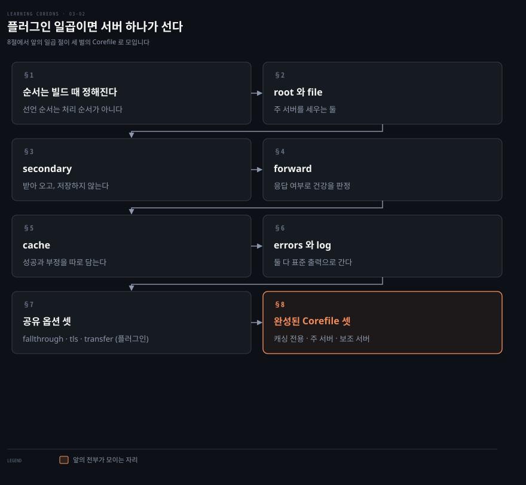
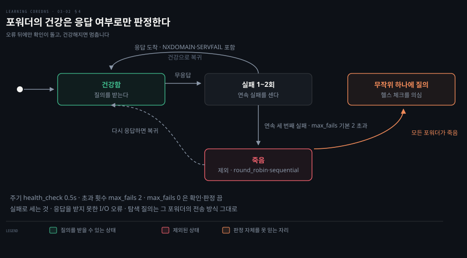
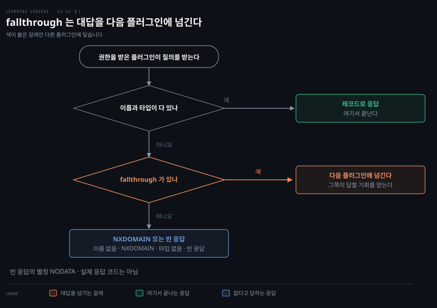
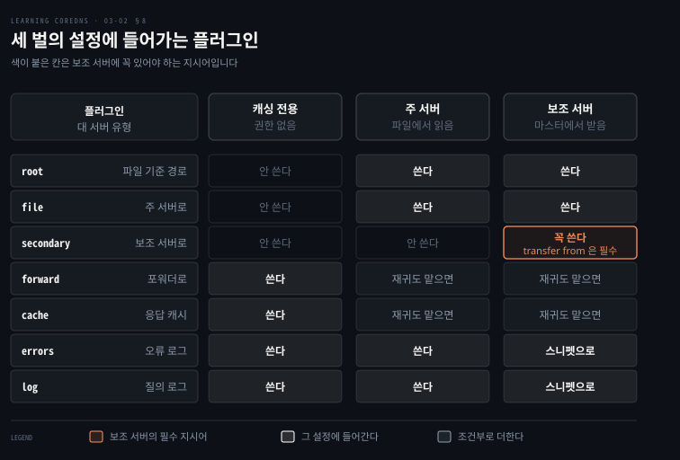

# 플러그인 일곱이면 서버 하나가 선다

---

> 서버 블록 안에 무엇을 적느냐가 그 서버가 하는 일입니다. 기본 플러그인 일곱이면 권한 서버와 캐싱 서버를 모두 세울 수 있습니다.

## 핵심 요약

> 이 절 전체가 매달린 하나의 생각은 CoreDNS 의 기능이 전부 플러그인이고, 그것이 요청을 처리하는 순서는 내가 정하지 않는다는 것입니다.

앞 편에서 라벨이 어느 질의를 받을지 정했다면 여기서는 그 질의를 어떻게 처리할지가 정해집니다. 처리를 맡는 것이 플러그인이고 저자가 고른 기본 일곱이면 쓸 만한 서버가 하나 섭니다.

여기서 걸려 넘어지기 쉬운 것이 순서입니다. Corefile 에 지시어를 어느 순서로 적든 처리 순서는 바뀌지 않습니다. 그 순서는 CoreDNS 를 빌드할 때 이미 정해져 있습니다.


## 학습 목표

이 내용을 읽고 나면:

1. 플러그인 처리 순서가 어디서 정해지는지 말하고 그 정본이 어느 파일인지 댈 수 있습니다.
2. `root`·`file`·`secondary` 로 주 서버와 보조 서버를 세우는 Corefile 을 쓰고 나가는 전송을 어디에 적는지 말할 수 있습니다.
3. `forward` 가 포워더의 건강을 어떻게 판정하는지 상태로 설명하고 확인 루프가 언제 돌고 언제 멈추는지 말할 수 있습니다.
4. `cache` 의 성공 캐시와 부정 캐시를 구분하고 프리페치의 조건을 말할 수 있습니다.
5. `fallthrough` 가 무엇을 넘기는지 질의 처리 흐름 위에서 짚을 수 있습니다.

아래는 이 문서 전체를 읽는 순서로 이은 지도입니다.




## 이 문서가 다루지 않는 것

> 쿠버네티스 연동을 비롯한 고급 플러그인은 뒤 장들이 맡습니다.

- 존 데이터를 파일 아닌 곳에서 관리하는 법 → 4장 노트
- 쿠버네티스와 이어지는 플러그인 → 6장 노트
- 요청과 응답을 고쳐 쓰는 `template`·`rewrite` → 7장 노트
- Corefile 문법과 서버 블록 라벨 → [Corefile은 라벨로 서버를 가른다](./03-01.Corefile%EC%9D%80%20%EB%9D%BC%EB%B2%A8%EB%A1%9C%20%EC%84%9C%EB%B2%84%EB%A5%BC%20%EA%B0%80%EB%A5%B8%EB%8B%A4.md)


## 1. 순서는 빌드 때 정해진다

> **Corefile 에 지시어를 어느 순서로 적든 처리 순서는 바뀌지 않습니다.** 그 순서는 CoreDNS 를 빌드할 때 고정됩니다.

적은 순서대로 돈다고 믿으면 플러그인이 기대와 다르게 걸릴 때 원인을 찾지 못합니다. 기본 빌드의 순서는 CoreDNS 저장소의 `plugin.cfg` 에서 볼 수 있습니다.

플러그인은 CoreDNS 가 응답을 어떻게 만들지 정하는 설정 지시어이자 DNS 기능을 구현한 소프트웨어 모듈입니다. 기본 플러그인 일곱이면 서버 하나가 몇 개 존에 권한을 갖고 포워더를 쓰며 그 응답을 캐시할 수 있습니다.

각 플러그인은 요청 처리 중에 자기 아래 플러그인들의 영향을 받되 자기 위의 플러그인이 무엇을 하는지는 신경 쓰지 않아야 합니다.[^plugincfg]

이 일곱이 요청을 만나는 처리 순서는 `root`·`errors`·`log`·`cache`·`file`·`secondary`·`forward` 입니다.[^plugincfg] 아래 표는 처리 순서가 아니라 설명 순서입니다. `cache` 가 `forward` 보다 앞에 있으므로 캐시에 답이 있으면 포워더까지 가지 않고 끝납니다.

| 플러그인 | 하는 일 |
|----------|--------|
| `root` | 상대 경로로 적은 파일을 찾을 기준 디렉터리를 정합니다 |
| `file` | 파일에서 존 데이터를 읽어 그 존의 주 서버가 됩니다 |
| `secondary` | 마스터 DNS 서버에서 존 데이터를 받아 보조 서버가 됩니다 |
| `forward` | 질의를 포워더 하나 이상으로 넘깁니다 |
| `cache` | 질의에 대한 응답을 캐시합니다 |
| `errors` | 오류를 로그로 남깁니다 |
| `log` | 받은 질의를 하나씩 로그로 남깁니다 |


## 2. root 와 file — 주 서버 만들기

> `root` 는 존 데이터 파일을 찾을 디렉터리를 정하고, `file` 은 그 파일을 읽어 서버를 그 존의 주 서버로 만듭니다.

존 파일 이름만 적었는데 서버가 파일을 못 찾는다면 `root` 와 `file` 사이의 **경로** 관계를 놓친 것입니다.

`root` 는 존 데이터 파일처럼 상대 경로로 적힌 파일을 찾는 기준 디렉터리를 정합니다. 따로 정하지 않으면 CoreDNS 의 현재 작업 디렉터리가 기준입니다.

`root` 는 프로세스의 작업 디렉터리를 바꾸지 않습니다.[^rootcfg] v1.15.0 에서 이 기준을 쓰는 플러그인은 `auto`·`dnssec`·`dynupdate`·`etcd`·`file`·`forward`·`grpc`·`hosts`·`loadbalance`·`sign`·`tls` 입니다.[^rootsrc]

`file` 은 서버 블록의 존, 또는 지정한 존 목록에 대해 서버를 주 서버로 설정합니다. 주 서버는 존을 기술한 존 데이터 파일에서 데이터를 읽으므로 `file` 은 그 파일 이름을 인자로 받습니다.

```bash
file DBFILE [ZONES...] {
    reload DURATION
    reload_by_mtime
    fallthrough [ZONES...]
}
```

`ZONES` 를 생략하면 그 파일은 서버 블록에 지정된 존의 데이터 파일로 읽힙니다. 지정하면 서버 블록의 존을 덮어씁니다. 다만 지정한 존은 서버 블록의 존 **안에** 들어야 합니다. 그러지 않으면 서버가 그 존에 대한 질의를 아예 받지 못합니다. 여러 존이 존 데이터 파일 하나를 공유한다면 그 파일은 상대 도메인 이름을 담아야 합니다.

나가는 존 전송은 같은 서버 블록의 `transfer` 플러그인이 맡습니다. `to` 는 IP 주소(`IP:포트` 포함)와 모든 주소를 뜻하는 `*` 를 받고, 개별 주소에는 존이 바뀔 때 NOTIFY 를 보냅니다.[^xfer]

옛 설정 파일처럼 `file` 블록 안에 `transfer to` 를 쓰면 알 수 없는 하위 지시어라는 오류로 CoreDNS 가 뜨지 않습니다. 이 하위 지시어는 CoreDNS 1.8.0 에서 `transfer` 플러그인으로 옮겨졌으므로 같은 서버 블록에 `transfer { to * }` 를 따로 둡니다.[^n180]

`reload` 하위 지시어를 주면 CoreDNS 는 존 데이터 파일을 주기적으로 확인해 `SOA` 의 시리얼 번호가 올랐을 때 존을 다시 읽습니다. 기본 간격은 1분이고 인자는 확인 간격이며 정수 뒤에 `s`·`m`·`h` 를 붙입니다. `0` 으로 두면 주기 확인이 꺼집니다.

```bash
foo.example {
    file db.foo.example
    transfer {
        to 10.0.0.1
    }
}

. {
    file db.template.example bar.example baz.example
    transfer {
        to *
    }
}
```


## 3. secondary — 받아 오고, 저장하지 않는다

> `secondary` 는 마스터에서 존을 받아 오게 합니다. 다만 CoreDNS 는 그 존을 디스크에 남기지 않습니다.

2장([위임이 그은 경계가 질의 경로를 정한다](./02-01.%EC%9C%84%EC%9E%84%EC%9D%B4%20%EA%B7%B8%EC%9D%80%20%EA%B2%BD%EA%B3%84%EA%B0%80%20%EC%A7%88%EC%9D%98%20%EA%B2%BD%EB%A1%9C%EB%A5%BC%20%EC%A0%95%ED%95%9C%EB%8B%A4.md) §4)에서 보조 서버는 받은 존 데이터를 백업 파일로 남겨 두기도 한다고 배웠습니다.

존을 지정하는 방식은 `file` 과 같습니다. 서버 블록에서 물려받거나 지시어의 인자로 적습니다.

```bash
secondary [ZONES...] {
    transfer from ADDRESS [ADDRESS...]
}
```

`transfer from` 은 마스터 주소를 적고 여러 번 쓸 수 있으며 하나가 안 되면 다음을 시도합니다. 받아 온 존을 다시 내보내려면 `transfer` 플러그인을 켭니다.[^secondary] 옛 설정의 `secondary` 블록 안 `transfer to` 도 1.8.0 에서 `transfer` 플러그인으로 옮겨졌습니다.[^n180]

CoreDNS 는 받아 온 존을 디스크에 저장하지 않으므로 재시작할 때마다 모든 보조 존을 마스터에서 다시 전송받아야 합니다.[^secondary] 받는 방식도 존 전체를 한 번에 옮기는 AXFR(전체 존 전송)뿐이고 증분 존 전송, 곧 IXFR 은 지원하지 않습니다. 보조 존이 여럿인 서버를 재시작하면 전체 전송이 한꺼번에 몰릴 수 있습니다.

다만 이것은 받는 쪽에 한한 이야기입니다. 1.8.0 부터 나가는 전송을 맡는 `transfer` 플러그인은 IXFR 요청을 받으면 존이 바뀌었을 때 AXFR 로 대신 답합니다.[^xfer]

```bash
foo.example {
    secondary {
        transfer from 10.0.0.1
        transfer from 10.0.1.1
    }
}

. {
    secondary bar.example {
        transfer from 10.0.0.1
    }
    transfer {
        to *
    }
}
```


## 4. forward — 포워더와 헬스 체크

> `forward` 는 어떤 이름의 질의를 어느 포워더로 넘길지 정합니다. 그리고 그 포워더가 살아 있는지를 실제 DNS 질의를 보내 스스로 확인합니다.



죽은 서버로 질의가 계속 간다면 CoreDNS 가 무엇을 죽음으로 보는지부터 따져 봐야 합니다.

기본 문법은 두 인자입니다.

```bash
forward FROM TO...
```

질의가 `FROM` 의 도메인 이름에 맞으면, 곧 그 도메인 안에 들면 CoreDNS 는 `TO` 로 지정한 서버들로 질의를 넘깁니다. 포워더 주소 앞에 프로토콜 접두사를 붙일 수 있어서 `tls://` 는 DoT, `quic://` 는 DoQ(QUIC 위의 DNS), `https://` 는 DoH(HTTPS 위의 DNS), `dns://` 또는 접두사 없음은 평문 DNS 입니다.

포워더는 최대 15개까지 설정할 수 있습니다.[^fwdproto]

```bash
# foo.example 질의는 10.0.0.1 로 넘긴다
foo.example {
    forward foo.example 10.0.0.1
}

# 나머지 전부는 Google Public DNS 로 DoT 를 타고 넘긴다
. {
    forward . tls://8.8.8.8 tls://8.8.4.4
}
```

건강 확인은 대역 안(in-band), 곧 별도 관리 채널 없이 평소와 같은 DNS 질의로 이뤄집니다. 포워더로 보낸 질의가 오류를 만나면 CoreDNS 는 그 포워더에 루트의 `NS` 레코드를 재귀 질의로 물어 건강을 확인합니다. 이 확인은 포워더가 건강해질 때까지 0.5초 간격으로 돌다가 건강해지면 멈춥니다.[^fwd] 이 탐색 질의는 그 포워더에 설정된 전송 방식을 그대로 탑니다.

포워더가 응답하기만 하면 건강한 것으로 셉니다. 그 응답이 `NXDOMAIN` 같은 부정 응답이든 `SERVFAIL` 같은 DNS 오류든 상관없습니다. 확인 질의에 응답이 아예 없거나 연결·타임아웃 같은 I/O 오류가 나면 실패로 세고, 연속 실패가 `max_fails`(기본 2)를 넘으면, 곧 기본값에서는 세 번째 연속 실패에서 죽은 것으로 표시합니다.[^fwddown] 답이 비어 있는 NOERROR 응답도 응답이므로 건강으로 셉니다.[^fwdsend]

그리고 어떤 이유로든 모든 포워더가 죽어 보이면 CoreDNS 는 헬스 체크 장치 자체가 고장 났다고 보고 무작위로 고른 포워더에 질의합니다. `failfast_all_unhealthy_upstreams` 를 켜면 이때 바로 SERVFAIL 로 답합니다.[^fwdfailfast]

죽은 포워더도 이 루프에서 첫 응답을 받으면 실패 횟수가 0 으로 돌아가 다시 건강해집니다.[^fwdsend]

확장 문법은 그 판정과 그 밖의 것들을 손보게 해 줍니다.

```bash
forward FROM TO... {
    except IGNORED_NAMES...
    force_tcp
    prefer_udp
    expire DURATION
    max_fails INTEGER
    health_check DURATION [no_rec] [domain FQDN]
    policy random|round_robin|sequential
    tls CERT KEY CA
    tls_servername NAME
}
```

`except` 는 `FROM` 에 지정한 도메인의 서브도메인 가운데 넘기지 **않을** 것을 지정합니다. `max_fails` 는 연속 헬스 체크 실패가 이 값을 **넘어야** 죽었다고 보는 기준이고 `0` 으로 두면 헬스 체크 자체를 하지 않아 절대 죽었다고 표시하지 않습니다.[^fwddown]

`health_check` 는 확인 주기이며 기본값이 0.5초이고, 인자로 `no_rec` 와 `domain FQDN` 을 받을 수 있습니다. `expire` 는 재사용하려고 들고 있던 TCP·TLS 연결을 언제 버릴지 정하며 기본값이 10초입니다.

`force_tcp` 와 `prefer_udp` 는 전송 방식을 강제합니다. 평소 CoreDNS 는 질의를 받은 것과 같은 프로토콜로 넘깁니다. `force_tcp` 는 UDP 로 받은 질의도 TCP 로 넘기게 하고 `prefer_udp` 는 그 반대입니다. 저자는 TCP 강제가 캐시 오염 공격, 곧 위조한 응답을 리졸버 캐시에 심는 공격에 대한 저항을 높이거나 방화벽 규칙을 짜기 쉽게 만들 수 있다고 덧붙입니다. UDP 로 넘긴 질의가 잘린 응답을 받으면 CoreDNS 가 알아서 TCP 로 다시 시도합니다.

`policy` 는 포워더 여럿을 무슨 순서로 물을지 정합니다.

| 값 | 동작 |
|----|------|
| `random` | 무작위로 하나를 고릅니다 |
| `round_robin` | 처음 물을 대상을 라운드 로빈으로 돌립니다. 첫 질의는 첫째부터, 다음 질의는 둘째부터 시작합니다 |
| `sequential` | 언제나 적힌 순서대로 갑니다. 매 질의가 첫째부터 시작합니다 |

어느 정책이든 죽은 것으로 표시된 포워더는 건너뜁니다.[^fwdskip] 기본값은 `random` 입니다.[^fwd] 그 밖에 `failover`·`next`·`max_concurrent` 같은 지시어가 있고, 목록은 `forward` 문서에 있습니다.[^fwd]


## 5. cache — 성공과 부정을 따로 담는다

> `cache` 는 서버 블록마다 따로 설정합니다. 지시어를 적기만 해도 기본값으로 동작하고, 하위 지시어로 더 조일 수 있습니다.

TTL 을 아무리 길게 줘도 캐시가 그만큼 남지 않는다면 CoreDNS 가 상한으로 잘라내기 때문입니다.

```bash
cache [TTL] [ZONES...]
```

`cache` 를 적어 두기만 하면 CoreDNS 는 모든 출처의 데이터를 최대 한 시간, 곧 3,600초까지 캐시합니다. 다른 DNS 서버뿐 아니라 쿠버네티스 같은 백엔드에서 온 것도 포함합니다. 부정 응답은 최대 1,800초까지입니다. 그보다 긴 TTL 을 가진 레코드와 부정 응답은 **상한으로 잘라낸 뒤** 캐시합니다. `TTL` 인자로 다른 최대값을 줄 수 있습니다. 존을 지정하는 방식은 `file` 과 같습니다.

```bash
# foo.example 에 대해 10.0.0.1 에서 받은 데이터를 최대 600초 캐시
foo.example {
    forward . 10.0.0.1
    cache 600
}

# 8.8.8.8 이나 8.8.4.4 에서 받은 bar.example 데이터만 캐시
. {
    forward . 8.8.8.8 8.8.4.4
    cache 3600 bar.example
}
```

둘째 블록이 `ZONES` 인자의 쓰임을 보여 줍니다. 서버 블록은 루트라 모든 질의를 받지만 캐시는 `bar.example` 것만 담습니다.

v1.15.0 의 하위 지시어는 `success`·`denial`·`prefetch`·`serve_stale`·`serve_stale_policy`·`servfail`·`disable`·`keepttl` 입니다. 이 절은 앞의 셋을 다룹니다. 나머지 가운데 `servfail` 은 설정하지 않으면 SERVFAIL 응답을 5초 캐시합니다.[^cachesub]

```bash
# 이 절에서 다루는 하위 지시어
cache [TTL] [ZONES...] {
    success CAPACITY [TTL] [MINTTL]
    denial  CAPACITY [TTL] [MINTTL]
    prefetch AMOUNT [DURATION] [PERCENTAGE%]
}
```

`success` 는 레코드를 담는 긍정 캐시를 세밀하게 다룹니다. `CAPACITY` 는 담아 둘 최대 패킷 수로, 이 수를 넘으면 오래된 패킷을 무작위로 버립니다. 기본값이 9,984이고 설정 가능한 최소값이 1,024입니다.

256으로 나누어떨어지지 않는 값을 주면 256의 배수로 내려 맞춥니다.[^cache] 256은 캐시를 나누는 샤드 수이고 샤드마다 크기를 같게 하려는 것입니다.

`TTL` 은 캐시의 최대 TTL 을, `MINTTL` 은 최소 TTL 을 덮어씁니다. 최소 TTL 의 기본값은 5초입니다.

`denial` 은 같은 통제를 부정 캐시에 줍니다. 여기서도 용량이 차면 오래된 항목이 무작위로 버려집니다.

`prefetch` 는 캐시에서 빠지기 전에 미리 다시 조회해 두는 동작입니다. 기본값은 꺼짐이고 켜면 조건이 이렇습니다. 어떤 캐시된 답에 대해 `AMOUNT` 만큼의 질의가 `DURATION` 이상 벌어지지 않고 들어오면, 그 답의 TTL 이 원래 값의 `PERCENTAGE` 에 닿았을 때 다시 조회합니다. `DURATION` 의 기본값은 1분이고 `PERCENTAGE` 의 기본값은 10%이며, 이 값은 정수 뒤에 `%` 를 붙여야 합니다. `PERCENTAGE` 는 10%에서 90% 사이만 받습니다.[^prefetchpct]


## 6. errors 와 log — 표준 출력으로 나가는 것들

> 둘 다 표준 출력으로 나갑니다. `errors` 는 질의 처리 중 생긴 오류를, `log` 는 받은 질의 자체를 남깁니다.

`errors` 는 서버 블록 안에서 질의를 처리하다 만난 오류를 로그로 남기게 합니다. 지시어 이름만 적으면 되고 오류는 표준 출력으로 갑니다. `consolidate` 하위 지시어를 쓰면 같은 종류의 오류를 묶을 수 있습니다.

```bash
. {
    forward . 8.8.8.8 8.8.4.4
    cache 3600
    errors {
        consolidate 5m ".* timeout$"
        consolidate 30s "^Failed to .+"
    }
}
```

`consolidate DURATION REGEXP` 는 `DURATION` 동안 정규식에 맞는 오류 메시지를 모아 요약 한 줄로 남깁니다. 뒤에 `LEVEL`(`warning`·`error`·`info`·`debug`)과 `show_first` 를 붙일 수 있습니다.[^errcons] 위 설정이면 타임아웃 메시지는 5분마다, 실패 메시지는 30초마다 묶여 `3 errors like '^Failed to .+' occurred in last 30s` 같은 줄이 나옵니다. 저자는 성능을 위해 정규식에 `^` 나 `$` 앵커를 쓰기를 권합니다.

`log` 는 받은 모든 질의와 응답 일부를 표준 출력으로 내보냅니다. 인자 없이 적으면 모든 요청에 대해 한 줄씩 남습니다.

```bash
2019-02-28T19:10:07.547Z [INFO] [::1]:50759 - 29008 "A IN foo.example. udp 41 false 4096" NOERROR qr,rd,ra,ad 68 0.037990251s
```

`false` 는 그 가운데 `{>do}`, 곧 DNSSEC OK 비트가 꺼져 있다는 뜻입니다.[^log]

무엇을 어떤 모양으로 남길지도 정할 수 있습니다. `log [NAMES...] [FORMAT]` 에서 `NAMES` 는 로그를 남길 도메인 이름이고 그 도메인으로 끝나는 이름이 모두 걸립니다. `FORMAT` 은 메시지 모양이며 기본값이 Common Log Format 입니다.

```bash
{remote}:{port} - {>id} "{type} {class} {name} {proto} {size} {>do} {>bufsize}" {rcode} {>rflags} {rsize} {duration}
```

쓸 수 있는 필드는 무엇을 보느냐로 묶으면 넷입니다.

- 질의 자체: 타입·이름·클래스·프로토콜·크기·ID·OPCODE(일반 질의인지 동적 업데이트 같은 다른 작업인지 가르는 헤더 값)
- 주고받은 쪽: 받은 IP 와 포트, 서버 쪽 IP
- 응답: 응답 코드·크기·플래그·처리 시간
- EDNS0(Extension Mechanisms for DNS, RFC 6891 — 옛 DNS 메시지의 크기 한계와 모자란 플래그 칸을 넓히는 확장): 버퍼 크기·DNSSEC OK 비트

`{common}` 은 기본 형식 자체이고 `{combined}` 는 거기에 OPCODE 를 더한 것입니다.

응답의 종류로도 거를 수 있습니다. `success` 는 성공 응답 전부, `denial` 은 부정 응답 전부, `error` 는 서버 실패·미구현·형식 오류·거부를, `all` 은 앞의 셋 전부를 담습니다.

```bash
foo.example {
    file db.foo.example
    errors
    log {
        class success denial
    }
}

# 폐기된 baz.example 를 조회하는 클라이언트를 남긴다
. {
    forward . 8.8.8.8 8.8.4.4
    errors
    log baz.example "Client: {remote}, query name: {name}"
}
```


## 7. 여러 플러그인이 공유하는 옵션

> 같은 이름의 옵션이 여러 플러그인에 나타납니다. CoreDNS 개발자들이 같은 일을 하는 옵션은 플러그인 사이에서 같게 동작하도록 특별히 신경 쓴 결과입니다.



아래 세 옵션은 여러 플러그인이 같은 뜻으로 함께 쓰는 공유 옵션이라 플러그인마다 따로 외울 필요가 없습니다. 다만 셋째인 `transfer to` 는 따로 떨어진 `transfer` 플러그인 블록 안에 `to` 로 적습니다.

### fallthrough — 다음 플러그인에 넘기기

`fallthrough` 는 질의 처리를 한 플러그인에서 다음 플러그인으로 넘길지 통제합니다. 이 옵션이 없으면 어떤 존에 권한을 받은 플러그인은 그 존의 질의에 무엇이든 응답을 내놓습니다. 요청한 이름이 없으면 `NXDOMAIN` 을, 이름은 있는데 요청한 타입의 데이터가 없으면 빈 응답을 돌려줍니다. 저자는 이 빈 응답을 NODATA 라 부르기도 하지만 그것이 실제 응답 코드는 아니라고 못 박습니다. 그런데 때로는 다른 플러그인에 답할 기회를 주고 싶습니다. `fallthrough` 가 하는 일이 그것입니다.

도식은 두 응답 갈래를 한데 그렸습니다. 어느 쪽에서 넘기는지는 플러그인마다 다를 수 있어서 뒤 장에서 플러그인별로 봅니다.

### tls — 바깥 대상과 말할 때 쓰는 인증서

`tls` 옵션은 클라이언트 쪽 TLS 인증서를 설정합니다. CoreDNS 가 쿠버네티스 같은 바깥 대상과 안전한 통신을 시작할 수 있게 하는 용도입니다. 서버의 TLS 인증서를 설정하는 `tls` **플러그인**과 헷갈리지 말라고 저자가 따로 경고합니다. 인자는 0개에서 3개입니다.

| 형태 | 하는 일 |
|------|--------|
| `tls` | 시스템에 설치된 표준 CA 로 서버 인증서를 검증합니다 |
| `tls CERT-FILE KEY-FILE` | 지정한 클라이언트 인증서를 제시하고, 서버 인증서는 시스템 CA 로 검증합니다 |
| `tls CERT-FILE KEY-FILE CA-FILE` | 클라이언트 인증서를 제시하고, 서버 인증서는 `CA-FILE` 의 인증서로 검증합니다 |

### transfer to — 나가는 존 전송

나가는 존 전송은 `transfer` 플러그인이 맡습니다. `file`·`auto`·`secondary`·`kubernetes` 가 이 플러그인을 거쳐 전송을 내보냅니다.[^xfer]


## 8. 완성된 Corefile 셋

> 저자는 이 일곱으로 캐싱 전용·주 서버·보조 서버 세 벌의 Corefile 을 만들어 보입니다.



### 캐싱 전용 서버

캐싱 전용 서버는 어떤 이름이든 조회할 수 있지만 어느 존에도 권한이 없습니다. 자주 조회되는 레코드의 로컬 캐시를 제공하므로 바쁜 서버에서 쓸모가 있습니다. 루트 엔트리 하나에 `forward` 로 포워더를 알려 주고 `cache` 로 받은 응답을 캐시하게 합니다. `forward` 가 꼭 필요한 이유는 기본 빌드의 CoreDNS 가 스스로 재귀하지 못하기 때문입니다. 나중에 문제를 짚으려고 `errors` 와 `log` 도 넣습니다.

```bash
. {
    forward . 8.8.8.8 8.8.4.4
    cache
    errors
    log
}
```

### 주 서버

주 서버는 존 하나나 몇 개를 맡습니다. 권한을 가질 존의 엔트리를 두고 `root` 로 존 데이터 파일을 둘 디렉터리를 알려 준 뒤 `file` 로 그 파일을 지정합니다. `root` 를 쓰지 않아도 기준은 CoreDNS 의 현재 작업 디렉터리라서 그 안의 존 파일은 상대 경로로 지정할 수 있습니다.[^root] 권한 서버와 재귀 서버를 겸하려면 루트 엔트리를 하나 더 두고 포워더와 캐시를 겁니다.

```bash
foo.example {
    root /etc/coredns/zones
    file db.foo.example
    errors
    log
}

# 재귀 질의도 처리하려면 아래 엔트리가 더 필요하다. 권한 전용이면 생략한다.
. {
    forward . 8.8.8.8 8.8.4.4
    cache
    errors
    log
}
```

### 보조 서버

보조 서버는 자기가 권한을 가진 존의 질의에 권한 있게 답하되 그 존은 다른 서버에서 관리됩니다. 주 서버 설정에 보조 존 엔트리를 더한 모양이고 마스터 주소를 지정하는 `transfer from` 이 필수입니다. 여기서 저자는 `errors` 와 `log` 를 여러 번 쓰게 되므로 `logerrors` 라는 재사용 스니펫을 정의해 둘을 대신합니다.

```bash
(logerrors) {
    errors
    log
}

bar.example {
    secondary {
        transfer from 10.0.0.1
    }
    import logerrors
}

# 한 서버가 어떤 존에는 보조, 다른 존에는 주 서버일 수 있다
foo.example {
    file db.foo.example
    root /etc/coredns/zones
    import logerrors
}

. {
    forward . 8.8.8.8 8.8.4.4
    cache
    import logerrors
}
```

`transfer from` 은 `secondary` 의 하위 지시어이므로 서버 블록에 바로 적지 않고 위처럼 `secondary { }` 안에 둡니다. `forward` 도 `FROM` 인자를 빠뜨리지 않고 `forward . 8.8.8.8 8.8.4.4` 로 적습니다.


## 결정 치트시트

> 3장 후반부만으로 가를 수 있는 판단을 모았습니다. 근거는 모두 본문입니다.

| 상황 | 판단 | 이유 |
|------|------|------|
| 지시어 순서를 바꿔도 동작이 그대로다 | 순서로 고칠 수 없다 | 처리 순서는 빌드 때 고정되며 `plugin.cfg` 가 정본 |
| 존 파일 이름만 적고 서버가 못 찾는다 | `root` 로 기준 디렉터리를 주거나 파일 경로를 바로잡는다 | `root` 를 생략하면 현재 작업 디렉터리에서 찾는다 |
| 보조 서버 재시작 때마다 전체 전송이 일어난다 | CoreDNS 에서는 정상이다 | 백업 존 파일을 남기지 않고 IXFR 도 받지 않는다 |
| 옛 설정의 `file` 블록 안 `transfer to` 를 넣었더니 CoreDNS 가 안 뜬다 | `transfer { to ... }` 플러그인으로 옮긴다 | 1.8.0 부터 나가는 전송은 `transfer` 플러그인이 맡는다 |
| 죽은 포워더로 질의가 계속 간다 | 응답이 오고 있는지 본다 | `SERVFAIL` 이라도 응답이면 건강한 것으로 센다 |
| 모든 포워더가 죽은 것으로 보인다 | 헬스 체크 쪽을 먼저 의심한다 | CoreDNS 도 그렇게 보고 무작위 하나에 질의한다 |
| TTL 을 길게 줬는데 캐시가 그만큼 안 남는다 | `cache` 의 최대값을 확인한다 | 기본 상한 3,600초로 잘라낸 뒤 캐시한다 |
| 자주 조회되는 답의 지연을 줄이고 싶다 | `prefetch` 를 켠다 | 기본은 꺼져 있고, 켜면 `AMOUNT` 번의 질의가 1분 이상 끊기지 않고 온 답을 TTL 이 10%에 닿을 때 다시 조회한다 |
| 다른 플러그인에도 답할 기회를 주고 싶다 | `fallthrough` 를 붙인다 | 없으면 권한을 받은 플러그인이 `NXDOMAIN` 이나 빈 응답으로 끝낸다 |
| 오류 로그가 같은 메시지로 넘친다 | `errors` 에 `consolidate` 를 건다 | 정규식에 맞는 것을 묶어 요약 한 줄로 남긴다 |


## 적용 관점

> 세 벌의 Corefile 가운데 하나를 그대로 띄워 보는 것이 가장 빠릅니다.

**한 가지 실행**: 캐싱 전용 Corefile 에 네 지시어를 적어 비표준 포트로 띄운 뒤 `log` 가 표준 출력으로 뱉는 줄을 눈으로 봅니다. 그 한 줄이 6절의 Common Log Format 입니다.

```bash
printf '. {\n    forward . 8.8.8.8 8.8.4.4\n    cache\n    errors\n    log\n}\n' > Corefile
coredns -dns.port 1053
# 다른 터미널에서 실행
dig @127.0.0.1 -p 1053 example.com
```

쿠버네티스 위의 Spring 애플리케이션 쪽에서 보면 이 절은 클러스터 CoreDNS 의 ConfigMap 을 그대로 읽게 해 줍니다. 그 파일에도 `errors`·`cache`·`forward` 가 들어 있습니다. `log` 는 권고 기본값에 없어서 질의 로그가 필요하면 직접 켜야 합니다.

여기서 배우지 않은 것은 클러스터 이름을 맡는 `kubernetes` 와 `health`·`ready`·`prometheus`·`loop`·`reload`·`loadbalance` 입니다. `fallthrough` 도 `kubernetes` 옆에서 `fallthrough in-addr.arpa ip6.arpa` 모양으로 만나는데 이것은 모르는 IP 의 역방향(PTR) 조회를 뒤쪽 `forward` 로 넘기는 자리입니다.

클러스터 밖 이름은 애초에 `kubernetes` 가 맡은 존이 아니어서 `fallthrough` 없이도 다음 플러그인으로 갑니다. 줄마다의 이유는 [기본 Corefile의 줄마다 이유가 있다](./06-02.%EA%B8%B0%EB%B3%B8%20Corefile%EC%9D%98%20%EC%A4%84%EB%A7%88%EB%8B%A4%20%EC%9D%B4%EC%9C%A0%EA%B0%80%20%EC%9E%88%EB%8B%A4.md)가 다룹니다.


## 면접에서 받을 만한 질문

> 자답한 뒤 아래 정답과 맞춰 봅니다.

1. Corefile 에서 지시어 순서를 바꾸면 처리 순서가 바뀝니까?
2. `file` 과 `secondary` 는 무엇이 다릅니까?
3. CoreDNS 보조 서버가 재시작하면 무슨 일이 일어납니까?
4. CoreDNS 는 포워더가 죽었다고 어떻게 판정합니까?
5. `cache` 를 인자 없이 적으면 어떤 값으로 동작합니까?
6. `fallthrough` 는 무엇을 넘깁니까?
7. `cache 600` 을 건 서버 블록에 TTL 이 7,200초인 레코드가 들어오면 캐시에는 얼마 동안 남습니까? 그 뒤 같은 이름을 다시 물으면 누가 답합니까?
8. 포워더 하나가 모든 질의에 `SERVFAIL` 만 돌려준다면 CoreDNS 는 그 포워더를 죽었다고 봅니까? 그 판단이 운영에서 어떤 문제를 낳을 수 있습니까?


## 정답 (자답 후 펼치기)

### 정답 1 — 지시어 순서

바뀌지 않습니다. 플러그인이 요청에 대해 동작하는 순서는 컴파일 시점에 고정되며 기본 빌드의 순서는 저장소의 `plugin.cfg` 에 있습니다.

### 정답 2 — `file` 과 `secondary`

`file` 은 존 데이터 파일에서 존을 읽어 그 존의 주 서버가 되게 합니다. `secondary` 는 마스터 DNS 서버에서 존 전송으로 존을 받아 보조 서버가 되게 합니다. 존 지정 방식은 둘 다 서버 블록에서 물려받거나 인자로 적는 식으로 같습니다.

### 정답 3 — 보조 서버 재시작

모든 보조 존을 마스터에서 다시 전송받습니다. CoreDNS 는 보조 존 데이터를 백업 존 데이터 파일에 저장하지 않기 때문입니다. 게다가 증분 전송인 IXFR 을 지원하지 않아 전송은 언제나 존 전체입니다.

### 정답 4 — 포워더의 죽음 판정

루트의 `NS` 를 재귀 질의로 물어 응답이 오는지 봅니다. 응답이기만 하면 `NXDOMAIN` 이나 `SERVFAIL` 이어도 건강한 것으로 셉니다. 응답이 없거나 I/O 오류인 확인이 연속으로 `max_fails`(기본 2)를 넘으면, 곧 세 번째에서 죽은 것으로 표시합니다. 그 기준은 `max_fails` 로 바꿉니다. 이 확인은 오류가 난 뒤에만 0.5초 간격으로 돌다가 건강해지면 멈춥니다.

### 정답 5 — 인자 없는 `cache`

모든 출처의 데이터를 최대 3,600초, 부정 응답은 최대 1,800초까지 캐시합니다. 그보다 긴 TTL 은 그 상한으로 잘라낸 뒤 담습니다. 최소 TTL 의 기본값은 5초입니다.

### 정답 6 — `fallthrough`

대답할 기회를 다음 플러그인에 넘깁니다. 이 옵션이 없으면 존에 권한을 받은 플러그인이 이름이 없을 때 `NXDOMAIN`, 타입이 없을 때 빈 응답으로 그 질의를 끝내 버립니다.

### 정답 7 — 상한에 잘리는 TTL

600초만 남습니다. `cache` 는 상한보다 긴 TTL 을 상한으로 잘라낸 뒤 담기 때문입니다. 600초가 지나면 캐시에 없으므로 `plugin.cfg` 순서상 `cache` 뒤에 있는 `forward` 까지 질의가 내려가 포워더가 다시 답합니다.

### 정답 8 — `SERVFAIL` 만 주는 포워더

죽었다고 보지 않습니다. 응답이 오기만 하면 건강한 것으로 세기 때문입니다. 그래서 상류가 고장 나 `SERVFAIL` 만 돌려주는 포워더에도 질의가 계속 가고 클라이언트는 그 `SERVFAIL` 을 그대로 받습니다. 헬스 체크가 막아 주는 것은 응답이 아예 없는 네트워크 고장이지 잘못된 답이 아닙니다.


## 핵심 개념 체크리스트

- [ ] 플러그인 처리 순서가 어디서 정해지고 정본이 어느 파일인지, 일곱 가운데 `cache` 가 `forward` 보다 앞에 있다는 것이 무엇을 뜻하는지 말할 수 있는가?
- [ ] `root`·`file`·`secondary` 로 주 서버와 보조 서버를 함께 두는 Corefile 을 쓰고, 나가는 전송을 어디에 적는지 아는가?
- [ ] 포워더의 건강 판정 기준과 모두 죽었을 때의 동작, 그리고 확인 루프가 언제 돌고 언제 멈추는지 말할 수 있는가?
- [ ] `success` 와 `denial` 이 각각 무엇을 담는지 구분하고, 프리페치가 켜지는 세 조건을 댈 수 있는가?
- [ ] `fallthrough` 가 붙는 자리와 붙지 않았을 때의 응답을 질의 처리 흐름 위에서 짚을 수 있는가?


## 관련 문서

- [Learning CoreDNS 정독 인덱스](./README.md) — 이 책의 장별 진행 상황
- [Corefile은 라벨로 서버를 가른다](./03-01.Corefile%EC%9D%80%20%EB%9D%BC%EB%B2%A8%EB%A1%9C%20%EC%84%9C%EB%B2%84%EB%A5%BC%20%EA%B0%80%EB%A5%B8%EB%8B%A4.md) — 이 플러그인들이 들어가는 그릇
- [레코드 한 줄을 읽으면 존 파일이 읽힌다](./02-02.%EB%A0%88%EC%BD%94%EB%93%9C%20%ED%95%9C%20%EC%A4%84%EC%9D%84%20%EC%9D%BD%EC%9C%BC%EB%A9%B4%20%EC%A1%B4%20%ED%8C%8C%EC%9D%BC%EC%9D%B4%20%EC%9D%BD%ED%9E%8C%EB%8B%A4.md) — `file` 이 읽어 들일 파일의 문법
- [기본 Corefile](./06-02.%EA%B8%B0%EB%B3%B8%20Corefile%EC%9D%98%20%EC%A4%84%EB%A7%88%EB%8B%A4%20%EC%9D%B4%EC%9C%A0%EA%B0%80%20%EC%9E%88%EB%8B%A4.md) — 쿠버네티스 CoreDNS ConfigMap 의 실물


## 참고 자료

- 원서: 《Learning CoreDNS: Configuring DNS for Cloud Native Environments》 3장 Configuring CoreDNS 후반부
- 서지: John Belamaric·Cricket Liu, O'Reilly, 2019년, ISBN 978-1492047964
- [CoreDNS `plugin.cfg`](https://github.com/coredns/coredns/blob/v1.15.0/plugin.cfg#L22) — 플러그인 처리 순서의 1차 자료

[^plugincfg]: CoreDNS `plugin.cfg` — 일곱의 줄 번호는 `root:root` 22, `errors:errors` 44, `log:log` 45, `cache:cache` 57, `file:file` 72, `secondary:secondary` 74, `forward:forward` 77. 머리말 — "Directives are registered in the order they should be executed. Ordering is VERY important. Every plugin will feel the effects of all other plugin below (after) them during a request, but they must not care what plugin above them are doing." 첫 항목은 `root:root`. <https://github.com/coredns/coredns/blob/v1.15.0/plugin.cfg#L22>

[^n180]: CoreDNS 1.8.0 릴리스 노트 — "the `transfer` plugin is now made a first class citizen and plugins wanting to perform outgoing zone transfers now use this plugin: *file*, *auto*, *secondary* and *kubernetes* are converted." <https://github.com/coredns/coredns/blob/v1.15.0/notes/coredns-1.8.0.md#L24-L26>

[^root]: CoreDNS `root` 문서 — "The default root is the current working directory of CoreDNS." "**NOTE: The *root* directory is NOT currently supported by all plugins.** Currently the following plugins respect the *root* plugin configuration: * *file* * *tls* * *dnssec*" <https://github.com/coredns/coredns/blob/v1.15.0/plugin/root/README.md#L9-L16>

[^secondary]: CoreDNS `secondary` 문서 — "With *secondary* you can transfer (via AXFR) a zone from another server. The retrieved zone is *not committed* to disk (a violation of the RFC)." "`transfer from` specifies from which **ADDRESS** to fetch the zone. It can be specified multiple times; if one does not work, another will be tried. Transferring this zone outwards again can be done by enabling the *transfer* plugin." <https://github.com/coredns/coredns/blob/v1.15.0/plugin/secondary/README.md#L9-L10> <https://github.com/coredns/coredns/blob/v1.15.0/plugin/secondary/README.md#L35-L37>

[^fwd]: CoreDNS `forward` 문서 — "When it detects an error a health check is performed. This checks runs in a loop, performing each check at a *0.5s* interval for as long as the upstream reports unhealthy. Once healthy we stop health checking (until the next error).", "Any response that is not a network error (REFUSED, NOTIMPL, SERVFAIL, etc) is taken as a healthy upstream.", "The default is `random`." 확장 문법 블록(`:45-66`)에는 `max_concurrent`·`next`·`failfast_all_unhealthy_upstreams`·`failover` 도 있습니다. (`:12-16`, `:119`) <https://github.com/coredns/coredns/blob/v1.15.0/plugin/forward/README.md#L12-L16> <https://github.com/coredns/coredns/blob/v1.15.0/plugin/forward/README.md#L119> <https://github.com/coredns/coredns/blob/v1.15.0/plugin/forward/README.md#L45-L66>

[^fwdfailfast]: CoreDNS `forward` 문서 — "`failfast_all_unhealthy_upstreams` - determines the handling of requests when all upstream servers are unhealthy and unresponsive to health checks. Enabling this option will immediately return SERVFAIL responses for all requests. By default, requests are sent to a random upstream." 1.12.1 릴리스 노트 — "plugin/forward: added option `failfast_all_unhealthy_upstreams` to return servfail if all upstreams are down" <https://github.com/coredns/coredns/blob/v1.15.0/plugin/forward/README.md#L136> <https://github.com/coredns/coredns/blob/v1.15.0/notes/coredns-1.12.1.md#L33>

[^cache]: CoreDNS `cache` 문서 — "If **CAPACITY** _is_ specified, the actual cache size used will be rounded down to the nearest number divisible by 256 (so all shards are equal in size)." <https://coredns.io/plugins/cache/> (2026-09-23 조회)

[^log]: CoreDNS `log` 문서 예시 — `"A IN example.org. udp 41 false 4096"`. <https://coredns.io/plugins/log/> (2026-09-23 조회) `{>do}` 는 `strconv.AppendBool(b, state.Do())` 로 `true`·`false` 를 찍습니다. <https://github.com/coredns/coredns/blob/v1.15.0/plugin/pkg/replacer/replacer.go#L115-L116>

[^rootsrc]: 상대 경로에 root 를 붙이는 플러그인 — v1.15.0 소스 `plugin/auto/setup.go:118`, `dnssec/setup.go:133`, `dynupdate/setup.go:135`, `etcd/setup.go:87`, `file/setup.go:95`, `forward/setup.go:352`, `grpc/setup.go:117`, `hosts/setup.go:94`, `loadbalance/setup.go:83`, `sign/setup.go:50`, `tls/tls.go:96` 이 모두 `!filepath.IsAbs(...) && config.Root != ""` 일 때 `filepath.Join(config.Root, ...)` 를 하는 같은 꼴입니다 — "if !filepath.IsAbs(fileName) && config.Root != "" {" <https://github.com/coredns/coredns/blob/v1.15.0/plugin/file/setup.go#L95-L96>

[^rootcfg]: CoreDNS `plugin/root/root.go` 는 인자를 `config.Root = c.Val()` 로 서버 설정에 담고 `os.Stat` 으로 경로가 있는지만 확인합니다. 작업 디렉터리를 바꾸는 호출(`os.Chdir`)은 v1.15.0 소스 어디에도 없습니다. `core/dnsserver/config.go` 주석 — "Root points to a base directory we find user defined \"things\". First consumer is the file plugin to looks for zone files in this place." <https://github.com/coredns/coredns/blob/v1.15.0/plugin/root/root.go#L16-L38> <https://github.com/coredns/coredns/blob/v1.15.0/core/dnsserver/config.go#L34-L36>

[^fwdskip]: CoreDNS `plugin/forward/forward.go` — 정책이 만든 목록을 차례로 돌며 `if proxy.Down(f.maxfails) { fails++; if fails < len(f.proxies) { continue } ... }` 로 죽은 포워더를 건너뛰고, 모두 죽었으면 `failfast_all_unhealthy_upstreams` 가 아닐 때 무작위 하나를 고릅니다. <https://github.com/coredns/coredns/blob/v1.15.0/plugin/forward/forward.go#L154-L177>

[^fwdproto]: CoreDNS `forward` 문서(v1.15.0) — "a protocol, `tls://9.9.9.9`, `quic://94.140.14.14`, `https://9.9.9.9` (DoH defaults to `/dns-query` path) or `dns://` (or no protocol) for plain DNS. The number of upstreams is limited to 15." <https://github.com/coredns/coredns/blob/v1.15.0/plugin/forward/README.md#L33-L34>

[^fwddown]: CoreDNS `plugin/pkg/proxy/proxy.go` — "// Down returns true if this proxy is down, i.e. has *more* fails than maxfails." 이어서 `return fails > maxfails`. 기본값 `max_fails 2` 에서는 연속 실패 3회째에 `Down` 이 참이 됩니다. <https://github.com/coredns/coredns/blob/v1.15.0/plugin/pkg/proxy/proxy.go#L139-L146>

[^fwdsend]: CoreDNS `plugin/pkg/proxy/health.go` `send()` — "// If we got a header, we're alright, basically only care about I/O errors 'n stuff." 응답 메시지를 받으면 오류를 지워 건강으로 센다. 건강 확인이 성공하면 `atomic.StoreUint32(&p.fails, 0)` 로 실패 횟수를 되돌린다(`:222`). <https://github.com/coredns/coredns/blob/v1.15.0/plugin/pkg/proxy/health.go#L231-L240>

[^xfer]: CoreDNS `transfer` 문서 — "*transfer* answers full zone transfer (AXFR) requests and incremental zone transfer (IXFR) requests with AXFR fallback if the zone has changed." "The following plugins implement zone transfers using this plugin: *file*, *auto*, *secondary*, and *kubernetes*." "Zone change notifications are sent to all **ADDRESS** that are an IP address or an IP address and port" (`:11-12`, `:16-17`, `:35-36`). `to` 는 `*` 이거나 IP 주소(포트 포함)이고, `file` 블록에 옛 `transfer to` 를 쓰면 `file/setup.go:153` 의 `unknown property '%s'` 로 거부됩니다. <https://github.com/coredns/coredns/blob/v1.15.0/plugin/transfer/README.md#L11-L36> <https://github.com/coredns/coredns/blob/v1.15.0/plugin/transfer/setup.go#L57-L72>

[^cachesub]: CoreDNS `cache` 문서(v1.15.0) — 문법 블록에 `success`·`denial`·`prefetch`·`serve_stale`·`serve_stale_policy`·`servfail`·`disable`·`keepttl` 이 있다(`:40-47`). "If this option is not set, SERVFAIL responses will be cached for 5 seconds."(`:106`) <https://github.com/coredns/coredns/blob/v1.15.0/plugin/cache/README.md#L40-L47> <https://github.com/coredns/coredns/blob/v1.15.0/plugin/cache/README.md#L105-L106>

[^prefetchpct]: CoreDNS `cache` 문서 — "Values should be in the range `[10%, 90%]`." 설정 코드는 범위 밖이면 `percentage should fall in range [10, 90]: %d` 오류를 낸다. <https://github.com/coredns/coredns/blob/v1.15.0/plugin/cache/README.md#L62> <https://github.com/coredns/coredns/blob/v1.15.0/plugin/cache/setup.go#L175>

[^errcons]: CoreDNS `errors` 문서 — "consolidate DURATION REGEXP [LEVEL] [show_first]", "Supported options for **LEVEL** option are `warning`,`error`,`info` and `debug`."(`:33`), 요약 줄 예시 "[WARNING] 3 errors like '^read udp .* i/o timeout$' occurred in last 30s" <https://github.com/coredns/coredns/blob/v1.15.0/plugin/errors/README.md#L26> <https://github.com/coredns/coredns/blob/v1.15.0/plugin/errors/README.md#L45>
