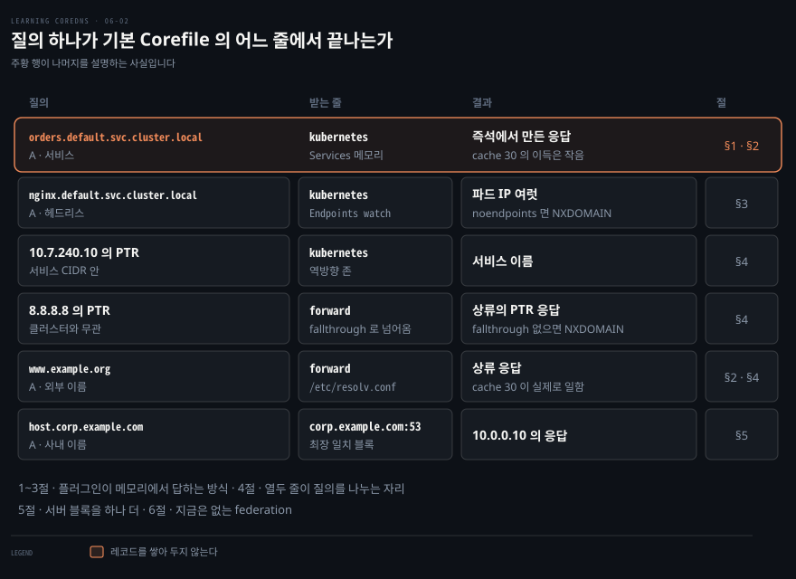
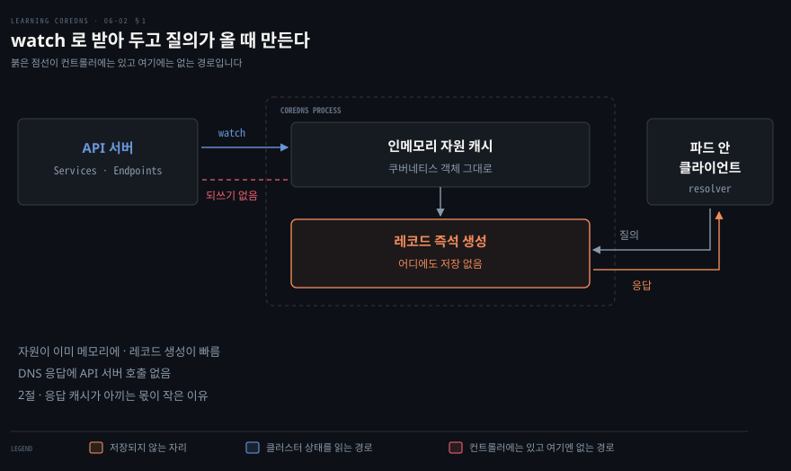
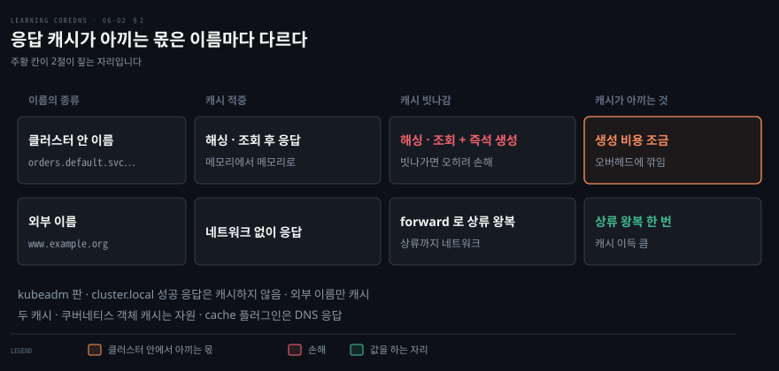
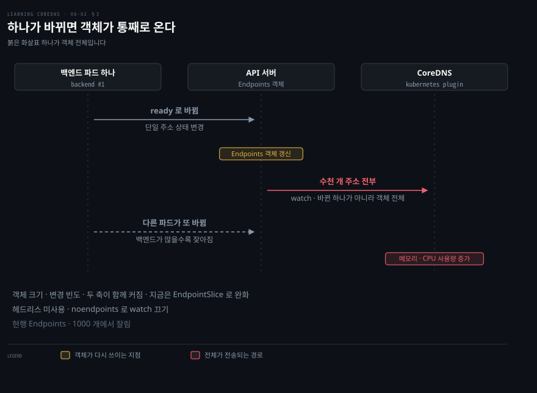
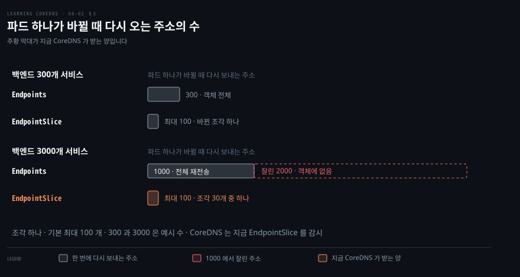
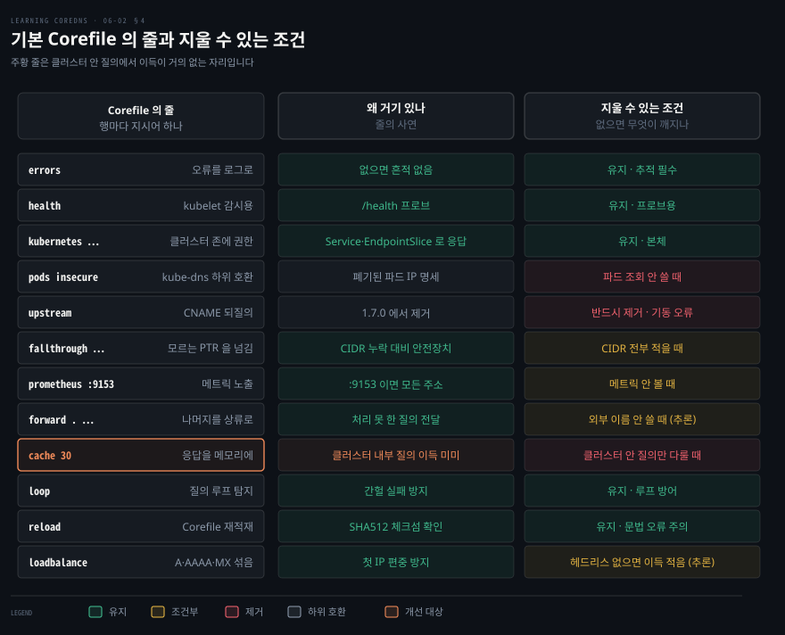
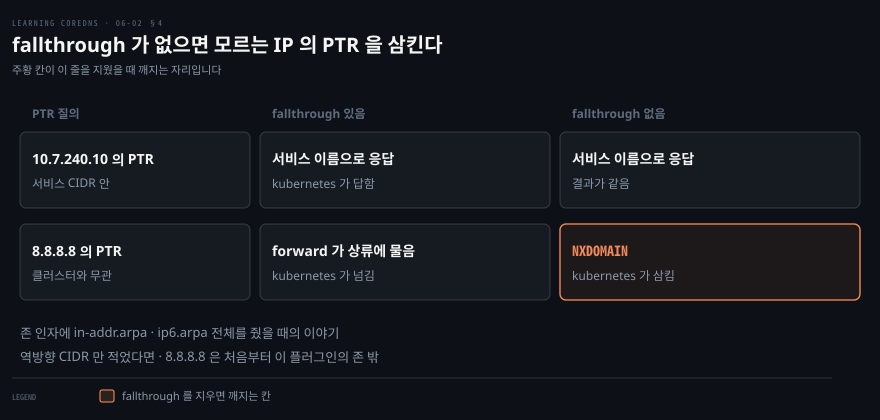
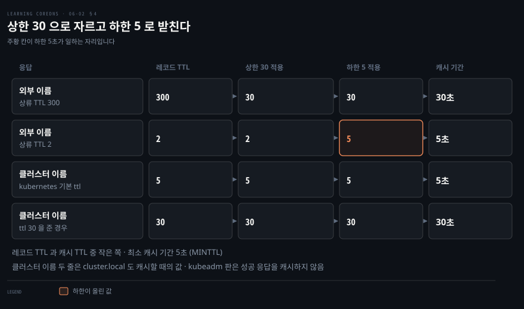
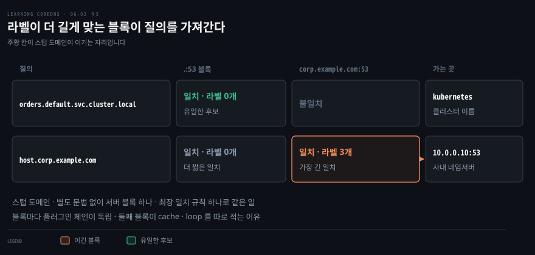

# 기본 Corefile의 줄마다 이유가 있다

---

> 클러스터에 배포되는 CoreDNS 설정은 열두 줄 남짓입니다. 그 줄들이 왜 거기 있는지 알면 어떤 줄을 지워도 되는지가 함께 드러납니다.

## 핵심 요약

> 이 편이 매달린 하나의 생각은 CoreDNS 가 레코드를 쌓아 두지 않는다는 것이고, 기본 설정의 어색한 줄들은 대부분 거기서 나옵니다.

`kubernetes` 플러그인은 컨트롤러처럼 동작하되 API 서버에 아무것도 되쓰지 않습니다. Services 와 EndpointSlices 에 watch 를 걸어 메모리에 들고 있다가, 질의가 오면 그 자리에서 레코드를 만들어 답합니다.

이 사실 하나가 기본 Corefile 을 읽는 열쇠가 됩니다. 쿠버네티스 객체가 이미 메모리에 있어 클러스터 안 이름은 빠르게 만들 수 있으므로 `cache 30` 이 그 응답을 다시 저장해 얻는 이득은 작습니다. 저자들도 그렇게 적고, 4절 끝의 kubeadm 기본값은 클러스터 도메인을 캐시에서 뺍니다.

나머지 줄들도 저마다 사연이 있습니다.

- `pods insecure` 는 kube-dns 하위 호환입니다.
- `upstream` 은 불필요해진 유산이고 지금 버전에서는 넣으면 오히려 오류가 납니다.
- `fallthrough` 는 역방향 CIDR 을 다 못 적었을 때를 위한 안전장치입니다.

사연을 알면 지울 줄과 남길 줄이 갈립니다.


## 학습 목표

이 내용을 읽고 나면:

1. `kubernetes` 플러그인이 컨트롤러와 무엇이 같고 무엇이 다른지 말할 수 있습니다.
2. 쿠버네티스 인메모리 캐시와 `cache` 플러그인이 왜 별개인지 설명할 수 있습니다.
3. Endpoints 감시가 큰 서비스에서 비싼 이유를 watch 의 동작으로 유도할 수 있습니다.
4. 기본 Corefile 의 각 줄이 무엇을 켜고 왜 거기 있는지 짚고, `cache` 의 상한과 하한으로 응답이 캐시에 남는 시간을 계산할 수 있습니다.
5. 스텁 도메인이 왜 새 서버 블록으로 표현되는지 3장의 최장 일치와 이어 말할 수 있습니다.

아래 지도는 기본 Corefile 에 성격이 다른 질의 여섯을 차례로 물었을 때 어느 줄이 받고 어떻게 끝나는지를 적은 것입니다. 1절부터 3절까지가 첫 두 행을 만드는 플러그인의 동작이고, 4절부터 6절까지가 나머지 행을 가르는 설정입니다. 읽는 동안 "이 질의는 지도의 몇 번째 행인가"를 물으며 따라가면 됩니다.




## 이 문서가 다루지 않는 것

> 이 편은 CoreDNS 가 클러스터에서 어떻게 동작하고 어떻게 설정되는가까지입니다. 그것을 실제로 띄우는 리소스는 다음 편입니다.

- RBAC·Service·Deployment 매니페스트와 오토스케일링 → [복제본 둘과 170Mi는 어디서 온 값인가](./06-03.%EB%B3%B5%EC%A0%9C%EB%B3%B8%20%EB%91%98%EA%B3%BC%20170Mi%EB%8A%94%20%EC%96%B4%EB%94%94%EC%84%9C%20%EC%98%A8%20%EA%B0%92%EC%9D%B8%EA%B0%80.md)
- `kubernetes` 플러그인 전체 문법과 확장 기능 → [명세 밖으로 나가면 이식성을 내준다](./06-04.%EB%AA%85%EC%84%B8%20%EB%B0%96%EC%9C%BC%EB%A1%9C%20%EB%82%98%EA%B0%80%EB%A9%B4%20%EC%9D%B4%EC%8B%9D%EC%84%B1%EC%9D%84%20%EB%82%B4%EC%A4%80%EB%8B%A4.md)
- 쿠버네티스가 DNS 에 요구하는 명세 → [무엇을 선언했느냐가 레코드 모양을 정한다](./06-01.%EB%AC%B4%EC%97%87%EC%9D%84%20%EC%84%A0%EC%96%B8%ED%96%88%EB%8A%90%EB%83%90%EA%B0%80%20%EB%A0%88%EC%BD%94%EB%93%9C%20%EB%AA%A8%EC%96%91%EC%9D%84%20%EC%A0%95%ED%95%9C%EB%8B%A4.md)
- `errors`·`cache`·`forward`·`loadbalance` 플러그인 자체의 문법 → [플러그인 일곱이면 서버 하나가 선다](./03-02.%ED%94%8C%EB%9F%AC%EA%B7%B8%EC%9D%B8%20%EC%9D%BC%EA%B3%B1%EC%9D%B4%EB%A9%B4%20%EC%84%9C%EB%B2%84%20%ED%95%98%EB%82%98%EA%B0%80%20%EC%84%A0%EB%8B%A4.md)

남는 것은 그 줄이 왜 거기 있는가입니다.


## 1. 되쓰지 않는 컨트롤러

> 앞 편에서 컨트롤러가 읽고 쓰는 루프를 돈다고 했습니다. `kubernetes` 플러그인은 그 루프에서 쓰는 쪽을 통째로 뺀 모양입니다.



앞 편에서는 쿠버네티스가 요구하는 DNS 이름을 봤습니다. 이제 CoreDNS 가 그 답을 만들기 위해 어떤 자원을 읽는지 살펴봅니다.

CoreDNS 의 `kubernetes` 플러그인은 컨트롤러와 아주 비슷하게 동작하되 API 서버에 데이터를 절대 되쓰지 않습니다. Services 와 EndpointSlices 자원에 watch 를 걸고 그 데이터를 캐시합니다. 플러그인이 처리할 요청이 들어오면 그 이름이 자원에 대응하는지 조회하고 대응하면 알맞은 데이터를 돌려줍니다.

### 즉석 레코드 생성

응답 레코드를 미리 만들어 저장해 두지는 않습니다. CoreDNS 는 들어온 요청에 맞춰 그 자리에서 레코드를 만듭니다.

쿠버네티스 자원이 인메모리 캐시, 곧 CoreDNS 프로세스가 메모리에 들고 있는 사본에 있기 때문에 레코드를 만드는 일은 아주 빠릅니다. API 서버의 watch 기능 덕분에 인메모리 자원 데이터가 변화를 따라갑니다. 그래서 정상적으로 동기화된 상태에서는 DNS 질의마다 API 서버를 조회할 필요가 없고 응답도 빠르게 만들 수 있습니다.

> **노트의 읽기**: 이 설계가 앞 편 2절의 watch 와 짝을 이룹니다. 조정 루프의 컨트롤러는 읽고 판단하고 되썼지만, `kubernetes` 플러그인은 읽고 들고 있다가 물어보면 답할 뿐입니다. 클러스터 상태를 바꾸지 않는 읽기 전용 소비자라, RBAC 에서도 쓰기 권한을 요구하지 않습니다. 그 권한 목록은 다음 편에서 봅니다.


## 2. 서로 다른 두 캐시

> 쿠버네티스 객체의 인메모리 캐시와 `cache` 플러그인의 DNS 캐시는 서로 다르고 이름만 같습니다. 이 구분을 놓치면 기본 설정의 `cache 30` 을 잘못 읽습니다.

1절에서 `kubernetes` 플러그인이 자원을 메모리에 들고 있다고 했는데, 기본 Corefile 에는 `cache 30` 이 또 있습니다. 이미 메모리에 있는 것을 왜 한 번 더 캐시하는지 궁금해집니다. 답은 두 캐시가 저장하는 대상이 다르다는 데 있습니다. 쿠버네티스 객체의 인메모리 캐시는 Service 같은 자원을 담고 DNS 응답 캐시는 CoreDNS 의 `cache` 플러그인으로 켭니다.

클러스터 밖 질의는 더 넓은 네트워크로 나갑니다. CoreDNS 가 이런 질의는 다루지 않고 클러스터 안 요청에만 답한다면 `cache` 플러그인을 켜는 이득이 아주 적습니다.

저자들은 그 비용을 설명합니다. `cache` 플러그인은 `kubernetes` 플러그인이 구성한 리소스 레코드를 DNS 질의에 대한 응답 형태로 메모리에 저장합니다. 그 레코드를 돌려주는 것이 재구성하는 것보다 조금 빠를 수는 있습니다. 그런데 해싱과 데이터 조회에 추가 오버헤드가 있어서 캐시 적중 시의 성능 이득이 줄고 캐시가 빗나가는 경우에는 오히려 성능이 떨어집니다.

결국 인메모리 자원에서 만든 DNS 응답을 다시 메모리에 두는 셈입니다. 적중하면 여전히 조금 빠르기는 하되 그 이득이 오버헤드에 깎이고 빗나가면 순손해입니다. 클러스터 밖으로 나가는 질의에는 사정이 다릅니다. 그쪽은 실제로 네트워크를 타야 하므로 캐시가 값을 합니다.

아래 그림은 두 종류의 이름을 캐시가 적중했을 때와 빗나갔을 때로 나눴습니다. 캐시가 아끼는 몫의 차이는 한 열에 모입니다.




## 3. Endpoints 감시가 큰 서비스에서 비싼 이유

> `kubernetes` 플러그인은 Services 와 Endpoints 를 둘 다 감시합니다. 뒤엣것이 문제를 일으키는데, 이유가 자원의 이름에 이미 들어 있습니다.



플러그인이 Services 와 EndpointSlices 를 둘 다 감시하는 데는 이유가 있습니다. ClusterIP 서비스 질의에 답하려면 Services 가 필요하고 헤드리스 서비스 질의에 답하려면 EndpointSlices 가 필요합니다. 헤드리스를 지원할 필요가 없다면, 플러그인 옵션 `noendpoints` 로 Endpoints watch 를 끌 수 있습니다. 헤드리스는 StatefulSet 과 함께 쓰이는 일이 많다는 점도 판단에 넣을 만합니다.

저자들이 Endpoints 구조를 골칫거리라 부르는 까닭은 객체의 크기와 갱신 방식에 있습니다.

### 복수형 이름의 문제

지금 CoreDNS 가 보는 것은 EndpointSlice 이고, 아래 설명은 그 앞 단계인 Endpoints 에서 문제가 어떻게 생기는지입니다. 자원 이름이 Endpoints 로 복수인 이유는, Endpoints 자원 하나가 서비스 하나의 엔드포인트 주소를 전부 담기 때문입니다. 준비된 것과 준비되지 않은 것을 가리지 않고 전부입니다. 백엔드가 많은 서비스라면 아주 큰 자료구조가 됩니다.

거기에 watch 의 동작이 겹칩니다. watch 는 자원이 바뀔 때마다 자원 데이터를 보냅니다. Endpoints 라면 그 서비스의 파드가 하나 생기거나 없어지거나 준비 상태를 오갈 때마다 Endpoints 객체 전체가 전송됩니다.

부담은 두 방향에서 늘어납니다.

- 서비스의 백엔드가 많을수록 Endpoints 객체가 커집니다. 담긴 주소가 많으니 당연합니다.
- 백엔드가 많을수록 그중 하나가 바뀔 가능성도 높아집니다.

두 요인이 겹쳐 큰 Endpoints 가 작은 Endpoints 보다 더 자주 전송됩니다. 수천 개의 백엔드를 가진 아주 큰 서비스에서는 확장 문제가 됩니다. 큰 서비스가 있으면 CoreDNS 는 작은 서비스일 때보다 메모리와 CPU 를 훨씬 많이 씁니다. 헤드리스가 필요 없다면 Endpoints watch 를 끄는 것이 자원 사용을 낮추는 데 도움이 됩니다.

> **버전 차이**: 이 문제는 쿠버네티스가 EndpointSlice 를 들이면서 크게 누그러졌습니다. 서비스 하나의 주소를 여러 조각(slice)으로 나눠 담으므로, 파드 하나가 바뀌어도 그 파드가 든 조각만 다시 전송됩니다.[^slicewatch] 조각 하나에는 기본으로 엔드포인트가 100개까지 들어갑니다.[^eps][^epsmax] 옛 Endpoints API 쪽에는 상한이 생겼습니다. 백엔드가 1000개를 넘으면 쿠버네티스가 Endpoints 객체를 1000개에서 자르고 `endpoints.kubernetes.io/over-capacity: truncated` 주석을 답니다.[^overcap] 쿠버네티스가 1000개 상한을 두고 Endpoints API 를 deprecated 로 돌린 것은 각각 v1.22, v1.33 입니다.[^trunc122][^endpointsdep] 지금 `kubernetes` 플러그인은 `"The kubernetes plugin watches Endpoints via the discovery.EndpointSlices API."` 라고 적듯 이 API 로 감시합니다.[^k8splugin] 그래도 큰 클러스터에서 API 서버 부담이 걱정되면 `apiserver_qps`·`apiserver_burst`·`apiserver_max_inflight` 로 플러그인이 보내는 요청의 초당 한도·순간 폭주 한도·동시 진행 상한을 조일 수 있습니다.[^k8splugin]

아래 그림은 백엔드 수가 다른 두 서비스에서 파드 하나가 바뀔 때 다시 오는 주소의 수를 막대 길이로 견줍니다. 백엔드 수는 설명용 예시입니다.



> **노트의 읽기**: `noendpoints` 를 켰을 때의 결과는 공식 문서가 `"All endpoint queries and headless service queries will result in an NXDOMAIN."` 이라고 적습니다.[^k8splugin] 조용히 비는 것이 아니라 이름이 없다고 답한다는 뜻이라, 헤드리스를 쓰는 워크로드가 하나라도 남아 있으면 그 워크로드가 깨집니다. 끄기 전에 확인할 것은 "헤드리스를 안 쓴다" 가 아니라 "아무도 안 쓴다" 입니다.


## 4. 기본 Corefile 열두 줄

> 배포 도구가 만들어 넣는 Corefile 은 CoreDNS 팀의 권고를 거의 그대로 씁니다. 줄마다 켜는 것과 그 줄이 있는 이유가 다릅니다.



클러스터에서 도는 CoreDNS 의 Corefile 은 대개 배포 도구가 만들어 넣습니다. 손으로 쓴 적이 없으니 처음 열면 줄마다 왜 있는지 알기 어렵습니다.

쿠버네티스 클러스터를 만드는 방법은 여러 가지입니다. CoreDNS 를 포함한 각 구성요소의 정확한 설정은 클러스터를 만드는 사람의 몫입니다. 이것을 쉽게 하려고 `kubeadm`·`kube-spray`·`minikube` 같은 배포 도구가 여럿 있습니다. 각 도구가 클러스터에 필요한 쿠버네티스 자원을 전부 만드는 책임을 집니다. CoreDNS 의 Corefile 도 거기 들어갑니다.

이론상 각 도구가 Corefile 에 무엇을 담을지 스스로 정할 수 있습니다. 그런데 실제로는 대부분 CoreDNS 팀의 권고를 따릅니다. 그 권고는 CoreDNS GitHub 조직의 deployment 저장소 `kubernetes` 디렉터리에 있습니다. deployment 템플릿과 kubeadm 기본값은 `pods insecure`·`ttl`·`cache` 의 `disable` 에서 갈립니다.[^deptmpl][^kubeadm1372]

아래는 쿠버네티스 v1.37.2 kubeadm 이 생성하는 현행 기본 Corefile 입니다.[^kubeadm1372] kubeadm 템플릿의 `{{ .DNSDomain }}` 자리는 아래 예제처럼 `CLUSTER_DOMAIN` 으로 적었습니다. `cache` 의 `disable` 두 줄은 클러스터 도메인이 주어졌을 때만 들어갑니다.

```bash
.:53 {
    errors
    health {
       lameduck 5s
    }
    ready
    kubernetes CLUSTER_DOMAIN in-addr.arpa ip6.arpa {
       pods insecure
       fallthrough in-addr.arpa ip6.arpa
       ttl 30
    }
    prometheus :9153
    forward . /etc/resolv.conf {
       max_concurrent 1000
    }
    cache 30 {
       disable success CLUSTER_DOMAIN
       disable denial CLUSTER_DOMAIN
    }
    loop
    reload
    loadbalance
}
```

아래는 위 블록에서 `lameduck`·`ready`·`ttl`·`max_concurrent`·`disable` 을 걷어 내고 값 자리를 변수로 남긴 Corefile 입니다. 줄마다의 설명은 이 형태로 읽습니다.

```bash
.:53 {
    errors
    health
    kubernetes CLUSTER_DOMAIN REVERSE_CIDRS {
        pods insecure
        fallthrough in-addr.arpa ip6.arpa
    }
    prometheus :9153
    forward . UPSTREAMNAMESERVER
    cache 30
    loop
    reload
    loadbalance
}
```

대문자로 적힌 값은 변수입니다. 이 파일을 처리하는 배포 도구가 치환합니다. 쿠버네티스 자체는 이 변수를 이해하지도 않고 아무 일도 하지 않으므로, 이 파일을 그대로 쓰면 클러스터의 CoreDNS 배포가 깨집니다.

### 서버 블록과 로깅

첫 줄 `.:53 {` 은 53번 포트에서 도는 서버의 새 서버 블록을 엽니다.
이 블록이 루트 도메인과 그 아래 전부의 질의를 풉니다.
즉 더 구체적으로 일치하는 다른 서버 블록이 없는 한 모든 질의가 이 블록의 플러그인 집합을 지납니다.

`errors` 는 질의 처리 중 반환된 오류를 로그로 남깁니다. 상류 네임서버로 가는 네트워크 타임아웃 같은 것이 여기 들어갑니다. 이 플러그인은 오류가 기록되는지에만 영향을 주고 실제 DNS 응답 코드는 바꾸지 않습니다. 없어도 CoreDNS 는 대개 `SERVFAIL` 로 응답하되 아무것도 남기지 않습니다. 오류가 기록되면 문제 추적이 훨씬 쉬워집니다.

`health` 는 헬스체크 엔드포인트를 엽니다. kubelet 은 이 엔드포인트로 CoreDNS 가 살아서 제대로 도는지 감시합니다. 8080 포트에 HTTP 서버를 열고 `/health` 요청에 응답합니다.

### kubernetes 블록 안의 세 줄

셋째 줄 `kubernetes CLUSTER_DOMAIN REVERSE_CIDRS {` 는 `kubernetes` 플러그인을 켭니다.
이 줄이 `CLUSTER_DOMAIN` 에 대한 권한을 줍니다.

클러스터에서 도는 서비스의 PTR 요청에도 답해야 하므로 `REVERSE_CIDRS` 에는 쿠버네티스 서비스 CIDR 을 채웁니다. 서비스 CIDR 이 `10.7.240.0/20` 이면 그 값을 씁니다. 서비스 엔드포인트의 PTR 질의까지 풀고 싶으면 파드 CIDR 도 전부 이 목록에 넣어야 합니다.

서비스 CIDR 과 파드 CIDR 은 쿠버네티스 API 로 발견할 수 없어서 CoreDNS 가 스스로 알아낼 수 없습니다. 대안으로 `in-addr.arpa` 와 `ip6.arpa` 를 적으면 모든 역방향 DNS 요청을 플러그인이 보게 됩니다.

블록 안에서 다룰 설정이 셋입니다. `pods insecure` 와 `fallthrough` 는 위 블록에 있고, `upstream` 은 옛 설정에서 만나는 줄입니다.

`pods insecure` 는 폐기된 명세 부분을 지원합니다. 파드 IP 주소를 묻는 특수한 형태의 질의에 답하는 부분입니다. 이전 기본 클러스터 DNS 해법이던 kube-dns 와의 하위 호환을 위해 제공됩니다. 필요 없다면 이 줄을 지워야 한다고 저자들이 못 박습니다. `pods` 를 아예 적지 않으면 기본값은 `disabled` 라서, 이 줄은 꺼져 있던 기능을 켜는 줄입니다. 세 모드의 차이와 비용은 06-04 §2 가 다룹니다.

`upstream` 은 1.7.0 에서 옵션이 제거돼, 지금은 적으면 알 수 없는 속성이라는 오류로 CoreDNS 가 뜨지 않습니다.[^rel170][^unkprop] 설정 파서의 분기 목록에도 `upstream` 이 없습니다.

`upstream` 을 적으면 CoreDNS 가 CNAME 레코드를 풀 때 자신에게 질의를 되보냈습니다. CNAME 은 서비스가 `type: ClusterIP` 대신 `type: ExternalName` 으로 정의될 때 쓰입니다.

이 옵션은 스텁 도메인을 비롯한 다른 설정이 존중되게 하고 클러스터 안 서비스로 풀리는 CNAME 도 되게 했습니다. 이후 이 동작이 기본이 되어 줄이 불필요해졌고 1.7.0 에서 옵션이 제거됐습니다.[^upsdefault]

`fallthrough in-addr.arpa ip6.arpa` 는 PTR 조회에서 레코드를 못 찾으면 요청을 플러그인 체인 아래로 넘기라고 지시합니다. 서비스와 파드 CIDR 을 Corefile 에 전부 명시하지 않았을 때 특히 중요합니다. 그 경우 설정상 모든 PTR 요청이 `kubernetes` 플러그인을 지나게 되는데, 이 줄이 없으면 플러그인이 아무 IP 의 PTR 요청이든 삼켜 버립니다. 이 줄이 있으면 모르는 IP 는 체인 아래로 내려가 `forward` 플러그인이 받습니다.

서비스 IP 와 외부 IP 의 PTR 을 이 줄이 있을 때와 없을 때로 나누면 결과가 갈리는 칸은 하나뿐입니다.



### 나머지 여섯 줄

`prometheus :9153` 은 Prometheus 가 긁어 갈 메트릭을 내보냅니다. 기본적으로 이 플러그인은 localhost 에서만 청취해서 민감할 수 있는 메트릭이 실수로 노출되는 것을 막습니다. `:9153` 을 지정하면 모든 주소의 9153 포트에서 청취하게 됩니다. Prometheus 가 네트워크 너머에서 긁어 가므로 이렇게 해야 접근할 수 있습니다.

`forward . UPSTREAMNAMESERVER` 는 루트 존에 대해 `forward` 플러그인을 켭니다. 이 서버가 받은 질의 중 앞선 플러그인이 처리하지 않은 것이 지정된 네임서버로 전달됩니다.

여기서 "앞선" 은 Corefile 에 먼저 적혔다는 뜻이 아닙니다. 3장에서 본 대로 질의는 컴파일 시점에 정해진 고정된 순서로 플러그인을 지납니다. Corefile 의 순서는 플러그인 사이에서는 의미가 없습니다. 다만 한 서버 블록 안에 여러 인스턴스를 허용하는 플러그인이라면 그 순서는 의미가 있습니다.

`cache 30` 은 `cache` 플러그인을 켜고 레코드의 TTL 을 30초로 제한합니다. 캐시 기간은 레코드 TTL 을 하한 5초와 상한 30초 사이로 맞춘 값입니다.[^cache][^cacheclamp] TTL 이 2초인 레코드도 5초 동안 캐시됩니다. 30 은 위로 자르는 상한이고 5 는 아래를 받치는 하한입니다.

2절에서 본 이유로 여기서 캐시를 쓰는 것은 이상적이지 않습니다. 상류 요청에는 쓸모가 있지만 클러스터 도메인 안쪽 요청은 캐시에서 얻는 값이 크지 않습니다.

아래 그림은 TTL 이 다른 응답 넷을 같은 단계에 차례로 통과시킵니다. 상한과 하한이 실제 값에 어떻게 걸리는지 왼쪽에서 오른쪽으로 읽으면 됩니다.



`loop` 는 DNS 질의 루프를 탐지하는 방어용 플러그인입니다. 공식 문서가 `"only attempts to find simple static forwarding loops at start up time"` 이라고 한정하듯, 시작할 때 단순한 포워딩 루프만 잡습니다.[^loop] 루프가 탐지되면 CoreDNS 는 문제를 설명하는 오류 로그를 남기고 종료합니다. 종료가 가혹해 보일 수 있지만 그래야 루프가 처리됩니다. 간헐적으로 터지고 원인을 짚기 어려운 DNS 실패를 막아 줍니다.

`reload` 는 프로세스를 재시작하지 않고 Corefile 을 다시 읽게 합니다. `kubectl -n kube-system edit configmap coredns` 로 고치면 변경이 자동으로 반영됩니다. ConfigMap 을 바꾸면 그 변경이 필요한 모든 노드에 전파되는 데 1~2분 걸릴 수 있습니다.

`reload` 는 Corefile 의 SHA512 체크섬을 기본 30초 간격으로 확인합니다(기본 지터 15초). 지터는 검사 간격에 무작위로 더하고 빼는 폭입니다. 같은 Corefile 을 나눠 쓰는 여러 인스턴스가 한꺼번에 다시 읽지 않도록 시점을 흩어 줍니다. 변경이 확인되면 Corefile 을 다시 읽습니다.[^reload][^reload150]

저자들은 변경을 반드시 실험 환경이나 동일한 사본 배포에서 먼저 시험하라고 경고합니다. Corefile 에 문법 오류가 있으면 CoreDNS 는 오류를 로그에 남기고 원래 Corefile 로 계속 서빙합니다. 문제는 그다음입니다. CoreDNS 파드가 죽거나 나중에 다른 노드로 재스케줄되면, 새로 시작한 프로세스가 그 잘못된 Corefile 을 읽고 뜨지 못합니다.

마지막으로 `loadbalance` 는 응답의 A·AAAA·MX 레코드를 무작위로 섞습니다.[^lb][^lb150] 헤드리스 서비스를 쓰면 클라이언트마다 다른 순서로 레코드를 받게 됩니다. 많은 클라이언트가 그냥 첫 번째 IP 를 쓰기 때문에, 이것만으로도 부하가 모든 인스턴스에 퍼집니다.

> **kubeadm 기본값**: kubeadm 이 만드는 기본 Corefile 은 변수 형태의 열두 줄에 몇 가지를 더합니다.[^kubeadmdns][^kubeadm1372] `health` 에 `lameduck 5s` 가 붙어 종료 신호를 받은 뒤에도 5초 동안 종료를 미룹니다. 그동안 `/health` 는 계속 200 OK 를 답하고, 따로 들어간 준비 상태 플러그인 `ready` 는 OK 를 답하지 않습니다.[^health][^lameduck150] `kubernetes` 블록에는 `ttl 30` 이 붙습니다. `forward` 에 `max_concurrent 1000` 이 붙습니다. `cache 30` 은 클러스터 도메인을 `disable success`·`disable denial` 로 빼서, 2절이 지적한 클러스터 안 이름의 캐시 문제를 한 블록 안에서 풉니다. `pods insecure` 도 들어 있습니다.


## 5. 스텁 도메인과 서버 블록

> 특정 도메인만 다른 네임서버로 보내고 싶을 때가 있습니다. CoreDNS 는 그것을 옵션이 아니라 서버 블록을 하나 더 만들어 표현합니다.

사내 도메인 하나만 다른 네임서버로 보내고 싶다고 합시다. `forward` 는 첫 인자로 매칭할 도메인을 받으니 같은 블록에 한 줄 더 적는 길도 있습니다. 그런데 배포 도구가 만드는 Corefile 은 그 길 대신 서버 블록을 따로 나눕니다.

노트가 읽는 답은 서버 블록마다 플러그인 체인이 독립이라는 데 있습니다. 블록을 나누면 그 도메인의 질의만 다른 캐시 설정과 다른 `loop` 감시를 받게 할 수 있습니다. 한 블록 안에 `forward` 를 한 줄 더 얹으면 그 질의도 클러스터 질의와 같은 체인을 지납니다.

deployment 저장소 Corefile 템플릿에는 `STUBDOMAINS` 변수가 들어갑니다.[^depfed] 더 흔히 쓰이는 변수에 집중하려고 앞 절의 목록에서는 빠져 있었습니다. `FEDERATIONS` 변수는 deployment 저장소가 2020년 6월 federation 지원을 걷어내면서 템플릿에서 사라졌습니다.

federation 지원이 있던 템플릿에서 이 둘이 붙는 자리는 조금 특이했습니다. `FEDERATIONS` 는 `kubernetes` 블록을 닫는 중괄호 바로 뒤, `STUBDOMAINS` 는 서버 블록을 닫는 중괄호 바로 뒤였습니다.

> **노트의 읽기**: 이 위치를 중괄호만 놓고 읽으면 `FEDERATIONS` 는 서버 블록의 지시어 자리로, `STUBDOMAINS` 는 서버 블록 바깥이므로 새 서버 블록으로 치환된다고 읽힙니다. 아래 예제가 뒤엣것을 실제로 그렇게 보입니다.

### 스텁 도메인의 두 서버 블록

`STUBDOMAINS` 는 `UPSTREAMNAMESERVER` 가 아닌 다른 네임서버로 특정 도메인을 풀고 싶을 때 서버 스탠자를 추가하는 데 쓰입니다. 전형적인 용도는 내부 DNS 서버로 사내 도메인을 푸는 것입니다.

아래 설정은 스텁 도메인의 서버 블록 구조를 읽는 예제로 씁니다.

```bash
.:53 {
    errors
    health
    kubernetes cluster.local in-addr.arpa ip6.arpa {
        pods insecure
        fallthrough in-addr.arpa ip6.arpa
    }
    prometheus :9153
    forward . /etc/resolv.conf
    cache 30
    loop
    reload
    loadbalance
}

corp.example.com:53 {
    errors
    cache 30
    loop
    forward . 10.0.0.10:53
}
```

`corp.example.com` 아래 무엇이든 질의하면 두 번째 서버 블록을 지납니다. 질의가 가장 길게 일치하는 서버 블록으로 향하기 때문입니다. 그리고 그 질의들은 `/etc/resolv.conf` 에 정의된 네임서버가 아니라 `10.0.0.10` 의 사내 네임서버로 전달됩니다.

그림에서는 두 블록에 클러스터 이름과 사내 이름을 하나씩 넣고 어느 블록이 왜 이기는지 견줍니다.



> **노트의 읽기**: 최장 일치는 [3장에서 본 규칙](./03-01.Corefile%EC%9D%80%20%EB%9D%BC%EB%B2%A8%EB%A1%9C%20%EC%84%9C%EB%B2%84%EB%A5%BC%20%EA%B0%80%EB%A5%B8%EB%8B%A4.md) 그대로입니다. 스텁 도메인이 별도 문법 없이 그냥 서버 블록으로 표현되는 이유가 여기 있습니다. CoreDNS 에는 "스텁 도메인" 이라는 개념이 따로 없고, 라벨이 더 긴 블록이 이기는 규칙 하나로 같은 일이 됩니다. 두 번째 블록이 `cache` 와 `loop` 를 따로 적는 것도 서버 블록마다 플러그인 체인이 독립이기 때문입니다.


## 6. 페더레이션 유산

> `FEDERATIONS` 변수는 이미 개발이 멈춘 기능을 위해 있던 유산입니다. 변수도 그 기능도 사라졌습니다.

`FEDERATIONS` 변수는 쿠버네티스 federation v1 이름을 지원하는 데 쓰이던 설정이었습니다. `federation` 플러그인을 켜고 페더레이션 존을 지정하게 했습니다. `federation` 플러그인은 1.7.0 에서 제거됐고 지금 기본 빌드 목록에 없습니다.[^plugincfg][^fedgone]

federation v1 은 여러 클러스터에 걸친 워크로드를 관리하는 제어 평면이었지만 더 이상 활발히 개발되지 않았습니다.

> **노트의 읽기**: `federation` 플러그인은 제거됐습니다. 옛 설정에서 `FEDERATIONS` 를 만나면 없는 기능으로 읽고 넘어가면 됩니다. 다중 클러스터 쪽 자리는 `multicluster` 옵션이 차지하고 있는데, 이것은 federation 의 후계가 아니라 Multi-Cluster Services API 라는 별개 규격에 맞춘 것으로 읽힙니다(노트의 해석).[^k8splugin][^k8splugin150]


## 결정 치트시트

> 기본 Corefile 의 각 줄을 지울 수 있는 조건으로 정리했습니다. `forward`·`loadbalance` 의 조건은 본문 설명에서 노트가 끌어낸 것입니다.

| 줄 | 왜 있나 | 지울 수 있는 조건 |
|----|---------|------------------|
| `errors` | 오류를 로그에 남긴다 | 지우지 않는다 · 문제 추적이 어려워진다 |
| `health` | kubelet 이 감시할 엔드포인트 | 지우지 않는다 · 프로브가 이것을 부른다 |
| `pods insecure` | kube-dns 하위 호환 | 폐기된 파드 레코드가 필요 없으면 지운다 |
| `upstream` | CNAME 을 되질의해 푼다 | 반드시 지운다 · 지금은 넣으면 CoreDNS 가 뜨지 않는다 |
| `fallthrough in-addr.arpa ip6.arpa` | 모르는 IP 의 PTR 을 체인 아래로 | 서비스·파드 CIDR 을 전부 열거했으면 지울 수 있다 |
| `prometheus :9153` | 메트릭을 네트워크에 연다 | Prometheus 로 긁지 않으면 지운다 |
| `forward . …` | 나머지 질의를 상류로 | 역방향 CIDR 을 전부 열거했고 외부 이름을 풀 필요가 없으면(노트의 추론) |
| `cache 30` | 응답을 메모리에 둔다 | 클러스터 안 질의만 다루면 값이 거의 없다 |
| `loop` | 질의 루프를 탐지하고 종료 | 지우지 않는다 · 디버깅 불가능한 실패를 막는다 |
| `reload` | Corefile 을 다시 읽는다 | 남기되 문법 오류를 조심한다 |
| `loadbalance` | A·AAAA·MX 를 섞는다 | 헤드리스를 안 쓰면 이득이 적다(노트의 추론) |
| 헤드리스를 아무도 안 쓴다 | — | `noendpoints` 로 Endpoints watch 를 끈다 |
| 큰 서비스에서 API 서버가 힘들어한다 | — | `apiserver_qps` 계열로 요청 속도를 조인다 |


## 적용 관점

> 이 편은 도는 클러스터가 있으면 ConfigMap 하나를 열어 대조하는 것으로 끝납니다.

**한 가지 실행**: 지금 도는 Corefile 을 꺼내 4절의 열두 줄과 대조합니다. 명령은 `kubectl -n kube-system get configmap coredns -o yaml` 입니다. `upstream` 이 남아 있는지, `pods insecure` 가 필요한지, 역방향 CIDR 이 실제 값으로 채워졌는지 봅니다. 이 셋만 봐도 그 클러스터가 어느 시절의 권고를 쓰는지 드러납니다.

**한 가지 확인**: 그 Corefile 을 고치기 전에 실험 클러스터나 복제 배포에서 먼저 시험합니다. ConfigMap 만 다른 이름으로 복제해서는 아무것도 시험되지 않습니다. 그 ConfigMap 을 마운트해 뜨는 CoreDNS Deployment 가 따로 있어야 문법 오류가 드러납니다. 4절 끝의 경고대로, 잘못된 Corefile 은 지금 도는 파드는 살려 두고 다음에 뜨는 파드부터 죽이기 때문에 증상이 늦게 옵니다.

Spring 애플리케이션 관점에서는 `cache 30` 이 판단 지점이 됩니다. 클러스터 안 서비스 이름만 부르는 애플리케이션이라면 이 캐시가 응답 시간에 기여하는 바가 거의 없습니다. 그보다 먼저 CoreDNS 에 질의가 가는 빈도를 정하는 것은 JVM 의 이름 캐시입니다. OpenJDK 는 `networkaddress.cache.ttl` 을 따로 정하지 않으면 성공한 조회를 30초 동안 들고 있습니다. 이 값은 DNS 응답의 TTL 과 상관없이 적용됩니다.[^jdkttl]

그래서 `RestTemplate` 이나 `WebClient` 가 `http://orders.default.svc.cluster.local` 을 초당 수백 번 불러도 JVM 하나가 CoreDNS 에 묻는 것은 30초에 한 번꼴입니다. 레코드 TTL 을 5초로 줄여도 그 JVM 이 새 주소를 아는 시점은 30초 캐시가 정합니다. 외부 API 를 자주 부른다면 반대로 이 캐시가 실제로 일합니다.


## 면접에서 받을 만한 질문

1. `kubernetes` 플러그인이 컨트롤러와 같은 점과 다른 점은 무엇입니까?
2. 기본 Corefile 에서 `cache 30` 줄을 지우면 클러스터 안 서비스 이름과 외부 이름의 응답은 각각 어떻게 달라집니까?
3. StatefulSet 이 헤드리스 서비스로 파드 이름을 푸는 클러스터에서 `noendpoints` 를 켜면 무슨 일이 일어납니까?
4. Endpoints 감시가 큰 서비스에서 비싸지는 이유를 두 요인으로 나눠 말해 보십시오.
5. `fallthrough in-addr.arpa ip6.arpa` 를 지우면 어떤 일이 생깁니까?
6. Corefile 의 플러그인 순서를 바꾸면 처리 순서가 바뀝니까?
7. 스텁 도메인이 별도 문법 없이 서버 블록으로 표현되는 이유는 무엇입니까?
8. kubeadm 판처럼 `cache 30 { disable success cluster.local }` 을 둔 CoreDNS 에, 상류 TTL 이 2초인 외부 이름과 클러스터 안 서비스 이름을 각각 물었습니다. 두 응답은 CoreDNS 캐시에 몇 초 동안 남습니까?


## 정답 (자답 후 펼치기)

### 정답 1 — 컨트롤러와의 차이

같은 점은 API 서버에 watch 를 걸고 자원 변화를 좇는다는 것입니다. 다른 점은 API 서버에 아무것도 되쓰지 않는다는 것입니다. 조정 루프의 셋째 걸음인 조치와 `Status` 기록을 둘 다 하지 않는 읽기 전용 소비자입니다.

### 정답 2 — `cache 30` 을 지우면

클러스터 안 이름은 거의 달라지지 않습니다. 레코드가 이미 메모리에 있는 쿠버네티스 자원에서 즉석으로 만들어지므로, 캐시가 아껴 주던 것은 해싱과 조회 비용만큼입니다. 외부 이름은 느려집니다. 매 질의가 `forward` 를 거쳐 상류 네임서버까지 네트워크를 타야 하기 때문입니다. 그래서 지금 kubeadm 은 캐시를 지우지 않고 클러스터 도메인만 `disable` 로 뺍니다.

### 정답 3 — 헤드리스를 쓰는데 `noendpoints` 를 켜면

StatefulSet 파드 이름을 묻는 질의가 전부 `NXDOMAIN` 을 받습니다. `noendpoints` 는 Endpoints 감시를 꺼서 헤드리스 서비스와 엔드포인트 질의에 답할 재료를 없애기 때문입니다. 끄기 전에 볼 것은 헤드리스를 쓰는 워크로드가 하나라도 남아 있는지입니다.

### 정답 4 — Endpoints 가 비싼 두 요인

첫째, Endpoints 자원 하나가 서비스 하나의 모든 엔드포인트 주소를 준비 여부와 무관하게 담아서 백엔드가 많을수록 객체가 커집니다. 둘째, watch 는 자원이 바뀔 때마다 객체를 통째로 보내는데 백엔드가 많을수록 그중 하나가 바뀔 확률이 높습니다. 둘이 같은 방향으로 나빠져서 큰 객체가 더 자주 전송됩니다. 지금 CoreDNS 는 EndpointSlice 를 감시해 조각 단위로 받으므로 이 비용이 크게 줄었습니다.

### 정답 5 — `fallthrough` 를 지우면

역방향 존을 넓게(`in-addr.arpa`·`ip6.arpa`) 잡아 둔 경우, `kubernetes` 플러그인이 클러스터와 무관한 IP 의 PTR 요청까지 전부 삼킵니다. 체인 아래의 `forward` 로 내려가지 못하므로 외부 IP 의 역방향 조회가 답을 못 받습니다.

### 정답 6 — Corefile 순서와 처리 순서

바뀌지 않습니다. 플러그인 사이의 처리 순서는 컴파일 시점에 고정됩니다. 다만 한 서버 블록 안에 여러 인스턴스를 허용하는 플러그인이라면 그 인스턴스들 사이의 순서는 의미가 있습니다.

### 정답 7 — 스텁 도메인이 서버 블록인 이유

CoreDNS 가 질의를 가장 길게 일치하는 서버 블록으로 보내기 때문입니다. `corp.example.com:53` 블록은 `.:53` 블록보다 라벨이 길어서 그 도메인의 질의를 가져갑니다. 스텁 도메인이라는 별도 개념 없이 기존 규칙 하나로 같은 일이 됩니다.

### 정답 8 — 캐시의 상한과 하한

외부 이름은 5초, 클러스터 안 이름은 0초입니다. 외부 응답의 TTL 2초는 상한 30 에 걸리지 않지만 최소 캐시 기간 5초에 받쳐 5초로 올라갑니다.[^cache] 클러스터 안 이름은 `disable success cluster.local` 때문에 성공 응답이 캐시에 아예 들어가지 않으므로, 질의마다 `kubernetes` 플러그인이 메모리에서 새로 만듭니다. 2절의 결론을 설정 한 줄로 옮긴 셈입니다.


## 핵심 개념 체크리스트

- [ ] `kubernetes` 플러그인이 컨트롤러와 같은 점(watch)과 다른 점(되쓰지 않음)을 말할 수 있는가?
- [ ] 응답이 즉석에서 만들어지므로 쿠버네티스 인메모리 캐시와 `cache` 플러그인이 별개라는 것을 설명할 수 있는가?
- [ ] Endpoints 가 복수형인 이유와 watch 가 객체를 통째로 보내는 동작으로 큰 서비스의 비용을 유도하고 EndpointSlice 가 무엇을 바꿨는지 말할 수 있는가?
- [ ] 기본 Corefile 의 각 줄이 무엇을 켜고 왜 있는지, kubeadm 기본값이 무엇을 더하는지 짚고, `cache` 의 상한 30·하한 5 로 캐시 기간을 계산할 수 있는가?
- [ ] 스텁 도메인이 3장의 최장 일치 규칙 하나로 새 서버 블록이 되는 이유를 말할 수 있는가?


## 관련 문서

- [무엇을 선언했느냐가 레코드 모양을 정한다](./06-01.%EB%AC%B4%EC%97%87%EC%9D%84%20%EC%84%A0%EC%96%B8%ED%96%88%EB%8A%90%EB%83%90%EA%B0%80%20%EB%A0%88%EC%BD%94%EB%93%9C%20%EB%AA%A8%EC%96%91%EC%9D%84%20%EC%A0%95%ED%95%9C%EB%8B%A4.md) — 이 편이 답하는 명세를 앞 편이 세웁니다
- [Corefile은 라벨로 서버를 가른다](./03-01.Corefile%EC%9D%80%20%EB%9D%BC%EB%B2%A8%EB%A1%9C%20%EC%84%9C%EB%B2%84%EB%A5%BC%20%EA%B0%80%EB%A5%B8%EB%8B%A4.md) — 최장 일치와 서버 블록 라벨
- [플러그인 일곱이면 서버 하나가 선다](./03-02.%ED%94%8C%EB%9F%AC%EA%B7%B8%EC%9D%B8%20%EC%9D%BC%EA%B3%B1%EC%9D%B4%EB%A9%B4%20%EC%84%9C%EB%B2%84%20%ED%95%98%EB%82%98%EA%B0%80%20%EC%84%A0%EB%8B%A4.md) — 고정된 플러그인 순서와 `fallthrough`
- [책 노트 인덱스](./README.md)


## 참고 자료

- 원서: 《Learning CoreDNS: Configuring DNS for Cloud Native Environments》 6장 Kubernetes 중반부
- 서지: John Belamaric·Cricket Liu, O'Reilly, 2019년, ISBN 978-1492047964
- [CoreDNS kubernetes 플러그인 README](https://github.com/coredns/coredns/blob/master/plugin/kubernetes/README.md)
- [CoreDNS deployment 저장소 — kubernetes 디렉터리](https://github.com/coredns/deployment/tree/master/kubernetes)

[^reload]: CoreDNS — reload 플러그인 공식 문서. Corefile 변경 확인에 SHA512 체크섬을 사용하고 기본 검사 간격 30초, 기본 지터 15초를 명시합니다. <https://coredns.io/plugins/reload/> (2026-09-27 조회)

[^loop]: CoreDNS — loop 플러그인 README. `"This plugin only attempts to find simple static forwarding loops at start up time."` <https://github.com/coredns/coredns/blob/master/plugin/loop/README.md> (2026-09-23 조회)

[^kubeadmdns]: Kubernetes kubeadm `cmd/kubeadm/app/phases/addons/dns/manifests.go` 의 Corefile — `health { lameduck 5s }`, `ready`, `kubernetes ... { pods insecure · fallthrough in-addr.arpa ip6.arpa · ttl 30 }`, `forward . /etc/resolv.conf { max_concurrent 1000 }`, `cache 30 { disable success {{ .DNSDomain }} · disable denial {{ .DNSDomain }} }`. <https://github.com/kubernetes/kubernetes/blob/master/cmd/kubeadm/app/phases/addons/dns/manifests.go> (2026-09-23 조회)

[^health]: CoreDNS — health 플러그인 README. `"Where lameduck will delay shutdown for DURATION. /health will still answer 200 OK."`, `"The ready plugin will not answer OK while CoreDNS is in lame duck mode prior to shutdown."` <https://github.com/coredns/coredns/blob/master/plugin/health/README.md>

[^eps]: Kubernetes 문서 — EndpointSlices. `"By default, the control plane creates and manages EndpointSlices to have no more than 100 endpoints each."` <https://kubernetes.io/docs/concepts/services-networking/endpoint-slices/>

[^overcap]: Kubernetes 문서 — Service 의 Over-capacity endpoints 절. `"When there are over 1000 backing endpoints for a Service, Kubernetes truncates the data in the Endpoints object."` <https://kubernetes.io/docs/concepts/services-networking/service/#over-capacity-endpoints>

[^rel170]: CoreDNS 1.7.0 릴리스 노트. `"plugin/kubernetes: Remove already-deprecated options resyncperiod and upstream"` <https://coredns.io/2020/06/15/coredns-1.7.0-release/>

[^cache]: CoreDNS — cache 플러그인 README. `"The minimum cache duration defaults to 5 seconds and can be adjusted per cache type using MINTTL in the success or denial directives."` <https://github.com/coredns/coredns/blob/master/plugin/cache/README.md>

[^lb]: CoreDNS — loadbalance 플러그인 README. `"randomizes the order of A, AAAA and MX records"` <https://github.com/coredns/coredns/blob/master/plugin/loadbalance/README.md>

[^jdkttl]: OpenJDK `conf/security/java.security` 의 `networkaddress.cache.ttl` 주석. `"The default behavior in this implementation is to cache for 30 seconds."` <https://github.com/openjdk/jdk/blob/master/src/java.base/share/conf/security/java.security>

[^plugincfg]: CoreDNS `plugin.cfg` — 기본 빌드의 플러그인 목록에 `federation` 항목이 없습니다. <https://raw.githubusercontent.com/coredns/coredns/master/plugin.cfg> (2026-09-23 조회)

[^k8splugin]: CoreDNS — kubernetes 플러그인 README 의 Syntax 절과 본문. `"The kubernetes plugin watches Endpoints via the discovery.EndpointSlices API."` 문법 블록에 `noendpoints`·`pods POD-MODE`·`apiserver_qps`·`ignore empty_service`·`multicluster` 가 있고 `upstream` 과 `federation` 은 없습니다. <https://github.com/coredns/coredns/blob/master/plugin/kubernetes/README.md>

[^kubeadm1372]: Kubernetes v1.37.2 kubeadm 이 만드는 CoreDNS 기본 Corefile — "health {", "lameduck 5s", "ready", "pods insecure", "fallthrough in-addr.arpa ip6.arpa", "ttl 30", "max_concurrent 1000", "disable success {{ .DNSDomain }}", "disable denial {{ .DNSDomain }}" (줄 170-195) <https://github.com/kubernetes/kubernetes/blob/v1.37.2/cmd/kubeadm/app/phases/addons/dns/manifests.go#L170-L195> (2026-11-01 조회)

[^lameduck150]: CoreDNS v1.15.0 health 플러그인 README — "Where `lameduck` will delay shutdown for **DURATION**. /health will still answer 200 OK." / "Note: The *ready* plugin will not answer OK while CoreDNS is in lame duck mode prior to shutdown." <https://github.com/coredns/coredns/blob/v1.15.0/plugin/health/README.md#L29-L30>

[^slicewatch]: 쿠버네티스 문서(release-1.36) EndpointSlices — "With kube-proxy running on each Node and watching EndpointSlices, every change to an EndpointSlice becomes relatively expensive since it will be transmitted to every Node in the cluster." <https://github.com/kubernetes/website/blob/release-1.36/content/en/docs/concepts/services-networking/endpoint-slices.md#L176-L178> (release-1.36 판과 main 판이 같은 파일이고 이 문장은 줄 176-178. 문서는 kube-proxy 를 예로 들며, 변경이 EndpointSlice 단위로 전송된다는 데까지만 받친다. 2026-11-01 조회)

[^epsmax]: 쿠버네티스 문서(release-1.36) EndpointSlices — "By default, the control plane creates and manages EndpointSlices to have no more than 100 endpoints each. You can configure this with the `--max-endpoints-per-slice` … flag, up to a maximum of 1000." <https://github.com/kubernetes/website/blob/release-1.36/content/en/docs/concepts/services-networking/endpoint-slices.md#L62-L66>

[^endpointsdep]: 쿠버네티스 문서(release-1.36) Service — "### Endpoints (deprecated)" 와 feature-state v1.33 deprecated. "The deprecated Endpoints API has several problems relative to EndpointSlice:" <https://github.com/kubernetes/website/blob/release-1.36/content/en/docs/concepts/services-networking/service.md#L310-L317> (2026-11-01 조회)

[^cacheclamp]: CoreDNS v1.15.0 cache — README "The minimum cache duration defaults to 5 seconds and can be adjusted per cache type using **MINTTL** in the `success` or `denial` directives." (:30-31). 코드 `ttl := min(max(msgTTL, minTTL), maxTTL)` (`plugin/cache/cache.go:331`), `MinimalDefaultTTL = 5 * time.Second` (`plugin/pkg/dnsutil/ttl.go:55`). <https://github.com/coredns/coredns/blob/v1.15.0/plugin/cache/cache.go#L331>

[^reload150]: CoreDNS v1.15.0 reload 플러그인 README — "This plugin periodically checks if the Corefile has changed by reading it and calculating its SHA512 checksum." (:12-13) / "The default **INTERVAL** is 30s, default **JITTER** is 15s, the minimal value for **INTERVAL** is 2s, and for **JITTER** it is 1s." (:44-45) <https://github.com/coredns/coredns/blob/v1.15.0/plugin/reload/README.md#L12-L13>

[^lb150]: CoreDNS v1.15.0 loadbalance 플러그인 README — "*loadbalance* - randomizes the order of A, AAAA and MX records  and optionally prefers specific subnets." (:5). 두 칸 공백은 원문 그대로. <https://github.com/coredns/coredns/blob/v1.15.0/plugin/loadbalance/README.md#L5>

[^upsdefault]: CoreDNS 1.3.1 릴리스 노트는 다음 판(1.4.0)의 변경으로 "The `upstream` directive used in various plugin will start to *default* to the coredns process itself." 를 예고했고, 1.5.2 릴리스 노트는 "For all plugins that use the `upstream` directive it use removed from the documentation; it's still accepted but is a noop." 라고 적습니다. <https://github.com/coredns/coredns.io/blob/master/content/blog/coredns-1.3.1.md> · <https://github.com/coredns/coredns.io/blob/master/content/blog/coredns-1.5.2.md> (2026-11-02 조회)

[^unkprop]: CoreDNS v1.15.0 kubernetes 플러그인 설정 파서 — `switch` 의 case 목록(줄 119-277)에 `upstream` 이 없고 기본 분기가 `return nil, c.Errf("unknown property '%s'", c.Val())` (줄 291). <https://github.com/coredns/coredns/blob/v1.15.0/plugin/kubernetes/setup.go#L291>

[^fedgone]: CoreDNS 1.7.0 릴리스 노트 — "The federation plugin (which allows for v1 Kubernetes federation) has been removed." / "plugin/federation: Remove already-deprecated federation plugin (https://github.com/coredns/coredns/pull/3794)" <https://coredns.io/2020/06/15/coredns-1.7.0-release/>

[^depfed]: coredns/deployment 커밋 `916d904` — "Remove support for federation in deploy script (#229)" (2020-06-16). 현행 템플릿에는 `STUBDOMAINS` 만 남아 있다: `}STUBDOMAINS` (`kubernetes/coredns.yaml.sed:73`, 커밋 `d966288`). <https://github.com/coredns/deployment/commit/916d90420df83ad7d2ab9135a409ea80780af9e0>

[^k8splugin150]: CoreDNS v1.15.0 kubernetes 플러그인 README — "The *kubernetes* plugin watches Endpoints via the `discovery.EndpointSlices` API." (:223) / "`noendpoints` will turn off the serving of endpoint records by disabling the watch on endpoints. All endpoint queries and headless service queries will result in an NXDOMAIN." (:107-108) / "`multicluster` defines the multicluster zones as defined by Multi-Cluster Services API (MCS-API)." (:118-119) <https://github.com/coredns/coredns/blob/v1.15.0/plugin/kubernetes/README.md#L223>

[^trunc122]: Kubernetes PR #103520 — 제목 "Truncate endpoints over a 1000 addresses", milestone v1.22, 병합 2021-07-08. <https://github.com/kubernetes/kubernetes/pull/103520> (2026-11-01 조회)

[^deptmpl]: coredns/deployment `kubernetes/coredns.yaml.sed` 의 Corefile(커밋 `d966288`, 줄 56-73) — `kubernetes CLUSTER_DOMAIN REVERSE_CIDRS {` 블록 안에 `fallthrough in-addr.arpa ip6.arpa` 한 줄만 있고 `pods insecure`·`ttl` 이 없으며, `cache 30` 에 `disable` 이 없습니다. <https://github.com/coredns/deployment/blob/d966288950ebcef3551b6de5fca02bd337d36621/kubernetes/coredns.yaml.sed#L56-L73> (2026-11-01 조회)
