# 복제본 둘과 170Mi는 어디서 온 값인가

---

> CoreDNS 를 클러스터에 띄우는 매니페스트에는 설명 없이 박힌 숫자와 이름이 여럿 있습니다. 대부분은 이전 DNS 서버에서 무중단으로 넘어오려고 정해진 값입니다.

## 핵심 요약

> 기본 매니페스트는 개별 클러스터 최적화보다 이전 kube-dns 에서 넘어오는 무중단 호환과 배포 편의에 맞춰져 있습니다.

Service 이름 `kube-dns` 는 기존 DNS 서비스 객체를 이어 써 중단을 피하려고 남겼습니다. 메모리 상한 170Mi 는 기존 kube-dns 파드와 같은 수의 CoreDNS 파드를 스케줄할 수 있도록 맞춘 값입니다. 클러스터 IP 는 kubelet 이 파드의 `resolv.conf` 에 지정해야 하므로 고정값으로 둡니다.

ClusterRole 의 파드와 노드 읽기 권한은 기능을 켤 때 역할을 고치지 않으려는 배포 편의입니다. 노드 권한은 federation 전용이었고 현행 kubeadm 역할에서는 빠졌습니다.


## 학습 목표

이 내용을 읽고 나면:

1. CoreDNS 가 뜨는 데 필요한 자원 네 범주를 대고 각각이 무엇을 맡는지 말할 수 있습니다.
2. ClusterRole 이 주는 권한 중 무엇이 실제로 필요하고 무엇이 편의인지 가를 수 있습니다.
3. Service 이름이 왜 고정돼야 했는지 불변 필드로, 클러스터 IP 가 왜 고정값인지 kubelet 으로 설명할 수 있습니다.
4. `dnsPolicy: Default` 가 파드의 기본값이 아니라는 것과 CoreDNS 가 이 정책을 쓰는 이유를 말할 수 있습니다.
5. 복제본을 늘리는 두 방식의 신호가 각각 무엇인지 구분할 수 있습니다.

아래 지도는 이 편이 다루는 값들을 한 표에 놓고 값마다 출처를 가릅니다. 셋은 호환, 동작상 필요, 배포 편의이고 나머지 두 줄은 5절과 6절이 다시 고르는 값입니다.

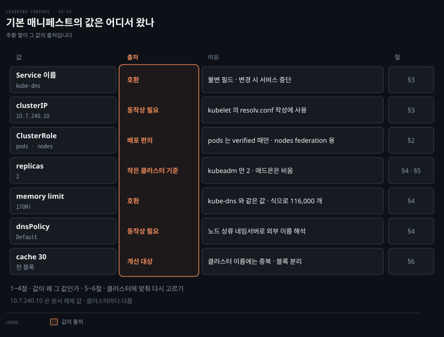


## 이 문서가 다루지 않는 것

> CoreDNS 를 클러스터에 배포하고 조정하는 자원에 집중하며 개별 플러그인 문법은 다음 편에서 다룹니다.

- `kubernetes` 플러그인 전체 문법과 확장 기능 → [명세 밖으로 나가면 이식성을 내준다](./06-04.%EB%AA%85%EC%84%B8%20%EB%B0%96%EC%9C%BC%EB%A1%9C%20%EB%82%98%EA%B0%80%EB%A9%B4%20%EC%9D%B4%EC%8B%9D%EC%84%B1%EC%9D%84%20%EB%82%B4%EC%A4%80%EB%8B%A4.md)
- 기본 Corefile 의 각 줄이 무엇을 켜는지 → [기본 Corefile의 줄마다 이유가 있다](./06-02.%EA%B8%B0%EB%B3%B8%20Corefile%EC%9D%98%20%EC%A4%84%EB%A7%88%EB%8B%A4%20%EC%9D%B4%EC%9C%A0%EA%B0%80%20%EC%9E%88%EB%8B%A4.md)
- ClusterIP Service 와 헤드리스의 차이 → [무엇을 선언했느냐가 레코드 모양을 정한다](./06-01.%EB%AC%B4%EC%97%87%EC%9D%84%20%EC%84%A0%EC%96%B8%ED%96%88%EB%8A%90%EB%83%90%EA%B0%80%20%EB%A0%88%EC%BD%94%EB%93%9C%20%EB%AA%A8%EC%96%91%EC%9D%84%20%EC%A0%95%ED%95%9C%EB%8B%A4.md)
- 쿠버네티스 RBAC 자체의 개념과 문법 → 이 편 범위 밖


## 1. 배포 자원 네 범주

> Corefile 하나만으로는 CoreDNS 가 뜨지 않으며, 배포에는 네 범주의 쿠버네티스 자원이 필요합니다.

- API 서버 접근 권한을 주는 자원들(ServiceAccount, ClusterRole, ClusterRoleBinding)
- Corefile 을 담을 ConfigMap
- DNS 를 클러스터에 제공할 Service
- 실제로 파드를 띄우고 관리할 Deployment

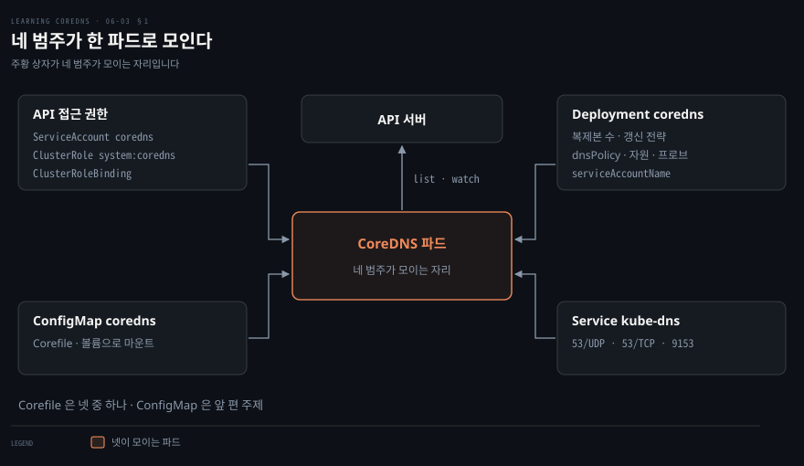


## 2. 필요보다 넓은 접근권

> ClusterRole 이 부여하는 자원 다섯 중 기본 설정에서 실제로 쓰는 것은 셋입니다. 나머지 둘은 배포 편의와 이전 기능의 흔적입니다.

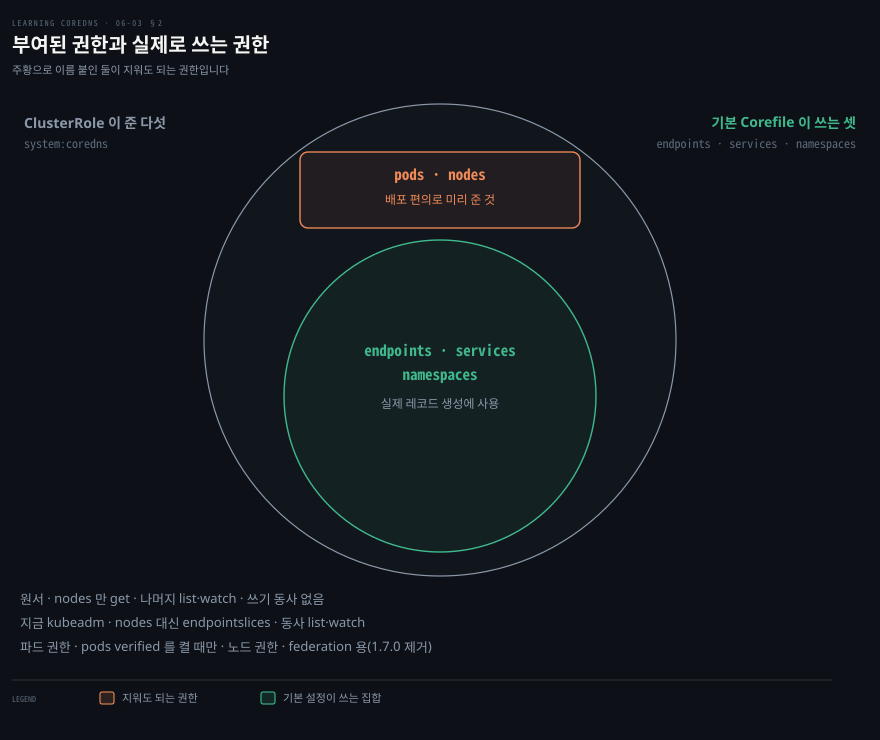

CoreDNS 는 클러스터 전역의 서비스와 엔드포인트 데이터를 API 서버에서 읽어야 합니다. 기본 서비스 계정에는 검색 외의 자원 읽기 권한이 없습니다.[^serviceaccount] 따라서 `coredns` ServiceAccount 를 만들고 `ClusterRole` 로 권한을 묶습니다. `Role` 과 달리 `ClusterRole` 은 특정 네임스페이스에 묶이지 않습니다.

```yaml
rules:
- apiGroups:
  - ""
  resources:
  - endpoints
  - services
  - pods
  - namespaces
  verbs:
  - list
  - watch
- apiGroups:
  - ""
  resources:
  - nodes
  verbs:
  - get
```

위 기본 배포 역할은 `nodes` 의 `get` 까지 부여합니다.

kubeadm 의 `system:coredns` 역할은 파드·서비스·엔드포인트·네임스페이스에 `list`·`watch` 를 줍니다. `discovery.k8s.io` 의 `endpointslices` 에도 `list`·`watch` 를 주고 `nodes` 의 `get` 은 없습니다.[^kubeadmrole] `endpointslices` 권한은 `kubernetes` 플러그인이 Endpoints 를 EndpointSlices 로 감시하게 되면서 더해졌습니다.[^k8sversion]

ClusterRoleBinding 은 이 역할을 `coredns` ServiceAccount 에 연결합니다.

### 왜 네임스페이스를 읽어야 하는가

네임스페이스 읽기 권한이 필요한 이유는 둘입니다.

첫째는 `namespace.svc.cluster.local` 질의에 `NXDOMAIN` 과 데이터 없는 SUCCESS 중 무엇을 돌려줄지 정하기 위해서입니다. 그 네임스페이스에 서비스가 하나라도 있으면 존재하지 않는 도메인이 아니므로 `NXDOMAIN` 을 돌려주면 안 됩니다.

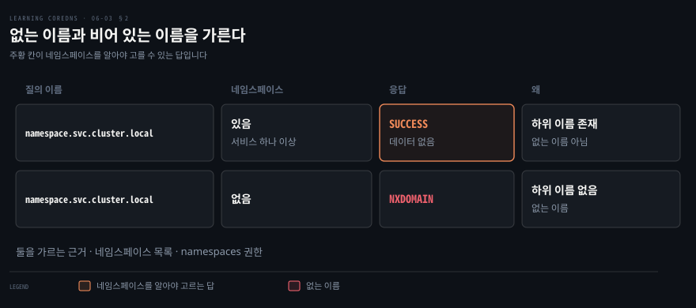

둘째는 `kubernetes` 플러그인이 네임스페이스 informer 를 항상 실행하기 때문입니다. informer 는 watch 로 로컬 캐시를 최신으로 유지합니다. `namespace_labels` 로 노출할 네임스페이스를 고를 때도 라벨 셀렉터로 목록을 읽습니다.[^k8scontroller]

### 파드와 노드는 "아마 아니다"

파드와 노드 읽기 권한은 기본 Corefile 에서는 쓰이지 않는 배포 편의용 권한입니다. 기능을 켤 때 클러스터 역할을 다시 고치지 않도록 미리 넣어 둔 것입니다.

파드 감시 권한은 `pods verified` 옵션을 켤 때만 필요하므로 이 옵션을 쓰지 않는다면 지워도 됩니다.

노드 읽기 권한은 federation 전용이었으나[^nodesfed] 해당 기능이 제거되어 현재 CoreDNS 소스에는 호출부가 없습니다.[^nodesunused] 지금 kubeadm 역할에 `nodes` 가 없는 것과도 맞아떨어집니다.

`kubernetes` 플러그인은 API 서버에 되쓰지 않는 읽기 전용 소비자라 어느 자원에도 `create`·`update`·`delete` 가 없습니다. 위 역할의 동사는 `list`·`watch`·`get` 셋뿐이고 kubeadm 역할은 `list`·`watch` 둘입니다.


## 3. 서비스 이름이 kube-dns 로 남은 이유

> Service 의 이름과 clusterIP 가 불변 필드이기 때문에 이전 DNS 서비스 객체를 그대로 이어받습니다.

CoreDNS 는 표준 ClusterIP 서비스를 쓰며 서비스 이름은 `kube-dns` 입니다. 기존 kube-dns 에서 CoreDNS 로 중단 없이 전환하려면 서비스 이름을 유지해야 했습니다.

쿠버네티스에서 Service 의 이름과 `clusterIP` 는 불변 필드입니다.[^serviceapi] 이름을 바꾸려면 Service 를 삭제하고 다시 생성해야 하고 그 사이에 DNS 서비스가 끊길 수 있습니다.

`clusterIP` 는 클러스터 생성 시점에 정해지는 고정값이고 쿠버네티스가 자동 할당하지 않습니다. 같은 IP 주소가 각 kubelet 인스턴스에 전달되고 kubelet 이 자기가 띄우는 파드의 `resolv.conf` 를 만들 때 그 값을 씁니다.

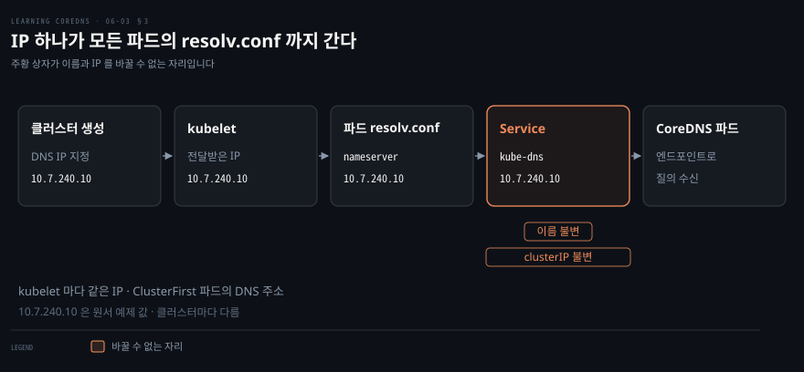

### 메트릭 포트가 서비스에 있는 이유

Service 는 DNS 포트(53 TCP/UDP) 외에 메트릭 포트(9153)를 정의합니다.

Prometheus 는 서비스에서 스크레이프할 포트를 찾지만 실제 메트릭은 각 파드에서 긁습니다. 서비스가 포트의 이름표 노릇만 하는 셈입니다.

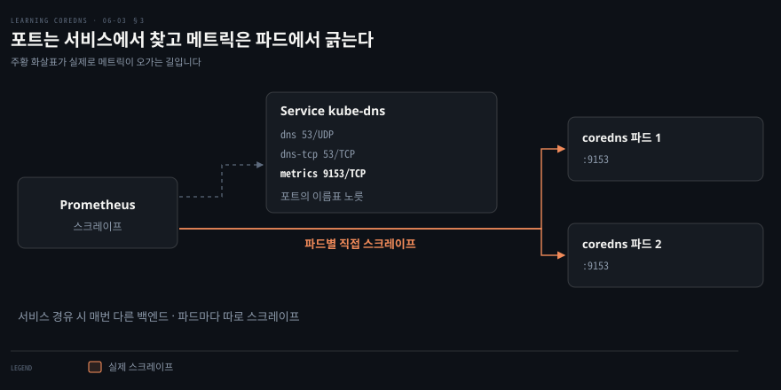


## 4. Deployment 한 장에 담긴 판단들

> Deployment 는 복제본 수·롤링 업데이트·DNS 정책·자원 상한·프로브를 정의합니다.

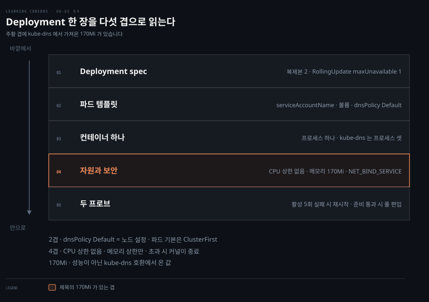

Deployment YAML 을 끝까지 읽어도 어느 값이 판단이고 어느 값이 관례인지는 알기 어렵습니다.

### 바깥 겹 — 몇 개를 어떻게 갈아 끼우나

kubeadm 은 매니페스트의 `replicas` 에 2 를 지정합니다.[^kubeadmreplicas] deployment 저장소의 `coredns.yaml.sed` 와 쿠버네티스 애드온 매니페스트는 값을 비워 둡니다.[^replicasunset] 비워 두면 Deployment 기본값 1 이고 오토스케일러를 켜면 그쪽이 복제본 수를 관리합니다.

갱신 전략은 `maxUnavailable: 1` 인 `RollingUpdate` 를 씁니다. 복제본 하나를 내리고 교체한 뒤 새 복제본이 제대로 뜰 때까지 기다렸다가 다음 복제본으로 넘어갑니다.

### 가운데 겹 — 이름이 헷갈리는 DNS 정책

파드 템플릿의 주요 설정은 셋입니다.

- `serviceAccountName` 을 `coredns` 로 지정합니다.
- Corefile 을 담은 볼륨 하나를 정의합니다.
- `dnsPolicy` 를 `Default` 로 지정합니다.

`dnsPolicy: Default` 는 파드의 기본값이 아닙니다. 파드의 일반 기본값은 클러스터 DNS 서비스를 가리키는 `ClusterFirst` 입니다. `Default` 는 호스트 노드의 DNS 설정을 쓴다는 뜻입니다.

CoreDNS 가 `Default` 를 쓰는 이유는 노드 상류 네임서버로 외부 이름을 풀어야 하기 때문입니다. `ClusterFirst` 라면 CoreDNS 가 자기 서비스를 네임서버로 삼게 되어 상류로 나갈 길이 막힙니다.

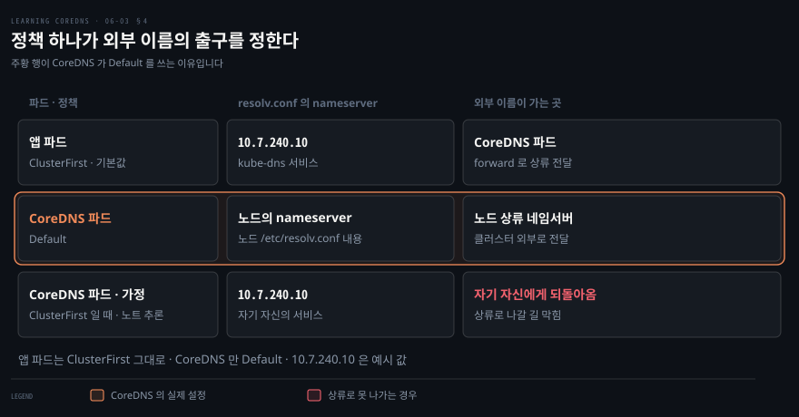

### 안쪽 겹 — 컨테이너 하나에 담긴 넷

CoreDNS 파드는 컨테이너 하나로 돌며 캐싱·헬스·메트릭을 플러그인으로 처리합니다.

CoreDNS 는 CPU 요청량(100m)만 두고 상한을 두지 않습니다. CPU 바운드 프로그램이므로 노드의 남는 연산 능력을 최대한 활용해 질의를 처리하기 위해서입니다.

메모리는 반대로 상한을 두는 것이 중요합니다. 프로세스가 노드에서 메모리를 너무 많이 먹으면 커널이 프로세스를 죽이기 시작할 수 있습니다.

170Mi 상한은 기존 kube-dns 에 설정돼 있던 값과 같습니다. 이 값을 그대로 두면 클러스터가 kube-dns 파드와 같은 수의 CoreDNS 파드를 스케줄할 수 있게 됩니다.

기본 Corefile 설정에서 메모리 필요량(MiB)은 다음 추정식을 따릅니다.[^scaling]

```bash
MiB needed = (pods + Services) / 1000 + 54
```

파드 10,000 개와 서비스 6,000 개인 클러스터라면 70 MiB 가 필요하며 이는 기본 메모리 `requests` 값(70Mi)과 일치합니다.

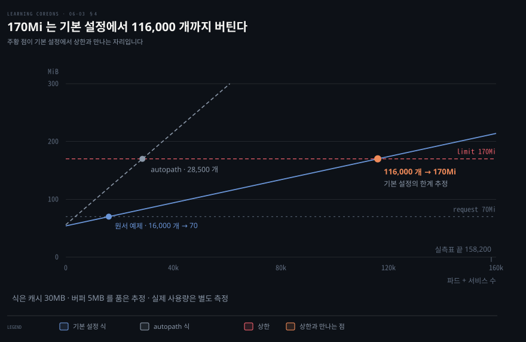

추정식을 역산하면 170Mi 상한은 파드와 서비스 합계 약 116,000 개 규모에 해당합니다. 다만 식이 맞춘 실측값은 질의 부하 없이 잰 것이라 이 계산값이 그 규모를 보장한다는 뜻은 아닙니다.[^scaling]

보안 컨텍스트는 `NET_BIND_SERVICE` 를 설정하고 나머지 프로세스 능력을 전부 버립니다. 그래서 1024 미만 포트인 DNS 포트 53 에 바인드할 수 있습니다. 비루트 사용자(`USER 65532:65532`) 실행은 컨테이너 이미지 자체에 설정돼 있습니다.[^dockerfile]

활성 프로브는 `health` 플러그인의 `/health`(8080)를, 준비성 프로브는 `ready` 플러그인의 `/ready`(8181)를 호출합니다.[^kubeadmdns][^probesready] 활성 프로브가 다섯 번 실패하면 CoreDNS 프로세스가 죽고 다시 뜹니다. 준비성 프로브를 통과하면 CoreDNS 프로세스가 clusterIP 부하 분산 풀에 추가되어 트래픽을 받게 됩니다.


## 5. 복제본을 늘리는 두 갈래

> 클러스터 규모에 맞추는 비례 오토스케일러와 실제 부하에 맞추는 HPA 두 경로가 있습니다.

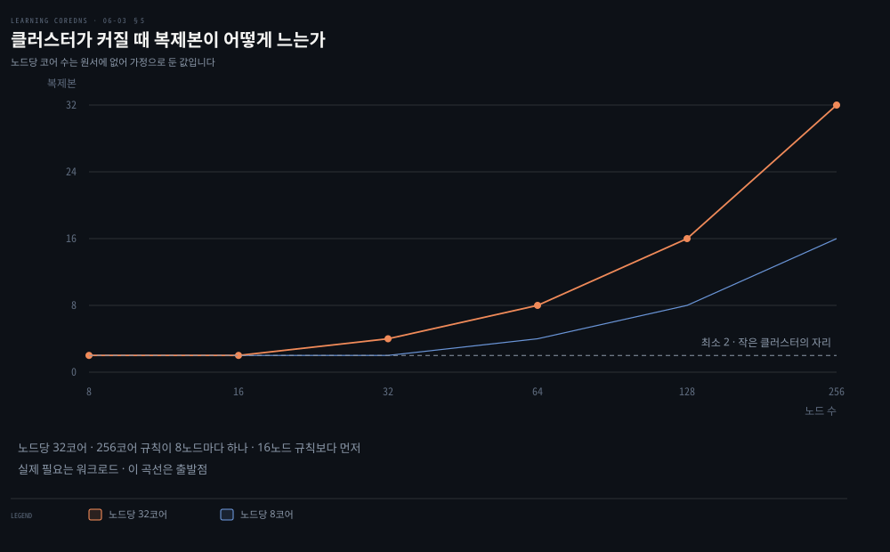

cluster-proportional 오토스케일러(`dns-autoscaler`)는 노드 수와 코어 수에 비례해 복제본을 늘립니다. 256 코어당 하나 또는 16 노드당 하나 중 큰 쪽을 택합니다. 쿠버네티스 애드온 매니페스트가 `"preventSinglePointFailure":true` 를 켜 두어 노드가 둘 이상이면 복제본을 최소 둘로 지킵니다.[^cpa]

다만 클러스터 크기만으로는 필요한 DNS 인스턴스 수를 정확히 가늠하기 어렵습니다. 실제 필요는 클러스터에서 도는 워크로드에 따라 달라집니다.

노드당 16코어가 두 규칙의 경계입니다. 노드가 16코어보다 굵으면 코어 규칙이, 얇으면 노드 규칙이 더 많은 복제본을 요구합니다.

파드 둘이 같은 노드나 같은 가용 영역에 몰리면 하드웨어 장애 하나로 클러스터 전체 DNS 가 끊깁니다. 노드 점검이나 업그레이드로 drain 이 일어날 때 복제본이 한꺼번에 퇴거당할 위험도 있습니다. 그래서 `PodDisruptionBudget`(PDB)으로 최소 가용 파드 수를 보장합니다. 아울러 `topologySpreadConstraints` 로 여러 노드와 가용 영역에 분산합니다.

### CPU 를 신호로 삼는 길

CoreDNS 는 CPU 바운드 프로그램이므로 Horizontal Pod Autoscaler(HPA)로 CPU 사용률에 따라 스케일할 수 있습니다. 아래 YAML 은 `autoscaling/v1` 형식입니다. `autoscaling/v2` 에서는 같은 목표를 `metrics: - type: Resource` 로 적습니다.[^hpacpu]

```yaml
apiVersion: autoscaling/v1
kind: HorizontalPodAutoscaler
metadata:
  name: coredns
  namespace: kube-system
spec:
  maxReplicas: 20
  minReplicas: 2
  scaleTargetRef:
    apiVersion: apps/v1
    kind: Deployment
    name: coredns
  targetCPUUtilizationPercentage: 50
```

`scaleTargetRef` 는 HPA 와 같은 네임스페이스의 대상을 가리키므로 HPA 역시 `kube-system` 에 배포해야 합니다.

CoreDNS 는 단일 프로세스이므로 CPU 사용률이 곧 질의 부하를 직접 반영합니다. 목표치를 50% 로 두면 일시적 질의 폭주와 파드 스케일아웃 지연을 흡수할 여유를 둡니다.

### CPU 말고 다른 신호

CoreDNS 의 `coredns_health_request_duration_seconds` 메트릭을 스케일 신호로 삼을 수도 있습니다. 이 메트릭은 내부 헬스체크 응답 시간을 잽니다.[^healthplugin]

로컬 연산이므로 응답이 지연된다면 프로세스가 질의 부하를 감당하지 못하고 있음을 뜻합니다. 이 메트릭에는 `server` 라벨이 없는데, 과부하가 특정 서버 블록이 아닌 프로세스 전체의 증상이기 때문입니다.[^healthplugin]


## 6. 더 나은 Corefile — 무엇을 지웠나

> 기본 Corefile 을 클러스터 내부 도메인과 외부 조회 블록으로 분리하고 불필요한 설정을 제거합니다.

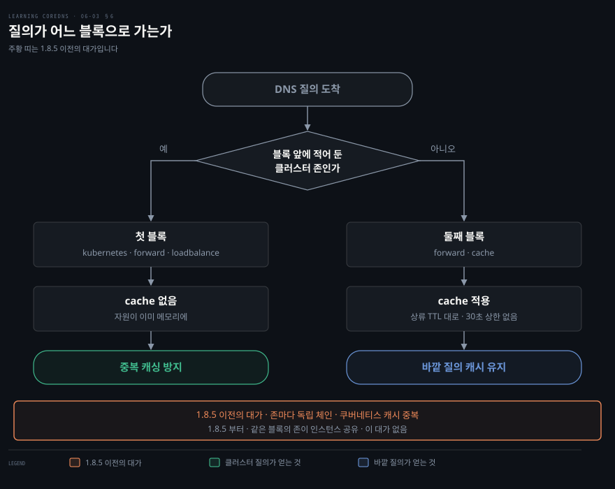

기본 Corefile 에서 더 잘할 수 있는 자리 하나는 `cache` 플러그인입니다. 밑에 깔린 쿠버네티스 자원이 이미 메모리에 있어서 클러스터 안 이름에는 사실상 중복입니다. 그래도 클러스터 밖 질의에는 캐시가 적용되기를 원합니다.

```bash
CLUSTER_DOMAIN REVERSE_CIDRS {
    errors
    health
    kubernetes {
        pods insecure
        upstream
        fallthrough in-addr.arpa ip6.arpa
    }
    prometheus :9153
    forward . UPSTREAMNAMESERVER
    loop
    reload
    loadbalance
}

. {
    errors
    forward . UPSTREAMNAMESERVER
    prometheus :9153
    cache
    loop
}
```

`CLUSTER_DOMAIN` 과 `REVERSE_CIDRS` 를 서버 블록 앞으로 옮기면 그 존들의 질의만 `cache` 가 없는 첫 블록으로 갑니다. 다른 존의 질의는 두 번째 블록을 지나므로 캐시됩니다. 외부 질의는 상류 네임서버의 TTL 대로 캐시하므로 30초 상한도 뗍니다.

kubeadm 은 `cache 30` 의 `disable` 설정으로 클러스터 도메인만 캐시에서 제외합니다.[^kubeadmdns]

### 블록 나누기와 메모리

CoreDNS 는 같은 서버 블록의 존들이 플러그인 인스턴스를 공유하므로 `kubernetes` 플러그인의 API 캐시도 한 벌만 유지됩니다.[^sharedplugins] 1.8.5 미만 버전에서는 존마다 플러그인 체인이 생겨 메모리가 중복되었습니다.

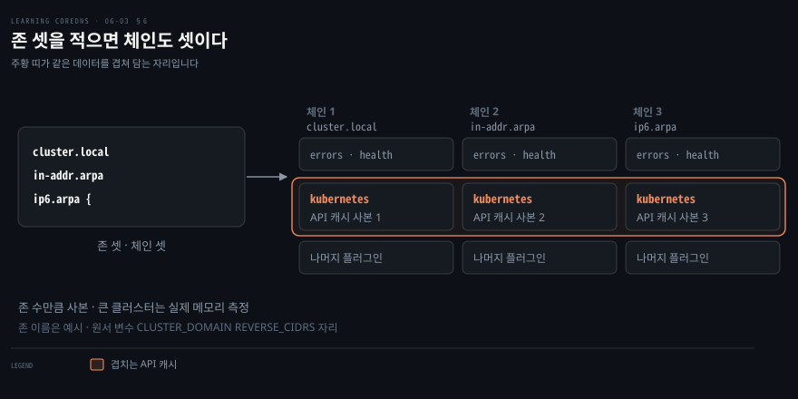

### 전역인 것과 블록마다인 것

`reload` 와 `health` 는 전역 플러그인이므로 Corefile 전체에서 한 번만 적으면 됩니다.[^health150] `ready` 플러그인은 플러그인별 준비 상태를 허용하고 쿠버네티스에는 그쪽이 필요합니다.

### 두 번째 단계

쿠버네티스 API 캐시가 찼을 때 준비 완료를 알리도록 첫 번째 블록에 `ready` 를 추가합니다.

파드 레코드는 쿠버네티스 DNS 명세에서 제거됐고[^podspecremoved] `pods insecure` 는 kube-dns 하위 호환용으로만 남아 있습니다.[^podsinsecure] 특별한 이유가 없다면 `pods insecure` 줄을 뺍니다.

역방향 CIDR 을 전부 나열할 수 없으면 `in-addr.arpa` 와 `ip6.arpa` 존 전체를 적어야 합니다. 그러면 쿠버네티스가 관리하지 않는 IP 의 질의까지 이 서버 블록으로 옵니다. 이때 `fallthrough` 와 `forward` 를 둘 다 빼면 그 IP 들의 PTR 질의에 `kubernetes` 플러그인이 `NXDOMAIN` 을 돌려줍니다. CIDR 을 열거할 수 있다면 두 줄을 다 지울 수 있습니다. `upstream` 은 1.4 부터 기본 동작이 됐고 1.7.0 에서 옵션 자체가 제거됐으므로 이 줄도 지웁니다.

```bash
CLUSTER_DOMAIN REVERSE_CIDRS {
    errors
    health
    kubernetes
    ready
    prometheus :9153
    loop
    reload
    loadbalance
}

. {
    errors
    forward . UPSTREAMNAMESERVER
    cache
    loop
}
```

`upstream` 줄을 남겨 두면 `kubernetes` 플러그인의 설정 파서가 `unknown property` 로 거부해 서버가 뜨지 않습니다.[^k8ssetup] 그래서 1단계 Corefile 은 지금 CoreDNS 에서 뜨지 않고 이 줄이 빠진 2단계는 그대로 뜹니다.

둘째 블록의 `prometheus` 가 2단계에서 빠집니다.

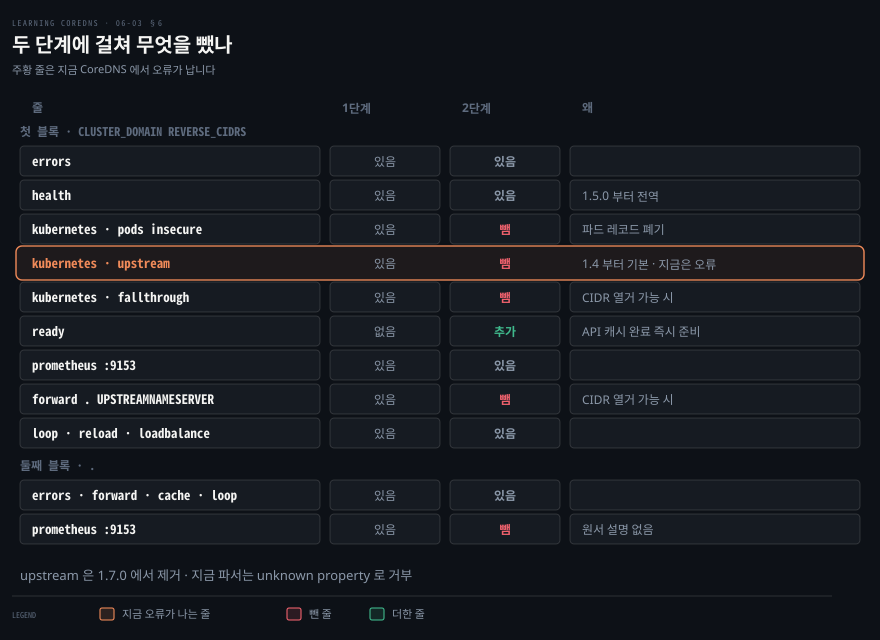

`autopath` 플러그인을 켜면 검색 도메인 순회로 인한 질의 증폭을 줄일 수 있습니다. 다만 클러스터가 크지 않으면서 외부 DNS 이름을 많이 조회할 때만 말이 됩니다. `autopath` 에는 `pods verified` 모드가 필요해 API 서버 부하와 메모리 사용량이 늘어납니다.

`pods verified` 나 `autopath` 를 켤 때 비로소 ClusterRole 의 파드 읽기 권한이 실제로 쓰입니다.


## 결정 치트시트

> 각 값을 그대로 둘지 고칠지의 기준입니다. 근거는 모두 본문입니다.

| 값 | 기본 | 왜 그 값인가 | 언제 바꾸나 |
|----|------|-------------|------------|
| Service 이름 | `kube-dns` | kube-dns 에서 무중단 업그레이드 | 바꾸지 않는다 · 불변 필드라 중단이 따른다 |
| `clusterIP` | 고정값 | kubelet 이 `resolv.conf` 에 박는다 | 바꾸지 않는다 |
| ClusterRole 자원 | endpoints·services·pods·namespaces·nodes 다섯 · kubeadm 은 노드 대신 EndpointSlice | 배포 지침 단순화 | `pods verified` 를 안 쓰면 파드 권한을 뺀다 |
| `replicas` | 2 | 작은 클러스터 기준 | 오토스케일러에 맡긴다 |
| CPU limit | 없음 | CPU 바운드라 노드만큼 쓰게 | 그대로 둔다 |
| memory limit | 170Mi | kube-dns 와 같은 값 | 식으로 재서 클러스터에 맞춘다 |
| `dnsPolicy` | `Default` | 노드의 상류 네임서버를 써야 한다 | 바꾸지 않는다 · `ClusterFirst` 면 자기를 본다 |
| 오토스케일 신호 | 노드·코어 수 | 거친 잣대지만 단순하다 | 워크로드가 편중되면 CPU 나 지연으로 |
| `cache 30` | 한 블록 | 클러스터 안에는 값이 없다 | 블록을 나누거나, 지금 kubeadm 처럼 `disable` 로 클러스터 도메인만 뺀다 |
| 존을 블록 앞에 나열 | — | 클러스터 질의만 캐시를 건너뛴다 | 메모리 중복이 없다(1.8.5~) · 클러스터 이름만 캐시에서 빼려면 블록 앞 나열 또는 kubeadm 식 `disable` |
| `pods insecure` | kubeadm 켜짐 · 옵션 기본은 꺼짐 | kube-dns 하위 호환 | 새 배포에서는 뺀다 |
| `health` 를 블록마다 | — | 1.5.0 부터 전역이다 | 한 번만 적고 `ready` 를 따로 쓴다 |


## 적용 관점

> 도는 클러스터의 매니페스트를 꺼내 서비스 이름·권한·DNS 정책을 대조합니다.

**한 가지 실행**: `kubectl -n kube-system get svc kube-dns -o yaml` 로 서비스 이름을 확인합니다. 이어 `kubectl -n kube-system get pods -l k8s-app=kube-dns` 로 그 뒤의 파드를 봅니다. 서비스 이름이 `kube-dns` 이고 파드가 `coredns-...` 인 배포 구조를 확인할 수 있습니다.

**한 가지 확인**: `kubectl get clusterrole system:coredns -o yaml` 로 동사 목록을 봅니다. ClusterRole 은 클러스터 범위라 `-n` 을 붙이지 않습니다. 쓰기 동사가 없다면 읽기 전용으로 동작하는 것을 뜻합니다. kubeadm 클러스터라면 동사가 `list`·`watch` 둘이고 `endpointslices` 가 보입니다. `pods` 가 자원에 있는데 Corefile 에 `pods verified` 가 없다면 그 권한은 쓰이지 않습니다.

Spring 애플리케이션 관점에서는 `dnsPolicy` 가 중요합니다. 일반 애플리케이션 파드는 클러스터 서비스 이름을 해석해야 하므로 기본값 `ClusterFirst` 를 써야 합니다. `Default` 로 바꾸면 노드의 리졸버를 참조해 클러스터 내부 이름이 풀리지 않습니다. CoreDNS 만 외부 상류 조회를 위해 `Default` 를 씁니다.


## 면접에서 받을 만한 질문

1. CoreDNS 를 클러스터에 띄우는 데 필요한 자원 네 범주를 대 보십시오.
2. CoreDNS 가 `Role` 이 아니라 `ClusterRole` 을 써야 하는 이유는 무엇입니까?
3. CoreDNS 가 네임스페이스를 읽어야 하는 이유를 하나 이상 말해 보십시오.
4. DNS Service 의 이름이 `kube-dns` 로 남아 있는 이유는 무엇입니까?
5. `dnsPolicy: Default` 는 무엇을 뜻하며 파드의 기본값과 어떻게 다릅니까?
6. 노드가 40개이고 노드마다 16코어인 클러스터에서 cluster-proportional 오토스케일러는 CoreDNS 복제본을 몇 개로 잡습니까? 노드가 8코어라면 어떻게 달라집니까?
7. 파드 8만 개·서비스 1만 개인 클러스터에 기본 170Mi 상한을 그대로 두어도 됩니까?
8. 클러스터 존을 서버 블록 앞으로 옮겼을 때 얻는 것과 잃는 것은 CoreDNS 1.8.5 전후로 어떻게 다릅니까?
9. 6절의 1단계 Corefile 을 1.7.0 이상의 CoreDNS 에 그대로 넣었더니 서버가 뜨지 않습니다. 어느 줄을 의심해야 하고, 그 줄은 1.7.0 전에는 왜 문제가 없었습니까?


## 정답 (자답 후 펼치기)

### 정답 1 — 네 범주

API 서버 접근 권한을 주는 자원들, Corefile 을 담을 ConfigMap, DNS 를 클러스터에 제공할 Service, 파드를 띄우고 관리할 Deployment 입니다.

### 정답 2 — ClusterRole 이어야 하는 이유

`Role` 은 특정 네임스페이스에 묶이는데 CoreDNS 는 모든 네임스페이스에 걸쳐 서비스와 엔드포인트 데이터를 읽어야 하기 때문입니다. 기본 서비스 계정에는 API 검색을 제외한 자원 읽기 권한이 자동으로 주어지지 않습니다.

### 정답 3 — 네임스페이스가 필요한 이유

첫째, `namespace.svc.cluster.local` 질의에 `NXDOMAIN` 을 줄지 데이터 없는 SUCCESS 를 줄지 정해야 합니다. 그 네임스페이스에 서비스가 하나라도 있으면 `NXDOMAIN` 을 주면 안 됩니다. 둘째, `kubernetes` 플러그인은 네임스페이스 informer 를 늘 띄우고, `namespace_labels` 로 노출할 네임스페이스를 고를 때도 네임스페이스를 읽습니다.

### 정답 4 — 이름이 `kube-dns` 인 이유

Service 의 이름과 `clusterIP` 가 쿠버네티스에서 불변이기 때문입니다. kube-dns 에서 CoreDNS 로 서비스 중단 없이 넘어가려면 이름을 그대로 둬야 했습니다. 이름을 바꾸려면 기존 Service 를 삭제하고 새로 만들어야 하므로 DNS 서비스가 잠시 끊길 수 있습니다. `clusterIP` 도 일반적인 업데이트로 바꿀 수 없습니다.

### 정답 5 — `dnsPolicy: Default`

호스트 노드의 DNS 설정을 쓴다는 뜻입니다. 파드의 실제 기본값은 `ClusterFirst` 로, kube-dns 서비스를 네임서버로 쓴다는 뜻입니다. CoreDNS 는 노드에 설정된 상류 네임서버로 외부 이름을 풀어야 해서 `Default` 를 씁니다.

### 정답 6 — 오토스케일러의 복제본 수

3개입니다. 코어는 40 × 16 = 640 이라 256 코어당 하나로는 3개(640/256 = 2.5 를 올림), 노드는 40 이라 16 노드당 하나로는 3개(2.5 를 올림)이고 큰 쪽이 3입니다. 노드가 8코어면 코어 쪽이 320/256 을 올린 2가 되고 노드 쪽은 그대로 3이라 역시 3입니다. 노드당 16코어가 두 규칙이 비기는 경계라서 이보다 얇은 노드에서는 노드 규칙이 이깁니다.

### 정답 7 — 큰 클러스터의 170Mi

기본 설정의 추정식으로는 (80,000 + 10,000)/1,000 + 54 = 144 MiB 로, 170Mi 아래입니다. 다만 추정치만으로 상한이 충분하다고 보장할 수는 없으므로 실제 파드 메모리 사용량과 피크를 재야 합니다. `pods verified` 나 `autopath` 를 켜면 06-04 §2 에서 다룰 기울기 네 배의 식이 적용되어 90 × 4 + 56 = 416 MiB 가 필요하므로 상한을 올려야 합니다.

### 정답 8 — 존을 앞으로 옮기면

1.8.5 부터는 플러그인 인스턴스를 공유하므로 메모리 손실 없이 클러스터 질의만 캐시를 건너뛰게 할 수 있습니다. 1.8.5 전에는 클러스터 질의가 `cache` 를 건너뛰는 대신 존마다 플러그인 체인과 쿠버네티스 캐시가 중복되는 손실이 있었습니다.

### 정답 9 — 1단계 Corefile 이 뜨지 않는 이유

`kubernetes` 블록 안의 `upstream` 줄입니다. 1.4 부터 기본 동작이 되어 1.7.0 전에는 중복일 뿐이었지만 1.7.0 에서 옵션 자체가 제거됐습니다. 지금 설정 파서는 모르는 옵션을 `unknown property` 로 거부하므로 서버가 시작하지 못합니다. 6절 2단계 Corefile 은 이 줄이 없어서 그대로 뜹니다.[^k8ssetup]


## 핵심 개념 체크리스트

- [ ] CoreDNS 배포에 필요한 네 범주를 대고 각각이 맡는 일을 말할 수 있는가?
- [ ] ClusterRole 권한 중 필수와 편의를 가르고, 노드 권한의 쓰임과 kubeadm 역할 차이를 말할 수 있는가?
- [ ] Service 이름은 불변 필드 때문에, 클러스터 IP 는 kubelet 이 미리 알아야 해서 고정이라는 두 이유를 가를 수 있는가?
- [ ] `dnsPolicy: Default` 가 파드 기본값이 아니라 노드 설정을 쓴다는 뜻이고 CoreDNS 가 이 정책을 쓰는 이유를 말할 수 있는가?
- [ ] 오토스케일러의 코어·노드 규칙과 HPA 의 CPU 신호, `health` 지연 메트릭을 신호별로 구분하고 복제본 수를 계산할 수 있는가?


## 관련 문서

- [기본 Corefile의 줄마다 이유가 있다](./06-02.%EA%B8%B0%EB%B3%B8%20Corefile%EC%9D%98%20%EC%A4%84%EB%A7%88%EB%8B%A4%20%EC%9D%B4%EC%9C%A0%EA%B0%80%20%EC%9E%88%EB%8B%A4.md) — 이 편이 고치는 그 Corefile 을 앞 편이 한 줄씩 읽습니다
- [무엇을 선언했느냐가 레코드 모양을 정한다](./06-01.%EB%AC%B4%EC%97%87%EC%9D%84%20%EC%84%A0%EC%96%B8%ED%96%88%EB%8A%90%EB%83%90%EA%B0%80%20%EB%A0%88%EC%BD%94%EB%93%9C%20%EB%AA%A8%EC%96%91%EC%9D%84%20%EC%A0%95%ED%95%9C%EB%8B%A4.md) — ClusterIP Service 와 kube-proxy
- [플러그인 일곱이면 서버 하나가 선다](./03-02.%ED%94%8C%EB%9F%AC%EA%B7%B8%EC%9D%B8%20%EC%9D%BC%EA%B3%B1%EC%9D%B4%EB%A9%B4%20%EC%84%9C%EB%B2%84%20%ED%95%98%EB%82%98%EA%B0%80%20%EC%84%A0%EB%8B%A4.md) — 서버 블록마다 독립인 플러그인 체인
- [책 노트 인덱스](./README.md)


## 참고 자료

- 원서: 《Learning CoreDNS: Configuring DNS for Cloud Native Environments》 6장 Kubernetes 후반부
- 서지: John Belamaric·Cricket Liu, O'Reilly, 2019년, ISBN 978-1492047964
- [CoreDNS deployment 저장소 — kubernetes 디렉터리](https://github.com/coredns/deployment/tree/master/kubernetes)
- [CoreDNS health 플러그인 README](https://github.com/coredns/coredns/blob/master/plugin/health/README.md)

[^k8scontroller]: CoreDNS — `plugin/kubernetes/controller.go`. 네임스페이스 informer 를 `namespaceListFunc(dns.client, dns.namespaceSelector)` 로 만들고, 셀렉터가 있으면 `opts.LabelSelector = s.String()` 으로 목록을 거릅니다. <https://github.com/coredns/coredns/blob/master/plugin/kubernetes/controller.go>

[^nodesfed]: CoreDNS — `plugin/kubernetes/controller.go` 의 `GetNodeByName` 주석 `"This query causes a round trip to the k8s API server, so use sparingly. Currently, this is only used for Federation."`. 제거 시점은 CoreDNS 1.7.0 릴리스 노트 `"plugin/federation: Remove already-deprecated federation plugin"`. <https://github.com/coredns/coredns/blob/master/plugin/kubernetes/controller.go>

[^kubeadmreplicas]: Kubernetes kubeadm `cmd/kubeadm/app/phases/addons/dns/dns.go` 의 `coreDNSReplicas = 2` 와 `manifests.go` 의 `replicas: {{ .Replicas }}`. <https://github.com/kubernetes/kubernetes/blob/master/cmd/kubeadm/app/phases/addons/dns/dns.go>

[^replicasunset]: coredns/deployment `kubernetes/coredns.yaml.sed` — `"# replicas: not specified here:"`, `"# 1. Default is 1."`, `"# 2. Will be tuned in real time if DNS horizontal auto-scaling is turned on."`. 쿠버네티스 애드온 `cluster/addons/dns/coredns/coredns.yaml.base` 는 여기에 Addon Manager 가 조정하지 못하게 한다는 항목이 하나 더 있습니다. <https://github.com/coredns/deployment/blob/128be7d6cea78fe335898fcaf87ffe85f1f2dc1c/kubernetes/coredns.yaml.sed#L85-L87>

[^scaling]: coredns/deployment `kubernetes/Scaling_CoreDNS.md` — `"MB required (default settings) = (Pods + Services) / 1000 + 54"`, `"A 5000 node cluster with 150000 Pods, 8200 Services"`, 표의 `default | 158200 | 154` 행, `"These pre-submit tests do not perform any QPS load, so cache and operating buffers were tested separately under load and added to the max memory usage of each test to approximate real world memory usages."`, `"The memory formulas above are based on a best fit linear trend of the following data points."`. <https://github.com/coredns/deployment/blob/master/kubernetes/Scaling_CoreDNS.md>

[^dockerfile]: CoreDNS — 저장소 루트 `Dockerfile` 의 `ARG BASE=gcr.io/distroless/static-debian12:nonroot` 와 `USER 65532:65532`, v1.15.0 기준 `:9` 의 `RUN setcap cap_net_bind_service=+ep /coredns`. <https://github.com/coredns/coredns/blob/master/Dockerfile>

[^k8ssetup]: CoreDNS — `plugin/kubernetes/setup.go` 의 옵션 파서. `case` 목록에 `upstream` 이 없고 `default:` 가 `c.Errf("unknown property '%s'", c.Val())` 를 돌려줍니다. 옵션 제거는 1.7.0 릴리스 노트 `"Remove already-deprecated options resyncperiod and upstream"`. <https://github.com/coredns/coredns/blob/master/plugin/kubernetes/setup.go>

[^healthplugin]: CoreDNS — health 플러그인 README. `"The health is exported, by default, on port 8080/health."` 와 `"coredns_health_request_duration_seconds{} - The health plugin performs a self health check once per second on the /health endpoint. ... As this is a local operation it should be fast. A (large) increase in this duration indicates the CoreDNS process is having trouble keeping up with its query load."`, `` "Note that these metrics *do not* have a `server` label, because being overloaded is a symptom of the running process, *not* a specific server." `` <https://github.com/coredns/coredns/blob/master/plugin/health/README.md>

[^serviceaccount]: Kubernetes Service Accounts 문서. 기본 서비스 계정에는 RBAC 사용 시 모든 인증 주체에 주는 API 검색 권한 외의 권한이 기본으로 부여되지 않습니다. <https://kubernetes.io/docs/concepts/security/service-accounts/> (2026-09-27 조회)

[^serviceapi]: Kubernetes Service API 문서. `clusterIP` 는 일반적인 업데이트로 바꿀 수 없으며, Service 이름은 객체의 식별자입니다. <https://kubernetes.io/docs/reference/kubernetes-api/core/service-v1/> (2026-09-27 조회)

[^kubeadmdns]: Kubernetes kubeadm `cmd/kubeadm/app/phases/addons/dns/manifests.go` — ClusterRole `resources: endpoints, services, pods, namespaces` · `verbs: list, watch` 와 `apiGroups: discovery.k8s.io` · `resources: endpointslices` · `verbs: list, watch`, `livenessProbe` `path: /health` `port: liveness-probe`(8080), `readinessProbe` `path: /ready` `port: readiness-probe`(8181), Corefile 의 `cache 30 { disable success {{ .DNSDomain }} · disable denial {{ .DNSDomain }} }`. <https://github.com/kubernetes/kubernetes/blob/master/cmd/kubeadm/app/phases/addons/dns/manifests.go> (2026-09-23 조회)

[^cpa]: kubernetes-sigs/cluster-proportional-autoscaler README — `preventSinglePointFailure` 는 "ensures at least 2 replicas if there are more than one node". <https://github.com/kubernetes-sigs/cluster-proportional-autoscaler> 이 옵션을 켠 곳은 쿠버네티스 애드온 매니페스트 `dns-horizontal-autoscaler.yaml` 의 `--default-params={"linear":{"coresPerReplica":256,"nodesPerReplica":16,"preventSinglePointFailure":true,...}}` 입니다. <https://github.com/kubernetes/kubernetes/blob/master/cluster/addons/dns-horizontal-autoscaler/dns-horizontal-autoscaler.yaml> (2026-09-23 조회)

[^health150]: CoreDNS — 1.4.0 릴리스 노트의 다음 릴리스 폐기 예고. `"health will revert back to report process level health without plugin status. A new ready plugin will make sure plugins have at least completed their startup sequence."` 그 다음 릴리스인 1.5.0 에서 `ready` 플러그인이 추가됐습니다. <https://coredns.io/2019/03/03/coredns-1.4.0-release/>

[^kubeadmrole]: Kubernetes v1.37.2 kubeadm `cmd/kubeadm/app/phases/addons/dns/manifests.go:204-220` — ClusterRole `resources: endpoints, services, pods, namespaces` · `verbs: list, watch` 와 `apiGroups: discovery.k8s.io` · `resources: endpointslices` · `verbs: list, watch`. `nodes` 항목은 없습니다. <https://github.com/kubernetes/kubernetes/blob/v1.37.2/cmd/kubeadm/app/phases/addons/dns/manifests.go#L197-L221>

[^k8sversion]: coredns/deployment `kubernetes/CoreDNS-k8s_version.md:19`, 쿠버네티스 v1.22 행(kubeadm 이 CoreDNS v1.8.4 를 설치) — "CoreDNS must be granted list and watch access to EndpointSlices". <https://github.com/coredns/deployment/blob/c51361611fcd43c3c23b9a402f30b882c4d736bd/kubernetes/CoreDNS-k8s_version.md#L19>

[^nodesunused]: CoreDNS v1.15.0 `plugin/kubernetes/controller.go:665-671` — 주석 "Currently, this is only used for Federation." 아래 함수 본문은 `dns.client.CoreV1().Nodes().Get(ctx, name, meta.GetOptions{})` 입니다. `plugin/kubernetes` 의 테스트 아닌 소스 16개에서 `GetNodeByName` 은 이 정의(`:668`)와 인터페이스 선언(`:60`)뿐이고 호출하는 곳이 없습니다. <https://github.com/coredns/coredns/blob/v1.15.0/plugin/kubernetes/controller.go#L665-L671>

[^probesready]: CoreDNS v1.15.0 `plugin/ready/README.md` — "By enabling *ready* an HTTP endpoint on port 8181 will return 200 OK, when all plugins that are able to signal readiness have done so." 와 `plugin/health/README.md` — "The health is exported, by default, on port 8080/health." <https://github.com/coredns/coredns/blob/v1.15.0/plugin/ready/README.md>

[^hpacpu]: Kubernetes 문서 「Horizontal Pod Autoscaling」 — "To use resource utilization based scaling specify a metric source like this: type: Resource resource: name: cpu target: type: Utilization averageUtilization: 60" <https://kubernetes.io/docs/tasks/run-application/horizontal-pod-autoscale/> (2026-11-01 조회, 하단 수정일 2026-08-03)

[^sharedplugins]: CoreDNS v1.15.0 `core/dnsserver/register.go:289-295` — "Doing this results in zones sharing the same plugin instances and settings as other zones in the same block." 이 동작은 PR #4593 "Share plugins among zones in the same server block"(2021-07-09 병합)으로 들어왔고, 같은 주석이 v1.8.4 의 register.go 에는 없고 v1.8.5 에 있습니다. PR 본문: "A server block with multiple zones will create a separate instance of each plugin in the block for each zone in the block." <https://github.com/coredns/coredns/blob/v1.15.0/core/dnsserver/register.go#L289-L295> <https://github.com/coredns/coredns/pull/4593>

[^podspecremoved]: kubernetes/dns 커밋 `a86af5089052d13bedb63b83601be1e12df6a74b`(2019-12-15) "KubeDNS remove deprecated records" — "Since the deprecationg was announced on 2016 it is time to remove from the DNS specification." (커밋 메시지 오타 그대로) 패치가 명세의 `### 2.6 - Deprecated Records` 절을 지운다. <https://github.com/kubernetes/dns/commit/a86af5089052d13bedb63b83601be1e12df6a74b>

[^podsinsecure]: CoreDNS v1.15.0 `plugin/kubernetes/README.md` — "`insecure`: Always return an A record with IP from request (without checking k8s). This option is vulnerable to abuse if used maliciously in conjunction with wildcard SSL certs. This option is provided for backward compatibility with kube-dns." 옵션 기본값은 "`disabled`: Default. Do not process pod requests, always returning `NXDOMAIN`". <https://github.com/coredns/coredns/blob/v1.15.0/plugin/kubernetes/README.md>
