# 명세 밖으로 나가면 이식성을 내준다

---

> `kubernetes` 플러그인에는 쿠버네티스 DNS 명세가 요구하지 않는 기능이 여럿 있습니다. 편리한 만큼 그 클러스터를 표준에서 벗어나게 만듭니다.

## 핵심 요약

> 이 편이 매달린 하나의 생각은 명세 밖 기능의 값이 편의가 아니라 이식성으로 계산된다는 것입니다.

명세 밖 옵션 일부는 클러스터를 표준 미준수 상태로 만들어 워크로드 이식성에 영향을 줄 수 있습니다. 대가는 세 종류로 갈립니다. 이식성을 내주거나, 메모리와 API 서버 부하를 내주거나, 둘 다 내줍니다.

`ndots:5` 는 외부 이름 하나를 푸는 데 질의가 여섯 번 나가는 구조적 이유이며, `autopath` 는 그 반복을 서버 안으로 옮기되 메모리를 더 씁니다.


## 학습 목표

이 내용을 읽고 나면:

1. `kubernetes` 플러그인의 전체 문법 항목을 용도별로 묶어 말할 수 있습니다.
2. `pods` 세 모드가 무엇을 바꾸고 메모리를 얼마나 더 쓰는지 수치로 비교할 수 있습니다.
3. `ndots:5` 가 왜 외부 이름 하나에 질의 여섯 번을 만드는지 검색 경로로 유도할 수 있습니다.
4. `autopath` 가 무엇을 어디로 옮기는지와 그 대가를 설명할 수 있습니다.
5. 클러스터 밖에서 서비스에 닿게 하는 두 길을 구분하고, 확장 기능 가운데 지금 사라진 것을 가를 수 있습니다.

아래 지도는 명세 밖 기능마다 얻는 편의와 치르는 대가를 정리합니다.

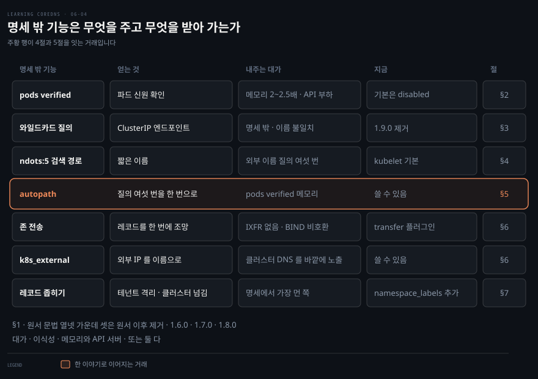


## 이 문서가 다루지 않는 것

> 이 편은 `kubernetes` 플러그인의 전체 문법과 확장 기능입니다. 6장의 마지막 구간이자 이 책의 쿠버네티스 편 마무리입니다.

- 배포 매니페스트와 오토스케일링 → [복제본 둘과 170Mi는 어디서 온 값인가](./06-03.%EB%B3%B5%EC%A0%9C%EB%B3%B8%20%EB%91%98%EA%B3%BC%20170Mi%EB%8A%94%20%EC%96%B4%EB%94%94%EC%84%9C%20%EC%98%A8%20%EA%B0%92%EC%9D%B8%EA%B0%80.md)
- 기본 Corefile 의 각 줄 → [기본 Corefile의 줄마다 이유가 있다](./06-02.%EA%B8%B0%EB%B3%B8%20Corefile%EC%9D%98%20%EC%A4%84%EB%A7%88%EB%8B%A4%20%EC%9D%B4%EC%9C%A0%EA%B0%80%20%EC%9E%88%EB%8B%A4.md)
- 질의와 응답을 다듬는 `template`·`rewrite` 플러그인 → 7장
- 클라이언트 측 `resolv.conf`·ndots 설정 자체 → [네트워크 로드맵 1단계](../../../landscape/network-keywords.md)


## 1. 플러그인 문법 전체와 지금 남은 것

> `kubernetes` 플러그인 문법에서 옛 항목 셋이 사라졌습니다. `resyncperiod` 와 `upstream` 은 1.7.0 에서, `transfer to` 는 1.8.0 에서 문법을 떠났습니다.

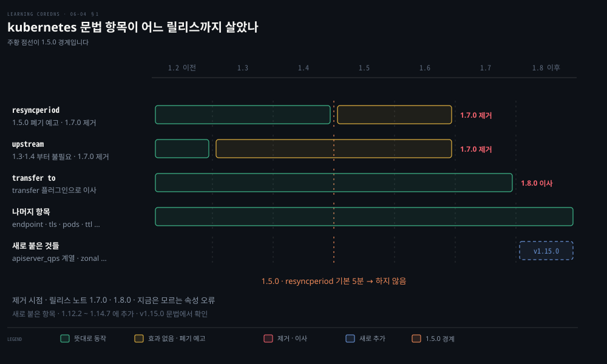

`kubernetes` 플러그인의 전체 문법은 이 장에서 다룬 표준 배포보다 훨씬 많은 용례를 허용합니다. 문법 항목은 용도별로 넷으로 묶입니다.

- **클러스터 밖에서 붙기**: `endpoint`·`tls`·`kubeconfig`
- **레코드 범위 좁히기**: `namespaces`·`labels`·`noendpoints`·`ignore empty_service`
- **레코드 모양 바꾸기**: `pods`·`endpoint_pod_names`·`ttl`
- **다른 플러그인·서버와 잇기**: `fallthrough`

`resyncperiod` 는 API 서버에서 자원을 다시 동기화하는 주기를 정하던 옵션으로 1.7.0 에서 제거되었습니다.[^rel170]

### 클러스터 밖에서 붙는 셋

`endpoint` 는 API 서버 URL 을 직접 지정하게 합니다. 주로 쿠버네티스 외부에서 CoreDNS 를 실행할 때 씁니다. `tls` 는 그 `endpoint` 와 함께 TLS 클라이언트 파라미터를 설정합니다.

CoreDNS 가 실행되는 위치에 따라 사용할 설정이 달라집니다.

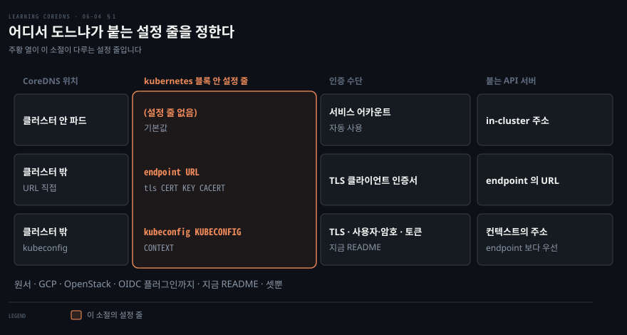

`kubeconfig` 는 표준 kubeconfig 파일로 API 서버에 인증하게 합니다. 지정한 컨텍스트의 API 서버에 TLS, 사용자명·비밀번호, 토큰 기반 인증으로 접속합니다.[^k8splugin]

클라이언트 인증에서는 client-go 의 OIDC 인증 플러그인을 지원합니다.[^authimport] OIDC(OpenID Connect)는 외부 신원 제공자가 발급한 토큰으로 사용자를 확인하는 표준입니다.

### 나머지 항목들

`ttl` 은 클러스터 자원과 관련된 모든 이름의 TTL 을 조절합니다. 상류 네임서버에서 온 레코드의 TTL 에는 영향을 주지 않습니다.

기본 상태에서는 ready 엔드포인트가 하나도 없어도 ClusterIP 서비스의 가상 IP(VIP)를 담은 A 응답을 돌려줍니다.[^emptysvc] `ignore empty_service` 는 ready 엔드포인트가 없는 ClusterIP 서비스를 없는 것처럼 취급하여 `NXDOMAIN` 을 반환합니다.[^k8splugin] 헤드리스와 ExternalName 서비스는 이 설정의 대상이 아닙니다.[^emptysvc415]

`fallthrough` 는 나열한 존의 질의를 플러그인 체인 아래로 넘깁니다. 엔드포인트의 CIDR 을 프로그램으로 모두 알아낼 수 없으므로, 주로 `in-addr.arpa` 전체의 PTR 질의를 상류로 넘길 때 쓰입니다.

`upstream` 은 CNAME 에 대응하는 A 레코드를 찾는 데 쓰였으나 1.7.0 에서 제거되었습니다.[^rel170] 지금 버전에서 이 옵션을 적으면 알 수 없는 속성으로 거부됩니다(06-02 §4). 존 전송을 맡던 `transfer to` 는 1.8.0 에서 별도 `transfer` 플러그인으로 이전되었습니다.[^n180] 지금 문법에는 `apiserver_qps` 계열과 `multicluster`·`zonal`·`startup_timeout` 도 있습니다.[^k8splugin]


## 2. 파드 옵션 셋과 메모리

> `pods` 는 세 모드가 있고 그 선택이 메모리를 가릅니다. 기본은 아무것도 안 하는 쪽이고, 가장 안전한 모드가 가장 비싼 모드이기도 합니다.

CoreDNS 의 기본값은 `pods disabled` 입니다. `pods` 옵션을 생략하면 파드 질의는 `NXDOMAIN` 을 돌려받습니다. 쿠버네티스 기본 배포 설정은 kube-dns 하위 호환을 위해 `pods insecure` 를 씁니다. 요청된 IP 주소로 확인 없이 A 레코드를 돌려줍니다.

`pods verified` 는 파드가 실제로 존재하는지 확인합니다. CoreDNS 가 파드 자원에 watch 를 걸고, 해당 네임스페이스에 실제로 그 주소의 파드가 있을 때만 IP 를 반환하여 신원을 보장합니다.[^insecuremoniker]

### 켜지 않는 이유가 둘

`pods verified` 가 기본값이 아닌 이유는 대규모 클러스터에서 확장성 문제를 유발하기 때문입니다.

첫째는 API 서버 부하입니다. CoreDNS 인스턴스마다 API 서버에 별도의 watch 를 겁니다. 파드가 많을수록 그 watch 하나하나가 API 서버 성능에 주는 영향이 커지고 동시에 필요한 CoreDNS 인스턴스 수도 늘어납니다. 그래서 파드 수가 늘 때 API 서버 부하가 비선형으로 커집니다. CoreDNS 는 이를 제어하기 위해 `apiserver_qps`·`apiserver_burst`·`apiserver_max_inflight` 옵션으로 API 서버 요청 속도를 조절하는 기능을 제공합니다.[^k8splugin]

둘째는 메모리입니다. 인스턴스마다 서비스와 엔드포인트뿐만 아니라 모든 파드를 캐시해야 합니다.

| 클러스터 | `pods verified` | `insecure` 또는 `disabled` |
|---------|----------------|---------------------------|
| 파드 25,000 · 서비스 1,000 | 약 160 MiB | 약 80 MiB |
| 파드 50,000 · 서비스 2,000 | 264 MiB | 106 MiB |

CoreDNS 규모 산정 공식에 따르면 `pods verified`(또는 `autopath`) 모드의 메모리 사용량은 `(Pods + Services) / 250 + 56` MiB 로 계산됩니다.[^scaling] 객체 1,000개당 약 4 MiB 씩 증가하여 `insecure` 모드(`(Pods + Services) / 1000 + 54` MiB)보다 기울기가 네 배 가파릅니다.

두 모드의 메모리 차이는 객체 수가 늘어날수록 선형으로 벌어집니다.

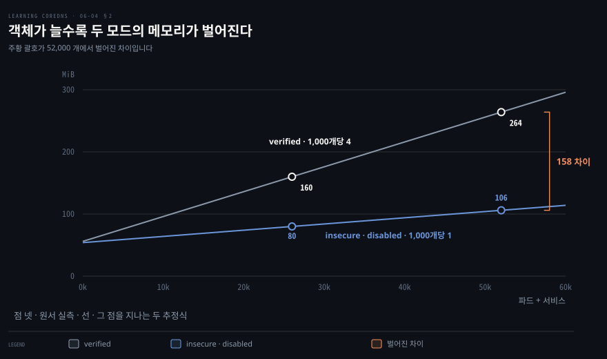

쿠버네티스 DNS 명세 1.1.0 에는 파드 레코드 규정이 없으므로 `pods insecure` 를 꺼도 명세 위반이 아닙니다.[^dnsspec110]


## 3. 와일드카드 질의

> `*` 라벨 질의는 그 라벨 자리에 무엇이 있든 레코드를 반환하던 명세 밖 편의 기능이었으나, CoreDNS 1.9.0 에서 제거되었습니다.[^n190]

ClusterIP 서비스는 DNS 질의 시 가상 IP(VIP) 하나만 반환합니다. 이름 붙은 포트의 `SRV` 레코드도 개별 엔드포인트가 아닌 서비스 이름을 가리키므로, 엔드포인트별 IP 는 헤드리스 서비스에서만 얻을 수 있습니다.[^k8sdns]

`kubernetes` 플러그인은 DNS 표준 와일드카드 레코드와 별개로, 질의 이름의 라벨 자리에 `*` 또는 `all` 을 넣어 매칭하는 비표준 와일드카드 질의를 지원했습니다.

```bash
host '*.default.svc.cluster.local.'
```

응답 레코드의 이름은 실제 서비스 이름이 아니라 질의에 지정한 와일드카드 이름과 일치했습니다. 많은 클라이언트가 응답의 이름이 질의의 이름과 다르면 응답을 거부하기 때문에 알아 둘 값어치가 있습니다. 다만 네임스페이스에 서비스가 여러 개일 경우 반환된 IP 가 어느 서비스에 속하는지 구분하기 어려웠습니다.

### 쓸모가 분명한 자리가 하나

와일드카드 질의가 유용했던 사례는 ClusterIP 서비스의 전체 엔드포인트를 조회할 때였습니다.

```bash
host kube-dns.kube-system.svc.cluster.local.
host '*.kube-dns.kube-system.svc.cluster.local.'
```

일반 질의는 ClusterIP 의 VIP 하나만 반환하지만, `*.<service>.<namespace>.svc.cluster.local` 로 질의하면 백엔드 엔드포인트 레코드를 모두 반환했습니다. 1.8 까지는 이것이 DNS 로 이 정보를 얻는 유일한 길이었습니다.

지금 ClusterIP 서비스의 엔드포인트가 필요하면 DNS 밖에서 `kubectl -n kube-system get endpointslices -l kubernetes.io/service-name=kube-dns` 로 봅니다. DNS 로 받아야 한다면 같은 셀렉터의 헤드리스 서비스를 하나 더 두어 `SRV` 로 묻습니다.[^k8sdns]

엔드포인트를 묻는 경로를 와일드카드 유무로 비교하면 다음과 같습니다.

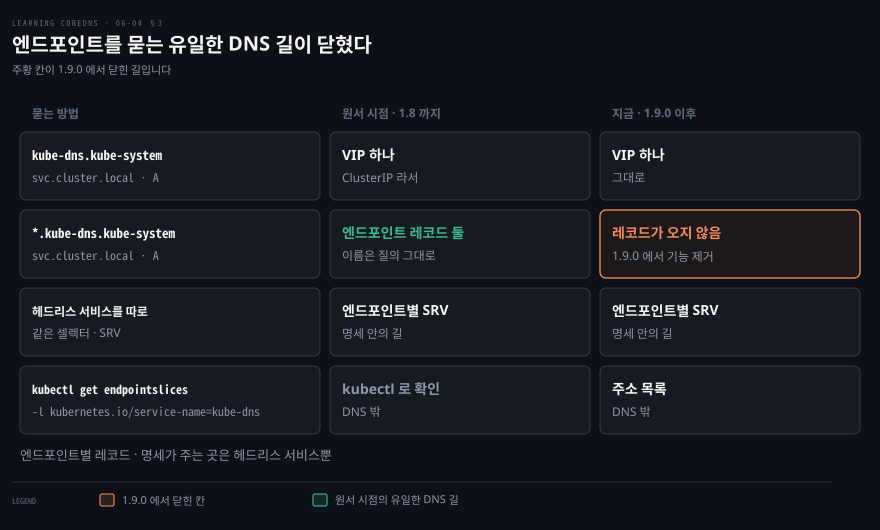

와일드카드는 A 레코드 질의에서는 엔드포인트·서비스 이름·네임스페이스 라벨에, `SRV` 질의에서는 여기에 포트·프로토콜 라벨까지 지정할 수 있었습니다.


## 4. 점 다섯 개와 질의 여섯 번

> 짧은 이름을 쓰게 해 주는 점 다섯 개 설정이 외부 이름을 풀 때 질의를 여러 번으로 늘리는 대가를 청구합니다.

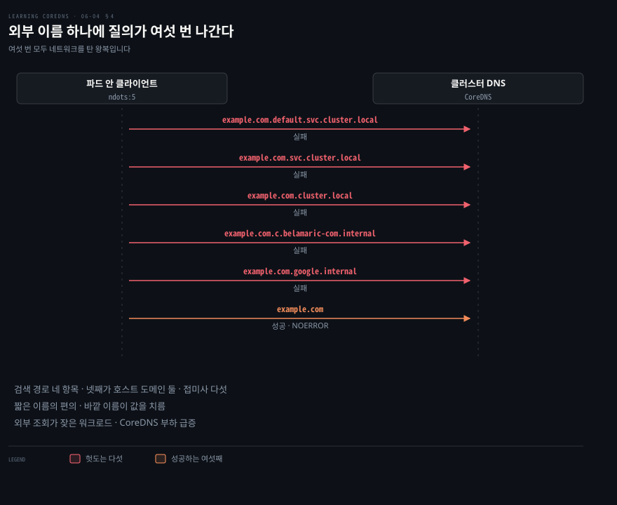

파드에서 `service` 같은 짧은 이름으로 통신할 수 있도록 kubelet 은 파드의 `/etc/resolv.conf` 에 검색 경로(search path)를 다음 순서로 주입합니다.

1. `<namespace>.svc.cluster.local` — `<service>` 이름 해석
2. `svc.cluster.local` — `<service>.<namespace>` 해석
3. `cluster.local` — `<service>.<namespace>.svc` 해석
4. 노드 호스트의 검색 경로(보통 도메인 두어 개)

이 검색 경로 덕분에 클러스터 내부에서는 짧은 이름만으로 동일 네임스페이스 및 클러스터 서비스를 찾을 수 있습니다. 애플리케이션을 다른 네임스페이스에 배포해도 설정을 그대로 둘 수 있습니다.

### 바깥 이름 문제

문제는 외부 도메인을 조회할 때 발생합니다. 검색 경로가 제대로 동작하게 하려고 kubelet 이 `ndots` 옵션을 5 로 설정하기 때문입니다. 점(`.`)이 5개 미만인 이름은 모두 상대 이름으로 간주되어 검색 경로가 먼저 붙습니다.

```bash
host -v example.com
Trying "example.com.default.svc.cluster.local"
Trying "example.com.svc.cluster.local"
Trying "example.com.cluster.local"
Trying "example.com.c.belamaric-com.internal"
Trying "example.com.google.internal"
Trying "example.com"
```

이 예제에서는 먼저 보낸 질의 다섯 번이 실패하고 여섯 번째에 원래 이름이 풀립니다. 넷째와 다섯째 줄은 GCP 노드의 호스트 검색 경로라서 접미사가 다섯입니다. 호스트 검색 경로의 개수에 따라 이 횟수는 달라집니다. 각 질의마다 네트워크 왕복이 발생하므로 외부 호출이 많은 워크로드에서는 CoreDNS 와 네트워크 부하가 급증합니다.

### 네 해법

이 부하를 줄이는 네 가지 해법과 각각의 한계는 다음과 같습니다.

- **PodSpec 의 `dnsConfig`**: 파드마다 자기만의 DNS 정책을 설정합니다. 다만 모든 워크로드 매니페스트에 일일이 적용해야 합니다.
- **FQDN 사용**: 도메인 끝에 루트를 뜻하는 점을 붙여(`example.com.`) 검색 경로 순회를 건너뜁니다. 개발자나 애플리케이션 설정 전반에 강제하기 어렵고 일부 HTTP 클라이언트에서 문제를 일으키기도 합니다.
- **NodeLocal DNSCache**: 캐시 전용으로 작게 빌드한 CoreDNS 를 모든 노드에 두고 캐시에 없는 것은 중앙 CoreDNS 서비스로 넘깁니다.[^nodelocaltcp] 이 전달을 TCP 로 올리면 UDP 패킷 유실과 DNS 타임아웃에서 생기는 꼬리 지연이 줄어듭니다.[^nodelocal] 대신 노드마다 자원을 조금씩 더 쓰고 각 노드의 로컬 캐시는 인스턴스가 하나뿐이라 고가용성이 아닙니다.
- **`autopath`**: CoreDNS 서버 내부에서 검색 경로 순회를 처리하여 클라이언트-서버 간 반복 왕복을 없앱니다.

네 해법을 적용 대상과 한계로 비교하면 다음과 같습니다.

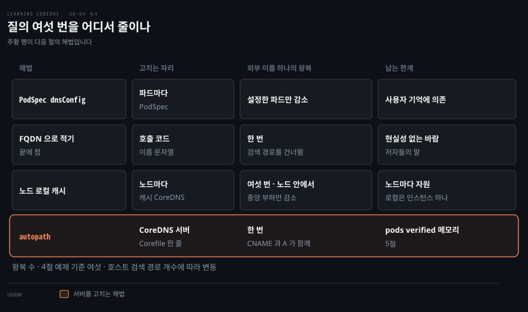


## 5. autopath

> `autopath` 는 검색 경로 순회를 클라이언트에서 CoreDNS 서버 내부로 옮겨 네트워크 왕복을 내부 루프로 바꿉니다.

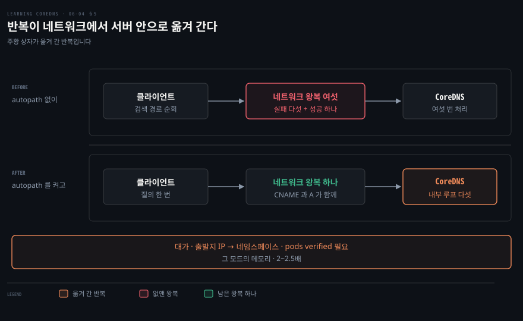

`autopath` 는 `example.com.default.svc.cluster.local` 같은 첫 검색 질의를 받으면 서버 내부 루프로 나머지 검색 후보를 차례로 조회합니다. 성공하면 원본 도메인을 가리키는 CNAME 과 최종 주소 레코드를 함께 반환합니다.

```bash
;; QUESTION SECTION:
;example.com.default.svc.cluster.local. IN A

;; ANSWER SECTION:
example.com.default.svc.cluster.local. 30 IN CNAME example.com.
example.com.                 30       IN       A         93.184.216.34
```

클라이언트는 첫 질의 하나로 정답을 얻어 추가 검색 경로를 밟지 않습니다.

### 메모리 대가

하지만 `autopath` 는 CoreDNS 메모리 소비를 크게 늘립니다. 서버에서 검색 경로를 조립하려면 질의를 보낸 클라이언트 파드의 네임스페이스를 알아야 하기 때문입니다.

CoreDNS 가 수신한 질의 패킷에서 알 수 있는 정보는 출발지 IP 뿐입니다. 이 출발지 IP 로 파드 네임스페이스를 역추적하려면 2절의 `pods verified` 모드가 켜져 있어야 합니다. 즉 전체 파드 목록을 메모리에 캐시하고 watch 해야 합니다. 그림의 출발지 IP 와 네임스페이스는 설명용 예시 값입니다.

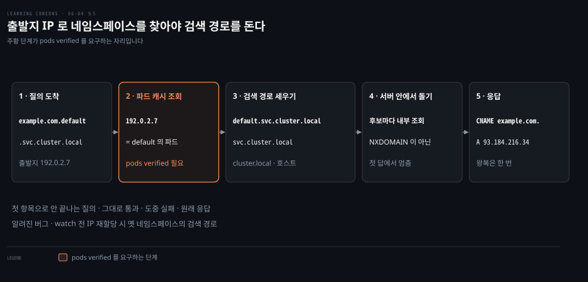

`autopath` 에는 몇 가지 제약과 부작용이 있습니다. 파드가 삭제된 직후 동일 IP 가 다른 네임스페이스 파드에 재할당되면 watch 가 반영되기 전까지 잘못된 네임스페이스로 검색 경로를 세울 수 있습니다.[^autopath] 또 검색 경로의 첫 항목으로 끝나지 않는 질의에는 손대지 않고, 도는 중에 실패하면 원래 응답을 그대로 돌려줍니다.[^autopath] 서버 쪽 탐색이 부정 응답(`NXDOMAIN`)으로 끝나면 클라이언트가 경로를 다시 도는 탓에 최적화가 사라집니다.[^autopathwin] Windows 노드 파드와도 호환되지 않습니다.[^autopathwin]

`ndots:5` 의 반복 질의가 표준 이식성을 지킨 대가라면, `autopath` 는 네트워크 지연을 CoreDNS 메모리 및 동기화 비용으로 맞바꾸는 선택입니다. 클러스터가 작고 외부 조회가 많을 때만 후자가 남는 장사가 됩니다.


## 6. 존 전송과 바깥 노출

> 클러스터의 모든 레코드를 한 번에 확인하는 존 전송과, 클러스터 밖 클라이언트에게 서비스 이름을 노출하는 두 가지 방법입니다.

CoreDNS 는 `kubernetes` 존의 전체 존 전송(AXFR)을 지원합니다. 질의 한 번으로 클러스터의 모든 레코드를 볼 수 있어 디버깅에 쓰입니다. 파드 IP 가 사내망에 라우팅된다면 외부 클라이언트가 헤드리스 서비스 엔드포인트에 직접 접근하는 경로로도 활용됩니다.

존 전송은 같은 서버 블록의 `transfer` 플러그인이 맡습니다(03-02 §2).[^xfrplugin] 증분 존 전송(IXFR) 요청 시 SOA 시리얼이 같으면 SOA 만 반환하고 바뀌었으면 AXFR 전체로 답합니다.[^xfrplugin] NS 레코드도 응답에 포함됩니다.[^xfrns185]

다만 폐기된 파드 레코드나 `fallthrough` 로 다른 플러그인이 서빙하는 레코드는 전송되지 않는 한계가 있습니다.

### 클러스터 밖에서 닿게 하기

쿠버네티스 DNS 명세는 클러스터 내부 통신만 다룹니다. External IP 나 LoadBalancer 서비스, Ingress 로 외부에 노출된 서비스의 IP 를 외부 클라이언트에게 DNS 로 알리는 표준 방법은 명세에 없습니다.

외부 서비스 디스커버리 경로는 크게 둘로 나뉩니다. 서비스 이름과 IP 는 설명용 예시 값입니다.

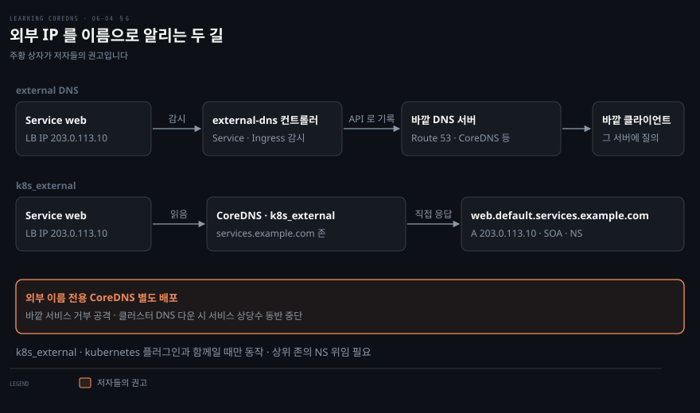

첫째는 **external-dns** 컨트롤러입니다. Service 나 Ingress 자원을 감시하여 Google Cloud DNS, AWS Route 53, CoreDNS 등 외부 DNS 서버 API 를 호출해 레코드를 자동 등록합니다.[^extdnsnow] 그 서비스의 도메인을 관리하는 외부 DNS 서버를 API 로 고칠 수 있다는 전제가 필요합니다.

둘째는 더 단순한 필요에 맞는 CoreDNS 내장 **`k8s_external`** 플러그인입니다. 존을 지정하면 LoadBalancer 와 External IP 서비스가 `<service>.<namespace>.<zone>` 으로 노출됩니다.

```bash
k8s_external services.example.com {
    apex services
}
```

이 플러그인은 `kubernetes` 플러그인이 함께 설정돼 있을 때만 동작합니다. 존 정점의 SOA 와 NS 레코드를 처리해서 그 존을 CoreDNS 에 위임할 수 있게 해 줍니다. 기본 apex 라벨은 `dns` 이며 `apex` 옵션으로 변경할 수 있습니다.[^k8sexternal] 외부 IP 가 부여된 헤드리스 서비스를 해석하는 `headless`, 질의한 도메인이 없을 때 다음 플러그인으로 넘기는 `fallthrough`, TTL 조절 옵션도 지원합니다.[^k8sexternal]

외부 노출 시에는 클러스터 DNS 인스턴스를 직접 외부에 열지 않고 외부 이름 전용 CoreDNS 인스턴스를 별도 배포하는 편이 권장됩니다. 외부의 서비스 거부 공격으로 클러스터 DNS 를 잃으면 대개 클러스터의 서비스 상당수가 함께 내려가기 때문입니다.


## 7. 레코드를 좁히는 옵션들

> 다중 테넌트 격리나 장애 조치 등 특수 목적을 위해 레코드 노출 범위를 좁히는 옵션들입니다.

특정 네임스페이스만 서빙하거나 엔드포인트 이름을 다듬는 등 특수 환경을 위한 옵션들이 있습니다. 다만 표준 쿠버네티스 DNS 명세를 벗어나 이식성을 해칠 수 있습니다.

### 엔드포인트 이름을 예측 가능하게

CoreDNS 는 기본적으로 파드 IP 의 대시 형태(`10-0-0-1`)를 엔드포인트 라벨로 씁니다. 그러면 엔드포인트 이름을 미리 알 수 없고 파드 안의 호스트 이름과 DNS 의 라벨이 서로 맞지 않습니다.

`endpoint_pod_names` 옵션은 PodSpec 에 `hostname` 이 지정되지 않았을 때 대시 형태 IP 대신 실제 파드 이름을 DNS 라벨로 사용합니다. 기술적으로는 이것도 DNS 명세 안이지만 이 동작에 의존하는 것은 명세 밖입니다. 대상 파드가 없거나 파드 이름이 63자를 초과하면 대시 형태 IP 로 대체됩니다.[^eppodnames]

### NXDOMAIN 을 신호로 쓰기

`ignore empty_service` 는 ready 엔드포인트가 없는 ClusterIP 서비스에 VIP 응답 대신 `NXDOMAIN` 을 반환합니다.[^k8splugin] 클라이언트는 질의 실패를 확인하고 검색 경로의 다음 도메인(예: 보조 클러스터)으로 장애 조치를 수행할 수 있습니다.

서비스 종류와 ready 엔드포인트 유무에 따른 응답 변화는 다음과 같습니다.

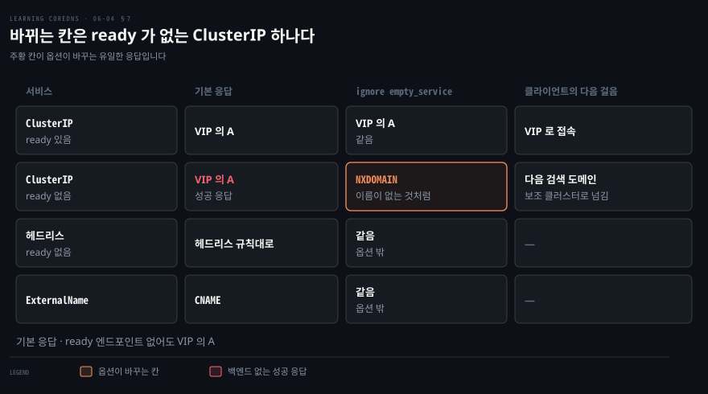

`noendpoints` 옵션은 Endpoints 자원을 메모리에 적재하지 않아 자원을 절약합니다. 대신 헤드리스 서비스와 개별 엔드포인트 질의는 `NXDOMAIN` 을 받습니다.

### 테넌트별로 잘라 내기

다중 테넌트 환경에서는 CoreDNS 인스턴스별로 서빙할 레코드 범위를 제한할 수 있습니다.

`namespaces` 는 지정한 네임스페이스의 레코드만 적재하여 응답합니다. 특정 노드와 네임스페이스를 테넌트 전용으로 할당한다면 kubelet 옵션을 고쳐 그 노드가 고르는 네임서버를 전용 CoreDNS 서비스로 지정할 수 있습니다. `labels` 는 특정 라벨 셀렉터에 맞는 객체의 레코드만 노출합니다.

`namespace_labels` 는 라벨 셀렉터에 부합하는 네임스페이스의 레코드만 노출하며, `namespaces` 와 함께 설정할 수 없습니다.[^k8splugin][^nslabels]


## 결정 치트시트

> 명세 밖 기능마다 얻는 것과 내주는 것을 나란히 뒀습니다. 마지막 세 줄은 상황에서 손잡이를 찾는 표입니다.

| 기능 | 얻는 것 | 내주는 것 |
|------|---------|----------|
| `pods insecure` | kube-dns 하위 호환 | 네임스페이스 신원 보장 |
| `pods verified` | 신원 보장 회복 | 메모리 두 배에서 두 배 반(위 실측 구간) · API 서버 비선형 부하 |
| `pods disabled` | 가장 가볍다 | 파드 질의가 전부 `NXDOMAIN` |
| 와일드카드 질의(1.9.0 제거) | ClusterIP 엔드포인트 전수 조회 | 명세 밖 · 이름 불일치 · 결국 기능 자체가 사라짐 |
| `autopath` | 외부 이름 질의가 여섯에서 하나로 | `pods verified` 가 필요해 메모리 |
| 노드 로컬 캐시 | 중앙 부하 감소 · TCP 로 타임아웃 회피 | 노드마다 자원 · 로컬 캐시는 단일 인스턴스 |
| 존 전송 | 클러스터 레코드를 한 번에 조망 | 폐기된 파드 레코드와 `fallthrough` 로 다른 플러그인이 서빙하는 레코드는 전송 안 됨 · IXFR 요청엔 AXFR 폴백 · 1.8.0 부터 `transfer` 플러그인 |
| `k8s_external` | 외부 IP 를 이름으로 노출 | 클러스터 DNS 를 바깥 공격면에 두게 됨 · 따로 배포 권장 |
| `endpoint_pod_names` | 엔드포인트 이름이 예측 가능 | 의존하면 명세 밖 |
| `ignore empty_service` | 검색 경로로 다른 클러스터에 넘김 | ready 엔드포인트 없는 서비스와 없는 서비스의 구분이 사라짐 · ClusterIP 에만 적용 |
| `namespaces`·`labels` | 테넌트별 격리 | 명세에서 가장 멀리 나간다 |
| 큰 클러스터에서 API 서버가 힘들다 | — | `apiserver_qps` 계열로 요청 속도를 조인다 |
| 네임스페이스 단위로 거르고 싶다 | — | `labels` 말고 `namespace_labels` 를 본다 |
| 시작 직후 빈 응답이 나온다 | — | `startup_timeout` 과 `ready` 를 함께 본다 |


## 적용 관점

> 이 편은 파드 하나만 있으면 `ndots` 이야기를 눈으로 볼 수 있습니다.

**한 가지 실행**: 파드 내부에서 `cat /etc/resolv.conf` 로 `search` 목록과 `ndots:5` 설정을 확인합니다. 그다음 `host -v example.com` 으로 시도 횟수를 확인합니다. 검색 접미사 개수만큼 실패한 뒤 원본 도메인이 조회되면 기본 설정입니다.

파드 안에 `host` 나 `nslookup` 도구가 없다면 공식 디버그 파드를 띄워 확인합니다.[^dnsdebug]

**한 가지 확인**: `host '*.default.svc.cluster.local.'` 을 질의해 봅니다. 1.9.0 이후 버전에서는 와일드카드 질의가 지원되지 않으므로 레코드가 반환되지 않습니다.

Spring 애플리케이션 관점에서는 `ndots:5` 가 실제 비용이 됩니다. 외부 API 를 자주 부르는 서비스라도 이름 조회가 일어날 때마다 검색 경로에 따라 여러 번의 질의가 나갈 수 있습니다.

OpenJDK 는 따로 정하지 않으면 성공한 DNS 조회를 30초 동안 캐시하므로(`networkaddress.cache.ttl`),[^jdkttl] 외부 API 이름 하나당 30초마다 여러 질의가 발생할 수 있습니다. 외부 호스트명을 FQDN(끝에 점 추가)으로 설정하면 검색 경로를 건너뛸 수 있으나, HTTP `Host` 헤더나 TLS 인증서 검증과의 호환성을 확인해야 합니다.


## 면접에서 받을 만한 질문

1. `pods` 세 모드의 차이와 각각의 기본값 여부를 말해 보십시오.
2. `pods verified` 가 기본이 아닌 이유를 둘로 나눠 설명해 보십시오.
3. 쿠버네티스 와일드카드 질의가 DNS 와일드카드 레코드와 무엇이 다릅니까?
4. ClusterIP 서비스의 엔드포인트를 알아내는 방법과 제약은 무엇입니까?
5. 호스트 검색 경로가 도메인 셋인 노드의 파드가 `ndots:5` 로 `api.example.com` 과 `api.example.com.`(끝에 점)을 차례로 묻습니다. A 질의만 셀 때 성공까지 각각 몇 번 나갑니까?
6. `autopath` 는 무엇을 어디로 옮기며 그 대가는 무엇입니까?
7. 파드 3만 개·서비스 2천 개인 클러스터에서 `autopath` 를 켜려 합니다. CoreDNS 인스턴스 하나의 메모리는 대략 얼마로 잡겠습니까?
8. 클러스터 DNS 를 외부에 직접 노출하지 말라는 조언의 근거는 무엇입니까?


## 정답 (자답 후 펼치기)

### 정답 1 — `pods` 세 모드

`disabled` 는 CoreDNS 기본값으로 파드 질의에 `NXDOMAIN` 을 반환합니다. `insecure` 는 쿠버네티스 기본 배포 설정으로 kube-dns 호환을 위해 검증 없이 요청 IP 로 A 레코드를 돌려줍니다. `verified` 는 실제 해당 네임스페이스에 해당 IP 의 파드가 존재할 때만 응답합니다.

### 정답 2 — `verified` 가 기본이 아닌 이유

첫째, API 서버 부하입니다. CoreDNS 인스턴스마다 별도 watch 를 거는데 파드가 많을수록 watch 하나의 영향도 커지고 필요한 인스턴스 수도 늘어 부하가 비선형으로 커집니다. 둘째, 메모리입니다. 모든 파드 목록을 캐시해야 하므로 메모리 사용량이 두 배 이상 늘어납니다.

### 정답 3 — 두 와일드카드의 차이

DNS 의 와일드카드 레코드는 존에 `*` 로 시작하는 레코드를 두어 없는 이름에 답하는 표준 기능입니다. 쿠버네티스 와일드카드 질의는 그것과 완전히 별개로, 질의 이름 라벨 자리에 `*` 나 `all` 을 써서 리소스를 조회하던 CoreDNS 의 비표준 보조 기능입니다.

### 정답 4 — ClusterIP 의 엔드포인트 알아내기

ClusterIP 서비스는 가상 IP(VIP) 하나만 반환하며 `SRV` 레코드도 개별 엔드포인트를 제공하지 않습니다. 엔드포인트 조회가 필요하면 `kubectl get endpointslices` 로 직접 확인하거나, 동일 셀렉터의 헤드리스 서비스를 별도로 정의해 `SRV` 로 질의해야 합니다.[^k8sdns]

### 정답 5 — 검색 경로가 셋일 때와 끝에 점이 있을 때

끝에 점이 없는 `api.example.com` 은 일곱 번입니다. kubelet 이 넣는 클러스터 접미사 셋에 호스트 도메인 셋이 더해져 접미사가 여섯입니다. `api.example.com` 은 점이 둘이라 `ndots:5` 보다 적으므로 상대 이름으로 보고 접미사 여섯을 차례로 붙여 여섯 번 실패한 뒤, 일곱 번째에 원래 이름을 그대로 물어 성공합니다.

끝에 점이 있는 `api.example.com.` 은 한 번입니다. 끝의 점은 이 이름이 이미 완전한 FQDN 이라는 표시라서 리졸버가 검색 경로를 붙이지 않습니다.

### 정답 6 — `autopath` 가 옮기는 것

검색 경로를 순회하는 반복을 클라이언트 네트워크 왕복에서 CoreDNS 내부로 옮깁니다. 왕복 다섯 번이 내부 루프가 되고 결과를 CNAME 과 주소로 돌려줍니다. 대가는 클라이언트 파드의 네임스페이스를 출발지 IP 로 알아내야 한다는 점이며, 이를 위해 `pods verified` 가 필요해 메모리를 더 씁니다.

### 정답 7 — `autopath` 를 켤 때의 메모리

약 184 MiB 로 산정합니다. `autopath` 는 `pods verified` 를 요구하므로 규모 산정 공식 `(Pods + Services) / 250 + 56` MiB 를 씁니다.[^scaling] 객체가 32,000 개이므로 `32,000 / 250 + 56 = 184` MiB 입니다 (`insecure` 기준 약 86 MiB 대비 두 배 이상).

### 정답 8 — 외부 노출을 피하라는 근거

클러스터 밖에서 오는 서비스 거부 공격을 막기 위해서입니다. 클러스터 DNS 를 잃으면 대개 클러스터의 서비스 상당수가 함께 내려갑니다. 외부 이름 전용 CoreDNS 를 따로 배포하는 편이 자원을 조금 더 쓰고 그 위험을 피하는 길입니다.


## 핵심 개념 체크리스트

- [ ] `kubernetes` 플러그인 문법을 용도 넷으로 묶고, 제거된 항목과 추가된 주요 옵션을 설명할 수 있는가?
- [ ] `pods` 세 모드의 기본값과 쿠버네티스 기본 설정이 다르다는 것, `verified` 의 두 비용을 수치로 말할 수 있는가?
- [ ] `ndots:5` 와 검색 경로가 외부 이름 하나를 여러 번 질의로 만드는 과정을 유도할 수 있는가?
- [ ] `autopath` 가 반복을 어디로 옮기고 왜 `pods verified` 를 요구하는지 설명할 수 있는가?
- [ ] external-dns 와 `k8s_external` 을 가르고, 와일드카드 질의처럼 지금 사라진 확장 기능을 댈 수 있는가?


## 관련 문서

- [복제본 둘과 170Mi는 어디서 온 값인가](./06-03.%EB%B3%B5%EC%A0%9C%EB%B3%B8%20%EB%91%98%EA%B3%BC%20170Mi%EB%8A%94%20%EC%96%B4%EB%94%94%EC%84%9C%20%EC%98%A8%20%EA%B0%92%EC%9D%B8%EA%B0%80.md) — 이 편이 재는 메모리 비용의 추정식이 앞 편에 있습니다
- [무엇을 선언했느냐가 레코드 모양을 정한다](./06-01.%EB%AC%B4%EC%97%87%EC%9D%84%20%EC%84%A0%EC%96%B8%ED%96%88%EB%8A%90%EB%83%90%EA%B0%80%20%EB%A0%88%EC%BD%94%EB%93%9C%20%EB%AA%A8%EC%96%91%EC%9D%84%20%EC%A0%95%ED%95%9C%EB%8B%A4.md) — 폐기된 파드 레코드와 엔드포인트 이름 규칙
- [상태를 밖에 두어야 이름이 초 단위로 바뀐다](./05-01.%EC%83%81%ED%83%9C%EB%A5%BC%20%EB%B0%96%EC%97%90%20%EB%91%90%EC%96%B4%EC%95%BC%20%EC%9D%B4%EB%A6%84%EC%9D%B4%20%EC%B4%88%20%EB%8B%A8%EC%9C%84%EB%A1%9C%20%EB%B0%94%EB%80%90%EB%8B%A4.md) — external DNS 가 지원하는 CoreDNS + etcd 조합
- [책 노트 인덱스](./README.md)


## 참고 자료

- 원서: 《Learning CoreDNS: Configuring DNS for Cloud Native Environments》 6장 Kubernetes 마지막 구간
- 서지: John Belamaric·Cricket Liu, O'Reilly, 2019년, ISBN 978-1492047964
- [CoreDNS kubernetes 플러그인 README](https://github.com/coredns/coredns/blob/master/plugin/kubernetes/README.md)
- [CoreDNS k8s_external 플러그인 README](https://github.com/coredns/coredns/blob/master/plugin/k8s_external/README.md)
- [external-dns 프로젝트](https://github.com/kubernetes-sigs/external-dns)

[^insecuremoniker]: CoreDNS — kubernetes 플러그인 README 의 pods 항목. `insecure` 는 `"Always return an A record with IP from request (without checking k8s)."` 이고 와일드카드 SSL 인증서와 악의적으로 함께 쓰면 악용될 수 있다고 적습니다. `verified` 는 `"Return an A record if there exists a pod in same namespace with matching IP."` 입니다. <https://github.com/coredns/coredns/blob/v1.15.0/plugin/kubernetes/README.md#L87-L90>

[^nodelocal]: Kubernetes 문서 Using NodeLocal DNSCache in Kubernetes Clusters — `"Upgrading DNS queries from UDP to TCP would reduce tail latency attributed to dropped UDP packets and DNS timeouts usually up to 30s (3 retries + 10s timeout)."` 같은 문서가 로컬 캐시의 이점으로 `"avoid UDP DNS entries filling up conntrack table"` 도 듭니다. conntrack 테이블은 리눅스 커널이 연결마다 상태를 적어 두는 표로, UDP DNS 질의도 항목을 하나씩 차지합니다. <https://kubernetes.io/docs/tasks/administer-cluster/nodelocaldns/> (2026-11-02 조회)

[^k8splugin]: CoreDNS — kubernetes 플러그인 README 의 Syntax 절. 현재 문법 블록에 `apiserver_qps`·`apiserver_burst`·`apiserver_max_inflight`·`multicluster`·`zonal`·`startup_timeout` 이 있고 `resyncperiod`·`upstream`·`transfer to` 는 없습니다. `namespace_labels` 는 문법 블록에는 없고 그 아래 항목 설명에만 나옵니다. `kubeconfig` 설명은 `"It supports TLS, username and password, or token-based authentication."` 입니다. <https://github.com/coredns/coredns/blob/master/plugin/kubernetes/README.md>

[^n190]: CoreDNS 1.9.0 릴리스 노트 — "Wildcard queries are no longer supported by the _kubernetes_ plugin.", "plugin/kubernetes: remove wildcard query functionality (#5019)". <https://raw.githubusercontent.com/coredns/coredns/master/notes/coredns-1.9.0.md>

[^k8sdns]: Kubernetes 문서 DNS for Services and Pods — "SRV Records are created for named ports that are part of normal or headless services." <https://kubernetes.io/docs/concepts/services-networking/dns-pod-service/> (2026-09-23 조회)

[^dnsspec110]: Kubernetes DNS 명세 v1.1.0 에는 파드 레코드 절이 없습니다. <https://github.com/kubernetes/dns/blob/master/docs/specification.md> (2026-09-27 조회)

[^scaling]: CoreDNS deployment 저장소 `kubernetes/Scaling_CoreDNS.md` — "MB required (w/ autopath) = (Pods + Services) / 250 + 56". <https://github.com/coredns/deployment/blob/master/kubernetes/Scaling_CoreDNS.md> (2026-09-23 조회)

[^k8sexternal]: CoreDNS — k8s_external 플러그인 README. `"**APEX** is the name (DNS label) to use for the apex records; it defaults to `dns`."` 이고, `headless` 와 `fallthrough` 옵션이 있습니다. <https://github.com/coredns/coredns/blob/master/plugin/k8s_external/README.md>

[^emptysvc]: CoreDNS — `plugin/kubernetes/kubernetes.go` 의 `findServices`. `"If \"ignore empty_service\" option is set and no endpoints exist, return NXDOMAIN unless it's a headless or externalName service"` 주석 아래에서 ready 주소(`Subsets[].Addresses`)를 세고, 옵션이 없으면 ClusterIP 서비스는 `svc.ClusterIPs` 로 바로 레코드를 만듭니다. <https://github.com/coredns/coredns/blob/master/plugin/kubernetes/kubernetes.go>

[^rel170]: CoreDNS 1.7.0 릴리스 노트 ``"plugin/kubernetes: Remove already-deprecated options `resyncperiod` and `upstream`"``. <https://github.com/coredns/coredns/blob/v1.15.0/notes/coredns-1.7.0.md#L88>

[^n180]: CoreDNS 1.8.0 릴리스 노트 — "the `transfer` plugin is now made a first class citizen and plugins wanting to perform outgoing zone transfers now use this plugin: *file*, *auto*, *secondary* and *kubernetes* are converted." <https://github.com/coredns/coredns/blob/v1.15.0/notes/coredns-1.8.0.md#L24-L25>

[^dnsdebug]: Kubernetes 문서 Debugging DNS Resolution — `kubectl apply -f https://k8s.io/examples/admin/dns/dnsutils.yaml`, `kubectl exec -i -t dnsutils -- nslookup kubernetes.default`. 매니페스트의 이미지는 `registry.k8s.io/e2e-test-images/agnhost:2.39`. <https://kubernetes.io/docs/tasks/administer-cluster/dns-debugging-resolution/> (2026-10-03 조회)

[^jdkttl]: OpenJDK `conf/security/java.security` 의 `networkaddress.cache.ttl` 주석. `"The default behavior in this implementation is to cache for 30 seconds."` <https://github.com/openjdk/jdk/blob/master/src/java.base/share/conf/security/java.security>

[^autopath]: CoreDNS — autopath 플러그인 README. `"If the autopath plugin sees a query that matches the first element of the configured search path, it will follow the chain of search path elements and return the first reply that is not NXDOMAIN. On any failures, the original reply is returned."` 와 Bugs 절 `"In Kubernetes, autopath can derive the wrong namespace of a client Pod (and therefore wrong search path) in the following case."`. <https://github.com/coredns/coredns/blob/master/plugin/autopath/README.md>

[^authimport]: CoreDNS v1.15.0 `plugin/kubernetes/setup.go` L22 `_ "k8s.io/client-go/plugin/pkg/client/auth/oidc"`. <https://github.com/coredns/coredns/blob/v1.15.0/plugin/kubernetes/setup.go#L22>

[^emptysvc415]: CoreDNS v1.15.0 `plugin/kubernetes/kubernetes.go` L495 `if k.opts.ignoreEmptyService && svc.Type != api.ServiceTypeExternalName && !svc.Headless() {`. <https://github.com/coredns/coredns/blob/v1.15.0/plugin/kubernetes/kubernetes.go#L495>

[^nodelocaltcp]: Kubernetes 문서 NodeLocal DNSCache — "Connections from the local caching agent to the CoreDNS service can be upgraded to TCP." <https://kubernetes.io/docs/tasks/administer-cluster/nodelocaldns/> (2026-11-01 조회)

[^autopathwin]: CoreDNS autopath README Bugs 절 — "In Kubernetes, *autopath* is not compatible with Pods running from Windows nodes." 와 "If the server side search ultimately results in a negative answer (e.g. `NXDOMAIN`), then the client will fruitlessly search all paths manually, thus negating the *autopath* optimization." <https://github.com/coredns/coredns/blob/v1.15.0/plugin/autopath/README.md#L65-L68>

[^xfrplugin]: CoreDNS transfer README — "*transfer* answers full zone transfer (AXFR) requests and incremental zone transfer (IXFR) requests with AXFR fallback if the zone has changed." kubernetes 의 xfr.go L34 는 "// ixfr fallback" 주석 아래에서 시리얼이 같으면 SOA 만 보낸다. <https://github.com/coredns/coredns/blob/v1.15.0/plugin/transfer/README.md#L11-L12> <https://github.com/coredns/coredns/blob/v1.15.0/plugin/kubernetes/xfr.go#L34-L39>

[^xfrns185]: CoreDNS v1.15.0 `plugin/kubernetes/xfr.go` L41-L50 이 SOA 다음에 NS 와 그 주소 레코드를 보냅니다. <https://github.com/coredns/coredns/blob/v1.15.0/plugin/kubernetes/xfr.go#L41-L50>

[^extdnsnow]: external-dns README — "No new provider will be added to ExternalDNS _in-tree_." 와 "No new in-tree providers are accepted; use the [webhook system](#new-providers) instead." In-tree 표에 Google Cloud DNS·AWS Route 53·CoreDNS 가 있고 webhook 표에 Infoblox NIOS·Infoblox UDDI 가 있습니다. 새 제공자는 in-tree 로 받지 않습니다. <https://github.com/kubernetes-sigs/external-dns/blob/v0.24.0/README.md#L132> (releases/latest 가 2026-11-01 에 가리킨 태그)

[^eppodnames]: CoreDNS kubernetes README — "If there is no pod targeted by the endpoint or pod name is longer than 63, use the dashed IP address form." <https://github.com/coredns/coredns/blob/v1.15.0/plugin/kubernetes/README.md#L103-L104>

[^nslabels]: CoreDNS kubernetes setup.go — "namespaces and namespace_labels cannot both be set". README L71 "`namespace_labels` **EXPRESSION** only expose the records for Kubernetes namespaces that match this label selector." <https://github.com/coredns/coredns/blob/v1.15.0/plugin/kubernetes/setup.go#L296>
