# 질문과 답이 어긋나면 클라이언트가 버린다

---

> 원서 7장은 요청과 응답을 흐르는 중에 고치는 플러그인 넷을 다룹니다. 고치는 힘이 커질수록 질문과 답의 대응이 깨지기 쉬워지고, 그 대응을 검사하는 것은 서버가 아니라 클라이언트입니다.

## 핵심 요약

> 이 편이 매달린 하나의 생각은 요청을 고치면 응답도 같이 고쳐야 한다는 것입니다.

클라이언트가 검사하는 것은 답 자체가 아니라 질문과 답의 대응입니다. 일부 DNS 리졸버 라이브러리는 응답의 질문과 답의 이름이 맞지 않으면 그 응답을 거부합니다.[^rw]

대응은 세 층을 가리킵니다. 1절의 `{{ .Name }}` 은 Answer 레코드의 이름이 질문 이름과 일치하는지 봅니다. 3절은 재작성 뒤 응답에 실린 이름이 원래 질문 이름과 같은지 확인하며, 4절은 답의 클래스가 질문의 클래스와 같은지 검사합니다. 층은 달라도 검사하는 쪽이 클라이언트라는 점은 같습니다.

`template` 은 질문에서 답을 지어내므로 대응이 저절로 지켜집니다. `rewrite` 는 질문을 바꾸므로 그 대응을 복구해야 하며, 클래스처럼 복구할 방법이 없는 필드도 있습니다. `metadata` 는 값을 고치지 않고 플러그인 사이에 재료를 넘깁니다. `dnssec` 은 답이 실제로 그 존에서 왔는지를 증명합니다.

정확히 일치하는 규칙에서는 CoreDNS 가 답의 이름을 원래 질문 이름으로 자동으로 되돌리지만, 정규식 규칙에서는 되돌리지 않아 많은 클라이언트가 응답을 버립니다.


## 학습 목표

이 내용을 읽고 나면:

1. `template` 이 존 파일 없이 답을 만드는 방식과 매칭이 실패했을 때의 행선지를 설명할 수 있습니다.
2. `rewrite name` 의 정확 일치 규칙과 정규식 규칙이 무엇이 다른지, 왜 `answer name` 이 필요한지 말할 수 있습니다.
3. `continue` 와 `stop` 이 규칙 처리 순서를 어떻게 바꾸는지와 `class` 재작성이 남기는 구멍을 설명할 수 있습니다.
4. EDNS0 옵션을 싣고 푸는 두 방향과 `metadata` 의 공급자·소비자 구조를 그릴 수 있습니다.
5. ZSK 와 KSK 를 나누는 이유를 부모 존과 롤오버 비용으로 설명할 수 있습니다.

아래 지도는 이 장의 도구들이 요청에서 무엇을 바꾸며 질문과 답의 대응이 어떻게 달라지는지 정리합니다.

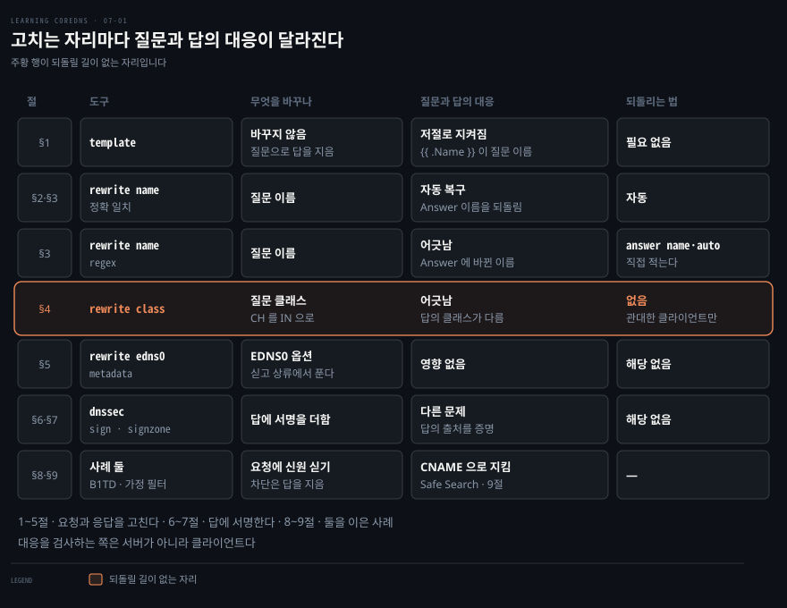


## 이 문서가 다루지 않는 것

> 이 편은 7장 전체를 한 편으로 담았습니다.

- 플러그인 체인이 빌드 때 고정되는 원리 → [플러그인 일곱이면 서버 하나가 선다](./03-02.%ED%94%8C%EB%9F%AC%EA%B7%B8%EC%9D%B8%20%EC%9D%BC%EA%B3%B1%EC%9D%B4%EB%A9%B4%20%EC%84%9C%EB%B2%84%20%ED%95%98%EB%82%98%EA%B0%80%20%EC%84%A0%EB%8B%A4.md)
- `kubernetes` 플러그인이 레코드를 합성하는 방식 → [무엇을 선언했느냐가 레코드 모양을 정한다](./06-01.%EB%AC%B4%EC%97%87%EC%9D%84%20%EC%84%A0%EC%96%B8%ED%96%88%EB%8A%90%EB%83%90%EA%B0%80%20%EB%A0%88%EC%BD%94%EB%93%9C%20%EB%AA%A8%EC%96%91%EC%9D%84%20%EC%A0%95%ED%95%9C%EB%8B%A4.md)
- `ndots:5` 와 검색 경로 → [명세 밖으로 나가면 이식성을 내준다](./06-04.%EB%AA%85%EC%84%B8%20%EB%B0%96%EC%9C%BC%EB%A1%9C%20%EB%82%98%EA%B0%80%EB%A9%B4%20%EC%9D%B4%EC%8B%9D%EC%84%B1%EC%9D%84%20%EB%82%B4%EC%A4%80%EB%8B%A4.md)
- DNSSEC 이론 자체 → 《DNS and BIND》 참고
- 관측과 문제 진단 → [무엇을 볼지 좁히는 손잡이가 도구마다 다르다](./08-01.%EB%AC%B4%EC%97%87%EC%9D%84%20%EB%B3%BC%EC%A7%80%20%EC%A2%81%ED%9E%88%EB%8A%94%20%EC%86%90%EC%9E%A1%EC%9D%B4%EA%B0%80%20%EB%8F%84%EA%B5%AC%EB%A7%88%EB%8B%A4%20%EB%8B%A4%EB%A5%B4%EB%8B%A4.md)

남는 것은 요청과 응답이 흐르는 중에 무엇을 고칠 수 있고 그 대가가 무엇인가입니다.


## 1. 존 파일 없이 답을 짓는 template

> 역방향 존의 PTR 레코드를 손으로 다 적는 일은 규모가 조금만 커져도 불가능해집니다. `template` 은 그것들을 저장하지 않고 요청에서 계산해 냅니다.

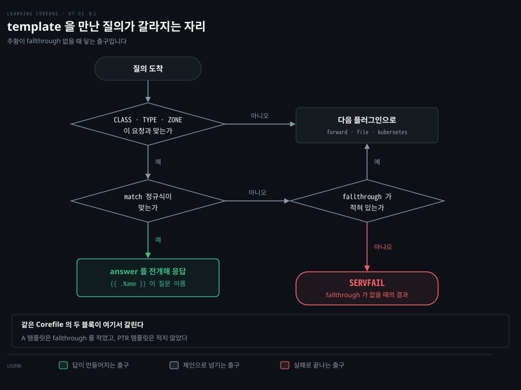

주소 하나에 PTR 레코드 하나입니다. `/16` 하나만 해도 65,536 줄이고 그 줄들은 전부 같은 규칙으로 만들어집니다. `template` 플러그인은 요청만 보고 즉석에서 답을 지어냅니다.

```bash
example.com:5300 in-addr.arpa:5300 {
    # host-a-b-c-d.example.com A 요청을 잡아 a.b.c.d 를 돌려준다
    template IN A example.com {
      match (^|[.])host-(?P<a>[0-9]*)-(?P<b>[0-9]*)-(?P<c>[0-9]*)-(?P<d>[0-9]*)[.]example[.]com[.]$
      answer "{{ .Name }} 60 IN A {{ .Group.a }}.{{ .Group.b }}.{{ .Group.c }}.{{ .Group.d }}"
      fallthrough
    }

    # d.c.b.a.in-addr.arpa PTR 요청을 잡아 host-a-b-c-d.example.com 을 돌려준다
    template IN PTR in-addr.arpa {
      match ^(?P<d>[0-9]*)[.](?P<c>[0-9]*)[.](?P<b>[0-9]*)[.](?P<a>[0-9]*)[.]in-addr[.]arpa[.]$
      answer "{{ .Name }} 60 IN PTR host-{{ .Group.a }}-{{ .Group.b }}-{{ .Group.c }}-{{ .Group.d }}.example.com."
    }
    forward . /etc/resolv.conf
}
```

5300 포트로 PTR 과 A 질의를 보내 확인합니다.

```bash
dig +nostats +nocmd +nocomments -p 5300 -t ptr 1.2.3.4.in-addr.arpa @localhost
dig +nostats +nocmd +nocomments -p 5300 host-1-2-3-4.example.com @localhost
```

```bash
;1.2.3.4.in-addr.arpa.          IN      PTR
1.2.3.4.in-addr.arpa.   60      IN      PTR     host-4-3-2-1.example.com.
;host-1-2-3-4.example.com.      IN      A
host-1-2-3-4.example.com. 60    IN      A       1.2.3.4
```

두 답의 첫 칸이 모두 물은 이름 그대로입니다. PTR 쪽 답이 `host-4-3-2-1` 로 뒤집혀 나오는 것은 역방향 이름 `1.2.3.4.in-addr.arpa` 가 주소 `4.3.2.1` 을 뜻하기 때문입니다.

### 캡처 그룹이 이름을 쪼개고 다시 잇습니다

먼저 첫 줄의 `CLASS TYPE ZONE` 이 요청과 맞는지 확인하고, `match` 정규식을 검사합니다. 통과하면 `answer` 의 Go 템플릿이 전개되어 응답이 됩니다.

아래 그림은 질문 이름에서 조각을 떼어 내 응답으로 조립하는 과정을 보여 줍니다.

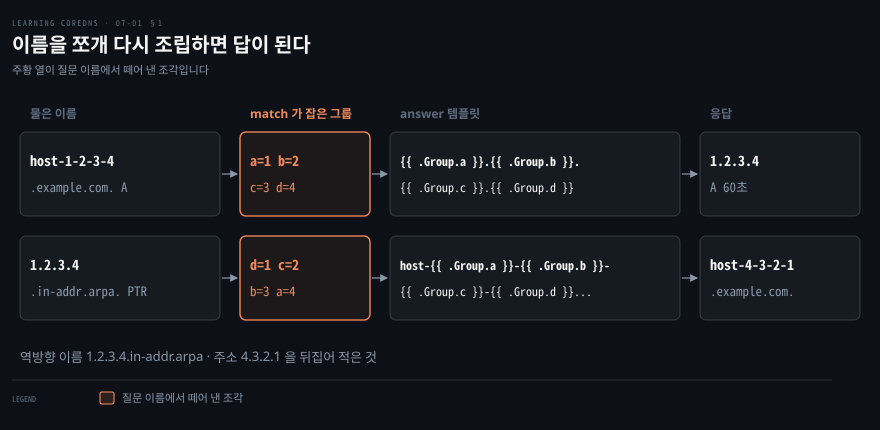

Go 템플릿에서는 `{{ $variable }}` 과 `{{$variable}}` 이 같지만, Corefile 은 공백 없이 붙여 쓴 쪽을 환경 변수 치환으로 먼저 인식하므로 중괄호 안쪽에 공백을 두어야 합니다.

`answer` 의 첫 칸은 `{{ .Name }}` 으로 질문 이름 그대로이며, 질문에서 답을 생성하므로 둘의 대응이 유지됩니다.

정규식의 명명된 캡처 그룹 `(?P<a>[0-9]*)` 은 `{{ .Group.a }}` 로 참조합니다. PTR 쪽은 역방향 존 주소가 거꾸로 배치되므로 `d.c.b.a` 순으로 캡처해 A 레코드 템플릿과 상호 변환합니다.

응답에 지정할 수 있는 항목은 넷입니다.

- `answer`: Answer 섹션에 넣을 레코드
- `additional`: Additional 섹션에 넣을 레코드
- `authority`: Authority 섹션에 넣을 레코드
- `rcode`: 응답 코드

`rcode` 만 지정해 특정 도메인을 차단할 수도 있습니다. `template IN ANY example.com { rcode NXDOMAIN }` 은 해당 도메인의 모든 질의 유형(A·PTR 등)에 대해 `NXDOMAIN` 으로 응답합니다.

### 매칭이 안 되면 어디로 가나

`fallthrough` 는 패턴에 맞지 않는 질의를 뒤의 플러그인으로 넘깁니다. `fallthrough` 가 없는데 질의 이름이 ZONE 에는 맞고 정규식에 맞지 않으면 `SERVFAIL` 이 돌아갑니다.[^tmpl]

위 예제의 PTR 템플릿처럼 `fallthrough` 가 없으면 `d.c.b.a` 형식이 아닌 PTR 질의는 다음 플러그인으로 넘어가지 못하고 `SERVFAIL` 을 받습니다. `fallthrough` 를 붙일지 정규식을 넓힐지는 그 존을 다른 플러그인이 함께 서비스하느냐로 갈립니다.

옛 Corefile 에 남아 있는 `upstream` 옵션은 무시되며 CNAME 재조회는 기본으로 동작합니다.[^tmplsetup]


## 2. 같은 인증서를 쓰려다 트래픽이 밖으로 나갔다 온다

> 클러스터 안의 파드가 자기 클러스터 안 서비스를 외부 이름으로 부르면, 트래픽이 클러스터 밖으로 나갔다가 로드밸런서를 거쳐 되돌아옵니다.

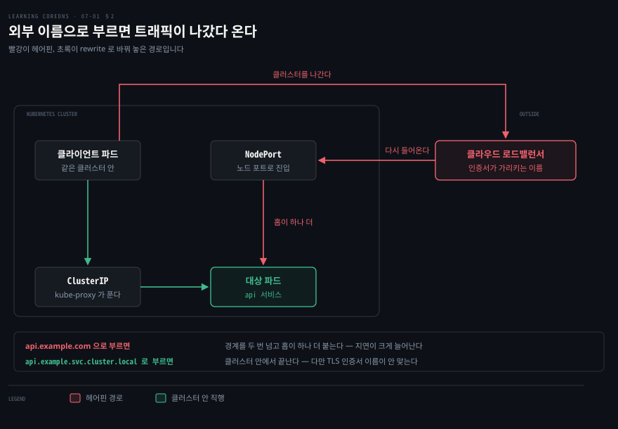

`api.example.com` 의 TLS 인증서가 적용된 서비스를 클러스터 내부 파드가 외부 도메인으로 호출하면, 트래픽이 클라우드 로드밸런서를 거쳐 되돌아오는 헤어핀 현상과 불필요한 네트워크 지연이 발생합니다. 내부 도메인(`api.example.svc.cluster.local`)으로 직접 호출하면 지연은 줄지만 TLS 인증서 검증이 실패합니다. 환경이나 리전마다 클러스터 도메인이 다르면 모든 내부 도메인을 인증서에 추가하기도 어렵습니다.

`rewrite` 플러그인은 질의의 Question 섹션을 `api.example.svc.cluster.local` 로 재작성해 이 문제를 해결합니다.

```bash
.:53 {
    errors
    health
    rewrite name api.example.com. api.example.svc.cluster.local.
    kubernetes cluster.local in-addr.arpa ip6.arpa {
      fallthrough in-addr.arpa ip6.arpa
    }
    prometheus :9153
    forward . /etc/resolv.conf
    cache 30
    loop
    reload
    loadbalance
}
```

CNAME 처럼 동작하지만 클라이언트에게는 원래 물은 이름 그대로 답이 전달됩니다. `rewrite` 는 요청의 유형·이름·클래스·EDNS0 옵션을 재작성하고, 응답 쪽에서는 TTL 과, 경우에 따라 Answer 섹션 레코드의 이름을 고칠 수 있습니다.

재작성은 `FROM` 조건에 맞을 때만 일어납니다. `name` 과 `ttl` 에는 `exact`·`suffix`·`prefix`·`substring`·`regex` 한정자를 지정할 수 있으며, 생략하면 `exact` 로 처리됩니다.

`answer name` 은 한 줄에 이어서 적거나 중괄호 블록 안에 선언할 수 있습니다.[^rw]


## 3. 정규식으로 넓히면 답의 이름이 안 돌아온다

> `api` 하나가 아니라 여러 서비스에 같은 동작을 주려면 정규식 규칙으로 넓혀야 합니다. 넓히는 순간 CoreDNS 가 대신 해 주던 복구가 사라집니다.

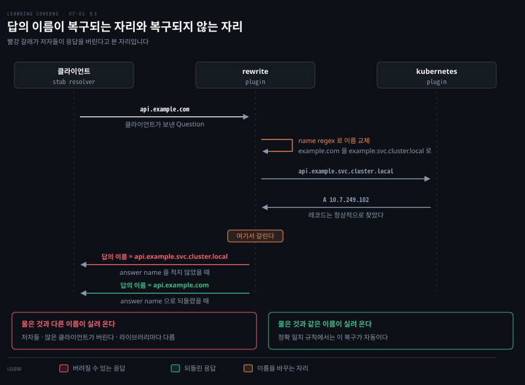

정규식 규칙을 `rewrite name regex ^([^\.]*)\.example\.com\.$ {1}.example.svc.cluster.local.` 로 쓰면 `example.com` 아래 한 단계 이름 전부가 대상이 됩니다. 그러나 이 규칙만 두면 응답의 Answer 레코드에 바뀐 내부 도메인이 그대로 실려 나갑니다.

일부 DNS 리졸버 라이브러리는 질문 섹션과 Answer 레코드의 이름 불일치를 중간자 공격(MITM)으로 보아 응답을 거부합니다.[^rw]

정확 일치(`exact`) 규칙은 Answer 레코드 이름을 자동으로 되돌리지만,[^rwans1150] 정규식 규칙은 `answer name` 이나 `answer auto` 를 직접 지정해야 응답 이름이 복구됩니다.[^rwans1150]

```bash
rewrite {
    name regex ^([^\.]*)\.example\.com\.$ {1}.example.svc.cluster.local.
    answer name ^([^\.]*)\.example\.svc\.cluster\.local\.$ {1}.example.com.
}
```

`answer name` 은 나가는 응답의 도메인 이름을 역방향으로 재작성해 원래 질문 이름으로 되돌립니다.

### 세 설정과 한 가지 예외

아래 그림은 규칙 종류에 따른 응답 섹션 복구 차이를 보여 줍니다.

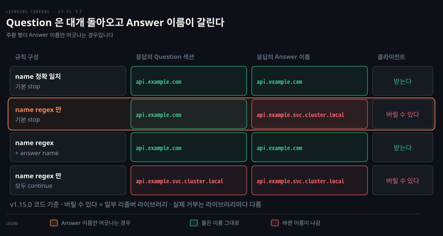

응답의 Question 섹션은 기본값 `stop` 경로에서 규칙 종류와 무관하게 원래대로 복구됩니다(`res.Question[0] = r.originalQuestion`).[^reverter] 모든 규칙이 `continue` 이고 응답 규칙이 없을 때만 복원이 생략됩니다.[^rwgo150] Answer 레코드의 이름은 정확 일치 규칙만 자동으로 복구하므로,[^rwans1150] 정규식 규칙에서는 `answer name` 으로 수동 복구해야 합니다.

물은 이름과 답의 이름이 다른 응답을 버리는지는 리졸버 라이브러리마다 다릅니다. musl 의 `dns_parse_callback` 은 소유자 이름을 보지 않고 유형과 길이만 맞으면 A·AAAA 를 수용합니다.[^musl]

존재하지 않는 서브도메인을 물으면 변환된 내부 도메인도 존재하지 않으므로 `NXDOMAIN` 이 반환됩니다.

`answer` 재작성은 셋으로 나뉩니다.[^rw] 이름을 되돌리는 `answer name`, 최선의 노력으로 자동 복구하는 `answer auto`, `CNAME`·`SRV` 같은 레코드의 값 쪽을 고치는 `answer value` 입니다.


## 4. 규칙 여럿을 잇는 법과 class 의 구멍

> 기본값은 첫 규칙이 맞으면 거기서 멈추는 것입니다. 여러 규칙이 같은 질의에 걸리게 하려면 `continue` 를 명시해야 하고, 그렇게 이어 붙였을 때 되돌릴 수 없는 필드가 하나 드러납니다.

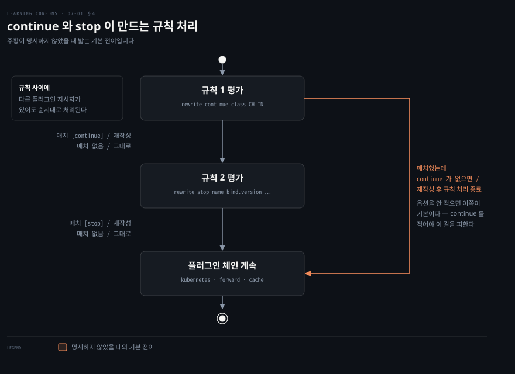

한 서버 블록에 `rewrite` 규칙을 여럿 적을 수 있습니다. 기본 동작은 처음 매칭된 규칙 하나만 적용하고 끝내는 `stop` 입니다. 다음 규칙까지 계속 평가하려면 `continue` 를 명시해야 합니다.

```bash
rewrite continue class CH IN
rewrite stop name bind.version dns-version.cluster.local
```

ChaosNet 클래스로 `bind.version` 에 붙은 TXT 를 묻는 질의에, 쿠버네티스 DNS 버전 TXT 레코드로 답하게 하는 설정입니다. 첫 규칙이 클래스를 `CH` 에서 `IN` 으로 바꾸고 `continue` 로 처리를 이어 가며, 둘째 규칙이 이름을 바꾸고 `stop` 으로 종료합니다.

서버 블록 안의 `rewrite` 규칙들은 적힌 순서대로 처리되지만, 응답 쪽 `answer` 재작성은 역순으로 적용됩니다.[^rw]

### 클래스는 되돌릴 길이 없습니다

`host -t txt -c ch bind.version.` 을 질의하면 답의 클래스가 질문의 클래스와 맞지 않아 경고가 발생합니다.

이름과 Question 은 되돌아오지만 Answer 의 클래스는 `IN` 으로 남습니다.

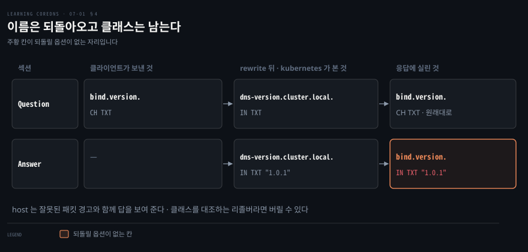

이름과 달리 클래스 재작성에는 응답의 클래스를 되돌리는 옵션이 없습니다.[^rw]

Answer 섹션의 클래스가 `IN` 으로 유지되므로, `host` 처럼 관대한 클라이언트는 경고와 함께 답을 수용하지만 엄격한 리졸버는 응답을 거부할 수 있습니다.

`rewrite` 로 고칠 수 있는 필드는 클래스·유형·이름·TTL·EDNS0 옵션과 응답 코드 `rcode`, CNAME 대상 `cname` 까지 일곱입니다.[^rw]

`dns-version` TXT 레코드 값은 CoreDNS 가 구현한 쿠버네티스 DNS 명세 버전(1.1.0)입니다.[^k8sspec]


## 5. 요청에 정보를 실어 보내고 상류에서 풀어 읽는다

> EDNS0 는 DNS 요청과 응답에 추가 옵션을 실을 수 있게 합니다. `rewrite` 로 그 옵션을 채워 넣고, 상류에서 `metadata` 로 풀어 읽는 왕복이 이 절의 그림입니다.

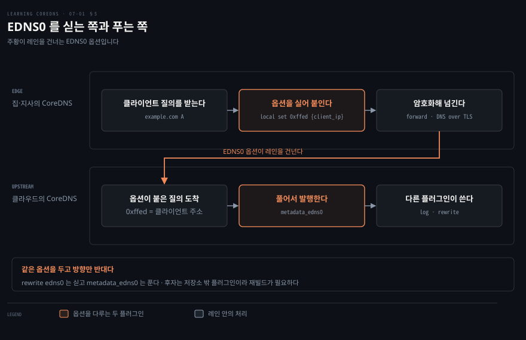

집이나 지사의 CoreDNS 가 상류 네임서버에 질의를 넘길 때, 상류는 CoreDNS 의 주소만 볼 수 있어 요청 유입 지점을 구별하기 어렵습니다.

RFC 6891 이 정의한 EDNS0(Extension Mechanisms for DNS)는 요청과 응답에 추가 옵션을 싣는 통로를 제공하며, `rewrite` 플러그인으로 이를 제어합니다.

```bash
rewrite [continue|stop] edns0 TYPE [set|replace|append|unset] TYPE-FIELDS [revert]
```

### 액션 넷은 옵션이 이미 있느냐로 갈립니다

액션은 넷입니다.[^rw]

- `set`: 옵션을 지정한 값으로 놓습니다. 없으면 만들고 있으면 덮어씁니다.
- `replace`: 이미 있을 때만 고칩니다. 새로 만들지 않습니다.
- `append`: 이미 있을 때의 처리는 옵션 종류마다 다릅니다.[^rwedns1150]
- `unset`: 일치하는 옵션을 지웁니다.

`set` 과 `replace` 의 매칭 기준은 EDNS0 옵션 코드입니다. 응답에서 옵션을 되돌리는 `revert` 플래그도 함께 지원합니다.

넷의 차이는 같은 코드의 옵션이 요청에 이미 있느냐에 따라 갈립니다.

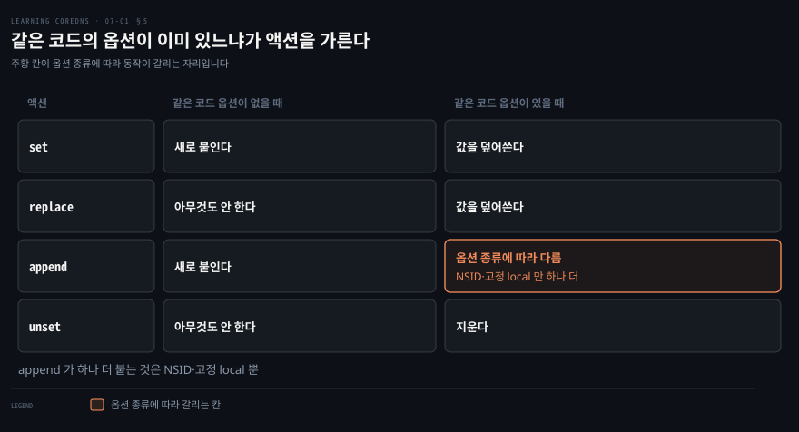

옵션이 이미 있을 때 `append` 동작은 옵션 종류마다 다릅니다. NSID 와 고정 값 local 은 일치하는 옵션이 있어도 하나 더 붙이고, 변수 local 과 subnet 은 일치하는 옵션이 있으면 붙이지 않습니다.[^rwedns1150]

### 무엇을 실을지는 TYPE 셋이 정합니다

`TYPE` 은 셋입니다. `subnet` 은 EDNS Client Subnet 옵션을 설정합니다. `rewrite edns0 subnet set 24 56` 라고 쓰면 클라이언트 출발지 IP 의 앞 24비트(IPv4) 또는 56비트(IPv6)를 옵션 값으로 씁니다. 상류 DNS 서버가 그 서브넷을 보고 응답을 달리 줄 수 있습니다.

이 기능은 사생활과 맞바꾸는 것입니다. RFC 7871 은 이 기능을 기본으로 꺼 두라고 하며, 재귀 리졸버가 IPv4 는 24비트, IPv6 는 56비트로 잘라 사용자 주소 일부를 감추도록 권고합니다.[^rfc7871] `24 56` 은 이 권고를 따른 값입니다.

`nsid` 는 서버 식별자입니다. `local` 은 옵션 코드와 데이터 두 필드를 받으며 데이터에 변수를 쓸 수 있습니다.

```bash
rewrite edns0 local set 0xffaa some-value
rewrite edns0 local set 0xffab 0xaabbccdd
rewrite edns0 local set 0xffac {client_ip}
rewrite edns0 local set 0xffad {protocol}
```

쓸 수 있는 변수는 일곱입니다.

- `{qname}`: 질문 이름
- `{qtype}`: 질문 유형
- `{client_ip}`: 클라이언트 출발지 IP 주소
- `{client_port}`: 클라이언트 출발지 포트
- `{protocol}`: 요청에 쓰인 프로토콜
- `{server_ip}`: 요청을 받은 서버의 IP 주소
- `{server_port}`: 요청을 받은 서버의 포트

`metadata` 플러그인을 활성화하면 이 일곱 변수 외에 metadata 값도 변수로 참조할 수 있습니다.

지사나 엣지 배치에서 EDNS0 옵션에 위치 정보를 실어 보내면, 상류 네임서버가 이를 바탕으로 응답을 조정할 수 있습니다.

### metadata 는 아무것도 고치지 않습니다

`metadata` 플러그인은 요청도 응답도 건드리지 않습니다. 대신 다른 플러그인이 요청에 대한 데이터를 만들어 서로 주고받을 수 있게 합니다.

`metadata.Provider` 를 구현한 플러그인들은 질의 처리 초입에 요청을 확인하고 데이터를 발행합니다.[^metadata] 발행하는 쪽이 공급자이고 쓰는 쪽이 소비자이며 한 플러그인이 둘 다일 수 있습니다.

`kubernetes`·`forward`·`view`·`proxyproto` 등 여러 플러그인이 공급자로 참여합니다[^mdprov1150].

아래 그림은 공급자와 소비자를 실제 키 이름으로 이은 것입니다. 값이 플러그인 사이를 오갈 뿐 요청과 응답은 변경되지 않습니다.

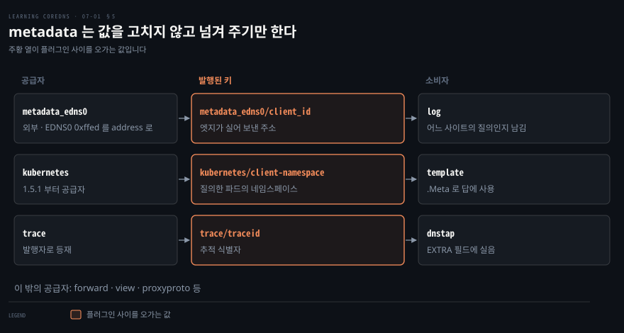

외부 플러그인인 `metadata_edns0` 는 `rewrite edns0` 의 역방향으로 동작합니다. EDNS0 옵션을 풀어 metadata 값으로 만들어 로그에 남기거나 다른 재작성에 활용합니다.

```bash
metadata_edns0 {
       client_id 0xffed address
       group_id 0xffee hex 16 0 16
}
```

`0xffed` 를 IP 주소로 읽어 `{/metadata_edns0/client_id}` 로 발행하고, `0xffee` 의 16바이트를 16진 문자열로 인코딩해 `{/metadata_edns0/group_id}` 로 내놓습니다. `hex` 형식은 길이·시작·끝 세 인자를 받으므로 `group_id 0xffee hex 16 0 16` 으로 적습니다.[^medns0]

`setup.go` 는 인자가 1·2·5개일 때만 허용하므로 `group_id 0xffee hex 16` 처럼 셋을 적으면 `invalid edns0 directive` 오류로 서버가 뜨지 않습니다.[^medns0setup]

엣지 CoreDNS 에서 `rewrite edns0 local set 0xffed {client_ip}` 로 옵션을 싣고, 상류의 `metadata_edns0` 가 이를 풀어 로그에 남기면 질의 유입 지점을 파악할 수 있습니다.

metadata 와 얽힌 플러그인 여섯의 역할은 다음과 같습니다.

| 플러그인 | 쓰임 |
|---|---|
| `kubernetes` | 공급자입니다. 클라이언트 파드의 네임스페이스·이름·라벨을 포함해 키 아홉을 발행하고, 옵션과 상황에 따라 `kubernetes/zone`·`kubernetes/cluster`·`kubernetes/parse-error` 가 더 붙습니다[^k8smeta][^k8smeta1150] |
| `template` | `.Meta` 함수로 소비자가 됩니다[^tmpl] |
| `dnstap` | `EXTRA` 필드에서 다른 플러그인의 metadata 를 씁니다[^dnstap] |
| `trace` | `trace/traceid` 를 발행합니다[^trace] |
| `metadata_edns0` | 외부 공급자입니다. `plugin.cfg` 에 없고 별도 저장소에 있습니다[^plugincfg] |
| `firewall` | CoreDNS 조직의 `policy` 저장소가 제공하고, Infoblox 의 Themis 와 OPA 를 정책 엔진으로 붙일 수 있습니다[^policy]. 다만 저장소의 마지막 커밋은 2022-08-01 입니다 |


## 6. 키를 둘로 나누는 이유는 부모 존에 있다

> DNSSEC 이 키 쌍을 둘 쓰는 이유는 암호학이 아니라 운영에 있습니다. 자주 갈아야 하는 키와, 갈 때마다 남에게 알려야 하는 키를 분리하는 것입니다.

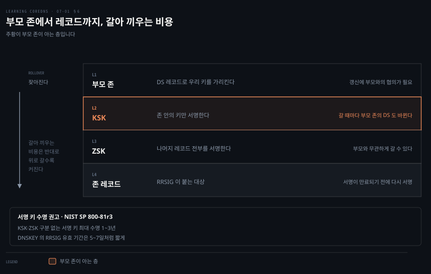

캐시 포이즈닝에 맞서 응답의 위변조를 막으려면 DNSSEC 서명이 필요합니다. 존 관리자가 레코드에 암호로 서명하고 재귀 리졸버가 서명을 검증합니다.

`auto` 나 `file` 플러그인으로 주 서버를 운영할 때는 BIND 9 의 `dnssec-keygen` 과 `dnssec-signzone` 으로 존 데이터 파일을 직접 서명합니다.

첫 실행이 ZSK(Zone Signing Key) 쌍을 생성합니다. ZSK 의 개인 키는 존의 모든 레코드를 서명하고 공개 키가 검증합니다.

```bash
dnssec-keygen -a ECDSAP256SHA256 foo.example
```

```bash
Generating key pair.
Kfoo.example.+013+50136
```

두 번째 실행에 `-f KSK` 를 붙이면 KSK(Key Signing Key) 쌍이 생성됩니다. KSK 의 개인 키는 존 안의 키만 서명합니다.

```bash
dnssec-keygen -a ECDSAP256SHA256 -f KSK foo.example
```

```bash
Generating key pair.
Kfoo.example.+013+12016
```

많은 레코드를 서명하는 ZSK 는 정기적으로 교체해야 합니다. 그런데 부모 존도 우리 키에 대한 정보를 자기 존에 넣고 있어야 합니다. 그 정보는 DS 레코드이며, 자식 존 키의 요약값을 부모 존에 적어 둔 것입니다. ZSK 를 갈 때마다 부모 존에 알리는 것은 번거로운 일입니다. 그래서 키만 서명하는 KSK 를 하나 더 두고 부모 존은 그 키만 알게 합니다. 서명하는 데이터가 적으니 KSK 는 그만큼 자주 갈 필요가 없습니다.

알고리즘은 서명이 작게 나오는 `ECDSAP256SHA256` 을 씁니다. RSA 계열은 호환성이 높지만 서명이 길어집니다. CoreDNS 는 NSEC3(이름을 해시해 존의 이름 목록이 드러나지 않게 하는 NSEC 의 변형)를 지원하지 않으므로 NSEC3 는 고르지 않습니다.

서명 절차는 세 단계입니다.

1. 두 키 파일에서 DNSKEY 레코드를 꺼내 존 데이터 파일에 붙입니다(`cat Kfoo.example.+013+*.key >> db.foo.example`).
2. `dnssec-signzone -o foo.example db.foo.example` 로 서명합니다.
3. 생성된 `.signed` 파일을 `file` 플러그인으로 읽힙니다.

세 번째 단계의 Corefile 은 이렇습니다.

```bash
foo.example {
    file db.foo.example.signed
    errors
    log
}
```

DNSSEC OK 비트를 세운 질의에 서명과 DNSSEC 레코드가 함께 반환됩니다. `dig soa foo.example. +dnssec +norec` 로 물으면 SOA 와 NS 옆에 RRSIG 이 따라옵니다.

`dnssec-signzone` 으로 서명한 존에서는 서명 갱신과 키 교체가 운영자 몫입니다. `sign` 플러그인은 존 파일의 재서명을 자동화하지만,[^sign] CSK(공통 서명 키. ZSK 와 KSK 의 일을 키 하나가 함께 맡는 방식)만 지원하고 ZSK/KSK 분리나 롤오버는 지원하지 않으므로 키 분리와 롤오버 운영은 여전히 사용자 몫입니다.

### 롤오버 주기 권고는 두 번 바뀌었습니다

NIST SP 800-81r3 는 KSK 와 ZSK 구분 없이 서명 키의 권장 최대 수명을 1~3년으로 두고, DNSKEY 의 RRSIG 유효 기간을 5~7일처럼 짧게 유지하도록 권고합니다.[^nist3]

아래 표는 알고리즘과 지침별 롤오버 수치입니다.

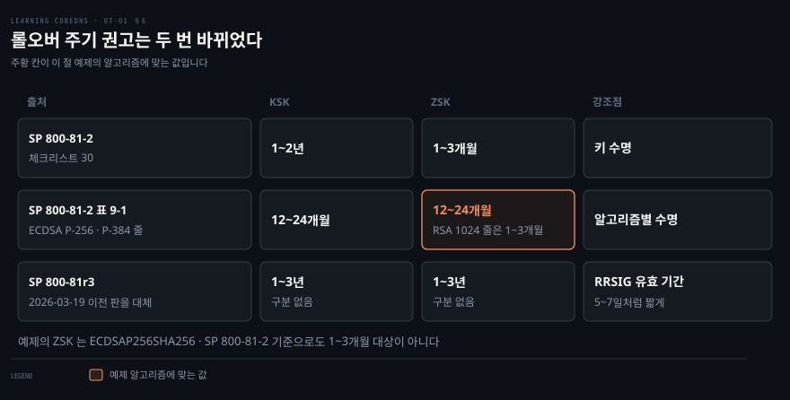


## 7. 합성한 레코드에는 서명할 존 파일이 없다

> `kubernetes` 플러그인이 만드는 레코드는 어느 파일에도 적혀 있지 않습니다. 미리 서명해 둘 대상이 없으므로 서명을 요청 때 만들어야 합니다.

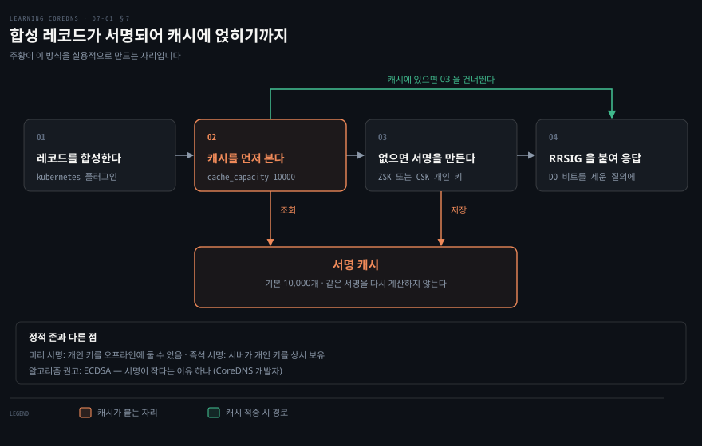

`kubernetes` 나 `etcd` 처럼 레코드를 동적으로 합성하는 환경에서는 미리 서명해 둘 존 파일이 없습니다.

`dnssec` 플러그인은 합성된 자원 레코드를 질의 시점에 즉석에서 서명합니다.

```bash
dnssec [ZONES...] {
    key file KEY...
    cache_capacity CAPACITY
}
```

`ZONES` 는 즉석 서명할 존입니다. 생략하면 해당 서버 블록의 모든 존이 서명됩니다. `key file` 은 `dnssec-keygen` 으로 생성한 키 파일 이름을 지정합니다. 기준 이름이나 `.key`·`.private` 확장자 중 어느 쪽을 주어도 인식합니다.

### 키 판정은 SEP 비트 조합으로 갈립니다

키는 SEP 비트 조합으로 서명 방식을 결정합니다. SEP(Secure Entry Point) 비트는 부모 존의 DS 레코드가 가리키는 진입점 키라는 표시입니다. `dnssec-keygen -f KSK` 가 이 비트를 켭니다. 이 비트가 켜진 키와 꺼진 키가 함께 존재할 때만 DNSKEY 레코드는 KSK 개인 키로, 나머지 전부는 ZSK 개인 키로 나눠 서명합니다. 그 외에는 단일 키에 KSK 플래그가 켜져 있어도 모두 공통 서명 키(CSK)로 동작합니다.[^dnssec]

아래 그림이 키 구성별 판정을 보여 줍니다.

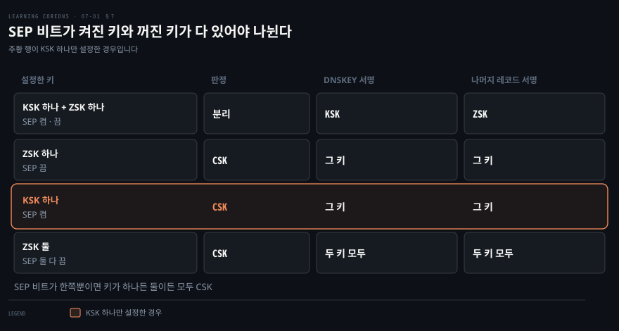

### 서명 캐시와 개인 키의 자리

`cache_capacity` 는 즉석 서명을 보관하는 캐시 크기이며, 기본값은 10,000개입니다.

```bash
cluster.local {
    kubernetes
    dnssec {
            key file Kcluster.local.+013+47746
        }
}
```

즉석 서명에는 서명 크기가 작은 ECDSA 알고리즘을 권장합니다.[^dnssec]

미리 서명하는 방식은 개인 키를 오프라인에 보관할 수 있지만, 즉석 서명은 서버가 `key file` 로 개인 키를 계속 들고 있어야 하므로 서버가 뚫리면 키도 함께 뚫립니다.

키 저장소로 `aws_secretsmanager` 도 사용할 수 있습니다.[^dnssec] 서명 TTL 은 3600초로 고정되며 서버 블록당 한 번만 선언할 수 있습니다.

### 없는 이름은 NSEC 하나로 증명합니다

`dnssec` 플러그인은 NSEC3 를 지원하지 않으며 부재 증명에 NSEC black lies 방식을 씁니다.[^dnssec]

black lies 는 없는 이름을 물어도 `NXDOMAIN` 대신 `NOERROR` 로 답하고 질의 이름 자체를 소유자로 한 NSEC 레코드를 즉석에서 생성합니다.[^blacklies] CoreDNS 는 일반 존 이름에서 A·TXT·AAAA·SRV 를 포함한 유형 열넷의 고정 비트맵에서 질의된 유형 하나만 제외하고 응답에 싣습니다.[^blackliesgo] 그래서 CoreDNS 의 NSEC 이 증명하는 것은 "이 이름에 물은 유형은 없다"입니다. 존 전체의 이름을 미리 알 수 없는 합성 레코드 환경에서 서명 한 번으로 부재를 증명하는 방식입니다.

없는 이름을 물었을 때의 세 가지 응답 차이는 다음과 같습니다.

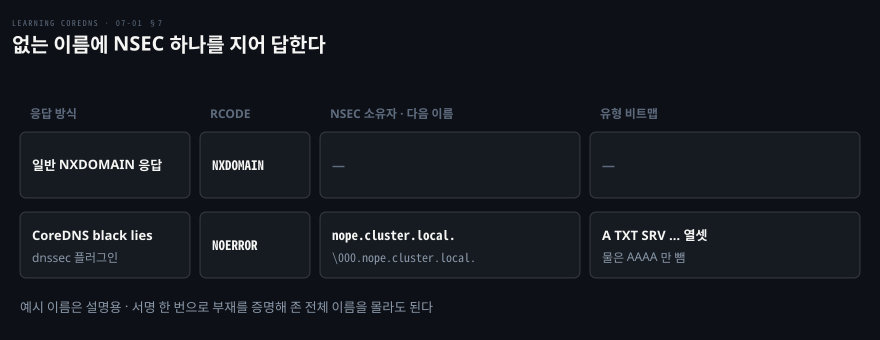


## 8. 사례 — 신원을 요청에 실어 보내는 서비스

> Infoblox 의 BloxOne Threat Defense 는 이 장의 조각들을 그대로 이어 붙인 서비스입니다. 클라이언트 쪽 CoreDNS 가 요청에 신원을 싣고, 클라우드 쪽 CoreDNS 가 그것을 읽어 정책을 적용합니다.

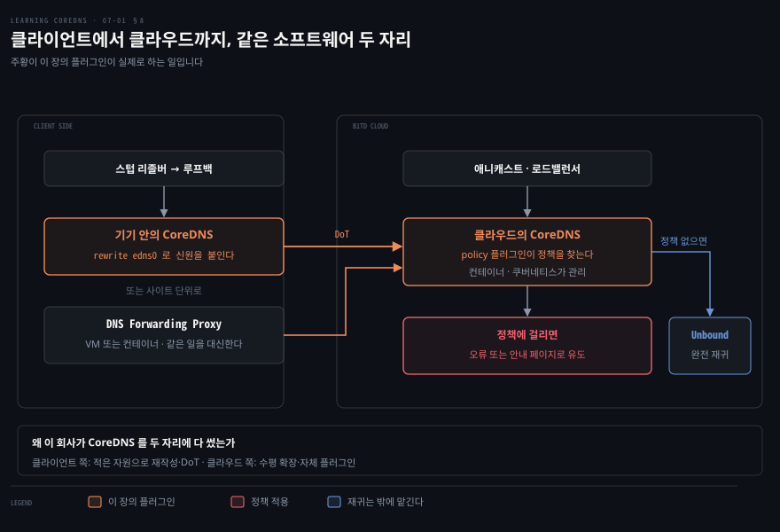

사외에서 근무하는 직원은 DHCP 가 할당한 DNS 서버를 사용하므로 사내 Response Policy Zone(RPZ) 차단 정책을 적용받지 못합니다. RPZ 는 도메인별 차단·응답 변경 규칙을 담은 특수한 존입니다.

Infoblox Threat Defense(옛 이름 BloxOne Threat Defense, B1TD)는 이 보호를 클라우드로 옮긴 재귀 DNS 서비스입니다[^ibtd].

DNS 메시지 자체에는 사용자 식별 정보가 없습니다. 출발지 IP 로 알 수 있을 때도 있지만 DHCP 로 동적으로 배정되거나 NAT 뒤에서 여럿이 하나를 쓰면 그 IP 는 신원과 이어지지 않습니다.

그래서 클라이언트의 스텁 리졸버를 로컬 CoreDNS 로 향하게 합니다. 스텁 리졸버는 운영체제 안에서 애플리케이션의 질의를 받아 DNS 서버로 넘기기만 하는 리졸버입니다. CoreDNS 가 `rewrite` 플러그인으로 EDNS0 옵션에 식별 정보(MAC·IP·조직·로그인 이름)를 추가합니다. 덧붙인 정보가 민감한 개인 데이터이므로 `forward` 플러그인의 DNS over TLS 로 전달 경로를 암호화해 B1TD 애니캐스트 주소로 넘깁니다. 애니캐스트는 여러 지점이 같은 주소를 광고해 가장 가까운 지점이 받게 하는 방식입니다.

클라우드 측 CoreDNS 는 컨테이너 기반으로 쿠버네티스 환경에서 수평 확장됩니다.

정책 판단은 `policy` 플러그인이 담당합니다. 클라이언트 신원과 요청 도메인 등을 확인해 차단 정책에 걸리면 오류를 반환하거나 안내 페이지의 도메인 이름 또는 IP 로 유도합니다. 걸리는 정책이 없으면 완전 재귀를 지원하는 Unbound 로 질의를 넘깁니다.

CoreDNS 는 완전 재귀 해석기가 아니므로, 재귀 조회가 필요한 정상 질의는 Unbound 로 전달하고 자신은 플러그인 체인으로 식별·정책 검사·응답 조작을 담당합니다.

클라이언트에서는 가벼운 자원으로 질의를 재작성하고 TLS 로 전달하며, 클라우드에서는 쿠버네티스로 확장하며 정책 플러그인을 구동합니다.


## 9. 사례 — 가정용 필터링 DNS 는 거짓 답을 짓는다

> 8절의 기업 보호를 집으로 옮기면 같은 조각이 더 단순하게 쓰이고, 서버는 멀쩡한데 이름 해석 단계에서 답을 바꿔 접속을 막습니다.

### 앱으로 막으면 앱을 지우는 순간 풀립니다

기기별 차단 앱은 앱을 삭제하거나 권한을 끄면 무력화됩니다.

필터링 DNS 는 모든 접속이 거치는 이름 해석 단계에서 차단하므로, 같은 DNS 를 사용하는 모든 애플리케이션에 일괄 적용됩니다.

### 막는 방법은 1절과 8절에 이미 있습니다

필터링 DNS 는 요청 도메인을 블록리스트와 대조해 차단 대상이면 둘 중 하나로 응답합니다.

- 없는 이름(`NXDOMAIN`)으로 응답합니다(1절의 `template` 차단과 동일). 브라우저에는 도메인을 찾지 못했다는 오류만 뜨고 막힌 이유는 알려 주지 않습니다.
- 안내 페이지의 도메인 이름이나 IP 로 유도하는 싱크홀 방식을 씁니다. 막힌 이유를 보여 줄 수 있지만 HTTPS 사이트라면 안내 페이지 서버가 그 이름의 인증서를 낼 수 없어 대개 브라우저 경고가 먼저 뜹니다.

정상 응답과 두 차단 방식의 차이는 다음과 같습니다.

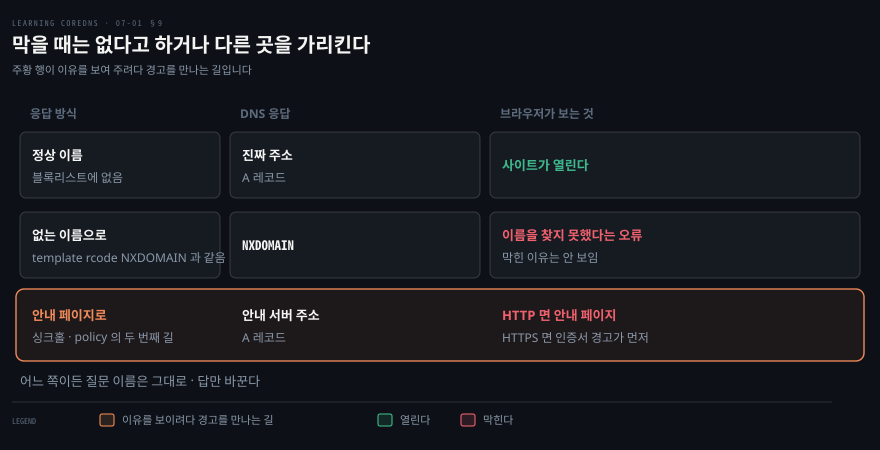

블록리스트는 StevenBlack 이나 Hagezi 처럼 카테고리별로 관리되는 공개 목록을 활용합니다.[^stevenblack][^hagezi] 목록 관리자가 분류를 갱신하면 사용자는 새 사이트를 따라잡지 않아도 됩니다.

### Safe Search 강제는 질문을 그대로 두고 답만 바꿉니다

사이트를 막아도 검색 결과로 같은 콘텐츠가 들어오므로 일부 필터링 DNS 는 검색 엔진의 Safe Search 를 강제합니다. Google 이 안내하는 방식은 `www.google.com` 을 `forcesafesearch.google.com` 의 CNAME 으로 매핑하는 것입니다. 이 설정은 브라우저 쪽에서 되돌릴 수 없습니다.[^safesearch]

질문 이름을 바꾸는 방식과 CNAME 방식을 견주어 봅니다. 둘째 행은 비교를 위한 가정입니다.

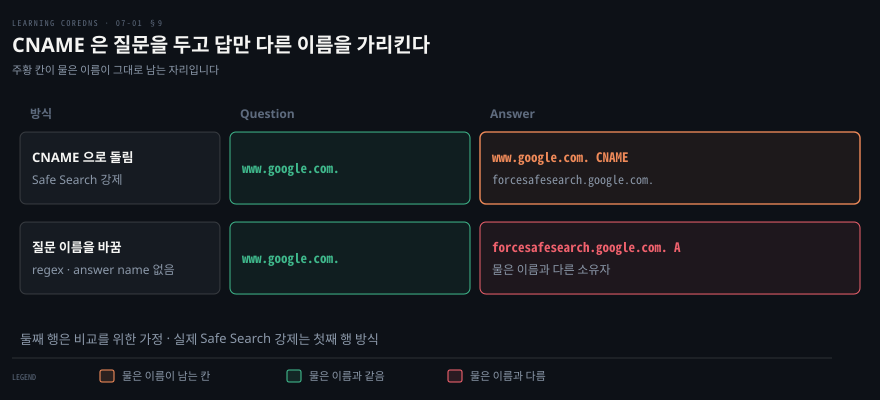

CNAME 응답은 질문 섹션에 원래 이름(`www.google.com`)이 유지되고 Answer 레코드만 대상 이름을 가리키므로, 질문과 답의 대응이 깨지지 않아 클라이언트가 거부하지 않습니다.

### 어디에 설정하느냐가 우회 마찰을 정합니다

공유기에 DNS 를 설정하면 네트워크 내 모든 기기에 일괄 적용되므로 우회 마찰이 커집니다.

기기에서 DNS 주소를 변경하거나 VPN, 브라우저 DoH 를 사용하면 필터를 우회할 수 있습니다. DNS 차단은 완벽한 차단보다 충동적인 접근에 마찰을 더하는 도구입니다.


## 결정 치트시트

> 이 장의 도구를 언제 고르는지와 그 대가입니다.

| 하고 싶은 일 | 도구 | 대가와 주의 |
|-------------|------|------------|
| 규칙으로 만들어지는 레코드를 파일에 안 적기 | `template` | 매칭 실패가 `fallthrough` 없으면 `SERVFAIL` · 그 존의 해당 CLASS·TYPE 질의를 모두 가로챕니다 |
| 이름 하나를 다른 이름으로 바꾸기 | `rewrite name` 정확 일치 | 답 이름 복구가 자동 · 이름 수만큼 규칙이 늘어납니다 |
| 이름 여럿을 한 규칙으로 바꾸기 | `rewrite name regex` | 답 이름 복구가 안 됨 · `answer name` 을 반드시 짝지어야 합니다 |
| 클래스 바꾸기 | `rewrite class` | 되돌릴 방법 없음 · 관대한 클라이언트에서만 씁니다 |
| 여러 규칙을 같은 질의에 걸기 | `continue` | 기본은 `stop` · 서버 블록 안 적힌 순서대로 처리됩니다 |
| 요청에 위치·신원 싣기 | `rewrite edns0` | 민감 정보면 전송 구간 암호화가 필요합니다 |
| 그 옵션을 상류에서 읽기 | `metadata` + `metadata_edns0` | 후자는 외부 플러그인이라 재빌드가 필요합니다 |
| 정적 존에 서명하기 | `dnssec-signzone` + `file`, `sign` | `dnssec-signzone` 방식은 재서명과 롤오버가 사용자 몫 · `sign` 은 재서명만 맡고 롤오버는 안 합니다 |
| 합성 레코드에 서명하기 | `dnssec` 플러그인 | 서버가 개인 키를 상시 보유 · NSEC3 미지원 · 서명 TTL 3600초 고정 |
| 도메인 하나를 없는 이름으로 막기 | `template` + `rcode NXDOMAIN` | 조용한 실패 · 막힌 이유를 보이려면 안내 페이지로 유도(9절) |


## 적용 관점

> Spring 애플리케이션을 쿠버네티스에 올려 두고 이 장을 읽는다면 걸리는 자리가 둘입니다.

첫째는 2절의 헤어핀입니다. Spring 애플리케이션이 `RestClient` 나 `WebClient` 로 사내 API 를 `https://api.example.com` 으로 부르고 있다면, 같은 클러스터 안에 그 API 가 있어도 트래픽이 밖으로 나갔다 옵니다.

코드에서 호스트를 클러스터 이름으로 바꾸면 TLS 인증서 검증이 깨집니다. 프로파일마다 다른 호스트를 두면 설정이 갈라집니다. `rewrite name` 은 이 선택을 코드 밖으로 빼냅니다. 애플리케이션은 한 이름만 알고 어디서 도는지는 CoreDNS 가 압니다.

둘째는 JVM 의 DNS 캐시입니다. `rewrite ttl` 로 CoreDNS 가 TTL 을 낮춰도 JVM 이 그 값을 무시하면 소용이 없습니다. 성공한 이름 조회 캐시 정책은 `networkaddress.cache.ttl` 보안 속성이 정합니다.[^jvmdns] 최신 JDK 의 기본값은 구현이 정하는 유한한 기간이며, `-1` 은 영구 캐시를 뜻합니다.[^jvmdns25] 실패한 조회는 `networkaddress.cache.negative.ttl` 이 담당하며 기본값은 10초입니다.

`networkaddress.cache.stale.ttl` 은 재조회 실패 시 만료된 이름을 얼마나 더 쓸지 결정합니다.[^jvmdns] 이 값을 `networkaddress.cache.ttl` 보다 크게 두면 뒤엣것이 갱신 주기로 쓰입니다. 성공 쪽 기본값은 숫자로 정해져 있지 않습니다. 그래서 파드 IP 가 자주 바뀌는 환경이라면 `java.security` 에서 `networkaddress.cache.ttl` 을 명시하는 편이 안전합니다.


## 면접에서 받을 만한 질문

1. `template` 플러그인이 존 파일 없이 답을 만들 수 있는 이유는 무엇입니까?
2. `rewrite name` 의 정확 일치 규칙과 정규식 규칙은 무엇이 다릅니까?
3. `answer name` 을 빼먹으면 어떤 증상이 나타납니까?
4. `class` 재작성 응답을 `host` 는 경고와 함께 받아 줍니다. 그런데도 운영에 쓰기 어려운 이유는 무엇입니까?
5. 4절의 두 줄에서 첫 줄의 `continue` 만 지우면 `host -t txt -c ch bind.version.` 은 무엇을 받게 됩니까?
6. `metadata` 플러그인은 요청이나 응답을 어떻게 바꿉니까?
7. DNSSEC 에서 키 쌍을 둘로 나누는 이유는 무엇입니까?
8. `dnssec` 플러그인이 필요한 상황은 정적 존 서명과 어떻게 다릅니까?
9. 1절의 Corefile 에서 A 템플릿의 `fallthrough` 를 지운 뒤 `www.example.com` 의 A 를 물으면 무엇을 받습니까? 지우기 전에는 무엇을 받았습니까?
10. `rewrite continue name regex ...` 한 줄만 두고 `answer name` 은 적지 않았습니다. 응답의 Question 섹션에는 어떤 이름이 실립니까? 같은 규칙을 기본값 `stop` 으로 두면 어떻게 달라집니까?


## 정답 (자답 후 펼치기)

### 정답 1 — 답을 어디서 얻는가

요청 자체가 재료이기 때문입니다. `CLASS TYPE ZONE` 으로 요청을 거르고 `match` 정규식의 캡처 그룹으로 요청 이름을 쪼갠 뒤, `answer` 의 Go 템플릿에서 그 조각들을 다시 조립합니다. 규칙으로 만들어지는 레코드라면 저장할 필요가 없습니다.

### 정답 2 — 두 규칙의 차이

정확 일치 규칙에서는 `rewrite` 플러그인이 Answer 레코드의 이름을 원래 질문 이름으로 자동으로 되돌립니다. 정규식 규칙에서는 그렇게 하지 않으므로 `answer name` 또는 `answer auto` 로 되돌리는 규칙을 직접 적어야 합니다. 기본값 `stop` 경로에서는 응답의 Question 섹션이 어느 규칙에서든 원래대로 돌아오므로 갈리는 쪽은 Answer 레코드의 이름입니다.

### 정답 3 — 빠뜨렸을 때의 증상

Answer 레코드에 질문과 다른 도메인 이름이 실려 나갑니다. 리졸버 라이브러리가 질문과 답의 이름 불일치를 중간자 공격(MITM)으로 판단하면 응답을 거부하고 버립니다. 소유자 이름을 검사하지 않는 musl 같은 구현체는 그대로 수용하므로 증상은 클라이언트 라이브러리에 따라 다릅니다.

### 정답 4 — 되돌릴 길이 없다

이름과 달리 클래스 재작성에는 응답의 클래스를 되돌리는 옵션이 없어, 질문과 답의 클래스가 어긋난 채 전달됩니다. `host` 같은 도구는 경고와 함께 수용하지만, 검증이 엄격한 리졸버는 응답을 버리므로 클라이언트를 통제할 수 있는 환경으로 사용처가 제한됩니다.

### 정답 5 — 이름이 안 바뀝니다

기본값이 `stop` 이라 첫 규칙이 클래스를 `IN` 으로 바꾼 뒤 규칙 처리가 끝납니다. 둘째 규칙이 돌지 않으니 이름은 `bind.version` 그대로 남고 `dns-version.cluster.local` 의 TXT 레코드는 돌아오지 않습니다. 그 이름을 그 서버의 다른 플러그인이 어떻게 다루느냐가 결과를 정합니다.

### 정답 6 — metadata 가 바꾸는 것

아무것도 바꾸지 않습니다. 공급자 인터페이스를 구현한 플러그인이 요청을 미리 들여다보고 계산한 값을 발행하게 해서 다른 플러그인이 그 값을 쓸 수 있게 할 뿐입니다. 조작은 그 값을 소비하는 쪽이 합니다.

### 정답 7 — 키가 둘인 이유

부모 존 때문입니다. 많은 레코드를 서명하는 ZSK 는 자주 갈아야 합니다. 그런데 부모 존이 우리 키 정보를 들고 있으므로 갈 때마다 부모에게 알려야 합니다. 키만 서명해서 서명 데이터가 훨씬 적은 KSK 를 따로 두고 부모에게는 그것만 DS 레코드로 알리면, ZSK 는 부모와 무관하게 갈 수 있습니다. KSK 는 서명하는 데이터가 적어 그만큼 자주 갈 필요가 없습니다.

### 정답 8 — 즉석 서명이 필요한 자리

서명할 존 데이터 파일이 없을 때입니다. `kubernetes` 플러그인처럼 요청 때마다 레코드를 합성하는 백엔드에서는 미리 서명해 둘 대상이 존재하지 않으므로 서명을 요청 시점에 만들고 `cache_capacity` 만큼 캐시합니다.

### 정답 9 — 존은 맞고 정규식이 안 맞으면 SERVFAIL

`www.example.com` 은 첫 줄의 `IN A example.com` 에 걸리므로 A 템플릿이 이 질의를 잡습니다. 그런데 `match` 정규식은 `host-` 로 시작하는 이름만 받으므로 맞지 않습니다. `fallthrough` 를 지웠으니 다음 플러그인으로 넘어가지 못하고 `SERVFAIL` 을 받습니다. 지우기 전에는 아래의 `forward` 로 넘어가 상류가 답했습니다.

### 정답 10 — continue 만 있으면 Question 도 안 돌아온다

바뀐 이름이 그대로 실립니다. 정규식 규칙은 응답 규칙을 스스로 만들지 않습니다. 규칙이 끝까지 `continue` 이고 응답 규칙이 하나도 없으면 원래 writer 로 넘기므로 `res.Question[0] = r.originalQuestion` 복원이 일어나지 않습니다.[^rwgo150]

같은 규칙을 `stop` 으로 두면 reverter 를 거쳐 Question 섹션이 원래 이름으로 돌아오고 Answer 레코드의 이름만 바뀐 채 남습니다.


## 핵심 개념 체크리스트

- [ ] `template` 이 존 파일 없이 답을 만드는 방식과, `fallthrough` 가 없을 때 정규식이 안 맞은 질의가 받는 결과를 설명할 수 있는가?
- [ ] 정확 일치 규칙과 정규식 규칙에서 응답의 이름이 어떻게 달라지는지, 그래서 `answer name` 이 왜 필요한지 말할 수 있는가?
- [ ] `continue` 와 `stop` 중 기본값이 무엇인지와, `class` 재작성이 되돌릴 길 없이 남기는 구멍을 설명할 수 있는가?
- [ ] `rewrite edns0` 로 싣고 `metadata_edns0` 로 푸는 왕복을 옵션 코드 하나로 이어 그리고, 공급자와 소비자를 가를 수 있는가?
- [ ] ZSK 와 KSK 를 나누는 이유를 부모 존의 DS 와 롤오버 빈도로 설명할 수 있는가?


## 관련 문서

- [Learning CoreDNS 정독 인덱스](./README.md)
- [명세 밖으로 나가면 이식성을 내준다](./06-04.%EB%AA%85%EC%84%B8%20%EB%B0%96%EC%9C%BC%EB%A1%9C%20%EB%82%98%EA%B0%80%EB%A9%B4%20%EC%9D%B4%EC%8B%9D%EC%84%B1%EC%9D%84%20%EB%82%B4%EC%A4%80%EB%8B%A4.md) — 이 장의 `rewrite` 가 6장의 `ndots` 문제와 만나는 자리
- [존 데이터를 어디에 둘지가 관리 방식을 정한다](./04-01.%EC%A1%B4%20%EB%8D%B0%EC%9D%B4%ED%84%B0%EB%A5%BC%20%EC%96%B4%EB%94%94%EC%97%90%20%EB%91%98%EC%A7%80%EA%B0%80%20%EA%B4%80%EB%A6%AC%20%EB%B0%A9%EC%8B%9D%EC%9D%84%20%EC%A0%95%ED%95%9C%EB%8B%A4.md) — 6절의 정적 존 서명이 전제하는 `file`·`auto` 플러그인
- [Kubernetes 레코드](./06-01.%EB%AC%B4%EC%97%87%EC%9D%84%20%EC%84%A0%EC%96%B8%ED%96%88%EB%8A%90%EB%83%90%EA%B0%80%20%EB%A0%88%EC%BD%94%EB%93%9C%20%EB%AA%A8%EC%96%91%EC%9D%84%20%EC%A0%95%ED%95%9C%EB%8B%A4.md) — 운영 관점의 클러스터 DNS


## 참고 자료

- 원서: 《Learning CoreDNS: Configuring DNS for Cloud Native Environments》 7장 Manipulating Queries and Responses
- 서지: John Belamaric·Cricket Liu, O'Reilly, 2019년, ISBN 978-1492047964

[^tmpl]: CoreDNS — template 플러그인 문법과 `fallthrough` 동작. <https://coredns.io/plugins/template/>
[^rw]: CoreDNS — rewrite 플러그인 문법, `answer` 세 형태와 고칠 수 있는 필드 목록, 응답 복구 절의 “some DNS resolvers treat mismatches between the QUESTION SECTION and ANSWER SECTION as a man-in-the-middle attack (MITM)”, 예시 `rewrite edns0 subnet set 24 56`. <https://github.com/coredns/coredns/blob/v1.15.0/plugin/rewrite/README.md>
[^dnssec]: CoreDNS — dnssec 플러그인의 키 판정 규칙, `cache_capacity` 기본값, NSEC black lies, `"it will always use 3600s"`, `"can only be used once per Server Block"`, ECDSA 권고. <https://coredns.io/plugins/dnssec/>
[^dnstap]: CoreDNS — dnstap 플러그인의 `EXTRA` 필드가 다른 플러그인의 metadata 를 씁니다. <https://coredns.io/plugins/dnstap/>
[^trace]: CoreDNS — trace 플러그인이 `trace/traceid` 를 발행합니다. <https://coredns.io/plugins/trace/>
[^k8smeta]: CoreDNS — kubernetes 플러그인이 발행하는 metadata 키 아홉. <https://github.com/coredns/coredns/blob/v1.15.0/plugin/kubernetes/README.md>
[^policy]: CoreDNS — policy 저장소가 제공하는 `firewall` 플러그인과 themis·opa 엔진. <https://github.com/coredns/policy>
[^k8sspec]: Kubernetes DNS-Based Service Discovery 명세 1.1.0 — `dns-version` TXT 레코드. <https://github.com/kubernetes/dns/blob/master/docs/specification.md>
[^nist3]: NIST SP 800-81r3 §3.8 — "recommended maximum lifetime of 1-3 years" 와 RRSIG 유효 기간 권고, 저자 목록. <https://csrc.nist.gov/pubs/sp/800/81/r3/final>
[^rfc7871]: RFC 7871 §2 Privacy Note — `"We recommend that the feature be turned off by default"`, §11.1 Privacy — `"Recursive Resolvers are strongly encouraged to conceal part of the user's IP address by truncating IPv4 addresses to 24 bits. 56 bits are recommended for IPv6"`. <https://www.rfc-editor.org/rfc/rfc7871.html>
[^stevenblack]: StevenBlack/hosts 저장소 설명 — "Consolidating and extending hosts files from several well-curated sources. Optionally pick extensions for porn, social media, and other categories." <https://github.com/StevenBlack/hosts> (2026-09-23 조회)
[^hagezi]: hagezi/dns-blocklists 저장소 — "DNS-Blocklists: For a better internet - keep the internet clean!" <https://github.com/hagezi/dns-blocklists> (2026-09-23 조회)
[^safesearch]: Google 도움말 「Lock SafeSearch for accounts, devices & networks」 — "Set the DNS entry for www.google.com (and any other Google country or region domains that your users may use) to be a CNAME for forcesafesearch.google.com." · "can't be undone at the browser level". <https://support.google.com/websearch/answer/186669> (2026-09-23 조회)
[^jvmdns]: Java SE 21 API — `InetAddress` 의 이름 조회 캐시와 `networkaddress.cache.ttl`·`networkaddress.cache.negative.ttl`. <https://docs.oracle.com/en/java/javase/21/docs/api/java.base/java/net/InetAddress.html>
[^medns0]: coredns/metadata_edns0 README — `group_id 0xffee hex 16 0 16`, `"only 'hex' format is supported with params <length> <start> <end>"`. <https://github.com/coredns/metadata_edns0>
[^plugincfg]: CoreDNS `plugin.cfg` v1.15.0 — `metadata:metadata` 는 있고 `metadata_edns0` 는 없습니다. <https://github.com/coredns/coredns/blob/v1.15.0/plugin.cfg>
[^sign]: CoreDNS — sign 플러그인. `"The sign plugin takes care of this"`(재서명), `"Sign does not support the ZSK/KSK split, nor will it do key or algorithm rollovers - it just signs."` <https://coredns.io/plugins/sign/>
[^blacklies]: draft-valsorda-dnsop-black-lies — `a.example.com. 3600 IN NSEC \000.a.example.com. ( RRSIG NSEC )`, `"The answer MUST have RCODE NOERROR, as opposed to NXDOMAIN"`. <https://datatracker.ietf.org/doc/html/draft-valsorda-dnsop-black-lies-00>
[^reverter]: CoreDNS v1.15.0 `plugin/rewrite/reverter.go` 96-102줄 — `if r.revertPolicy.DoQuestionRestore() { … res.Question[0] = r.originalQuestion … }`. `rewrite.go` 41-43줄은 정책이 없으면 `NewRevertPolicy(false, false)` 를 쓰므로 복원이 기본으로 켜져 있습니다. <https://github.com/coredns/coredns/blob/v1.15.0/plugin/rewrite/reverter.go>
[^rwgo150]: CoreDNS v1.15.0 `plugin/rewrite/rewrite.go` — `rule.Mode() == Stop` 이면 `if !rw.DoRevert() { … NextOrFailure }` 아니면 `serveWithResponseReverter`(56-61줄), 끝까지 `continue` 이면 `if !rw.DoRevert() || len(wr.ResponseRules) == 0 { return plugin.NextOrFailure(rw.Name(), rw.Next, ctx, w, r) }`(64-66줄). <https://github.com/coredns/coredns/blob/v1.15.0/plugin/rewrite/rewrite.go>
[^musl]: musl `src/network/lookup_name.c` 의 `dns_parse_callback` — `if (rr != ctx->rrtype) return 0;` 뒤 길이만 확인하고 주소를 복사하며 레코드 소유자 이름은 비교하지 않습니다. <https://git.musl-libc.org/cgit/musl/tree/src/network/lookup_name.c>
[^medns0setup]: coredns/metadata_edns0 `setup.go` — `if argsLen != 1 && argsLen != 2 && argsLen != 5 { return fmt.Errorf("invalid edns0 directive") }`. 커밋 `2d3cb0a` 의 `plugin/metadata_edns0/setup.go` 56-58줄. <https://github.com/coredns/metadata_edns0/blob/2d3cb0a8db62846b79f6ebccaa26d839f3fdd257/plugin/metadata_edns0/setup.go#L56-L58>
[^metadata]: CoreDNS — metadata README. `"any plugin that implements metadata.Provider interface will be called for each DNS query, at the beginning of the process for that query"`. <https://github.com/coredns/coredns/blob/v1.15.0/plugin/metadata/README.md>
[^tmplsetup]: CoreDNS `plugin/template/setup.go` master — `t.upstream = upstream.New()`, `case "upstream": // remove soon`. <https://github.com/coredns/coredns/blob/master/plugin/template/setup.go>
[^blackliesgo]: CoreDNS `plugin/dnssec/black_lies.go` — `zoneBitmap` 은 A·HINFO·TXT·AAAA·LOC·SRV·CERT·SSHFP·RRSIG·NSEC·TLSA·HIP·OPENPGPKEY·SPF 열넷이고, NXDOMAIN·NODATA 일 때 `filter14(state.QType(), zoneBitmap, mt)` 가 물은 유형만 뺍니다. v1.5.0 도 같습니다. <https://github.com/coredns/coredns/blob/v1.15.0/plugin/dnssec/black_lies.go>
[^rwans1150]: rewrite `answer auto` 와 정확 일치 규칙의 응답 복구 — "`answer auto` - the names in the _response_ is rewritten in a best effort manner." / "Please note that answers for rewrites of type `exact` are always rewritten." <https://github.com/coredns/coredns/blob/v1.15.0/plugin/rewrite/README.md>
[^rwedns1150]: CoreDNS v1.15.0 `plugin/rewrite/edns0.go` — NSID(103-136줄)와 고정 값 local(142-177줄)은 일치하는 옵션을 찾아도 `Replace`·`Set` 만 거기서 끝나고 `// add option if not found` 블록의 `if rule.action == Append || rule.action == Set` 이 하나 더 붙입니다. 변수 local(328-363줄)과 subnet(446-484줄)은 일치하는 옵션이 있으면 `return nil, RewriteIgnored`(348·467줄)로 붙이지 않습니다. <https://github.com/coredns/coredns/blob/v1.15.0/plugin/rewrite/edns0.go>
[^k8smeta1150]: CoreDNS v1.15.0 kubernetes metadata — README 의 Metadata 절(316-329줄)은 키 아홉을 적습니다. `metadata.go` 는 질의 해석 실패 때 `kubernetes/parse-error`(38줄), `multicluster` 존일 때 `kubernetes/cluster`(57줄), `zonal` 일 때 `kubernetes/zone`(63줄, README 122-125줄)을 더 발행합니다. <https://github.com/coredns/coredns/blob/v1.15.0/plugin/kubernetes/metadata.go>
[^mdprov1150]: CoreDNS v1.15.0 공급자 README 의 Metadata 절 — `forward/upstream`(forward README 156-160줄), `view/name`(view README 149-153줄), `proxyproto/tlv`(proxyproto README 60-64줄, `tlv_metadata` 옵션일 때), kubernetes README 316-329줄. 넷 다 `plugin.cfg` 에 있습니다(26·71·77·83줄). <https://github.com/coredns/coredns/tree/v1.15.0/plugin>
[^ibtd]: Infoblox 문서 — 공간 키 `BloxOneThreatDefense` 의 개요 페이지 제목이 `Infoblox Threat Defense` 입니다. 이름이 바뀐 날짜는 확인하지 못했습니다. <https://infoblox-docs.atlassian.net/wiki/spaces/BloxOneThreatDefense/overview>
[^jvmdns25]: Java SE 25 API — `InetAddress` 캐시 절. "The default behavior is to cache entries for a finite (implementation dependent) period of time." 21판의 "when a security manager is installed, … cached forever" 문장이 없습니다. <https://docs.oracle.com/en/java/javase/25/docs/api/java.base/java/net/InetAddress.html>
