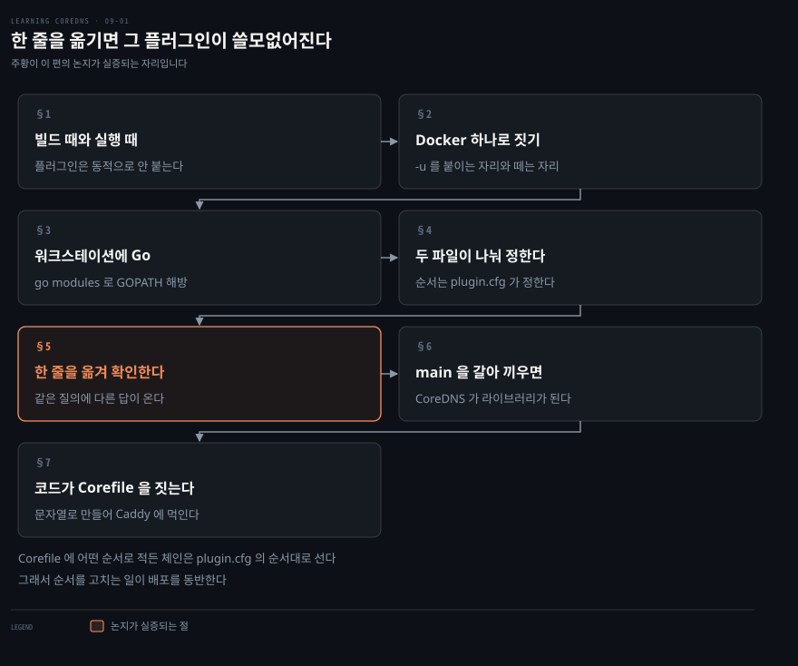
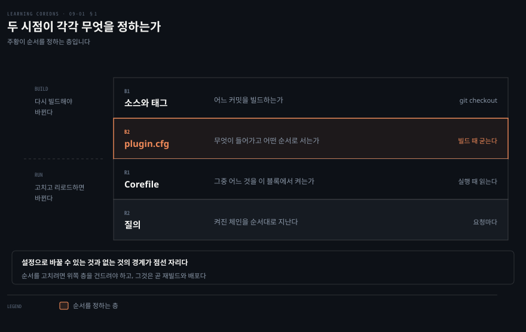
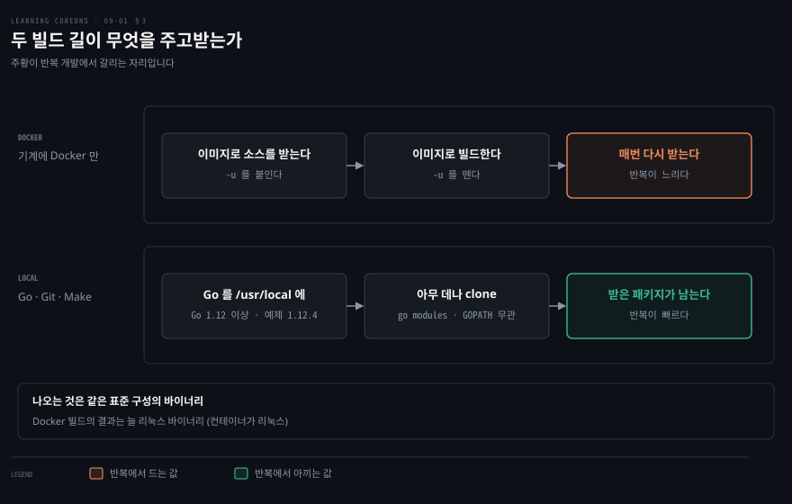
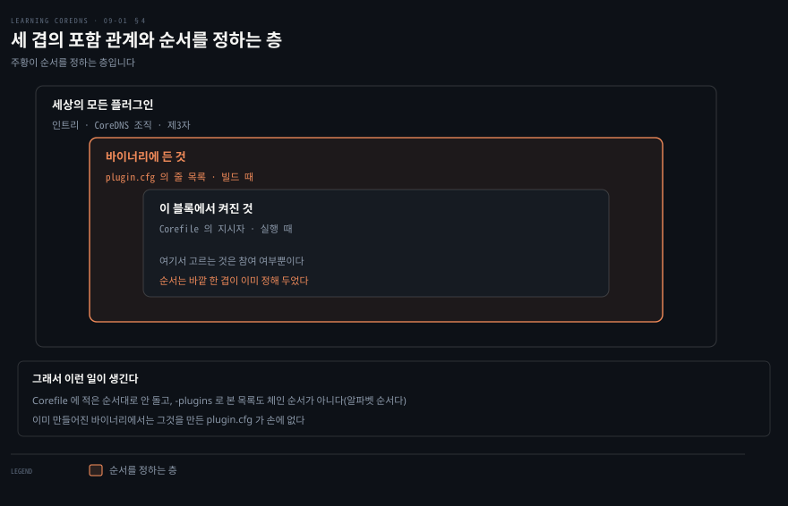
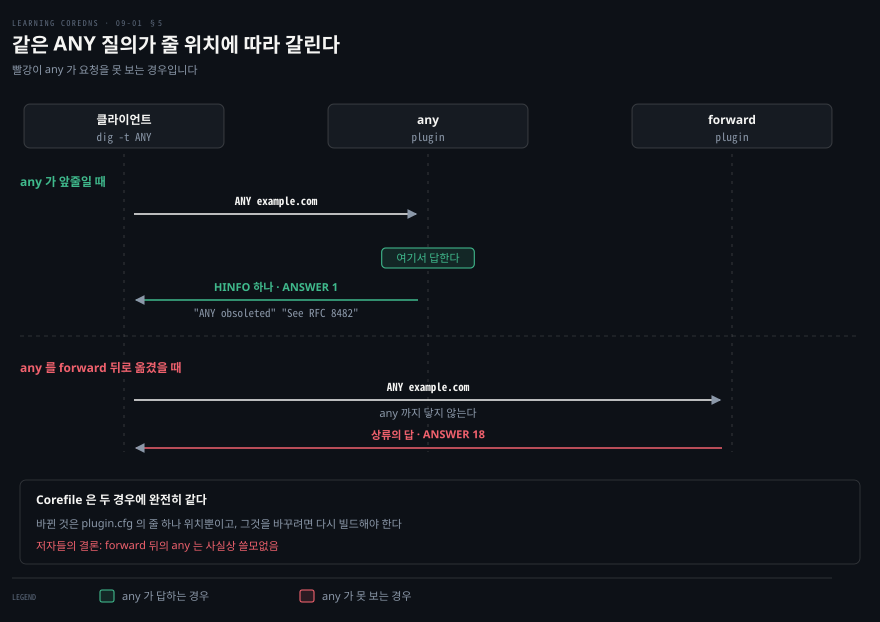
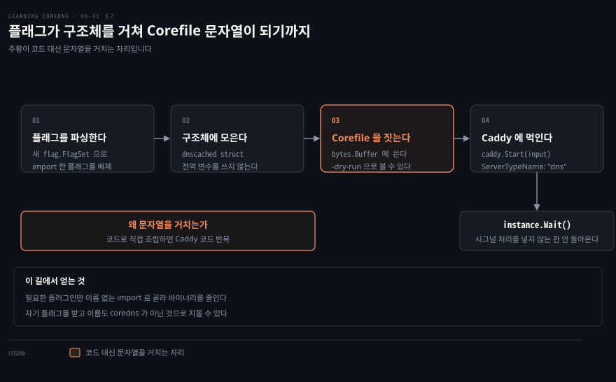

# 한 줄을 옮기면 그 플러그인이 쓸모없어진다

---

> 원서 9장 전반부는 남의 플러그인을 넣어 CoreDNS 를 다시 빌드하는 길과, CoreDNS 를 라이브러리로 삼아 자기 `main` 을 쓰는 길을 다룹니다. 두 길 모두 무엇을 바이너리에 넣을지 빌드 때 정하는 일입니다.

## 핵심 요약

> 플러그인 실행 순서는 Corefile 이 아니라 `plugin.cfg` 에서 정해집니다.

플러그인은 동적으로 적재되지 않고 빌드 때 컴파일됩니다. 따라서 외부 플러그인을 쓰려면 CoreDNS 를 다시 빌드해야 합니다.

Corefile 에 지시자를 어떤 순서로 적든 체인은 `plugin.cfg` 에 정의된 순서대로 동작합니다. 예컨대 `any` 플러그인을 `forward` 뒤로 옮기면 앞선 플러그인이 먼저 질의를 처리해 `any` 는 요청을 받지 못합니다.

표준 초기화 밖의 제어가 필요하면 CoreDNS 를 라이브러리로 가져다 자체 `main` 을 작성합니다. 필요한 플러그인만 import 해 바이너리를 줄일 수 있습니다.


## 학습 목표

이 내용을 읽고 나면:

1. 플러그인이 왜 재빌드를 요구하는지와 그것이 순서에 무엇을 뜻하는지 설명할 수 있습니다.
2. Docker 로 빌드하는 길과 워크스테이션에 Go 를 두고 빌드하는 길을 반복 횟수와 설치 부담으로 비교해 고를 수 있습니다.
3. Corefile 과 `plugin.cfg` 가 각각 무엇을 정하는지 가르고, `plugin.cfg` 한 줄의 위치가 체인의 어디에 대응하는지 말할 수 있습니다.
4. `main` 을 갈아 끼우는 길이 언제 필요한지와 그때 무엇을 얻는지 설명할 수 있습니다.
5. 자기 `main` 에서 새 `FlagSet` 과 Corefile 문자열을 쓰는 이유를 라이브러리 관점에서 설명할 수 있습니다.

아래는 이 문서 전체를 읽는 순서로 이은 지도입니다. 1절부터 5절까지가 `plugin.cfg` 를 고치는 길이고, 6절과 7절이 `main` 을 갈아 끼우는 길입니다.




## 이 문서가 다루지 않는 것

> 9장 전반부의 플러그인 빌드와 라이브러리 활용을 다룹니다.

- 플러그인을 직접 작성하는 법 → [네 함수를 구현하면 체인의 한 칸이 된다](./09-02.%EB%84%A4%20%ED%95%A8%EC%88%98%EB%A5%BC%20%EA%B5%AC%ED%98%84%ED%95%98%EB%A9%B4%20%EC%B2%B4%EC%9D%B8%EC%9D%98%20%ED%95%9C%20%EC%B9%B8%EC%9D%B4%20%EB%90%9C%EB%8B%A4.md)
- Corefile 문법과 서버 블록의 구조 → [Corefile은 라벨로 서버를 가른다](./03-01.Corefile%EC%9D%80%20%EB%9D%BC%EB%B2%A8%EB%A1%9C%20%EC%84%9C%EB%B2%84%EB%A5%BC%20%EA%B0%80%EB%A5%B8%EB%8B%A4.md)
- 각 플러그인이 하는 일 → 3~8장
- Go 언어 자체 → 커스텀 빌드를 만드는 데는 Go 개발자가 아니어도 됩니다. 플러그인을 직접 쓰는 후반부는 다릅니다

남는 것은 바이너리에 무엇이 어떤 순서로 들어가는가입니다.


## 1. 빌드 때 정해지는 것과 실행 때 정해지는 것

> 플러그인이 동적으로 붙지 않는다는 사실 하나가 이 장 전체의 전제입니다. 그래서 결정이 두 시점으로 갈립니다.



Corefile 에 지시자를 적어도 플러그인이 없거나 적은 순서대로 동작하지 않는 일이 생깁니다. 플러그인이 동적으로 적재되지 않고 빌드 때 컴파일되기 때문입니다. 표준 빌드에 없는 외부 플러그인을 쓰려면 CoreDNS 를 다시 빌드해야 합니다.

빌드 환경으로는 Docker 가 돌고 있으면 충분하며, Docker 를 쓰지 않는다면 Go·Git·Make 가 있어야 합니다. 이 편의 명령은 `v1.5.0` 태그와 Go 1.12 에 맞춘 것입니다. CoreDNS v1.15.0 빌드에는 Go 1.26 이상이 필요합니다.[^go1150]


## 2. Docker 하나로 짓는 길

> 기계에 Go 도 Git 도 없이 시작할 수 있습니다. 소스를 받는 일까지 컨테이너에 맡기면 됩니다.

`git` 이 들어 있는 `golang:1.12` 이미지로 저장소를 받아 오면 기계에는 Docker 말고 아무것도 없어도 됩니다.

```bash
docker run --rm -u $(id -u):$(id -g) -v $PWD:/go golang:1.12 \
    /bin/bash -c \
    "git clone https://github.com/coredns/coredns.git && \
    cd coredns && \
    git checkout v1.5.0"
```

현재 디렉터리를 컨테이너의 `/go` 로 마운트하고 저장소를 복제합니다. `-u $(id -u):$(id -g)` 옵션으로 컨테이너 안 사용자를 호스트 사용자와 맞춥니다. 이 옵션이 없으면 생성된 소스 파일이 `root` 소유가 되어 수정하기 어렵습니다.

빌드도 같은 이미지로 실행합니다.

```bash
cd coredns
docker run --rm -v $PWD:/coredns -w /coredns golang:1.12 make
```

빌드할 때는 `-u` 를 붙이지 않습니다. 빌드가 보통 사용자로는 만들 수 없는 자리에 디렉터리를 몇 개 만들기 때문입니다. 생성된 바이너리가 `root` 소유가 되지만 실행에는 문제가 없습니다.

컨테이너가 리눅스 환경이므로 호스트 OS 에 관계없이 리눅스 바이너리가 생성됩니다. 맥에서 돌릴 바이너리가 필요하다면 이 길로는 얻지 못합니다.


## 3. 워크스테이션에 Go 를 두는 길

> Docker 로도 되지만 고쳐 가며 빌드할 때 느립니다. 반복이 시작되면 로컬 Go 환경이 값을 합니다.



Docker 빌드는 매번 컨테이너를 새로 띄워 의존성을 다시 내려받으므로 반복 개발 시 느립니다.

Go 는 배포판 패키지가 충분히 최신이 아닐 수 있어 직접 받아 `/usr/local` 에 풉니다.

```bash
curl -s https://dl.google.com/go/go1.12.4.linux-amd64.tar.gz \
 | sudo tar -C /usr/local -xz
```

CoreDNS 는 Go 모듈을 사용하므로 소스 디렉터리를 `GOPATH` 외부에 두어도 빌드됩니다.

```bash
git clone https://github.com/coredns/coredns
```

```bash
cd coredns && git checkout v1.5.0 && make
```

이렇게 만든 바이너리는 기본 플러그인만 포함된 표준 바이너리입니다.


## 4. 두 파일이 각각 다른 것을 정한다

> Corefile 은 어느 플러그인을 켤지 정하고, `plugin.cfg` 는 무엇이 바이너리에 들어가고 어떤 순서로 서는지를 정합니다.



`plugin.cfg` 는 빌드 때 어떤 플러그인이 컴파일되어 들어갈지와 그 순서를 정의하는 설정 파일입니다.[^plugincfg1150] 한 줄에 지시자 이름과 패키지 경로가 콜론으로 이어집니다. 아래는 v1.5.0 의 `plugin.cfg` 입니다.

```bash
# Directives are registered in the order they should be
# executed.
#
# Ordering is VERY important. Every plugin will
# feel the effects of all other plugin below
# (after) them during a request, but they must not
# care what plugin above them are doing.

# How to rebuild with updated plugin configurations:
# Modify the list below and run `go gen && go build`

# The parser takes the input format of
#     <plugin-name>:<package-name>
# Or
#     <plugin-name>:<fully-qualified-package-name>
#
# External plugin example:
# log:github.com/coredns/coredns/plugin/log
# Local plugin example:
# log:log

metadata:metadata
cancel:cancel
tls:tls
reload:reload
nsid:nsid
root:root
bind:bind
```

`plugin.cfg` 를 수정한 뒤에는 `go generate` 로 지시자 순서를 담은 Go 소스를 새로 생성하고 `go build` 로 바이너리를 짓습니다. 주석의 `go gen` 은 `go generate` 를 뜻하며, `go` 명령에는 `gen` 이라는 하위 명령이 없어 그대로 치면 실패합니다. `Makefile` 도 빌드 전에 `go generate coredns.go` 를 부릅니다.[^plugincfg]

`plugin.cfg` 에 적힌 순서가 곧 체인의 실행 순서입니다. CoreDNS 는 플러그인을 동적으로 재정렬하지 못하므로, Corefile 의 지시자 순서와 관계없이 체인은 `plugin.cfg` 의 순서대로 동작합니다. 앞선 플러그인은 요청을 자기가 처리해 응답하거나 다음 플러그인에게 넘깁니다.

세 겹으로 정리하면 이렇습니다.

| 층 | 무엇이 정하나 | 언제 |
|----|--------------|------|
| 세상의 모든 플러그인 | 인트리와 외부를 합친 전부 | — |
| 바이너리에 든 것 | `plugin.cfg` 의 줄 목록 | 빌드 때 |
| 이 서버 블록에서 켜진 것 | Corefile 의 지시자 | 실행 때 |

순서는 가운데 층이 정합니다. 맨 아래 층은 참여 여부만 고릅니다.


## 5. 한 줄을 옮겨 그것을 확인한다

> `plugin.cfg` 에서 `any` 플러그인의 위치를 바꾸면 같은 질의에 다른 응답이 반환됩니다.



`any` 플러그인은 RFC 8482 를 구현해 ANY 질의를 폐기하고 최소 응답만 돌려주어 DNS 증폭 공격을 완화합니다.[^any1150] DNS 증폭 공격은 출발지 주소를 피해자 주소로 속인 작은 질의로 큰 응답이 피해자에게 쏟아지게 하는 공격입니다.

`any` 는 앞 절의 `v1.5.0` 에는 없고 v1.5.1 부터 기본 빌드에 들어 있으므로, 이 실험은 그 뒤 버전의 소스에서 합니다.[^any151] v1.15.0 의 `plugin.cfg` 에서 `any:any` 는 50번째 줄, `forward:forward` 는 77번째 줄이라 줄을 새로 넣지 않아도 `any` 가 ANY 질의를 먼저 받습니다.[^plugincfg1150]

`./coredns -plugins` 는 바이너리에 포함된 플러그인을 알파벳순으로 출력하므로 실제 체인 순서는 알 수 없습니다.[^plugins1150][^caddyplugins]

```bash
.:5300 {
  any
  log
  forward . 8.8.8.8
}
```

이 Corefile 로 서버를 띄우고 ANY 질의를 보냅니다.

```bash
dig -p 5300 -t ANY example.com @localhost
```

RFC 를 가리키는 `HINFO`(호스트 정보. 원래 호스트의 CPU 와 OS 종류를 적는 유형) 레코드 하나가 돌아옵니다.

```bash
example.com.    8482    IN    HINFO    "ANY obsoleted" "See RFC 8482"
```

`any` 가 `plugin.cfg` 에서 `forward` 보다 앞에 있으므로 질의를 직접 처리하고 다음 플러그인으로 넘기지 않습니다.

이제 `any` 한 줄을 `forward` 다음으로 옮기고 다시 빌드합니다. Corefile 은 그대로 둔 채 같은 질의를 보내면 응답이 열여덟 개 실려 돌아옵니다. `forward` 가 먼저 질의를 가로채 상류 DNS 에 전달하고 그 결과를 반환했기 때문입니다. 이렇게 빌드하면 거의 모든 플러그인이 `any` 보다 앞에 오므로 `any` 는 사실상 쓸모가 없습니다.

Corefile 만 보고 실행 순서를 추론하면 안 됩니다. 실제 순서는 바이너리를 빌드할 때 쓴 `plugin.cfg` 가 결정하며, `-plugins` 출력은 알파벳순일 뿐입니다. 외부 빌드를 쓴다면 빌드 시점의 `plugin.cfg` 를 함께 확보해야 합니다.


## 6. main 을 갈아 끼우면 라이브러리가 된다

> `plugin.cfg` 만 고쳐서는 표준 초기화 밖의 일을 할 수 없습니다. 그때는 CoreDNS 를 라이브러리로 가져다 자기 `main` 을 씁니다.

바이너리 크기 축소가 목적이라면 `plugin.cfg` 에서 불필요한 플러그인을 제외하고 표준 `main` 으로 빌드합니다. 표준 초기화 과정에 없는 로직을 끼워 넣거나 자체 플래그를 다루려면 CoreDNS 를 라이브러리로 가져와 자체 `main` 함수를 작성합니다. 이 경우 CoreDNS 는 그저 라이브러리입니다. 자기 명령줄 플래그를 받을 수 있고 이름도 `coredns` 가 아닌 것으로 지을 수 있습니다.

쿠버네티스의 NodeLocal DNSCache 가 대표적인 예입니다.[^nldstable136][^nodelocal] 노드마다 배치되는 전용 DNS 캐시로, CoreDNS 코어를 라이브러리로 쓰며 자체 `main` 에서 백그라운드 루틴을 띄웁니다.[^nldmain]

예제인 `dnscached` 는 Corefile 작성 없이 플래그만으로 동작하는 경량 캐싱 DNS 서버입니다.

```bash
package main

import (
        "fmt"
        "os"

        "github.com/mholt/caddy"
)

func init() {
        caddy.Quiet = true // don't show init stuff from caddy
        caddy.AppName = "dnscached"
        caddy.AppVersion = "1.0.0"
}

func main() {
        d := parseFlags()
        d.handleVersion()

        input, err := d.corefile()
        if err != nil {
                fmt.Fprintf(os.Stderr, err.Error())
                os.Exit(1)
        }

        d.handleDryRun(input)

        // Start the server
        instance, err := caddy.Start(input)
        if err != nil {
                fmt.Fprintf(os.Stderr, err.Error())
                os.Exit(1)
        }

        // Twiddle your thumbs
        instance.Wait()
}
```

`main` 의 흐름은 넷입니다.

1. 플래그를 파싱해 구조체를 만듭니다.
2. 그 구조체로 Corefile 을 메모리에 만듭니다.
3. 그 Corefile 로 서버를 띄웁니다.
4. 서버가 끝나기를 기다립니다. 특별한 시그널 처리를 넣지 않는 한 이 대기는 계속 유지됩니다.

`init` 함수는 `caddy.Quiet = true` 로 초기화 출력을 끄고 프로그램 이름과 버전을 등록합니다.

CoreDNS 는 Caddy 프레임워크 기반으로 설정, 시작, 리로드, 종료 등 수명주기를 관리합니다.

CoreDNS 는 Caddy 를 자체 조직(`github.com/coredns/caddy`)으로 포크해 사용합니다.[^caddy1150] `dns` 서버 타입도 이 포크에 등록되어 있습니다.[^dnsregister1150] 그래서 위 코드처럼 `mholt/caddy` 만 import 한 최소 프로그램은 빌드는 되지만, 실행하면 `no server types plugged in` 으로 끝납니다(2026-11-01 실행). 라이브러리로 쓸 때는 `github.com/coredns/caddy` 의 함수(`caddy.Start`, `instance.Wait`)를 호출합니다.


## 7. 플래그를 모아 Corefile 을 코드가 짓는다

> 자기 `main` 을 쓸 때 가장 실용적인 선택은 서버를 코드로 조립하지 않고 Corefile 문자열을 만들어 넘기는 것입니다.



`dnscached.go` 가 플래그를 다루고 Corefile 을 만듭니다.

import 목록에는 필요한 플러그인을 빈 식별자(`_ "패키지 경로"`)로 적습니다. 패키지의 `init()` 이 실행되면서 플러그인이 Caddy 에 자동 등록됩니다.

```bash
_ "github.com/coredns/coredns/plugin/bind"
_ "github.com/coredns/coredns/plugin/cache"
_ "github.com/coredns/coredns/plugin/errors"
_ "github.com/coredns/coredns/plugin/forward"
_ "github.com/coredns/coredns/plugin/log"
```

필요한 플러그인만 import 하면 바이너리 크기와 메모리 사용량이 줄어듭니다. 기본 플러그인 전체가 필요하다면 `github.com/coredns/coredns/core/plugin` 하나만 import 하면 됩니다.

### 플래그를 구조체에 담습니다

`parseFlags` 가 `dnscached` 구조체를 만들 때 두 가지 방식을 씁니다.

첫째, 플래그 값을 전역 변수 대신 구조체에 담아 그 플래그를 쓰는 테스트를 짓기 쉽게 만듭니다.

둘째, 새 `flag.FlagSet` 을 만들어 사용합니다. Caddy 나 외부 라이브러리가 기본 플래그 집합에 등록해 둔 플래그가 애플리케이션 플래그와 충돌하는 것을 방지하기 위해서입니다. 플래그 외에 위치 인자를 처리해야 한다면 `FlagSet.Usage` 도 직접 정의합니다.

### Corefile 은 문자열로 만듭니다

`corefile` 메서드는 버퍼에 설정 내용을 작성해 Corefile 문자열을 생성합니다. `-dry-run` 플래그로 생성 결과를 확인할 수 있습니다.

```bash
./dnscached -dry-run
```

```bash
.:5300 {
 errors
 bind 127.0.0.1 ::1
 cache 60 {
  success 9984
  denial 9984
  prefetch 10
 }
 forward . /etc/resolv.conf
}
```

코드로 서버를 직접 짓는 것은 쉽지 않고 Caddy 코드를 많이 반복하게 되므로, `caddy.Start` 에 Corefile 문자열을 넘기는 편이 단순합니다.

반환 객체는 `caddy.CaddyfileInput` 이며 세 필드로 구성됩니다.

- `Contents`: Corefile 의 바이트
- `Filepath`: 고정 문자열 `"<flags>"`. 디버깅용 출처 식별자입니다
- `ServerTypeName`: 반드시 `"dns"` 여야 합니다. Caddy 가 이 값을 보고 CoreDNS 서버를 생성합니다

`dnscached` 예제 저장소는 `github.com/coredns/caddy` 를 import 하도록 구성되어 있으며 `go build` 로 빌드합니다.[^repo]


## 결정 치트시트

> 무엇을 바꾸고 싶은지에서 시작해 길을 고릅니다.

| 하고 싶은 일 | 길 | 대가 |
|-------------|-----|------|
| 외부 플러그인 하나 추가 | `plugin.cfg` 에 한 줄 넣고 재빌드 | 넣을 줄 위치를 직접 정해야 합니다 |
| 바이너리 줄이기 | `plugin.cfg` 에서 안 쓰는 줄 삭제 | 나중에 필요해지면 다시 빌드해야 합니다 |
| 체인 순서 바꾸기 | `plugin.cfg` 의 줄 순서 변경 | Corefile 로는 안 됩니다 |
| 자기 플래그·초기화 넣기 | 자기 `main` 작성 | Caddy API 를 직접 다뤄야 합니다 |
| Go 없이 빌드 | Docker 이미지로 빌드 | 반복 개발이 느립니다 |
| 반복 빌드 | 워크스테이션에 Go 설치 | 환경을 갖춰야 합니다 |


## 적용 관점

> Spring 개발자에게 이 장이 낯설게 느껴지는 자리가 하나 있고, 익숙하게 느껴지는 자리가 하나 있습니다.

낯선 쪽은 재빌드입니다. Spring 에서 기능을 켜는 일은 대개 의존성을 하나 넣고 프로퍼티를 적는 일입니다. 자동 설정이 클래스패스를 보고 붙습니다. CoreDNS 에는 그 층이 없습니다. 클래스패스에 해당하는 것이 `plugin.cfg` 이고, 그것을 바꾸면 플러그인이 동적으로 적재되지 않으므로 반드시 다시 빌드해야 합니다.

익숙한 쪽은 순서입니다. Spring Security 의 필터 체인이나 서블릿 필터의 `@Order` 처럼, 요청이 체인을 지나며 앞쪽이 가로채면 뒤쪽은 보지 못하는 구조가 같습니다.

다른 것은 순서를 어디서 정하느냐입니다. Spring 은 런타임에 애너테이션이나 설정으로 정하지만, CoreDNS 는 빌드 때 파일 한 줄의 위치로 정합니다. 그래서 CoreDNS 에서는 순서를 고치는 일이 배포를 동반합니다.


## 면접에서 받을 만한 질문

1. CoreDNS 에서 외부 플러그인을 쓰려면 왜 재빌드가 필요합니까?
2. Corefile 의 지시자 순서를 바꾸면 체인 순서가 바뀝니까?
3. `plugin.cfg` 한 줄의 위치가 정하는 것은 무엇입니까?
4. `any` 플러그인을 `forward` 뒤에 두면 왜 쓸모가 없어집니까?
5. 사내 빌드에 넣은 외부 플러그인이 Corefile 에서는 `forward` 보다 위에 적혀 있는데 질의를 한 번도 받지 못합니다. 무엇부터 확인하겠습니까? `./coredns -plugins` 출력은 도움이 됩니까?
6. `main` 을 갈아 끼우는 길은 `plugin.cfg` 를 줄이는 길과 무엇이 다릅니까?
7. 자기 `main` 에서 새 `flag.FlagSet` 을 만드는 이유는 무엇입니까?
8. `caddy.CaddyfileInput` 의 세 필드 중 반드시 정해진 값이어야 하는 것은 무엇입니까?


## 정답 (자답 후 펼치기)

### 정답 1 — 동적 적재가 없습니다

플러그인은 동적으로 적재되지 않고 빌드 때 컴파일해 들어갑니다. 그래서 표준 빌드에 없는 플러그인을 쓰려면 그것을 포함해 다시 빌드해야 합니다.

### 정답 2 — 바뀌지 않습니다

Corefile 에 어떤 순서로 적든 체인은 `plugin.cfg` 의 순서대로 지어집니다. CoreDNS 는 플러그인을 동적으로 재정렬하지 못합니다.

### 정답 3 — 체인에서의 자리

그 플러그인이 요청을 언제 보는지를 정합니다. 위에 있을수록 먼저 보고, 먼저 본 플러그인이 응답하고 끝내면 아래는 그 요청을 보지 못합니다.

### 정답 4 — 앞의 것들이 먼저 가져갑니다

`forward` 가 먼저 요청을 가져가 상류에 묻고 답을 돌려주므로 `any` 에는 요청이 오지 않습니다. 거의 모든 플러그인이 그보다 앞에 오게 되어 사실상 쓸모가 없어집니다.

### 정답 5 — 그 빌드의 plugin.cfg

Corefile 의 순서는 체인 순서가 아니므로, 그 바이너리를 만든 `plugin.cfg` 에서 그 플러그인 줄이 `forward` 보다 아래에 있는지부터 봅니다. 아래에 있다면 `forward` 가 먼저 질의를 가져가 답하므로 그 플러그인은 요청을 보지 못합니다. `-plugins` 출력은 바이너리에 들어갔는지만 알려 줍니다. 목록이 알파벳 순서라 체인에서의 자리는 알 수 없습니다.

### 정답 6 — 목적이 다릅니다

`plugin.cfg` 를 줄이는 것은 바이너리를 줄이는 일이고 표준 `main` 을 그대로 씁니다. 자기 `main` 을 쓰는 것은 표준 초기화에 없는 작업을 끼워 넣는 일이고, 자기 플래그를 받고 이름을 다르게 지을 수도 있습니다.

### 정답 7 — import 한 코드의 플래그를 배제하려고

Caddy 나 쿠버네티스 client-go 같은 import 한 라이브러리가 자기 플래그를 등록해 둡니다. 새 `FlagSet` 을 만들지 않으면 그것들이 내 플래그와 섞여 혼란을 주거나 프로그램을 죽일 수 있습니다.

### 정답 8 — `ServerTypeName`

`"dns"` 여야 합니다. Caddy 가 이 값을 보고 CoreDNS 서버를 만들기 때문입니다. `Contents` 는 Corefile 바이트이고 `Filepath` 는 디버깅용이라 사람이 읽을 수 있으면 됩니다.


## 핵심 개념 체크리스트

- [ ] 플러그인이 동적으로 적재되지 않는다는 사실에서 재빌드와 고정된 순서가 함께 나온다는 것을 설명할 수 있는가?
- [ ] Docker 빌드와 워크스테이션 빌드를 반복 횟수와 설치 부담으로 비교하고, Docker 빌드에서 `-u` 를 붙이는 자리와 떼는 자리를 말할 수 있는가?
- [ ] Corefile 과 `plugin.cfg` 가 각각 정하는 것을 가르고, `any` 실험에서 줄 하나를 옮기면 왜 응답이 바뀌는지 말할 수 있는가?
- [ ] `main` 을 갈아 끼우는 길이 `plugin.cfg` 를 줄이는 길과 목적이 어떻게 다른지 설명할 수 있는가?
- [ ] 자기 `main` 에서 새 `flag.FlagSet` 을 만들고 Corefile 을 문자열로 짓는 이유, 그리고 `ServerTypeName` 이 `"dns"` 여야 하는 이유를 말할 수 있는가?


## 관련 문서

- [Learning CoreDNS 정독 인덱스](./README.md)
- [네 함수를 구현하면 체인의 한 칸이 된다](./09-02.%EB%84%A4%20%ED%95%A8%EC%88%98%EB%A5%BC%20%EA%B5%AC%ED%98%84%ED%95%98%EB%A9%B4%20%EC%B2%B4%EC%9D%B8%EC%9D%98%20%ED%95%9C%20%EC%B9%B8%EC%9D%B4%20%EB%90%9C%EB%8B%A4.md) — 9장 후반부, 플러그인을 직접 쓰는 법
- [플러그인 일곱이면 서버 하나가 선다](./03-02.%ED%94%8C%EB%9F%AC%EA%B7%B8%EC%9D%B8%20%EC%9D%BC%EA%B3%B1%EC%9D%B4%EB%A9%B4%20%EC%84%9C%EB%B2%84%20%ED%95%98%EB%82%98%EA%B0%80%20%EC%84%A0%EB%8B%A4.md) — 3장이 먼저 말한 "처리 순서는 빌드 때 고정된다"의 근거가 이 편입니다
- [무엇을 볼지 좁히는 손잡이가 도구마다 다르다](./08-01.%EB%AC%B4%EC%97%87%EC%9D%84%20%EB%B3%BC%EC%A7%80%20%EC%A2%81%ED%9E%88%EB%8A%94%20%EC%86%90%EC%9E%A1%EC%9D%B4%EA%B0%80%20%EB%8F%84%EA%B5%AC%EB%A7%88%EB%8B%A4%20%EB%8B%A4%EB%A5%B4%EB%8B%A4.md)


## 참고 자료

- 원서: 《Learning CoreDNS: Configuring DNS for Cloud Native Environments》 9장 Building a Custom Server 전반부
- 서지: John Belamaric·Cricket Liu, O'Reilly, 2019년, ISBN 978-1492047964

[^go1150]: CoreDNS v1.15.0 `go.mod` 3~5번째 줄과 `.go-version`·`Makefile` — "// Note this minimum version requirement. CoreDNS supports the last two // Go versions. This follows the upstream Go project support. go 1.26.0", `.go-version` 은 "1.27.3", `Makefile:18` "export GOTOOLCHAIN = go$(GOLANG_VERSION)" <https://github.com/coredns/coredns/blob/v1.15.0/go.mod#L3-L5>
[^plugincfg]: CoreDNS `plugin.cfg` v1.15.0 — 머리 주석 ``"run `go generate && go build`"``, `Makefile` 의 `go generate coredns.go`. <https://github.com/coredns/coredns/blob/v1.15.0/plugin.cfg>
[^repo]: 저자들의 예제 저장소 — 설명은 `Examples and code from the O'Reilly "Learning CoreDNS" book.` 이고 최상위에 `dnscached`·`plugins` 두 디렉터리. `dnscached/main.go` 는 38줄이며 `github.com/coredns/caddy` 를 import 합니다. <https://github.com/coredns/learning-coredns/blob/master/dnscached/main.go>
[^caddyplugins]: coredns/caddy `plugins.go` — `str += name[4:] + "\n" // drop dns. prefix caddy adds`. <https://github.com/coredns/caddy/blob/v1.1.4/plugins.go#L56-L68>
[^nodelocal]: Kubernetes 문서 「Using NodeLocal DNSCache in Kubernetes Clusters」 — `feature-state for_k8s_version="v1.18" state="stable"`. <https://github.com/kubernetes/website/blob/release-1.36/content/en/docs/tasks/administer-cluster/nodelocaldns.md?plain=1#L13>
[^caddy1150]: CoreDNS v1.15.0 `go.mod` 19번째 줄 — "github.com/coredns/caddy v1.1.4". <https://github.com/coredns/coredns/blob/v1.15.0/go.mod#L19>
[^any151]: CoreDNS `plugin.cfg` — v1.5.0 에는 `any` 줄이 없고(`cancel:cancel` 23번째 줄, `forward:forward` 55번째 줄), v1.5.1 은 38번째 줄이 `any:any` (2026-11-02 조회) <https://github.com/coredns/coredns/blob/v1.5.1/plugin.cfg#L38>
[^plugincfg1150]: CoreDNS v1.15.0 `plugin.cfg` — 84줄, 엔트리 62개. 7~8번째 줄 "run `go generate && go build`", 22번째 줄 "root:root", 50번째 줄 "any:any", 60번째 줄 "# Keep tls here so dnssec can sign ACME challenge records before authoritative backends run.", 77번째 줄 "forward:forward", 81번째 줄 "on:github.com/coredns/caddy/onevent" <https://github.com/coredns/coredns/blob/v1.15.0/plugin.cfg>
[^any1150]: CoreDNS v1.15.0 `plugin/any/any.go` 24~25번째 줄 — "Ttl: 8482" 와 "Cpu: "ANY obsoleted", Os: "See RFC 8482"" <https://github.com/coredns/coredns/blob/v1.15.0/plugin/any/any.go#L24-L25>
[^plugins1150]: coredns/caddy v1.1.4 `plugins.go` — 62번째 줄 "str += name[4:] + "\n" // drop dns. prefix caddy adds", 108번째 줄 "sort.Strings(others)", `DescribePlugins`(56~68번째 줄)는 `pl["others"]` 만 돈다. 그리고 `coremain/run.go:68-69` "if plugins { fmt.Println(caddy.DescribePlugins())" <https://github.com/coredns/caddy/blob/v1.1.4/plugins.go#L56-L68>
[^nldstable136]: Kubernetes 문서 `release-1.36` 「Using NodeLocal DNSCache in Kubernetes Clusters」 13번째 줄 — "" <https://github.com/kubernetes/website/blob/release-1.36/content/en/docs/tasks/administer-cluster/nodelocaldns.md?plain=1#L13>
[^nldmain]: `kubernetes-sigs/node-local-dns` `cmd/node-cache/main.go` — 26번째 줄 "corednsmain "github.com/coredns/coredns/coremain"", 30번째 줄 ""github.com/coredns/caddy"", 142~143번째 줄 "func main() {" 와 "cache.RunApp()". 같은 커밋의 `cmd/node-cache/app/cache_app.go` 274~276번째 줄은 "func (c *CacheApp) RunApp() {", "go c.runPeriodic()", "coremain.Run()" <https://github.com/kubernetes-sigs/node-local-dns/blob/d8b43598f209cfbc24c2ba1962aaf6cbf4769eaa/cmd/node-cache/main.go#L142-L143>
[^dnsregister1150]: CoreDNS v1.15.0 `core/dnsserver/register.go` — 10번째 줄 `"github.com/coredns/caddy"`, 19번째 줄 `const serverType = "dns"`, 37번째 줄 `caddy.RegisterServerType(serverType, caddy.ServerType{`. <https://github.com/coredns/coredns/blob/v1.15.0/core/dnsserver/register.go#L19-L37>
