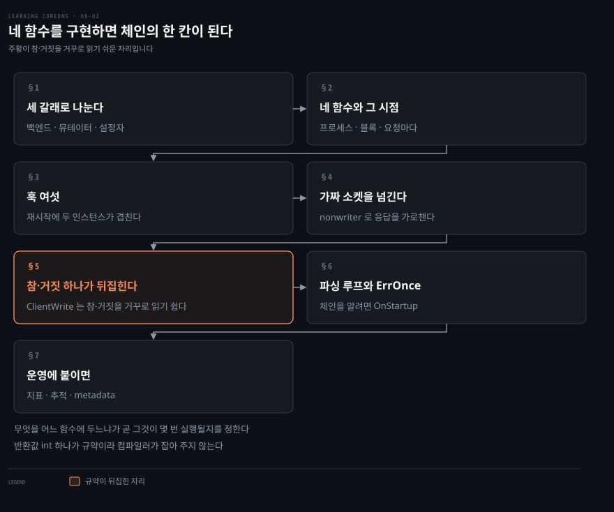
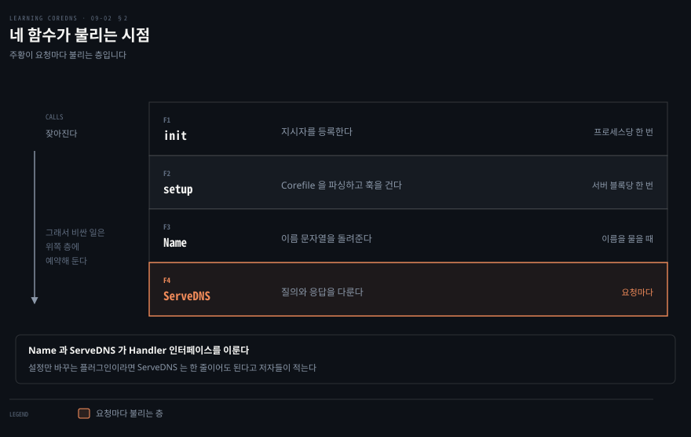
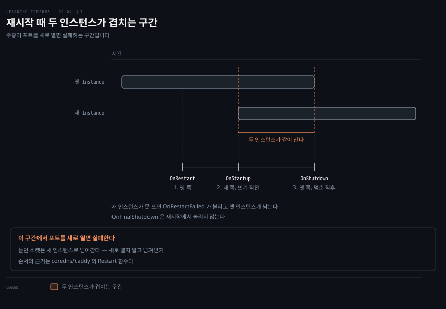
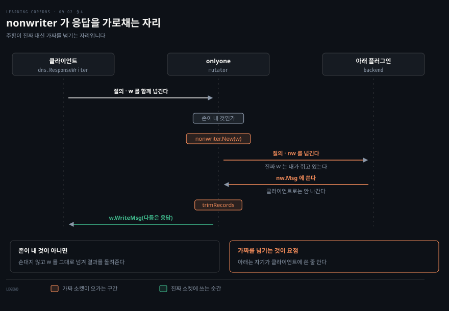
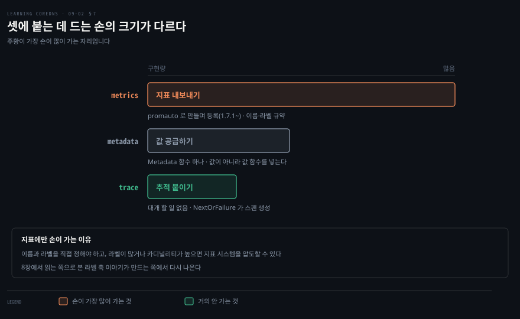

# 네 함수를 구현하면 체인의 한 칸이 된다

---

> 원서 9장 후반부는 플러그인을 직접 작성하는 법을 다룹니다. 구현할 것은 함수 넷뿐이지만, 그 넷이 각각 체인의 다른 시점에 불립니다.

## 핵심 요약

> 이 편이 매달린 하나의 생각은 플러그인을 쓰는 일이 체인의 한 칸이 되어 그 칸의 규약을 지키는 일이라는 것입니다.

CoreDNS 플러그인은 `init`·`setup`·`Name`·`ServeDNS` 넷만 구현하면 됩니다. 설정만 바꾸는 플러그인이라면 `ServeDNS` 는 한 줄이어도 됩니다.

넷이 불리는 시점이 다릅니다. `init` 은 프로세스가 뜰 때 한 번, `setup` 은 Corefile 을 파싱하며 서버 블록마다 한 번, `ServeDNS` 는 요청마다입니다. 그래서 무엇을 어느 함수에 둘지가 곧 실행 빈도를 정합니다.

뒷사람의 응답을 고치려면 체인 아래로 요청을 넘길 때 `nonwriter` 라는 가짜 `ResponseWriter` 를 대신 넘깁니다. 아래가 쓴 응답이 클라이언트로 나가지 않고 내 손에 남으므로, 그것을 고쳐 진짜 소켓에 쓰면 됩니다.

다만 `plugin.ClientWrite` 의 참·거짓은 거꾸로 읽기 쉬운 규약이어서, 반대로 구현하면 응답을 두 번 쓰거나 아예 쓰지 않게 됩니다.


## 학습 목표

이 내용을 읽고 나면:

1. 플러그인이 구현해야 할 네 함수와 각각이 불리는 시점을 말하고, 백엔드·뮤테이터·설정자 중 어느 갈래인지로 구현량을 가늠할 수 있습니다.
2. Caddy 생명주기 훅 여섯 중 재시작에서 무엇이 어떤 순서로 불리는지 구분할 수 있습니다.
3. `nonwriter` 가 왜 필요한지와 어떻게 쓰는지 설명할 수 있습니다.
4. `plugin.ClientWrite` 가 무엇을 뜻하는지 정확히 말할 수 있습니다.
5. 파싱 루프로 지시자 반복을 막는 법과, 체인을 알아야 하는 일을 `OnStartup` 으로 미루는 이유를 설명할 수 있습니다.

아래는 이 문서 전체를 읽는 순서로 이은 지도입니다. 1절부터 3절까지가 뼈대이고, 4절부터 6절까지가 예제 플러그인, 7절이 운영에 붙이는 일입니다.




## 이 문서가 다루지 않는 것

> 이 편은 9장의 후반부입니다.

- 외부 플러그인을 넣어 재빌드하는 법과 `main` 갈아 끼우기 → [한 줄을 옮기면 그 플러그인이 쓸모없어진다](./09-01.%ED%95%9C%20%EC%A4%84%EC%9D%84%20%EC%98%AE%EA%B8%B0%EB%A9%B4%20%EA%B7%B8%20%ED%94%8C%EB%9F%AC%EA%B7%B8%EC%9D%B8%EC%9D%B4%20%EC%93%B8%EB%AA%A8%EC%97%86%EC%96%B4%EC%A7%84%EB%8B%A4.md)
- `metadata` 플러그인을 쓰는 쪽 이야기 → [질문과 답이 어긋나면 클라이언트가 버린다](./07-01.%EC%A7%88%EB%AC%B8%EA%B3%BC%20%EB%8B%B5%EC%9D%B4%20%EC%96%B4%EA%B8%8B%EB%82%98%EB%A9%B4%20%ED%81%B4%EB%9D%BC%EC%9D%B4%EC%96%B8%ED%8A%B8%EA%B0%80%20%EB%B2%84%EB%A6%B0%EB%8B%A4.md)
- Prometheus 지표를 읽는 쪽 → [무엇을 볼지 좁히는 손잡이가 도구마다 다르다](./08-01.%EB%AC%B4%EC%97%87%EC%9D%84%20%EB%B3%BC%EC%A7%80%20%EC%A2%81%ED%9E%88%EB%8A%94%20%EC%86%90%EC%9E%A1%EC%9D%B4%EA%B0%80%20%EB%8F%84%EA%B5%AC%EB%A7%88%EB%8B%A4%20%EB%8B%A4%EB%A5%B4%EB%8B%A4.md)
- Go 문법 전반 → 이 노트는 CoreDNS 쪽 규약만 다루고, 필요한 Go 개념은 2절에서 Java 대응으로 한 줄씩만 짚습니다


## 1. 세 갈래로 나누고 하나만 잘한다

> 플러그인을 쓰기 전에 자기 것이 어느 갈래인지 정하면 구현할 것이 정해집니다. 갈래마다 `ServeDNS` 가 하는 일이 다릅니다.

DNS 요청과 응답을 직접 조작하려면 플러그인을 작성해야 합니다.

플러그인의 역할은 크게 셋으로 나뉩니다.

- **백엔드**: 원본에서 데이터를 제공합니다. 파일·외부 데이터베이스·다른 API 일 수도 있고 아예 지어낼 수도 있습니다. `file` 과 `kubernetes` 가 대표적입니다
- **뮤테이터**: 들어오는 요청이나 나가는 응답, 또는 둘 다를 고칩니다. `rewrite` 가 대표적이며, 캐시 계열도 아래쪽 플러그인에서 데이터를 가져오므로 뮤테이터로 볼 수 있습니다
- **설정자**: CoreDNS 의 내부 동작만 바꿉니다. `bind` 와 `log` 가 그렇습니다

한 플러그인이 여러 역할을 겸할 수도 있지만, 재사용성을 위해 단일 역할을 권장합니다.

이 분류는 구현량을 가늠하는 기준이 됩니다. 설정자라면 `ServeDNS` 가 한 줄이어도 되고 백엔드는 응답을 지어 쓰면 됩니다. 뮤테이터는 뒤 플러그인의 응답을 가로채야 하므로 손이 가장 많이 갑니다.


## 2. 네 함수가 각각 다른 시점에 불린다

> 구현할 것은 넷뿐입니다. 그런데 그중 셋이 불리는 횟수가 프로세스당 한 번, 서버 블록당 한 번, 요청당 한 번으로 갈립니다.



무엇을 어디에 두어야 하는지 헷갈리는 것이 처음 쓸 때의 문제입니다. 원격 서버에 연결을 여는 코드를 `ServeDNS` 에 두면 요청마다 연결이 열립니다. 판단 기준은 각 함수가 몇 번 불리느냐입니다.

`init` 은 그 이름대로 플러그인의 일회성 초기화를 합니다. Caddy 나 CoreDNS 의 함수가 아니라 표준 Go 패키지 초기화 함수입니다. 플러그인에서는 대개 지시자를 등록하고 그것을 `setup` 함수와 엮는 일만 합니다.

인트리 플러그인은 `init` 에서 `plugin.Register` 로 지시자를 등록합니다.[^register] 이것은 `caddy.RegisterPlugin` 을 감싼 함수라, `github.com/coredns/caddy` 를 import 해 `caddy.RegisterPlugin` 을 직접 불러도 동작은 같습니다.

```bash
func init() {
        caddy.RegisterPlugin("onlyone", caddy.Plugin{
                ServerType: "dns",
                Action:     setup,
        })
}
```

`setup` 은 Corefile 에서 플러그인 설정을 파싱합니다. 그 플러그인이 나타나는 서버 블록마다 정확히 한 번씩 불립니다. `foo.com bar.com { ... }` 처럼 한 블록이 존 여럿에 걸쳐도 블록의 첫 존에 대해서만 불립니다. 나머지 존은 첫 존의 플러그인과 설정을 복사해 같은 인스턴스를 나눠 씁니다[^caddyfirst][^propagate].

각 서버 블록은 코드에서 `Config` 객체로 표현되며, `setup` 은 그 객체에 `Handler` 를 더해 플러그인 체인에 자기를 끼워 넣습니다. 적어도 백엔드와 뮤테이터 플러그인은 그렇습니다.

한 서버 블록 안에 같은 지시자가 여러 번 나올 수도 있습니다. 그때 `setup` 은 그 블록에 있는 자기 지시자 전부의 데이터를 받습니다. 다른 블록의 것은 받지 않고 별도 호출로 처리됩니다.

Java 로 옮기면 이렇습니다. Go 의 인터페이스는 `implements` 를 적지 않아도 메서드 모양이 맞으면 구현한 것으로 봅니다. `func (o *onlyone) ServeDNS(...)` 의 `(o *onlyone)` 은 리시버로, Java 메서드의 `this` 를 앞에 드러내 적은 것입니다. `context.Context` 는 요청 하나에 딸린 마감 시각과 취소 신호, 요청 범위 값을 싣고 호출 사슬을 따라 내려가는 인자입니다.

`Name` 과 `ServeDNS` 는 `Handler` 인터페이스를 구현합니다. `Name` 은 이름 문자열 하나를 돌려주는 것이 전부이고, `ServeDNS` 가 백엔드와 뮤테이터의 심장입니다.


## 3. 훅 여섯 중 재시작에 불리는 것을 안다

> 원격 연결이나 포트를 여는 플러그인이라면 재시작을 잘못 다루는 순간 포트를 뺏깁니다. `setup` 에서 훅을 걸어 그것을 다룹니다.



원격 연결 같은 일회성 준비는 `setup` 에서 하되, 대개 `caddy.Controller` 의 생명주기 훅으로 콜백을 만들어 합니다. `setup` 은 Corefile 파싱 중에 반복해서 불릴 수 있어서 연결이 몇 개 열릴지 알 수 없기 때문입니다.

| 훅 | 언제 불리나 |
|----|------------|
| `OnFirstStartup` | 서버 시작 직전. 프로세스 시작 때 딱 한 번. 첫 인스턴스에만 불리고 재시작으로 만들어지는 인스턴스에는 안 불립니다 |
| `OnStartup` | 서버 시작 직전. 최초 시작과 재시작 모두 |
| `OnRestart` | 서버 시작 직전. 재시작일 때만 |
| `OnRestartFailed` | 재시작이 실패했을 때 |
| `OnShutdown` | 재시작과 프로세스 종료 모두. 프로세스 종료 때는 서버 정지 직전[^sigterm], 재시작 경로에서는 옛 인스턴스를 멈춘 직후에 불립니다 |
| `OnFinalShutdown` | 서버 정지 직전. 프로세스 종료일 때만 |

### 재시작 때 두 인스턴스가 함께 삽니다

CoreDNS 가 `SIGUSR1` 을 받으면 Corefile 을 다시 읽고 서버를 우아하게 재시작합니다. 내부에서 새 Corefile 로 새 `caddy.Instance` 가 만들어지고, 듣고 있던 소켓의 파일 디스크립터가 그쪽으로 넘어갑니다.

서버에 연결을 열거나 로컬 포트를 여는 플러그인이라면 재시작 이벤트를 다뤄야 합니다. 열린 포트를 새로 열려고 하면 이미 사용 중이어서 실패하므로, 기존 소켓을 넘겨받아야 합니다.

`SIGHUP` 으로는 재시작되지 않습니다. Caddy 의 신호 처리 코드는 `SIGHUP` 을 받아도 무시하고 `SIGUSR1` 에서 Corefile 을 다시 읽습니다.[^sighup]

재시작 때 Caddy 의 `Restart` 는 옛 인스턴스의 `OnRestart` 를 먼저 부르고, 넘겨받은 소켓으로 새 인스턴스를 띄운 뒤(새 인스턴스의 `OnStartup` 호출), 옛 인스턴스를 멈추며 그 `OnShutdown` 을 부릅니다.[^restart] 이 순서 때문에 두 인스턴스가 함께 떠 있는 구간이 생깁니다. `OnFinalShutdown` 은 재시작에서 불리지 않습니다.


## 4. 뒷사람의 응답을 고치려면 가짜 소켓을 넘긴다

> 뮤테이터는 자기 뒤 플러그인이 만든 응답을 고쳐야 합니다. 그런데 뒤 플러그인은 응답을 클라이언트 소켓에 그냥 써 버립니다.



`ServeDNS` 는 DNS 요청과 응답 소켓 참조를 받습니다. 그 소켓에 응답을 쓸 수도 있고 요청을 다음 플러그인에게 넘길 수도 있습니다. 백엔드라면 간단합니다. 질의를 보고 레코드를 만들어 넘겨받은 `ResponseWriter` 에 쓰면 됩니다.

뮤테이터는 그렇지 않습니다. 체인 뒤쪽 플러그인이 만든 응답을 고쳐야 하는데, 그냥 넘기면 그 플러그인이 클라이언트에게 직접 써 버려 손댈 기회가 없습니다.

그래서 진짜 소켓 대신 가짜를 넘깁니다. `nonwriter` 라는 `ResponseWriter` 구현이 그것입니다. 패키지는 `github.com/coredns/coredns/plugin/pkg/nonwriter` 입니다[^nonwriter]. 아래 플러그인이 거기에 쓴 응답은 밖으로 나가지 않고 그 객체의 `Msg` 필드에 남습니다.

`onlyone` 은 응답에 같은 유형의 레코드가 여럿일 때 유형마다 하나씩만 남기고 잘라 내는 뮤테이터입니다. A 레코드가 다섯 개 실린 응답이 오면 클라이언트에게는 A 레코드 하나만 전달됩니다.

```bash
onlyone [ZONES...] {
    types TYPES
}
```

`types` 는 잘라 낼 유형을 정하고 생략하면 A 와 AAAA 입니다. `ZONES` 를 생략하면 서버 블록의 존을 씁니다.

`ServeDNS` 의 뼈대가 네 걸음입니다.

```bash
state := request.Request{W: w, Req: r}

if plugin.Zones(o.zones).Matches(state.Name()) == "" {
        return plugin.NextOrFailure(o.Name(), o.Next, ctx, w, r)
}

nw := nonwriter.New(w)
rcode, err := plugin.NextOrFailure(o.Name(), o.Next, ctx, nw, r)
if err != nil {
        return rcode, err
}

w.WriteMsg(o.trimRecords(nw.Msg))
return rcode, err
```

`request.Request` 는 다양한 편의 메서드를 제공하는 구조체이며, 변수명을 `state` 로 두는 것이 인트리 플러그인의 관행입니다.

다음으로 질문의 이름이 이 플러그인이 맡은 존 안에 드는지 봅니다. 안 들면 손대지 않고 `plugin.NextOrFailure` 로 다음 플러그인에게 넘긴 결과를 그대로 돌려줍니다.

`Matches` 는 참·거짓이 아니라 맞은 존 가운데 가장 구체적인 것의 이름을 돌려주고, 맞는 존이 없으면 빈 문자열을 돌려줍니다.[^matches] 그래서 위 코드가 `Matches(state.Name()) == ""` 로 빈 문자열과 비교합니다.

일치하는 경우에만 `nonwriter.New(w)` 로 가짜를 만들어 다음 플러그인에 넘깁니다. 오류 없이 반환되면 응답은 `nw.Msg` 에 담겨 있으므로, 이를 다듬어 원래의 진짜 `ResponseWriter` 에 `WriteMsg` 로 씁니다.


## 5. 참·거짓 하나가 규약을 뒤집는다

> `ServeDNS` 가 돌려주는 정수는 응답을 이미 썼는지를 앞쪽 플러그인과 서버에게 알리는 신호입니다. 참·거짓 하나를 거꾸로 읽으면 그 신호가 뒤집힙니다.

응답을 이미 쓴 플러그인과 아직 안 쓴 플러그인을 위쪽에서 구분하지 못하면 응답이 두 번 나가거나 아예 안 나갑니다. 그 구분을 반환값 하나가 맡습니다.

`ServeDNS` 는 값을 둘 돌려줍니다. `int` 와 `error` 입니다. 오류는 보통의 Go 오류이고, 오류가 났다면 사용자에게 도움이 되고 `errors` 플러그인이 기록할 정보를 담아 돌려줘야 합니다.

정수 반환값은 응답 코드(`dns.RcodeSuccess` 등 타입 없는 `int` 상수)입니다. 이 값은 응답이 클라이언트 소켓에 이미 쓰였는지를 서버와 앞쪽 플러그인에 알리는 신호이며, 판정은 `plugin.ClientWrite` 가 맡습니다.

참·거짓 규약은 소스에 이렇게 적혀 있습니다.

```bash
// ClientWrite returns true if the response has been written to the client.
// Each plugin to adhere to this protocol.
func ClientWrite(rcode int) bool {
	switch rcode {
	case dns.RcodeServerFailure:
		fallthrough
	case dns.RcodeRefused:
		fallthrough
	case dns.RcodeFormatError:
		fallthrough
	case dns.RcodeNotImplemented:
		return false
	}
	return true
}
```

`ClientWrite` 가 `true` 를 반환하면 응답을 이미 클라이언트에 썼다는 뜻입니다.[^clientwrite] `SERVFAIL`·`REFUSED`·`FORMERR`·`NOTIMP` 넷만 `false` 를 반환하며, 이들이 응답을 아직 쓰지 않은 경우입니다.

서버는 `if !plugin.ClientWrite(rcode)` 일 때만 오류 응답을 대신 씁니다.[^callsite]

이 규약이 위험한 것은 조용히 틀리기 때문입니다. 참·거짓을 거꾸로 알고 구현하면 이미 쓴 응답을 한 번 더 쓰거나, 아직 안 쓴 실패 응답을 아무도 안 쓰게 됩니다. 컴파일은 통과하고 대부분의 정상 질의에서는 티가 나지 않다가 실패 경로에서만 어긋납니다.

이 네 코드는 플러그인이 답을 만들지 못한 경우입니다. 쓸 응답이 없으므로 직접 쓰지 않고 서버나 상위 플러그인이 대신 오류 응답을 쓰도록 `false` 로 규약되어 있습니다.


## 6. 파싱 루프와 한 번만 쓰이게 하는 법

> `setup` 이 받는 `caddy.Controller` 는 지시자를 훑는 커서입니다. 그 커서를 어떻게 도는지가 같은 지시자를 여러 번 쓸 수 있는지를 정합니다.

Corefile 에서 같은 지시자의 중복 허용 여부는 파싱 루프를 어떻게 제어하느냐에 달려 있습니다.

`onlyone` 의 `parse` 뼈대만 남기면 이렇습니다.

```bash
func parse(c *caddy.Controller) (*onlyone, error) {
        o := &onlyone{types: typeMap{dns.TypeA: true, dns.TypeAAAA: true}, pick: rand.Intn}
        found := false
        for c.Next() {
                // onlyone should just be in the server block once
                if found {
                        return nil, plugin.ErrOnce
                }
                found = true
                args := c.RemainingArgs()
                ...
                for c.NextBlock() {
                        switch c.Val() {
                        case "types":
                                args := c.RemainingArgs()
                                ...
                        default:
                                return nil, fmt.Errorf("invalid option %q", c.Val())
                        }
                }
        }
        return o, nil
}
```

`parse` 함수가 두 겹의 루프를 돕니다. 바깥의 `c.Next` 루프가 이 지시자의 등장을 훑고, 안쪽의 `c.NextBlock` 루프가 중괄호 블록 안의 하위 지시자를 훑습니다.

`c.Next` 는 `true` 를 돌려줄 수 있고 그러면 루프를 한 번 더 돕니다. 서버 블록에 `onlyone` 지시자가 여러 번 나오면 그것들이 다 소비될 때까지 `true` 를 돌려줍니다. 안쪽의 `c.NextBlock` 루프는 지시자 뒤에 중괄호 블록이 붙었을 때만 들어갑니다. 들어가면 닫는 중괄호에 닿을 때까지 한 줄씩 도는데, 줄에 남은 토큰을 `c.RemainingArgs` 로 소비해 줘야 그렇게 됩니다.

`onlyone` 처럼 블록당 한 번만 허용해야 하는 플러그인은 `found` 플래그로 중복을 감지해 `plugin.ErrOnce` 오류를 반환합니다.

파싱이 끝나면 `setup` 은 `GetConfig(c).AddPlugin` 에 핸들러 인스턴스가 아닌 핸들러 생성 함수를 넘깁니다. Corefile 파싱 시점에는 아직 실제 플러그인 체인이 인스턴스화되지 않으므로, 다음 플러그인을 나중에 주입하기 위해서입니다.

따라서 체인에 어떤 플러그인이 존재하는지 알아야 하는 플러그인(`metadata`·`metrics`·`ready` 등)은 `OnStartup` 훅을 사용해야 합니다. 파싱 시점에는 `plugin.cfg` 상 뒤에 오는 플러그인을 확인할 수 없습니다.

### 직접 돌려 보려면

만든 플러그인을 CoreDNS 에 넣는 절차는 [9장 전반부](./09-01.%ED%95%9C%20%EC%A4%84%EC%9D%84%20%EC%98%AE%EA%B8%B0%EB%A9%B4%20%EA%B7%B8%20%ED%94%8C%EB%9F%AC%EA%B7%B8%EC%9D%B8%EC%9D%B4%20%EC%93%B8%EB%AA%A8%EC%97%86%EC%96%B4%EC%A7%84%EB%8B%A4.md) 의 `any` 와 같습니다. `plugin.cfg` 의 알맞은 자리에 `onlyone:github.com/coredns/learning-coredns/plugins/onlyone` 한 줄을 넣고 다시 빌드합니다. 빌드할 때 Go 가 그 모듈을 GitHub 에서 내려받아, 내 워크스테이션에서 고친 코드가 들어가지 않습니다. 그래서 CoreDNS 의 `go.mod` 에 `replace` 지시문을 더해 로컬 디렉터리를 쓰게 합니다.

```bash
replace github.com/coredns/learning-coredns/plugins/onlyone => /home/learning-coredns/plugins/onlyone
```

경로는 예시이고, 자기 플러그인이 있는 디렉터리로 바꿔 적습니다. 이렇게 두면 코드를 고치고 다시 빌드하는 것만으로 바뀐 동작을 볼 수 있습니다.


## 7. 운영에 붙이면 인트리와 같아진다

> 지표·추적·metadata 셋에 붙이는 일이 남습니다. 셋 중 둘은 손이 거의 안 갑니다.



운영에 올리면 플러그인이 얼마나 불리는지도 어디서 느린지도 밖에서 보이지 않습니다.

셋에 붙여 그 사각을 없앱니다. 지표는 `prometheus` 플러그인에, 타이밍은 `trace` 플러그인에, 로깅·추적·정책에 쓸 값은 `metadata` 플러그인에 붙입니다.

지표는 표준 Prometheus 클라이언트 라이브러리를 사용하며, `promauto` 로 메트릭을 생성하면서 곧바로 등록하므로 별도의 `OnStartup` 등록 훅이 필요 없습니다.[^tmplmetrics]

```bash
templateMatchesCount = promauto.NewCounterVec(prometheus.CounterOpts{
        Namespace: plugin.Namespace,
        Subsystem: "template",
        Name:      "matches_total",
        Help:      "Counter of template regex matches.",
}, []string{"server", "zone", "view", "class", "type"})
```

규약이 셋입니다.

- `Namespace`: `plugin.Namespace` 를 씁니다
- `Subsystem`: 플러그인 이름을 씁니다
- `Name`: 자유롭게 짓되 Prometheus 프로젝트의 관례를 따릅니다

관례의 요점은 넷입니다.

- 라벨 값이 달라도 같은 것을 재야 합니다
- 단위를 모든 경우에 일관되게 써야 합니다
- 이름 끝에 복수형 단위를 붙이는 편이 좋습니다
- 기본 단위를 쓰는 편이 좋습니다 — 시간은 초, 메모리는 바이트, 누적은 total 입니다

라벨이 너무 많거나 카디널리티(라벨이 가질 수 있는 서로 다른 값의 수)가 높은 값을 사용하면 저장 데이터가 급증해 지표 시스템에 과부하를 줄 수 있습니다.

추적은 대부분의 플러그인에서 별도 코드를 작성할 필요가 없습니다. 다음 플러그인을 호출하는 `plugin.NextOrFailure` 가 플러그인마다 새 Span(작업 한 구간의 시작과 끝을 기록하는 단위)을 자동으로 생성합니다.

metadata 는 함수 하나입니다. `metadata.Provider` 인터페이스를 구현하면 되고, 그 인터페이스에는 `Metadata` 함수 하나뿐입니다. `context.Context` 와 `request.Request` 를 받아 `context.Context` 를 돌려줍니다.[^provider]

```bash
func (p *myplugin) Metadata(ctx context.Context,
        state request.Request) context.Context {
    metadata.SetValueFunc(ctx, "myplugin/foo", func() string {
         return state.Name()
    })
    return ctx
}
```

이 동작은 지연 평가(lazy evaluation)로 설계되어 있습니다. `metadata` 플러그인은 `OnStartup` 에서 `metadata.Provider` 를 구현한 공급자 목록을 구성하고[^mdsetup], 존에 맞는 요청마다 각 공급자의 `Metadata` 함수를 호출합니다. 공급자 수와 요청 수가 곱해지는 잦은 호출 경로이므로, 미리 값을 계산하지 않고 값을 구하는 함수를 `Context` 에 등록합니다. 소비자가 해당 키를 참조하지 않으면 계산 함수는 실행되지 않습니다.

그렇게 넣은 값은 7장에서 본 `{/LABEL}` 로 꺼내 씁니다.

```bash
log foo.example "Query: {name} {class} {type} {/myplugin/foo}"
```


## 결정 치트시트

> 무엇을 만들지에서 시작해 구현할 것을 고릅니다.

| 만들려는 것 | `ServeDNS` 가 하는 일 | 더 필요한 것 |
|------------|---------------------|-------------|
| 설정자 | 거의 없음. 한 줄이어도 됩니다 | `setup` 에서 설정만 |
| 백엔드 | 질의로 레코드를 짓고 `w` 에 씁니다 | 데이터 원본 연결은 `OnStartup` 훅에서 |
| 뮤테이터 | `nonwriter` 로 받아 고쳐 진짜 `w` 에 씁니다 | 존 매칭으로 남의 질의는 그냥 넘기기 |
| 같은 블록에 한 번만 | — | `found` 검사 + `plugin.ErrOnce` |
| 체인의 다른 플러그인을 알아야 함 | — | `OnStartup` 훅. 파싱 시점에는 알 수 없습니다 |
| 지표 내보내기 | — | `promauto` 로 생성과 동시에 등록 |
| metadata 제공 | — | `Metadata` 함수 하나 · 값이 아니라 값 함수를 넣기 |


## 적용 관점

> Spring 으로 미들웨어를 짜 본 사람에게 이 편은 대부분 낯익고, 한 자리만 낯섭니다.

낯익은 쪽은 체인과 래핑입니다. `ServeDNS` 가 다음 것을 부르고 그 결과를 고치는 구조는 서블릿 필터의 `chain.doFilter` 전후에 손대는 것과 같습니다.

짝을 지어 보면 이렇습니다.

- `nonwriter`: `HttpServletResponseWrapper`
- `plugin.ErrOnce`: 같은 필터를 두 번 등록했을 때의 방어
- `OnStartup`: `SmartLifecycle.start()` — 둘 다 시작 단계에서, 요청을 받기 전에 불립니다

`plugin.ClientWrite` 는 이름부터 헷갈림을 부릅니다. 이름만 보면 "클라이언트에 써라" 라는 명령처럼 읽히지만 실제로는 "클라이언트에 이미 썼는가" 를 묻는 함수입니다.

낯선 쪽은 반환값이 규약이라는 점입니다. 서블릿 필터는 응답을 썼는지를 반환값으로 알리지 않습니다. CoreDNS 는 `int` 하나로 그것을 알리고, 그 해석을 `plugin.ClientWrite` 가 맡습니다. 5절의 규약이 위험한 이유가 여기 있습니다. 타입은 그냥 `int` 라서 컴파일러가 아무것도 잡아 주지 않습니다.

직접 플러그인을 작성하지 않더라도 외부 플러그인을 검토할 때 유용합니다. `nonwriter` 사용 여부, `ClientWrite` 규약 준수, 존 매칭을 통한 불필요한 질의 가로채기 방지 여부를 판단하는 기준이 됩니다.


## 면접에서 받을 만한 질문

1. CoreDNS 플러그인이 구현해야 할 네 함수는 무엇이고 각각 몇 번 불립니까?
2. 백엔드·뮤테이터·설정자는 무엇이 다릅니까?
3. 뮤테이터가 `nonwriter` 를 쓰는 이유는 무엇입니까?
4. `plugin.ClientWrite` 가 `true` 를 돌려주면 무슨 뜻입니까?
5. `ClientWrite` 가 `false` 를 돌려주는 네 응답 코드의 공통점은 무엇입니까?
6. 재시작 때 두 `caddy.Instance` 가 함께 사는 구간에서 무엇을 조심해야 합니까?
7. 체인의 다른 플러그인을 알아야 하는 플러그인은 왜 `OnStartup` 을 써야 합니까?
8. `Metadata` 함수가 값이 아니라 함수를 넣는 이유는 무엇입니까?
9. `foo.com bar.com { onlyone }` 서버 블록 하나에서 `setup` 은 몇 번 불리고, `setup` 안에서 연결을 하나씩 여는 플러그인은 어떻게 됩니까?


## 정답 (자답 후 펼치기)

### 정답 1 — 넷과 그 시점

`init` 은 프로세스가 뜰 때 한 번, `setup` 은 그 지시자가 나오는 서버 블록마다 한 번, `Name` 은 이름을 물을 때, `ServeDNS` 는 요청마다 불립니다.

### 정답 2 — 데이터를 주느냐 고치느냐 설정만 바꾸느냐

백엔드는 원본에서 데이터를 제공합니다. 뮤테이터는 요청이나 응답이나 둘 다를 고칩니다. 설정자는 CoreDNS 의 내부 동작만 바꿉니다. 한 플러그인이 여러 역할을 겸할 수도 있지만, 재사용성을 위해 단일 역할을 권장합니다.

### 정답 3 — 아래가 클라이언트에게 직접 쓰기 때문

진짜 `ResponseWriter` 를 그대로 넘기면 아래 플러그인이 응답을 클라이언트에게 써 버려 고칠 기회가 없습니다. `nonwriter` 를 대신 넘기면 그 응답이 밖으로 나가지 않고 `Msg` 필드에 남아 손댈 수 있습니다.

### 정답 4 — 이미 썼다는 뜻

`plugin.ClientWrite` 의 문서 주석에 명시되어 있듯이 `true` 는 응답이 이미 클라이언트에 쓰였음을 뜻합니다.

### 정답 5 — 답을 만들지 못한 경우

`SERVFAIL`·`REFUSED`·`FORMERR`·`NOTIMP` 넷입니다. 전부 플러그인이 답을 만들지 못한 경우라 쓸 응답도 없고, 그래서 위쪽의 누군가가 대신 오류 응답을 써 줘야 합니다.

### 정답 6 — 포트를 새로 열지 말 것

재시작은 옛 인스턴스의 `OnRestart`, 새 인스턴스의 `OnStartup`, 옛 인스턴스의 `OnShutdown` 순서로 흐르므로 그 사이에 두 인스턴스가 함께 떠 있습니다. 듣고 있던 소켓의 파일 디스크립터가 새 인스턴스로 넘어갑니다. 열린 포트를 새로 열려고 하면 이미 쓰이는 포트라 실패하므로, 넘겨받는 쪽으로 다뤄야 합니다.

### 정답 7 — 파싱 시점에는 체인이 없기 때문

`setup` 은 Corefile 파싱 중에 불리고, 실제 체인은 내부 `dns.Server` 가 만들어질 때까지 인스턴스화되지 않습니다. 그래서 파싱 시점에 물으면 `plugin.cfg` 에서 자기보다 뒤에 오는 것들을 놓칠 수 있습니다.

### 정답 8 — 안 쓰이면 계산하지 않으려고

`Metadata` 는 요청마다 `metadata.Provider` 를 구현한 모든 플러그인에 대해 불리므로 빨라야 합니다. 값 대신 값 함수를 넣어 두면, 소비자가 그 값을 끝내 쓰지 않을 때 함수가 한 번도 불리지 않습니다.

### 정답 9 — 블록의 첫 존에서 한 번

첫 존에 대해서만 지시자를 설정하고 나머지 존에는 그 설정을 복사하므로 `setup` 은 한 번만 불립니다. 따라서 `setup` 안에서 연결을 열면 연결이 하나만 생성되어 두 존이 공유합니다. 서버 블록 파싱 횟수에 의존하지 않고 생명주기 훅으로 자원 생성 시점을 제어하는 것이 안전합니다.


## 핵심 개념 체크리스트

- [ ] 네 함수가 각각 몇 번 불리는지 말하고, 만들려는 플러그인이 백엔드·뮤테이터·설정자 중 어디인지로 구현량을 가늠할 수 있는가?
- [ ] 재시작 때 `OnRestart`·`OnStartup`·`OnShutdown` 이 어느 인스턴스에서 어떤 순서로 불리는지, 그래서 왜 포트를 넘겨받아야 하는지 말할 수 있는가?
- [ ] 뮤테이터가 `nonwriter` 를 넘기는 이유와, 존 매칭에 실패한 질의를 그냥 넘기는 이유를 설명할 수 있는가?
- [ ] `plugin.ClientWrite` 의 `true` 가 무엇을 뜻하고 `false` 를 받는 네 응답 코드의 공통점이 무엇인지 말할 수 있는가?
- [ ] `found` 와 `plugin.ErrOnce` 로 반복을 막는 법과, 체인을 알아야 하는 일을 `OnStartup` 으로 미루는 이유를 설명할 수 있는가?


## 관련 문서

- [Learning CoreDNS 정독 인덱스](./README.md)
- [한 줄을 옮기면 그 플러그인이 쓸모없어진다](./09-01.%ED%95%9C%20%EC%A4%84%EC%9D%84%20%EC%98%AE%EA%B8%B0%EB%A9%B4%20%EA%B7%B8%20%ED%94%8C%EB%9F%AC%EA%B7%B8%EC%9D%B8%EC%9D%B4%20%EC%93%B8%EB%AA%A8%EC%97%86%EC%96%B4%EC%A7%84%EB%8B%A4.md) — 9장 전반부. 6절의 `OnStartup` 이야기가 그 편의 논지와 맞물립니다
- [질문과 답이 어긋나면 클라이언트가 버린다](./07-01.%EC%A7%88%EB%AC%B8%EA%B3%BC%20%EB%8B%B5%EC%9D%B4%20%EC%96%B4%EA%B8%8B%EB%82%98%EB%A9%B4%20%ED%81%B4%EB%9D%BC%EC%9D%B4%EC%96%B8%ED%8A%B8%EA%B0%80%20%EB%B2%84%EB%A6%B0%EB%8B%A4.md) — `metadata` 를 쓰는 쪽
- [무엇을 볼지 좁히는 손잡이가 도구마다 다르다](./08-01.%EB%AC%B4%EC%97%87%EC%9D%84%20%EB%B3%BC%EC%A7%80%20%EC%A2%81%ED%9E%88%EB%8A%94%20%EC%86%90%EC%9E%A1%EC%9D%B4%EA%B0%80%20%EB%8F%84%EA%B5%AC%EB%A7%88%EB%8B%A4%20%EB%8B%A4%EB%A5%B4%EB%8B%A4.md) — 라벨 카디널리티를 읽는 쪽


## 참고 자료

- 원서: 《Learning CoreDNS: Configuring DNS for Cloud Native Environments》 9장 Building a Custom Server 후반부
- 서지: John Belamaric·Cricket Liu, O'Reilly, 2019년, ISBN 978-1492047964

[^clientwrite]: CoreDNS 소스 `plugin/plugin.go` — `"// ClientWrite returns true if the response has been written to the client. // Each plugin to adhere to this protocol."` 와 `false` 를 돌려주는 네 rcode. <https://github.com/coredns/coredns/blob/v1.15.0/plugin/plugin.go#L137-L151>
[^provider]: CoreDNS 소스 `plugin/metadata/provider.go` — `Metadata(ctx context.Context, state request.Request) context.Context`. <https://github.com/coredns/coredns/blob/v1.15.0/plugin/metadata/provider.go#L48-L52>
[^callsite]: CoreDNS 소스 `core/dnsserver/server.go` — `if !plugin.ClientWrite(rcode) { errorFunc(s.Addr, w, r, rcode) }`. <https://github.com/coredns/coredns/blob/v1.15.0/core/dnsserver/server.go#L450-L452>
[^register]: CoreDNS 소스 `plugin/register.go` — `func Register(name string, action caddy.SetupFunc) { caddy.RegisterPlugin(name, caddy.Plugin{ServerType: "dns", Action: action}) }`, import 은 `github.com/coredns/caddy`. <https://github.com/coredns/coredns/blob/v1.15.0/plugin/register.go#L3-L11>
[^caddyfirst]: coredns/caddy `caddy.go` — `// only set up directives for the first key in a block` `if j > 0 { continue }`, 커밋 "init plugins only for first zone in block (#1)"(2021-05-12). <https://github.com/coredns/caddy/blob/v1.1.4/caddy.go#L653-L656>
[^propagate]: CoreDNS 소스 `core/dnsserver/register.go` — `propagateConfigParams` 가 `c.Plugin = c.firstConfigInBlock.Plugin` 으로 같은 블록의 다른 존에 첫 존의 설정을 복사합니다. <https://github.com/coredns/coredns/blob/v1.15.0/core/dnsserver/register.go#L289-L295>
[^sighup]: coredns/caddy `sigtrap_posix.go` — `case syscall.SIGHUP: // ignore; this signal is sometimes sent outside of the user's control`, 다시 읽는 쪽은 `case syscall.SIGUSR1: log.Println("[INFO] SIGUSR1: Reloading")`. <https://github.com/coredns/caddy/blob/v1.1.4/sigtrap_posix.go#L101-L102> · <https://github.com/coredns/caddy/blob/v1.1.4/sigtrap_posix.go#L55-L56>
[^restart]: coredns/caddy `caddy.go` 의 `Restart` — `for _, fn := range i.OnRestart` → `startWithListenerFds(newCaddyfile, newInst, restartFds)`(그 안에서 `inst.OnStartup` 실행) → `i.Stop()` → `for _, shutdownFunc := range i.OnShutdown`. <https://github.com/coredns/caddy/blob/v1.1.4/caddy.go#L185-L271>
[^sigterm]: coredns/caddy `sigtrap_posix.go` 의 `SIGTERM` 처리 — `exitCode := executeShutdownCallbacks("SIGTERM")` 뒤에 `err := Stop()`. 콜백은 `ShutdownCallbacks` 가 `OnShutdown` 다음 `OnFinalShutdown` 순서로 부른다. <https://github.com/coredns/caddy/blob/v1.1.4/sigtrap_posix.go#L41-L47> · <https://github.com/coredns/caddy/blob/v1.1.4/caddy.go#L165-L180>
[^matches]: CoreDNS 소스 `plugin/normalize.go` — `// Matches checks if qname is a subdomain of any of the zones in z. The match will return the most specific zones that matches. The empty string signals a not found condition.` `func (z Zones) Matches(qname string) (zone string)`. <https://github.com/coredns/coredns/blob/v1.15.0/plugin/normalize.go#L23-L26>
[^nonwriter]: CoreDNS 소스 `plugin/pkg/nonwriter/nonwriter.go` — `package nonwriter`, `func New(w dns.ResponseWriter) *Writer { return &Writer{ResponseWriter: w} }`. <https://github.com/coredns/coredns/blob/v1.15.0/plugin/pkg/nonwriter/nonwriter.go#L15>
[^tmplmetrics]: CoreDNS 소스 `plugin/template/metrics.go` — `templateMatchesCount = promauto.NewCounterVec(...)`, 라벨 `[]string{"server", "zone", "view", "class", "type"}`. <https://github.com/coredns/coredns/blob/v1.15.0/plugin/template/metrics.go#L12-L17>
[^mdsetup]: CoreDNS 소스 `plugin/metadata/setup.go` — `if met, ok := p.(Provider); ok { m.Providers = append(m.Providers, met) }`. <https://github.com/coredns/coredns/blob/v1.15.0/plugin/metadata/setup.go#L24-L26>
